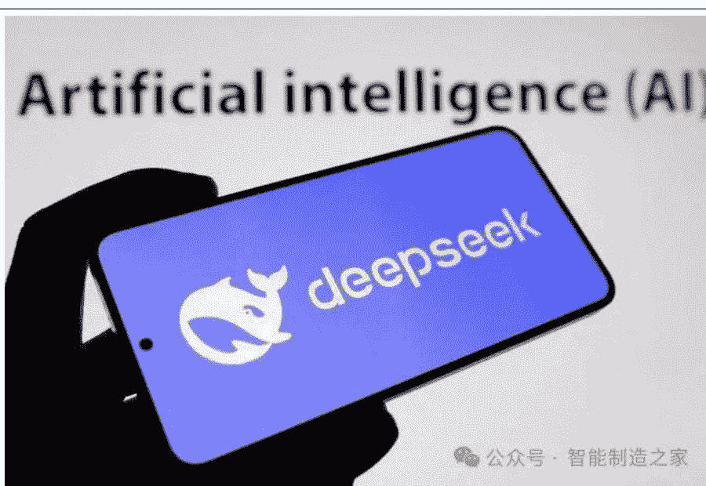
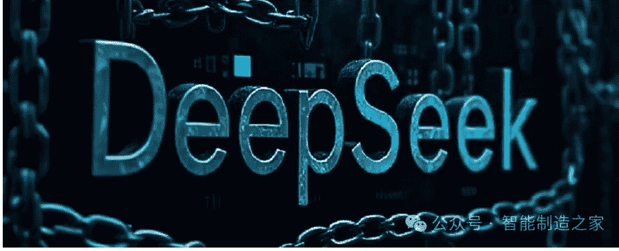
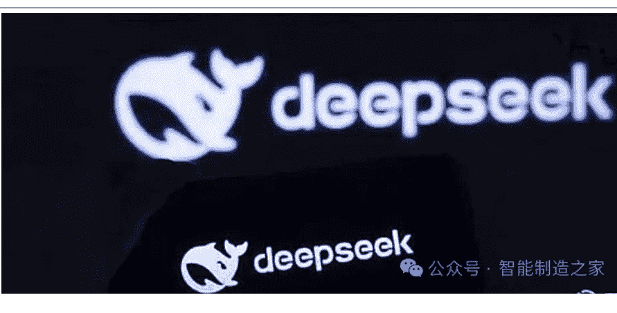
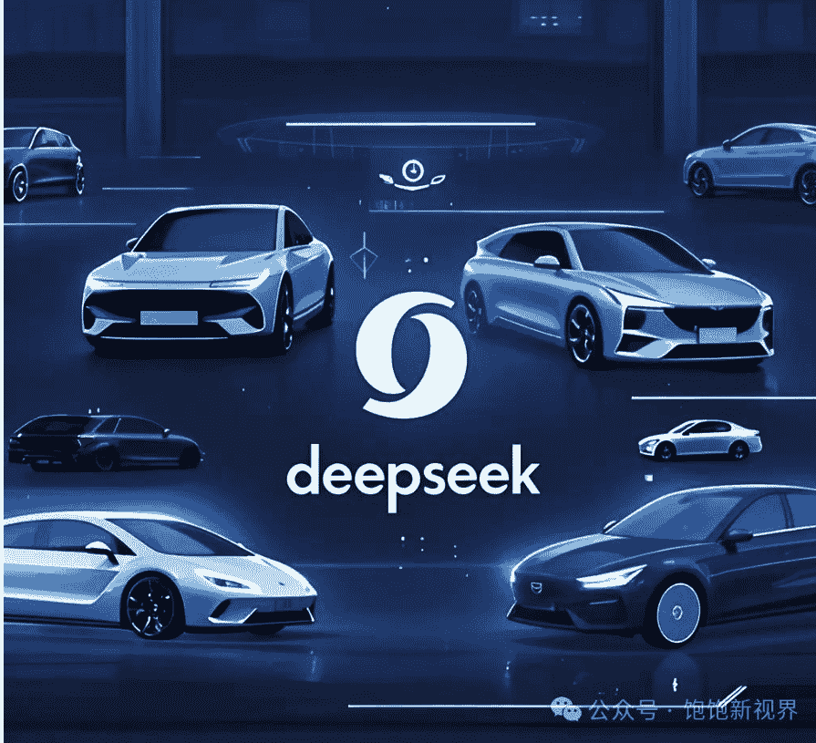
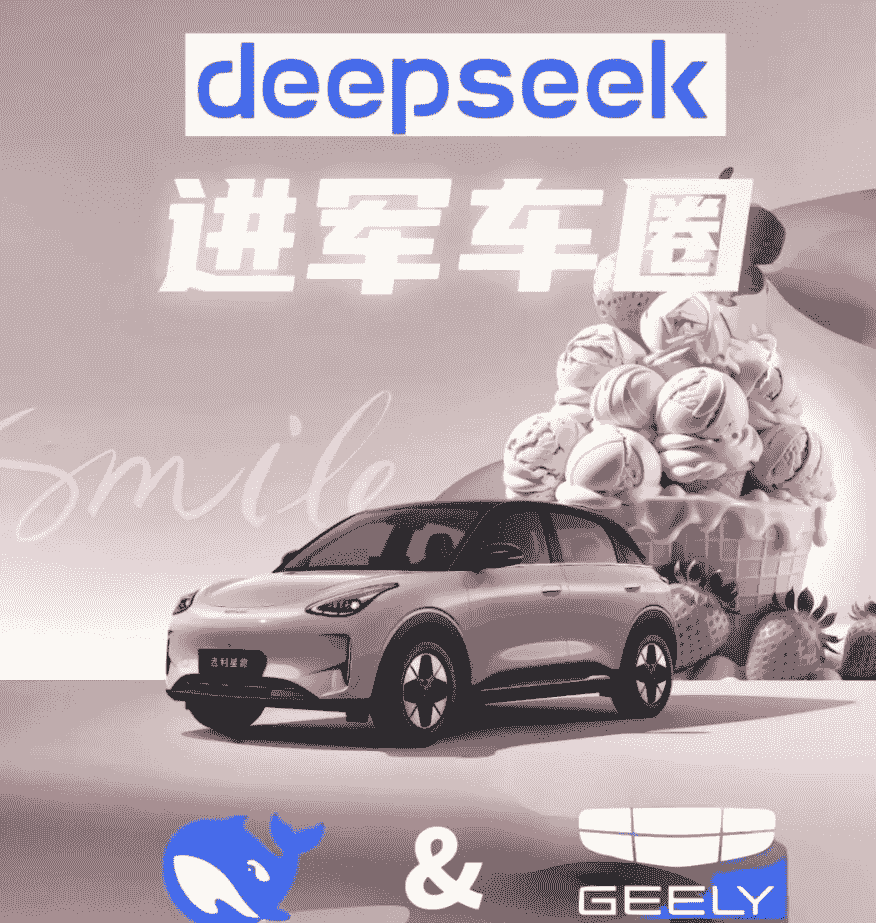
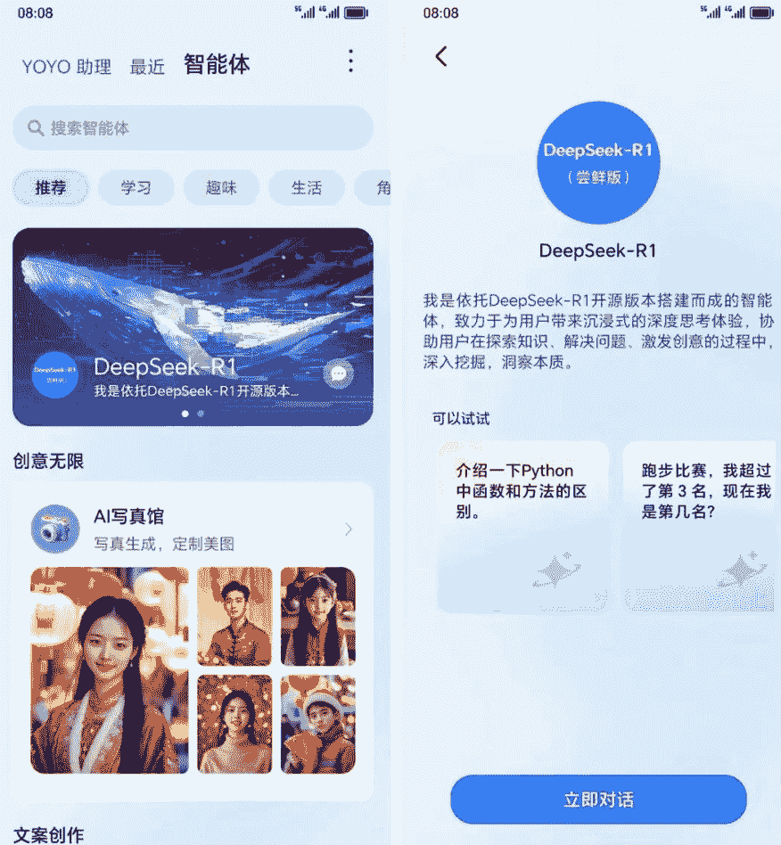
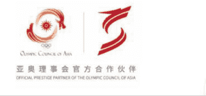
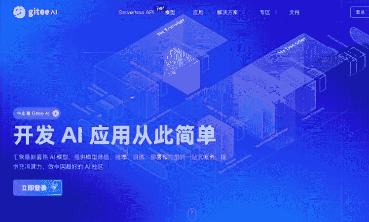
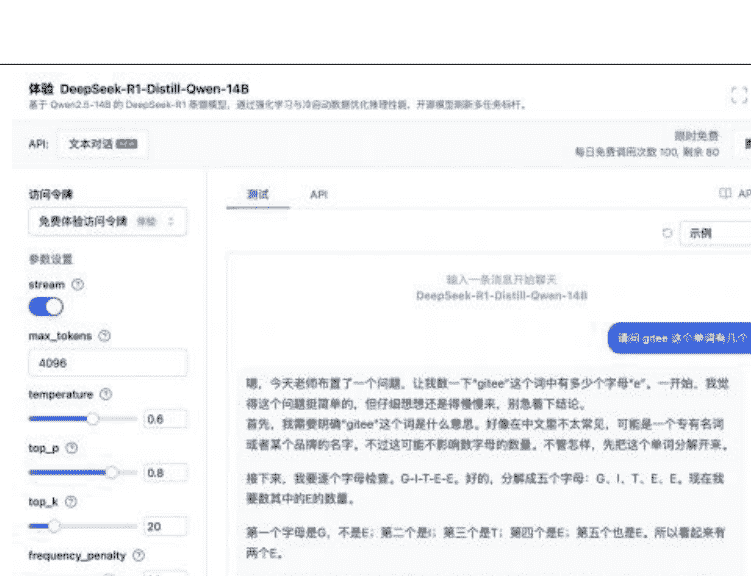
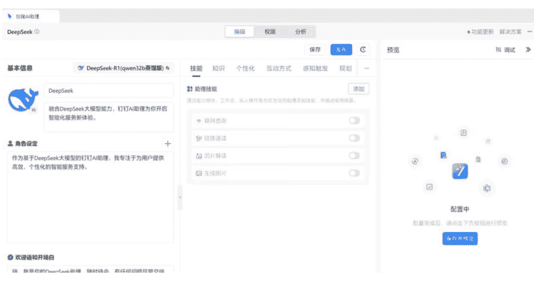

# 浙江大学 信息技术中心
INFORMATION TECHNOLOGY CENTER.
ZHEJIANG UNIVERSITY

# DEEPSEEK

# 行业应用案例集

解锁智能变革密码

# 免费 价值 及时 专注

## 扫码加入 知识星球TOP 免费资源群

- 每日免费获取有价值资源
- 可提供各类资源搜索服务

| 热门付费文章 | 各行行业报告 |
| 精选图书资源 | 副业赚钱方法 |
| 职场实用资源 | AI政经自媒体 |

公众号:知识星球TOP 微信号: jnttsg8 微信号: jnttsg2

分享资料仅供个人学习，请及时删除，切勿商用传播

DeepSeek 行业案例集: 解锁智能变革密码

# 目录

- 一、简介 ........................................................................................................ 1
- 二、行业案例 ................................................................................................... 1
  - 1 农业 ........................................................................................................ 1
  - 2 制造业 ................................................................................................... 10
    - 2.1 汽车行业 ............................................................................................... 24
    - 2.2 手机行业 ................................................................................................... 51
    - 2.3 智能家居 ............................................................................................... 60
  - 3 交通运输、仓储和邮政业 ................................................................................ 65
  - 4 信息传输、软件和信息技术服务业 ................................................................ 75
    - 4.1 办公 ...................................................................................................... 91
    - 4.2 网络安全 ............................................................................................. 97
  - 5 金融业 ....................................................................................................... 101
  - 6 医疗行业 ............................................................................................... 132
  - 7 教育 ....................................................................................................... 123

# 一、 简介

在数字化浪潮汹涌澎湃的当下，DeepSeek 以其强大的技术实力，如同一股创新的洪流，席卷众多行业，为各领域带来了前所未有的变革与突破。本案例初步收录了 40 多个来自农业、制造业、汽车行业、手机行业、智能家居、物流、云服务、办公、网络安全、金融、医疗、教育等多个关键领域的应用案例。从助力农业领域危害病精准预测与智能灌溉，到推动制造业生产故障预警与产品质量提升；从优化汽车智能交互体验与智能驾驶辅助，到升级手机语音助手功能；从革新智能家居控制场景，到重塑物流配送线路与订单调度；从提升云服务模型推理效率与一键部署能力，到增强办公软件 AI 助理和视觉内容平台能力；从网络安全防护，助力金融行业实现智能合检、信贷审核优化、投资策略生成等；从医疗领域的疾病诊断辅助、多模态数据治理，到教育行业的智能化教学升级与智能教学辅助。这些案例多方位多维度展示了 DeepSeek 在不同行业的落地实施与显著成效，为各行业从业者提供了宝贵的参考借鉴，引领大家一同探索智能时代的无限可能，见证 DeepSeek 如何推动各行业向智能未来的核心驱动力。

# 二、 行业案例

## 1 农业

### (1) 作物病虫害预测与防治

行业领域：农业

**挑战描述**：在传统农业生产里，病虫害预测主要依靠人工经验判断，这种方式主观性强、准确性难以保证。一旦病虫害预测出现偏差，防治措施就无法及时跟上，农作物极易遭受损害，最终导致减产。比如在某麦种植区，因人为判断病虫害发生时间晚了一周，面积小麦感染染病，减产了30%。

DeepSeek 应用方式：河南云飞科技发展有限公司与DeepSeek合作，在农业植保领域探索。云飞科技利用DeepSeek 大语言模型，整合了当年的虫情数据、气象信息以及小麦的长期周期多维度数据。通过DeepSeek 强大的分析能力，快速识别病虫害发生规律，预测病虫害的暴发风险。当监测到可能发生病虫害时，会根据实时画面数据，为农户生成个性化植保建议，包括农药配比、施药机会以及成本测算。

应用效果：采用该方案的区域，减少了病虫害对作物的损害，还提高了经济收益。

数据来源：https://mp.weixin.qq.com/s/__MzAxOTUMTk2NQ&mid=22475064&idx=1-7a51cb02759f16e8d7fae9c0

## DeepSeek 行业案例集: 解锁智能变革密码

## 云飞科技全面赋能 DeepSeek：AI 之力量重塑智慧农业

在农业发展的浪潮中，科技创新正成为产业升级的核心引擎。作为深耕农业多年的领军企业，河南云飞科技发展有限公司一直以“科技赋能”为使命，致力于用前沿技术解决问题。如今，云飞科技积极探索 DeepSeek 技术的应用，推动“AI+农业”的深度融合，为种植者提供更智能、更精准的植保服务。

## DeepSeek 行业应用案例: 解锁智能变革密码

### 01 AI 模型：探索植保领域的“超级大脑”

在农业植保领域，数据分散、经验依赖强、决策滞后等长期问题制约着行业效率。云飞科技正在将 DeepSeek 大语言模型应用于植保领域，尝试构建专属农业场景。通过整合历史虫情数据、气象信息、作物生长周期等多维度数据，DeepSeek 模型有望快速识别病虫害规律、预测暴发风险。以往依赖人工经验的模糊判断，未来可升级为数据驱动的精准预警。此外，还可以结合实时温度、作物长势等等条件，通过 DeepSeek 模型持续学习专家经验，动态推荐最优防治期。

### 02 智能观测：AI 赋能新时代

硬件创新是 AI 落地的关键载体。云飞科技正在探索 DeepSeek 智能监测，构建“感知-分析-预警”一体化解决方案，为田间管理提供更高效的工具。智能监测设备可自动诱捕虫害，实时识别虫种类及数量，并将数据同步至云端。结合 DeepSeek 的时空分析能力，系统可自动生成区域虫情信息，并通过 App、短信等方式主动推送预警，让农户第一时间掌握田间动态，实现从“人找虫”到“数据找人”的转变。绿色防护方面，系统可通过精准预测与 AI 决策，推广生物防治、物理防治等替代方案。例如，在虫害初期向农户释放天敌昆虫，减少化学农药使用，既低成本又护农田生态，推动农业可持续发展。

### 03 以科技之名，回归土地初心

从“靠天吃饭”到“知天而作”，人工智能正在重新定义农业生产的边界。云飞科技对 DeepSeek 技术的探索与应用，不仅是技术能力的升级，更是一场“让种植更简单”的产业革命。

我们深知，再领先的算法，其最终价值在于能否深耕土地、服务农业、造福农民。未来，云飞科技将继续以田间需求为导向，让人工智能能够“云端”，走进大农麦田，成为一种种植者可及的“数字农民”。智慧农业的未来，我们选择与AI并肩，与土地共生。

## (2) 智能灌溉与施肥决策

行业领域：农业

**挑战描述**：以往灌溉和施肥缺乏科学依据，农民多凭经验进行操作，导致水资源浪费严重，肥料利用率低。这不仅造成资源的不合理利用，还影响农作物的正常生长和最终产量。例如在某玉米种植区域，由于过量灌溉和目盲施肥，土壤板结，玉米生长不良，产量远低于预期。

DeepSeek 应用方式：在山东某家庭农场，借助 DeepSeek 的智能决策能力，结合土壤传感器采集的土壤湿度、肥力数据，以及农作物在不同生长阶段的需水需肥信息，制定科学合理的灌溉和施肥计划。通过 DeepSeek 模型，还能根据天气变化调整灌溉。

应用效果：该农场实现了节水40%，同时提高了产量18%。不仅节约了资源，产品的竞争力也得到了增强。

数据来源：https://www.sohu.com/a/8568758122245340/

# DeepSeek 在农业中的应用

DeepSeek 在农业中的应用十分广泛，通过深度学习技术，能够准确理解用户意图并提供革命性的变化。以下是 DeepSeek 在农业中的具体应用：

- 一、精准农业管理
  - 1 作物健康监测：使用 DeepSeek 图像识别技术，分析无人机拍摄的田间图像，实时识别病虫害特征，减少病虫害对作物的影响。
- 二、生产流程优化
  - 1 自动化养殖：使用 DeepSeek-Vision 识别牲畜行为，如分娩、发情等，帮助农民更好地管理牲畜。
- 三、供应链管理
  - 1 需求预测：整合 DeepSeek 自然语言处理 (NLP) 技术，自动生成种植日志摘要，帮助农民更好地规划生产，减少生产过剩和滞销。
- 四、市场运营创新
  - 1 智能客服系统：部署 DeepSeek 智能客服系统，构建24小时咨询机器人，及时解答疑惑，提升客户满意度。
  - 2 内容营销：使用 DeepSeek-Chat 生成短视频脚本、广告文案等内容，进行个性化营销，提升品牌曝光度和转化率。
- 五、其他应用
  - 1 种子研发：通过数据建模与强化学习算法，预测不同基因组合的抗病性、适应性，缩短育种周期，降低成本。
  - 2 田间管理：通过传感器监测土壤湿度、光照强度等参数，自动灌溉与施肥。
  - 3 农业机械智能化：AI驱动的农业机械替代传统动力，播种机器人、收割机等可根据地形和作物条件优化模式。

## 2 制造业

### (1) 生产故障隐患预警

行业领域：制造业（汽车制造）

**挑战描述**：生产线上故障隐患难以及时发现，导致设备停机时间长，生产效率低下，维修成本高。

DeepSeek 应用方式：汽车制造企业利用 DeepSeek 对生产过程中的数据，如设备运行参数、生产流程数据等进行实时监控和分析，建立故障预测模型。

应用成果：设备故障率降低20%，生产效率提高15%。

数据来源：https://www.toutiao.com/article/74696526219542296/?upstream_biz=doubao&source=m_redirect

### (2) 产品质量检测与生产优化

行业领域：制造业（电子产品制造）

**挑战描述**：在电子产品行业，传统质量检测主要依赖人工。人工检测时，工人需要长时间集中注意力观察细节，极易产生视觉疲劳，导致效率低下。随着市场对电子需求的快速增长，规模生产已成为常态，质量检测的不稳定性波动较大，严重影响企业的声誉和经济效益。

DeepSeek 应用方式：富士康在其智能组装线引入 DeepSeek 技术，利用强化学习模型协调2000多台机器人作业，实现毫秒级动态调度，解决机器人路径冲突。

应用成果：采用 DeepSeek 技术后，富士康iPhone主贴片环节的节拍时间缩短了12%，产能提升至12万片/日。

# 用案例让你大开眼界!

DeepSeek 的出现，为千行百业带来了新的发展机遇。它凭借强大的智能处理能力，成功赋能多个领域，以下这些应用案例足以让你大开眼界。

在金融行业，某银行利用 DeepSeek 构建智能风控系统。该系统能够实时分析海量的金融交易数据，快速识别潜在的风险交易，有效降低银行的风险损失。例如，在一次疑似洗钱的交易中，DeepSeek迅速发出警报，银行及时采取措施，避免了重大损失。

电商领域也因 DeepSeek发生了巨大的变革。某电商平台借助 DeepSeek 智能推荐算法，根据用户的浏览历史、购买行为等数据，为用户精准推荐商品。这不仅提升了用户的购物体验，也大大提升了平台的销售额。统计，使用 DeepSeek 推荐系统后，该平台的转化率提升了30%。

# Artificial intelligence (AI)

## 一、汽车与新能源汽车领域

### 1. 比亚迪 (BYD)

应用场景：动力电池缺陷检测

DeepSeek 的工业视觉质检方案部署于比亚迪电池产线，通过多模态模型（图像+激光扫描）识别电池毛刺、隔膜褶皱等缺陷，漏检率从0.3%降至0.05%，每年减少质量损失超2亿元。

技术亮点：自研的“微米级缺陷检测算法”可识别直径小于10μm的异常点，精度超传统机器视觉方案。

### 2. 宁德时代 (CATL)

应用场景：生产流程优化

基于 DeepSeek 的时序预测模型，宁德时代在电解液注液过程中实现工艺参数动态调整，良品率提升 1.2%，节省成本约 1.5 亿元。

合作延伸：双方联合研发“电池健康度预测模型”，用于储能系统寿命管理。

### 3. 全球头部汽车集团 (欧洲)

应用场景：焊装车间工艺优化

DeepSeek 的强化学习模型实时分析焊接电流、压力数据，动态调整机器人参数，车身焊接强度标准差降低 30%，能耗减少 15%。

## 二、高端装备与重工业

### 1. 三一重工

应用场景：工程机械故障预测

在泵车、挖掘机等设备部署 DeepSeek 的振动信号分析模型，提前 72 小时预警液压系统故障，非计划停机时间减少 20%，服务成本下降 8000 万元/年。

数据支撑：模型训练超过 1000 万台设备的运行数据。

### 2. 中国车

应用场景：高铁转向架智能检测

基于 DeepSeek 的 3D 点云处理技术，实现转向架焊缝的自动化检测，检测效率提升 5 倍，人工复工工作量减少 90%。

### 3. 某国际航空制造巨头

应用场景：复合材料缺陷检测

在飞机翼缘碳纤维胶铺层环节，DeepSeek 的超声成像 AI 系统替代人工目检，检测速度提升 3 倍，误判率低于 0.01%。

## 三、消费电子与半导体

### 1. 富士士康（Foxconn）

应用场景：智能手机组装线优化

DeepSeek 的强化学习模型调度 2000+台机器人协同作业，iPhone 主板贴片环节的节拍时间缩短 12%，产能提升至 120 万片/日。

技术突破：实现毫秒动态调度，解决多机器人路径冲突问题。

### 2. 台积电（TSMC)

应用场景：晶圆良率分析

利用 DeepSeek 的图神经网络 (GNN) 分析晶圆缺陷分布模式，定位光刻机参数偏差，28nm 工艺良率提升 0.8%，年增利超 3 亿美元。

### 3. 某全球半导体设备龙头（美国）

应用场景：光刻机热变形补偿

DeepSeek 的物理仿真 AI 模型预测 EUV 光刻机镜组热漂移，实时调整光学路径，套刻精度提升至 0.1nm 级别。

## 四、能源与化工

### 1. 国家电网

应用场景：输变电电设备状态评估

DeepSeek的图计算模型分析全国 200 万+电力节点数据，提前 48 小时预警变压器过载风险，2023 年避免经济损失 7.8 亿元。

### 2. 中石油

应用场景：炼化装置优化

在乙烯裂解装置部署 DeepSeek 的工艺参数推荐系统，原料转化率提升 1.2%，单套装置年增效 1.2 亿元。

### 3. 沙特阿美 (Saudi Aramco)

应用场景：油井智能维护

DeepSeek 的信号分析监测油井腐蚀，维护周期从 6 个月延长至 5 个月，运维成本下降 30 万美元。

## 五、合作模式与特点

- 私有化部署：制造业普遍要求数据本地化，DeepSeek 提供硬一体化解决方案（如三一重工）。
- 联合创新：与客户成立实验室（如台积电），针对性优化模型。
- 订阅收费：基础授权+效果分成模式（如京东）。

## 六、未公开的潜在方向

- 数字孪生：DeepSeek 模型用于锂电、光伏赛道。
- 资本关联：2024 年 5 月，三星电子投资了 DeepSeek。

## 总结：DeepSeek 落地的三大价值锚点

- 质量管控：AI 质检替代人工，缺陷出率提升 10%。
- 效率优化：通过工艺参数动态调整降低能耗 20%。
- 供应链韧性：预测性维护减少意外停机，保障产能稳定性。

注：以上信息综合公开报道及第三方研究机构（如IDC、Gartner）分析，部分数据经过脱敏处理，具体以企业披露为准。

## 供应链优化与库存管理

制造业挑战：供应链体系复杂，涉及众多供应商、零部件以及多样化的客户需求。传统模式下，信息传递存在延迟且透明，企业难以实时掌握实际生产和库存情况。主要依靠经验判断，缺乏充足的数据支撑，导致积压占用大量资金和仓储空间增加成本；缺货则影响生产进度，导致订单延迟。

应用方式：大型制造企业借助 DeepSeek 强大的数据分析能力，搭建了智能平台。实时收集市场数据，包括历史销售、市场趋势、客户订单等；同时获取供应商交货周期、运输时间以及各生产车间的设备运行状态、加工进度等。通过对这些海量数据的分析和优化算法，DeepSeek 为企业制定科学合理的采购计划和库存策略，实现精准库存控制。例如，根据市场需求的季节性波动和供应商的订单情况，提前调整原材料和零部件的采购量，避免积压或缺货。

应用成果：库存周转率提高了30%，供应链成本降低了20%。有效提升了企业的运营效率和经济效益，增强了企业在市场中的竞争力。

数据来源：https://mp.weixin.qq.com/s?__biz=MzUyMDMNTE2NA==&mid=2224789478&index=3&sn=60a5bcaa59121096572eae65f9&scene=0

# 悄然改变制造业的 AI：DeepSeek 落地全实录

在全球制造业积极转型升级的当下，人工智能技术正成为关键动力。DeepSeek 作为一款领先先进的 AI 工具，悄然深入制造业各个环节，为行业带来了前所有的变革。接下来的，让我们一起走进 DeepSeek 在制造业领域的落地实践，探寻它是如何重塑制造业的。

### 一、生产流程优化：智能调度与精准控制

传统制造业生产流程往往依赖人工经验和预设规划，面对反复多变的生产需求，效率和灵活性是核心。DeepSeek的算法可以实时分析生产线上的种类、设备、需求等。在汽车制造行业，生产线上数百个零部件需要精准调试且复杂，DeepSeek对生产数据的实时监控与分析，根据车型的生产要求，动态调整生产节奏和资源分配。可以合理安排零部件的配送时间和顺序，确保生产高效运转，避免零部件失效或工序衔接不当导致的停工。过去，生产新款可能需要对生产进行长时间的调试和安排，现在借助 DeepSeek，新车型的准备时间大幅缩短，生产效率提升了数倍。

### 二、质量检测：AI 视觉识别与缺陷诊断

产品质量是制造业的生命线，传统的质量检测方式多依赖人工检测或简单的自动化设备，不仅效率低，还容易漏检和误检。DeepSeek的AI视觉技术为质量检测带来了革命性的变化。在电子制造行业，微小的缺陷可能影响性能，DeepSeek搭载的高清摄像头，能够快速识别生产线上的元件尺寸、表面纹理、焊接缺陷等，瞬间发出报警。同时，通过大量数据的学习，不断改进检测准确性和可靠性，相比传统方法，良品率从原来的80%提升到了95%以上。

### 三、供应链管理：需求预测与库存优化

传统模式下，信息不对称和预测准确会导致积压或缺货现象，DeepSeek为供应链带来了新的解决方案。在机械制造领域，DeepSeek通过历史销售数据、市场趋势、客户需求等多个维度的分析，企业可以合理地安排原材料采购计划，确保及时供应，避免浪费造成的经济损失。

## DeepSeek 行业应用案例：解锁智能变革密码

| 领域 | 挑战描述 | 应用方式 | 应用成果 |
| :--- | :--- | :--- | :--- |
| 汽车 | 智能交互功能单一，用户体验佳，难以满足个性化交互的需求 | 吉利汽车将星睿模型与DeepSeek-R1深度融合 | 提升了智能交互体验，增强了语音识别、语义理解和智能应答等功能 |

## 众多企业接入 DeepSeek，释放了什么信号？

转自：正和岛
作者：一来

自1月20日发布以来，DeepSeek-R1迅速火爆全网，1月DeepSeek用户增长达1.25亿（含网站Web、App累加不计）。QuestMobile显示，DeepSeek在1月28日的活跃用户首次超过豆包，随后在2月1日突破3000万大关，成为史上最快达成这一里程碑的应用。随后7天狂揽1亿用户，在没有任何广告投放的情况下超越ChatGPT的用户增长速度，成为史上用户增长最快的互联网产品。

## 超级产品增长1亿用户所用的时间

| 产品 | 增长1亿用户花费时间 |
| :--- | --- |
| DeepSeek | 7天 |
| ChatGPT | 2个月 |
| Tiktok | 9个月 |
| 拼多多 | 10个月 |
| 微信 | 1年2个月 |
| Instagram | 2年6个月 |
| Whatsapp | 3年6个月 |
| Snapchat | 3年8个月 |
| Facebook | 4年6个月 |
| Telegram | 5年1个月 |
| X | 5年5个月 |
| 万亿网 | 7年 |

注：DeepSeek包含网站Web/应用App。Tiktok不包含国内版本抖音。
数据来源：AI产品榜 aicpcb.com

## DeepSeek 行业应用案例集：解锁智能变革密码

智化服务、外部数智服务升级、数据驱动决策等场景的创新应用。

## 7. 办公&教育领域

- 视觉中国：完成 DeepSeek-R1 接入与本地化部署，并在多个产品中深度应用其能力。
- 钉钉：钉钉 AI助理接入 DeepSeek，支持深度思考。
- 用友：通过引入 DeepSeek 将进一步优化 YonSuite 的 AI 能力，并将以更多数据开源模型训练 YonGPT 模型，从而提供更多的智能体，为企业实现复杂推理和智能化决策。
- 飞书：飞书多维表格、飞书智能伙伴接入 DeepSeek。
- ima：正式接入 DeepSeek-R1 模型，在使用搜索、读、写和知识库的时候，可以选择混合大模型或 DeepSeek-R1 模型。
- 网易道道：全面接入 DeepSeek-R1，AI 全助手“有道小 P”结合 DeepSeek-R1 超长思维链提供的思考及分析能力，进一步优化了个性化疑答功能。
- 云学堂：已全面接入 DeepSeek-R1/V3 模型。日前，云学堂的 AI 制课专家、AI 学习地图、AI 专家、AI 对练等产品均能够使用 DeepSeek 在内的多种大模型能力，为客户提供智能化服务。

## 8. 其他领域

- 知乎：DeepSeek-R1 模型能力已经在知乎问答和知乎 App 双端集成上线，实现了搜索结果和解答质量的全面提升。
- 科大讯飞：讯飞开放平台宣布 DeepSeek 全大模型已正式上线，支持公有 API 调用和专用模型一键部署。
- 江苏银行：依托“智慧小苏”大服务平台，成功本地化部署微调 DeepSeek-VL2 多模态模型、轻量 DeepSeek-R1 推理模型。
- 支付宝：在宝宝平台，免费使用强大的 DeepSeek R1 & V3 模型，轻松搭建专属智能体。
- 值得买：已经接入 DeepSeek 的模型产品。
- 智联招聘：正式接入 DeepSeek-R1 大模型，以提升岗匹配的精准度和效率。
- 盛天网络：正在进行 DeepSeek 模型的对接测试，计划应用于社交平台。

除了国内的众多企业，国外的维达、微软、AMD、英特尔、AWS（亚马逊云）等企业也纷纷接入 DeepSeek。

## DeepSeek 行业应用案例：解锁智能变革密码

DeepSeek 重构企业竞争逻辑

可以预见的是，DeepSeek 与各领域厂商的深度合作，绝非昙花一现的短期热潮，而是拉开了 AI 产业深度变革的帷幕。

在网络安全领域，DeepSeek 让安全防护迈向智能化阶段，极大提升了威胁检测与响应的效率和准确性。

在云计算领域，借助 DeepSeek 的强大技术实力，云服务得以进一步优化，为开发者和企业提供了更高、更便捷的开发与应用环境。

在芯片领域，通过与 DeepSeek 的适配，加速了国产芯片在 AI 应用中的落地进程，推动了国产芯片的创新发展。

诸多国内外企业也纷纷接入 DeepSeek，将可能引发哪些变革?

### 1. 技术升级带来效率极大提升

DeepSeek 的接入，就像是给企业装了一个更大的“智能大脑”，它的大模型通过自然语言理解、多模态数据处理等核心能力，改变了企业核心业务的运作方式。

比如，某电商平台用了智能客服后，每天处理的咨询量增加了 470%，问题解决率从 62% 升到 89%；某车研发部门用代码代码生成模块，新车型仿真测试时间缩短了 40%。这说明 AI 正从一个简单的工具转变成了企业生产力的核心。

目前，AI 的应用分成了三个层次：基础层把文档处理、会议纪要这类行政工作自动化；业务层改变了客户服务、供应链管理等环节；战略层用数据帮助高层决策。

这种全方位的改进企业效率大幅提升，根据第三方机构测算，早期接入 AI 的企业人效比行业平均水平高出 2.3 倍。

### 2. 行业生态彻底蜕变

在金融领域，DeepSeek 驱动的智能投研平台正在改变传统分析模式。

比如，某券商研究所在接入后，行业报告产出效率提高了 5 倍，数据覆盖范围扩展到了非结构化的意见信息，分析师不再仅仅是收集信息，而是变为了策略制定者。

制造业中，AI 工程师与行业模型协同工作，某家企业新品研发从 18 个月缩短至 11 个月，期间产生 37 项专利创新。

这种变革正在引发“数字达尔文主义”效应：当某头部物流企业通过智能调度...

## 免费价值 及时专注

## 扫码加入 知识星球TOP 免费资源群

- 每日免费获取有价值资源
- 可提供各类资源搜索服务

| 热门付费文章 | 各行行业报告 | 精选图书资源 | 副业赚钱方法 |
| :--- | :--- | :--- | :--- |
| 职场实用资源 | AI政经自媒体 | | |

公众号: 知识星球TOP | 微信号: jntsg8 | 微信号: jntsg2

## DeepSeek 行业应用实例：解锁变革密码

| 维度 | 变革内容 |
| :--- | :--- |
| 效率提升 | 运输成本降低 15%，行业竞争者被迫在6个月内跟进。 |
| 行业竞争 | 从拼规模转向拼智能化的速度，市场格局重新洗牌。 |
| 行业格局 | 彻底颠覆。 |

### 3. 技术依赖和生态博弈的境

在效率提升背后，深度依赖带来了新的风险。比如某消费电子企业过度依赖 AI 系统，结果出现严重误判，就是技术“黑箱”带来的风险。在数据方面，虽然用了深度学习等技术，但企业核心数据训练模型，业务深度融入后，后续开发、开发能力会越来越弱。

这种新的技术依赖，正在引发“智能主义”的坦忧——表面上是，实则受限于底层架构。DeepSeek 的普及浪潮本质上是智能时代的生产革命。那些快速搭建敏捷体系、在技术依赖与自主之间找到平衡点的，最终会在新的商业世界里掌握话权，定义未来。

## 结语

在这场 AI 接入的浪潮中，每个人都在卷。DeepSeek：
- 模型上架，算力适配
- 功能接入，迭代产品
- 场景落地，业务升级
- 宣传，愿景

正如网易道 CEO 周说，“开源和低价模型必然带来AI繁荣。DeepSeek 的出现，也将给行业带来巨大变化，很快会有更多机会和经济进步。在这AI变革浪潮中，如何进一步挖掘 DeepSeek 的潜力，实现技术的深度融合与创新应用，是所有企业共同面临的机遇与挑战。”

## 参考文献:

- [1]. 特大：好家伙！160家企业集体接入 DeepSeek（附名单）
- [2]. DeepSeek 热度狂飙，本月23家企业宣布接入！科技企业纷纷开启“联动”模式（转自：和森）

### (2) 融合模型实现量产应用

- 行业领域：汽车
- 挑战描述：汽车智能化转型过程中，模型与车辆系统融合导致难以实现量产应用。
- 应用场景：汽车完成 DeepSeek 模型融合，成为首个融合 DeepSeek 的量产车型。
- 应用成果：实现了 DeepSeek 模型在汽车量产中的应用，提升了车辆的智能化水平。
- 数据来源：https://www.toutiao.com/article/740439900237562419/?upstream_biz=doubao&source= (同上)

### (3) 智能驾驶辅助

- 行业领域：汽车
- 挑战描述：传统驾驶辅助系统功能较为基础，像简单的倒车雷达、定速巡航等，面对复杂的路况，如早晚高峰道路拥堵、恶劣天气视线受阻、道路施工导致的车道线清晰等情况，难以提供有效的应对策略。在配备先进驾驶辅助系统的车辆中，因人为操作失误和系统应对能力不足引发的交通事故占比一定比例，严重影响人们的出行安全和体验。
- 应用方式：汽车企业积极挖掘 DeepSeek 技术，将其车辆搭载的各类传感器数据，如毫米波雷达、摄像头、超声波传感器收集的环境信息，以及高精度地图信息进行深度融合。利用 DeepSeek 强大的深度学习和推理能力，实现一系列先进的智能驾驶辅助功能。通过对捕捉的车道线进行分析，结合地图数据，当车辆有偏离车道趋势时，DeepSeek 会及时发出预警并辅助调整方向，确保车辆始终在车道内行驶。自动泊车功能中，融合传感器数据和地图信息，DeepSeek 可以快速识别适合的停车位，并规划最佳泊车路径，自动完成泊车操作，大大减轻困扰。
- 应用成果：DeepSeek 的人类推理能力可将车控系统开发周期缩短70%，成本压缩至1/5。
- 数据来源：https://mp.weixin.qq.com/s?biz=Mzk2NDU3MDM4Ng==mid=2247483686&idx=1&sn=7a5976a070b4e9966bf2c0

## DeepSeek 进军车圈！

2025 年，AI 浪潮以前所有的态势席卷行业，DeepSeek 的强势入局无疑让车圈掀起了一场智能化变革。

- 吉利汽车：2月7日，吉利汽车宣布其自研的星眸模型与 DeepSeek-R1 模型完成深度融合。此次合作，吉利利用 DeepSeek-R1 对内外场景精准理解用户潜在需求，提供车辆控制、主动交互等服务。
- 凤图汽车：2月7日，凤图宣布已与 DeepSeek 模型深度融合，成为行业首个融合 DeepSeek 的量产车型。用户体验响应速度、准确度得到了提升。
- 东风汽车：2月7日，东风宣布已完成 DeepSeek 全系列语言模型的接入工作，猛士、奕派、风神、纳米等自主品牌车型将于近期搭载。其中，东风猛士9等汽车座舱已完成 DeepSeek-R1 模型接入，计划于2025年4月上海车展前，先在猛士、蛟龙等车型上通过 OTA推送。
- 小鹏汽车：小鹏汽车 CEO 何小鹏在信中表示，DeepSeek 以“媲美 OpenAI”的体验与极低成本震撼全球，小鹏将从“汽车+AI”转向“AI定义汽车”。DeepSeek 的多模态能力可加速自动驾驶复杂场景的决策训练，车载模型的个性化服务或成为新的增长点。
- 极氪汽车：2月7日，极氪智能座舱团队宣布，其自主研发的 KrAI 大模型与 DeepSeek R1 大模型实现深度融合。极氪副总裁表示，后续，极氪智能座舱将以 DeepSeek R1 大模型为基础，持续训练极氪自研大模型推理能力，提升对用户模糊意图与隐性需求的理解与预测精度，为用户提供更符合心意的主动智能服务。
- 特斯拉：2月8日，特斯拉免费使用强大的 DeepSeek R1 & V3 模型，轻松搭建专属智能体。

新增的智能体广场。智能体广场不仅包含了 DeepSeek-R1 的 Beta 版，还提供了多种智能体供用户探索和使用。这些智能体涵盖了文档编辑、英语教学、PPT 助手等多个领域，能够满足用户在不同场景下的需求。

## (2) 对话功能升级

行业领域：手机

挑战描述：手机语音交互体验差，对话不流畅，对用户意图的理解不准。

DeepSeek 应用方式：荣耀接入 DeepSeek-R1，升级到合算版可与 DeepSeek-R1 流畅对话。

应用成果：改善了手机语音交互体验，提高了对话的流畅度和对用户意图的理解准确率。

数据来源：
https://mp.weixin.qq.com/?_biz=Mza4NTA3MjcxMw==&mid=6528546630&idx=1&csn=8693abf6135c65e91c627a85a38e6a4chksm=85f78cdcb351de37e9056da675f2ee2751fb02a39a062d1023678d3220c71e42da94711&scene=27

## 安卓首家：荣耀接入 DeepSeek!

>随着国内云计算厂商、芯片厂商、软件厂商和众多终端厂商密集宣布 DeepSeek!

手机终端方面，2月8日，荣耀宣布正式接入 DeepSeek，成为安卓系统首家接入的品牌！

↓↓

## 01 安卓首家！荣耀上线 DeepSeek-R1

2月8日，“荣耀手机”官方公众号发布消息，宣布荣耀正式接入 DeepSeek。

## 安卓手机！荣耀上线DeepSeek-R1

荣耀手机 2025年02月08日 18:31 北京 26人

2月8日，荣耀正式接入 DeepSeek。荣耀手机系统版本 MagicOS 8.0 及以上用户，将 YOYO 助理升级到 80.0.1503 版本及以上，可与 DeepSeek-R1 流畅对话。

YOYO 智能体是荣耀打造的以人为中心的终端级智能助手，具备强大的 AI 能力，月活已超1.3亿。接入 DeepSeek-R1 模型后，YOYO 强大的自然语言理解能力、逻辑推理、上下文理解能力将达到全新高度，实现更高效的任务处理，从深度思考、智慧交互、个性化服务等多个维度，全方位刷新手机体验，为用户带来更高效、强大的 AI体验。荣耀致力于构建 AI智能体生态，通过百模型生态计划持续引入优质智能体，让荣耀用户在使用手机的各种场景获得更极致的体验。

荣耀用户可唤醒 YOYO 后，在荣耀手机底部拉进入“智能体”区块，点击“DeepSeek-R1”即可体验。

## DeepSeek 行业应用集: 解锁变革密码

荣耀手机系统版本 MagicOS 8.0 及以上用户，将 YOYO 助理升级到 80.0.1.503 版本及以上，可与 DeepSeek-R1 流畅对话。

YOYO 智能体是荣耀打造的以人为中心的终端级智能助理，具备强大的 AI 能力，月活已超 1.3 亿。接入 DeepSeek-R1 模型后，YOYO 强大的自然语言处理能力、逻辑推理、上下文理解能力将达到全新高度，实现更高效的 AI 任务处理。从深度思考、智慧交互、个性化服务等多个维度，全方位革新手机使用体验，为用户带来更高效、强大的 AI 体验。

## 02 如何体验?

荣耀用户可唤醒 YOYO 后，在荣耀手机底部往上拉进入“智能体”版块，点击“DeepSeek-R1”即可体验。

我是依托 DeepSeek 开源版本构建的智能体，致力于为用户带来沉浸式的深度思考，帮助用户在探索知识、解决问题、激发创意的过程中，可以试试。

## 持续引入智能体

荣耀总部位于深圳市福田区，是先进的智能终端制造商，覆盖全球100多个国家和服务，覆盖2000多家直店、3000多家售后中心，月度活跃用户超过2.5亿。

目前拥有7个研发中心（北京、深圳、西安、南京、日本、法国），包括通信、操作系统、影像、显示、仿真等核心团队，研发人员占70%。荣耀致力于构建 AI智能体生态，通过模型生态计划持续引入优质智能体，让用户在使用手机的各种场景获得更极致的体验。

## (1) 智能家居控制与场景优化

行业领域：智能家居

挑战描述：发展初期，用户虽能通过手机控制各类设备，但操作流程繁杂，品牌差异巨大，增加了用户学习成本。

应用方式：接入 DeepSeek 后，智能家居系统通过语音识别与自然语言处理能力，用户只需说出“打开客厅灯”“把卧室空调设置为26度”指令，智能家居设备就能精准响应。DeepSeek 还对用户日常习惯、作息时间、环境数据进行深度学习和自动化优化。例如，用户下班提前半小时，到家时自动开启灯光，营造舒适环境。满意度提高了35%，操作便捷性提升35%，操作失误率降低40%。用户反馈操作流程简化，系统更懂自己需求，提升了生活品质。

数据来源：
https://www.toutiao.com/article/74706098069145796/?upstream_biz-doubao&source=m_redirect

## 海尔生态三大模型接入 DeepSeek：开启智能家居新纪元

在科技日新月异的当下，智能家居早已融入我们的生活。今天，海尔公司又一次走在前沿，宣布其三大模型成功接入 DeepSeek，给用户带来了全新的体验。快来一起感受这一重大突破将改变我们的生活吧！

## 更智能的家居体验

海尔生态的三大模型接入 DeepSeek 后，家里的智能设备变得更聪明了。不管是智能电视、智能冰箱，还是智能空调，都能更好地明白我们的需求，提供特别贴心的服务。比如智能电视，通过语音识别技术，我们只要说句话，它就能快速响应、换台、找节目、查天气，轻松搞定，再也不用腾腾操作。据海尔公司的数据显示，接入 DeepSeek 后，智能电视的操作响应提升了30%，用户操作的失误率降低了40%。

## 更安全的居住环境

海尔的安全模型和 DeepSeek深度合作，打造出了安全应急模型。这意味着智能家居系统不仅方便，遇到紧急情况还能快速反应，保障我们的安全。像智能安防系统，时刻盯着家里的情况，一旦发现异常，马上通知我们，还会采取相应的措施。有位用户反馈，有次家里进了陌生人，智能安防系统瞬间就检测到异常，自动报警，还把实时画面发给他，让他及时处理，避免了损失。

## 更高效的能源管理

借助 DeepSeek 的智能算法，海尔的智能家居系统可以把家里的能源管理得更精准。就拿智能空调来说，它能根据室内外温度、我们的习惯等因素，自动调节温度，既能让我们住得舒适，还能节能能源，少交不少电费。根据海尔的数据，接入 DeepSeek 后，智能空调的能源效率提高了20%，为用户节省了大量电费。

## 更个性化的服务

DeepSeek 模型可以引发惊喜，它能够同时处理多种类型的数据（如文字、图像、声音等），融合来自不同源和类型的行业信息，然后提供更符合个人需求的服务。比如说智能冰箱，它能根据饮食习惯推荐健康的菜谱。有位用户说，自从接入 DeepSeek 后，它根据用户的饮食偏好自动购所需食材，让生活变得超级方便。

## 实际应用场景

现在用智能电视，按下遥控器上的键或者直接说句话，轻松控制电视。不管是换台、找节目还是查询天气。

## DeepSeek 行业应用案例：解锁智能变革密码

智能冰箱：DeepSeek 不仅仅记住食材什么时候过期，还能根据我们平时吃什么，给出健康的菜谱，让我们随时都能吃到新鲜食材。

智能空调：DeepSeek 会根据室内的温度和习惯，自动调节温度和风速，让我们觉得舒服，而且通过智能算法合理使用，帮我们省不少电费。

智能安防：智能安防系统时刻守护家里的情况，一旦发现异常，系统会立刻报警，还把实时视频发给我们。

## 结语

DeepSeek 不是冷冰冰的机器，而是真正懂我们的伴侣。随着技术的进阶和应用的深入，有理由相信 DeepSeek 将带来更多智能、快捷和舒适。大家不妨体验一下新技术带来的便利，希望这篇文章让你更好地了解 DeepSeek 的接入意义！

## (1) 智能订单分发与骑手优化

行业领域：物流（即时配送）

挑战描述：订单与骑手匹配效率低，路线规划不合理导致配送长时间、成本高，不稳定。

应用方式：顺丰城接入 DeepSeek 模型，结合自身在物流领域的运营沉淀和积累，利用 DeepSeek 在语义理解、多模态生成等优势，实现智能业务规划及管理。通过大数据分析和 AI算法，综合统筹前端营销策略、骑手分布、路线规划、补贴、等待时间等因素，有效预测订单波动，提升订单与骑手匹配的准确性和效率，降低运营成本。官方数据显示，顺丰城平台上已有220万活跃用户、55万活跃商家以及100万活跃骑手，若此方面成本削减，将带来显著经济效益。

数据来源：
https://www.toutiao.com/article/7470532820814914/?upstream_biz-doubao&source=m_redirect

## DeepSeek 的火“烧”到物流领域！顺丰城首次接入大模型如何重塑物流行业?

记者：赵爱琪 编辑：魏光红

DeepSeek 的火终于“烧”到了物流领域。2月12日，《每日经济新闻》记者获，顺丰城已接入 DeepSeek 大模型，成为物流行业首接入的企业。顺丰城披露，此次接入大模型将依托其在物流领域的运营沉淀和内容积累，结合 DeepSeek 在语义理解、多模态生成等优势，探索更多大模型技术在即时物流行业的应用场景。

在2023年ChatGPT横空出导致探讨时，顺丰集团董事长王卫就公开表达了对这项技术的兴趣和危机感。“技术快速发展的进程里，顺丰不可以懒，需要借助新事物、新工具，做到不落后。”王卫曾在内部平台表示，并直言“我们在这个时代，都是被科技或者创新的老虎分分钟吃掉，而不是被同同行干掉”。去年8月，顺丰推出了自主研发的“知丰”物流大模型，如今，顺丰城作为物流行业首批“吃螃蟹的人”接入 DeepSeek，也可以看出顺丰对于新技术足够的兴趣和探索欲望。快递专家小小敏《每日经济新闻》记者分析，大模型未来将重塑物流行业，有前瞻性的物流公司需加大投入，打造更强大的团队，加强持续学习和数据分析能力，提升创新能力。如果自身具备相关能力，也要尽快想办法和人工智能或科技公司合作，加速智能化进程。

顺丰城：希望通过DeepSeek减少运营成本

摩根丹利报告显示，DeepSeek R1的训练成本仅为ChatGPT的三十分之一。顺丰城方面表示，希望通过引入DeepSeek减少运营成本。官方数据平台显示，顺丰城上有220万活跃用户、55万活跃商家以及100万活跃骑户，如果这方面成本可以削减，对于顺丰城来说是不小的数目。在大模型的运用，顺丰城表示，目前已实现业务规划及管理、智能订单分发、路线优化等功能。顺丰城同时披露，公司已经在国内多个模型厂商达成合作，包括火山豆、腾讯混元、百度文心等。值得的是，业内对于DeepSeek的运用有望待。这两年来，顺丰城通过投资、收购等方式布局，进一步巩固领先地位。

| 顺 |
| :--- | :--- |
| 2024年数智物流峰会上共同成立 |

| 智能算法 | 综合统筹前端营销策略、骑手分布、路线规划、补贴、等待时间和配送时间等因素，实现不同、复杂配送网络中订单与骑手之间的最优匹配。

## (2) 物流配送路线优化

行业领域：物流

挑战描述：配送路线涉及众多因素，传统方式主要依赖人工经验和简单的导航工具，无法全面考虑实时况、配送地点分布、车辆的装载能力和行驶限制，导致配送路线不合理，配送时间长，成本居不下，严重影响客户体验和企业竞争力。应用方式：国内大型物流企业引入DeepSeek智能线路规划系统，该系统结合实时路况信息（通过与交通平台对接获取）、配送点的详细地址和时间要求、车辆的类型和载重等信息，运用先进的实时算法计算出最优配送线路。在配送过程中，遇到突发路况（如交通事故、道路临时管制），系统能迅速重新规划线路，确保货物按时送达。应用DeepSeek 后，油耗降低了15%，配送效率提升了23%，直接给公司省了200多万的运营成本。货物能够更快送达客户手中，客户满意度大幅提升。

数据来源：https://mp.weixin.qq.com/?biz=Mzk2NDE5OTgNQ%3D%3Dmid=22474838550&idx=1&sn=04cae74dbb1b4596456e72b0466dd8b9&scene=0&from=kdocs_link 物流升级：DeepSeek路径优化百万运输成本大家好大家好今天咱们聊个特别接地的话题 - 送快递。前几天和朋友吃饭时，他抱怨现在电商太火，每天要处理几百个包裹，线路规划搞得他头都大了。这不就用到了最近特别的DeepSeek在物流领域的应用吗？实话，要是不是亲眼见证，我都不敢相信AI能把快递这事儿玩出这么多新花样。DeepSeek行业应用案例：解锁智能变革新密码先跟大家讲个真实案例。去年，某知名快递公司在华东区域试点了DeepSeek的智能路由规划系统。结果怎么样？一个月下来，油耗降低了15%，配送效率提升了23%，直接给公司省了200多万的运营成本。这事儿我专门找了几快递小姐聊过，他们现在送货轻松多了，再也不用自己费尽脑想线路了。那个DeepSeek到底是什么事呢？简单来说，它就像是个超级级的地图导航，但比普通导航多了。它不光知道哪条路堵，还能使其更具灵活性和快速响应能力。不过，对于物流领域，福佑卡合伙人陈冠曾向每日经济新闻记者表示，目前物流大模型仍然处于早期的阶段，在物流这种垂直行业，因为不是创意类的产品，对大模型输出的准确性要求很高，而当下的大模型准确性不够，随机性比较，还需要更多算法上的改进，以及大量的数据和场景的丰富解决这个问题，这也是当下物流大模型面临的最大挑战。赵小敏看来，大模型未来必将继续重塑物流行业，物流公司在拥抱新技术的同时，还要优化流程和网络架构，使其更具灵活性和快速响应能力。

## DeepSeek行业应用案例集：解锁智能变革密码

这批包裹特别着急。

“那个地方下午要修路……”

然后给出一个最优解，不仅能保证准时送达，还能省油时间。

有人可能要问了，市面上不是已经有多物优化物流系统了吗？确实是这样。
但是我通过深入调研，发现 DeepSeek 有有几个独特优势：

- 学习能力特别强。它能从每天的配送数据中不断总结经验，越用越聪明。比如它发现某个小区上午周二特别堵，就会优先安排这个时段送货。
- 适应能力强。下雨了？临时修路了？系统分分钟重新规划路线，一点都不慌。
- 成本真的省。之前提到的那家快递公司，现在每个网点平均每月能省 3-5 万块钱，主要是省在油费和人力成本上。

不过话说回来，DeepSeek 也不是完美无缺。比如：

- 前期投入有一点大，对小型物流公司来说压力不小
- 需要司机有一定的数字化意识，老师傅可能不太适应
- 系统稳定性还有提升空间

但是从长来看，这种智能化升级是大势所趋。据业内预测，到 2026 年，国内物流行业的智能化市场规模可能突破千亿。现在入场的企业，无疑能在未来竞争中占得先机。

说到这儿，我突然想起前几天在朋友圈看到过个段子：以后快递小哥可能都不用自己想路线了，打开手机点一点，就像打游戏一样。这句话说得还有道理的，科技发展就是要让工作变得更轻松嘛。

最后聊聊我的个人感受。作为一个经常网购的人，我特别期待这种技术更广泛地普及。想想，快递更准时，快递员工压力就小了，企业成本降低了，这并不是挺的好事吗？

这需要时间，也需要整个行业的共同努力。但我相信，随着 DeepSeek 这样的技术不断成熟，我们的物流业会越来越智能化、人性化。

好了，今天就聊到这儿。如果你也对这个话题感兴趣，欢迎在评论区和我交流讨论！

## + 信息传输、软件和信息技术服务业

### (1) 模型推理服务优化

**行业领域**：云服务

**挑战描述**：模型推理服务成本高，稳定性不足，难以满足大规模生产环境的需求。

**DeepSeek 应用方式**：华为云与 DeepSeek 联合开发并上线基于华为云昇腾云服务的 DeepSeek-R1 推理服务，利用华为云昇腾云服务的 DeepSeek-R1 模型优势，优化推理服务。

**应用成果**：获得全球高端 GPU 部署模型的效果，提供稳定的、生产级服务能力。

**数据来源**：
https://baijiiahao.baidu.com/s?id=18231805356251508444&wfr=spider&for=pc

## 最新！华为昇腾+DeepSeek 来了！讯云再放大招

2月以来，已有多个平台宣布了跟 DeepSeek 模型的大规模合作。

2月4日晚，华为微信公众号发文表示，DeepSeek-R1 系列模型的开源，因其出色的性能和低廉的开发成本，已引发全球的热切讨论和关注。潞晨科技携手昇腾，联合发布基于昇腾算力的 DeepSeek-R1 系列推理 API 及云镜镜像服务。

> **昇腾原生：潞晨科技推出基于昇腾算力的 DeepSeek-R1 系列推理API及云镜镜像服务**
> 华为计算 2025年02月04日 18:24 湖南

> DeepSeek-R1 系列模型的开源，因其出色的性能和低廉的开发成本，已引发全球的热切讨论和关注。潞晨科技携手昇腾，联合发布基于昇腾算力的 DeepSeek-R1 系列推理API 及云镜镜像服务。

华为计算称，在本次发布中，潞晨以自研自产推理引擎为技术底座，成功实现了昇腾算力与 DeepSeek-R1 系列模型的推理适配优化，性能表现与使用高端 GPU 持平，为开发者提供高效、灵活、稳定的 AI 服务，助力企业降本增效。另外，对于自定义需求 DeepSeek-R1 系列模型用户，寰云提供了基于开源方案的推理镜像，同样支持昇腾在内的多种算力，用户可灵活选择。

2月4日，安恒信息也在微博发布：近日，安恒信息旗下恒脑·安全模型正式集成 DeepSeek-R1 的训练，推出首个“DeepSeek版”智能体，开启全新智能化之旅。

## 安恒信息发布首个“DeepSeek版”智能体

安恒信息 2025年02月04日 09:53 浙江

近期，安恒信息旗下恒脑·安全模型正式集成 DeepSeek-R1 的训练，推出首个“DeepSeek版”智能体，开启全新智能化之旅。公司表示，依托恒脑智能体开发框架，快速完成了迁移和适配，本次推出的智能体在钓鱼邮件识别、数据分类、告警等关键场景表现出色。公司还称，未来安恒信息将深化与 DeepSeek 等国内前沿技术的合作，不断优化智能体功能与性能，为用户提供更加优质、高效的服务。

同样在2月4日，腾讯云也发文：“DeepSeek全系模型准备好了一份‘限时福利’——TI平台开放免费体验，从千亿级‘大模型版’到轻量级‘小模型版’。”今日，百度智能云、华为云、阿里云、腾讯云、360安全、云轴科技等多个平台已上线 DeepSeek 大模型。

2月3日，百度智能云宣布，千帆平台已正式上架 DeepSeek-R1 和 DeepSeek-V3 模型，推出了超低价格方案，还可享受限时免费。百度智能云称，本次接入的模型全融合千帆推理链路，集成百度独家安全算子，实现模型增强与企业级可用保障，同时支持完善的日志分析和告警，助力用户稳定地构建智能应用。据了解，该模型限时免费2周，截止时间为2月18日24:00，限免配额为1000 RPM &10000 TPM，调用 Tokens 无上限。

同样在2月3日，阿里云宣布，阿里云 AI Model Gallery 支持一键部署 DeepSeek-V3、DeepSeek-R1。在该平台上，用户可以零代码实现从训练到部署再到推理的全过程，简化模型开发流程，为开发者和企业带来了更快速、高效、更便捷的 AI 开发体验。

随着 DeepSeek 在2024年2月上旬上线并开源 DeepSeek V3/R1/Janus Pro，近期已有华为、腾讯云、360安全、云轴科技ZStack 等多个平台宣布上线 DeepSeek 大模型。

2月1日，华为官方公众号：DeepSeek-R1 开源后引发全球用户和开发者关注。经过基础流和华为云团队联合攻坚，双方联合上线为华为云跨境服务的 DeepSeek-R1/V3 推理服务。得益于自研推理加速支持，DeepSeek 模型可获得平高端 GPU 部署的效果。

2月2日，腾讯云宣布，DeepSeek-R1 大模型一键部署至腾讯云“HAI”上，开发者只需3分钟即可接入调用。简单来说，通过“HAI”，开发者可以省去买卡、驱动、配网络、存储、装环境、装机架、下载模型等繁琐步骤，只需两步即可调用 DeepSeek-R1 模型。

2月2日，360安全全称：近期，360安全集团宣布其安全模型正式接入 DeepSeek，将 DeepSeek 为安全大模型基座，发挥360安全数据优势，通过继续强化学习等技术手段，训练出“DeepSeek版”安全大模型，让安全真正做到“自动驾驶”。

此外，1月31日，英伟达、亚马逊和微软这三家美国科技巨头在同一天宣布接入由中国企业开发的先进语言模型 DeepSeek-R1。

每日经济新闻综合公开信息

免责声明：本文内容与数据仅供参考，不构成投资建议，使用前请核实。
每日经济新闻

## (2) 推理服务

**行业领域**：云服务

**挑战描述**：模型部署流程复杂、耗时久，增加成本和周期。

**DeepSeek 应用方式**：腾讯云将 DeepSeek-R1 模型一键部署至腾讯云 HAI 上，开发者仅需3分钟即可接入。

**应用成果**：极大缩短了模型部署时间，提升开发效率。

**数据来源**：
https://baijiahao.baidu.com/s?id=1823180535625150844&wfr=spider&for=pc

## 深圳特报：腾讯云HAI支持DeepSeek-R1一键部署

昨日，腾讯云宣布其高性能人工智能服务 HAI (Hyper Acceleration Intelligence) 正式支持国产 AI 模型 DeepSeek-R1 的接入部署。这一合作标志国内云计算与 AI 技术生态的深度融合，为企业及开发者提供了更低门槛、更高效率的智能化工具，加速 AI 技术在各行业的规模化落地。

## 技术强联合：HAI 与 DeepSeek R1 的协同优势

腾讯云 HAI 作为一站式 AI 计算解决方案，整合了 GPU/NPU 异构算力、自动化资源调度及预留框架，旨在降低复杂 AI 模型的部署难度。而 DeepSeek R1 作为国内领先的模型，凭借其强大的语义理解、生成能力及行业垂直场景的深度优化，已在金融、教育、客服等领域展现出显著价值。

此次合作中，腾讯云 HAI 为 DeepSeek-R1 量身打造了“开箱即用”的部署方案：

- 1. 秒级算力就绪：用户无需手动配置服务器环境，HAI 自动分配最优资源，支持 R1 模型的快速加载与推理；
- 2. 全流程可视化：通过控制界面即可完成模型参数调整、API 接口生成及服务监控；
- 3. 弹性扩缩容：根据业务流量动态调整算力规模，兼顾高并发需求与成本控制；
- 4. 安全合规保障：内置数据加密、权限管理等机制，满足企业级要求。

## 行业应用案例：解决智能变革

传统 AI 模型部署面临环境适配难、运维成本高。某科技负责人反馈：“过去部署需要一周，通过HAI 功能，只需30分钟即可完成，效率提升了90%以上。”

目前，该方案支持 DeepSeek-R1 深度适配多类场景：

- 内容生成：结合 DeepSeek-R1 的创作能力，实现营销文案、代码辅助。
- 知识库问答：基于 DeepSeek-R1 构建内部知识库。
- 多模态交互：集成语音、图像等接口。

## 结语

在 AI 竞争激烈的潮下，腾讯云 HAI 与 DeepSeek R1 的深度融合，以“极简操作”释放了模型能效，这一创新模式或成为国内行业标杆。

## 100% AI 的力量

DeepSeek R1 是一款大型混合专家(MoE)模型，拥有 671 亿参数、12800 个 Token 的输入上下文长度。在数学、代码和自然语言推理等任务上表现出色。本次部署在沐曦 GPU 上的 DeepSeek-R1 蒸馏模型，以更小数量的资源占用，实现了性能与大参数模型相当。

## 国产 GPU 沐曦云云端

沐曦系列 GPU 产品（包括 C500, C550, C500X, C290, C280, N260 等型号）采用完全自主研发的 IP，拥有完整的知识产权，并且强大的多精度混合计算能力及高带宽显存支持。

数据来源：
https://caijing.chinaily.com/a/202502/11/WS67ae032a10be5c3f4ee.html

## DeepSeek 行业应用实例：解锁领域智能密码

| 任务类型 | DeepSeek-R1-Distill-Qwen-1.5B | DeepSeek-R1-Distill-Qwen-7B | DeepSeek-R1-Distill-Qwen-14B | DeepSeek-R1-Distill-Qwen-32B |
| :--- | :--- | :--- | :--- | :--- |
| 文本生成 | | | | |
| 文本生成 | 13 | | | |
| 视觉模型 | 4 | | | |
| 推理和对话模型 | 10 | | | |
| 文档/OCR | 4 | | | |
| 聚类和分类 | 5 | | | |
| 代码生成 | 8 | | | |
| 特征提取 | | | | |
| 任务转换 | | | | |
| 异常检测 | | | | |

# 国产平台 Gitee AI

2024 年上半年以来 Gitee AI 平台以 Serverless API、模型引擎、AI 应用为核心功能与服务，致力于让开发者轻松构建和部署 AI 应用，为企业客户提供更加智能、高效的 AI 应用解决方案。

# 开发最热 AI 从此简单

无论是最热模型型、数据基础品、环境、调试、部署一站式流程，Gitee AI 为开发者提供国内最好的 AI 基础设施。

# 100%国产 AI 免费跑

目前 Gitee AI 上的 DeepSeek-R1-Distill 系列模型现已面向全体开发者免费使用！免费使用！免费使用！

本次上线的参数量较小，它们表现并不大于参数模型。如下图中的 DeepSeek-R1-Distill-Qwen-14B，虽然参数较小，但简单任务相较于参数模型其响应更快，同时也具备思考过程的能力：

# DeepSeek 行业用例：智能能变妥吗

| 体型 DeepSeek-R1-Distill-Qwen-18 | API | 文档测试 | 定时测试 | 购买 |
| :--- | :--- | :--- | :--- | :--- |
| 访问次数 | 免费 | 每日免费额度 100 次，每日 80 次 | | |
| 免替模型 | | | API 文档 | |
| 参与数据 | | | | |
| stream | | | | |
| max_tokens | | | | |
| 4096 | | | | |
| temperature | 0.8 | | | |
| top_p | | | | |
| top_k | 20 | | | |
| frequency_penalty | 1.1 | | | |
| stop | | | | |
| user | | | | |

哦，今天我遇到了一个问题，让计数“gleer”这个词里有多少个字母？一个，这个问题很基础，但我却得到了错误的答案，可能是一个有问题的模型或者某个单词的字母，这种预测是非常不可靠的，可能是受到了模型的影响，不靠模型就无法给我正确的答案。

接下来，我们将第一个答案、第二个答案、第三个答案……G-I-T-E，好的，分成五个字母：G, I, T, E, E。现在我来数每一个的个数。第一个字母是 G，第二个字母是 I，第三个字母是 T，第四个字母是 E，第五个字母是 E，这样就对了。

我发现之前的答案可能被模型欺骗了，比如，“gleer”不是某个单词的拼写错误吗？有类似的例子真的吗？我不需要这个答案的，“gleer”会被模型欺骗吗。

我再确认一遍这个单词，“G-I-T-E”，这个词的字母顺序和 ETIG 反过来吗？不完全是，“是是一个字母的事实，但是在上面这一个，所以模型结构应该是 G-I-T-E-E。

还有一种可能出现什么情况，“gleer”的变音不会影响到字母数量吗？其实的，在事实和不确定之间找到一个答案这就很难了。

# 模型自强、算力自强、平台自强、100%国产 AI 的新时代已经来临。我们一起在国产 AI 的土壤上，种出下一个时代的参大树。

访问 Gitee AI，体验基于算算的 DeepSeek R1，开启你的 100%国产 AI 开发之旅！

免责声明：该文章我转载，旨在为读者提供更多相关资讯。所涉及内容不构成投资、消费建议，仅供读者参考。

## (4) 推理服务器与性能优化

### 行业领域：芯片

挑战描述：推理服务部署困难，模型性能在硬件上无法充分发挥，影响计算效率和应用效果。

DeepSeek 应用方式：阿里云线实现对 DeepSeek 蒸馏模型的推理服务部署。

应用成果：提升了模型在阿里云线硬件上的推理性能，优化了计算效率。

数据来源：https://t.10jqka.com/pid_422092585.shtml

## 阿里云线成功部署 DeepSeek 蒸馏模型，提升推理性能

阿里云（北京）有限责任公司近日宣布，已成功实现对 DeepSeek 蒸馏模型的推理部署。通过 DeepSeek 提供的蒸馏模型，阿里云线将大规模模型迁移至更小、更高的 GPU 上实现性能。此次部署基于 Ollama 框架，DeepSeek-R1-Distill-Qwen-14B，在多种任务中展现了优异性能，不仅验证了阿里云自研 GPU 的通用兼容性，还通过研发的高性能引擎，结合软硬件优化，提升了模型计算效率。此外，还可以基于 MTT80 和 MTT4000 进行实践，为未来更多模型部署提供了保障。

### 行业领域：视觉内容

挑战描述：平台在内容创作、管理和用户等方面效率低，难以满足多样化需求。

DeepSeek 应用方式：视觉中国完成 DeepSeek R1 接入本地部署，并在多个产品中深度应用能力。

应用成果：提升了平台在内容创作、管理和用户方面的效率，增强了用户体验。

数据来源：https://jiahao.baidu.com/s?id=1832910974258&w=spider&for=pc

## 视觉中国完成 DeepSeek 开源模型接入本地部署

### (2) AI 能力升级

行业领域：办公（办公软件平台）
挑战描述：办公软件的 AI 助理功能有限，无法满足用户复杂的办公需求，如文档处理、会议安排、数据分析等。

应用成果：提升了 AI 助理在办公场景中的智能交互和任务处理能力，帮助用户高效地完成办公任务。

数据来源：https://jiahao.baidu.com/s?id=18238195538263&w=spider&for=pc

## 钉钉接入 DeepSeek：无需配置一键创建 AI助理

2月7日，钉钉 AI助手已全面接入 DeepSeek 系列模型（R1-67B满血版及 Qwen-32B满血版）。同时，钉钉还发布了全新模板，帮助用户一键创建基于 DeepSeek 的AI助手，支持深度思维、联网查询等功能。钉钉低代码平台“宜搭”也已接入，进一步拓展了 AI 应用范围。通过“宜搭”，用户不仅可以生成 Prompt，还能直接调用数据分析、决策推理。此前，钉钉接入 DeepSeek 并非一时之举，而是其长期探索的一部分。在此之前，钉钉就已经在多个领域引入 AI 技术，如机器学习算法、开发智能系统等深度体验。

## (1) 安全大模型训练与应用

行业领域：网络安全

挑战描述：安全防护面临复杂多样的威胁，传统安全防护难以快速识别和应对新型威胁，成本高且效率低。

DeepSeek 应用方式：360集团将基于 DeepSeek 训练出“DeepSeek 版”安全模型，利用 DeepSeek 强大的数据分析和学习能力，结合360 在网络领域积累的海量数据和专业知识，提升安全防护的智能化水平。

## (2) AI 能力升级

### 江苏银行已应用 DeepSeek 大语言模型

中央金融工作会议指出，要做好数字经济和金融成为推动银行数字化转型、拥抱新一代科技革命的重要途径。近日，随着国产大模型 DeepSeek 崛起，其推出的一系列模型以极低成本实现了卓越的性能展现。江苏银行主动融入数字发展浪潮，依托“智慧小苏”大语言模型服务，成功在本化部署微调 DeepSeek-VL2 多模态模型、轻量 DeepSeek-R1 推理模型，分别应用于合同质检和自动化对账场景，通过对海量金融数据的挖掘与分析，重塑金融服务模式，实现金融语义理解准确率与业务效率双突破，为业务发展注入强动力。江苏银行于2023 年率先研究并开发行业级大语言模型服务平台“智慧小苏”，通过构建基础层、工具层、模型层、服务层与应用层五层架构，做到高度自主可控与定制化。“智慧小苏”依托行业领先的大模型底座，具备文本、图像、代码、语音等灵活扩展的生成能力，集成的多种单一领域模型，在各特定场景下表现优异。

### DeepSeek 行业用例

| 应用领域 | 智能客服 | 智能公文 | 数据治理 | 风险防控 | ... |
| :--- | :--- | :--- | :--- | :--- | :--- |
| | | Fast API | MaaS SDK | 控制台治理 | | |
| 模型层 | 基础小V1 | 智慧小S1 | 基础小V2 | 基础小S40 | 智慧小S1A1 | 智慧小V2X (DeepSeek VL2) | 智慧小R1 (DeepSeek R1) |
| | | | | 算力训练+微调 | | |
| 工具层 | 增强微调 | | 模型化 | | |
| | Better Transformers | vLLM | LoRA | Prefix Tuning | INT8量化 | GPT量化 |
| | 框架 | PyTorch | | CUDA | |
| 数据基础层 | 数据化湖查询 | 数据化对象存储 | 数据湖异构 | |
| 硬件 | CPU | 存储 | 内存 | |

## 360推出“DeepSeek 版”安全大模型

近日，360数字安全集团宣布其大模型正式接入 DeepSeek，将DeepSeek为安全基座，发挥360大数据优势，通过强化学习等手段训练出“DeepSeek 版”安全模型，让安全真正做到“自动驾驶”。作为国内首家接入 DeepSeek 的数字安全企业，360采用 AI 重构安全，推出首个 AI 应用的安全行业模型——360大模型，并以“类脑分层”安全分区协同(CoE)架构，发掘攻击检测、运营处置、追踪溯源、安全知识管理、代码安全防护等场景，在政府、金融、养老、医疗等关键基础设施行业落地，以分秒速度帮助智能化勒索病毒、捕获AI攻击。另外，360大模型也将发挥“以模制模”的新思路破解模型安全难题，近期发现了近40个模型相关安全漏洞。此次拥抱 DeepSeek 后，360将发挥自身在安全领域的专业知识和实战经验，对 DeepSeek版本模型进行深度训练，提升模型对各类安全威胁的识别和应对能力。同时，继续坚持独家的“快思考+慢思考”双系统技术理念，进一步推动专家型模型与多个安全场景的深度融合。未来，360 与 DeepSeek团队将保持积极交流与配合，紧密围绕客户需求，不断优化 DeepSeek 版360 安全大模型的效果和体验，为千行百业的用户提供更加可靠、高效的安全防护服务，引领安全行业进入新的发展阶段，为数字中国构建安全屏障!

## (2) 安全智能体构建与应用

**行业领域**: 网络安全
**挑战描述**: 在钓鱼邮件识别、数据分类、告警研判等关键网络安全业务中，人工处理效率低且准确性不足，无法及时有效保障网络安全。

DeepSeek 应用方式：安恒信息将恒脑·安全垂域大模型集成 DeepSeek，构建首个“DeepSeek 版”安全智能体，运用 DeepSeek-R1 在分析方面的优势，提升处理能力。应用场景在钓鱼邮件识别、数据分类、告警研判等关键业务场景表现出色，有效提高了处理效率和准确性。

数据来源：https://finance.sina.com/articles/view/17473815582600.

## 安恒信息发布首个“DeepSeek 版”安全智能体

随着数字化转型的加速，钓鱼邮件、勒索病毒、数据泄露等问题成为了企业面临的重大挑战。为此，安恒信息通过 DeepSeek 技术应用于安全智能体开发。近日，安恒信息官宣，旗下恒脑·安全垂域大模型集成 DeepSeek，推出首个“DeepSeek 版”安全智能体。通过 DeepSeek-R1 模型，在复杂网络环境中快速识别并准确应对各类威胁，在以下关键领域获得了显著成果：

- 钓鱼邮件识别
- 数据分类分级
- 告警预判

## (1) 智能合规与自动化对账

行业领域：金融（银行）
挑战描述：传统资产托管依赖人工录入对账困难；智能客服功能无法满足复杂业务需求。

DeepSeek 应用方式：江苏银行引入 DeepSeek 大语言模型，依托行业级语言模型平台“智慧小苏”，微调 DeepSeek-VL2 多模态模型、轻量 DeepSeek-R1 推理模型，分别应用于合同质检和自动化对账场景。

应用结果：实现邮件分类、对账全链路自动化处理，每天节约9.6小时工作量；为客户经理、研发人员释放大量生产力。

数据来源：https://jiahao.baidu.com/s?id=1832730510725195&w=spider&for=pc

## 江苏银行已应用 DeepSeek 大语言模型

中央金融工作会议指出，要做好数字经济和金融成为推动银行数字化转型、拥抱新一代科技革命的重要途径。近日，随着国产大模型 DeepSeek崛起，其推出的一系列模型以极低成本实现了卓越的性能展现。江苏银行主动融入数字发展浪潮，依托“智慧小苏”大语言模型服务，成功在本化部署微调 DeepSeek-VL2 多模态模型、轻量 DeepSeek-R1 推理模型，分别应用于合同质检和自动化对账场景中，通过对海量金融数据的挖掘与分析，重塑金融服务模式，实现金融语义理解准确率与业务效率双突破，为业务发展注入强动力。江苏银行于2023 年率先研究并开发行业级大语言模型服务平台“智慧小苏”，通过构建基础层、工具层、模型层、服务层与应用层五层架构，做到高度自主可控与定制化。“智慧小苏”依托行业领先的大模型底座，具备文本、图像、代码、语音等灵活扩展的生成能力，集成的多种单一领域模型，在各特定场景下表现优异。

# DeepSeek 行业用例：解构智能密码

## DeepSeek 行业应用案例：智能理解语义革码

通过 DeepSeek-VL2 多模态模型的细粒度文档理解能力解决了传统模型在非制式合同中存在合并单元、跨页表格等非结构化内容识别准确率不足、精度局限的问题，拟套表格、手写字体合排版等复杂场景的识别成功率提升至领先水平。通过创新的多模态技术与混合专家框架，识别准确率跃升至 96%，较传统方案提升 12 个百分点。利用识别结果结合外部数据等方式智能检测校验合同信息，对风险高的交易提前发出预警，有效防范潜在的信贷风险。利用 DeepSeek 模型化后，识别及预警响应速度提升 20%，有效防范潜在的信贷风险，助力分行更高效完成受托资产合规审核。

运用推理模型实现托管资产估值自动化，优化流程提质增，“智慧办公”通过轻量化 DeepSeek-R1 推理引擎的高效计算特性完成资产托管估值信息解析录入、自动化对账。传统托管估值依赖人工处理每天超过 200 封差异化邮件，对 TA 信息、交易信息、估值信息等后期手工录入对比，存在工作量大、对账异常回溯困难等问题。江苏银行应用 R1 推理模型，结合邮件网解析处理能力，实现邮件分类、产品匹配、交易录入、估值表对账全链路自动化处理，识别成功达 90%以上，目前已初步实现业务集中运营，按照平均手工操作水平，每天可节约 9.68 小时工作量。

江苏银行探索大模型技术在金融场景的应用，在智能客服、智慧办公、数据治理、风险防控等领域都有领先的创新实践，已落地近二十个场景，为客服坐席、客户经理、研发运维人员大量释放生产力。未来，江苏银行将紧紧做好“数字金融”这篇文章，持续推动数智化转型，积极拥抱大模型带来的变革，不断创新金融服务模式，打造更具竞争力的智慧金融生态，更高效、更智能服务实体经济。

本文源自：金融界

## (2) 信贷材料识别与审核效率提升

行业领域：金融（银行）
挑战描述：信贷材料审核人工处理耗时久，识别准确率不高，影响信贷业务办理速度。

DeepSeek 应用方式：苏商银行引入 DeepSeek-VL2 多模态模型用于智能信贷领域。

应用成果：提高了信贷材料识别准确率，提升了审核效率。信贷材料综合识别准确率提升至 97%以上，该技术使信贷审核流程效率提升了 20%。

数据来源：https://baijiahao.baidu.com/s?id=1823475074660493699&wfr=spid&er&for=pc

## 苏商银行率先应用 DeepSeek 提升数字金融智能化水平

来源：开甲财经

近年来，人工智能技术的飞速发展重塑了全球金融行业的竞争格局。在《推动数字金融高质量发展行动方案》政策指引下，苏商银行积极紧抓住数字经济转型发展机遇，深入推进大模型技术在金融领域的创新应用。2023年，苏商银行即由行内顶尖人才组成的研究团队，专注于大模型技术应用研究，前瞻性地布局金融AI 双平台战略，即建设 AI 模型应用平台和 AI 算力平台，形成了基础设施、平台、能力与应用的全景架构，覆盖数据治理、风险控制到智能决策的全链路应用。

2024年，在国产模型兴起之初，苏商银行积极关注并引入 DeepSeek 系列技术，结合原有模型技术能力，在模型轻量化与高效推进方面取得了显著突破，并大幅降低了算力消耗，为高频、实时业务场景提供了更优化的解决方案，推动数字金融服务一步智能化升级。

## DeepSeek 行业应用用例：解锁智能变革密码

| 应用场景 | 智能风控 | 智能理财 | 智能营销 | 智能客服 | 智能办公 | 智能研发 |
| :--- | :--- | :--- | :--- | :--- | :--- | :--- |
| 技术能力 | | | | | 业务能力 | |
| | Agent | RAG | Prompt | Fine Tuning | 短生成 | 知识问答 | 语音 | 数据分析 | 多模态交互 |
| 平台能力 | 数据管理 | 微调训练 | 应用开发平台 | 部署推理平台 | 评测平台 | 安全管理平台 |
| 基础建设 | 算力 | Ray | vGPU | Prompt Tuning | Adapter | ASR | Rake |
| | Kubernetes | CANN | LLM | ViT | Embedding | ASR | 评测 | 数据 |

在智能金融领域，苏商银行创新应用 DeepSeek-VL2 多模态模型，成功破解非标材料处理。针对传统 OCR 技术存在的识别低、手写体难、文档解析难等痛点，通过构建“多模态技术+混合专家框架”的创新体系，实现材料精准解析，将材料综合识别率提升至 97%以上。该技术使信贷审核效率提升了 20%，真正实现了。

在智能研发领域，苏商银行开创性构建智能协作平台，通过集成 DeepSeek-R1 模型，深度语义理解转化，有效解决复杂业务中的需求偏差、代码重复等难题。数据显示，部署平台后，代码采纳率提升 28%，Code Review 效率提升 40%，系统迭代周期缩短 30%，形成“需求分析-代码生成”智能化闭环，为业务交付带来强大动能。

在智能风控领域，苏商银行通过深度融合 DeepSeek 系列模型，构建“数据+算法+场景”四位一体的智能决策体系，为稳健发展筑线。通过模型蒸馏技术，在保持精度的同时，实现推理效率指数级提升，单次决策时间压缩至毫秒。该体系成功应用于贷前、贷中、贷后全生命周期，欺诈风险准确率提升 35%。苏商银行相关负责人表示：“数字化转型不是选择题，而是关乎高质量发展的必题。”站在数字金融的新起点，苏商银行围绕智能信贷、智能投顾、智能客服等场景，加速推进“AI+金融”战略。

## 客户经理信息检索与报告辅助

行业领域：金融（银行）
挑战描述：客户经理信息检索与整理繁琐，撰写企业分析报告耗时久。

DeepSeek 应用方式：南京银行基于 R1 模型为一线客户经理构建助手。

应用成果：在 10 分钟内完成以往需要耗时一天的检索与整理工作，目前已撰写企业分析报告 600 多篇。

数据来源：https://www.toutiao.com/article/747050385529861638/?upstream_biz=doubao&source=m_redirect

## “入局”金融界！南京多家银行探索 DeepSeek 大模型技术

来源：【金山新闻】

记者：江苏银行目前已引入 DeepSeek 大语言模型，在智能客服、智慧办公等领域接近 20 个场景。市内其他金融机构也在积极探索 DeepSeek 大模型技术。近段时间持续火爆的国产 AI 大模型 DeepSeek，已正式“入局”南京金融界。依托我行行业级模型服务平台“智慧小苏”，我们微调 DeepSeek-VL2 多模态模型、轻量化 DeepSeek-R1 推理模型，分别用于智能合同质检与自动化估值对账场景，通过对海量金融数据的挖掘与分析，重塑金融服务模式，为业务发展注入强动力。目前我在智能客服、智慧办公、数据治理等领域都有领先的创新实践，已落地近 20 个场景，为客户经理、研发运维人员带来大量生产力。

江苏银行负责人告诉记者，传统资产托管估值对账依赖人工处理，存在录入工作量、对账异常回溯困难等问题。应用 DeepSeek-R1 推理模型后，实现跨分类、产品匹配、估值解析对账全链路自动化处理，每天节省 9.68 个小时工作量。

| 应用场景 | 智能客服 | 智慧办公 | 数据治理 | 风险防控 |
| :--- | :--- | :--- | :--- | :--- |
| 业务服务 | Fast API | MaaS SDK | 策略管理 | | |
| 模型部署 | 插件小L0 | 插件小L1 | 插件小L2 | 插件小A0 | 插件小A1 | 智慧小3X (DeepSeek VL2) | 智慧小T (DeepSeek R1) | |
| | | 微调加速 | 微调 | | | |
| 模型量化 | Better Transformers | vLM | LoRA | Prefix Tuning | INT8量化 | GPTQ量化 | |
| | PyTorch | Transformers | CUDA | | | |
| 基础数据 | 虚拟化数据 | 国产化云数据库 | 国产化对象存储 | 数据库 | |
| 硬件组件 | CPU | GPU | 网络 | | |

江苏银行目前已引入 DeepSeek 大语言模型，在智能客服、智慧办公领域落地近 20 个场景。受访者进一步了解到，江苏银行在信贷领域也通过 DeepSeek-VL2 多模态模型，提高了信贷材料识别准确率，提升了审核效率。基于 R1 模型构建助手，能够在 10 分钟内完成以往需要耗时一天的检索与整理工作，目前已撰写报告 600 多篇。

南京银行负责人表示：“DeepSeek 给行业带来什么样的影响？相比 ChatGPT，对于小型银行来说，引入 DeepSeek 意味着开启了“普惠”时代，用更低的成本加强防范数据泄露、隐私风险。”记者 曹丽珍/南京日报

## DeepSeek 行业应用案例：解决智能变革密码

### (4) 智能问答与咨询

行业领域：证券（券商）
挑战描述：咨询响应慢、问题解答准、满意度低。

DeepSeek 应用方式：广发证券在“广发智仁”平台上线 DeepSeek 官方 API 接入，为客户提供快速理解市场规则、产品业务咨询服务。

应用成果：咨询平均响应时间缩短，满意度提升。

数据来源：https://www.toutiao.com/article/747040691514720802/?upstream_biz=doubao&source=m_redirect

券商借助 DeepSeek 实现智能问答与咨询的全面升级。广发证券在“广发智仁”平台上线 DeepSeek 模块，助力机构投资者提升效率，为其投资决策提供强有力支持。东方证券完成 DeepSeek 官方 API 的接入，并实现 DeepSeekV3 和 R1671B 大模型量化版本在东方人工智能平台的本地化部署，为客户提供精准、及时的咨询服务，无论是复杂的市场规则咨询，还是产品业务咨询，客户都能快速获得复答，极大提升了效率。

东兴证券推出的“多智亚”智能平台，依托 DeepSeek 大模型，实现了员工问答精准检索和秒级响应，该覆盖规则解读、业务流程指导和软件使用等高频场景，员工工作效率飞跃。上海证券完成 DeepSeek 大模型本地化部署，深度整合 DeepSeek 在证券业务办理、内部知识智能检索、专业文本生成处理、代码编写测试、智能辅助、模型构建合规知识图谱等应用场景，赋能员工提升效率。

城证券充分挖掘 DeepSeek-R1 在 AI 对话、数学推理、编程任务和复杂问题解决场景中的表现卓越，赋能“客户流失预测”“基金 AI 评测报告生成”等证券业务场景。财通证券自主研发的“小智”已完成与 DeepSeek 大模型的对接，实现了知识智能检索、智能办公等多个应用。西南证券基于 DeepSeek-R1 模型实现了公司已有的大模型产品——智能知识助手的升级改造，高效提供知识查询与问答。华西证券在现在有“孔明 AI 助手”模型平台基础上增加了 DeepSeek 大模型，在流程审批、文档处理、会议纪要生成等日常办公场景中，引入智能解决方案，实现办公效率的提升。

## 智能交互引领客户服务升级

客户服务正向智能化迈迁，券商借助 DeepSeek 实现智能问答与咨询总结。广发证券在“广发智仁”平台上线 DeepSeek 模块，助力机构投资者提升效率，为其投资决策提供强有力支持。东方证券完成 DeepSeek 官方 API 的接入，并实现 DeepSeekV3 和 R1671B 大模型量化版本在东方人工智能平台的本地化部署，为客户提供精准、及时的咨询服务，无论是复杂的市场规则咨询，还是产品业务咨询，客户都能快速获得复答，极大提升了效率。

东兴证券推出的“多智亚”智能平台，依托 DeepSeek 大模型，实现了员工问答精准检索和秒级响应，该覆盖规则解读、业务流程指导和软件使用等高频场景，员工工作效率飞跃。上海证券完成 DeepSeek 大模型本地化部署，深度整合 DeepSeek 在证券业务办理、内部知识智能检索、专业文本生成处理、代码编写测试、智能辅助、模型构建合规知识图谱等应用场景，赋能员工提升效率。

财通证券自主研发的“小智”已完成与 DeepSeek 大模型的对接，实现了知识智能检索、智能办公等多个应用。西南证券基于 DeepSeek-R1 模型实现了公司已有的大模型产品——智能知识助手的升级改造，高效提供知识查询与问答。华西证券在现在有“孔明 AI 助手”模型平台基础上增加了 DeepSeek 大模型，在流程审批、文档处理、会议纪要生成等日常办公场景中，引入智能解决方案，实现办公效率的提升。

## DeepSeek 行业应用案例：破解智能变身

券商在完成 DeepSeek 本地部署后，迅速开启了全方位、深层次的应用之旅。东方证券、国投证券、东兴证券、光大证券、长城证券、东吴证券、华西证券、国新证券、信达证券等近期相继 DeepSeek 布局进展。从内部流程到智能控体系，细化并融入券商核心业务场景，标志着证券行业对于 DeepSeek 的布局进入“场景精耕”期。

## 动爻药方研究智能化升级

证券时报报中社，券中证券记者首从国金证券获奖，该公司基于国产模型 DeepSeek 的思维链(CoT) 技术打造的“深度思考”产业智能挖掘系统已投入应用，这标志着国金证券的产业链实现了从传统静态分析到智能推理+可解释性分析的升级。

当前，券商静态分析模式已难以满足市场对前瞻性、动态研究的需求，在此背景下，国金证券研究所金融工程团队首创了大模型产业链智能挖掘应用。该应用通过挖掘最新情报的标、产业链区块、关联度等，分析产业链上下游发展现状，协助研究员快速深入市场，提升投研效率和质量。

获悉，自国金证券成功完成 DeepSeek 大模型的本地化测试，公司将思维链技术深度融入产业链研究体系。该技术通过显性化推理过程，成功从数据发现到逻辑理解的跨越发展，从四个维度重构研究模型：

其一，产业链智能解析方面，系统对产业链上下游、技术路径、供应关系进行多层级建模，形成动态知识图谱；其二，因果推理维度，利用逐步推理能力还原产业发展路径，识别关键变量并预测未来趋势；其三，研究透明度提升，通过开放推理过程使用户直观获取分析路径；其四，

## DeepSeek 行业应用实例：解锁智能变身密码

研究生生态优化，计划开源部分思考过程促进人机协同进化。

国金证券金融行业首席分析师高智告诉记者，通过 DeepSeek 思维链的赋能，国金证券的产业链从传统的静态分析升级为智能推理+可解释性分析的模式，能够帮助研究团队和投资者更高效、准确地理解市场格局，发现潜在的投资机会，并最终形成更具前瞻性的深度研究报告。

## (7) 海量数据处理与投资策略生成

行业领域：证券（券商）

挑战描述：证券市场数据海量且复杂，传统分析方法难以以快速处理和挖掘价值，投资策略制定缺乏科学性。

DeepSeek 应用方式：华西证券将 DeepSeek 大模型技术投入投研和产，对海量数据进行智能分析、多维度挖掘，生成投资策略。

应用成果：投资策略制定时间缩短，投资策略胜率提升。数据来源：https://www.stcn.com/article/detail/1514304.html

## 华西证券：DeepSeek 模型驱动巨震 有望加速完善产业生态

证券时报网讯，华西证券研报，1月20日，DeepSeek 正式发布 R1 系列模型并开源，DeepSeek模型引动巨变革，有望加速完善产业生态。其一，当前 AI 发展处于模型训练转向推理的关键阶段，伴随着 Scaling Law 边际效益递减，市场对于 DeepSeek 创新优化训练方式提升模型性能的特性备受关注，短期在市场验证过程中，硬件设备投资存在一定延误，短期重点关注大厂 AI Capex 及上游芯片出口情况。中长期看，AI 大范围的应用场景包括自动驾驶、机器人等应用供应链仍待成熟，对于 RL 训练模型仍处于早期阶段，挖掘与需求拓展具有巨大的成长空间，建议关注：紫光股份、中奥通讯、光环网络等；其二，对于国产产业领先来说，在科技制裁反复长期博弈下，开源模型和生态有助于加速国产 GPU 适配。其三，API/Token 价格下降有利于 AI 使用以及 AI 端侧硬件的加速渗透，推动下游包括 AI PC、机器人以及 AI 玩具、AI 眼镜可穿戴、工控等应用方向均有望爆发，也给其中的模组厂商带来结构性市场机会，建议关注：PC 终端及 OEM 厂商联想、微软、荣耀、华勤技术，相关模组厂商移远通信、美格智能等。

校对：刘柯榕

## (8) 情绪判别与风险识别

行业领域：证券（券商）

## DeepSeek 行业应用案例：解锁智能变身密码

挑战描述：对市场情绪和投资风险的判别能力不足，难以以及及时采取应对措施，导致投资损失。

DeepSeek 应用方式：东方证券实现 DeepSeek 在东方大脑智能平台的本地化部署，进行舆判别、风险识别，为私募尽调提供问答服务。

应用成果：风险识别准确率提高，在私募尽调中显著提升调查的效率与质量。

数据来源：https://www.toutiao.com/article/774040691514720802/?upstream_biz=doubao&source=m_redirect

## (9) 智能知识库助手升级

行业领域：证券（券商）

挑战描述：原有的智能知识库助手功能有限，检索不精准，难以满足员工和客户需求。

DeepSeek 应用方式：西南证券基于 DeepSeek-R1 模型实现智能知识库助手的升级改造。

应用成果：知识查询与问答效率提高，满足员工和客户对信息的快速获取需求。

数据来源：https://www.cnstock.com/commonDetail/357835

| 西南证券完成 DeepSeek-R1 模型本地化部署 |
| :--- |

## DeepSeek 行业应用案例: 解锁智能效率密码

上证中国证券网（记者 王彦珍）记者了解到，日前，南西证券已搭建技术先进、功能强大的智能化中台，实现了大模型的自集成与灵活调度，并已上线投产多个大模型产品。接接入 Qwen 等开源模型后，日前又完成了国产模型——DeepSeek 的本地部署与适配，公司已有智能化中台升级改造，高效赋能知识查询与问答，扩展到更多业务领域，如投研、智能客服、合规风控、办公等，不断为客户提供更优质的服务。

## (10) 办公流程优化

**行业领域：证券（券商）**

**挑战描述：日常办公流程杂，流程审批效率低，文档处理和会议纪要耗费人力。**

**DeepSeek 应用方式：华西证券在现有“AI 助手”基础上新增 DeepSeek 模型，在流程审批、文档处理、会议纪要生成等日常场景中引入智能解决方案。

**应用成果：办公效率提高，时间缩短。**

数据来源：https://www.eastmoney.com/news/20250124

## 华西证券新增 DeepSeek 模型

近日，光大证券在现有平台上新增了 DeepSeek R1 版本，标志着公司在智能化转型上迈出一步。此次部署是积极响应金融“五大文章”政策导向，展现了公司在金融创新应用中的前瞻性、领先性与自主可控优势，技术深度融入财富管理、投研、办公、数据治理等业务领域，全面推动智能化升级。

+ 1. 财富管理：双轮驱动，服务升级

在财富管理方面，公司将聚焦智能化“投顾助手”，构建智能化财富管理新生态。通过模型人才培训、知识库建设、资产配置等核心场景，实现集约化、精准化。

+ 2. 投资：数据引领，科学决策

在投资领域，模型将深度应用于海量数据处理、市场趋势预测及策略生成，大幅提升投研效率，为投资团队提供高价值的决策依据，助力客户在复杂的市场环境中抢占先机。

+ 3. 产业链研究：智能分析，深度洞察

在产业链研究领域，公司将依托智能化研究平台。通过对上下游企业、市场需求、政策环境等多维度数据的分析，我们能够快速生成行业洞察，为投资决策、客户服务提供全面的支持。同时，模型还将帮助我们识别行业中的潜在风险与机遇，助力客户在复杂的市场中把握先机。

+ 4. 数据治理：强化基础，提升价值

数据治理层面，公司将利用模型与数据治理深度融合，实现数据的高效清洗与分析，进一步提升数据质量与价值。模型将帮助我们构建智能化数据治理体系，实现数据的自动化分类、标签化管理和智能检索，为业务决策提供更精准的数据支持。同时，我们将探索模型在数据安全与合规领域的应用，确保数据使用的安全性与合规性，为公司的可持续发展护航。

+ 5. 办公增效：智能驱动，办公升级

在办公管理层面，公司将依托模型全面推动办公流程的自动化与智能化。在流程审批、文档处理、会议纪要生成等日常场景中，引入智能解决方案，实现办公效率的提升。同时，利用“代码模型”优化研发、单元测试，提升系统开发及测试效率，为公司的数字化转型提供坚实的技术保障。

华西证券始终贯彻中央金融工作“五大文章”的政策精神，坚定不移地践“科技赋能金融”的核心战略。此次 DeepSeek 大模型部署为契机，公司将以数据驱动、AI 赋能为抓手，加速深化数字化建设，推动科技与财富管理、投资、办公等业务领域的深度融合，构建全方位智能化综合平台、运营和管理体系，全面提升公司竞争力。

## (11)智能平台助力员工问答与业务指导

行业领域：证券（券商）

挑战描述：员工在业务中遇到问题时，缺乏快速准确的解答渠道，业务流程指导不及时，影响工作效率。

DeepSeek 应用方式：东兴证券推出“智多兴”智能响应，依托 DeepSeek 大模型，实现员工问答精准检索和秒级响应，覆盖规则解读、业务流程指导及软件使用查询等高频场景。

应用成果：员工工作效率飞跃提升，业务问题解决时间缩短。

数据来源：https://finance.sina.com/roll/2025-02

## 东兴证券完成 DeepSeek 本地部署

在 AI 技术蓬勃发展的时代浪潮下，东方证券凭借其突出的语义理解和推理能力，在智能化领域脱颖而出。公司率先完成了 DeepSeek-R1 的本地化部署。

## DeepSeek 行业应用案例: 解锁智能变密码

东兴证券深入贯彻金融“五大文章”的重要意义，持续加大技术投入，在数字化转型工作中攻坚。近年来，研发团队对人工智能持续积累，结合 RAG 和 AI Agent 技术构建了一套完善的模型平台，实现智能问答、信息检索、业务流程指导及软件查询等等方面，助力工作效率飞跃。展望未来，东方证券将继续深化。

## (12) 智能服务助手赋能证券

行业领域：证券（券商）

挑战描述：证券业务办理效率低，内部知识检索困难、专业文本生成和代码辅助不足。

DeepSeek 应用方式：光大证券自主研发“小e”智能助手，深度整合 DeepSeek 在业务办理、内部知识检索、专业文本处理、代码编写辅助、智能构建合规知识图谱等场景。

应用成果：员工工作效率显著提升，业务办理时间进一步缩短。数据来源：https://www.cnstock.com/commonDetail/357725

## 光大证券新增 DeepSeek 为数智化发展注入新动力

近日，光大证券新增 DeepSeek 模型本地化部署和多场景应用，并基于华为 NPU 算力平台实现国产适配。DeepSeek 强大的语言理解和生成能力在范围内受瞩目。光大证券此次部署以“自主可控+创新应用”为核心，依托国产算力基础设施，自主研发知识库构建和多模态数据框架，大幅降低模型应用成本，在保护金融隐私与安全下，逐步构建“服务客户、赋能员工”的智能服务。光大证券自主研发的“小e”智能助手，深度整合 DeepSeek 在业务办理、内部知识检索、专业文本生成、代码编码辅助、智能合规知识图谱等场景，赋能员工提升质效。此外，公司建立了一站式智能数据中台“阳光”，借用 DeepSeek-RI 推理能力，助力用户在理解和使用数据方面化繁为简。未来，光大证券将持续积极拥抱人工智能技术变革，深化科技融合，不断加速 AI 技术的优化进程，以技术引领数字化转型，为客户提供更加智能、便捷的金融服务。

## 6 医疗行业提升

(1)产前诊断（妇幼保健）

行业领域：医疗健康

挑战描述：产前诊断知识普及不足，市民获取相关信息有限且效率低，影响孕妇对产前诊断的理解与配合。

DeepSeek 应用方式：龙岗妇幼保健院将 205 万字的产前诊断知识库引入 DeepSeek 模型，开发对话助手与答疑助手，市民可通过快速获取科普知识。

应用成果：市民获取产前诊断知识的效率大幅提升。数据来源：https://www.sznews.com/news/content/2025-02/11/content_31463675.htm

## 从产前诊断到智能管理，龙岗区利用 DeepSeek 大模型全面提升医疗服务效率

深圳新闻报2025年2月11日讯（记者 张凡）2月11日下午，龙岗区卫生健康局组织开展 DeepSeek 赋能医疗健康信息化建设座谈会，华为、国家级参与。华西证券研报，DeepSeek模型引动巨变革，有望加速完善产业生态。

| 华西证券：DeepSeek 模型驱动巨震 有望加速完善产业生态 |
| :--- |

DeepSeek，一个基于 AI 的智能平台，自问世以来备受关注。其强大的自然处理和深度学习算法，使得它在医疗领域出现了惊人的能力，无论是辅助医生疾病诊断，还是优化治疗方案，甚至是推动医学科学的进展，DeepSeek 都展现出了独特的优势。

在医学领域，DeepSeek 如同一全能的医学助手，它能够整合和分析医学的文献和数据，帮助医学人员定位研究热点，挖掘潜在的研究方向。这大大缩短了科研周期，提高了科研成果的质量和数量。同时，DeepSeek 能够根据医学的需求，提供个性化的文献检索和数据分析服务，让科研工作变得高效便捷。

在临床领域，DeepSeek 是医生的助手。通过分析患者的症状和体征，DeepSeek 能够提供准确的诊断建议。例如，在一个36 岁女性肺病例中，DeepSeek 提供了诊断建议，帮助医生做出最优的决策。此外，DeepSeek 还能根据患者的具体情况，提供个性化的治疗方案选择，实现精准医疗，这避免了过度治疗，降低了不必要的医疗支出。

DeepSeek 在医学领域的应用得到了显著进展。通过 Mixture-of-Experts（MoE）架构和多层注意力机制（MLA），DeepSeek 能够有效处理多语语言证据和病灶识别。例如，在一个30 岁男性病例的案例中，DeepSeek 通过分析病史，自动识别别部位的神经……

DeepSeek 在医学检测中的应用也展现了它的强大能力。通过分析影像数据，DeepSeek 能够快速发现微小的肺肿瘤，提高早期诊断的准确率。例如，在一个针对肺癌的临床研究中，DeepSeek 对头部影像的分析，成功检测出了直径小于 5 毫米的早期肿瘤，准确率超过 95%。

DeepSeek 在药物研发领域的应用非常有意义。通过分析大量的细胞模型和基因数据，DeepSeek 能够快速识别目标，提高治疗效率。例如，在 CAR-T 中，DeepSeek 能够快速筛选候选药物，具有针对性的 CAR-T 细胞，显著提高治疗效果。

除了科研领域，DeepSeek 在患者沟通方面也发挥着重要作用。它能够将复杂的医学知识以通俗易懂的方式呈现给患者，帮助他们更好地理解病情和治疗方案。同时，DeepSeek 能够为医生提供与患者沟通的技巧和建议，促进医患之间的和谐与信任。

当然，DeepSeek 不是万能的。它虽然能够提供强大的支持，但医生的临床经验和直觉仍然不可替代。在面对复杂和多种疾病时，医生需要综合考虑各种因素，做出更全面的判断，而 DeepSeek 能够为医生提供有用的数据支持和建议。

## DeepSeek 行业应用用例：解决智能医疗难题

展望未来，DeepSeek 有望与医生形成更紧密的合作关系。医生将更多地依赖 DeepSeek 的数据分析和决策功能，提高诊疗效率和准确性。而 DeepSeek 将不断学习和优化自己的算法和模型，更好地满足患者的需求和期望。

总之，DeepSeek 作为强大的 AI 智能工具，正在改变着医学领域的面貌。它的出现不仅为医生提供了有力的助手和支持，还为医学科研和患者带来了新的机会和可能。让我们共同期待 DeepSeek 在未来的发展创造更多的奇迹！

### (3) 中医辨证论辅助

**领域**：医疗健康（中医）

**挑战描述**：中医辨证过程复杂，对医生经验和知识储备要求高，年轻医生辨证可能存在偏差。

**DeepSeek 应用方式**：引入 Mixture-of-Experts (MoE) 架构和多头溯源注意力 (MLA) 技术，进行中医六象经辨证和脏脏腑辨证，针对 30 岁男性患者自动识别病邪经络并给出治疗方剂。

**应用成果**：辅助中医辨证，提高辨证准确性。

**数据来源**：
https://ms.weixin.com/q?src=11&timestamp=1739438378&ver=5810&signature=-jTyPMG4dy6dMcpa1nOHMmGgdhopQ1CKGBe0mki-6XSi4VUm8u-VFH4aeTg0fbq7yJWP*WVRo6hFVjF8itzOT9iub*yye8yFpgH2cZZMsZTh01Accb9LVW*LXX9pQVL&new=1（同上）

### (4) 多模态临床数据治理

**行业领域**：医疗健康（医疗）

**挑战描述**：临床数据多模态且复杂，传统治理效率低、精度差，数据难以互通。

**DeepSeek 应用方式**：神州医疗将 DeepSeek 融入核心底层，结合多模态数据构建联合智能体，进行数据标准化、格式转换、语义匹配和信息保护。

**应用成果**：完成多项基础数据质控，术语映射精度提升 10%。

**数据来源**：
https://baijiahao.baidu.com/s?id=182393293567474&wfr=spider&for=pc

### 神州医疗深度融合 DeepSeek，打造多模态数据治理“智能大脑”

春节期间，神州医疗正式完成 DeepSeek 人工智能模型在核心底座的全面部署，打造以 DeepSeek 为核心的多模态数据治理“智能大脑”。整合后的核心底座具备强大能力，实现与国际标准 SNOMED 及 LOINC 的高精度映射。在数据处理过程中，DeepSeek 采用的强化学习和泛化能力，极大提升了逻辑推理和深度应用。

### DeepSeek 行业应用案例：解锁智能变革

DeepSeek 人工智能大模型在 2025 年推出，相较于传统 模型，因其强大的自主学习和逻辑推理能力受到广泛关注。这一技术的主要特点在于，它能够分析海量数据，自我优化并生成更加精准的信息。例如，在学生评估过程中，DeepSeek 能够从学生的以往学习记录中提取关键信息，快速生成个性化的规划和策略。这一过程不仅提高了教育的针对性，还使学生更高效。

### DeepSeek 行业应用案例：解决智能语义

医学医疗基于 DeepSeek 和自有的多模态数据湖构建联合智能体，以大模型替代传统的数据治理，大幅提升临床数据效率和精度。DeepSeek 结合国际标准 SNOMED CT 及 LOINC 等术语体系，形成了临床环境增强、自动化的术语处理，有效打通了数据语义互通。

### 全面信息保护

神州医疗在信息保护领域已取得多项自主创新成果，发表在 JMIR Medical Informatics, Scientific Reports, Journal of Medical Internet Research 等国际期刊上。神州医疗结合技术优势与 DeepSeek 的智能能力，构建一套以 DeepSeek 为核心的引擎，对医疗场景中的信息进行深度语义匹配和解析，实现内部控制，提供“精准识别-高效脱敏”的全链路解决方案。

### (5) 血糖管理方案定制

**行业领域**：医疗健康（慢病管理）

**挑战描述**：传统血糖管理方式缺乏个性化，患者难以有效控制血糖水平，预防慢性疾病。

**DeepSeek 应用方式**：智能智能体“糖豆”接入 DeepSeek，结合慢病管理系统和自有数据集，分析客户多维度健康数据。

**应用成果**：为客户提供更精准健康管理建议，帮助控制血糖水平，具体指标提升未公布。

**数据来源**：
https://baijiahao.baidu.com/s?id=18237138284705104&wfr=spider&for=pc

## 美年健康接入 DeepSeek：加快 AI+医疗落地

2025 新春，DeepSeek 在人工智能领域引发了新一轮技术变革，迅速成为关注焦点。记者从相关渠道获悉，AI 医疗领先者美年健康集团已将多项业务应用接入 DeepSeek，此举将全面推动医疗健康的智能化升级，大幅提升业务发展潜力。

美年健康集团在早年前便提出了“All in 数”数字化策略，2024 年更是将其升级为“All in AI”，成果显著。据相关消息，美年健康管理 AI 智能体“糖豆”已率先接入 DeepSeek。凭借 DeepSeek 强大的思考和推理能力，结合美年健康自主研发的慢病管理系统和丰富的自有数据，“糖豆”能够为客户提供更精准的血糖管理建议。通过对客户实时血糖数据、饮食、运动等多种健康数据的深度分析，“糖豆”能够生成个性化的健康管理方案，帮助客户更好地控制血糖水平，预防和管理糖尿病、脂肪肝等等慢性疾病。这一新举措，不仅一步巩固了美年健康在血糖管理领域的专业地位，更为患者们带来了便捷、科学的健康管理新体验。

此时，美年健康的 AI 数智管师“健康小美”也在与 DeepSeek 开源模型适配。作为美年健康服务的组成部分，“健康小美”提供个性化管理服务。通过与 DeepSeek 的深度合作，“健康小美”将实现数据分析能力的飞跃，为用户提供精准、全面的管理建议。值得一提的是，DeepSeek 技术在业务中的高效运行，已在自身中心部署了基础。不仅如此，还充分利用数字化平台的运维和开发，进一步增强了平台的稳定性，为客户打造了优质的服务。

### (2) 北京朝阳区中学的“数字园丁”

**智能教学辅助**

**行业领域**：中学教育

**挑战描述**：教师难以以全面细致地关注每一个学生的学习细节和状态变化。

**DeepSeek 应用方式**：DeepSeek 教育大模型为教师提供教学提醒和学生学习情况分析。能够监控学生的错率、学习时长等数据，针对学生情况给出相应建议，还能根据学生兴趣定制学习内容。

**应用成果**：帮助教师更好地了解学生，如提醒教师关注细节，提升教学效率。

数据来源：
https://www.sohu.com/a/8539648412218475

### (1) 高等教育：智能化教学升级

**行业领域**：高等教育

**挑战描述**：高等教育面临所未有的挑战，对于教育机构而言，如何提升教学效果、优化用户体验成为亟需解决的痛点。据调查，超过60%的学生表示在授课过程中常常面临压力、焦虑情绪，77%的学生希望获得更个性化的体验，由于资源的局限，个性化学习几乎无。

**DeepSeek 应用方式**：高等教育通过接入 DeepSeek 人工智能大模型，深入挖掘教育场景的多样性与创新性。随着 DeepSeek 的深入应用，未来几个月还将推出多项创新功能，包括口语批、学习规划系统等，全力提升学生的体验。这一系列功能的诞生，标志着教育科技正向一个更加智能化的未来。高等教育接入 DeepSeek AI 是教育领域迈向智能化的一步，为用户提供了更广阔的想象空间。

在这个数字时代，教育模式的转型，大量的学生供给让学生与老师之间的互动变得复杂。从教材到线上课程，老师们常常感到压力，然而学生不再是单向的传递，将得到更具针对性的学习方案。为了解决当前教育市场链不紧密、资源利用率不高的问题，高等教育通过接入 DeepSeek 人工智能大模型，在多个业务流程中，需要教育的互动性、智能化。

高等教育的联合创始人罗斌就表示，DeepSeek 的技术创新有效提升了大模型在教育场景中的可用性与覆盖率，未来的目标是全方位提高用户的学习价值和企业的运营效率。通过更精确的分析与评价工具，为教育注入新动力。在人工智能技术浪潮深刻改变行业格局的当下，我们将牢抓时代机遇，持续创新，以技术为刃，破解医疗难题，为健康贡献更多力量。

### 高等教育：智能化教学

高等教育接入 DeepSeek AI 是教育领域迈向智能化的一步，为用户提供了更广阔的想象空间。

