# 2025年宠物行业 消费趋势洞察

2025年3月

MobTech研究院&库润数据联合出品
特别鸣谢：魔镜洞察

# 扫码加入 知识星球TOP 免费资源群

免费

公众号: 知识星球TOP

- 每日免费获取高价值资源
- 可提供各类资源搜索服务

| 热门付费文章 | 各行各业报告 |
| :--- | :--- |
| 精选图书资源 | 副业赚钱方法 |
| 职场实用资源 | AI政经自媒体体 |

价值
微信信号: jntsg8

及时
微信信号: jntsg2

专注
分享资料仅供个人学习，请及时删除，切勿商用传播

# Contents

- 01 宠物消费市场现状概览
- 02 养宠人群基础画像
- 03 养宠人群消费偏好
- 04 宠物消费趋势分析

## 01 Part one: 宠物消费市场 现状概览

### 市场规模：稳中好，2024年城镇（犬猫）消费市场规模突破3000亿

2024年城镇（犬猫）消费市场规模增长7.5%，达到3002亿元。其中，犬消费市场规模达到1557亿元，小幅增长4.6%；猫消费市场规模达到1445亿元，增长10.7%

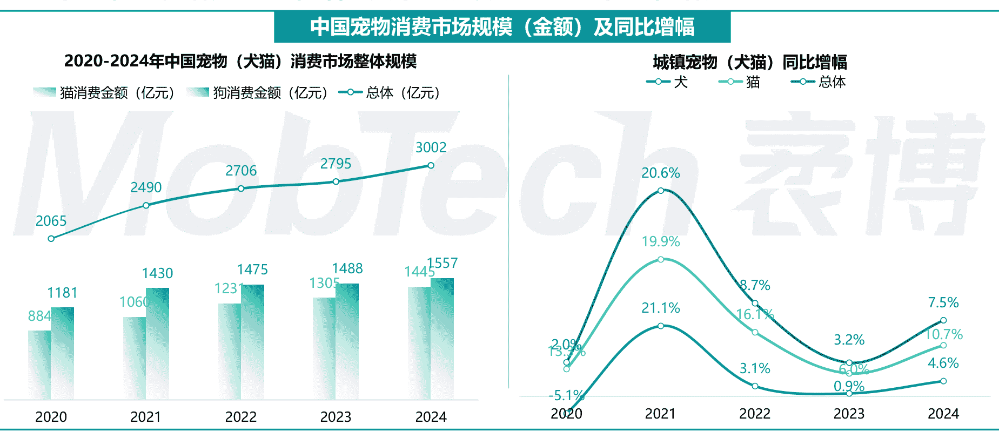

Source:《2025年中国宠物行业白皮书》派宠业，MobTech研究院整理数据

### 宠物数量：2024年城镇宠物猫数量持续回升，宠物猫更受青睐

2024年，宠物数量为12411万只，较2023年增长2.1%。其中，宠物犬数量为5258万只，较2023年增长1.6%，宠物猫数量为7153万只，较2023年增长2.5%

| 中国宠物消费市场规模（犬猫）数量 |
| :--- |
| 2020-2025年中国宠物（犬猫）数量 |
| 2024年中国宠物（犬猫）占比 |

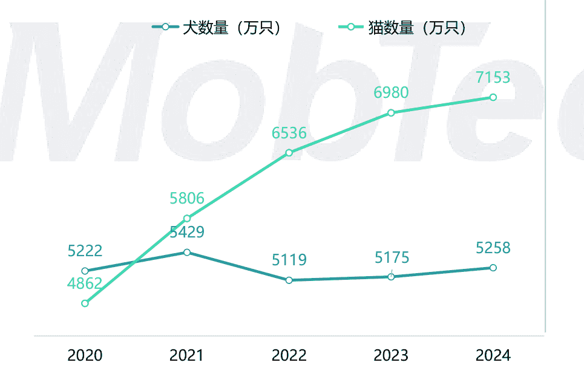
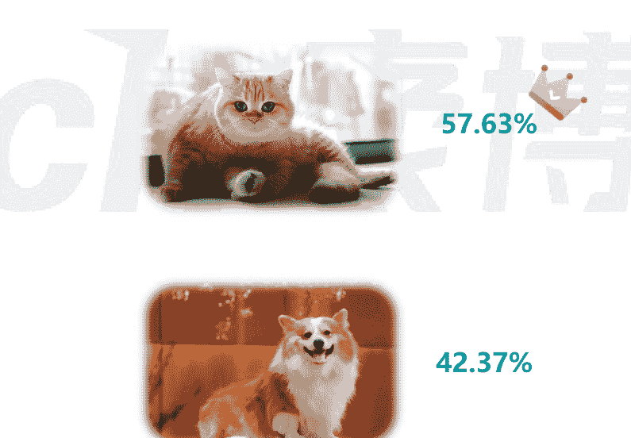

Source Source：《2025年中国宠物行业白皮书》派读业、MobTech研究院整理绘制

### 行业渗透：宠物行业渗透率远低于海外，未来发展潜力有望进一步释放

2023年国内宠物家庭渗透率约为17.8%，猫家家庭渗透率约为16.4%；中国宠物狗猫家庭渗透率相比美国、日本等发达国家相比存在较大差距，未来潜在空间巨大

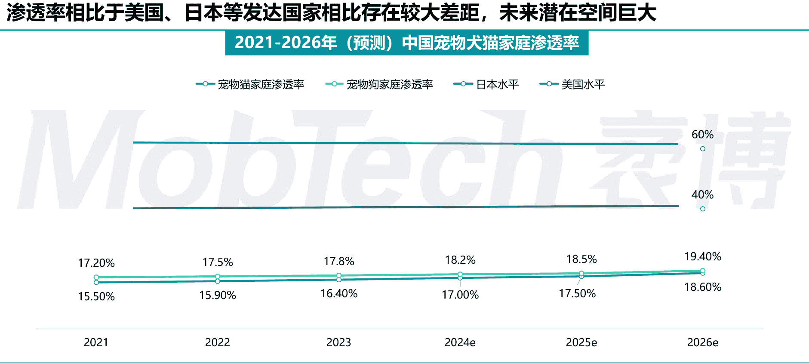

Source:公开资料，中国统计年鉴，国家统计局，艾瑞咨询，MobTech研究整理绘制

### 资本表现：一级市场进入融资寒冬，二级市场头部企业亮眼

2023年经营范围包含“宠物”的新增企业数量190家，由于2021年宠物融资出现“寒冬”，融资数量大幅下滑；市场大盘稳定，，持续走高

| 2019-2023年经营范围包含“宠物”的新增企业数量及增速 |
| :--- |
| 2019-2023年经营范围包含“宠物”的新增企业数量及增速（%） |
| 2019-2023年经营范围包含“宠物”的新增企业数量及增速（亿元） |

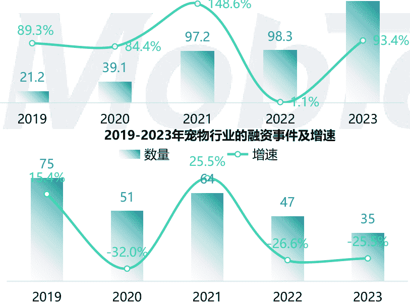
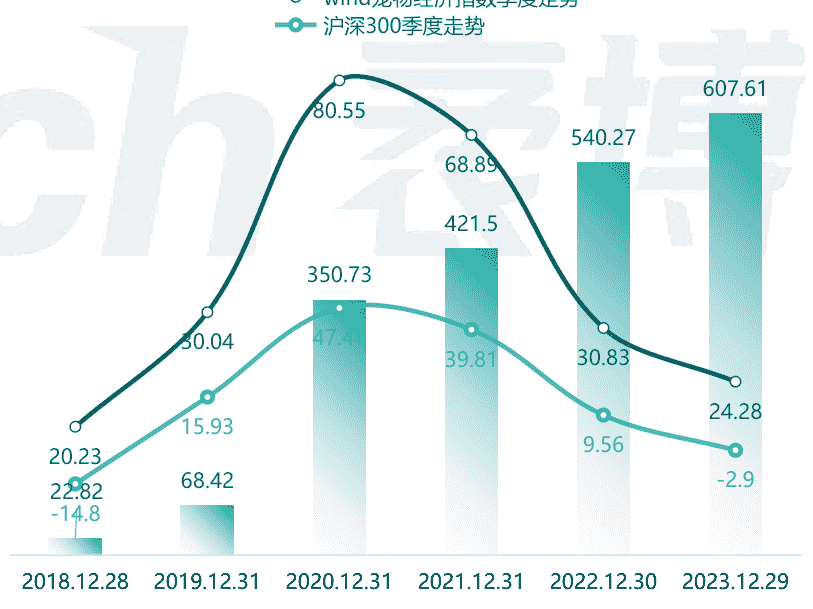
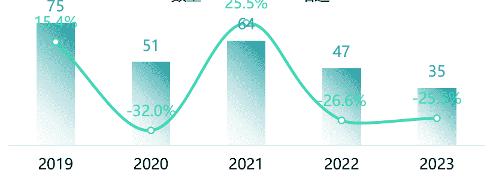

Source:公开资料，中国统计年鉴，国家统计局，艾瑞咨询，MobTech研究院整理

### 消费结构：市场消费结构稳定，细分市场小幅波动

主粮、营养品、保险呈现上涨趋势；零食、用品、药物、疫苗、洗澡轻微下降；体检、表现平稳

| 中国宠物（犬猫）消费结构（%） |
| :--- |

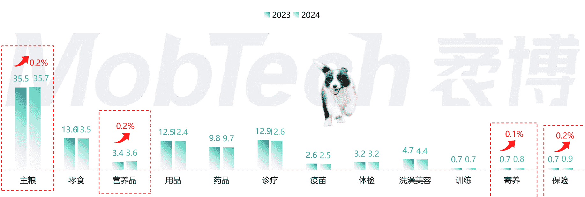

Source:《2025年中国宠物行业白皮书》派宠业，MobTech研究院整理

## 02 Part two: 养宠人群基础画像

### 女性占比高、高学历、高收入的年轻白领

女性养宠群体占比60.5%，本科以上学历占比67.8%；员工最多，其次为教师等专业人士；整体收入较高，具有一定购买能力

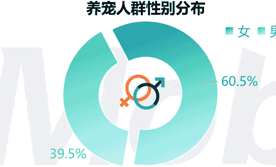

### 性别分布 / 学历分布 / 收入分布 / 年龄分布 / 职业分布

### 六成宠物主饲养2年以上，小宠宠新机遇

六成宠物主的饲养时长在两年以上；对比2022年，养宠人群年轻化，异宠市场（鸟类、冷血类、水族类）呈上升态势

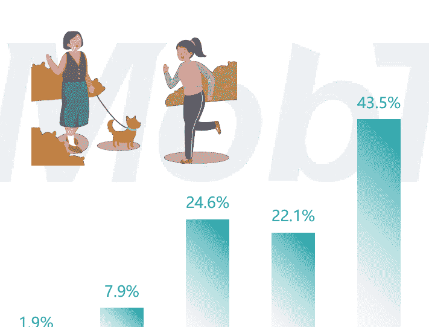
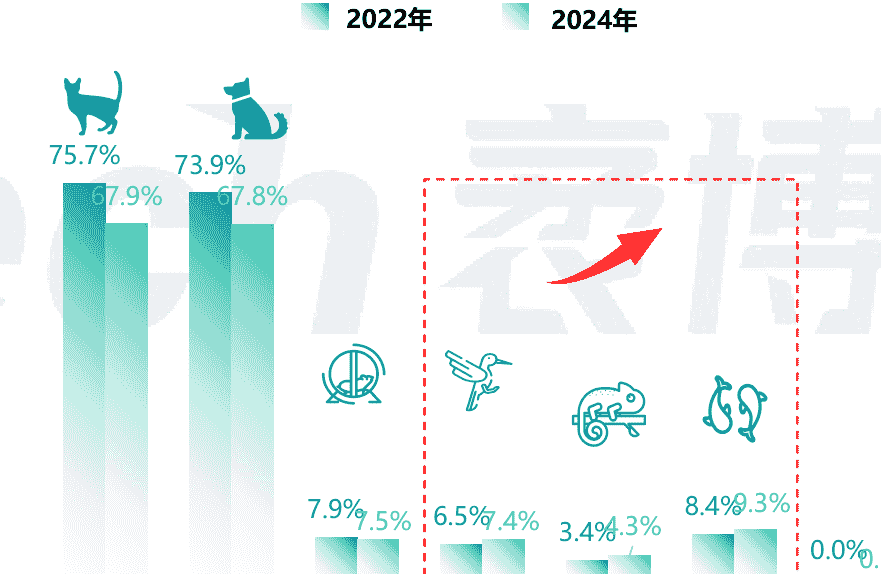

Source:KuRun数据库数据，2024.08，MobTech研究院绘制

### 京冀沪粤成为养大营，北京人最爱“铲屎”

在养宠人群区域分布中，三线城市占比最高，超30%，一线和二线城市接近；北京、河北、上海位列铲屎Top3

| 一线城市 | 二线城市 | 三线城市 | 四线城市 | 五线城市 |
| :--- | :--- | :--- | :--- | :--- |
| 北京 | 河北 | 上海 | 广东 | 四川 | 重庆 | 宁 | 辽 | 河南 | 江苏 | 山西 |

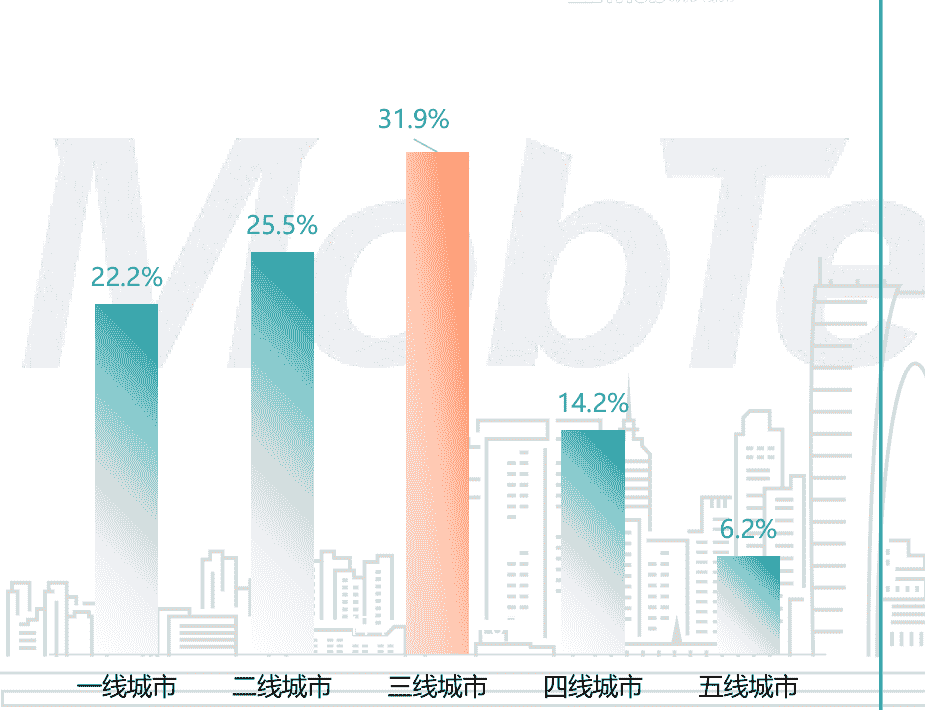
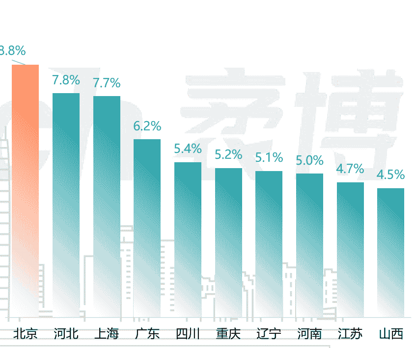

Source:KuRun数据库数据，2024.08，MobTech研究院绘制

### 养宠主打一个“陪伴”，但真的费钱又费力

“陪伴”是宠物主们的最大诉求，爱宠成为他们工作及生活压力下治愈身心的良药；打扫卫生和医疗费用高昂成为了养宠群众甜蜜的负担

| 养宠群众主要诉求 | 养宠群众主要痛点 |
| :--- | --- |
| 个人陪伴需求 | 缓解压力 |
| 家人需求 | 养宠与责任心 |
| | 因云养产生兴趣 |
| | 宠物知识不丰富 |
| | 环境打扫费 |
| | 养宠费用较高 |
| | 医疗费用较高 |
| | 用品选择困难 |
| | 就餐选择困难 |
| | 以上均有 |

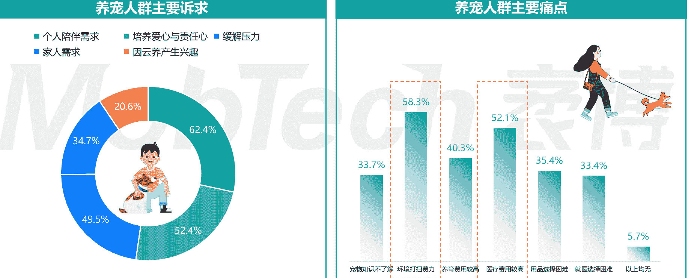

Source:KuRun数据库数据, 2024.08, MobTech研究院绘制

### 养宠遇到困难宠物主转向短视频和社交媒体寻找答案

随着短视频平台和社交媒体快速发展，当遇到养宠问题时，宠物主倾向通过小红书、抖音等专业渠道解决。

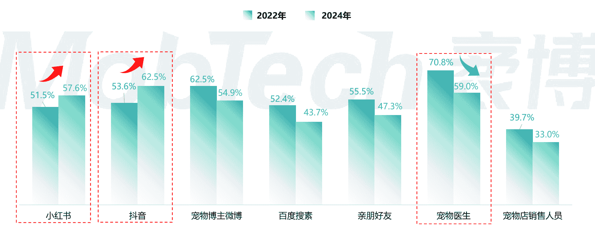

Source:KuRun数据库数据，2024.08，MobTech研究院绘制

## 03 Part three: 养宠人群消费偏好

### 花费情况：宠物主高消费比例下降

与2022年相比，宠物主单只平均花费500元以上消费占比下降；在花费中，除了宠物粮这一刚需外，花费占比上升，单次平均花费变化

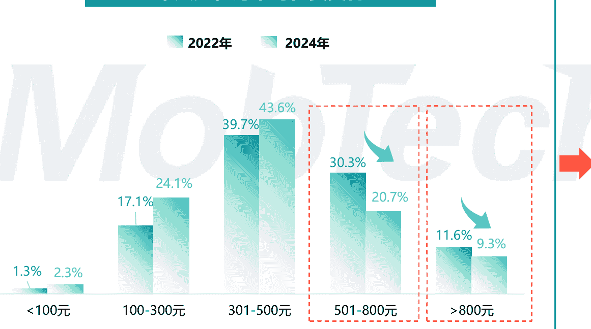
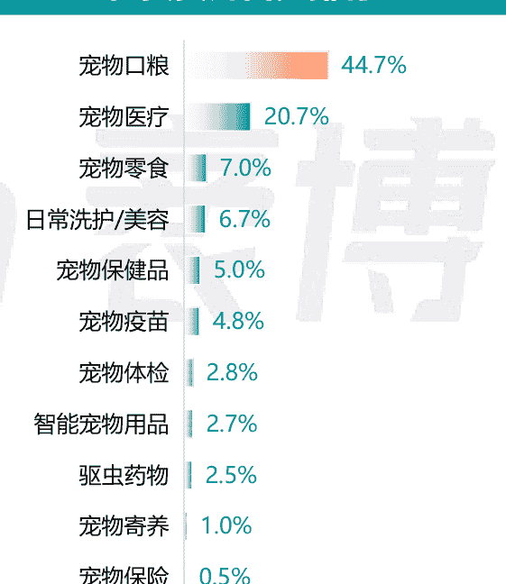

### 渠道偏好：线上买口粮零食领先

除了宠物粮、零食外，宠物主也习惯线上选购疫苗、日常洗护/美容等服务，在线渠道上有绝对优势

| 养宠人群线上购买品类 | 养宠人群线下购买品类 |
| :--- | :--- |
| 宠物口粮 83.9% | 医疗 48.0% |
| 宠物零食 73.6% | 疫苗 46.2% |
| 驱虫药物 53.7% | 日常洗护/美容 44.0% |
| 娱乐/玩具 49.4% | 口粮 42.5% |
| 日常洗护/美容 41.8% | 体检 40.3% |
| 保健品 39.2% | 零食 38.9% |
| 疫苗 32.3% | 驱虫药物 38.8% |
| 智能用品 27.9% | 寄养 23.3% |
| 医疗 26.7% | 娱乐/玩具 22.2% |
| 体检 21.3% | 智能用品 17.1% |
| 保险 16.5% | 保险 14.1% |
| 寄养 12.2% | |

### 宠物食品：国产宠物粮实现超越

相比2022年，选择国产宠物粮的宠物占比大幅提升，近六成宠物主更多天然粮和主食罐头，其中益生菌、维生素类以及钙片类是最受欢迎的宠物保健品

| 进口/国产类选择 2022 | 2024 |
| :--- | :--- |
| 宠物粮消费偏好 | |
| 保健品消费偏好 | |
| 口粮 |

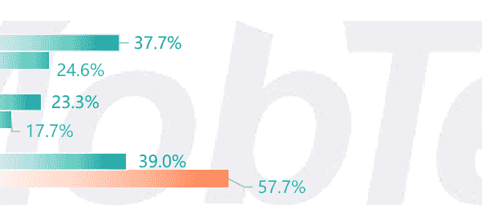

Source:KuRun数据库数据,2024.08,MobTech研究院绘制

### 宠物服务：托运遇冷，价格敏感人群上升

对比2022年，选择托运的宠物主进一步减少。其中空运占比大幅下降，专车和火车上升；除了担心情绪不稳定、排泄及温度控制等问题，费用较高问题提升显著

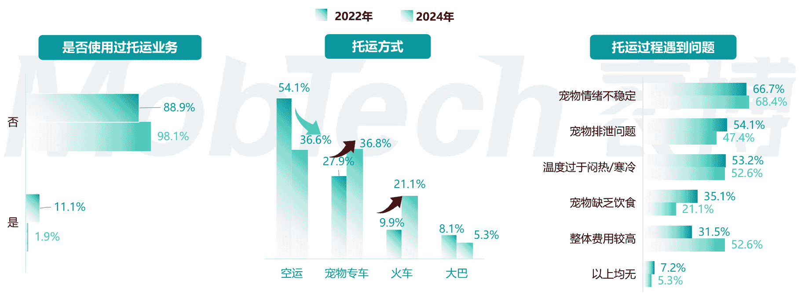

Source:KuRun数据库数据，2024.08,MobTech研究院绘制

### 宠物服务：认真规划“那一天”，让宠物永远“陪伴”在身边

对于将来会离开的小可爱，选择自行处理和交由专业殡殡处理的宠物主占比上升；在选择医院代为处理的宠物中，近七成宠物会选择收回骨灰

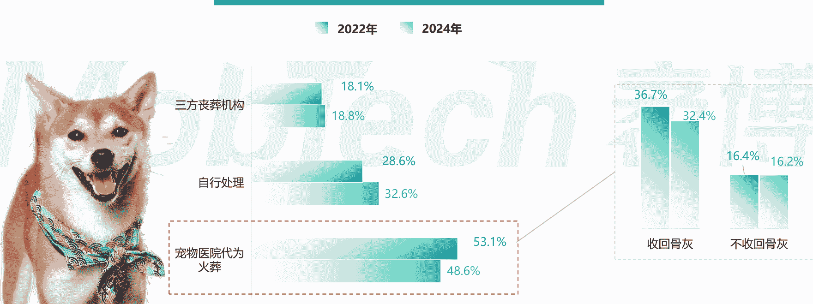

### 宠物服务：宠物保险渗透率低，宠物主向大牌保险公司

和2022年相比，选择购买宠物保险的宠物主比例小幅下降，渗透渗透率不高；太平洋保险依然是宠物主优先选择的平台，500-1000消费区间占比最高

| 宠物保险消费偏好 |
| :--- |
| 是否购买宠物保险 |
| 2022年 |
| 2024年 |
| 保险购买平台 |
| 单只宠物保险费用（元） |

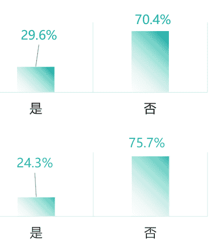
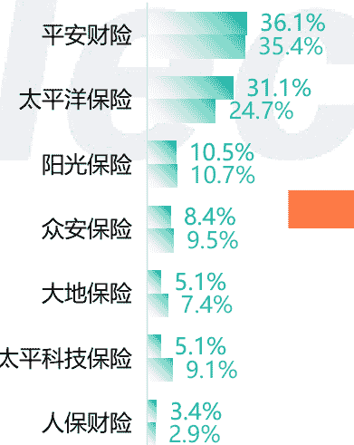
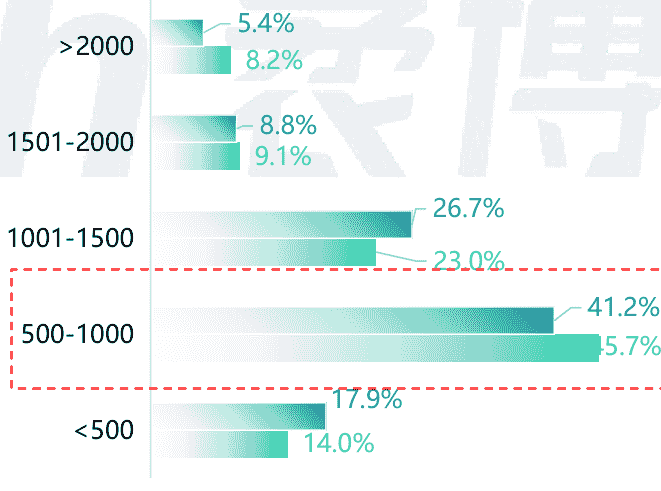

Source:KuRun数据库数据，2024.08，MobTech研究院绘制

### 宠物医疗：宠物健康意识更强，单次平均花费增加

相比2022年，宠物主选择给宠物体检的频率整体增加，一年两次；单次平均花费300-500元最多

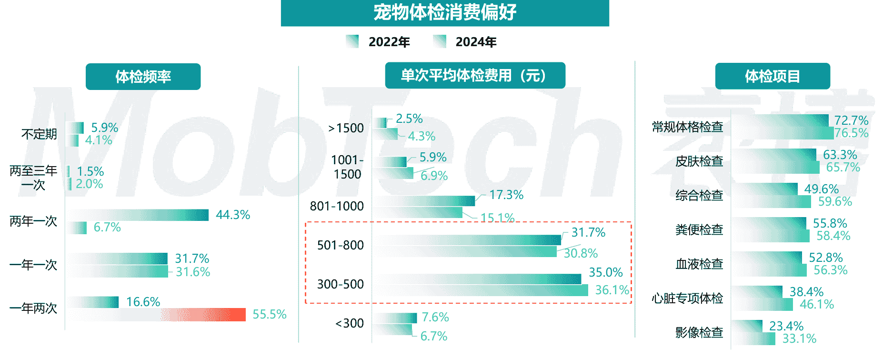

### 宠物医疗：方便、无时间限制，便捷性

超过六成宠物主都有过线上问诊经历，忙碌的工作让问诊随时随地满足需求

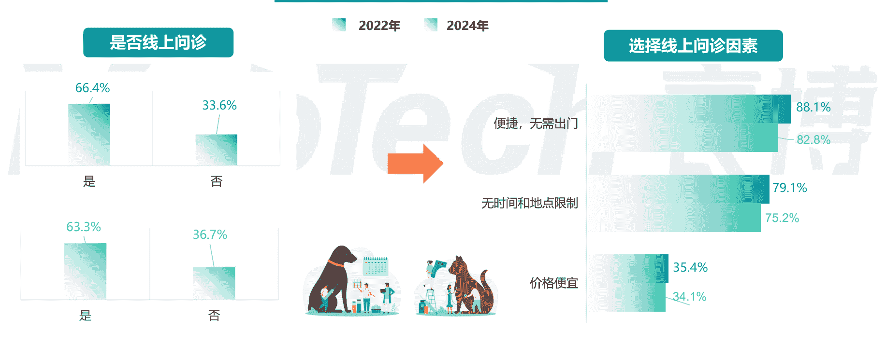

Source:KuRun数据库数据，2024.08,MobTech研究院绘制

## 04 Part four: 宠物消费趋势分析

### 宠物粮：科学养宠观念指导，功能类增长

在宠物粮中，关节保护、体重控制等功能类销售增速较快；在猫粮中，调肠胃、益肾泌尿市场潜力较大

| 2023-2024年狗粮销售额增速及占比增长 | 2023-2024年猫粮销售额增速及占比增长 |
| :--- | :--- |
| 占比增长 3.0% | 占比增长 5.0% |
| 营养滋补 | 营养滋补 |
| 调肠胃 | 关节保护 |
| 抗衰老 | 体重控制 |
| 益肾泌尿 | 益肾泌尿 |
| 销售额增速 | 美护肤 |
| 健骨补 | 体重控制 |
| 美护肤 | 提免疫 |

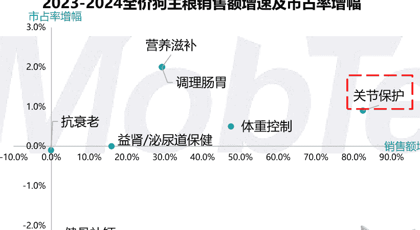
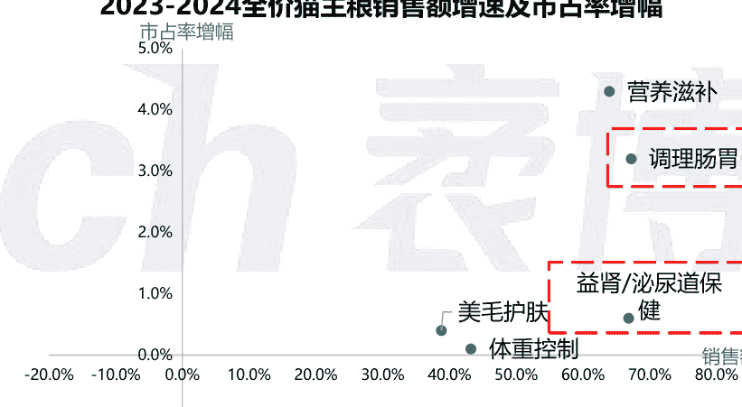

Source:魔京东数据（2023.01-12），MobTech研究院整理

### 宠物保健品：猫类复合保健品销售额明显

狗类保健品市场以单一功能为主，猫类保健品已单功能向复合功能转变，增幅较大

| 2024年狗保健品市场份额及销售增速（按功效） | 2024年猫保健品市场份额及销售增速（按功效） |
| :--- | :--- |
| 份额（%） —— 销售增速（%） | 份额（%） —— 销售增速（%） |

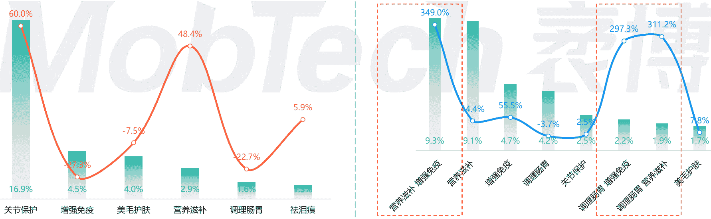

Source:魔京东数据（2023.01-12，2024.12），MobTech研究院整理

### 宠物用品：解放双手、智能宠成为呼声高

在宠物用品中，饮食产品、玩具以及家居用品的销售增速明显，宠物家庭对产品是否智能化功能较为关注

| 特性 | 2023 | 2024 |
| :--- | :--- | :--- |
| 功能属性 | 爪抓、休息、娱乐 | 智能 |
| | 智能 | 电动玩具 |
| | 猫爬 | 爪抓、快乐娱乐 |
| | 防护 | 互动玩具 |
| | | 带激光 |

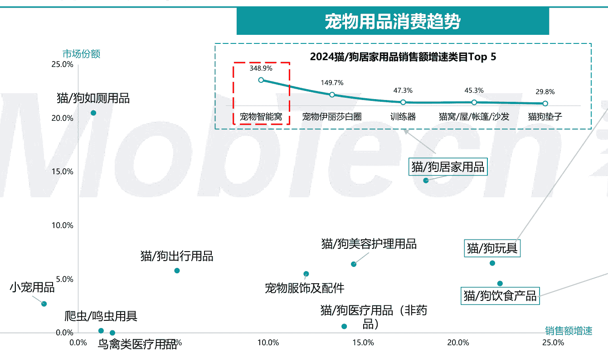
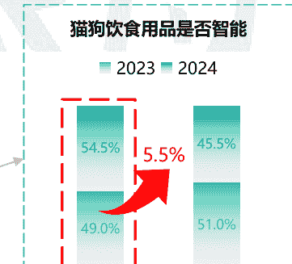

Source:魔京东数据（2023.01-12、2023.04-12），MobTech研究院绘制

### 宠物服务：在线问诊、宠物摄影等众化服务成为蓝海赛道

宠物在线问诊和宠物摄影服务销量和销售额增长快，整体市场份额较小，仍处机会市场阶段

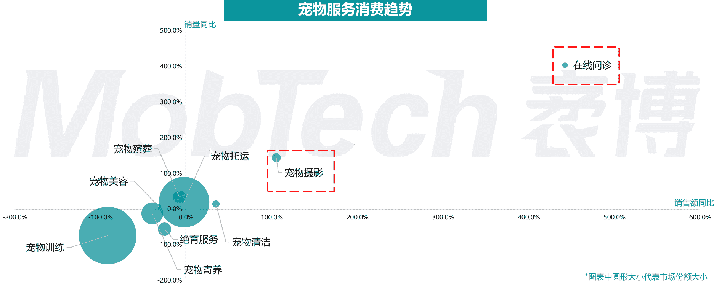

Source:魔京东数据（2023.01-12，2024.01-12），MobTech研究院整理

# 特别鸣谢

作为AI赋能的零售洞察公司，从2012年起，魔镜洞察积累核心团队就开始为品牌提供市场和消费者洞察服务。十余年来，魔镜洞察一贯利用机器学习和算法，帮助品牌从海量的市场信息中提取增长的、有投资价值的新机会。魔镜洞察的调研涵盖了整个线上零售市场的各个细分行业和海量消费品牌。

通过saas系统和行业市场洞察，魔镜洞察服务于500+中国品牌，见证他们从成长到成熟。

# 报告说明

1.数据来源
本报告数据基于市场公开信息，MobTech自有数据，以及MobTech研究模型估算等来源。

2.数据周期和指标说明
报告整体时间段：2023.01-2024.12 具体指标请参考各页标注

3.版权声明
本报告为Mob研究院制作，报告中所有的文字、图片、表格均受有关商标和著作权的法律保护，部分文字和数据采集自公开信息，所有权为原作者所有。没有经过本公司新媒体许可，任何组织和个人不得以任何形式复制或传递。任何未经授权使用本报告的相关行为都将违反《中华人民共和国著作权法》和其他法律法规与有关国际公约的规定。

4.免责条款
本报告中行业数据和市场预测为分析师采用桌面研究、行业访谈及其他研究方法，并且结合MobTech监测产品数据，通过统计预测估算获得，仅供参考。受研究方法和数据获取资源的限制，本报告只提供给用户作为市场参考资料，本公司对该报告的数据和观点不承担法律责任。任何机构或个人援引或基于上述信息所取的任何行动所造成的法律后果均与MobTech无关，由此引发的相关争议或法律责任均由行为人承担。
