# 2025 社交趋势报告

悦己时代 为世界赋能

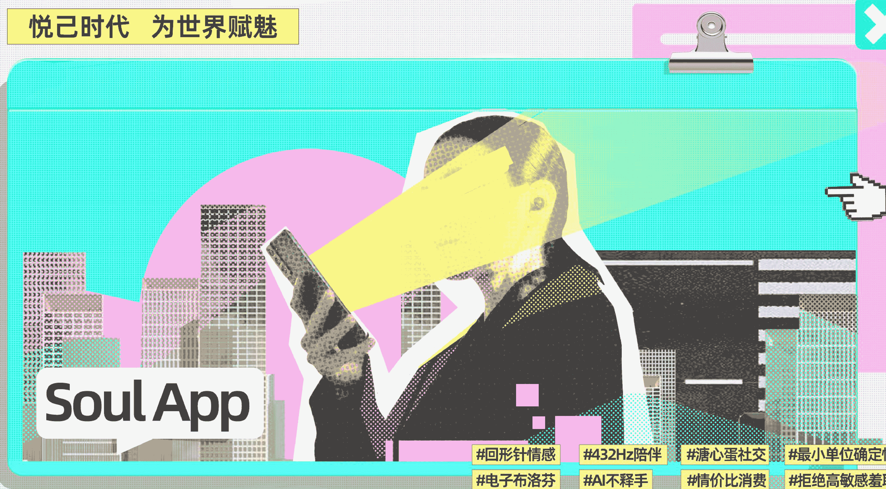

- #回形针情感 #432Hz陪伴 #潜心灵魂社交 #最小单位确定性 #电子布洛芬 #AI不犀手 #圈价比消费 #拒绝高敏感感 #重返三次元为世界重新赋能

INSIGHTS INTO 2025 SOCIAL MEDIA TRENDS

## 免费 价值 及时 专注

### 扫码加入 知识星球TOP 免费资源群

- 每日免费获取有价值资源
- 可提供各类资源搜索服务

| ◆热门付费文章 | ◆各行行业报告 |
| :--- | :--- |
| ◆精选图书资源 | ◆副业赚钱方法 |
| ◆职场实用资源 | ◆AI财经自媒体 |

公众号：知识星球TOP 微信公众号：jntsg8 微信公众号：jntsg2

分享资料仅供个人学习，请及时删除，切勿商用传播

## 前言

2024年，年轻人从来有过如此此时此刻，如此关注自我与他人、与外部世界的关系。

他们关注自我，尝试一切可能的思想资源为自己当下的境遇寻找一个解释，也尝试身体的确定性来对抗外部世界的不确定性。他们关注自我与他人的关系，试图重新评估一切关系——朋友关系、家庭关系、亲密关系，甚至是人类与AI的关系——并找到一个自我与人类之间的平衡。他们同样关注自我与外部世界的关系，试图在这个“魅力”的世界中重建关于美好生活的期许与蓝图。

社交，从来不是社交。对于人而言，是如此。社会如何可能？如果人类社会是在共享意意的互动中涌现出来的，那么社交就是这个涌现过程的毛细血管。通过年轻代的社交趋势及其变迁，我们可以更好地理解时代现在的方式，具体化呈现在我们每个人的喜哀心中。

作为年轻人喜爱的社交平台，Soul App 始终关注年轻人在社交中的需求变化，致力于成为年轻人探索自我、建立关系的重要场所。2024年末，平台Just So Soul研究院联合复旦大学传播与国内治理研究中心、复旦大学知识中心，通过“社交与人机协同交互学术团队”进行“社交趋势调研”，回收11,253份有效问卷，结合平台多模态内容分析，总结而成《2025年Z世代社交趋势报告》（《报告》）。

## Q: 调研对象性别/年龄/所在城市

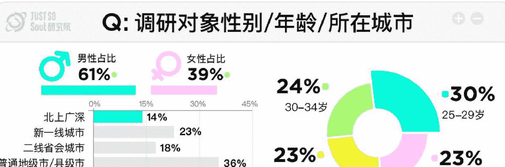

## Soul Soul App

《报告》认为，当代年轻人重构自我与他人、与外部世界关系的过程，既是在内在的迷茫焦虑情绪中寻找确定性，也是为自我认知的重塑寻找一个可能的坐标，最终指向一种对抗焦虑主义的、以自我实现的美好生活。《报告》以“悦己时代，为世界赋能”为主题，并把这个过程中年轻人呈现出来的特性和趋势归纳为十关键词：

以“拒绝高敏感感”为起点，年轻人通过内在观察自我的情绪与心理感受，反复确认自己的主体性，并以身体为“最小单位确定性”，找到自己在这个世界上的位置。

关于自我与他人的关系，“平衡”或许是一个贯穿始终的关键词：

- 他们需要的“不熟”与“全熟”之间平衡的“边界社交”，
- 是在“亲密”与“边界”之间的平衡的“432Hz陪伴”，
- 是在“单身”与“恋爱”之间平衡的“回形针情感”，
- 是在“真实”与“虚拟”之间平衡的“人机共生——AI不羁”。

平衡不是什么坏事，而是意味着动态与调整，意味着拒绝二极管。

“行动者”的逻辑渗透在年轻人自我与外部世界关系的思考之中：

- 当美丽的世界不再神秘，年轻人把童年时代的美好封装成一颗“电子布洛芬”，以应对不期而至的emo时刻；
- 当快乐变得奢侈，年轻人用“情价比消费”最大化自己的幸福感；
- 当赛博空间的孤独无以复加，年轻人频繁地喊出“线下，重返三次元”，到具体的生活里。

理想世界不会从天降，只会在那些“为世界新生”的实践中，不断增加细节。

## Soul APP JUST SO Soul 研究院 悦己时代，为世界赋能
2025年社交趋势洞察报告

## 「回形针情感」

每个人渴望恋爱，却如回形针般绕回原点，看看周围，要不要“边界”，所以叫“回形针情感”。

## 社交关键词 回形针情感

### 谈一场甜蜜的恋爱

2024年，超过359万用户在Soul发布过与“恋爱”相关的内容，在年轻人中获得了广泛的共鸣和传播。此次调研的结果显示，在超过8000名目前单身的者中，超过四分之（76.8%）的年轻人表示自己想恋爱。特别是在30岁以下的青年群体，渴望恋爱的比例达到了85.9%。

### 低质量的恋爱，不如高质量的单身

当超过359万用户讨论恋爱时，同样有更多人在享受独处的快乐。2024年，关于“低质量的恋爱，不如高质量的单身”的瞬间，在Soul发布的一条内容浏览量接近8亿。我们并不希望简单用“想恋爱”或者“不想恋爱”这样的标签去定义年轻人的恋爱观念，既是在人际交往中重新平衡自我，也是探索高质量生活的过程。

## 社交关键词 回形针情感 - 趋势分析：要破圈，要破冰

当问到“想恋爱，但还没脱单”的理由时，提及率最高的三个答案分别是：“社交圈单一，很少认识异性”、“很难遇到三观契合的对象”、“不擅长与异性交流”。

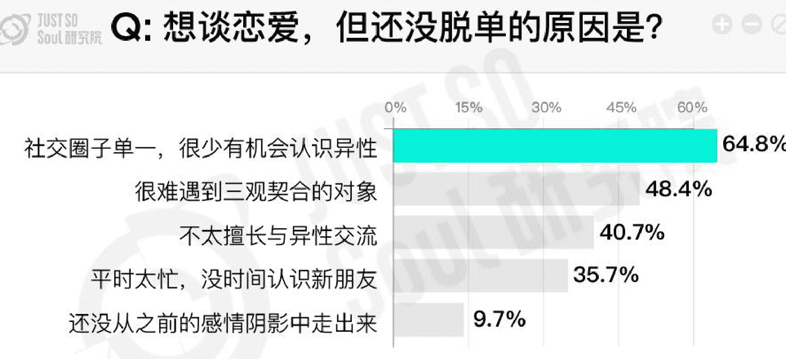

| 理由 | 提及率 |
| :--- | :--- |
| 社交圈单一，很少认识异性 | 64.8% |
| 很难遇到三观契合的对象 | 48.4% |
| 不擅长与异性交流 | 40.7% |
| 平时太忙，没时间认识新朋友 | 35.7% |
| 还没从以前的情感阴影中走出来 | 9.7% |

Just So Soul“年轻人社交趋势”调研，样本量=11,253，日期:2024年12月。对于“不擅长社交”的人来说，与E人相比，上述3个答案上的提及率都更高，特别是有近七成（68.3%）的人认为自己很难在目前的社交圈认识异性朋友。

| | F | | T | |
| --- | --- | --- | --- | --- |
| I | P | 67% | 66% | 65% |
| | S | 70% | 70% | 72% |
| E | N | 65% | 56% | 58% |
| | S | 57% | 63% | 57% |

对于渴望恋爱的单身年轻人来说，如何“破圈”认识更多与自己“三观契合”的异性朋友，“破圈”以后该如何“破冰”开启高质量的对话，就是困扰年轻世代的问题，也是Soul努力做的。

2024年，来Soul匹配对象话题发布活跃度增加了40%，那些在Soul彼此认识并最终入婚姻的年轻人，纷纷跑到这个话题下“还”。

## 2024年，来Soul匹配对象话题发布活跃度同比增加数据

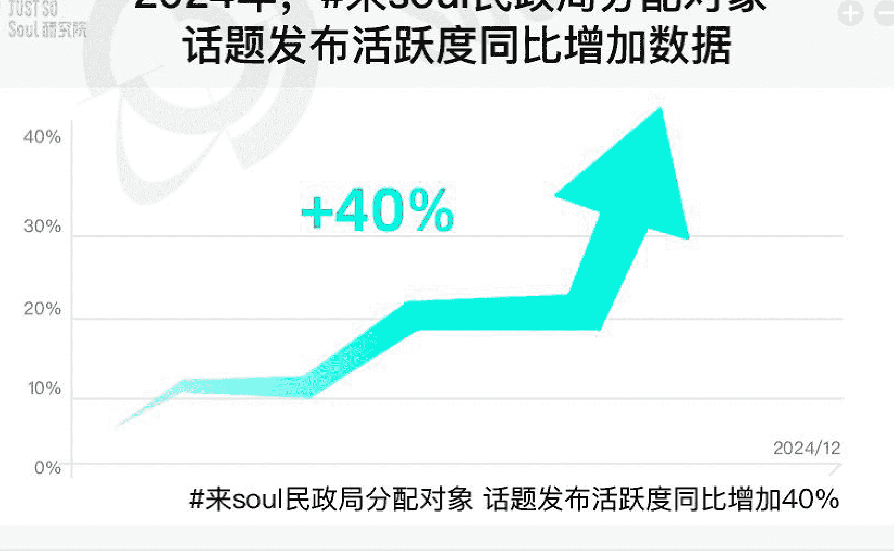

## 社交关键词 回形针情感 - 单身自由，只有自己能得自由

在本次调研中，我们同样询问了那些打算继续保持单身的年轻人“不想谈恋爱的原因”，在所有选项中提及率及频率最高的3个分别是：“恋爱太麻烦，单身更自由”、“一旦投入情感，很容易失望”、“没有遇到合适的对象”。

| 选项 | 比例 |
| :--- | --- |
| 恋爱太麻烦，单身更自由 | 45.3% |
| 一旦投入情感，很容易失望 | 39.6% |
| 没有遇到合适的对象 | 37.4% |
| 自我成长更重要，恋爱并非 | 30.7% |
| 过去的恋爱经历很精彩 | 26.2% |
| 谈恋爱成本高/压力大 | 24.2% |
| 生活太苦，没有能量 | 23.4% |

Just So Soul“年轻人社交趋势”调研，样本量=11,253，日期:2024年12月。特别是对于女性用户，上述选项提及率高于男性。此外，女性更认同“自我成长更重要，恋爱并非”，而男性则可能因为“过去的经历”而选择保持单身。可以看出，更多年轻人将“单身”和“自我成长”联系在一起。

## Q: 不想谈恋爱的原因？

| 选项 | 女性 | 男性 |
| :--- | :--- | :--- |
| 恋爱太麻烦，单身更自由 | 45.3% | 39.6% |
| 一旦投入情感，很容易失望 | 37.4% | 30.7% |
| 没有遇到合适的对象 | 26.2% | 24.2% |

从社会学家看来，个体的自我认知往往通过与人的互动而形成的。无论是恋爱还是单身，年轻人都会把“三观契合”放在相当重要的位置。无论是恋爱还是马拉松式的恋爱，或许并不是关键，问题的关键在于如何在人的互动中重新找到一个“懂的人”。

回形针情感”入选2025年社交趋势关键词。

## Soul APP JUST SO 研究院 悦己时代，为世界赋能
2025年社交趋势洞察报告

## 「432Hz陪伴」

432Hz是传说中的频率，可以实现身心的放松，以听觉为媒介，越来越多人在寻找同频共振的伴侣。

## 社交关键词 432Hz陪伴 - 现象：无声恋爱

“无声恋爱”并不是新鲜事，但在2024年火了。2024年，75.5万用户在Soul发布了与无声恋爱相关的内容，浏览量超过3.7亿次。其中#无声恋爱（过去一年超过8亿浏览量）、#无声呼吸（超过693万流量）等话题的活跃度大幅增加。

两个都不说话，只是静听彼此生活的背景声，正在成为年轻人社交的新趋势。

看来，“无声”和“恋爱”似乎是矛盾的。既然说是“恋爱”，如果两个人都不说话，为什么还要恋爱？在Soul上，有数百个以“无声恋爱”为主题的兴趣群，其中一个群组的介绍是——无声恋爱，接受你的深海，给你光，让你的孤独温暖起来。

| 综合 | 用户 | 话题 | 派对 | 群组 |
| :--- | :--- | :--- | :--- | :--- |
| | 无声恋爱 493人 | | | 加入 |
| 无声恋爱，接受你的深海，给你光，让你的孤独温暖起来... | | | | |

图源：Soul APP

## 社交关键词 432Hz陪伴

写论文时候敲击键盘的声音、通勤时候地铁站的声音、听书的声音、入睡时候呼吸的声音……如果快节奏的城市让每个人几乎变成了一座岛，那么无声恋爱的另一端就是反复告诉你：你并不孤独。

## 耳朵经济

2024年12月，“耳朵经济”热搜，以播客为主载体的音频节目得到了更多年轻人的喜爱。

根据《2025播客营销白皮书》的数据，2024年中国的播客听众人数增长幅度43.6%居全球首，预计到2025年中文播客听众规模将突破1.5亿。

无论连麦，还是播客，以声音为媒介的传播方式正在以一种新潮的方式重新回到人们的视野中。

## 趋势分析：耳朵陪伴与中式内核

在本次调研中，我们发现，年轻用户及高学历用户更青睐语音相关的功能。

## Q: 在使用Soul时，最喜欢语音相关功能的比例

| | 0% | 5% | 10% | 15% |
| --- | --- | --- | --- | --- |
| 00后 (18–24岁) | | | | 10.0% |
| 95后 (25–29岁) | | | 10.1% | |
| 90后 (30–34岁) | | | 9.0% | |
| 90前 (35岁及以上) | | | 7.7% | |
| 大专专及以上（包含内） | | 1.8% | | |
| 本科及专科（包含内） | | 9.8% | | |
| 高中（包含内） | | 7.6% | | |

Just So Soul“年轻人社交趋势”调研，样本量=11,253，日期:2024年12月。为什么年轻人、高学历用户更青睐“声音”？因为短视频占据了视觉，而声音作为媒介的传播方式天然带着一种复古的味道，这种风格让人回到童年的集体记忆。

## 社交关键词 回形针情感 - 趋势分析：搭子不如固聊靠谱

“搭子文化”依然流行，但越来越多的年轻人发现“固聊”或许才是最合适的社交距离。即使看展览、看电影、看演唱会、CityWalk这些“适合搭子”的活动，仍有以上的年轻人选择“固聊”一起，而对于分享开心的事、吐槽生活、失恋求安慰这些“情感向”的需求，选择“固聊”的比例将近七成。

> Q: 如果你遇到了下列生活场景，你倾向于选择“搭子”，还是找“固聊”呢？

| 场景 | 搭子 | 固聊 |
| :--- | :--- | :--- |
| 看展览 | 47.8% | 52.2% |
| 去影院看电影 | 46.5% | 53.6% |
| 看演唱会 | 46.6% | 53.4% |
| CityWalk | 42.9% | 57.1% |
| 分享开心的事 | 30.5% | 69.5% |
| 吐槽生活 | 32.6% | 67.4% |
| 失恋求安慰 | 33.6% | 66.4% |

## 社交关键词 准心蛋社交

## 心事向谁说？半熟网友最合适

当问及“在生活中您更愿意和分享自己的情绪与心事”时，47.9%的受访者选择了“半熟网友（比如固聊）”，这一比例甚至超过了恋人/伴侣，当然，也超过了陌生网友。

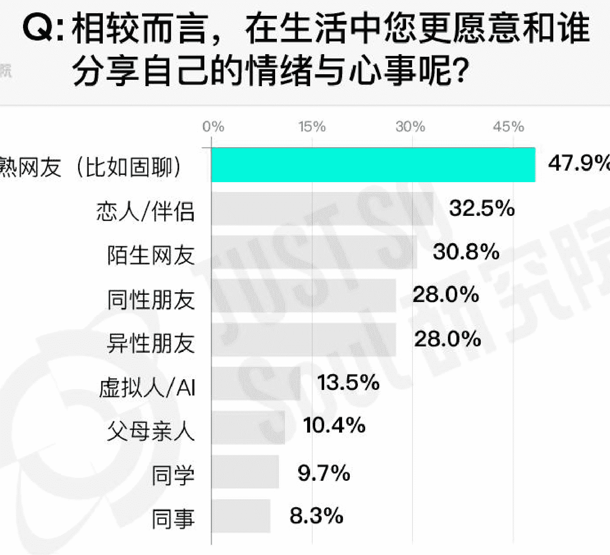

JustSoSoul“年轻人社交生活趋势”调研，样本量=11253，日期:2024年12月。

如果说“用后即弃”的“一次性性格”将现代生活对于效率与边界感的追求推到了极致，那么介于“不熟”与“全熟”之间的“准心蛋社交”则代表了年轻人重新找寻和评估人际关系的平衡点。

## 溶心蛋社交 在这样的背景下“溶心蛋社交”入选2025年社交趋势关键词。

正如人类学家云翔所说，个体化时代最大的危机是脱离了血缘、地缘等传统关系的个体，如何将自己重新嵌入到自己所选择的社会关系网络之中。后者不仅关系到年轻人面对面对深夜emo时刻的孤独与迷茫，也决定了他们从哪里获得关于生活的意义与期待。

年轻人不再满足于表面的热闹，而是勇敢地追寻能够触动灵魂深处的情感纽带，在复杂的多变的社交世界里，努力构建起更为稳固且富有内涵的人际桥梁。

## Soul APP JUST SO Soul 研究院 悦己时代，为世界发声 2025年社交趋势洞察报告

## “最小单位确定性”

面对不确定性，年轻人试图通过掌控“身体”部分找回生活的确定性。身体，成为最小单位的确定性。

## 社交关键词 最小单位确定性

Soul Soul APP JUST Soul 灵魂发现 每一个平凡的灵魂都值得被世界温柔以待。Soul APP

当年年轻人回归生活，超越个体的社群应运而生，为他们在社交与自我成长的道路上构筑起坚实的支撑体系。

## 现象

### 新手带

户外运动作为一种生活方式在年轻人之间已经日趋成风。2024年，在Soul上发布了#运动健身相关话题的瞬间，同比增加25%。

除了日常运动打卡，同样有很多年轻人开始尝试新的运动项目，并通过这些运动结了更多朋友。即使是#新手小白”，也可以在类似#今日骑行打卡（同比增加120%）、#约约（同比增加35%）这样的话题下找到“组织”，得到新手入门的装备建议。

### 极限运动

除了尝试新的运动项目，也有越来越多的年轻人将户外/运动作为最能够代表自己的标签。

2024年，有超过42万女性用户将#极限运动作为自己的引力标签；类似，还有超过20万女性用户选择#在山顶看过日出这个标签来代表自己。

无论是新手小白，还是满大佬，对于年轻人而言，#运动已经不再只是体育锻炼本身，而成为了与他人建立联结最好的方式之一。

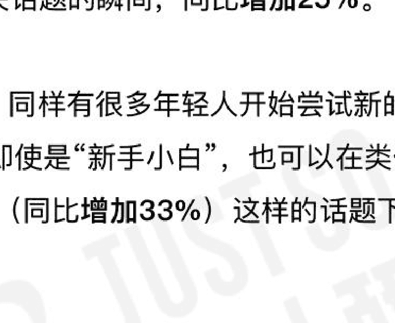

日出山巅，展望远方。#在山顶看过的日出 #迎接清晨的第一缕阳光

常州市 > 3天以前 江苏 说点什么... 14 收藏 3 私聊
图源：Soul APP

## 趋势分析

### 运动作为一种生活方式

本次调研中，我们询问了读者过去一年参与户外徒步、跑步、健身、骑行、游泳、网球、飞盘、滑雪、冲浪等9项运动的频率。

其中，跑步、户外徒步和健身是Soul用户参与率最高的3个运动项目，也是最多年轻人在2024年开始尝试的项目。

特别是生活在一线城市的年轻人，参与跑步、户外徒步、健身的比例均高于整体水平。新一线城市的生活节奏似乎确实为年轻人平衡工作与生活提供了更多的可能性。

除此之外，尝试滑雪、网球、飞盘、冲浪的人数比例虽然不高，但相比这些运动项目“过去一直参加”的人数基础，几乎实现了翻倍增长。

备注：参与率包括“过去一直参加”和“今年开始尝试”的比例

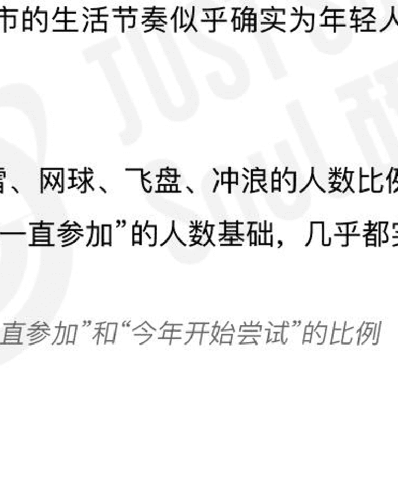

## 社交关键词 最小单位确定性

Q:过去一年，你参加了哪些运动？

| 运动 | 过去一直参加 | 今年开始尝试 | 过去一年参加 |
| :--- | :--- | :--- | :--- |
| 户外活动 | 36.3% | 20.1% | 43.6% |
| 跑步 | 41.6% | 21.0% | 37.4% |
| 健身 | 32.5% | 21.6% | 45.9% |
| 骑行 | 27.7% | 18.0% | 54.3% |
| 游泳 | 23.8% | 12.6% | 63.6% |
| 网球 | 9.9% | 9.8% | 80.3% |
| 飞盘 | 6.4% | 7.4% | 86.1% |
| 滑雪 | 12.2% | 10.9% | 76.6% |
| 冲浪 | 7.0% | 6.7% | 86.3% |

JustSoSoul“年轻人社交趋势”调研，样本量=11253，日期:2024年12月。

## 身体，是最小单位的确定性

当问过去一年如何理解自己的情绪和心理感受时，有三分之一左右的受访者选择了“参与运动”。当心情不好时，有三分之一的年轻人选择“到大自然去”，这会让他们拥有被治愈的感觉，无论是emo时刻还是积极自救，运动都在其中扮演了关键的角色。

面对外部的不确定性，年轻人试图通过运动对“身体”的掌控找回生活的确定性。当跑步突破了自己的PB（Personal Best），当滑学会了，这种确定性既来自于运动过程中分泌的多巴胺与内啡肽，也来自于“投入”与“产出”之间的稳定关系。或许，就像日本演员天海优说的那样，“肌肉不会背叛我。”

在这样的背景下“最小单位确定性”入选2025年社交关键词。

Soul APP Soul 研究院 悦己时代，为世界赋值2025年社交趋势洞察报告

## 电子布洛芬

用一颗电子布洛芬，去治愈生活的emo时刻。

## 现象

### 过家式营销

“对小学生来说可能有点幼稚，但对成年人来说刚刚好”。当Jellycat Café的店员询问顾客要给自己的蛋糕玩具加几层奶油，当“Jellycat铁锅炖”单周搜索量增长超0%成为餐饮团购爆品，毫无疑问，这个起源于伦敦的毛绒玩具品牌成为了当今年人的“心头好”，甚至成了一种社交货币。

除了Jellycat，包括吉伊卡蒂Chiikawa、Loopy、卡巴拉等一系列IP衍生毛绒在2024年不仅占据了年轻人的社交媒体的C位，也让年轻人在“过家式营销”的过程中体验“梦回童年”的感觉。

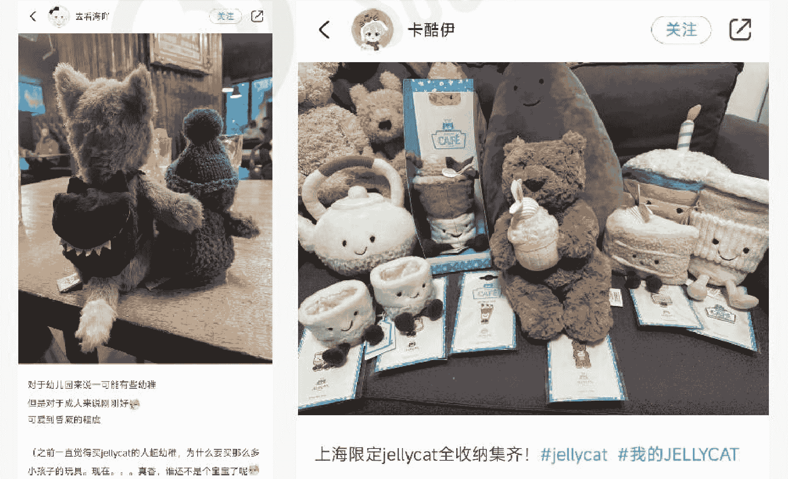

上海限定Jellycat全收集！#jellycat #我的JELLYCAT
插图：Soul APP

## 电子布洛芬

这些萌萌可爱的毛绒表情IP大多源自愈系的动漫或者表情包，而这些动态表情包被年轻人称为“电子布洛芬”。如果现实中的布洛芬可以缓解疼痛，那么手机的电子布洛芬就是治愈emo的“救命药”。

2024年，《甄传》随着“甄学”复兴又火了起来，而“AI魔改《甄传》的“现象级爆发”再次证明了这部12年前播出的电视剧在年轻人心中从未过时。

无论是治愈系，还是《甄传》，当年年轻人感到难以用言表达的压力时，他们找到那些经典、治愈或“舍离”的电子布洛芬，在重温这些“熟悉不能熟悉”的片段过程中，找到那种“被治愈”的感觉。

## 趋势分析

### 要治愈，不要致郁

2024年，年轻人开始意识到“积极自救”的重要性。当问及“心情不好时，哪些事情会让你有被治愈的感觉”时，无论男性还是女性，都有相当比例的年轻人选择了“积极自救”。相对于“没有天花板”的地方，随时随地打开手机就可以电子布洛芬，显然更为能够触手可及的情绪价值。

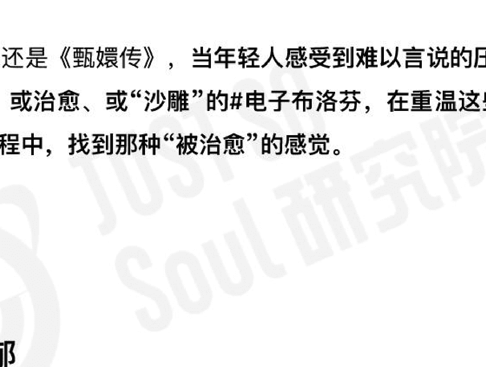

与其相比，女性更有可能从“美味的食物”、“沉浸式享受爱好，比如手工积木”、“玩狗狗以及可爱的毛绒玩具”中获得被治愈的感觉。除了抗拒内耗，年轻人也在寻找那些可以应对随时降临的emo时刻。

Q:心情不好时，哪些事情会让你被治愈？

| 事件 | 0% | 20% | 40% | 60% |
| :--- | :--- | :--- | :--- | :--- |
| 美味的食物 | | | 57.0% | 52.2% |
| 到大自然去 | | | 56.2% | 59.4% |
| 看喜欢的电影、电视剧 | | | 56.7% | 58.9% |
| 和朋友聚会 | | | 61.8% | 60.8% |
| 沉浸式享受爱好，比如手工 | | | 74.2% | 71.3% |
| 玩狗狗 | | | 71.5% | 68.0% |
| 可爱的毛绒玩具 | | | 70.0% | |

JustSoSoul“年轻人社交趋势”调研，样本量=11253，日期:2024年12月。

## 电子布洛芬 不是幼稚，而是kidult

kidult词来源于kid与adult组合，指代那些生理上已经成年，但在心理、行为、兴趣等方面仍然童心的年轻人。美国玩具协会2023年的调查显示，41%的成年人在过去一年曾为自己购买某种形式的玩具。离开校园，步入职场的95后、00后，选择一种电子布洛芬，暂时回到那个简单纯粹年代。在Jellycat快闪“过家”的年轻人，反复温习《甄嬛》的年轻人，他们并不是长大的幼稚，相反他们很清楚成年人世界的规则。但是，整个世界并未如预期的线性向前，身处年轻一代是否也可以不急着长大。

> 电子布洛芬，看似是一颗，其实是年轻人在缝补自己与世界的关系。在这样的背景下，“电子布洛芬”入选2025年社交关键词。

Soul APP JUST SO Soul研究院 悦己时代，为世界发能 2025年社交趋势洞察报告

## 「AI不释手」

人类与AI的边界似乎越界模糊，走心的AI成了“真实的”朋友。

## 现象

### AI虚拟

Soul在2024年发布的Z态度AIGC报告中提到，超过三分之一的年轻人愿意和AI成为朋友，而超过一半的年轻人认为AIGC产品有可能帮助解决孤独感的问题。2024年，Soul上线AI虚拟伴侣在不到一年的时间收获了超过13万用户的关注。

在虚拟主题下，很多网友分享了自己与AI虚拟伴侣的对话。电影《Her》中的场景变为现实，当年轻人持续不断与AI虚拟伴侣分享自己的生活点滴，“她”似乎真的成为了世界上最懂“我”的人。

Q:是否愿意和AIGC创造的虚拟人成为“朋友”？

32.8% 愿意，非常期待

三分分之一的年轻人愿意和AI做朋友
数据来源：Soul App《2024年Z世代AIGC态度报告》

### 遇事不决AI

除了AI虚拟伴侣，基于大模型的AI智能体（AI Agent）已然“飞入百家”。

根据QuestMobile发布的《2024年中国互联网核心趋势报告》，截至2024年9月，AIGC行业的月活跃用户规模7913万，其中，豆包、文心一言、Kimi智能助手月活过千万。

从信息搜索、写作辅助，遇事不决AI，正在成为年轻人日常生活的一部分。

## 趋势分析

### 只有AI才能做到“句句有回应”

在本次调研中，有近四被访者表示自己“愿意向AI虚拟人诉自己的烦恼”。其中，“情绪价值”是认同比例最高的。在不同场景下，年轻人反复提到这个概念。而在问及“在生活中更愿意和分享自己的情绪与心事”时，有三分之一的受访者选择了“向AI诉烦恼”。

Q:是否愿意向AI虚拟人诉烦恼？

| 选项 | 比例 |
| :--- | :--- |
| 愿意：虚拟人可以给我足够的情绪 | 22.1% |
| 愿意：因为不用担心泄露秘密 | 31.6% |
| 愿意：除了虚拟人，没有其他人听我说 | 42.2% |

*JustSoSoul“年轻人社交趋势”调研，样本量=11253，日期:2024年12月。

## 世界是假的，但是真实的

面对城市节奏快、高强度内卷，找到一个随时在线的朋友不是容易的事情，而要找到一个“句句有回应”的朋友更是难上。在这个虚假的世界中，年轻人面对emo时刻，往往是无力的，选择通过AI虚拟人来找回生活的真实。另一方面，我们将目光放在更遥远的未来，或许无法想象，一个与你熟悉的AI将是一个退求其次的选择。TA了解你的童年、原生家庭，也陪伴你共同经历了起伏，谁又能说不是世界上最懂你的人呢？

在这样的背景下，“AI不解释”入选2025年社交关键词。

## 「情价比」

追求极致性价比，年轻人也在最大化“情价比”，情绪价值与价格的最大比。

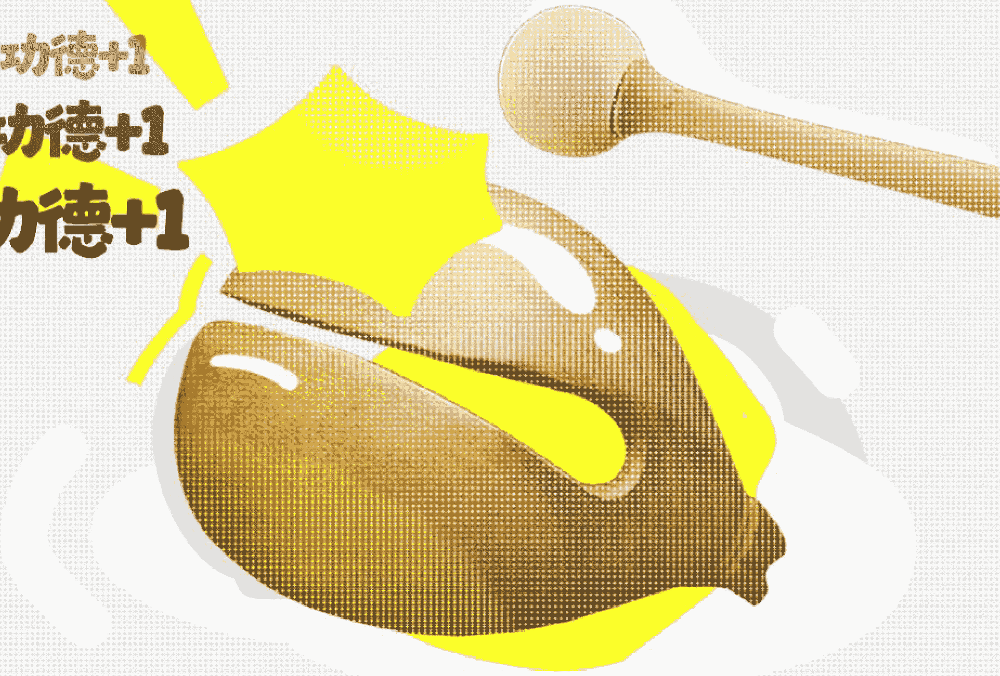

## 社交关键词 情价比消费

## 现象

### 好运喷雾

2024年，以“好运喷雾”为代表的虚拟商品成为新的流行趋势。只要不要块钱，下单“好运喷雾”之后就会收到一段鼓励和祝福的小作文。除了好运喷雾，还有“通用运气”、“高考过”、“爱因斯坦的脑子”等看似毫无的虚拟商品。尽管注明只是娱乐项目，但每当临近期、或者是考研、考公季之前，这些商品依然走红一把。

花费不多，毕竟“用没有”，年轻人仍然乐不疲？除了娱乐之外，年轻人大概不是真的指望不用块钱“逆天”，他们只是想买来5分钟的好情。

### 谷子

2024年，#谷子（Goods商品的谐音，泛指二次周边）不再是二次元专属话题，“谷子经济”的爆发成了A股市场的投资风向。除了谷子，吧唧（微信周边），痛包（即挂满人物徽章和玩偶周围包）已经成为年轻人的社交货币。2024年6-8月，在Soul上关于谷子、吧唧等话题的分享量环比增长576%，阅读量环比增长1270%。

谷子、吧唧、痛包，这些看起来完全符合“极致性价比”原则的行为背后，是年轻人希望在平淡的日子为自己的心情支付更高溢价的意愿。

## 趋势分析

### 敲电子木鱼，念赛博真经

从2023年的“寺庙热”，到2024年的“好运喷雾”，年轻人对于“玄学”的热情似乎日益高涨。但在我们看来，年轻人并不真的关心“玄学”本身。与其说，年轻人希望通过借助“玄学”找到成功的捷径，不如他们只是享受在“投注”那一刻，那种“说不定真的会有好运气的”期待感。生活需要有所期待，年轻人尤其如此。2024年，“接”成为了哔哩哔哩的年度弹幕，累计发送超过576万。每当有UP分享自己的考公上岸、顺利入职、表白成功等“欧气”时刻，年轻人通过这种方式接接好运。

## 社交关键词 情价比消费

## 好心情
## 心流体验
## 情价比
## 成为有趣的人
## 有意义
## 增加与同好话题

我们借用PERMA模型模拟了年轻人的情价比模型。某种程度上，这个模型也代表了当下多数年轻人的新消费驱动力。

## 情价比消费

在这样的背景下，“情价比消费”入选2025年社交趋势关键词。

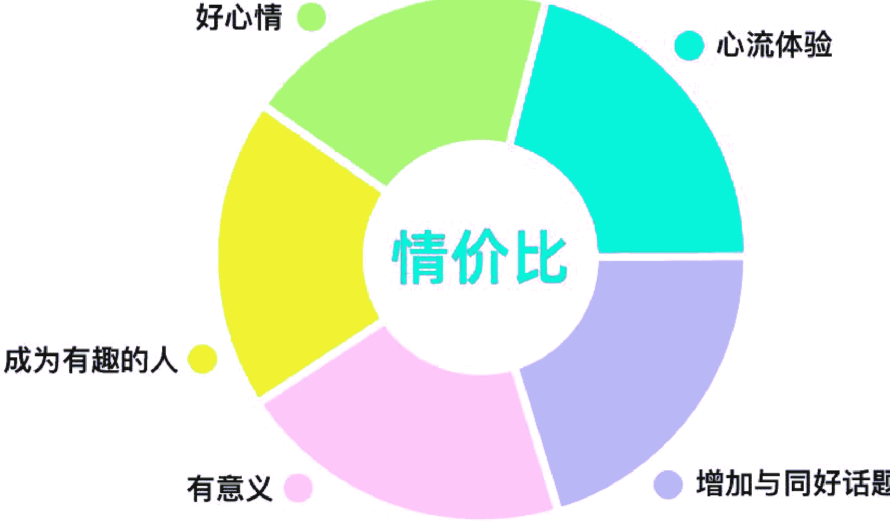

## 拒绝高敏感羞耻

理解并接纳自己的情绪，放下高敏感羞耻，是自我觉知的开始。

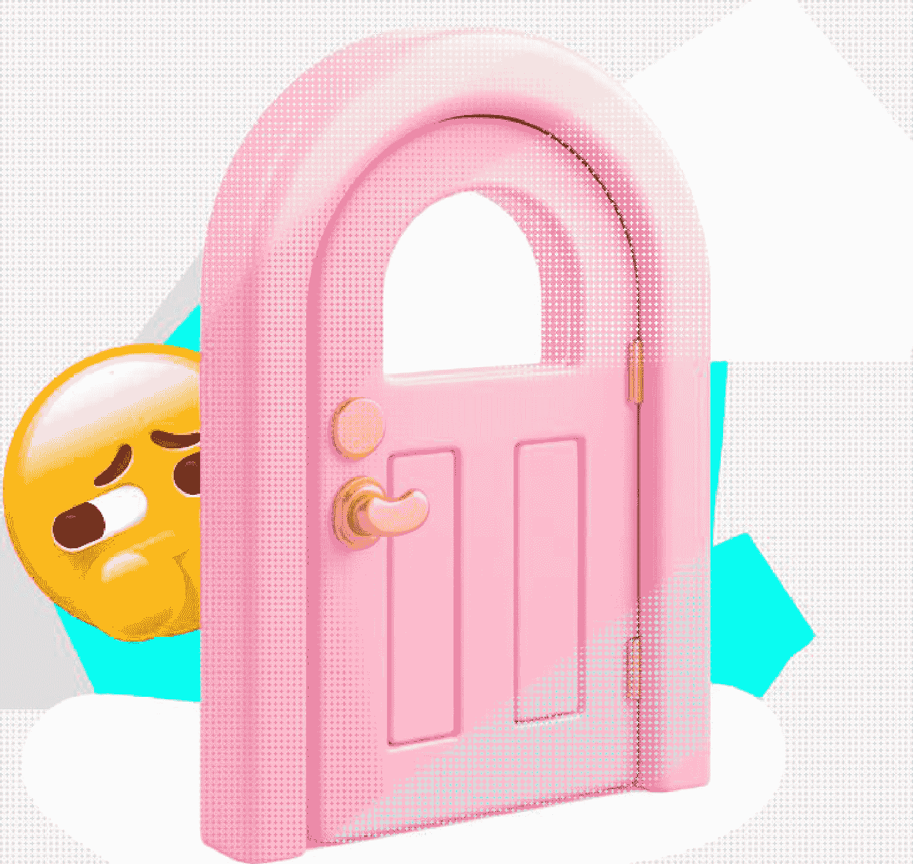

## 社交关键词：拒绝高敏感靠近

## 现象

### NPD

伴随着离恋综艺的现象级爆发，NPD（英文全称Narcissistic Personality Disorder, 即自恋型人格障碍）这样一个相当专业的医学心理学词汇，进入了年轻人的日常话语体系之中。表现强欲、自我夸大、缺乏共情被认为是“确认NPD”的典型表现。

一个时间，#NPD生存者成为了社交媒体的热门话题，年轻人纷纷开始以此为依据，比照自己的伴侣、亲人、同事。2024年，在Soul包含#NPD的相关话题有着超过2416万的阅读量。

比起NPD的热议带来了娱乐、标签化的问题，类似NPD这样的学术概念进入流行语境，足以表现年轻人在试图借助不同的思想资源，来对自己的生活困境寻求何种解释。

### 课题分离

作为阿尔夫雷德·阿德勒提出的心理概念，#课题分离在2024年同样经历了向大众传播的过程。简言之，课题分离的关键在于区分哪些是自己的课题，哪些是别人的，不去干涉别人的课题，也不让别人干涉自己的课题。2024年，Soul用户发布的包含“课题分离”的瞬间超过3440万的阅读量。

年轻人在讨论#课题分离时，他们在讨论是如何拒绝将他的评价标准强加于自己身上，如何抽出自己的主体性。无论是NPD，还是课题分离，年轻人关心的始终都是自己的情绪和心理感受到底哪里，并在在这个过程中完成自我的重塑与新生。

## 社交关键词：拒绝高敏感羞耻

## 趋势分析

正视内心感受，是认识自我的开始

在此次调研中，问及过去一年如何“理解”、应对自己的情绪和心理感受”排在前3位的回答分别是：“浏览相关音视频内容（短视频、播客等）”和“朋友讨论”、“参与运动、户外项目”。

可以看出，浏览相关音视频内容是年轻人最普遍采用的方式，这也与我们观察到的一系列学术概念融入大众话语的趋势相一致。

无论通过何种途径，年轻人正在用自己的方式去理解和认知自己内心的感受，并学习与这种感受共处生活。曾经，“情感”被认为是“理智”是反面，是不成熟的表现，是需要摒弃的；如今，越来越多的年轻人意识到，刻意忽视内心的感受，最终会引起“心里的那根弦”，在某个不期而得的时刻，清醒地断裂。

于是，我们看到，年轻人开始为自己的感受“命名”，开始去寻找那些背后的结构性因素，这也是认识自我的开始。

> Q: 过去一年，您是否通过以下方式来处理焦虑、抑郁、迷茫等负面情绪？

| 项目 | 比例 |
| --- | --- |
| 浏览相关视频内容（短视频、播客等） | 42.5% |
| 朋友讨论 | 39.8% |
| 参与运动、户外项目 | 32.0% |
| 阅读相关书籍和资料 | 26.4% |
| 参与网络讨论（群聊、论坛等） | 22.1% |
| 参加线下活动 | 9.3% |
| 寻求专业人士/机构提供的咨询服务 | 8.4% |
| 没尝试过 | 12.0% |

JustSoSoul“年轻人社交活动趋势”调研报告no.1253，日期：2023年12月24日。

## 照个体，才能超越个体困境

人主义心理学者卡尔·罗杰看来，每个人都拥有成长的内在驱动，而只有当我们接受并理解自己的感受，这种内在驱动才能转化为一种积极的倾向。

在个体化时代，几乎所有根源都指向自我与外部的关系。有一种声音认为，年轻人过度关注自我，这种“过度关注”可能让现代人丧失与他人共情的能力。然而，我们观察到的趋势相反，年轻人开始向内观察，正视自己的感受，这看似个体化的行为，却创造了超越个体、形成社群的可能性。当人在各种线上或线下的社群中，分享自己的经验，认同他人的感受时，个体的主体性构成了“共享叙事”，而这种“共享叙事”将温暖每一个孤独倦怠的年轻人。

在这样的背景下，“拒绝高敏感”入选2025年社交关键词。

## 重返三次

JUST SO Soul：在这个时代，习惯了二维世界的年轻人回到线下，去发现更立体的“人”。

## 社交关键词：重返三次

## 现象

### 跟着“游山西”

2024年，《黑神话：悟空》火了山西。在所有关于电子游戏的刻板印象中，年轻人沉迷虚拟世界，对现实失去兴趣是常谈。然而，“游山西”的案例告诉我们，对现实的热爱可以成为年轻人回归生活的契机。

### 重新发现线下

年轻人正在重新发现“线下”的魅力。2024年，SoulAPP发布的“脱口秀”、“聚会”、“菜市场”、“演唱”等线下相关的瞬间，超过1亿。无论是小型读书会、线下剧本杀，还是大型脱口秀、音乐节，习惯了互联网高效、便利的年轻人似乎突然发现，有些事情并不需要高效，也不需要那么方便。就像Soul用户用“热闹”那样——去街边逛逛小店，而不是仅仅收集爆款打卡点；和朋友聚在一起面对面聊天，而不是昏天地狂手机；去菜市场挑选新鲜的蔬菜，给自己做饭，而不是看着外卖纠结。

于是，越来越多的年轻人选择回到线下，回到具体的生活里

## 社交关键词：重返三次元

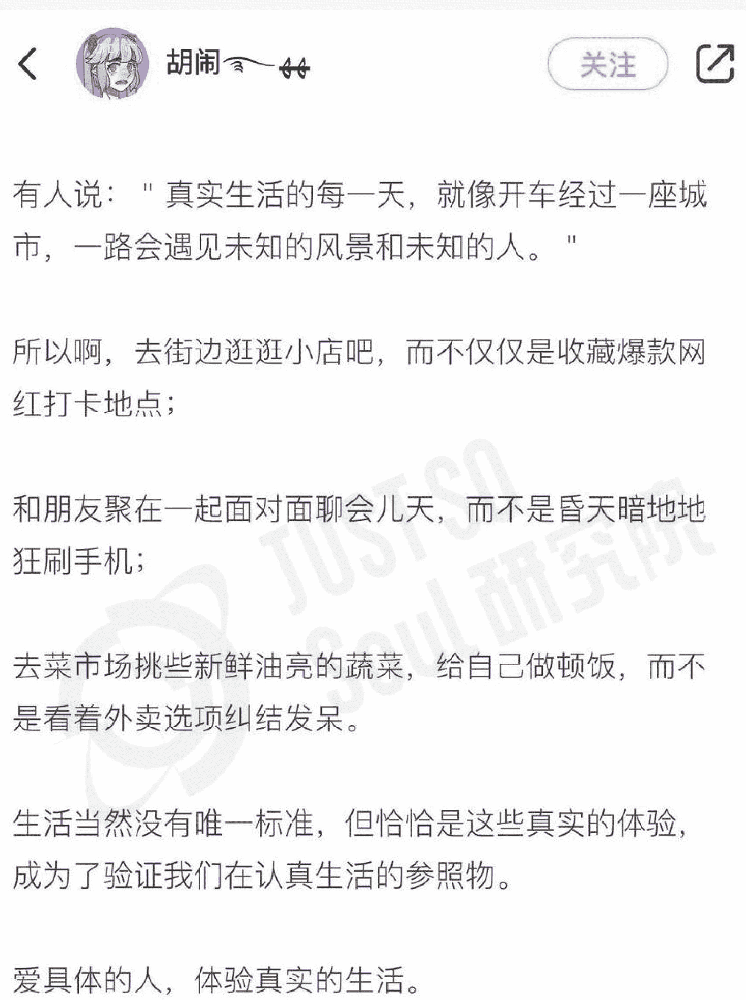

有人说：“真实生活的每一天，就像开车经过一座城市，一路会遇到未知的风景和未知的人。”所以啊，去街边逛逛小店吧，而不是收藏爆款网红打卡地点；和朋友聚在一起面对面聊天，而不是昏天地刷手机；去菜市场挑些新鲜的蔬菜，给自己做顿饭，而不是看着外卖选项纠结发呆。生活自然没有唯一标准，但恰恰是这些真实的体验，成为了我们在真实生活的参照物。

爱具体的人，体验真实的生活。

## 趋势分析

### 人是社会性的动物

正如亚士亚里士多德所说，人是社会性的动物。几乎所有关于Z世代的代际研究都指向同一个结论：互联网与社交媒体正在让Z世代成为前所未有的、孤独的一代人。

去线下，首先意味着面对面，意味着具体的人聚在一起。于是，“去线下”，天然地与“不孤独”联系在一起。

在此次调研中，我们邀请被访者为自己当前的幸福感打分，从1到5分，分数越高，越幸福。我们发现，在所有潜在的影响因素中，以何种方式“理解、应对自己的情绪和心理感受”是最重要的。那些选择“参加线下活动”、“参与运动、户外项目”的年轻人拥有最高水平的幸福感，而那些“没有尝试过”任何方式的年轻人最不幸。

换言，尝试通过各种途径去理解和自己的心理感受，总是好的，总是会让年轻人感觉“更幸福一点”；其中，回到线下，无论是参加线下活动还是参与运动项目，与更多具体的人在一起，是最幸福的。

| 通过哪些方式尝试理解、对自己的情绪和心理感受？ 幸福感 |
| --- | --- |
| 参加线下活动 | 3.65 |
| 参与运动、户外项目 | 3.57 |
| 阅读相关书籍和资料 | 3.52 |
| 寻求专业人士/机构提供的咨询服务 | 3.47 |
| 朋友讨论 | 3.46 |
| 参与网络讨论（群聊、论坛等） | 3.46 |
| 浏览相关视频内容（短视频、播客等） | 3.38 |
| 没尝试过 | 3.03 |

JustSoSoul“年轻人社交趋势”调研，样本量：1253，日期：2024年12月。

### 生活藏在“美好无用”里

为什么要去？因为只有在线下，菜市场里的新鲜蔬菜才有意义；因为只有在线下，那些好看的小店、一场烟花、一次音乐节，都是具体的生活。这种生活总是有无穷尽的，恰恰是这些“美好无用”构成了生活本身。与其说年轻人重返线下，不如说，他们在具体的生活中获得幸福。在这样的背景下，“重返三次”入选2025年社交关键词

## 社交关键词：为世界重赋

## 现象

### 祛魅

1600年前的德国社会学家马克思·韦伯提出的“祛魅”（Disenchantment），一个用来描述现代社会理性转型的学术概念，在2024年成为了流行语。2024年，在Soul上，年轻人发布的包含“祛魅”的瞬间增加了68%。在入职大厂Vlog里，每天以上的通勤时间、工作强度面前，年轻人选择一套穿搭，安静地宣告：“我累了”。曾经对于浪漫的情怀，在自我与他者的反复确认过程中，年轻人不再期待爱情，他们只是对爱情“祛魅”了。

### 抽象

2024年，#抽象成为了小红书的年度关键词，超过1000万相关的笔记以及1.6亿评论，共同构成了这个抽象的趋势。当“抽象”这个概念被重新发现之后，它仿佛变成了一个流行黑洞。面对那些让人费解、尴尬、无奈的人事，年轻人不再争辩，而是幽幽地说一句：“这真的很抽象”。

## 社交关键词：为世界重赋

## 趋势分析

### 做一个自己喜欢的人

用诸如“躺平”、“放弃”这样的关键词概括年轻人对待生活的态度似乎几乎不公，也不客观。尽量用“世界是个草台”这样的表述带有一种认清“真相”之后的失望，但就像铁锤在《好东西》里说的那样，是因为我们足够乐观和自信，才能直面生活的困境。

换句话说，年轻人并非不再热爱生活，他们不再接受“如何理想生活”的现成答案。探索与寻找答案的过程中总是迷跚，但年轻人恰是在这样的过程中成为了更完整、更强大的自我。当问及哪种状态接近你理想的生活时，排在第一位的答案是“有自己的爱好，自由自在”，而排在最后一位的是“魅力，有很多人追捧”。

| 状态 | 比例 |
| --- | --- |
| 有自己的爱好，自由自在 | 36.0% |
| 财富自由，想买什么买什么 | 31.3% |
| 结婚生子，有美的家庭 | 15.4% |
| 事业有成，工作上有成就感 | 11.1% |
| 有社会地位，受他人的尊敬 | 3.3% |
| 有魅力，有很多人追捧 | 3.1% |

JustSoSoul“年轻人社交趋势”调研，样本量=1253，日期：2024年12月。

对于那些依赖他人认可、指向优越主义的评价标准（比如有魅力、有地位），年轻人真的是“祛魅”了。如果一个人的“成功”只能建立在很多人的“失败”之上，那么我们又该如何面对一个大中人都是“失败者”的社会呢？

从这个意义来说，今天的年轻人反复在追问的恰是，我们如何能够上一种不以“比较”为前提、以“战胜”为目标的生活。

## 为世界重赋

关于马斯克看来，祛魅的过程并非单向的、线性的，现代社会反而在“祛魅-重赋”的过程中循环往复。所谓“重赋”（Reenchantment），就是重新赋魅的意思。

当年轻人将身体作为最小单位试图找回生活掌控感时，习惯了二维世界的年轻人回到线下，去发现更立体的“人

当年轻人将目光投向附近的生活，以及那些美好而无用的细节，他们感觉自己不受困于主观世界，他们选择“行动”去为世界重赋。

生活的意义不会从天降，也非来自主观世界的望梅止渴，生活的意义从那些试图为世界重赋的行动者实践中，涌现出来。

在这样的背景下，“为世界重赋”入选2025年潮流关键词。

## 免费 价值 及时 专注

## 扫码加入 知识星球 免费资源群

+   - 每日获取价值资源

+   - 可提供各类资源搜索服务

◆热门付费文章
◆各行业报告
◆精选图书资源
◆副业赚钱方法
◆职场实用资源
◆AI经营自媒体

公众号: 知识星球   微信: jntjsg8   微信: jntjsg2

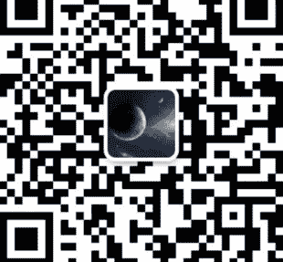

分享资料仅供个人学习，请及时删除，切勿商用传播
