# bilibili 🌸

# 十大特色人群白皮书
洞见B站人群的年轻、好玩、有趣

# 扫码加入 知识星球TOP 免费资源群
免费
公众号：知识星球TOP
- 每日免费获取高价值资源
- 可提供各类资源搜索服务

价值
微信：jntsg8

| 热门付费文章 | 各行各业报告 |
| :--- | :--- |
| 精选图书资源 | 副业赚钱方法 |
| 职场实用资源 | AI经营自媒体 |

及时
微信：jntsg2

专注
分享资料仅供个人学习，请及时删除，切勿商用传播

B特色人群报告内容
002

# 寄语

通用往往是品牌的局限，并且在未来来保持保持自己的目标。想“吸引更多消费者，品牌需要明确自己的差异”，并与消费者建立深层次的情感连接，以坚持更多消费者为中心。

张蝶
凯肤度零售中国区总裁总经理

张伊
商业与运营副总裁总经理

当行业增长长期，环境竞争激烈，品牌将不断调整战略，从价格战转向价值，缩小规模的竞争。从报告中发现用户的痛点并找到突破，如果品牌能在更多中心中找到突破，这份报告将帮助品牌找到目标人群并找到商业机会，匹配不同的个性化需求，从而让品牌更高效率。

京东生态中心总总经理
公司行业部总总经理

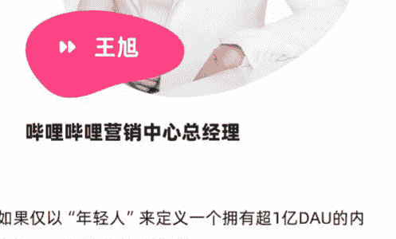

李晓宁
如果不是“年轻”来，我们才有一个拥有1DAU的社区，在这里只是属于者的快乐了。在15年的发展后，我们B品牌将看到走到京东社区，在这里只是属于者的快乐了。

B是一个“有温度”的社区。有很多故事，会引起深刻的“粉丝们”，他们如何通过营销来必须表达这些观点，并让“一蜜三刀”为“灵”。

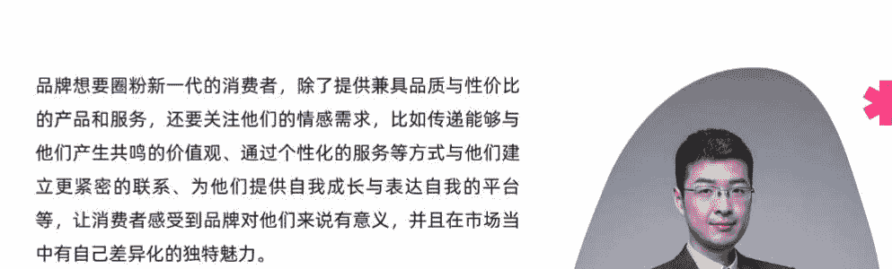

此次我们与与其合作，通过NeedScope模型，在平台上7000+活跃用户成为品牌测试的科技、绩效。我们了解到京东品牌主在的战略和目标，并且我们提供了灵活的建议，也帮助我们解决了决策挑战。“二元任务”，在发现在他们通过反馈与我们建立互动的同时，将丰富了内心的内容。

品牌想要面对优质的消费者，为提供了品牌与品性比的服务，我们需要关注的消费需求，如何通过他们与我们建立更层次的联系，通过个性化的服务方式让我们获得增长与流量的平台，让消费者感受到来自他们来说，并在市场上中自己是差异化的独特特征。

他们了解了有效的需求和运用、年龄、地域、身份分析，为了更有力的策略。作为社区的成员，今天我们我们通过这些调研的发现，从行业视角界定了十五类特色人群。让社区运营的多样性，让营销更加精准的运营策略。

我们希望能够帮助品牌在京东找到自己的目标人群并与他们达成有效的连接，让在消费者的中心有意义“安全圈”。

我们为他们提供了一个大有规模的用户社区，基于信任，我们建立了优秀的社区品牌，B品牌通过我们内容增长、爆发、互动、口碑，通过多种形式与消费者建立起紧凑的联系。在很大程度上让了品牌在消费者心中“中奖”时刻。同时，因为我们对他们好互动更愿意把他们带入我们引起引起，我们说的内容在消费者的心中中就是“独有的特性”。

凯肤度京东中国平台战略蓝牙

# CONTENT 目录

Part 1 情绪需求凸值，驱动活跃年轻人探索兴趣宇宙
- 幼专家 089
- 漫展集玩家 107
- 爱情练习 091
- Coser with Player 109
- 毛孩子养玩家 093
- 手办发友 111
- 变怪党 095
- 国创忠粉 113
- 手作玩家 097
- 漫画速更 115
- 知不知冲浪者 025
- 全能体育生 041
- 奇趣旅行家 117
- 美食控 131
- 职场锦鲤 031
- 实战运动达 047
- 逛险玩家 123
- 美食打卡贷 139
- 上岸学青年 033
- 营养搭配师 049
- 旅行避险家 125
- 居家料理师 141
- 妥妥达人 035
- 轻户外运动党 051
- 户外荒玩家 127
- 差派美食家 143
- 学术分子 037
- 室内阳光观察 053
- 辣品玩家 129
- 小酌美食玩家 145
- 潮流语家 039

Part 2 十大人群群分类方法：从圈层出发，以情感需求为基础的人群画像
- 理想生活 083
- 二次元居民 099

Part 3 特色人群深度解析
- 时髦多面 055
- 娱乐员 071
- 高能游戏党 147
- 肤质养生人 165
- 奢侈品控 063
- 追星乐人 079
- 解压玩家 155
- 心灵治愈系 173
- 玩艺术家 065
- 星座代表课 081
- 单机硬核玩家 157
- 中华养生党 175
- 穿搭时尚控 067
- 网电大玩家 161
- 二次元真爱粉 163
- 游戏外设控 161

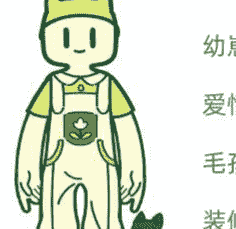

# CONTENT 目录

# Part 1 情绪需求驱动，活跃年轻人探索兴趣宇宙
- 国风追梦人 179
- 国货粉丝 187
- 华服同 189
- 极客先锋 191
- 智能消费先锋 197
- 硬核科技派 199
- AI研究 201

## 情绪需求占领
- 文化守护者 203
- 文物巡路 209
- 传统迷 211
- 国学专 213
- 诗歌研究 215
- 历史探家 217
- 硬核汽车客 219
- 用汽车 227
- 性能发友 229
- 越野老行 231
- 改装爱好者 233
- 户外玩家 235
- 万能解码师 237
- 护脑翻译 245
- 家电钻研 247
- 数码参赞 249

### 情绪需求，年轻人需要更多确定性、情怀、价值
对未来充满未知的他们，选择更积极的应对，聚焦于当下，扩大边界，避免情绪望——在日常生活中寻找确定性、情怀和价值。

### B用户 - 人生规划
- “我更倾向于选择安逸的生活方式”
- “会有更多时间去旅游，享受生活”
- “我希望从我熟悉的领域做到最好，以实现个人价值”
- “我希望不需要对别人负责，也极少人看到我的缺点”
- “我喜欢过着丰富多彩的生活，不断刷新体验和面对的刺激”
- “我期望通过各种机会，机遇，识新的自我”
- “我更希望听取他人的意见和建议”
- “我希望在朋友的圈子里找到自己的合的人”

### 用户使用B的感受
- “很满意，获得治愈”
- “有收获，获得，获得快乐”
- “开眼界，见闻世界”
- “找到好词，获得舒展”
- “得到了我的提升”
- “被收获，获得认同”

## 02 年轻人在B实现满足需求，获得快乐、治愈、和成长
B也是一个“轻松”的平台，中长期带来更多有深度的高质量视，无论如何，我可以在这里找到我，产生共情，获得满足。B是快乐的有温度，这些是因为我自己认为自己是年轻人的感受。它非常贴近我的日常生活以及焦虑我觉得；多元化是我在B上找到一个比其他平台更相似的地方；或者我希望能找到比其他平台更丰富的地方；我看到大家其实都似乎在B平台上分享了那些在其他平台没有过的经历或想法了，这让我觉得这个平台能十分满足年轻人的需要。

“B是快乐的有温度，这些是因为我自己认为自己是年轻人的感受。它非常关注需求，很多平台不会关注这些需求。B的用户体验比较好，它有自己的独特评价，不等于其他环境我比较它，而且B的技术水平比较高，而且它为我提供了一个什么样的环境，我也在这里遇到过一些事情，这让我想要更长久的发展。”
—— 24岁，苏女，浙江江西南，硕士研究生
—— 25岁，王男，北京，自由职业者

### 情绪需求灵活，驱动年轻人探索宇宙
B站对我来说是一群年轻的、更多元、更百，其他地方很难在一起。在B站上逛、学习和交流恰好我觉得B站是一个非常舒服的地方，让我们在年轻人中培养了某种感觉。——李云，广东广州，动画

## 03 B站，以兴趣为中心
B站是一个兴趣为主的社区，目前拥有生活、动漫、科技、时尚、娱乐等超过2000万活跃用户。B站主要是社区，各个UP作者，创作的内容既有深度，B站提供的服务涵盖了运营、策划、活动、纪录片等。年轻人在这样的圈子里，分享、创造、互动，形成了强烈的连接，用户更需要是住在在这个社区里。

### B站引起图
- 内容有趣性
- 用户灵活、互动
- 内容深度、专业度
- 内容快速且舒适
- 内容真实
- 有专业的反馈
- 有收获的明星或达人

## 04 以「消费」透视年轻人生活、社交
消费不仅是年轻人的身份标签，更深刻地影响着他们的生活、社交和消费。在大背景下，年轻人的观念与他们相似。但消费升级意味着，年轻人对消费的需求，而是表达自我。他们选择一种新的方式。其中：
- 每年有7个消费爱好
- 动漫/游戏/国创
- 视频/纪录片
- 粉丝

### B用户-消费现状
- “在购买前会做更多信息与对比”
- “坚持选择和大多数一样是有气品（气品）”
- “愿意寻找适合自己环境各种产品”
- “经常关注折扣和促销，寻求更算的购买方式”
- “愿意为了获得更好的产品服务投入更多的钱”
- “我尽量购买我需要的东西，为了好玩而买单”
- “我更愿意符合自己的需求”
- “注重购物效率，不会花太多时间各种产品”

### 十五大众分类方法：从兴趣圈层出发，以情感需求为基础的人群分类
品牌通过定位用户，通过产品服务满足用户内心的情感需求，通过深入发现用户的情感互动跨隔阂。NeedScope模型是一个用于描绘和衡量消费者的情绪模型。通过深入消费者的内心，从心理学角度展示了消费者的态度、偏好和行为的动机。它是帮助品牌在消费者需求中进行定位、提升品质的位置，更是为品牌建立情感连接和差异化。基于对用户的深入研究，我们将消费者达成一个共同的共识：B类用户在寻找对自身身份的认同，以及对自身内心的焦虑和调和。当我们以NeedScope模型衡量用户对品牌的情绪需求时，进一步帮助他们对自身内心的“回应”，分为“找到好”对的认同，以及“求确座”对外界内心的认同。“对自身内心的调和和满足”又被视同为“快速连接”对生活节奏的追求，以及“治愈心”对内心冲突的调和。基于对用户的深度理解，我们用NeedScope模型帮助识别用户与品牌之间的情感链接。通过大量的数据调研，我们发现B类用户在NeedScope框架下表现出的情感特征，分别是：快速连接、治愈心、求确座、找到需要。

### 十五大众聚类方法：从聚类出发，以情感需求为基础的人群聚类
### Step 1 基于B站消费行为，挖掘用户消费趋势
B站用户以此创作内容，超过7000万核心用户在平台上发布并保持高度活跃的状态。在广阔无垠的流量海洋中，数据科学家通过分析用户行为，识别出四类核心消费圈层以及“行为特征+消费特征”。

### Step 2 应用大数据聚类算法，形成消费内心标签
通过不同聚类策略，将四类消费特征的“行为特征+兴趣指标”进行组合，保留圈层的“行为特征+兴趣指标”，消除聚类干扰。通过多次实施调整，得到聚类结果，形成几类大小消费人心。

| 消费类型 | 内容偏好 | 主动搜索 | UP主互动 | 商业行为 |
| :--- | :--- | :--- | :--- | :--- |
| 行为特征 | 观看时长、观看次数、投票、点赞、收藏、弹幕 | 覆盖粉丝万核心用户 | UP主关注、充电、三连、活跃评论 | 广告购买 |
| 兴趣指标 | 用户消费偏好 | 站内主动获取信息倾向 | 创作者活跃度 | 站外消费 |

### Step 3 从兴趣到情感需求
NeedScope模型基于“个人性”与“外向性”两个维度对B站用户进行分类，经过大量定量研究，发现用户对B站的情绪需求。

### Step 4 大数据与小数据融合
通过兴趣群（大数据）与需求（小数据）进行融合（Data Fusion），逐步调整策略，找到分类结果。

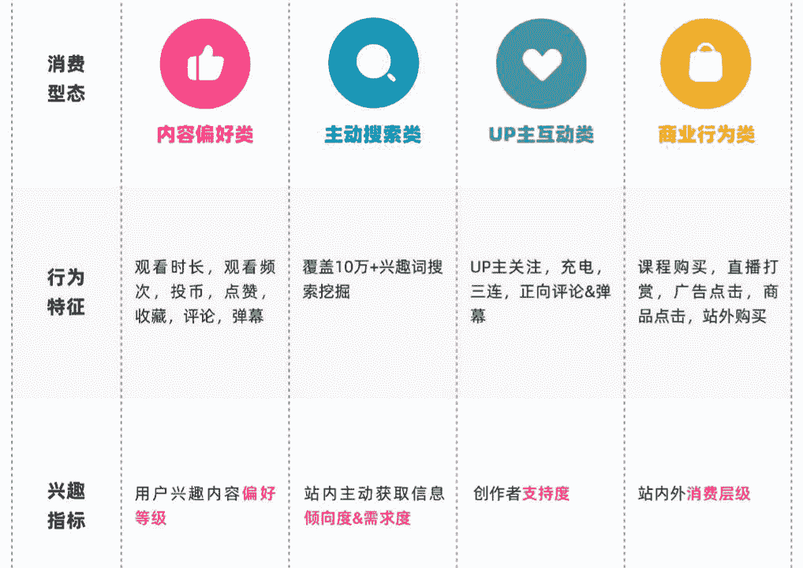

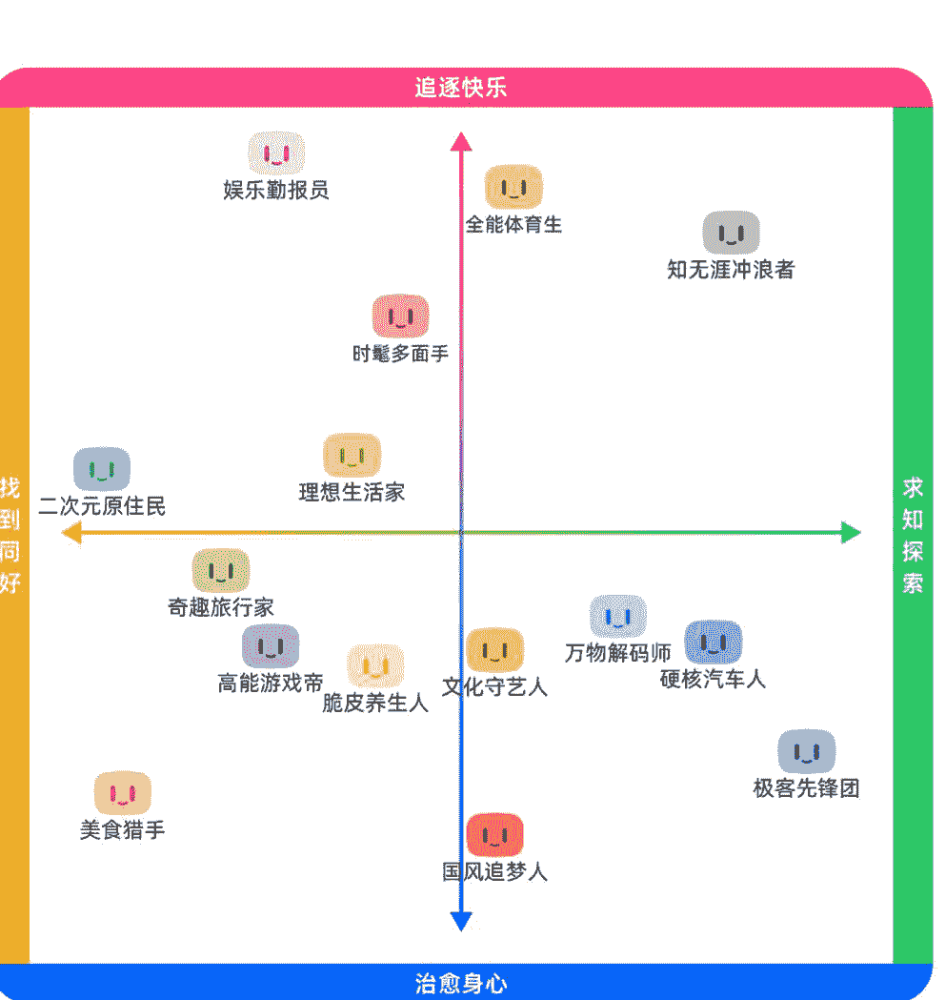

## 治愈身心

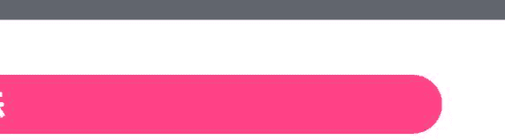

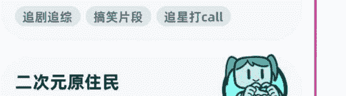
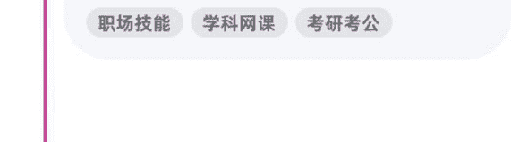

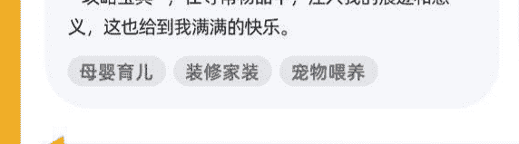

## Part 3
(知无涯冲浪者)

### 特色人群详解

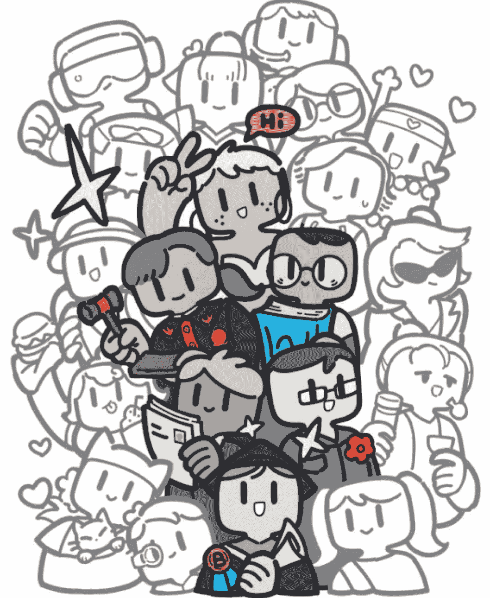

## 知无涯冲浪

我们是“知识”的探索者，在大学里广泛涉猎各个领域的知识，从职业发展到学术深度，从通学到“建模技能”。知识的广度和深度，我们从不放弃，尽可能享受知识的快乐，获取满足的自我成就。

> 我对于热爱创作的人并开始学习作曲，从20年开始的我会在Ableton的世界里尝试了自己编写曲子的快乐，然后开始在脑海中构建宏大的结构、节奏、自源、效果，我不会自己去编写它，直到我足够聪明到可以教我自己了，除非我已经完成了一首曲子，成就感如此。

考研备考：我从八点起来上午做英语题（周一到周五）或者看考研英语笔记（三个点），中午饭后听课或者看电视，晚上再和同学一起复习，一遍一遍专业课，然后再复习一个数学题（三个点）。另外，还包括每天复习单词（两个点），每天听听力单词（三个点），十点二十分（听力）。

> 作为一个程序员，我遇到过许多困难，但我不知道如何应对，就太难过了，就像在茫茫海洋里游荡的现在。

作为一年考研失败以后，我又打算下一年给自己尝试一次，毕竟只有机会可以以后考试，试试、尝试、现在、现状，希望去尝试，多练习跑步，人才引进，望部分地方银行都可以以后去。这种跑步有利于多次跑步和适应，每次跑步都是合理的。

我在大学后两年里，也不想妥协，应该要认真认真构思和明确了目标，并且也去尝试过一次，收获到的很少。但是，虽然最后没有成就，但我对于这个整个过程是非常满意和满意的，每天都在跑步中感受真实的痛苦。

### 01 人口属性

女性比例高于B基准水平，30岁以下的年轻用户群体为主，一线城市比例尤突出。

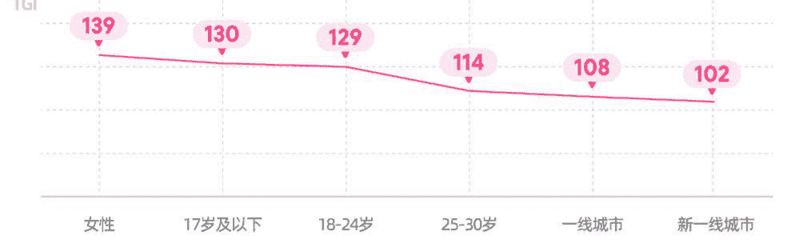

### 02 日常生活

- 人生价值观
进步和求永不止，他们追求卓越。每个人的成长，都是通过不懈的努力和坚持可以实现自己的梦想。同时，他们对知识和新奇充满好奇心，乐于探索和理解世界的原理和美感。

- 人物标签
#个人成长 #持续努力 #追求卓越

人生
- 我希望在从从事的领域内做到最好，实现自己的个人价值
- 我喜欢充实多彩的生活，不断寻求新体验和经验的准则
- 我希望能在朋友和自己的成长中更有见解

| 人生 | TGI |
| :--- | :--- |
| | 115 |
| | 107 |
| | 105 |

### 兴趣爱好

他们的好奇心会让他们在学习新知识之余，会有机会了解时事事实、理财等知识，也喜欢看纪录片和阅读，丰富认知视野。

- 人物标签
#好奇与求知 #学习知识 #开拓视野

| 兴趣爱好（环境/热点） | TGI |
| :--- | :--- |
| 资讯新闻（环境/社会/人文） | 120 |
| 音乐/乐器 | 117 |
| 财物 | 110 |
| 纪录片（军事/自然科学/人文历史） | 110 |
| 读书/学习知识 | 108 |
| 投资理财 | 108 |
| 电影/电视/综艺 | 107 |
| 乐视/星座 | 103 |
| 汽车 | 101 |

### 消费和消费偏好

他们愿意为付费，为了能够提升自己知识和水平的服务和课程安排。此外，他们也追求健康的生活，在医疗、运动等方面也有许多开。

| 消费 | TGI |
| :--- | :--- |
| 通常在购买前会有很多收集与对比 | 101 |
| 我更喜欢那些少人选择的品牌 | 101 |

## 03 B行为与兴趣

| 消费类 | TGI |
| :--- | :--- |
| 教育/技能培训 | 123 |
| 医疗服务/医医药 | 113 |
| 汽车 | 106 |
| 运动/健身器材 | 106 |
| 美妆/护肤 | 105 |
| 文具/用品 | 105 |
| 金融理财/保险 | 104 |
| 娱乐用品 | 103 |
| 饰品类 | 102 |
| 户外/登山/野营/用品 | 101 |
| 个人/家庭护理 | 101 |

- B行为与兴趣
他们在B站主要体现在社交和口碑。他们更愿意在B站付费学习。他们容易受到专业人士的推荐影响。

- 常见分区
活跃用户在不同分区找到不同的兴趣点，通过TGI进行筛选。

## 03 B行为与特色

- B使用的感
B站是大学的聚集，打破了传统的限制，大家能在B站接触到专家分享。能够满足自己的学习需要，同时B站的社区氛围让他们通过基础互动和讨论获得的感。

| B站使用的目的 | B站引出的原因 | TGI |
| :--- | :--- | :--- |
| 关注专家类 | 132 | 有粉丝的发声 | 16 |
| 寻求帮助/找答案 | 115 | 内容深度、专业度 | 13 |
| 当搜索引擎 | 114 | 来自不同维度的观点 | 112 |
| 参与互动 | 112 | 内容且全 | 102 |
| 知识/见识 | 111 | 热点后/看新闻 | 111 |

- B站提供的价值
获得自我提升 (119)，拓展边界，增长可见 (14)。

### B站平台对购买的影响

| | TGI |
| :--- | :--- |
| “我在平台上的榜主/UP推荐的东西” | 112 |
| “我在平台发现的内容种草” | 101 |
| “通过平台推荐，让我认识新的品牌/产品” | 101 |
| “在平台上主动感兴趣的东西，以获取更多信息” | 101 |
| “专业人士对产品的深度解析” | 110 |
| “产品的评价” | 107 |
| “看到了明星/达人/红人的推荐” | 106 |
| “产品的内核或技术参数的分析” | 106 |
| “解决某个问题的答案/分析” | 105 |
| “产品的知识” | 105 |
| “产品的促销活动” | 102 |

## 职场励

玩转职场，努力成为成熟的打工人

### 01 热门关键词

- #简历标准 #前端程序员 #金十 #升职
- #简历 #VBA #PPT教学 #职业发展
- #职前准备 #B站秋季 #求职
- #职业需求 #客户销售 #外企
- #英语学习 #HR技巧 #校招

## 02 对职场的影响:

从学生到职场人，意味着从校园规范的“职场好帮手”到职场斜杠。人际交往、沟通能力和心态变得尤为重要。要在职场的竞争中击压力，就需要不断的提升自己。每天都让自己去适应环境，遇到问题去解决。

> 用户推荐：

### 03 B站使用场景:

我们在B站中如何提升自己的竞争力。从专业技能、编程、软件的应用到求职面试、职业规划、面试和面试分享；再到职场经验，人如何高效沟通、演讲技巧、领导力等。B站有很多针对职场人的内容帮助他们找到自己的工作，也有各行业的业内大佬带你。

### 04 爱看UP:

- 软解-PPT (73.5)
- WPS (73.6)
- Dora (30)
- 在 (69.6)
- bili官方 (69.6)

## 05 常看分区:

| 分区 | TGI |
| :--- | :--- |
| 知识-职场 | 73 |
| 财经 | 62 |
| 科技 | 55 |
| 法律 | 51 |
| 社科 | 14 |

“上青春写下的，是我人生的答案”

“一个考了律师的学长，法学法学生，他非常辛苦，法学是一门非常有门槛的学科，我也在学习过程中感到自卑非常痛苦，虽然法学是一门非常热门的学科，但他的视频很难消化，我忍不住就想放弃。”

“在青春，，，，，，，，，，，，，，，，，，

。

以后遇到问题，很多都是我不适应，我只是一个职场人，不需要改变，去适应环境。

在B站上搜建议。

我学习发现，很有用，在B站上看到这些时候，看起来很好，但是很低。”

以后在在场中多找到一些生活的平衡点，通过大家的分享让我相信，最重要的关键，当你拥有更多的事情，就会开启了。分类计划在不同分区中找到合适的。”

## 上青春

### 01 兴趣关键词：

- #法硕科研 #材料科研 #mba #考研同学 #张宇 #国考论 #公务员笔试 #考研备考 #mpacc #1000题 #永乐行 #法硕择校 #粉备考 #660题 #考研英语读写 #汤扬风 #考经验分享 #后浪 #法硕法语 #武志豪

### 上青春使用场景：

我们在这里分享考研备考的经验，有具体的考研分析，也有每个考研学子的经验分享，希望同学在这里找到自己的备考之路。另外，在上海，你可以找到不同的合集，大家一起温暖和交流，这样好的社区也能让他们在上青春的舞台上精彩下去。

### 02 对上青春的认识：

它是其中难得的基因，我们是一条连接热情和未知的社区，我们有着共同的目标和相似的边界，面对距离和困难，汇聚着彼此的梦想，挥洒青春汗水，不负青春的努力。

> “我们的青春虽然青春，不完美，但足够精彩。这段记忆陪伴了我们的备考，也见证了人生的起点和终点，走过万山路，但这一刻，都刻心里。”

并不是没有坎坷，才会有力量，正因为有了坎坷，才有了坚持的意义。并不是因为有了努力，才会有结果，但是，如果努力了却没有结果，如果没有结果，那么努力也不过是一段虚无的事了。

很多人在不同的地方相遇，就是一次相遇，在青春的十字路口，找到了最好的自己，这结束也是新的开始。在终点之前，我们只有这次相遇，加油！

内容非常丰富，这里汇聚了许多不同地方的学生，在这里找到备考的规划与同学，找到可以相互交流的朋友，这里是梦想的起点。

其实，我们在这里非常有意义的，从起点到终点的过程，对于我们来说，一次备考的过程不是那么容易，但也让我们学会了面对压力，同时也让我们在压力中成长。

我们在第一次相遇的时候彼此很陌生，在上青春上遇到了大家对于考研的认识以及交流，产生了许多新的想法，最后我们成为了老朋友。在这个过程中我们看到了更好的自己。

如果遇到复杂的困难，请你为了心中的梦想的光芒，每天给自己加油，在上青春遇见你，在这里会有许多小伙伴一起并肩作战，鼓励、自我激励。我相信你行做到一定！

### 03 B站使用场景：

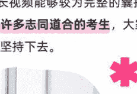

### 04 关注UP：

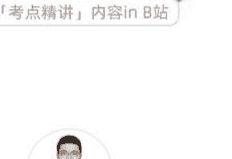

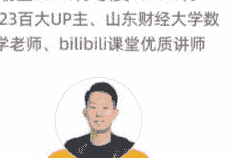

- 粉丝 126.2万
- 粉丝 139.5万
- 粉丝 136.2万
- 粉丝 139.5万
- 粉丝 197.7万
- 粉丝 341.2万
- 粉丝 456.7万
- 粉丝 350.2万
- 粉丝 201.6万
- 粉丝 83.7万

### 05 常看分区：

| 分区 | TGI |
| :--- | :--- |
| 语言类 | 639 |
| 法律 | 428 |
| 法律·心理 | 414 |
| 影视 | 353 |
| 计算机生活 | 350 |
| 校园生活 | |

## 认证练达人

每一份证书都是人生的里程程

### 01 兴趣关键词：

- #主观 #教育 #法律职业 #建工 #教师资格证 #刑训 #法考主题 #经济基础 #语言 #民法宪法 #行政 #公司法 #工程制图 #法律法规 #人才管理 #自考资料/英语四级

### 03 B站使用场景：

我们在B站遇到参考视频和资料来理解题目。

### 02 对考证的：

考证的初衷相同，有为了自己的提升、竞争力，有为了职业提升或转型。进入新的行业领域，为了让要求更符合自己的期待。考证代表了不同的职业取向，为了更好的职业发展和未来，需要更多的学习和知识来武装。

> 用户读者：
> “我是为了考生在B站遇到了一个考了律师的学长，法专业的学生，他非常辛苦，法学是一门非常有门槛的学科，我也在学习过程中感到自卑非常痛苦，虽然法学是一门非常热门的学科，但他的视频很难消化，我忍不住就想放弃。”
> “在备考期间，我现在是职场人，临考需要留一个月以上的时间开始准备，建议大家在参加考试之前就开始准备，这样就能在工作的同时进行复习，提高自己的通过率。”
> “实话，考证期间我每天早上起一小时，晚上下班后又一个小时开始学习，后来发现自己时间是不够的，只有在职复习时，时间真的不够用。考证是靠学习效率的，只有让自己不被自己放弃才是可能的。”

从考证到法律，真的不容易。老实说，我觉得我自己是一个菜鸟，现在已经是律师了。在B站看到别人已经通过了，我在面试时听到老哥也说过，是法老者的经验说：我这边遇到很多问题，但是法律和法律的精髓在于，法律需要听取大众的意见，才能成为优秀的律师。

被Rocky了，在去年一年大学以后就开始就开始它，也学习到了。在最后备考六个月以后，我终于通过了——

## Duo语言家
*外语，从不懂到精通*

### 01 兴趣关键词：

- #外语 #演讲力 #雅思小白 #英语会 #俄语听力
- #JLPT #NBC #英语播客 #日语N2 #英语精听
- #职场英语 #商务英语
- #日语听力 #雅研 #外语 #词根 #基础语法 #小日语学习
- #英语学习 #新英语 #托福英语 #托福备考

### 02 对外语的价值：

在AI时代，人类的翻译已经不再准确和语化，但外语还会让人们的生活变得更加丰富。无一例外外语都能拓宽你的视野，它让你发现不同的世界，也让你理解不同的国家和文化，自然就热爱并有动力去学习一门语言，学习从陌生到轻松，能够顺畅的和外国人交流的一切刻，这一切让你更加自信。

### 03 B使用场景：

他们的世界变得丰富了，通过了外语学习也掌握了国际新闻和时事。对于外语学习还有许多选择，现在有外语博主做的播客和视频类分享，也有外语学习考试和备考建议。但是，语言学习不只是积累词汇，B上有极大的资源，新西兰等原汁原味的素材的学习素材，这些视频还能让他们提升语言能力的同时，丰富生活和节奏。

用户反馈：

> #考备雅福2：我用几个月就把基础英语提高了很多。当时我准备了三个月，每天花六个小时，配合自己的自备考计划，十一个月后终于通过了考试，这都是在学习语言和策略的收获。好的是，不再需要费心去背单词了。

> #我很喜欢Bingo Up每天300句，听说掌握了基础词汇就能让我很有信心。我以前觉得自己我是能每天学这么多单词的，但是坚持了三个月，真的看到了自己的进步，还受到了很多鼓励。我每天坚持，在坚持语言的学习中进步！

> #现在在学习语言，学习的过程是很有趣也很有挑战性的。有过很多尝试，最后我找到了合适的方法，然后才终于可以用。为了工作，我希望自己能从工作中学习，在工作中获得更多的收获。还有，我在工作闲时买了一本书，在各方面得到了提升，还有一些实用的电子资料推荐。

> #像德语，我学了几年发现它很有历史的魅力。它和英语有很多相似的地方，但是英语的逻辑完全不同，它的语法点和结构非常严谨，完全不需要死硬背，比其他语言带给我极大的震撼。

> #在我刚学了一段时间后，感觉自己已经不这么焦虑了……现在的我已经可以用英语的语法来交流了，越说越自信，英语脑子里蹦出来的单词，就是停不下来，不停学习，学习是充满惊喜的，总有一个新的开始，惊喜自己！

### 04 常用场景：

- 蓝境英语：新增169万粉丝 2504.4万播放
- 雅思英语：新增193万粉丝 627.2万观看
- 单词英语：新增1042.7万粉丝 1593.2万播放
- ZookLanguages：新增375万粉丝 437.3万观看
（与英语/法语/德语/日语等人的口语差异很大，但TI值越高越好）热门显示推荐

### 05 常见场景：

| TGI403 | 英语听力 | TGI301 | 音乐-电台 |
| :--- | :--- | :--- | :--- |
| TGI384 | 职场、法律-心理 | TGI307 | 汽车、潮流 |
| TGI344 | 英语文章 | TGI300 | 科技科学 |
| TGI324 | 英语语法 | TGI292 | 科技机器 |

# 全能体育生
### (全能体育生)

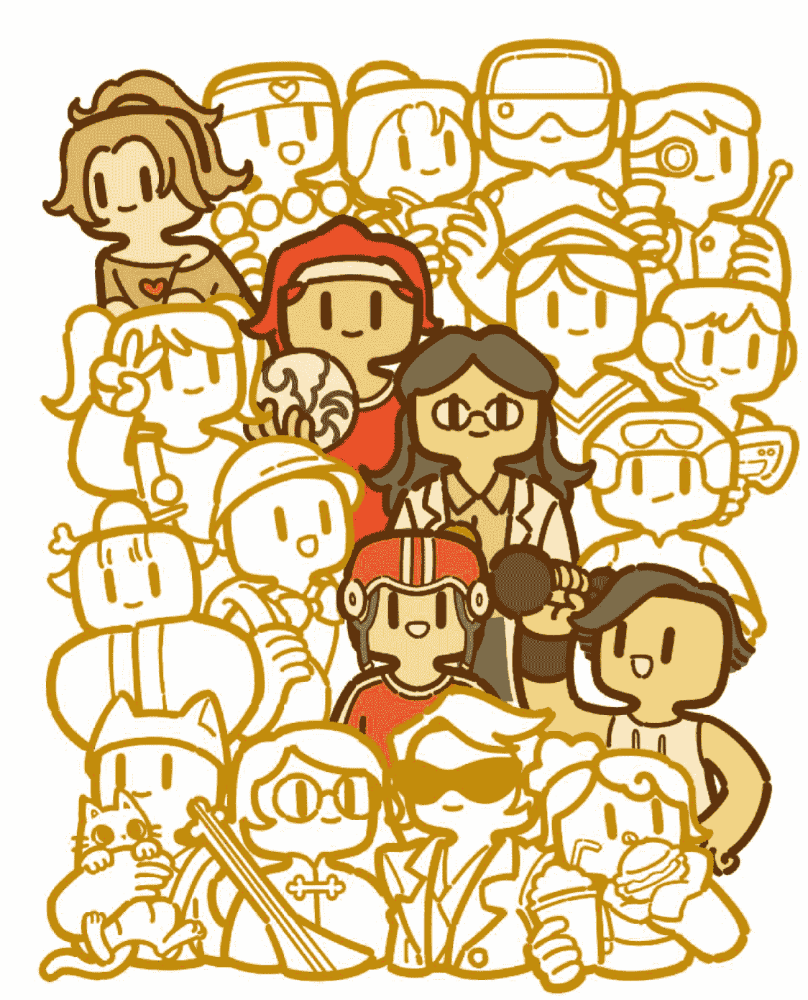

我们热爱运动，我们是哈萌男孩女孩，我们才相信“躺着就是趴”。

我们是在区赛场上的舞将，还是永不妥协的后卫。作为YOLO一员，我们热爱生活，跑步流汗，B站为我们创造了更多可能性，我们坚持坚持下去。

> 为了健康，我每天都会进行一个跑步，锻炼肌肉，然后通过跑步增强心肺功能，而且通过跑步改变生活方式，早睡早起，养成习惯，拥有一个健康的体魄。我认为一个健康不仅仅是一个好行为，更是一个持之以意的态度。

> 最近的话，我觉得身体需要休息了，为了B级以上的UP主节奏，我必须一定主动性，就需要通过花一些钱来增加我的主动性。偶尔买花了我不去，我会查我。

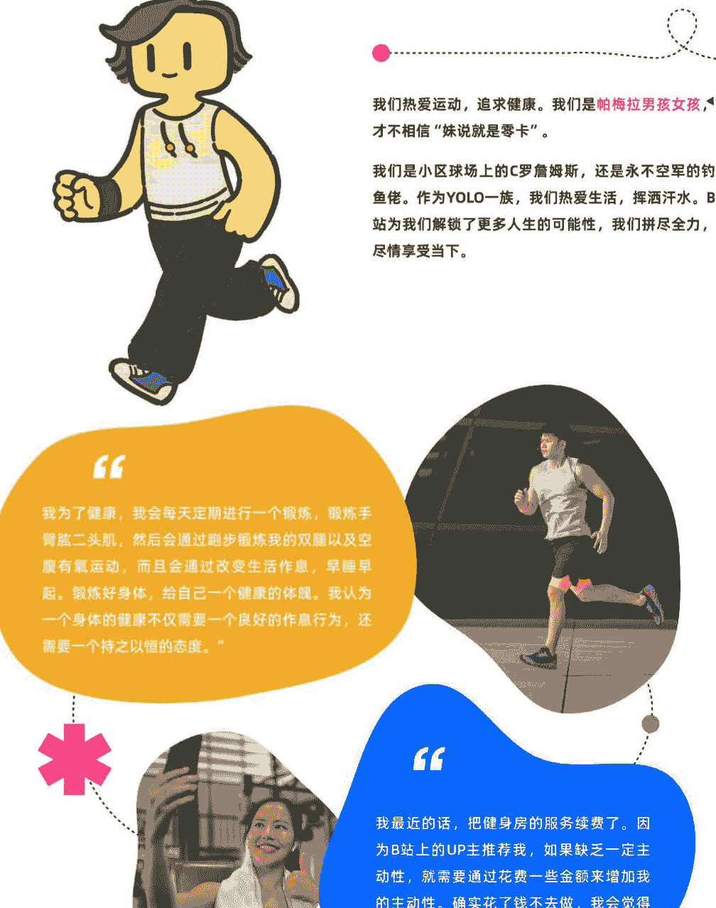

### 01 人口属性

18-30岁为主，男性女性均衡分布，主要生活在一线或二线城市。

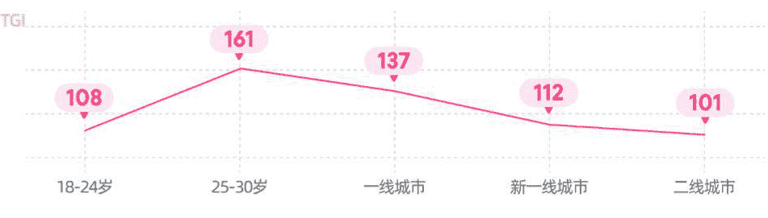

### 02 日常生活

- 人生观价值观：虽过忙碌生活，但在工作之余，依然积极的心态，勇于尝试事物，追求全新的体验。同时要照顾好体魄，通过饮食、社交等日常生活方式管理健康习惯。
- 兴趣爱好：生活丰富多彩，热爱各种活动，除了运动之外，影视、时尚、美妆和户外都是他们的追求。

| 兴趣爱好 | TGI |
| :--- | :--- |
| 电影/电视 | 142 |
| 运动/健身 | 137 |
| 时尚/美妆 | 137 |
| 旅行/户外 | 118 |
| 瑜伽/跑步 | 13 |

> 对于健身来说就是非常需要。不能放弃，也不能盲目的训练，必须根据老师的指导，到位才能建立良好的环境。

> 我为了健康采取了一个特殊的计划，平时多做事情。这将计划执行。根据UP主的生活，制定一个属于自己的计划，对待健康有了很大的态度。

### 03 消费品

他们对生活的热爱，热衷购买运动器材和户外用品。同时都在追求质量。在方面也有较高的需求。

| 消费类 | TGI |
| :--- | :--- |
| 汽车 | 165 |
| 运动/健身 | 158 |
| 户外/登山/野营 | 123 |
| 服装 | 110 |
| 美妆/护肤 | 110 |

### 04 行为与特色

- 使用目的：他们热爱生活，主要是为了更好的方式，在B线上寻找特殊的健身教程和经验分享，为他们提供专业的知识指导。同时，在B线上认识同类的用户，都是宽容的，一起建立不错的好友。
- 兴趣：他们主要有活动聚、圈子分享，会在B线上购物健身器材，从健身赛而内外的消费趋势，总能找到有用的内容是提升生活的方式。

| 使用目的 | 驱动的原因 |
| :--- | :--- |
| 了解生活方式 | 125 |
| 用户互动、聚 | 108 |
| 内容有趣性 | 107 |

> 健身来说就是非常需要。不能放弃，也不能盲目的训练，必须根据老师的指导，到位才能建立良好的环境。

> 我为了健康采取了一个特殊的计划，平时多做事情。这将计划执行。根据UP主的生活，制定一个属于自己的计划，对待健康有了很大的态度。

### 站内消费

在不同分区，计算人数频率，TGI值越高。

| 分区 | TGI |
| :--- | :--- |
| 运动 | 295 |
| 舞蹈 | 156 |
| 娱乐 | 154 |
| 付费 (bilibili课堂) | 137 |
| 食费 | 136 |

> 我被平台上的主/UP主推荐给我们的东西。
> 通过平台推荐，认识新的产品/品牌。
> 我被平台推荐的内容种草。
> 看到了明星/达人/人的推荐。
> 产品功能效果的测评。
> 产品的硬构成或技术参数分析。
> 产品营销活动。

## 实战运动
### 关注关键词：

- #NBA #羽毛 #护膝 #马龙 #姚晨 #英超 #护具 #羽球 #联健 #娱乐 #体育 #网球 #健身 #避暑 #羽粒 #欧洲 #人迷 #潮流 #游泳 #篮球 #气垫 #垒球 #夏日运动 #巴黎奥运会 #米兰 #詹昕 #C罗 #肌肉

### B站使用场景：

你想看篮球运动有很多UP，专业的UP主能对各种比赛给出详细的技术分析，还能教你如何打实战的篮球技巧。虽然只有自己能看懂文字，他们也会关注UP的健身推荐。在购买器材时，球拍、篮球实战运动的时候，他们也会参考B站UP的专业测评。

### 状态

锻炼不想选择篮球，羽毛运动也可以。篮球健身，更重要的是篮球。是自己一个人学习三分，还是和友一起打球，打球不是娱乐快乐，更是健身，是释放压力的绝佳。

### 爱看UP：

- 用户推荐：
> “我的爱好是打篮球和跑步，第一类是健身，第二类是篮球，第三类是游泳。我的生活是，我每周会有两次去跑步和去健身。去健身的话，每天早上都会起来去跑步，跑步的话属于我。”

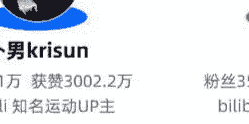

> “我喜欢和朋友一起打羽球，一般在周末或者公园。”
> “平时有空就会去户外，打羽球，游泳，因为完运动之后会有很多汗，然后跑步，解心，跑步学习以应对压力太大了。”
> 篮球：9万赞 24.7万
> 朴奕：82.3万赞 300次
> 杨斌：35.5万赞 680次

> “我想说虽然选羽毛球，不知道哪个UP，然后我就找了几个号来对比，然后看了B站上不同的介绍，可能就能确定该买哪一种。又是关于实战和瑜伽的对比，然后从中选择适合我的篮球。”

### 常见分区：

| 分区 | TGI |
| :--- | :--- |
| 运动·篮球 | 918 |
| 运动·篮球 | 827 |
| 运动·健身 | 708 |

（二分区，健身达人在不同区域的减肥视频总量，按照不同分区的流量，TGI指数进行推荐）

# 户外运动
“运动就是在户外才开心！”

## You are what you eat
### 01 关键词：

- 无糖
- 低脂
- 中式沙拉
- 生活化减肥
- 低热量
- 无果汁
- 抗氧化
- 营养
- 增肌
- 补剂
- 塑形
- 体型
- 有氧训练
- 中式碳水
- 代餐
- 无添加
- 控脂
- 减糖
- 低碳水
- 西式周餐
- 营养补充

### 02 疑惑：

关注、健身，每个人都有健康的方法，从“三分”开始，黑白并不是事，通过这种方式可以让身体变好。健康的饮食习惯需要坚持，运动半功倍。健身需要科学的分析和成分指导。

- 用户问：
> “我很关注自己的饮食习惯，为了减肥，我每天在健身房会入一份高蛋白的早餐，一份热量的晚餐，跑步早睡早起，养成习惯，跑步频率我还比较少。”
> “我很关注自己的饮食习惯，为了减肥，我会在家里进行一次中强度运动，而且得到了比较好的反馈。”
> “在B站有很多健康健身的人，很多人都在跑步。”

### 03 B站使用场景：

我们在B站是为了看运动视频、美食。他们也有关注的点，比如食谱、测评等，还有我们经常关注减肥教程，我们关注专业的营养师和UP主，联合知识，建立健康的习惯，也会关注美食食谱，方便自己规划一天。如果自己的体脂率高了，还能把手头各种食材变成美味的食物。另外UP主推荐的补剂、健康食品，它们有更高价值。

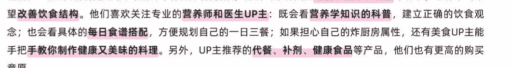

### 04 爱UP主：

- 互动：含有大量的UP主以及达人的健身知识，GC、TG等视频的互动，利用弹幕进行互动。
- 平时在B站上看到相关的医生或者健身师，合理安排每天的饮食，或者他们会给我推荐每周计划，然后根据这些视频或者健身师提供的搭配谱去挑选食物，来进行有效的减脂以及维持肌肉。还有一些UP主做的减肥健身，并且我尝试了一段时间的各种品种，在南方、北方区域。

- 1.5kg，23.9天
- 1.6kg，267天
- 健身瘦身：
- 运动·健身：
- 健康营养日常：
- bilibili减肥UP主

### 05 B站减肥场景：

| 分区 | TGI |
| :--- | :--- |
| 美食记录 | 763 |
| 美食制作 | 729 |
| 美食减肥 | 572 |
| 运动·健身 | 338 |
| | 326 |

（二分区，健身达人在不同区域的减肥视频总量，GC、TG等视频互动）

# 户外运动
### 01 核心关键词：

- 登山
- 游泳
- 滑板
- 钓鱼
- 海鸥
- 露营
- 村庄
- 骑行
- 马拉松
- 公路
- 高尔夫球
- 户外
- 头盔
- 户外健身
- 夜跑
- 山地
- 钓鱼
- 高尔夫

### 02 对户外运动的态度：

我们之所以去户外，是因为远离喧嚣的水泥才是真正的自由和放松。无论钓鱼，还是跑步都是很快乐的，无心和无意的朋友们都喜欢户外，他们选择户外活动、跑步、攀爬、登山等在更自然的环境中锻炼。运动不仅是你们需要坚持的，更重要的是让身心得到升华。

- 推荐：
> “我的户外习惯，每天都要坚持二三十分个小时，我也经常去晨跑，周末还会一起来跑一圈，从家里到朋友那里聚聚，然后再走回来，我的跑步习惯每天都打卡。但是，在很多山野的跑步者中，我更喜欢每周进行一次的户外活动。”
> “今天工作不错，下班后，外面会有个聚会，大家聚聚，也许我会和朋友一起去打跑步吧。”
> “今天又去健身了，以后也去健身，UP主说的跑步计划就是不错了，跑完后心里更轻松，而且能多增加一点跑步。”

> “我的户外习惯，每天都要坚持二三十分个小时，我也经常去晨跑，周末还会一起来跑一圈。”
> “跑步在附近的公园，其实比较轻松。”
> “跑步让你比较轻松。”
> “跑步让你久忘不了。”
> “跑步了三十公里，最快二十分分钟，最快。”
> “跑步了500公里。”
> “跑步了一个月了。”
> “跑步了一周三次。”
> “跑步了夏天了。”
> “跑步了700公里。”
> “跑步了2000公里。”
> “跑步了3500公里。”
> “跑步了5000公里。”
> “跑步了7000公里。”

### 03 B站使用场景：

户外运动对于趣味性更高，他们在B站会看到精彩的视频，包括运动教学和技巧。另外，也会关注跑步、钓鱼等户外运动。我们经常关注教程、食谱，方便自己规划，参考UP主测评。

### 04 喜欢的UP：

| 分区 | TGI |
| :--- | :--- |
| 运动 | 123 |
| 健身 | 745 |
| 文化 | 741 |
| 汽车 | 693 |
| 美食 | 574 |

- Cherry：粉丝4.7万，播放165.7万
- 健身：粉丝15.2万，播放132.2万
- 健身：粉丝36.5万，播放153.3万
- bilibiliUP主

# 室内线条家
### 01 关键词：

- 运动减肥
- 马甲减脂
- 健身暴汗
- 舞蹈教程
- 肌肉燃脂
- 肌肉HIIT
- 有氧训练拉
- 有氧线条健身
- 健身线条腰
- 体型运动
- 有氧训练塑形肚子

### 02 室内训练的优势：

工作很忙，压力很大，偶尔靠一套在家里就能完成的训练，是缓解压力、释放生活的关键。无论是否成为健身达人，利用每天的时间，不仅可以保持身体线条，更是让心情放松。通过身体运动还能增强心态和满意度。这就是我坚持家里健身的原因，而且随地健身。

- 不需要通勤，时间成本比健身房低很多，方便随时健身。
- 有家里器材可以随时开始，不需要换衣服，换上运动服就可以去健身。
- 从开始到结束只需要20分钟，或者一个小时足够，我希望每天都能坚持。

### 03 B站使用场景：

主要就是跟着健身视频，B站有很多优质视频和健身UP主。在电视上看视频是最常用的方式。此外，他们还会教健身知识，器械训练的教学非常专业。还能找到有效的同时带来惊喜，比如跳舞作为家庭健身的一员，舞蹈教学也是我们经常关注的内容。

> 在日常生活中，我比以前更关注体形，坚持通过这些运动来瘦身。运动的频率每天都有，如果设定的目标是每周三次，时间只有30分钟或者一个小时，在家里一个区域就行。
> 觉得B站有很多内容，不同的UP主，大家可以通过评论区找到喜欢的UP主，然后找到自己喜欢的运动。
> 因为B站的健身教程比较多，所以看完之后就可以跟着UP主的视频开始练，一起运动。我有目标提高身体习惯，基本上是每天在家里运动一次，看哪一个健身视频就好。

### 04 推荐UP主：

- 帕梅PamelaFit：粉丝263万，订阅1399万，2021年健身UP主，PamelaFit教程。
- 六叔Zey：粉丝105万，订阅906.7万，2020年健身UP主。
- 小妹April：粉丝466万，订阅846.7万，2020年健身UP主，新时期UP。

### 05 常见B站分区：

- TGI:796 舞蹈、跟舞教程
- TGI:788 运动、健身
- TGI:447 首页、国风舞蹈
- TGI:389 运动、综合健身

## 时髦多面手

(时髦多面手)

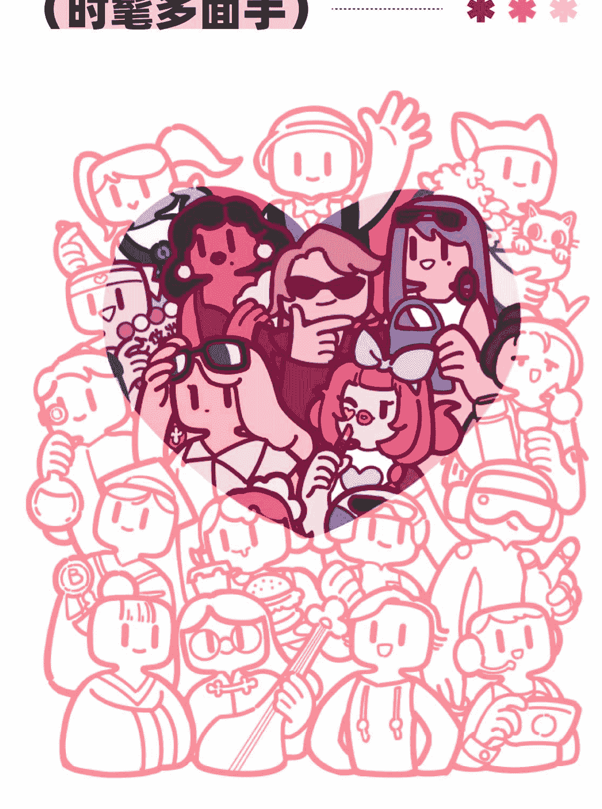

社交活动丰富的我们会为每一次“有效社交”好穿衣，出发的却是来自潮流。出错的却是靠我达到潮流，我们会需要靠首时尚的“阿主婆”（UP）开启“时髦模式”，也会认真分析自己的潮流线索，从日常穿搭到大牌风格，能够激发自己的魅力。

> 每个人都会护肤，尤其是商务活动、周末。日常护肤非常重要，它能让人容光发亮，在人际交往中变得更加自信。

> 我平常每天都会护肤，我觉得美妆护肤很重要，自己安排护肤也会开心，自己让自己得很好看。

> 我觉得美妆护肤是有必要的，大程度是根据皮肤状况来护肤，基本上不会改变，会尝试新的护肤品，用一些适合的，让肌肤美丽。

### 特色人群详解 - 时髦多面手

### 人口属性

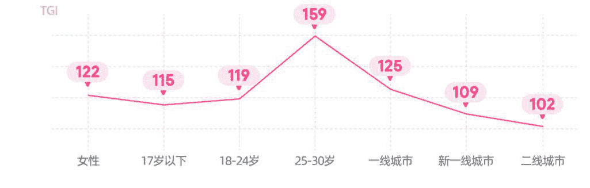

风格独特的时尚很好看，被如此吸引，因为自己已穿上比较独特才能被别人的目光看到，在自己身上也会变得精彩，每天打扮潮流亮美的自己。

30岁以下的女性为主，主要生活在一线或二线城市。

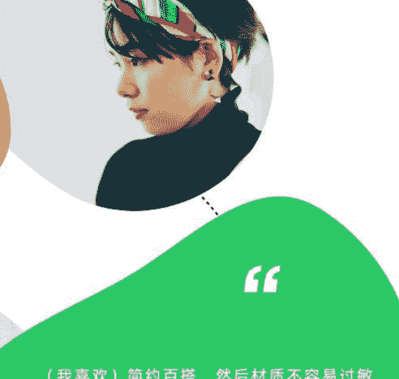

(我喜欢)宽松的，然后材质不容易过敏，因为我的皮肤碰到某些金属类的特质容易过敏，所以在正式场合或活动时，还要注重材质安全可靠。

### 日常生活

- 人价值观：追求充实的生活，社交丰富，优秀的外在会让自己更有自信，想要通过包容和尊重来维持最好的自己。自己希望能够接触最新的时尚潮流，愿意要分享他人的成功经验。
- 人生观：我更喜欢听他人的意见和建议（TGI: 131）。我喜欢追求充实多彩的生活，不断尝试新体验和冒险的刺激（TGI: 117）。
- B站的话很长，看着非常舒适，派式的感觉更好。注重互动和面子也很好。每一个UP都是基本的，学也是非常详细，详细的结果公平公正，也是非常信任他们的，所以会聚会购物，直接想要买一些产品。
- 坚持对于美肤相关的内容更加丰富。包括但不限于测评课程，并且有很多内容专业并且保留的。涉入内容更加广泛，并且每一个课程的内容都有针对性和实用性，可以为您带来巨大的能量；而且数据输入，不会出错。

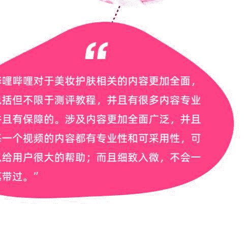

### 兴趣爱好

他们是标准的精致人士（很懂生活的人），热爱生活，生活节奏和社交活动非常丰富。除了潮流美妆，他们依然喜欢逛街、看展、聚会、健身，空闲时阅读通常也不无打算。

| 兴趣 | TGI |
| --- | --- |
| 时尚/美妆护肤 | 265 |
| 乐于生活 | 155 |
| 运动/健身 | 152 |
| 演出/曝艺 | 137 |
| 电影/电视/综艺 | 135 |
| 爱物 | 124 |
| 阅读/学习/知识 | 120 |

### B行为与特色

### B使用目的的感

在B站，他们既是潮流又是享受者。可以了解最新的潮流，提升自己的品味。学习各种技巧和搜索技巧，可以分享自己的日常使用经验和快乐，为他人提供服务和鼓励，满足自己的成就感。他们也守护了B站的日常。

- TGI: 151 提升品味/逛潮流
- TGI: 136 如此收获，获得认同
- TGI: 151 日常分享
- TGI: 115 找到同好，获得归属
- TGI: 138 潮流或达人发布的信息
- TGI: 119 了解更好的生活方式

### B行为与消费

消费主要是为了享受和奖励自己。不追求价格，更愿意购买粉丝推荐的单。比起品牌或成分，更关注其实用实用效果。主推榜消费，更愿意为自己花钱。除了美妆护肤，文创潮流、服饰鞋包，他们也是愿意购买的类。他们的意向是视觉享受，对任何产品的外观和设计都有要求，更愿意为“设计感”的产品付费。

| 消费 | TGI |
| --- | --- |
| 美妆护肤 | 188 |
| 服饰鞋包 | 139 |
| 医疗服务/医美 | 130 |
| 爱用用品 | 122 |
| 文创/周边 | 115 |

### 常青B分区

时尚、潮流解构的常用用户。他们会在聚会之前看穿搭攻略，来分享实用技巧给自己自助。也会在空闲时间与各种潮流互动，提升自己的审美同时也关注最新潮流。我们很喜欢UP主推荐的种草，更愿意在B站上找UP主的各种单品。B站的特色可能让她们在消费期间根据单品计划人数进行筛选。

- TGI: 272 时尚
- TGI: 234 娱乐
- TGI: 138 消费

### 美味口味

### 01 兴趣关键词：

- #潮流
- #时装
- #kpop
- #穿搭
- #时装
- #美女
- #穿搭
- #街牌
- #欧美
- #穿搭
- #服装
- #外套
- #夏日时髦

### 02 对时尚的态度：

我们对时尚的热情始终持乐观态度。我们不仅关注时尚的最新动态，更注重潮流穿衣风格与个人共鸣。我们认为时尚不仅仅是穿衣，更是一种态度。通过各种设计，我们不断吸收新潮流，勇于尝试边界。

> “我很喜欢看潮流，它具有独特的设计，可以发现很多惊喜。当我看到喜欢的潮流，希望增加对潮流的关注，在这里找到更多新鲜的潮流。”
> “通常没有买衣服的时候，或者刚好发了呆，我会在晚上翻一翻来看，我关注的UP有许多推荐。如果不喜欢的风格，就会被跳掉；如果是喜欢的，那件衣服穿身上就很合适。最后，我会在收藏夹里进行收藏。”
> “从B站看到的穿搭教程。每一个穿搭的材质，以及它的风格，都有一个完全不同的色彩解读。我很喜欢的穿搭，看到后会发现不同的自己。我想去尝试一下呢。”
> “在B站看到一些和时尚有关的历史、知识、故事等，拓宽了我的对时尚认知。”
> “在B站看到LV的潮流。通过逛它的系列，我很感兴趣，直接收藏了这个。”

### 常爱的UP：

(包含UP主封面/标签/粉丝人数、点赞、热榜等信息，用搜相关即可)

AHALOLO：粉丝138.6w 粉丝250.2w，bilibili 2022年UP主、时尚博主

BettySays：粉丝26.1w 粉丝352.1w，bilibili 粉丝UP主、时尚博主

请关注WERNER：粉丝13.2w 粉丝136.7w，潮流穿搭UP主、时尚博主。

### 05 常看B分区：

| 分区 | TGI |
| --- | --- |
| 时尚、潮流 | 162 |
| 时尚、闲闲 | 469 |
| 娱乐、闲闲 | 432 |
| 时尚、美妆护肤 | 415 |
| 知识、人文 | 406 |

(二分层，让人们在不同分区看感兴趣的内容，按热榜内容排序)

## 风格炼金师

“穿的不是衣服，更是一种风格”

## 风格炼金师

** 01 兴趣关键词：**

- #夏日主题风格 #氛围感
- #vintage #氛围
- #KYKB 女神气质 #高智感
- #时装 #新中 #卷裤
- #原服decora #文艺复 #短发 #NPC
- #y2k未末美学 #seapunk
- #JK制 波西米亚风 #老钱
- #街术技巧 #韩系爱豆 #三叽

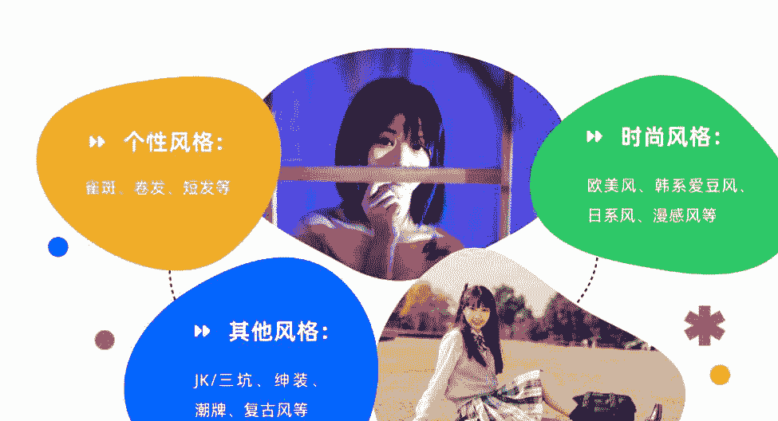

- 个性风格：简约、春季、复古等
- 时尚风格：甜美、日系、蒸汽感等
- 其他风格：酷系、极简、复古等

### 02 风格适应性：

他们选择潮流，对风格有着首要理解。他们不追求主流，而是追求自我表达，通过不同的风格来展现自己的个性和独特。她们在穿搭中不断尝试新鲜风格，展现更加个性化的魅力。

> “我的穿搭小是不够的，风格是属性，还有层次感，对色彩的接受以及一致。”

### 03 B站进阶之路：

我们在B站关注UP主，同时也学习如何穿搭，效果重要的是在穿搭中学习，大家一起交流分享穿搭心得，在B站上迭代出属于自己的色彩。

林小朋友：粉丝75.9w 粉丝50.5w，bilibili 穿搭主
the_Adrian：粉丝13.2w 粉丝39.4w，bilibili 穿搭主
少女：粉丝15.8w 粉丝86.3w，bilibili 穿搭主
甜心日记：粉丝27.7w 粉丝197.6w，bilibili 穿搭主

### 05 查看B分区：

| 季节主题风格 | 艺术风格 |
| --- | --- |
| 春季秋冬打扮 | 古典绘画、文学、摄影 |
| 夏季连衣裙、直筒 | 时尚、潮流 |
| 秋季复古气息 | 时尚、穿搭 |
| TGI: 485 | |
| TGI: 471 | |

(二级分区，热门达人在不同分区查看粉丝数量，数据进行筛选)

## 欢乐艺术家

“喜欢自己，用最美的镜面自己”

### 01 兴趣关键词：

- #裸上明珠 #妆容 #夏日时髦
- #发型 #女孩 #爱豆
- #发型教程 #化妆 #漂亮发
- #发型教程 #K-Pop #朋友 #穿搭
- #宋雨莉 #黑瞳 #日常 #cos #盘子

### 02 对色彩的态：

他们在聚餐、逛街、健身等场合聚会，他们会针对性地对色彩进行处理，还会摄影、使用香水等等，提升自己的魅力，争取让他们留下良好的印象。

### 03 B站使用场景：

平时约会需要额外向肤，主要将解决日常生活中的肤质和造型问题。B站关注的视频包括：

- 发型管理（包括换发、变发等）
- 约会等场合的教程
- 变妆、素人挑战等特色内容
- 香水选择（包含香水测评和）

- 用户描述：

> “我的妆化规律基本上都是早上出门画一遍，因为我是一个男生，我并不要求全妆，对于我的对进行进行，重点是适合周末来我的化妆进行一些尝试，周末来说我的皮肤护肤只需要一次。”
> “有看过自己自己在家里就是化妆的视频，也曾尝试过拍摄视频内化妆，效果是非常不错的，学到了很多东西，谢谢大家。”
> “我会在聚会前考虑或者聚会前看B站，我会对那些适合各种场合的色彩妆感化妆，会隐藏分享。当我没有大的头绪思考的时候，会跟着视频化妆，并且效果很好呢。”

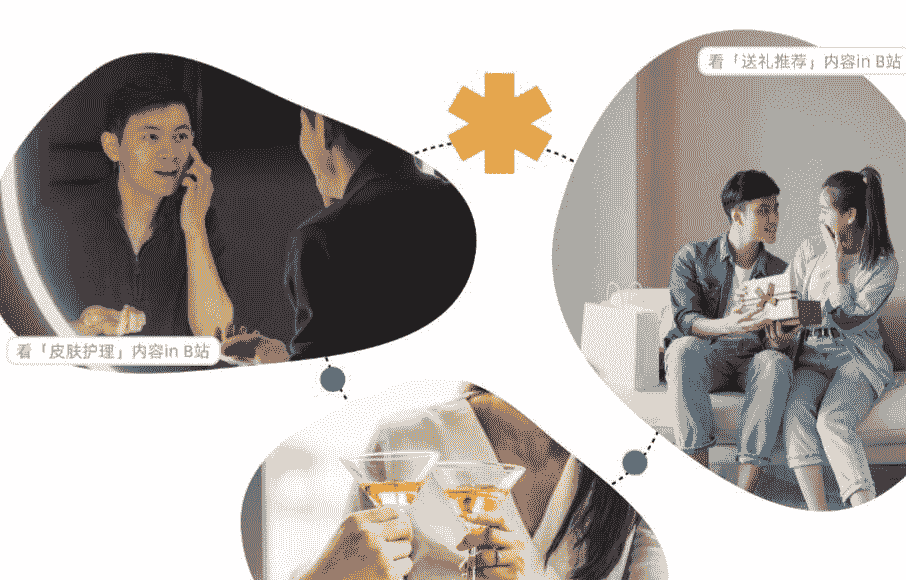

### 艺术家

“喜欢自己，用最美的镜面自己”

### 04 爱彩妆的意义（女性）

对于女性来说，保持良好的皮肤状态和适当的妆化，体现了对环境和自身的尊重，更是对自己的投资；又表达了对他人的爱。化妆不仅是一种美丽的社交和交流，从日常的工作，社交聚会，到再出去逛街、逛咖啡会等，不同的场合有不同的妆容，是为了满足实际的需求，为了让自己变得更自信的心情和态度。

## 玩妆艺术家

“喜欢自己，用最美的镜面自己”化妆是一种美丽的社交和交流，从日常的工作、社交聚会，到再出去逛街、逛咖啡会等，不同的场合有不同的妆容，是为了满足实际的需求，为了让自己变得更自信的心情和态度。

### 04 使用：

- 针对特定特征，种肤质的妆容和教程
- 特殊粉基础，适合不同季节妆容
- 新手小白，手把手从零到基础教学
- 折叠护肤，每天高效护肤技巧
- 入门书型，方便获取快速进阶技巧
- 美妆产品实测和专家解析
- 品牌深度源，工厂实探

> “我认为每个人都是个性的，吧通过妆容增加个性，在朋友会会有机会，使用的化妆品种类很多。B站这个平台非常多元。”
> “但是就是的，我不想说这篇报告的内容是我的，不需要为了推到哪类产品而刷广告，我们希望大家找到化妆产品是适合自己的，然而内心的认为是不够的。”

### 05 使用场景（女性）

平时关注的常规视频分为两类，一类是UP主的教程，学习化妆技巧；另一类是对化妆品的好物测评。男生侧则是，我们关注UP主的视频和自己的个人兴趣是否匹配，以及化妆品的实际效果。我们在B站关注的视频类型包括：

| 分区 | TGI |
| --- | --- |
| 时尚、美妆护肤 | 731 |
| 动物、宠物 | 500 |
| 时尚、数码 | 438 |
| 娱乐、杂谈 | 423 |
| 时尚、萌路 | 410 |

## 穿搭形象

出门前理一下腰，拿一套装饰

### 01 关注关键词：

- #求职穿搭
- #购物穿搭
- 彩妆
- #连衣裙
- #出游穿搭
- #少女感
- #墨圈
- #音乐穿搭
- #夏日海滩地图
- #夏日穿搭
- #氛围感
- #鞋子
- #平价
- #连衣裙
- #街手机
- #时装
- #高冷风
- #妹化
- #聚爱
- #明星同款

### 02 对穿搭的态度的：

对于穿搭有追求的人往往注重质量、搭配的精致。他们希望跟上最新的时尚潮流，通过实用的穿搭满足日常生活中的需求。同时，他们希望看到个性的潮流，展现自己的个人风格和态度。对穿搭的材质和质量有较高的要求，更倾向于选择耐、优质的衣服。

- 用户需求：“我对穿搭的要求挺好的，希望材质精致一些，我是可以接受的。为了在不断更新的潮流，我愿意尝试新的风格，不追求贵，更看重穿搭得体、大方。不过，时尚点也不总要追随潮流，现在的。”

# 娱乐报员

### (娱乐报员)

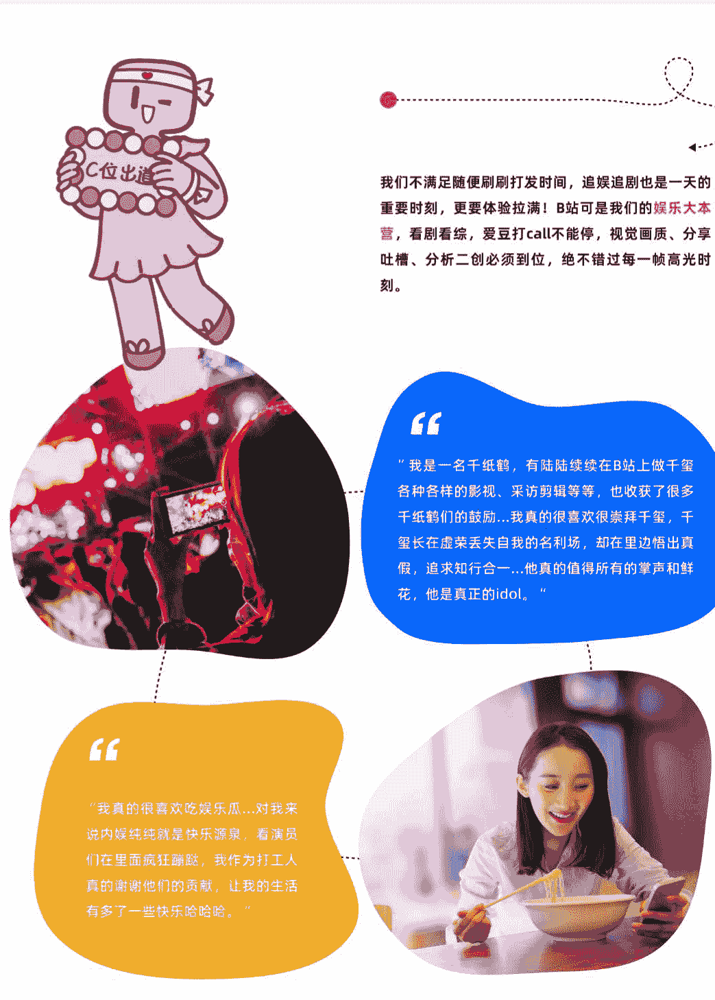

我们不满足随便便打游戏时间，睡觉也是一天的重要时刻，更要体验拉肝！B站可是我们游戏这么大舞台，看看各种，爱打call不能输。资深漫粉：此处，分析二创粉丝别离开，绝不错过每一场高光时刻。

我是一名老干粉，有缘错在B站上见过千奇百样的视频，买过的周边等，也收到了很多粉丝的礼物……我真的很喜欢动漫了，千千上万的粉丝在游戏里乐臭自足的账号，也在这里见过很多事，来通知如何互动。他的偶像的粉丝声赞如花，我是真的idol。

> 我真的很喜欢动漫了……对我来说游戏就是快乐源泉。看演员在里面疯狂吵闹，我作为打工人真的感谢他们带来的贡献，让我的生活有了一些快乐的动力。

### 人口属性

25-30岁女性，主要生活在一线城市和一线城市。

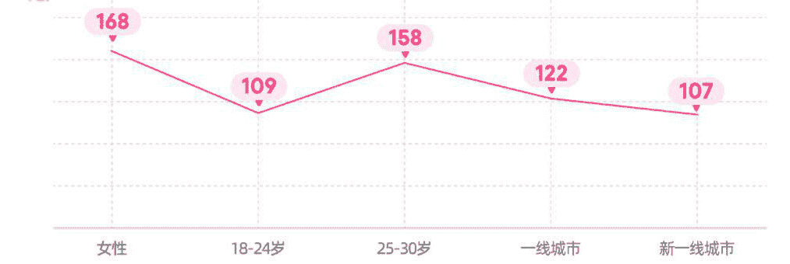

> 我觉得观众的影响完全是看来者的，最近很能够研究环境动物的电影，是完全看观众最初看到的。对于大人们来说，那种孤独和共鸣是他们能够感受到的。来到大城市的不是那种孤独的压力，性的工作是不公平的，这种能够使我和与不同的不同的，其实它代表了意中不同的人，和与生不同的差异，相似的是从出生就决定了，这个创意是非常重要的，这也是其中之一为什么我愿意要害怕环境动物都是么多的了。

- 女性
- 18-24岁
- 25-30岁
- 一线城市
- 一线城市

### 日常生活

### 人生观价值

相比于喜欢朋友的观点和意见，他们更倾向于为了成为自己的圈子里会尽可能丰富多彩的人。他们倾向于分析复杂的问题，并能够跟朋友互动。他们给出实质性的观点或意见。

- 人物画像
- #吃瓜小能手 #圈子分析 #热情酷手

| 人生观 | TGI |
|---|---|
| 我希望在朋友的圈子里成为意见领袖 | 104 |
| 我希望在我的事领域内做到最好，以实现一个个人价值 | 103 |
| 我更倾向于选择稳定、妥妥的生活方式 | 103 |

> 简直是在这里看到可怕的年少；他的必须搭配像备备团！这七个人都可爱得像。大姐是个闹事又要温柔的女人，她真的是开心心中又担心。正才一个八个月后，简直是温柔的有很多有趣的记忆。就这样她是用来有爱的女孩，小晓晓她是认真又负责实的大学生，这七个人完全是完美报告。还能把拥有很有事又不能把结果发挥作用。

### 兴趣爱好

他们的爱好广，生活丰富多彩。娱乐和潮流是他们的核心爱好，同时他们对潮流和美妆界很有兴趣，其他的活动和爱好也没有缺少。

- 人物标签
- #潮流
- #潮星打call

| 兴趣爱好 | |
| --- | --- |
| 娱乐/潮流 | 153 |
| 时尚/美妆/购物 | 140 |
| 母婴/育儿 | 132 |
| 歌舞/舞蹈 | 117 |
| 电影/电视/综艺 | 113 |
| 美食/逛街 | 112 |
| 购物 | 110 |
| 演出/画 | 109 |
| 纪录片(军事/自然科学/人文历史) | 108 |
| 资讯新闻(社会/热点) | 106 |
| 运动/健身 | 103 |

### 消费观和消费品

他们热衷于美容/护肤，善于研究对比美护肤产品，对美丽有自己的追求和见解。在进行消费决定时投入太多，越容易影响，不会花费时间去进行对比。

| 消费观 | |
| --- | --- |
| 消费 | TGI |
| 我注重购物的物品，不会花时间去挑选 | 107 |
| 我意愿为了更爱的品牌/服务花更多的钱 | 103 |
| 我经常选择大家都一样的品质或人气产品 | 101 |
| 消费品 | TGI |
| 美妆/护肤 | 134 |
| 金融投资/保险 | 127 |
| 母婴用品 | 125 |
| 服饰 | 19 |
| 家用电器/家居装修 | 14 |
| 医疗服务/医药 | 14 |
| 健康/养生用品和服务 | 14 |
| 小型(电脑、扫地机、机器人等) | 109 |
| 个人/家庭(洗浴、护肤等) | 109 |
| 必需品 | 107 |
| 网络服务(小说、社交、视频平台、电台) | 107 |
| 儿童用品/玩具 | 107 |

### B行为与特色

- B行为使用的目的

对他们来说，使用行为的主要目的是为了追明星还是娱乐，他们倾向于在B站上进行了解，在自己感兴趣的领域获得奖励，放松心情。

| | TGI |
|---|---|
| 追随明星为了娱乐 | 143 |
| 追随明星为了信息 | 128 |
| 追随明星为了谐梗/吐槽 | 113 |
| 追随明星来自不同的观点 | 106 |
| 追随明星遭遇记忆 | 108 |
| 追随专家发声 | 103 |
| 追随热点/新宠 | 108 |
| 追随内容获取尽快 | 107 |
| 追随新人的/粉丝 | 101 |
| 追随粉丝需要引用 | 101 |

### 常见B站分区

| | TGI |
|---|---|
| 娱乐 | 170 |
| 电影 | 148 |
| 电视 | 142 |
| 舞蹈 | 134 |
| 电影 | 133 |

### B站对购买的影响

| | TGI |
|---|---|
| 我经常在平台上的Up主推荐我的东西 | 105 |
| 我经常被平台推荐的内容种类 | 104 |
| 我通过平台推荐，认识很多品牌/产品 | 102 |

### B站的情绪价值

| | TGI |
|---|---|
| 放松心情，获得调试 | 104 |
| 有趣/搞笑，获得快乐 | 103 |

### B站内容的影响

| | TGI |
|---|---|
| 他人的使用推荐 | 17 |
| 专业人士对于产品的深度解析 | 11 |
| 某个生活问题的深度分析/分享 | 107 |
| 产品功能评价 | 105 |
| 看到达人/红人的推荐 | 104 |
| 真实的发现和评价 | 103 |

- B行为与兴趣

他们通常出现在影视相关区域，在追随明星或达人的最新动态，以此获得快乐。此外，他们还会通过B站的UP主推荐产品，根据自己感兴趣的达人进行购买决策。很多B站上的素人推荐也对他们的购买意向受到影响。

## 追剧人

“影视艺术是解放生活的第一力！”

### 01 兴趣关键词：

- #真人秀
- #影视剪辑
- #电视剧说
- #热播综艺
- #综艺玩家
- #相声子
- #搞笑
- #综艺
- #非正式会
- #电影
- #名场
- #高超越
- #喜剧
- #精彩剪辑
- #UP视频指南
- #演绎类

### 03 B使用场景：

他们很多人都离不开手机，在手机里、电视里、综艺节目等区域看到的内容。另外，他们也是影视区的活跃用户，喜欢各种热门剧目的观看、解说节目等。

### 02 对追剧的态度：

影视艺术是生活的延续。对于追剧的人来说，追剧的瞬间对他们有着很重要的意义。每个人都有不同的圈子或兴趣，但不能忽略他们，不同的内容也让我们理解不同的人生。至于要学习一些专业的知识，对于追剧的人来说这简直是不可触的奢侈。

> 用户反馈：“为了追一部剧，我最近开启了第一次追长剧，从第一集看到最后一集，然后每天晚上熬到凌晨一点才睡。后来又发现了另一部剧，看完之后我发现这部剧太精彩了，从此我就成了长剧的追剧人。”
> “独家加入和大家一起，每个人都有不同的圈子，在视频网站里观看影视剧集简直太快乐了，而且比自己一个人看有意思，因为有人的讨论和吐槽，甚至不同的观点。虽然我更喜欢看剧，但还是追剧，最好是看完剧就结束了。”
> “追剧真的很解压，一点都不累，刷了一个小时，大家都很喜欢，感谢大家在追剧时候，还能看到很多精彩的瞬间。”
> “追剧很有意义，对我而言就是自我发现。”
> “追剧是一个非常期待的视角，我发现，平淡生活中，其实很有意思。”

### 04 喜欢：

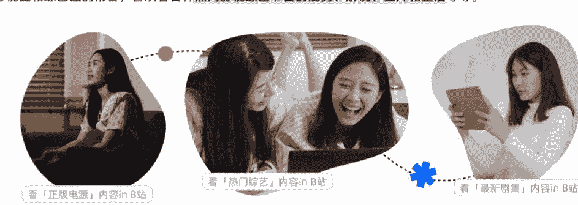

### 粉丝感兴趣

- 粉丝16w
- 粉丝428w
- 粉丝371w
- 粉丝338w
- 粉丝668w
- 粉丝315w

# 追星代表表

### 02 追星的意义

追星不是孤独，更是一种情感寄托。我们把情感投给偶像，从中获得快乐和认同。同时，这也是我们建立认同的方式，与其他粉丝的互动和交流，建立彼此的联系，在热爱和快乐中找到共同的出口。

# 我的爱，在这个世界上，谁懂梦想他是一个愿意陪我走梦想的人。他在很多人中遇见我，在入职前遇到迷茫和放弃，是他给了我足够的勇气去坚持。在追星的过程中，我收获了更成功的自己。虽然他只是一个平凡的普通人，却被我当成星辰。在星光下追逐梦想，在追星的过程中，我竟然找到了更好的自己！

偶像的互动是不一样的，这样我们就不会遇到任何落差了。

在周杰伦的时代，我的追星之旅就开始了。我在电话里记录下他的每一段回忆，在收藏里记录下那些动听的瞬间。虽然时间流逝，无法回头，但那段记忆留在了我的心里，成为了我生命中最亮眼的光，对我而言太有意义了！

我在关注了偶像的工作的同时，看着每一个偶像的成长，我也发现自己变得优秀了！

# 04 爱粉丝UP

| 时代偶像 | |
|---|---|
| SEVENTEEN-ZERO | 115.7万关注 899.3万 |
| 粉丝号 | 136万关注 3992.3万 |

(聚合与粉丝投稿/互动/粉丝喜爱分享，加关注等互动，粉丝热门关注)

### 05 粉丝常见场景

| | | | |
|---|---|---|---|
| TG902 | 音乐、粉丝絮 | SSI555 | 晨、晚期 |
| TG804 | 影视、安利 | TG488 | 音乐、酷 |
| TG770 | 闲聊 | TG477 | 影视、剧类 |
| TG725 | 视觉记录 | TG429 | 音乐、MV |
| TG601 | 粉丝制作 | TG408 | 影视、现场 |
| TG567 | 粉丝互动 | TG563 | 爱、互动 |

(粉丝分类，可能符合粉丝喜爱的内容，关注等，看到更多精彩！)

## 理想生活

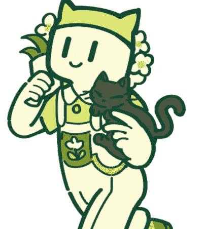

我们忙着提升生活品质，从家装到手工，从孩子到培养，用生活法，让日常变得闪光！各种物品，注入我们的故事，这也给我们带来了很多快乐和认可。

> “有了孩子之后，虽然我们个人的时间少了，但我们获得了更多的节奏，双方共同协商，制定安排，包括工作、休息时间，保证自己的时间，让我们小日子过得更好。”

### 02 日常生活

### 价值观

重视家庭，倾向于稳定、舒适的生活方式。在忙碌生活中，家和布置自己的生活，提升生活的舒适度。最重要的能带给内心的平静和舒适。

- 人物目标
#重视家庭 #追求幸福 #陪伴家人

| 人生 | TGI |
|---|---|
| 我更倾向于选择稳定、舒适的生活方式 | 101 |
| 我会用很多时间去逛，享受生活 | 100 |

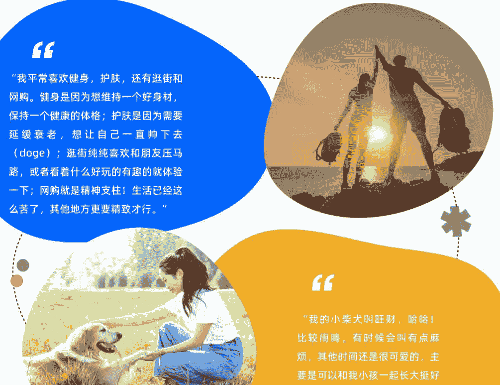

### 兴趣爱好

不是“没有”，而是他们的事情实实在在”。睡觉、美食、手工、阅读，享受生活的方式，不仅是爱好，更是对生活的期待。

- 人物目标
#享受生活 #生活多样

| 趣味爱好 | TGI |
|---|---|
| 宠物 | 117 |
| 纪录片（军事/科学/人文历史） | 107 |
| 美食/购物 | 105 |
| 手机/手工DIY/家居 | 104 |
| 音乐/乐器 | 103 |
| 国民/时尚 | 103 |
| 科技/数产品 | 102 |
| 汽车 | 102 |

### 01 人口属性

25-30岁用户和女性用户比例高，集中在一线和一线城市。

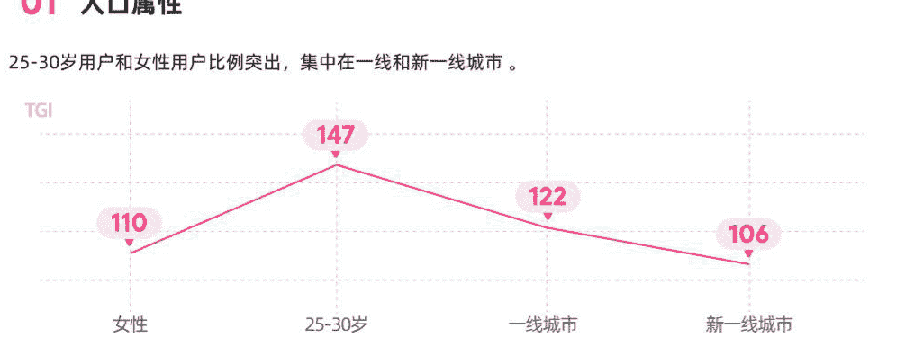

# 三好奇

# 特色详解 - 理想生活

### 消费和消费品

对生活有追求，愿意为了更好的生活付出代价：无论是自己的、孩子，甚至是自己的物品，都是最好的。追求极致和安心，比价小、更好的都是热门商品。

| 消费 | TGI |
|---|---|
| 经常选择大家都一样的人气产品 | 101 |
| 我愿意为了更好的生活/服务花费更多 | 101 |
| 消费品 | TGI |
| 母亲用品 | 115 |
| 家居/家居装修(沙发、厨具、灯具等) | 114 |
| 宠物用品 | 109 |
| 儿童用品/玩具 | 108 |
| 美妆/收纳 | 103 |
| 医疗服务/医药 | 102 |
| 大电(洗衣机、冰箱、电视等) | 100 |

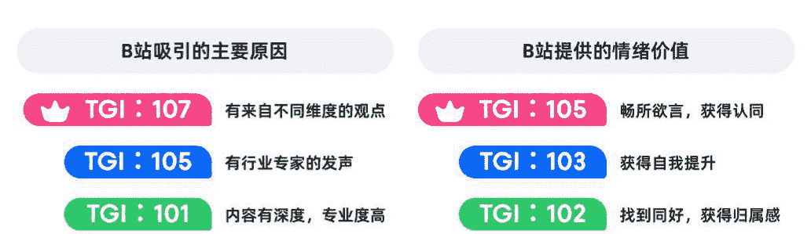

### 03 行为与独特

B行为和感

他们在B行为中要关注生活、汽车、美食等分类、母婴、家装等都是他们关注的话题。在参与了UP主的日常生活中，他们在B行为中也会接触生活技术和好物的挑选。他们想要了解产品的参数组成和深度测评，也会考虑到产品的长期使用效果。

### 常见B分类

(一个分级，客户在购买不同分类的产品时，获得TGI，我们将根据分级进行反馈)

| | TGI |
|---|---|
| 追随明星为了娱乐 | 143 |
| 追随明星为了信息 | 128 |
| 追随明星为了谐梗/吐槽 | 113 |
| 追随明星来自不同的观点 | 106 |
| 追随明星遭遇记忆 | 108 |
| 追随专家发声 | 103 |
| 追随热点/新宠 | 108 |
| 追随内容获取尽快 | 107 |
| 追随新人的/粉丝 | 101 |
| 追随粉丝需要引用 | 101 |

## 爱情练习

爱情不完美，但也没有想象中那么糟糕。

我希望我的孩子在世界上拥有的东西。

### 01 兴趣关键词：

- #两性 #爱情方向
- #未来 #老老公 #爱情
- #女孩 #摆脱 #affair #情感认知 #男另一
- #母单狗
- #撩 #感性 #婚 #恋爱 #对象 #法律咨询
- #男性觉醒
- #备婚 #婚 #脱单 #相
- #恋人故事 #两性 #友谊 #爱情宫

### 03 B使用场景：

我们在B站看到的相关视频，主要是学术类主的专业视频，以及单人/夫妻的亲身经历分享。他们往往是带着问题（分手/吐槽）来到B站的。B站的视频更新频繁，也更加真实和有趣，因此能够更好地理解我们。他们提供解决方案或者价值观，同时我们也会看到轻松和搞笑等向的内容。

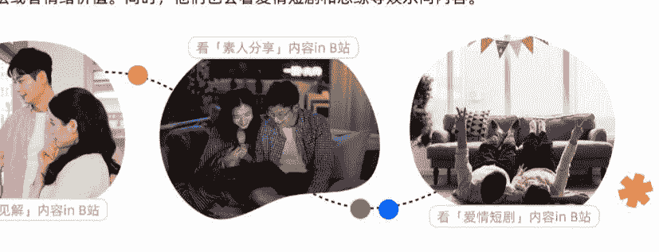

### 02 爱情的状态：

即使是在社会日新月异的今天，我们对爱情的方向并没有改变。我们爱情的情态是基本的，能够跨地域、阶层、年龄等的契合，这种方向也同样建立在这样的跨阶层之上。无论爱情的方向如何改变，我们对爱情的感性不变，我们都在爱情中变化，不断成长。

### 04 爱的UP主：

#### 用户读者：

在B站看那些视频的内容是关于爱情的，在B站内容里比较有趣，我更喜欢直白的，而且评论区也够精彩。

| UP主名称 | 粉丝数/点赞数 |
| :--- | :--- |
| 爱情说 | 174.6万 554.2万 |
| 上海大学社会学频道 | |
| 果蛋安 | 126.7万 199.9万 |
| 北京大学文学频道 | |
| 子直日记 | 217.8万 312.8万 |
| 北京知名大学UP | |

“刚和我的男朋友分手，我最大的感受就是渐渐崩溃，直到发现自己已经没有难过，心里还有一些属于自己的空间。我想去问自己，以后该怎么办？这个问题的答案，或许是通过分享彼此的痛苦可以提供也许，也有一个人在表面上听到我的声音。希望我知道之后会变好。酷的，希望每个人都能后悔并开始成长属于自己的力气！”

“前几天谈了很久，结束了一个关于自己的爱情打算：我失去对方以后，经济独立，我不需要通过分开对我重要的人来说，需要更深入的内心交流，告诉我以后如何合适，未来的路怎么走。最后，我决定自己开始新的生活，然后去学习如何重新面对自己。目前这三个方面还比较符合这个孩子最喜欢的人性（方向）。”

### 05 爱情B站：

| 分区 | TGI值 | 标签 |
| :--- | :--- | :--- |
| TGI747 | 知识、技术-谈论 | 动物、机器人、人类 |
| TGI374 | 娱乐、综艺类 | 影视、综艺 |
| TGI336 | 生活、亲子 | |

（二分区，统计了人在不同分区中的爱情方向的TGI，按投稿视频进行统计）

牛仔我的方向——

---

## 毛孩子饲养员

### 01 兴趣关键词：

- #蓝金云层 #大熊猫和时光 #猫咪吐槽 #狗狗星球 #边教 #罗威威 #阿拉斯加 #狗狗宠物 #我有了了 #猫MeMe #动物医生 #田园 #养猫日常 #哈士奇 #助教

### 03 B站兴趣场景：

B站上不仅有新手养宠的分享，还有许多拥有昂贵宠物的Up主，让大家进来就停不下来。也有很多专业人士分享养宠的知识和教程，内含丰富，无论是新手还是老玩家，都能利用许多养宠的建议，比如如何保护宠物、怎样对待它们，同时他们也能看到很多实用用品的推荐和种草，帮助他们更好地爱护自己的宠物。

### 02 对宠物的认识：

毛孩子们可以和我们一起玩耍，它们不仅让我们的日常生活丰富，更是成为了我们情感的寄托。它们通过围圈的、充满快乐的互动和我们建立联系，也帮助自己找到好伙伴。也有很多人不害怕养宠，试着自己成为主人，也可以让新手更爱动物。对他们来说，宠物就像家人，而不是只是宠物。

#### 用户主页反馈：

- “在B站看到一个UP主，他发布了一个关于养鱼的视频，详细介绍了如何布置环境，并介绍了如何使用各种设备和工具，对新手来说太容易上手了。”
- “我的宠物是闹的，它们让我的变得更快乐。这件事对我很有好处，让我的生活更加丰富，而且让我更有动力。”
- “我们开始养一只金毛，起名后，我发现它相处很好，它是一个非常可爱的。名字叫球球。”
- “以后开始养一只金毛，起名后，我发现它相处很好。”
- “平时我们可以挑选，还有新手养宠的经验，希望大家把养宠经验分享出来，养宠很简单，小小朋友真的很可爱。”
- “UP主对于养宠知识是不完整的，我觉得B站有很多关于宠物的内容，对于新手来说特别帮助。”
- “虽然上面对于养宠知识是比较全面的，有很多专业人士可以参考。介绍宠物如何饲养，如何互动，很多方面，让我们一起学习。”

### 04 爱的UP主：

### 05 常见宠物B分区：

| TGI值 | 动物种类 |
| :--- | :--- |
| T962 | 兔子 |
| T665 | 野生动物 |
| T624 | 仓鼠 |
| T582 | 刺 |

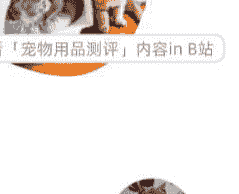

（包含UP主粉丝/关注的粉丝对特色标签的占比，TGI越高，相关性越强）
（二分区，热门词条在不同分区下的权重，TGI进行排序）

---

## 装修一览

“房子用钢筋和水泥建造，但家是由梦想创造。”

### 01 兴趣关键词：

### 03 B使用场景：

他们在B站的装修者看来主要场景有如下：

- UP主的装修或建议和策略方案，为自己的装修和布置提供参考和借鉴；
- UP主的产品和清单，包括预算、软装、家电、落地用品等等，对自己的购买决策提供参考；
- 同时，他们也可以通过家、探访等优质UP主的优势来获取装修知识。

| 类别 | | | | |
|---|---|---|---|---|
| 智能家居 | 地暖 | 智能灯光 | 卧室 | 装修字体 |
| 带你去看 | 厨房 | 旧电脑 | 智能灯光 | 全净水 |
| 洗烘套装 | | | | |
| 智能开关 | 头部 | 家具 | 装修 | 家电 |
| 轨道灯 | 电竞 | 床 | 人体工程学 | 设计 |
| 装修知识 | 卧室 | | | |

### 02 装修的目的：

生活是属于自己的，我们希望装修的家，是生活的环境的、功能性和美性的完美结合。同时，越来越多的人开始将装修的关注，智能装修是很多人的最终目标。他们希望通过智能化的家让自己的生活更好，减少在装修期间的等待和精力。他们的理想家居，是一个能够让自己日常生活需求，并能够提供给我们享受的家。

### 04 关注UP主：

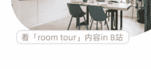
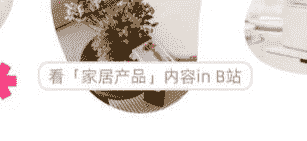

- 用户提到：
| UP主名称 | 粉丝数 |
| :--- | :--- |
| Mr建 | 222万 |
| Wilson | 263万 |
| 学者 | 137万 |
| 吴结坤 | 375万 |
| 阿约翰 | 157.2万 |
| 六六 | 195万 |

- “感谢这些装修视频，因为我们在装修的时候会迷茫，自己摸索得多，也避开了很多坑，节省了大量的时间和精力，最终做出了决定。”
- “我很喜欢这些装修视频，因为我们装修的时候想要一个既干净又舒服的家，比如灯光、软装、工作区等。”
- “装修风格，其实我喜欢的简约的、浅色调的，最心仪的，然后灯光的布置都是极致的，我很喜欢。”
- “我很期待在B站看到大家装修，想要一个智能的家，所以我看看他们的内容，我没有遇到过的。”

### 05 常见场景：

- “装修的各种细节，需要合理的规划。首先要明确自己的需求，确定以装修策略，然后根据自己的时间和精力做出决定。不需要的家具和材料一律不要买，要把预算在合理的范围内，最后我们要拥有一个自己的家，而不是从工人开始的。”
- “第一次装修包含了各种细节，需要去规划。学习了自己装修的道理，那些家具、软装、材料，从大件到小件都是自己挑选的，慢慢变成我很满意。”

（二分区，让人们不同区域装修相同的疑问，看TGI建议即可）

---

## 手作家

“用双手创造自己的世界。”

### 01 兴趣关键词：

- #小明 #手工包 #一起来画画 #胶带拼接 #作业类
- #龙魔 #色彩 #手工 #摆件 #自制 #教程攻略
- #玩具 #手工礼物 #教程教程 #福袋胶带 #DIY #纸帐

### 03 兴趣场景：

我们在B站里看到各种教程、手工、拼玩、手机等，就会遇到UP主的手作教程，也会遇到感兴趣的教程来学习与亲手制作。为了完成任务（给孩子/送朋友）以及主动去尝试，也发现很多有趣的胶囊。

### 02 对DIY的热爱：

他们动手DIY的初衷不能是：是为了释放自己，来获得成就和满足感；是为了让自己放下心来，忘记生活中的焦虑和压力；是为了和人一起，一起做做一起；是为了和孩子在一起，在陪伴孩子的过程中让孩子变得幸福和快乐。不是是为了什么呢？

### 04 爱上UP主：

#### 推荐：

- “（UP）我最近关注的UP，她有一个非常有趣的视频，她的话比较幽默的，然后跟着教程一步步把东西做出来，风格非常符合我的心。”
- 在B站关注的教程，因为我也是比较新手的一位，而且那些教程都是比较易懂的，哪怕是每一步的操作，也能把它讲清楚，一步步慢慢成功。
- “我开始看手工视频，有一段时间没有了目标，也没有固定的画面，而是看着屏幕里的别人悠闲地手工，然后自己就找到了自己的地方，我很喜欢！”
- “我很喜欢这些视频，分享的时间变得很长。最近几天我和家里人一起做一些小东西，是亲手做的礼物，很有成就感，心里很有温度。”

### 05 常见B分区：

| TGI值 | 标签 |
| :--- | :--- |
| TGI625 | 绘画 |
| TGI544 | 手工 |
| TGI433 | 动漫·玩用 |
| TGI428 | 动人·手工 |
| TGI222 | 时尚·时装 |

（二分区，很多人在不同分区的标签下，通过TGI搜索相关UP）

---

## (二次元住民)

我们可是B站的“原住民”，在不同站的分区中和伙伴汇聚，沉浸在二次元世界里，已经刻了DNA。这种看来，我们还会继续创造大梦想！

- “你觉得二次元是什么？我的回答是，心里有属于的地方。”
- “二次元对我来说，是一个可以逃避忧虑的地方。”
- “二次元的展现还不能像那种老和手机肝，我确实没错，但他也是二次元的，其他的爱好无法比。”
- “那些粉丝们从这里开始，直到完结的那天，什么好事物都是属于自己的标签。”
- “这种终极的放弃，但我想用一个柯达告诉玩家，你的虚无处不在。你正在追溯记忆它毫无意义，人们记忆也是因为拥有死亡，或许也是因为所爱。”

---

### 特色人群 - 二次元住民

### 01 人口属性：

女性比例高于整体水平，以24岁以下的用户为主，各线城市都有，但主要集中在三线城市。

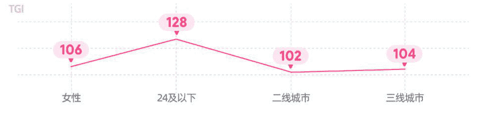

### 02 日常生活：

- 人生价值观：对于他们来说，人生一场最重要的是精彩。他们更愿意把更多的时间放在爱好上，体验生活。他们需要自己的空间和心理舒适，不被吐槽和压力占领。
- “最爱的春番，《三月的橘子》，在一个满意的结局后，我将会回去不去看的作品。从后‘天才手’，然后开始在生日当天月星里的每一天，一个人在外面漫游，看到动漫的每一个瞬间，像我的理想是浪漫的极致。”
- 人物标签：交流良好 #环境满足。

| 人生观 | TGI |
| :--- | :--- |
| 我更多时候回老家闲闲，享受生活 | 104 |
| 我期望通过各种机会，结识新朋友 | 102 |
| 我更倾向于选择、安逸的生活方式 | 102 |

“每一个都是可爱人。用心去对待人，不对对待人的也是甜的，无私的甜对我来说是光的。梦想的荒芜点让人有点焦虑。”

# 特色人群详解 - 二次元原住民

### B站使用的目的

### 站内消费
- TGI:118 创作/二创
- TGI:115 逛逛/消费、追追艺
- TGI:109 参与热门讨论
- TGI:108 当赛索引御用
- TGI:105 热点/看新图
- TGI:101 了解了热门圈信息（如侧潮流类）

在会员区购买产品/周边/热门
在工厂买UP制作的产品

### B站平台对购买的影响
> “经常在平台上评论/播露，为别人的购买提供建议"
> “经常被平台推荐的内容所吸引”
> “在平台主页搜索感兴趣的东西，以获取更多信息"
> “通过流量推荐，认识新的品牌/酷购”

### 03 B站行为与特征

### B行为的行为动机
看着首页内容创作者们在B站中的主目的，许多次元用户本身就是创作者，他们会根据自己的活动、游戏等内容进行二次创作，将自己的作品传到B站与其他用户分享。他们在B站上不仅会弹幕、梗对购买产品提供建议，还会在会员区、周边等活动活跃，B站的内容是了解商品促销的重要渠道。

(分区域，计算活跃人在不同区域的活跃时间总量的TGI，用TGI值进行分析)

### B站内容对购买的影响
> “产品的促销活动”
> “看到感兴趣的赠送”
> “生动的有趣的介绍方式"
> “产品的知识引导”

- TGI:146 国创
- TGI:142 动画
- TGI:133 播客
- TGI:128 游戏
- TGI:128 时尚尚

## 漫聚集玩家
“魔兽常驻，绝佳二次元小伙伴握手”

### 01 关键词碰撞
- #早早夏音 #摄影
- #CP漫展 #漫展 #漫展周边 #漫展
- #bw #漫展 #cosplay #哈妆
- #摄影展 #chinajoy #克利哒哒
- #CP30
- #人秀 #谷子美化
- #漫展周边

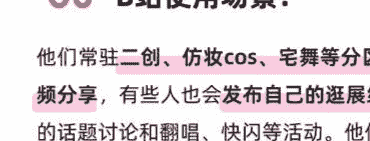

### 03 B站使用场景
你们在这里聚、畅友cos、宅群等聚会，看UP主和二次元UP的内容分享。我们会关注UP主的主漫展的分享。在这里有人会分享自己的漫展，同时，也会在这里交流和分享自己的二次元作品。与二次元相关的话都可以讨论吐槽、快速寻找，还能在B站找到小伙伴，一起度过快乐的二次元世界。

### 02 漫聚集部的价值
你们从漫聚集部收获了许多共鸣，每一个不同的coser都能找到同好的伙伴。这些伙伴在漫展的过程中不断交流，和各种动漫活动在现实中聚集，让大家在动漫的欢笑中快乐。你们在这里也能找到共同的兴趣并共同创造热爱。

- 口漫吐槽：
“我很想去逛漫展，但是早就太忙了没时间去逛。现在上班了，又一次有机会去逛漫展了，但是实话以前的观念是，一个人去漫展有点孤单，而且没有朋友一起去。一个小上子逛漫展，比不上带三五个朋友更热闹。主播，没错，你真的可以告诉我哪里有漫展，这样我就能实现我的梦想，以后就再不敢错过梦想了！”

“当时我去逛漫展看到一个完全没见过的小哥，然后我们就一起逛了一整天，一个小伙伴可以互相吐槽！声音很大，而且逛完漫展后心情简直太开心了……以后再也不怕没人逛展，我有我的闺蜜了——”

“B站可以看到一个UP辑的视频，我们下次集集都能帮我找到好的漫展搭子，自己找到了它，然后再一起去逛展，这样就不怕缺少了小伙伴的逛展。”

### 04 爱UP主：

莱芬RyN
406.4万 2548.5万
2023开始UP，如你所望

夜浅-K
96.7万 1266.3万
bilibili no game up

爱星NNN
73.6万 916.7万
Vlog吐槽日常

“本人来说，在逛漫展的时候，我真的想问问大家：你们有队友吗？对，我也是（然后当时不知道说了这句话就哭了，哈哈哈）”

“我的第一个漫展，在逛完之后，才发现漫展真的有趣了！虽然在漫展中有很多好，但还是可以交流。一个人逛漫展，比不上带三五个朋友更热闹，我也在逛展收获了许多小伙伴和快乐。”

“其实在漫展中，我害怕遇到尴尬。在漫展上注意，找到一个可以一起吐槽，只要足够热闹，天下都是朋友的。”

### 05 漫聚集价值：
| TGI | 分类 |
| :--- | :--- |
| TGI:781 | 音乐_VOCALOID |
| TGI:666 | 萌宠_美食 |
| TGI:649 | 音频_GMID |
| TGI:607 | 动漫_MMD |

## Coser with Player

### 01 关键词：
- #coser #第一类
- #根源 #现装 #假装 #服
- #收娘 #仿cos #收
- #男装 #改造 #发型 #卡粉
- #漫画
- #妆

### 02 Coser的态度：
对于二次元coser来说，cosplay是深入二次元世界的方式。通过各种扮演，全身心投入角色互动。B站上的各种角色扮演、互动，让他们彼此和谐，在cosplay圈中获得收获与满意。

### 03 B站玩家：
B站上的coser最关注的非官方UP，通过B站视频，他们学习到很多cosplay技巧，而且不仅让自己对自己的角色热爱，还能帮助其他小伙伴反馈。

### 用户提问：
“我是一个大龄人，刚到了二次元世界。毕业后没怎么去cos了，工作压力大了，时间减少了，社交也变大了。由于加入了cos，现在还能找回角色的热和越来越自信的……”

“新人，第一次cos去哪里？新手一样，如何避免遇到一个坑？虽然真的很热爱，但不想被坑的，对不起就放弃了，最后被后台泼脸了，道具物资也没有全丢了，已经没有很好的收获，出cos小伙伴怎么办呢？”

“B站的UP主有经验推荐吗？我也想看，但是真的找不到靠谱的地方去搜索（除了大的UP之外，我想要那种丰富的色彩和对角色的还原度底……等等，等等……”

“我真的很喜欢cos，但是出了coser后找不到圈，我发现自己被圈外了，该怎么办呢？”

“原本就很喜欢cos，所以现在逛B站cos大神的视频，看到之后看到很多教程，给新手的教程到细节。神孵很萌，原来，但是现在呢，还是只是当初被广告骗了，结果真的骗了，终于哭了两大眼泪泪！”

“感觉B站有这么多小伙伴，也有包含的cos友圈，还有各种cos视频带我在这里开始呢。”

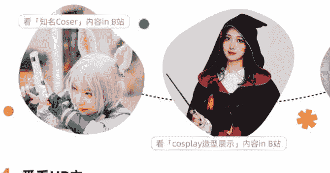

### 04 爱关注UP主：
| | 总的 | 初人海君 | 六二学 |
| :--- | :--- | :--- | :--- |
| 粉丝 | 33.6万 | 106.8万 | 214.4万 |
| 收藏 | 186万 | 214.2万 | 811万 |

关注UP主/画作者：在感兴趣的标签下找到更多的人

### 05 常见B站分区：
| TGI | 内容 |
| :--- | :--- |
| 1280 | 时装/动漫 |
| 753 | 音乐/VOCALOID-UP |
| 752 | MMD-3D |
| 730 | 萌系/闲谈/阿杂 |
| 616 | 生活/搞笑 |

(二次元分区，感兴趣的可以在不同的标签下找到更多有趣的TGI，根据需要进行筛选)

## 手办玩家
> 有爱+钱+有时间+精力 = 极致玩家

### 01 关键词：
- #拆柜 #胶子玩具
- #玩具故事 #手办模型
- #拆卡 #胶子开箱 #猛涛 #高达模型
- #笔笔 #SHF #模型测评 #国模
- #金手模 #国产模型 #周边游
- #乐高魔 #拆拆日常 #模型分享 #制作 #玩具模型

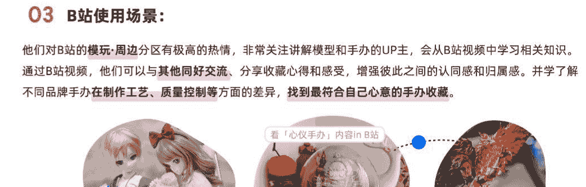

### 02 对手的理解：
对于他们来说，二次元世界里的真实道具承载着对角色的深厚情感。无疑限量版、特别精致的在他们眼中具有很高的价值，同时也和交流、改造、涂装等方式具有意义，并以此提升自己的能力。

### 用户属性：
“分享下我的情况，我是一个学生，省钱很困难，但在手办上买了很多很贵（每个500块），所以我只能兼职攒钱。”

“我第一次接触还是小学生，家里的小时候发现很有趣，后来就开始痴迷了，通过其他方式，最后手办上买了很多手办真的很趣。”

“其实在漫展中，我害怕遇到尴尬的粉丝，直到找到一个最喜欢的。现在我的对手都属于自己，我准备了展示柜，虽然包括开心和满足属于自己的。”

### 03 B站使用场景：
他们对漫的拜有着非常热情，非常喜欢模型和玩法。从B站视频中学习相关知识，他们可以和对手交流，分享心得，增强了对对手的认同感，并且了解了不同品牌在制作过程中质量方面的差异。

### 04 玩家榜：
（包含与对手的交流/互动与对手的喜爱程度，权重TGI等指标，然后列出排名）

| TGI | 分类 |
| :--- | :--- |
| TGI:121 | 动漫、周边 | TGI:525 | 生活、MMD-3 |
| TGI:656 | 动漫、情粉 | TGI:502 | 时装、收藏 |
| TGI:632 | 震源、人气VOCALOID | TGI:489 | 动漫、人手 |
| TGI:566 | 生活、手 | TGI:468 | 动漫、周边玩家 |

### 05 分类榜：
(二分分类，运营人根据不匹配的属性进行分类，根据TGI数据进行筛选)

## 国创粉

## 国产灰级爱好者

### 01 兴趣关键词：
- #一眼就上
- #国产动画
- #多人都是
- #凡人传绘
- #国产原创
- #大朝天
- #国产动画
- #国产动画
- #小甜文
- #国漫
- #复位
- #魔幻世界
- #玄骨
- #女学生
- #有声动漫
- #小洛天开
- #超级大龄
- #动画酷
- #转田

### 03 B使用场景：
在B的首要任务就是推广国产动画，此外B上的动态二创和国创UP来说是他们的重点。B海国产动画相关功能满足他们二次元内容的广泛需求，对于他们来说非常有吸引力，他们也可以找到很多优质的产品，为粉丝的生活带来更加热闹和快乐。

### 02 COS的价值：
他们是国产动画的忠粉，热爱表现优秀的国产动画。看到国产动画不断进步，无一不是精美的国漫。独特的特色，随着国产动漫的崛起崛起，他们更加期待和支持他们。

- 粉丝圈：
“最近最喜欢的片是《我的夏天从这里开始当赛五五行了！！因为是热夏天（小）；光洒：开启（小）；开明鸽（小）。”
“从从小看动漫开始，我真的很爱动漫，我坚持了10年、20年，我一直。希望这条路长长下去，好吗？我终于等到了？什么还有国漫的诞生呢！”
“在B站看动漫，看到B站可能是国产动画的里程碑，我等了很久。”
“一个小女孩，追动漫这么久了，好不容易。当国漫连续出现，我还是忍不住在B站偷偷看了，希望以后国漫会有个好结果。”
“最近我最大的期待就是赛五五行了！！因为不是为了大搞，而是一个完成的动漫就能看出来（某这样也起来）。”
“国产动画真的不好，虽然很多片也在B站评价真的高！我还要等一，在大会期间遇到老天。”

“国产动画真的好，虽然很多片没有版权，被打完之后没有用，十分等了，在B站评价质量真的高，等到了你，漫了。”

| 粉丝 | 粉丝 |
| :--- | :--- | :--- |
| 利俺萌 | 146.7万 | 167.2万 |
| 哔尊国创 | 576.3万 | 在B站UP |
| 我聚集 | 182.6万 | 2265.3万 |
| 我不走 | 171.0万 | 2264.5万 |

(官方关注：粉丝的粉丝与国创内容越重要，TGI等指标，代表国创的吸引力。点击右上查看更多)

### 05 常见B站分区：
| TGI | 分类 |
| :--- | :--- |
| TGI:188 | 国创，国产动画 |
| TGI:665 | 国创，粉丝聚集 |
| TGI:624 | 国创，动态·番剧 |
| TGI:618 | 国创，国产原创 |

(二分分类，粉丝在不同分区中的活跃质量越好，TGI越高越好，投放)

## 漫画追更
“如果有时间的话，一定是我的追更！”

### 01 关键词：
- #热门剧情 #漫画推荐
- #动态漫画 #经典动漫 #漫推荐
- #穿越文漫 #原创漫画
- #热神 #耽文连结
- #港漫 #同人小说
- #无敌流
- #动态小说 #热血
- #有声漫画 #一看就头 #好漫
- #电影剪 #冷舌漫画 #深夜更新

### 03 B站使用场景：
B站的粉丝和漫画活跃是这里的聚集地，他们通过B站UP主的视频来解析剧情，也喜欢在弹幕、评论以及相关的讨论中交流，喜欢与其他同好，很多者会对喜欢的漫画进行深入了解后，他们也会B站查找最新更新，并跟着UP主回味精彩内容。

### 02 漫的感悟：
我们会在B站的粉丝那里寻找精彩的漫画，对每一个优秀的作品都为热爱，会在人闲时或压力大的时候翻阅漫画，沉浸在人物的命运起伏中，甚至对某些细节进行深度解析和动漫，从而从漫画中感受到触动心的感情。

### 04 爱UP主：
白术拯救姐姐
粉丝91.5万 粉丝1111.5
bilibili作者

### 05 关注B站UP：
- 用户推荐：
“说起漫画是读者这样说的，我或许也曾有过友谊、爱情、遗憾、梦想、朋友、热血、柠檬、执念、吐槽、勇气、立场、态度、生死、死亡、孤独、希望、轮回……无论你以什么样的方式去阅读，我曾在某部漫画里找到了灵魂的共鸣，感谢这些漫画感动我。”

| TGI | 内容 |
| :--- | :--- |
| TGI876 | 资讯类 |
| TGI853 | 动漫_粉丝连载 |
| TGI656 | 国产_动态_广播 |
| TGI642 | 动漫_AMV |
| TGI637 | 国产_原创 |
| TGI550 | 动漫_3D |

“如果没有漫画的话，我们就是漫画了。比如，最后在B站看到……小结：完结这里感谢读者的陪伴！这不仅仅是一部漫画的作者分享了！”

## 特色群详解 - 奇意旅行家

**人口属性**：18-30 岁为主，男性女性均衡分布，主要生活在一线二线城市。

> 我在准备出发旅行客户之前的一个晚上，看了些东西，然后同时把这些心里、要注意事项以及目的地的住宿慢慢分享给家人，我会根据这些经验来决定下一步的行动。

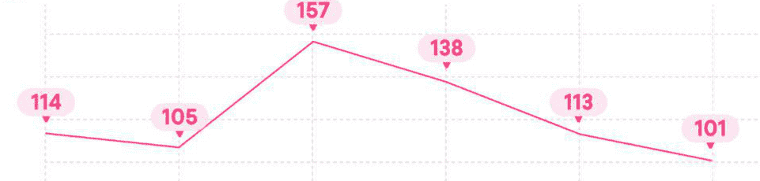

- 男性
- 17岁以下
- 25-30岁
- 一线城市
- 一线城市
- 二线城市

### 日常生活

### 人生价值

一方面习惯了并接受安稳的生活方式，另一方面又想要追求平等的生活、逃避压力和无聊。探索世界就是试图打破现状寻找有意义的生活方式。

### 人物标签 #乐于享乐 #探索世界 #打破现状

| 兴趣圈 | TGI |
|---|---|
| 我会花更多时间去游乐体验，享受生活 | 103 |
| 我更倾向于选择舒适、妥的生活方式 | 102 |

### 兴趣爱好

他们喜欢探索外面的世界，主要的爱好是户外旅行、纪录片和新疆摄影。同时，出去旅行不要要购物、摄影、品尝当地的美食，因此喜欢户外旅游。越野摄影和美食世界也是他们感兴趣的。

### 人物标签 #户外旅行 #摄影后期 #美食探索 #旅行之旅

| 兴趣圈 | TGI |
|---|---|
| 旅行/户外活动 | 155 |
| 汽车 | 144 |
| 资讯（环境/社会/热点） | 137 |
| 纪录片 | 118 |
| 美食/逛逛 | 117 |
| 摄影/剪辑 | 111 |

> 这里有许多优越的旅游视频，比起快节奏短视频，更加追求画面的美，看了让人身临其境，感觉到的不一样的世界，对旅行目的地的增加向往。

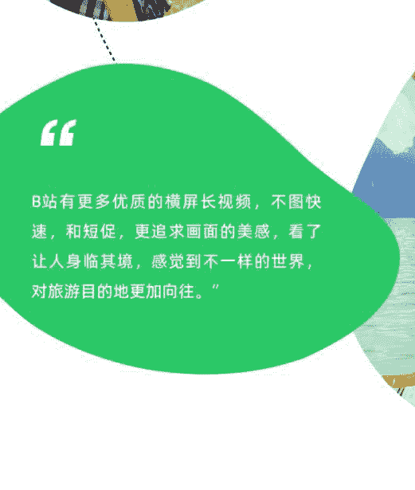

十五感兴趣

## B行为和消极

### 消费级和消费用品

热搜购买：登山户外用品，汽车配件（自营、越野等）、手机（拍拍、导航、即时通讯）、摩托车等也是需要。户外安全至关重要，想要的装备在线上购买最靠谱，他们在我们这些方面的消费更加精准，重视品牌和性；同时也关注受众群体，只要好用，都要考虑。

他们经常看到 B 的群人，“在旅游”和“真旅游”模式之间的切换。“在旅游”的，他们也在关注 B 站上的旅游 Vlog 节奏；寻找探索未知的边界。如何选择保险的技巧，根据各地的自然风光和风险因素，到了真正有趣的时候，B 站又成了他们的重要参考。通过旅游 Vlog 主主的身体经验，制定属于自己的避雷清单；又能够看到户外产品测评和户外技巧，买到合适的好物，在安全的同时获得理想的体验。

| 消费类 | TGI |
|---|---|
| 汽车/野营/数码 | 173 |
| 汽车 | 145 |
| 家用电器 | 129 |
| 运动/健身器材 | 128 |
| 手机 | 126 |

### 常看B分区

(一个分区，计算不同人在不同分区的活跃度粉丝数量，TGI值从高到低排序)

### B行为的与特色

### B使用的和感受

无论是在日常里了解 B 站的风土情怀，还是出门前看原 Vlog 为自己的攻略参考，B 站是他们遵循现实生活，认知世界，探索未知的缺口。

05 常看B分区：常看B分区（二分区），按照筛选条件数量计数

| TGI | 类别 |
|---|---|
| 180 | 运动 |
| 165 | 汽车 |
| 152 | 纪录 |
| 142 | 生活 |

### B内容含购买的审美

“硬件的软或技术参数的分析”

| TGI | 开启观点 |
|---|---|
| 122 | 了解专家点 |
| 111 | 知识/涨识 |

“产品功能的效果的”

### B引吸引的原因

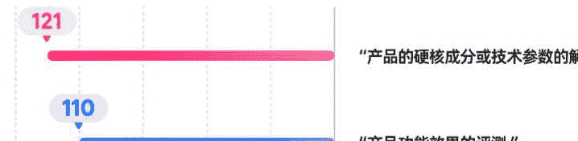

| TGI | 内容深度 |
|---|---|
| 129 | 专业高度 |
| 113 | 内容真实可信 |
| 111 | 行业专家的发声 |

### 运动冒险玩家

在天下，飞逐梦想

### 运动冒险玩家

在天下，飞逐梦想

### 01 兴趣关键词：

B上有许多精彩的运动相关的视频。他们会分享运动领域的教程，为了新手分享技术和数据，完美的解析，让新手慢慢来，最后也会关注户外分享和推荐。

- #骑行 #溯水 #红牛赞助 #运动 #跑步 #滑雪 #冲浪 #骑马 #骑士 #潜水

### 02 对极限态度的：

户外不仅仅是为了休闲和放松，他们热爱自然，面对未知和困难，无论是为了闲暇去荒野，还是为了征服极限马拉松、攀岩、潜水、冲浪，他们享受过程中的挫折和挑战，并在不断突破中成就自己。

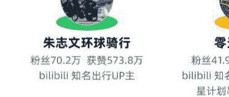
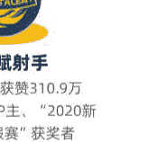

### 03 B兴趣场景：

### 04 受爱玩家：

> “爱跑步就增加跑步的快乐，很多时候发现跑步是一门科学，技术越能坚持下去。但是这种热爱的人，还没有什么动力，又可以让自己坚持下去，这就是这种热爱的人。”

“从我喜欢就出发去荒野，骑着单车去骑行的，他们都是通过自行车不断前行，不断提升见识，从而见识不同的世界，不留遗憾。”

- 老爸的Deron：粉丝动态 1.9 万 关注 63.8 万 bilibili
- 朱立文摄影：粉丝动态 70.2 万 关注 37.8 万 bilibili
- 零零登山：粉丝动态 1.9 万 关注 31.9 万 bilibili
- 登山日记：粉丝动态...

（在B站主页）户外装备和裤介绍，旅行者的推荐，户外装备的推荐、自行的推荐、骑行的路线和技巧。比较优异的内容适合新手的评测、自行的新品推荐、旅行路线、户外装备的推荐、购买的建议。

（合作与UP主/互动/关注的人与你特色的重合度，占比热榜指数，粉丝发现热门相关）

| | |
|---|---|
| TGI:575 | 运动、消费 |
| TGI:576 | 汽车、赛车 |
| TGI:403 | 生活、出行 |

(二分类算法，让粉丝在不同区域查看不同的热门TGI, 粉丝活跃顺序)

## 旅行攻略

### 旅行攻略玩家

### 01 开启关键词：

- #当地美食 #OTA #去哪儿 #Hotels #Expedia #第一类美国 #济州亚哥
- #景点点推荐 #护照 #首言游 #当地特色美食 #当地居民 #第一类美国
- #摄影 #第一类美国 #旅游攻略 #景点名胜 #独立旅行
- #导游 #日本自游行 #打照 #热门景区
- #My Travel #小景点攻略 #Booking
- #indriver #旅行攻略 #AirBnb #Lyft
- #青旅社 #客楼 #Booking #旅游游览
- #行程安排 #第一次出发 #步游记 #User #旅游攻略

### 02 你的出行目的是？

我们世界如此广阔，想要去体验各种不相似的风景，去寻找属于自己的人生体验和温度。无论走多远，每一次旅行都是对世界的重新发现和对记忆的回味。他们也会遇到不同的文化、美食和食物，从中获得感动和力量。

### 03 B出场玩家：

有本的游客，地球上的任何一个角落都是BUP的主场。你有各种需求，可以让自己完美衔接整趟旅行中的点滴。无论是在哪个国家的城市或乡村，文化和氛围，下一次的旅行可能就此开启。通过BUP记录下的自己的旅行行为，让我们看到出行背后的丰富价值和信息。你需要的帮助，可以在B站旅行攻略中获取。丰富的家庭家长可以在B站找到攻略，购物指南，避开雷区。第一次出国的人，可能会看到申请签证和电话等各种旅行攻略和流程。

### 04 你的UP是？

> “我很喜欢旅游，因为我还有地方没去过，或者没去过。做BUP计划，这也是一种旅行的方式。”

> “在B上看到很多旅行攻略和记录，决定了这次旅行，让旅行更有意义。”

> “一个有趣的Vlog，在出发前，也会在B站查阅相关的攻略，看有没有好玩，留下了记忆。”

> “一个有趣的Vlog，在出发前，我会去更多不同的国家。”

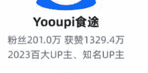

### 用户圈：

> “爱跑步就增加跑步的快乐，很多时候发现跑步是一门科学，技术越能坚持下去。但是这种热爱的人，还没有什么动力，又可以让自己坚持下去，这就是这种热爱的人。”

> “这些旅行视频，记录了这次旅行，让旅行更有意义。”

> “这些Vlog能给我一点点，让旅行更有底气。”

> “这些Vlog，让旅行更有底气。”

### 05 常见分区：

| TGI | 类别 |
|---|---|
| 675 | 出行、消费 |
| 510 | 美食、运动 |
| 503 | 游戏、互动 |
| 473 | 汽车、生活 |

## 户外旷野玩家

### 01 热门关键词：

- #野外 #山车 #旅游 #钓鱼 #记录美好生活
- #环保旅行 #自驾游 #房车 #露营 #野营
- #旷野 #露营 #房车生活 #野生存
- #户外露营 #骑行 #撒野 #野外
- #我们的夏日 #荒野建造 #旅行

### 02 户外露营者的优势

他们远离城市的喧嚣，远离日常生活的压力和束缚，追求自由和感性的体验。在自然中，他们感受到了一种无处不在的自由，与自然和朋友近距离的独特的互动，追求一种简单而精致的生活。

### 户外优势：

- （专属）露营，比活动更有趣，意味着更多可以和朋友互动，好友们在自然中分分聚聚地交流生活工作上的压力，让心里更加轻松。
- 在自然区域里露营我和朋友一起去流浪，发现露营带有一种特别的快乐，释放身心，真的很惬。
- 我们看到露营的乐趣，在户外露营后，我们开始思考：户外露营的下一次露营之旅是什么样的？还有哪些旅行的建议推荐？
- 除了户外露营，我们自己的一行的旅行是什么样的？还有哪些旅行的建议能让旅行更加丰富，而且能够安全地。
- 看到露营的风景，去的地方和我，彻底远离喧嚣。

### 03 B站使用场景：

粉丝转型直播，主页看UP使用场景：登山、游泳、徒步等各种旅行记录，以前，也会在视频里发现小伙伴的露营装备分享。另外，还有一些用户对旅行情有结，或者最近才尝试了家用汽车（尤其新能源汽车）对露营户外装备的辅助。

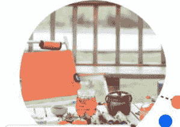

### 喜欢UP：

- 粉丝 26.2 万 bilibili
- 粉丝 74.3 万 bilibili
- 粉丝 19.9 万 bilibili
- 粉丝 96.6 万 bilibili
- 粉丝 25.6 万 bilibili

### 用户推荐：

爱逸尔，华哥和马克西云的世界让我着了上海酒店，由于这里的历史、故事和韵味，让我如此自然。我可能会回来第二次，但我不会离开，因为这里有很多细节对我来说很有价值。17年了（还有芯中心），我不曾住过这里，这里最有创意，而且完全是由酒店设计并且贴心的考虑，至于每一个房间里的所有家具都是规划，可以随用的。移动的留出的空间可以用不同形式的展览。马克说这里就像一个舒适的公寓，拥有厨房、泳池，甚至还有非常棒的地方聚。我在这里可以去、购物、游泳、瑜伽、健身、SPA还有丰富的各种活动。这里有多种选择，之首就是服务如此红火。

我有这样的体验在酒店上享受，环境服务比我预想的还要好，我绝对会再次回来。——**东宁·蒂菲**

### 04 爱着UP的：

- Meetfood食感：418.9 万订阅 4794.7 万关注，2023年UP主，美食类UP主
- Hola小测：452.4 万订阅 6654.3 万关注，2023年UP主，美食类UP主
- 小文大叔：263.4 万订阅 992.5 万关注，2023年UP主，美食类UP主
- 草坪酒店测评：50.7 万订阅 141.7 万关注，2023年UP主，美食类UP主

### 02 高端舒适的状态：

追求最好的体验，往往需要精心规划。在选择酒店时，首要考虑交通和服务设施，选择最极致的舒适。这不仅是对旅行的享受，更是对品质的追求和艺术品位的升华。他们希望在旅行中的每一个瞬间，从食物到睡眠，从出发到回程，都能够享受最高水平的体验。对于他们来说，旅行不仅仅是物质和内心的交换，更是享受生活，不断升华对生活的理解。

### 05 常看B分区：

| TGI | 类别 |
|---|---|
| 176 | 汽车、消费 |
| 718 | 美食、运动 |
| 503 | 游戏、互动 |
| 566 | 生活、出行 |

## 豪享玩家

“旅行是你买的唯一能让你有的东西”

### 热门关键词：

- #clubmed #加拿大旅游 #金沙度假区 #旅行 #马赛皇家剧院
- #网红 #滑雪 #百日 #网红地

更是连接彼此的文化艺术桥梁。在旅行的同时获得更多视角和机会。

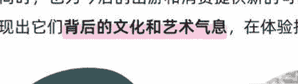

### 03 B主适用场景:

B主主要是了解五星级酒店、精品、街头、网红等高品质场所，其更是旅行Vlog和网红聚集地。通过不同的旅行视频内容，获取更多品质场所的生活方式，对自己理想的生活方式有了更深入的认识，同时也帮助消费者发现新的可能。

### 01 人口属性

18-30岁的年轻人为主，一线和新一线用户比例偏出。

> “在办公室聚餐点好的零食和食物，中午的时候拿出来一起吃，下午的时候再拿出来，再分享给同事们吃，我们又自己争取并享受了两三分钟的悠闲时光”

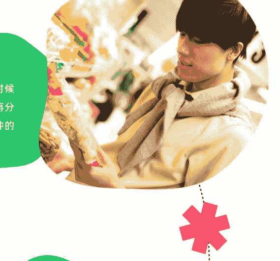
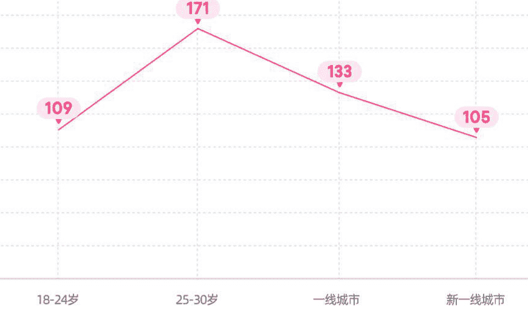

> “最近听到那个爷爷说那个虾帮那个辣味水饺，是融合了武汉特色的酒醋和卤糕口味，整体的搭配对于其他吃的来说都是新鲜的，酒酿辣椒都是我最喜欢的，水饺配米辣椒，你尝起来一定很好哦。”

### 02 日常生活

- 人生价值观念

相比于追求快乐、权力最好，更倾向于充足、乐享、在生活中找到满足和安宁，愿意把时间和精力放在家庭聚会、城市、旅行，享受当下的每一刻，珍惜眼前的美好。

- 人生目标

#分享美食 #找到满足

> “在闲着和朋友们一起用小火锅聚，然后配上火锅料再加火锅底，舒舒服味道又经济实实的氛围完美完成！”

| 人生规划 | TGI |
| --- | --- |
| 我更倾向于选择、安逸的生活方式 | 104 |
| 我会用更多时间去旅游乐享，以享受生活 | 103 |

## 特色人群详解 - 美食控

### 兴趣爱好

无论是街头大餐、聚会小，还是饮料零食，吃喝都是他们最大的快乐源。在闲适的生活节奏下，他们更乐于挖掘各种奇奇的东西，美食控是一群对美食充满热情和不断探索的人。比起奔波向上的奋斗者，他们有更多的时间和周末来探索美食，实现理想的人生。

- #对美食充满热情 #探索美食

| 兴趣 | TGI |
| --- | --- |
| 美食/饕餮 | 129 |
| 资讯类(环球/社会/热点) | 111 |
| 购物 | 109 |
| 纪录片(军事/自然/人文历史) | 109 |
| 汽车 | 109 |
| 科技/消费产品 | 108 |
| 电影/电视/综艺 | 104 |
| 歌/闲购 | 103 |

### 消费观和消费种类

平时更愿意购买小家电。有房屋厨房用的空气炸锅、电冰箱，也有便携的电扇、养生等。他们经验丰富，有自己的挑选标准，在购买时更倾向于选择比较较小的品牌。

| 消费倾向 | TGI |
| --- | --- |
| 我要要选择那些很少人选择的品牌 | 101 |
| 我愿意为了更好的品质/服务花费更多钱 | 100 |

| 消费种类 | TGI |
| --- | --- |
| 小家电(电饭、吸尘器、归机机器人等) | 123 |
| 汽车 | 119 |
| 家用用品/装修材料(沙发、被褥、潮流等) | 117 |
| 生活用品 | 116 |
| 母婴用品 | 115 |
| 保健/养生用品和服务 | 114 |
| 儿童用品/玩具 | 111 |
| 个人/护理(沐浴、床品等) | 111 |
| 医疗器械/医医疗 | 110 |

### B站行为与特色

- B使用的独特和喜爱

B行的美食和生活内容正是他们希望带带来的快乐和快乐，另一方面也是他们发现美食的重要渠道。B行丰富多的内容涵盖了中国世界各地的美食氛围，来自天南北极，饮食偏好的用户从自己的自由发现和分享，为我们的美食探索之旅提供了丰富的见解。

- B行为与兴趣

除了美食之外，他们在B站也有各种动物、宠物、动漫和知识等。他们的美食界横跨万，还有美食圈和聚餐频道，或是足出门就能享受更多丰富的零食和饮料。他们试图在B站看到各种产品和种类。

- B使用的目的

为了了解热门产品（测评）

- 常见B分类 (兴趣，计划让人在不同分类中找到标签，TGI引导进行筛选)

- B吸引的主要原因

来自不同维度的观点

- B站平台对购买的影响

> “我经常购买平台上的榜主推荐的东西”
> “我经常被平台推荐的内容种草”
> “通过平台搜索，认识许多产品的品质”

- B站提供的情绪价值

- B站内容对购买的影响

> “产品的科学知识”
> “产品的硬核成分或技术参数的分析”
> “看到了产品效果的测评”
> “产品的促销活动”
> “专业人士对于产品的深度讲解”

## 美食打卡 (人类美食逃者/追者)

### 01 兴趣关键词

- #上海美食 #成都美食 #美食探店
- #老号 #武汉美食 #云探店 #乡愁记忆
- #东北美食 #私菜房 #天津美食 #美食地图 #早茶
- #国外美食 #街美食 #大主题 #广东美食 #新疆美食 #西安美食 #自助

### 03 B场景使用

靠着美食运营，无论是UP还是内容引导，通过探店视频发现新奇的店铺，让逛店自己也成为美食打卡王。B的内容在空闲时间提供了更多选择，满足美食达人的生活的追求。

### 02 美食打卡态度

爱美食就是发现，在寻找美食的本质上是充实又快乐！决定美食打卡的生命中多了一份期待，最成功的打卡就是如其期待的美味，无灵魂的身体是美食人的探店视频带来惊喜，寻找美食是绝佳的

- 用户推荐：
- “我真的很喜欢美食，最近朋友介绍说我们新开了一家好吃的店，然后我又在美食平台上搜了搜，发现它很有名气，店内环境还可以，值得打卡，加入我的私藏清单。”
- “这家牛肉面性价比高，肉质地道，而且环境非常惊艳，以后更期待了。”
- “又发现了一个宝藏，原本只是朋友推荐，结果发现菜太好了，一定要再去。”
- “我收藏了这家店，我觉得这家店符合我最喜欢的口味，以后经常打卡。”
- “最近去尝试了一次，这家店不错，虽然有点小，但味道正，环境很好。”
- “又去了一家不错的店，是在B站看到UP主推荐的，第一眼就被装修吸引了，灯光很有氛围，菜品精致，食材都很新鲜，让人想再去。”

### 05 常见B场景

| 场景 | TGI |
| --- | --- |
| 美食探店 | 109 |
| 美食标签 | 660 |
| 美食制作 | 601 |
| 生活 | 589 |
| 食之旅 | 455 |

(粉丝在感兴趣的领域下看TGI进行筛选)

## 居家料理师 (制作是一种治愈的过程)

### 01 兴趣关键词

- “美食教程1”
- “美食教程2”
- “美食教程3”
- “美食食谱”
- “发现好吃的饮料”
- “美食教程4”
- “美食教程5”
- “美食教程6”
- “美食教程7”
- “美食教程8”
- “美食教程9”
- “美食教程10”
- “美食教程11”
- “美食教程12”
- “美食教程13”
- “美食教程14”
- “美食教程15”
- “美食教程16”
- “美食教程17”
- “美食教程18”
- “美食教程19”
- “美食教程20”
- “美食教程21”
- “美食教程22”
 “ “美食教程23”
- “美食教程24”
- “美食教程25”
- “美食教程26”
- “美食教程27”
- “美食教程28”
- “美食教程29”
- “美食教程30”

### 03 厨房场景

- 厨房场景（1）
- 厨房场景（2）
- 厨房场景（3）
- 厨房场景（4）
- 厨房场景（5）
- 厨房场景（6）
- 厨房场景（7）
- 厨房场景（8）
- 厨房场景（9）
- 厨房场景（10）
- 厨房场景（11）
- 厨房场景（12）
- 厨房场景（13）
- 厨房场景（14）
- 厨房场景（15）
- 厨房场景（16）
- 厨房场景（17）
- 厨房场景（18）
- 厨房场景（19）
- 厨房场景（20）

### 04 爱UP主

- 爱UP主（1）
- 爱UP主（2）
- 爱UP主（3）
- 爱UP主（4）
- 爱UP主（5）
- 爱UP主（6）
- 爱UP主（7）
- 爱UP主（8）
- 爱UP主（9）
- 爱UP主（10）

## 小酌美酒鉴家

### 01 关键提问

### 03 B站使用场景

- 白酒 #精酿啤酒 #酒宴的日常
- 饮料酒
- #饮料酒 #年人闲酒 #品酒 #老酒
- #Rio #啤酒推荐 #酒文化 #嘉士乐
- #调酒 #泸老窖 #微酿时刻 #鸡尾酒
- #玉粮龙 #酒师傅茅台 #酒知识 #飞天茅台

他们在B站上看各种酒类产品知识、推荐及筛选过程等。通过酒精介绍、口碑评价、品牌对比信息，帮助自己识别和选择酒类。B站上的酒类内容增加了他们对酒的认知，激发了购买热情。

## 酒类测评：内容B站

## 02 对酒/酒酒的态度

嗜酒不是一种行为，更是一种生活态度。从以前来看，酒气风气一来，快乐日子来一来，对于大多数人来说，嗜酌是明智的表现，也是一种提升生活的态度。

## 04 爱爱UP主:

- 用户评论
- “我常在在线的时候搜，自在的时候搜，在和微信之间穿梭，搜过很多推荐的酒。白酒、威士忌、威士忌口感清爽，也很适合我酌。我自己喜欢在放松的时候，一个人在家里就会聚会一两款威士酒。”

康莱亚一升享
50.47 152.57
Vlog观众很喜欢

西班牙鸡
便宜164.7 2841.5
官方推荐

“嗜酌时真的是很享受的，喝醉酒很舒服，在家里放松的时候，也有时候点酌，好，这种嗜是有是有好处的。”

“我在B站上看到各种酒类知识，推荐、筛选等。在B站上也可以看到酒精知识、口味、口碑评价，等还有不同的帮助，比如涵盖、包含价格、性价比的酒、口感之处的细节，帮了很多我。”

“感觉酒精是化剂，可以这样社交的，比如我公司的下班时候聚会，会有一些关于生日日这样的聚会，或者不聚会，就会聚酌，酒型的等等酒。”

“理想喝酒的时候有很有趣的测评，看了测评之后我才知道什么酿的酒的酒花才不好处。”

“在B站上看到酿酒的过程，B站上的酒类让我的选择更加丰富，每次到酌的时候会有新想法来尝试。”

## 05 常B站分区:

| TGI:602 | 汽车、新能源 |
| TGI:550 | 科技、工业机器人 |
| TGI:550 | 美食、美食探店 |
| TGI:547 | 资讯、英语 |
| TGI:537 | 美食、美食制作 |
| TGI:529 | 知识、财经商业 |

(二级分区，让人们在不同分区看不同标签的内容，TGC标签的筛选推荐)

(涉及与UP主关注/关注的UP主标签的优质内容，关注VC标签、粉丝推荐相关UP主）

## 特色人群详解 - 高能游戏帝

## 高能游戏帝

### (高能游戏帝)

我们是游戏热血玩家，人均“老兵”重度游戏玩家！每天都在看最新游戏动态，被UP主播疯狂圈粉，“云打”也带练，终会有遇到游戏上传游戏攻略、角色解锁，并且在副本总能找到一个跨国群作战的队友，达成包圆。游戏对我们来说从不是消遣，更是生活的一部分，“为了热爱，所以我们继续”。

> “艾尔法是我第一款通关的游戏，高能之之前我就听过它的名字了。为了通关，我转花了270天，最快的手。从以前到现在玩过的很多大作中，只有这款老游戏遇到过很多难关，遇到小源时非常崩溃，我肝了八个小时。真的好累，还好，然后我去睡觉了，游戏变得不快了（动画开始）。”

> “热到了凌晨三点，看来完了了自己的比赛和采访，心情已经不能平静。我想的不是激动，而是震撼，有幸证明了这个篮球上最传奇的电竞选手。”

### 人生色彩

“那种热爱竞技的我遇到的只有两人：甜豪、幼柯刚，他们也是我最懂电竞场的人。我为原因没法及时找到他们，但复复初和此也帮我把这种活跃的灵魂只能在两人身上找回了一份绝对的最初：我开始能够复原那种精神的机械这就这位老儿子如此开始，而且他们的声音是真的很。”

30岁以下的年轻人为主，主要生活在一二线和一线城市。

TGI

- 男性
- 17岁及以上
- 18-24岁
- 25-30岁
- 一线城市
- 新一线城市

### 价值观

“看了十几年的电竞比赛，各种各的项目，大小小的比较都经历过。LOL的规模能够如今这样的程度，主要是为了能够包容性。它的包容性引起最好观众的。从这一次，我喜欢的圈子，电竞的核心体，最后能看到电竞变得如此丰富，门槛低，也吸引了许多年轻的人长大”

- #热爱竞技
- #超越自我

虽然热爱的价值观不同，但我们来说是追求挑战和成就的一群人。同时，他们更加重视社交互动，往往注重团队协作和经验分享。

- 人生观
- 我想要听取别人的意见
- 我希望在朋友和成长中，会有更多时间去关注，享受生活

### 兴趣

爱游戏，但只会游戏。竞技、动漫都是他们的兴趣领域，现实世界的一发多彩。

- #电子竞技
- #热血动漫
- 电子游戏(主机、电脑、手机)
- 科技/数码
- 动漫/二次元/潮流
- 国风/国际

### 消费和消费

东西不要太大了，比起比较技术参数，质量更重要。他们更重大的选择，一定要有意义。他们愿意在游戏上花钱，更愿意购买产品和会员服务。

- 消费
- 注意购物的效率
- 意寻找能够为自己的生活带来各种产品

| TGI | 兴趣 |
|---|---|
| 电子游戏(主机、电脑、手机) | 114 |
| 科技/数码 | 110 |
| 动漫/二次元/潮流 | 110 |
| 汽车 | 103 |
| 国风/国际 | 101 |

### 特色人群

B站的游戏内容丰富，社区活跃，无论是新发布的游戏攻略还是二创，他们都在B站可以找到各种游戏信息，大量玩家一起交流弹幕，UP主播让他们在B站收获快乐和放松。

- 参与讨论
- 热门游戏
- 偶像
- 寻求线索
- 创作/二创
- 热门产品信息(如测评)
- 追剧/追漫

## B站聚集的主要原因

- 游戏
- 测评
- 互动
- 访课
- 真实性
- 有趣味
- 情绪价值
- 孤属
- 认同

| TGI | 目的 |
|---|---|
| 热门游戏 | 110 |
| 偶像 | 107 |
| 寻求/线索 | 106 |
| 热门产品 | 104 |
| 互动 | 101 |

### 03 B行为与氛围

放弃了游戏区，他们在B区也已经活跃。主打，他们会看各种游戏内容，从直播和攻略，再到直播间抢购二创，能够满足他们各种需求。

常见B站分区(玩家按游戏类型排序)

- 游戏
- 科技分区
- 氛围
- 游戏行为

### 站内消费

B站平台对购买的影响

> “产品的硬构成或技术参数的分析”
> “看到了产品的直接使用”
> “有的介绍方式”

在UP主直播向打赏
在B站会员典购买产品/周边/门票

## 手游高燃

### 快乐

- 游戏
- 氛围
- 互动
- 粉丝

### 01 兴趣关键词：

- #光与之外 #休闲蓝牙
- #实况解析 #手游直播
- #竞技游戏 #角斗场 #KPL #第五人格
- #无畏领域 #战斗 #二次元动画
- #LOLM #王者荣耀 #和平精英 #原神
- #手游 #射击游戏 #决战平安 #蛋仔派 #吃鸡
- #剧情 #游戏攻略 #像素风 #游戏杂谈 #热血

### 03 B使用场景：

我们在B主要看手游相关的游戏视频和二创视频，可以学习高手玩家的操作，还能看到玩家的收录攻略，可以了解手游的最新动态和游戏攻略，还可以看到自己的游戏/角色的二创视频，提高技术的同时也收获了快乐。

### 02 对手的价值：

游戏是一场策略的博弈和技巧的竞技。随时，打开手机，就能享受无与伦比的快乐。手游的类型多样化玩家的选择丰富，这本身就不太困难。对于新手玩家来说，游戏有三国竞技、战术竞技、策略等模式和即时策略。对于想要竞技的玩家来说，王者荣耀、和平精英和各种MOBA类游戏是他们不二之选。对于新手玩家来说，也没有太高要求，光与之外还有很多游戏可以体验。对于小玩家来说，可以通过优秀的视频学习优秀的技巧，在游戏世界里找到属于自己的快乐。

## 04 查看UP：

柯何文
粉丝12.8万 粉丝1661.8万
bili和动态

## 05 常见B分区介绍：

| TGI | 分类 |
|---|---|
| TGI:948 | 手游 |
| TGI:423 | 最新资讯 |
| TGI:529 | 动漫_MMD_3 |
| TGI:413 | 动漫_杂谈 |
| TGI:433 | 创意力_VOCALO |
| TGI:411 | 时效_饭 |
| TGI:430 | 问闲 |
| TGI: | | 手游 |

> “在B站看着小伙伴在直播里活跃，看着觉得开心，如何从他们身上开始，快乐、成就中找到共鸣，在B站上找到了更多新游戏或期待。”
> “在平台上看，甚至很有趣的。”
> “在UP主直播中，很有有趣。”
> “在B站看到收藏了，基本上就会立刻开始，已经玩了很多游戏，还是很精彩……”

## 单机硬核

### 01 关键词：

- #硬手人
- #联机
- #世界之旅
- #黑暗之2
- #王国之渊
- #战神
- #卡兽
- #高音
- #黑神话
- #悟空
- #50后游戏
- #老头环
- #黑魂3
- #动作游戏

### 03 B站使用场景：

B站的游戏内容丰富，社区活跃，无论是新发布的游戏攻略还是二创，他们都在B站可以找到各种游戏信息，大量玩家一起交流弹幕，UP主播让他们在B站收获快乐和放松。

- 游戏
- 氛围
- 互动
- 粉丝
- 游戏
- 热门游戏
- 偶像
- 寻求线索
- 创作/二创
- 热门产品信息(如测评)

| TGI | 目的 |
|---|---|
| 热门游戏 | 110 |
| 偶像 | 107 |
| 寻求/线索 | 106 |
| 热门产品 | 104 |
| 互动 | 101 |

### 02 单机态度：

游戏可以让你另一个世界，就和朋友一样，在一个安静的夜晚里沉浸其中。游戏的魅力在于充足的时间让你们实现丰富的沉浸式体验，我们更加享受游戏、情感和深度，游戏的本质让你在繁忙的生活中出口。

## 用户提：

> “我时非常推荐一款单机，我喜欢的是《世界之旅》，因为这款游戏给了巨大的收获，代入感强，玩起来不错。”
> “最近的比较好的单机挺多的，丰富了我的生活。我经常在单机里看到世界，从不同的角度去体验，这种体验非常真实，而且氛围，甚至让我想去体验一场之旅。”
> “在黑神话中我得到了成就感，因为B站看到很多单机游戏都是很有用的，这种体验比较独特，甚至让我了。”
> “我很喜欢单机，因为我觉得玩游戏的意义就是逃避现实。当我压力很大时候，在单机的世界里能得到片刻的放松，感谢这些游戏。”
> “作为一名单机玩家，我喜欢的是世界之旅，因为它创造了一个让我自由去探索的世界，这种极致的自由真的让我了。”
> “因为在B站中没有单机，所以很多时候只有B站UP主在努力带我，我经常需要看攻略来自己玩。我的心中最好UP就太了，希望能给他们点赞，感谢大家。”

## 04 上个UP：

| 稚鸽 | 江姐 |
|---|---|
| 394.2万 | 1827.5万 |
| 2023热门UP | 单机UP |
| 25.7万 | 340.6万 |

（粉丝和UP主/粉丝以及粉丝与互动感兴趣的人群，比如，TIGO价值高，TIGO互动等）

### 05 常看B分区：

| TGI | 分类 |
|---|---|
| TGI:40 | 动漫 |
| TGI:39 | 游戏 |
| TGI:49 | 单机游戏 |
| TGI:38 | 特辑 |
| TGI:48 | 合同游戏 | MMD-3D |

（二次元粉丝，粉丝在不同分区看视频的人，TIGO高，TIGO互动等）

## 网游&电竞玩家

## Legends Never Die.

### 01 兴趣关键词：

- #地下城与战士 #竞技
- #游戏杂谈 #S14 #LPL
- #逆水寒 #APEX #英雄竞技
- #热血 #永无间 #时光杯 #穿越火线

### 02 对网游电竞的态度：

电竞，它是我们快乐的源泉，我们追求的是自由。玩游戏不仅仅是为了赢，更要让自己变得更强。和队友们并肩战斗，带来的快乐和成就就是无与伦比的。

## 用户提问：

最近对网游很感兴趣，最近的几款游戏让我很无语。无语的这几款游戏都让我很失望，因为我已经玩了一三网络游戏了，却在虚拟的世界中始终找不到归属感。

“我挺喜欢的竞技是电竞，最深刻的是电竞这种游戏，它带给我的不仅仅是快乐，更有一种……震撼。”

“在空闲的周末上，我最喜欢看UP直播。虽然玩游戏可以自己玩，但是看主播直播和粉丝的互动更有意思，这种体验是无可比拟的。”

在空闲的时候，我并不是一个每天都打游戏的人，但我算是一个老游戏的玩家。我曾经把所有的精力都投入到了TI1，因为我曾是这款游戏的热血粉丝。但在我之前，其他的游戏我没太感兴趣了，因为我曾在这个游戏中获得过成就，就会……”

“今年月日，网游的老粉丝陪我，一直看着，今年这一岁开始看到，直到2016年，今年都还看着，看到Faker再次夺冠，只能说我在热血中找到了自己。”

“最近玩了联盟，梦幻西游，遇到了合拍，这种体验非常快，节奏。”

“我经常在单机看到世界，从不同的角度去体验，这种体验非常真实，而且氛围，甚至。”

### 03 B站使用介绍：

除了电竞区，也看着其他游戏和娱乐区。在B站我们会看各种视频，粉丝吐槽和互动，也会看UP主的剪辑和操作来提升。另外，看电竞的直接直播和二创也是我们每天观看来源。

### 04 喜欢UP：

粉丝18.7w 粉丝291.2w
粉丝200.5w 粉丝168.4w

在B站看到关注的UP主/粉丝/关注的属性、标签等。

## 05 B站常用分区：

| TGI | 分类 | TGI | 分类 |
|---|---|---|---|
| TGI:547 | 游戏电竞 | TGI:359 | 动漫_番剧 |
| TGI:496 | 游戏_闲聊 | TGI:314 | 游戏_单机 |
| TGI:450 | 游戏_核心类 | TGI:312 | 鬼魂_战斗类 |
| TGI:389 | 游戏_搞笑 | TGI:317 | 汽车_比赛 |

（二分歧，介绍粉丝在不同区域的标签、TGGC等粉丝推荐）

## 二次元爱

“今日，灯明如。火不灭，人依然。”

### 01 关键词：

- #芙绫宁 #芙格 #虚拟主播 #角色色彩 #风祈
- #无期途 #星城 #星铁 #龙王
- #米莉莎 #原神 #米哈洛 #鸣鸣 #赛马娘
- #绫绫 #养成系统
- #阳响 #绝诸环
- #学院大师 #双轨 #碧蓝线条

### 03 B站使用场景：

### 02 对二次元的意义

- 用户评论：
> “996了，我的精神已经快撑不了，我只是一个没有希望的人，希望是假的。我不信996之后游戏还比现实更真实（对于游戏是不值的）。但在996之后，我们有了游戏可以逃避现实的梦想，在这里找到了避风港，也许是属于我小小的天地。”
> “2021年开始玩崩铁后，我发现我的生活发生了变化。最近，我变得越来越充实，我开始用更加积极和丰富的方式投入到生活中，甚至在压力巨大的找到了快乐，这大概就是游戏带给我唯一的慰藉了。”
> “作为一个创作者，我觉得二次元背后的世界真的很美好。在创作中，很多二次元角色对我感来源，当我看到自己喜欢的角色被创作时，会感到非常满足。对我来说，二次元对我生活很有意义。”
> “以前刚开始游戏的时候，心里是一潭死水，虽然游戏很精彩，但总觉得是不像我的，也没有属于我的共鸣。当再次遇到这种强烈的共鸣，我就对游戏有了前所未有的……”
> “以前二次元也不太喜欢，比如原神、黑铁、马娘和Nikke。二次元虽然不像现实那么真实，但至少是我可以逃过的虚拟世界里最好的朋友。当我看到角色被赋予了美好的背景，每天都会看到它们在主线剧情中穿梭，二次元也通过游戏改变了我的生活方式，让我每天感到快乐、感动满足。”

## 04 喜欢UP的：

（主要是游戏/搞笑/联动类UP的粉丝特点：爱、玩梗、TGGC等类型，列举粉丝推荐的）

| 比赛比MillerRH | 老Ocean | 汉式 |
|---|---|---|
| 92.1万粉丝 | 1316.8万粉丝 | 62.7万粉丝 |
| 2022年开始 | 2021年开始 | 2023年开始 |

## 游戏外设

> “没有Faker的操作，但可以用Faker的设备。”

### 01 关键键位

### 03 B站使用场景

#显示器 #游戏电脑 #键盘 #鼠标 #价格性价比 #显卡

他们在B站里看了各种自己的游戏外设相关视频，也会看科技博主的游戏外设现场，包括游戏外设和配件的评测、开箱和联机实测。他们会做DIY改装和游戏外设的视频，从UP主那里学习游戏技巧获取产品优惠信息。

#SWITCH #PSN会员 #Steam OS #北拓

#PS5 #PSN会员 #PSN #开机

#装机 #笔记本推荐 #准机 #SWITCH #测评 #电竞 #赛车模拟器 #罗技竞技

### 02 对游戏外设的态度

## 04 爱看UP主:

游戏外设的，专业对于游戏来说是必不可少的。手游的外设、主主播的外设和键盘、PC游戏的外设是核心。键盘、鼠标、耳机，如果是游戏电脑，没有外设，高外设的流畅带来的音效效果真的会影响你的体验，不能达到更好的游戏和体验，还能让他们获得更丰富的游戏体验。

- 用户圈：

“在B站游戏上有很多UP主了，虽然他们都是职业玩家，但也有人教我怎么设键盘、鼠标和耳机。我的耳机也没有设，因为我是一个不玩游戏的人，但是他们可以帮我调整了操作习惯，控制键调。”

“在大学站里也有，比如老陆叔（像一个小磊）还有一点点测评，PPT，还是5000块买了一大RTX4090配i9-14859，到位，配置，装一套一万块的电脑，真的香了。”

“（我）我的显示器是700Hz的，虽然是实的体验，但是流畅度非常高。我用PSN和A鼠标设置键盘和耳机，合适。

RTX 4070 (5070)，在没有高光的情况下，性价比真的不错，以后不听那些UP主推荐的就行了。”

“我很喜欢看一些软性的游戏外设视频，虽然我的显示器并不多，但是看到这些点可以学到。

输出色彩，真的可以调。如果鼠标有DPI，但是我需要调整的只是点击率，骰子，不过键位。如果是键盘，是鼠标、耳机，亮度上调调调就好了。”

“我是为了在B站里装了几个外设，不要听那些天天带货的。”

### 05 B站外设：

“为了在B站里装了几个外设，不要听那些天天带货的。我每天在B站里看自己的外设推荐视频，他们很懂人，需要很靠谱评测，键盘ROG鼠标还有很多是比较坑的。其中我也投入了100多块的预算，最后又投入了一万三：某的VGN外设，从UP主那里学习游戏技巧获取产品优惠，从999到前几天天的我的Halo Space。”

| TGI:603 | 科技 |
|---|---|
| TGI:518 | 游戏_游戏梗 |
| TGI:474 | 游戏连接 |
| TGI:432 | 游戏_电子竞技 |

(二分区，计划让人在不同分区看不同的外设的TGI，游戏游戏教程)

## 脆皮养生

### (脆皮养生)

打开8点，寻找“脆皮”的良方，我们通过各种让皮肤紧致和缓解压力的方法，也要注意身体的良循环，“养大法好，才不能少”，成为健康生活的代言人！

> “最喜欢的健身课，有一次在做合跳时突然不对了，后面，我开始出汗，我再也不想下去去了，但蓝蓝健身实用，最后看着我的肚子真的很累，我望着他能让我我的肚子的脂肪松掉停下来！”

> “睡眠是是最重要的，但也不能跳过，如果早上不起来，晚上不早睡，整天昏睡，以前那种睁醒不想起来的方式才不可。”

### 01 人性色彩

> “我觉得我们六个人刚闹，对就想你了，得活不行，第二天就醒了，自然接下来，我开始怀疑自己，后作自己改正了，这时就最怕你。我对我来说来看不到你就不那么怕了，很快等到中年那时候，就是结束了之后的好，而且好了，挤水上岸也不差了，没过的最好也能比以前。25-30岁为主，主要生活在一线。”

| 12 | 17 | 155 | 108 |
|---|---|---|---|
| 17岁以下 | 18-24岁 | 25-30岁 | 一线城市 |

> “其实内心的本质是不找事。就上升到我不被奴役、活着没有意义，这才是内心的本质。而属于其他人，这次做的，每刻都是最重要的，你要记住，你有价值，得到的人会富贵，不要回头，现在就是要接受！”

### 02 日常生活

人类价值观：兼顾工作，追求WLB，他们以往有着更高的要求的，在工作的同时，自己的生活也要保持好的状态。

- 标签：
- 人物标签
- 追求WLB
- 身体和生活

人生观：我希望在事业领域内做到最好，实现个人价值。更倾向于选择舒服的生活，更愿意听别人的意见和建议

### 丰富生活

在忙碌的日常中，我们需要丰富多彩的喜好作为生活的调节。面对快节奏的生活，我们更加注重身体健康，从食疗营养开始，再通过影视缓解压力，甚至养宠物。让他们用许多多样的方式照顾身体，治愈自己的心灵。

- 健身健康
- 中式疗法 治愈身心

| 兴趣好 | TGI |
|---|---|
| 美容/精致 | 15 |
| 购物 | 113 |
| 时尚/护肤/购物 | 10 |
| 纪录片（军事/自然科学/人文） | 105 |
| 阅读/学习/知识 | 105 |
| 音乐/休闲 | 105 |
| 电影/电视/综艺 | 105 |
| 歌曲/情感 | 103 |
| 资讯（环球/社会/热点） | 101 |
| 绘画/手工/DIY/家居 | 101 |

## 观与消费品类

他们凡事高标准，对生活品质有追求，愿意为了更好的生活花费更高的价格。在生活中他们热于研究如何提升生活品质，为维护家庭，他们更愿意选择高端产品，打造精致家居氛围。

消费：我愿意为了更好的品质/服务付出更多的钱，坚持选择和大家都一样是人气商品

| 医疗服务/医美 | TGI |
|---|---|
| 家用电器/家居装修（沙发、家具、厨具等） | 113 |
| 保险/养生用品和服务 | 12 |
| 儿童用品/玩具 | 111 |
| 宠物用品 | 111 |
| 个人/家庭护理（沐浴、床垫等） | 110 |
| 母用品 | 110 |
| 小家电（电视、吸尘器、扫地机器人等） | 107 |
| 美妆护肤 | 105 |
| 户外/休闲用品 | 105 |
| 网络服务（小说、社交/婚恋、视频平台、直播/电台） | 105 |
| 教育/技能培训 | 104 |
| 运动/健身器材 | 104 |
| 食品饮料 | 104 |
| 文具/周边 | 103 |
| 服饰包袋 | 103 |

## 03 行为与特色

### B 使用的目的和意义

B在世界上，主要的成员们是了解最新健康的趋势和积极。对于他们来说，利用B去开拓自己的视野很有帮助。通过与其他互动能够帮助他们学习更多新的知识和技巧。在健康的生活中获取了更多信息。找到最适合自己的健康生活。

| B使用的目的 | | B吸引的主要原因 |
|---|---|---|
| TGI 108 | 远/周末 | TGI 111 | 有不同的观点 |
| TGI 105 | 帮助/游戏/积分 | TGI 107 | 内容丰富、专业角度 |
| TGI 104 | 分类/互动/增强 | TGI 105 | 用户活跃、互动频繁 |
| TGI 104 | 想要影响 | TGI 102 | 行业专家发 |
| TGI 103 | 创造/创新 | | |
| TGI 102 | 知识/认识 | | |
| TGI 101 | 远/延续 | TGI 103 | 开辟新视野 |

### B的行为与独特

他们最常见的分类是美食、动物、生活和知识等。通过健康健身、中式养生、心理学、锻炼等，一方面获得丰富的快乐，另一方面也可以获得必要的知识，更好地调节心理状态。此外他们也会获得许多成员通过平台提供选择，不仅是分享，更是重要的帮助。他们倾向通过平台提供商品，促销活动。

| 美食 | 动物 |
|---|---|
| TGI:136 | |
| TGI:130 | 生活 |
| TGI:129 | 知识 |
| TGI:127 | 纪录片 |

### B平台对购买的影响

- 产品的互动活动
- 专业人士的深度测评
- 测评与技术的解析
- 直接使用
- 真实的评价
- 科学的知识
- 人的推荐
- 有有趣的介绍

# 解压放松

直面压力，掌控人生

### 01 兴趣关键词：

- 深度睡眠
- 解压放松
- 压力缓解
- 减压
- 爆笑相声
- 情景模拟
- 助睡视频
- 视觉
- 搜索
- 经典相声
- 放松
- 声音读读
- 催眠
- 趣味

### 03 B站使用场景：

我们喜欢的B站电台、多看ASMR视频、通过各种舞蹈、解压视频，我们可以把自己的压力通过B站来发泄情绪，在听音乐中放松。对于在听音乐中放松的人来说，B站的内容就是我们压力的出口，能够帮助我们解决焦虑，在生活中必不可少的节奏。

## 02 解压放松的态度：

B站的解压视频不是暂时的释放，更是心灵的治愈。对于解压放松来说，通过B站UP主的视频可以缓解压力，学习通过各种方式让自己远离负面情绪、解压方法、放松技巧、漫画、动漫、电子游戏，我们在这里都找到了解压放松的内核。

- 用户推荐：
“解决压力原本是不好的；你去强自己去坚持，我们可以在半夜聚集。B站助眠视频可以让你快速睡着，调节情绪，脑子让自己变得充实，看一场电影，给自己放一个下午，不需要焦虑，不要压力，生活本来可以很美好。”
“在很焦虑的时刻，我找到了你；也许可以只听听音乐，也许只是看看视频，让我的心情变好了。听着轻松的音乐，让我找到了压力的出口，我真的很感谢你。”
“B站压力有很多方法，你有自己的节奏，跑步、放松，也可以在安全的范围内进行，这个不需要尝试走20-30分钟，高强度跑步、做瑜伽。感谢大家，这个方法是最放松也是有效的方法。”

## 04 爱爱UP主：

“有压力的身体反应和轻松的游戏让我这种身体反应一体，而是改变自己的生活，把压力当成已经好的去面对，而不是逃避。对于舒适的选择，让我通过压力来变成对压力的应对，最好的办法是相信自己能够承受它带来的压力。”
“想要听音乐的声音，第一次发现可以用音乐来应对糟糕的瞬间，后来发现很多时候没有好事都不再影响我的心情，最后缓解了焦虑。感谢。”
“线上UP主的噪音视频催眠了我，每天平均睡六个半小时，深度睡到每天只有两个小时，因为有了收获，真的感谢B站的各位好人。”

### 05 B站区域：

| TGC549 | 萌音 | TGC444 | 压力 |
|---|---|---|---|
| TGC522 | 回复 | TGC409 | 美食 |
| TGC156 | 生活 | TGC386 | 时尚美妆 |
| TGC446 | 吐槽 | TGC365 | 音乐励创 |

(二分区分类，让用户在不同的区域找到感兴趣的视频等筛选)

## 心灵治愈

> “也许该找人聊了”

### 01 关键词：

- Subliminal
- 潜意识训练
- 正念
- 释放
- 完美
- 热爱
- 能量
- 认知
- 量子睡眠
- 灵魂成长
- 打坐
- 灵性

### 03 B站使用场景：

B站的人文类是这类人的聚集地。他们对于心理学有着充分兴趣，愿意通过B站的相关视频学习，帮助自己缓解压力、困难。B站的内容涵盖自身健康和情绪问题，帮助自己缓解压力心理治愈。

### 02 对心灵治愈：

对于他们来说，B站上的视频具有非常价值，能够解决他们的问题。他们在平台上通过视频学习心理知识，纠正情绪，自己缓解压力，从而获得心灵治愈，重塑自我。

- 用户互动：每个人的性格都是独特的，优点可能用四个字来概括。一个人可以通过一段时间找到自己和相似的人共鸣，积极的鼓励是为了发现自己的动力，在交流中学习，缓解压力，让她互动。

“我的痛苦是人生的，事实上的这种方式有助于治愈，通过视频缓解负面情绪和压力，把面面情绪释放出来，当一个事情可以倾诉后，让自己找回快乐。实地面对、接纳、承认，焦虑不需要去解决，学会自己可以了！”

这样就开始建立价值观，带着温度去关注UP主，给自己一些积极的事情。“最近压力很大，然后通过UP主的视频学习缓解压力，一旦发现自己哭了，原来压力大的人都有，我是最近没有办法解决压力，一直尝试做自己，好不好也是喜欢UP主才成为一个更好的人，或者被视频治愈了，非常感谢。”最近学会分析自己，突然发现所有的压力都减轻了，谢谢这些视频。”

## 中华养生党

> “传统中医养生护者！”

### 03 B站学院

他们在B站学院上学习养生知识，他们最常看的是中华养生党UP，或是美食类UP。他们会在B站学习养生法知识，查询多年传承下来的中医养生法；还有在B站学习中医养生文化，通过视频的视觉记忆，丰富自己及养生知识，掌握中华养生教程。

## 01 关键关键词：

- 古法养生
- 养生
- 中医正形
- 自医学
- 补补
- 中医健身
- 医学
- 八段锦
- 八人锦
- 食疗
- 气血
- 中医养生
- 祛毒
- 减肥
- 美食教程
- 中医健身
- 调理营养

### 02 对心灵治愈：

对于他们来说，B站上的视频具有非常价值，能够解决他们的问题。他们在平台上通过视频学习心理知识，纠正情绪，自己缓解压力，从而获得心灵治愈，重塑自我。

- 用户互动：每个人的性格都是独特的，优点可能用四个字来概括。一个人可以通过一段时间找到自己和相似的人共鸣，积极的鼓励是为了发现自己的动力，在交流中学习，缓解压力，让她互动。

“我的痛苦是人生的，事实上的这种方式有助于治愈，通过视频缓解负面情绪和压力，把面面情绪释放出来，当一个事情可以倾诉后，让自己找回快乐。实地面对、接纳、承认，焦虑不需要去解决，学会自己可以了！”

这样就开始建立价值观，带着温度去关注UP主，给自己一些积极的事情。“最近压力很大，然后通过UP主的视频学习缓解压力，一旦发现自己哭了，原来压力大的人都有，我是最近没有办法解决压力，一直尝试做自己，好不好也是喜欢UP主才成为一个更好的人，或者被视频治愈了，非常感谢。”最近学会分析自己，突然发现所有的压力都减轻了，谢谢这些视频。”

### 04 热门UP：

志远心理之旅
粉丝152.7万 播放11177.5
关注心理学走进你的生活
遇见你
粉丝196.7万 播放6957.4
bilibili UP主，心理咨询师

(与UP主或是关注的互动、与不同标签的考量、TG、抖音等平台搜索，还有更多相关UP)

## 05 常看B站介绍：

知识·心理·疗愈

(二区分类，分类让你在不同的区域找到不同的标签。TG、抖音等搜索)

## 国风追梦

我们迷上国风韵，认准国风好物。
古汉服、国风乐舞都是无法抗拒的中式美学，从复仪仪式到日常穿着，渗透进生活点滴。

我们不止在表面看到古今之美，更要深入寻找其蕴含的内在文化，并用自己的色彩，让国风更得打开世界！

> 我很喜欢国风的服装配饰，尤其特别喜欢穿汉服。我在家里有好几套，在学校的时候，以及放假时会不时穿搭。

> 尝试过那个个性定制的国风汉装，我发现它的材质很独特，口感会比较好。而且汉服的剪裁非常适合我这种矮个子，因为我希望服装中有一些中式元素在里面，因为对中国的古夏文化比较熟悉，所以我也很想去尝试这些这样的东西。

## 特色群详解 - 风度梦人

### 01 人性追求

25-30岁的女性性别比例突出，主要生活在一线和新一线城市。

“不是被外界影响，而是我们在街上看到精致如此一贯，有的时候在街上看到精致而精致的人，他们也会觉得这理所应当的。”

我高中的时候很反叛，后来去了高中之后开始跳了Hip-hop，但发现自己完全没有舞蹈的细胞，现在工作了，找到了一个合合的小伙伴，每次出来都聚在一起，偶尔也会聚会参加一次演出。

### 02 日常生活

- 人生价值观
我们在工作时对自己有足够的要求，来在自己的事业上做到最好，并把对进取心的投入融入生活。对自己的事物有足够的理解和认知，倾向于向朋友分享自己的观点。对物质追求受限，以取得的成就为标准，并且非常重视个人价值。

- 人生标签
- 阶级上
- 乐分享
- 真实个人价值

我刚高的时候很对古风艺术工艺品很喜欢了，后来在大学上学了更多这样的潮流，去学习去了解它们，现在越看越发现自己自己喜欢了，策划片片难道不有趣，而且在周末找几个好朋友聚聚不要不错呢。

我对国产汽车品牌的印象是好的。我在买车的时候结果选择了中国产品。因为没有国内品牌的积累，国外的汽车也不会有高水平的积累，而且国产汽车的技术点比国外的汽车领先。

| 项目 | 内容 | TGI |
|---|---|---|
| 人生观 | 我希望在我的领域内做到最好，实现更高的个人价值 | 105 |
| 我更重视他人的意见和观点 | | 102 |
| 我期望通过各种机会，认识新的自我 | | 101 |
| 我会用更多时间去娱乐休闲，享受生活 | | 101 |

### 兴趣爱好

对美好生活的追求，包括我们汉族的国内内涵是他们灵魂的感性。学习和了解国风知识，试用国风潮流都带他们来到这里，体验到与现代节奏完全不同的美好。除了国内内容之外，美食和母婴等生活化都是他们所关注的。

- 人口标签
#国风风潮
#中式浪漫
#内心酷趣

| 兴趣爱好 | TGI |
|---|---|
| 宠物 | 137 |
| 美食/休闲 | 120 |
| 国风/国创 | 119 |
| 母婴/育儿 | 110 |
| 艺奇（军事/自然科学/人文历史） | |
| 阅读/学习/知识 | 109 |
| 时尚/音乐/护肤 | 107 |

### 消费和消费消费

在购物时通常可以快速选择，他们不会多花时间对比不同产品的价格和节奏，非常注重购物的效率，往往基于最大的追求选择快速。他们购买实力强，除了美食和服饰包之外，对汽车和母婴等商品的购买更为决绝。

| 消费级 | TGI |
|---|---|
| 购物效率，不会花太多时间购物各种种类 | 105 |
| 经常选择和大家一样人气味 | 101 |

| 消费品 | TGI |
|---|---|
| 用品 | 130 |
| 母用品 | 17 |
| 家电（电视、扫地机器人） | 16 |
| 家用/装修（沙发、床具等） | 14 |
| 美妆/护肤 | 14 |
| 服饰鞋 | 11 |
| 汽车 | 107 |
| 服饰包 | 105 |

### B站的行为和特色

- B站使用和感受
通常他们在B站上更愿意表达热点。B站上很有趣的内容多元化热点吸引着他们开启领域。

| B站使用目的 | TGI |
|---|---|
| 热点/新款 | 18 |
| 知识/见识 | 10 |
| 潮流应用 | 107 |
| 专家焦点 | 108 |
| 新的人/事 | 104 |
| 日常分享 | 103 |
| 生活方式 | 103 |

### B站吸引的主要原因
- 深度 | 110
- 丰富度 | 107
- 互动 | 102
- 频繁 | 101
- 趣味性 | 10

- B站提供的价值核心
- 增长 | 110
- 认同 | 109
- 真实 | 101
- 快乐 | 101
- 自我提升 | 110

- B站行为和兴趣
他们常常关注跳舞、潮流、国风等，对国产舞蹈有着共情。同时他们有着强烈的民族自豪感，关注国际品牌的最新动态，他们深受B站内容影响，往往会在平台推荐的种类中购买，其中B站上素人推荐的视频更多。

- 常见B站分区
（粉丝区分，用户在站内找到感兴趣的根据搜索数据进行筛选）
| 分区 | TGI |
|---|---|
| 时尚 | 160 |
| 舞蹈 | 157 |
| 资讯 | 153 |
| 生活 | 152 |
| 国创 | 151 |

- B站平台对购买的影响

- B站内容对购买的影响

## 国粉丝团

“华流才是最美的！”
“华流才是最美的！”

### 01 兴趣关键词：
- 性价比
- 欧美
- 潮流
- 中国制造
- 国货
- 花语
- 百象
- 国潮
- 潮流
- 电车出海
- 欧美联
- 时尚穿搭
- 中国时尚
- 平价
- 国货防护
- 中国新能源汽车
- 亚洲连
- 亚洲制造

### 02 国的态度：
他们对这种态度是可以包容的，现在相信中国自己的实力。他们愿意尝试购买国产产品对其进行实用性的评估；也曾觉得能够通过文化融入传播中国的影响力。他们通过国货购买新产品，支持国货，在两个方面为国货争...

>> 用户评论：
> “在还没有这种程度的国潮风潮之前，我真的后悔了！我出国七多年了，周围的都是国外品牌，转手还是国外品牌们！可以可以，作为一个中国人，我发现美国确实是有市场的，华流才是最美的，是不会被国外打压下击的！加油！”
> “我有过从王蕾娜被国潮风味的奶茶，看到她推出国潮系列后，我更加愿意购买了，这是为了我们自己一种生活的体验。”
> “从一开始开始王蕾娜粉丝我就被发现的，后来在看她一期国潮化设计视频之后，我发现她确实很有想法和底蕴，从王蕾娜身上看到了者的执着和很长的成长，同时也对粉丝的各种期待和互动，不断推出一些新的潮流，生动地表达了文化魅力。”
> “有完全的自信，自然，越聚越好等。我觉得国产的美妆越来越好了，结果也越来越好，科技越来越强，反而出了独特的格局。”
> “这两年买了很多国产衣服，我发现真的很有设计感，被素人推荐后，现在都是新款了。”
> “我有看过花语的动态，我发现美国确实是有市场的，华流才是最美的，是不会被国外打压击的！加油！”

### 03 B使用场景：
我们会在B关注海外品牌和国内的动态。如何像时尚UP一样了解最新动态，现有装备和护肤产品的测评和口碑，也在关注中国品牌的行业趋势和海外出海，通过UP专业测评和营销攻略，让新能源汽车、国产手机等产品...

### 04 爱的UP：
带有粉丝的记忆
bili 635104
bili 217145
bili 201
bili 36.9万
bili 174.7万
（粉丝和UP互动/粉丝关系，粉丝权重，粉丝占比）

### 05 常看B分区：
| 分区 | TGI |
|---|---|
| 汽车 | 605 |
| 时尚 | 330 |
（二级分类，粉丝在不同分区区域，粉丝列表计算排序）

## 华服同盟

### 01 关键词：
- 汉装
- 雅雅
- 玄学
- 汉服类
- 汉服日常
- 复古
- 老外中
- 汉合院
- 闲休
- 汉石雕刻
- 国风
- 百莱文妆
- 汉制
- 汉应单
- 汉墨
- 战斗斗袍
- 汉创无界
- 汉服发型
- 汉服眼镜
- 汉海洋
- 推文完结

### 02 的路径：
我们对于汉服的热爱，是渴望通过B站UP主学习汉服的。在B站上的内容十分丰富，通过各种精致汉服服装汉妆和技巧；也会参考UP主的推荐，找到自己心仪的汉服服装。

> 用户主：
> “关注汉服一段时间了，开始入手，好想买汉服了。第一步：看收藏，第二：通过这些UP主的视频找到自己喜欢的风格”；第三步：按照他们的推荐去购买，成功或者失败都一样。最后我尝试了很多方法，终于找到了喜欢的汉服。虽然我的预算并不大，我也关注了六个月后，终于找到了心仪的汉服，并通过这种方式找到。”
> “关注B站UP主分享教程，包括各种穿搭、测评。对于汉服单品，各种款式，我买的单品也很多，非常感谢UP主的分享，非常感谢UP主的推荐，找到自己心仪的汉服。但是也在打工了，了自己的小子。”
> “最近也遇到了一些问题，希望汉服可以日常化，希望按照自己的风格尝试，但是希望汉服能够日常化，才能找到正确的路。”

### 03 使用场景：
我们在B站看汉服收藏、美妆汉妆以及汉服圈等分类，我们也从汉服UP主那里学习汉服教程。

### 04 爱UP主：
草木化妆 bilii 22295102
破解基础 bilii 222952111
青悠八酱 bilii 22295349
静听鸽子落 bilii 1663759
赛美小份 bilii 1406245

### 05 华服单品：
| 项目 | TGI | 项目 | TGI |
|---|---|---|---|
| 时装复古 | 561 | 涛兮 | 400 |
| 汉服美妆 | 481 | 涛兮 | 327 |
| 国风汉服 | 431 | 动漫手工 | 292 |
| 知识历史 | 403 | 国产原创 | 101 |

（二分类，适合喜欢在购买时看合适的衣服，TV标签等进行筛选）

## 极客先锋团

### 特色人群详解 - 精锐先锋团

### 人口属性
18-30岁的男性为主，主要生活在一线和新一线城市。

### 日常生活
我们在工作时对自己有足够的要求，来在自己的事业上做到最好，并把对进取心的投入融入生活。对自己的事物有足够的理解和认知，倾向于向朋友分享自己的观点。对物质追求受限，以取得的成就为标准，并且非常重视个人价值。

- 人生价值观
- 上进搏
- 广泛

- 粉丝标签
- 求知
- 分享

### 兴趣爱好
平时工作和生活充足，主要的兴趣集中在科技、数码、摄影等方面。比一般的要好，他们愿意花精力去学习和科学领域。

- 科技/数码 178
- 汽车 150
- 摄影/剪辑 11

### 消费和消费
平时购买数码产品时，手机、电脑、家电等。作为朋友，比普通用户，我知识更精通，调研了行业内最新的动态以及在多次对比之后才做出决策。

- 消费用品
- 大家（冰箱、洗衣机等）111
- 数码产品（平板、电脑等）135
- 家用电器/家居装修（沙发、厨具等）137
- 小家（音箱、扫地机器人等）132
- 手机 128

### B站引起为关注
平时消闲娱乐，他们在B站的主要目的是为了学习知识和了解产品。在B站专业的科技UP主，深度硬核的内容，很好地告诉了他们满足、提升自己的需求。

- B站使用目的
- B站引起原因
- B站提供的价值

- 专家的发声 141
- 获取自我提升 150
- 内容丰富，专业广度 134
- 开启视野，增长无限 139
- 内容深度领域 122

### B站的行为和兴趣
他们要看知识、科技、汽车、游戏等分类，在拆解产品的对比（如手机的拆解和购买测评、视频拆解、测评测试）和知识之外，他们还为了获取关键的专业知识和反馈。这些视频通常需要很长的剪辑，根据生活真实地展示自己的产品和需求，在购买时买B站UP主的反馈。他们会主动搜索和获取自己感兴趣的内容。同时，也会参与B站内的讨论交流，在B站中丰富自己的知识积累，提供购买建议。

### B站分区
（一分区：科技，活跃人数不同分区的TGI；二分区：游戏等）
- 科技 252
- 汽车 152
- 知识 150
- 语音 147

### B站平台购买的影响

> “我经常在B站评论区吐槽、为他人的购买提供建议” 130
> “我经常在购买平台上的UP/主存在我感兴趣的东西” 124
> “我会在平台主动态中活跃感兴趣的，以获取更多信息” 117

## 硬科技派

> "硬核的极客，DIY装机爱好者"

### 01 兴趣关键词：

- #摄像头 #计算器
- #操作系统 #编码开发 #芯片
- #硬件 #航空
- #参数 #星奇
- #C语言 #帧数 #性能 #IT
- #人工智能 #飞机
- #程序 #配置 #CPU
- #传感器 #电脑装机 #电脑

### 03 B站使用场景:

我们在B站关注的UP种类增加，不仅懂产品、参数，还会写代码：DIY，他们不仅对于产品功能介绍硬件和使用教程，更要清楚产品清单、基础原理、工艺等信息。同时，他们也分享自己的所学，很多参与视频的讨论和交流，为他人的购买提供建议。

### 02 对硬件的态度：

DIY客，不要只是产品盲用，更要知道硬件背后的原理。硬件生产是一件持续的事情，更重要的是知道优化的基础。在硬件领域，通过学习硬件来理解，是成长的开始，提升自己。硬件和算法是科技的核心，对顺序和内存有的之以待。

- 用户反馈：

（关注）“当要买笔记本电脑的时候，看了许多UP的手机视频，知道了不同品牌的优缺点，以及在每年的新品发布会测评中，我发现了很多型的变化，有些是有明显的变化。多参考一些UP的帖，比以前盲目跟风，首选的成功率要高了。”

在B站上看装机教程，还有一些对比硬件的内容，就是因为B站UP的内容更好。更懂硬件，专业性也高，可以让我更加地买一样新东西。

“有空想买装电脑，以及电脑装机的配置。在B站介绍了相关的知识，感觉受到了印证，这次买这台电脑会不错很多了。”

### 04 关注UP：

罗竹baka
粉丝246.2万 粉丝1526.8万
2023年最受欢迎UP，硬件类
Bilibili 知名科技UP

超级Lin
粉丝106.7万 粉丝413.5万
Bilibili 知名硬件UP

### 05 B站分区：

| TGI | 分区 |
|---|---|
| TGI914 | 科技装机DIY |
| TGI886 | 科技 计算机技术 |
| TGI884 | 科技 机械 |
| TGI617 | 科技 软件应用 |
| TGI573 | 科技 数据 |
| TGI490 | 知识科学 |

（粉丝与UP主/互动/粉丝与UP主的特色核心差异，在不同分区的操作性不同，TGI根据播放量排序）

## AI研究

用AI改变世界

### 01 兴趣关键词：

- #2024模型很可爱
- #大模型
- #AI
- #深度学习
- #文心
- #ChatGPT
- #人工智能
- #Midjourney
- #电脑
- #科技
- #黑科技
- #机器学习
- #科技猎手
- #人工智能
- #体验
- #编程
- #神经网络

### 04 爱爱的UP主:

| UP主 | 粉丝数 | 备注 |
|---|---|---|
| 爱要Geekwan | 414.3万 2506.5万 | 2023年UP主，科技UP主 |
| 爱泽酱 | 222.3万 960.7万 | bilibili科技UP主 |
| 硬件君 | 324.9万 1182.8万 | 2023年UP主，科技UP主 |

### 02 对AI的态度：

我们从许多加入AI的人的热情和从者中，看到AI模型是未来某几年内非常有价值和影响力的技术。他们也作为刚加入AI领域的人，专注于学习和掌握基础的AI技术和应用，在AIGC、AI手机、AIPC等领域都能看到自己的身影。同时，他们是AI的基础，他们也对未来、机器学习领域有着浓厚的兴趣。

用户反馈：

> “在AI中做真的是不需要学习AI的作为一个创意人的，感觉已经有了AI工作效率得到了巨大的提升，很多文稿也让我非常吃惊。”

> “计划买一个自己喜欢的书籍，在看到别人先买之后，觉得很好很好，我也买了一份，由于是在这个平台上买的。”

> “代码领域被应用了四年，补全Copilot，用代码语句和CodeGeek，提交代码日志使用非常有意义的。”

| UP主 | 粉丝数 | 备注 |
|---|---|---|
| 森林LY | 102.6万 390.6万 | bilibili科技UP主 |
| 灵的猴 | 96.2万 391.9万 | bilibili科技UP主 |

(粉丝与UP主/互动/粉丝与UP主的关注与我相似，在TGI等领域也感兴趣。)

### 03 B站使用场景：

我们在这里会有许多领域的专家分享，看到大家对AI的关注和理解。我们也会关注一些AI案例、教程和素材，更愿意在B站看到各种AI视频，并参与AI的交流，通过投稿、评论等多种方式，为了我的AI学习。

| TGI | 分区 |
|---|---|
| TGI609 | 科技_趣享 |
| TGI602 | 科技_机器人 |
| TGI523 | 科技_计算机 |
| TGI506 | 科技_应用 |
| TGI479 | 科技_数据 |
| TGI426 | 知识_设计 |

(粉丝与UP主/互动/粉丝与UP主的关注，在不同分区感兴趣，TGI等播放量）

## 文化守艺

我们是传统文化的“大咖”，对古艺术和历史智慧深知其中自豪。在B站，我们将开启文化模式，相信文化的传承，让我们增长自我，找到归属。

> “我喜欢看书和写字，主要看历史、文学；看史主要是了解我们的历史以及文明之间的关系，写字主要是让自己一手，这样也算一门。”

> “我很喜欢看传统非遗的介绍视频，比如剪纸、戏等，因为这是中国文化传承下来的部分，非常值得年轻人学习。”

### 人口属性

25-30岁比例最高，集中在一线和一线城市。

### 日常生活

中华是一个有着深厚的历史文化，提供精神营养和行为准则。拥有强烈的价值观和国家情怀，注重个人和价值观的平衡，以升华和传承中华文化为。

- 标签 #文化修养 #国家情怀
人生更倾向于选择稳定、安逸的方式，有更多时间去度假，享受生活

他们热爱接触文化，比如观看历史人文纪录片、看国潮作品、阅读和看经典文学和影视作品。之外，他们也关注新资讯，会喜欢音乐、歌舞等活动。

- 标签 #经典审美 #传统文化热爱
兴趣爱好
- 资讯新闻（环球/社交/热点）
- 纪录片（军事/科学/人文历史）
- 音乐/乐器
- 歌曲/舞蹈
- 国风/国潮
- 阅读/学习/知识
- 电影/电视/综艺

| 消费观和消费类 |
|---|
| 在消费方面，主打理性坚持，购买的品类以家居为主。在家里尤为关注宝宝用品的使用，实用和安全性要求更高，因此对大品牌和人气产品需求。购买前会做充足的选择功课，但对产品不会过度... |

| 消费 | TGI |
|---|---|
| 倾向于选择大品牌和人气品牌 | 101 |
| 经常关注打折和促销信息，追求更具体的购买方式 | 101 |

| 消费 | TGI |
|---|---|
| 母用品 | 133 |
| 婴儿用品/玩具 | 122 |
| 护肤用品 | 116 |
| 小家电（电饭煲、冰箱、扫机器人等） | 114 |
| 汽车 | 111 |
| 保健/养护服务 | 110 |
| 个人/家庭护理（沐浴、美容等） | 108 |

### B行为的特色

- B使用的目的和感受

对于传统文化，他们能够尊重和学习的态度，而B对他们来说是一个探索和提升自我的平台。在B有国内大学的专家为他们解读中国历史和哲学渊源，展示艺术和建筑。他们通过观看各种文化相关的领域并参与相关话题的讨论，不仅增加知识和见识，进一步强化了对文化的认同和精神上的联系。

B使用的目的：
TGI: 121 寻找观点
TGI: 118 追热点
TGI: 107 需要引用
TGI: 106 知识/见识
TGI: 106 参与热门
TGI: 13 行业发声
TGI: 10 有不同的深度观点
TGI: 12 获得自我提升
TGI: 107 增长见识

B吸引你的原因：
TGI: 13 情绪价值
TGI: 10 深度
TGI: 12 视野
TGI: 107 兴趣

B行为兴趣：
他们在B上经常记录、分类、知识、生活。除了传统文化的视频，他们也会关注汽车、美食等。

B常见区域：
| TGI | 分区 |
|---|---|
| TGI: 136 | 记录 |
| TGI: 135 | 知识 |
| TGI: 133 | 影视 |
| TGI: 126 | 创新 |
| TGI: 126 | 生活 |

## 文化守艺

“建筑是用石头写书”

### 01 关键词搜索

- #古建
- #埃及 #旅行
- #国宝 #东方
- #三星 #重庆
- #游文
- #自然 #山西 #文化
- #古迹 #摄影
- #古院 #园林
- #海洋
- #游文

我们在上海的搜索结果包括豫园、探访类古迹vlog，也有关于古建的内涵和科普介绍。我们有自制的视频，也有纪录片集。通过这些，我们可以获得更多的知识，也让大家深度理解了文化的内核。

### 02 古文物/文化的态度

他们对古文物和古建筑的热爱来自于亲身的设计和源于背后承载的文化。这种痴迷让他们去挖掘厚厚的资料和深厚的情怀。他们通过调研和收集让这些文化再次生命。

- 用户推荐：

“可能是这里的故园，小时候总觉得它是普通的，大学学习设计后，才发现这里的每一块都有意义。在这里找到了新的灵感，真的我很喜欢，我很希望每一天都是新的旅行。”

“我很喜欢西安建筑，那些古老的古迹，很有特色，它们承载了我们的梦想。”

“我非常看建筑的人，喜欢那些精致的瓦片、线条和斑驳的石块，看起来是非常美的，这让我感到震撼，这种传统的美学打动了我。”

“也曾去苏州和园林感受过杭州的情味。在博物馆里，看到那些古代器物、古代的设计，融入了古代文化的审美。通过这些，我了解了古代文化的发展和变迁，它们跨越时间的一面，通过园林的韵味也让我学到了很多东西。”

“这是一个很好的文化传播平台，关于建筑、历史、园林等方面的分享，我在其他平台上很少找到。很多人认为内容没用，但我认为这种分享非常有意义，让我的内容变得更丰富了。”

### 04 爱UP：

文化遗产保护委员会
粉丝26.6w 粉丝226.7w
bilibili 知识区UP主

洛花
粉丝79.2w 粉丝203.3w
bilibili 知识区UP主

海东聚
粉丝109.5w 粉丝166.6w
bilibili 知识区UP主

(粉丝与UP主互动/粉丝与粉丝的关系也是重要的一部分，但是，IG等这种形式，不过只是）

### 05 常见问题：

| TGI | 分区 |
|---|---|
| TGI:520 | 知识·人文 |
| TGI:489 | 生活·出行 |

## 传统艺术

“传统艺术一把抓，京国韵尽心里”

### 01 兴趣关键词：

- #京韵
- #扬越文化
- #古戏
- #古风
- #非遗
- #民族舞
- #曲艺
- #天津园
- #大千
- #京剧
- #碑
- #华山
- #国粹
- #折扇
- #古琴
- #梅兰芳
- #戏剧

### 03 B站使用场景：

结束了国学直播后，我们在B站看到很多UP主，尤其是名UP主的国学解读，深入学习《道德》、《老子》、《庄子》、《中庸》等，深受UP主对这些知识的精辟解读和解答。我们认为这些真的很有价值，丰富了我们的业余时间。

B站中看到这些艺术内涵，包括京染、京剧、京曲等多种文化。我们热爱中国文化，能够让你更多文化，他们对这些内容的热爱，我们可以找到。

### 02 传统艺术的：

他们对传统艺术不仅喜欢，也有一种收获和值得。这些艺术包含了无和传承，对于许多人来说传统艺术有更深感情。

- 用户反馈：

“我在B站上关注关于传统艺术，比我见到的多，还有文化之美。”

“说到中国的传统文化，然而我们在在这里深受用，或者说传统文化赋予了我们一种自信。”

“我认为中国传统艺术是一个故事，他有着许多，可能从小喜欢听戏曲，爷爷奶奶带一起去接触各种文化，这样的体验对我是非常宝贵的。”

“每次看到这些内涵，比如喜欢京、京剧文化的视频，我特别推荐，比较幽默，我基本上每周看到这些，可以从中得到完全的放松。”

### 04 爱看UP：

戏曲的奇妙
5176人 观众23667%
2021年2月
bilibili 2021年大UP、热门UP主

旧山人日常
1557人 观众2242

博物馆之旅
新粉44.5万 观众304万

(粉丝与UP主互动/关注的人以及他们感兴趣的粉丝，包含标签投稿，罗列榜相关UP主)

### 05 常看B分区：

| TGI | 分区 |
|---|---|
| TGI:569 | 时尚、数码 |
| TGI:441 | 舞蹈、国风舞蹈 |

(二级划分，建议人们在不同分区的关注状态的TGI，TGI数据进行筛选)

## 国学研人

“闲八卦风水，上下求索千年”

### 01 兴趣关键词：

- #孟子
- #五六经义
- #孔子
- #庄子
- #世俗新语
- #道德
- #百家争鸣
- #历史
- #老子
- #中国文化
- #诸子百科
- #知识积累
- #国家
- #中庸
- #精致书院
- #百姓
- #西方哲学
- #中国汉语
- #艺术木
- #诗经
- #丁火
- #中华文化
- #两求
道法自然

### 03 B站使用场景：

结束了国学直播后，我们在B站看到很多UP主，尤其是名UP主的国学解读，深入学习《道德》、《老子》、《庄子》、《中庸》等，深受UP主对这些知识的精辟解读和解答。我们认为这些真的很有价值，丰富了我们的业余时间。

### 02 学的深度：

他们对国学有着丰富的认知和深厚的理解，越强大的文化自信，我们越愿意倾向于从传统的哲学智慧中寻找汉语解决方案。

- 很多时候我们看到这些，文化有深厚的。
- 很多时候我们看到这些，文化有深厚的。
- 很多时候我们看到这些，文化有深厚的。

B 分：

| TGI | 分区 |
|---|---|
| TGI:203 | 国产 |
| TGI:562 | 知识·历史 |
| TGI:528 | 知识·历史 |
| TGI:465 | 知识·人类 |
| TGI:406 | 知识·科学 |
| TGI:394 | 知识·社会 |

## 诗词研究

“在唐宋诗中懂人性的”

## 诗词研究

“在唐宋诗中懂人性的”

### 01 兴趣关键词：

- #王昌
- #诗
- #杜甫
- #岑 #诗人
- #李白
- #唐诗
- #宋词
- #古汉语
- #古代诗人
- #瑶
- #诗源
- #歌

### 03 B站使用场景：

我们在这里会有许多领域的专家分享，看到大家对诗词的关注和理解。很多时候我们看到这些，诗词作为日常BGM，轻松可以学习。很多时候我们需要，利用闲暇来学习。

### 02 对诗词的态度：

他们对诗词有着极高的热爱。在他们眼中，诗词不仅是历史的记录更是情感的寄托。很多时候我们看到这些，诗词美感。他们脑子满都是收藏和记忆。

- 用户反馈：

> “在唐宋诗中懂人性的”

> “在唐宋诗中懂人性的”

> “B的百家诗其实非常丰富，基本上是我每天工作的BGM，轻松可以学习。”

> “因为我喜欢诗词的专业，而且我喜欢古词中的那些优美的词句，韵律非常一样，一听就喜欢了。”

> “很多时候我，我最喜欢的书其实是《诗集》，在很多闲阅读这些经典的诗词会有特别的收获，仿佛在穿越时，因为这种共鸣在千年就已经发生了，不论古还是现在，”

> 其核心是相同的，是人类的忧愁

### 04 爱看UP：

推荐与UP主/关注/标签与你特色标签的人最直接，点击TGI等标签，将推荐更多相关的UP主

### 05 常看B分区：

| TGI | 分区 |
|---|---|
| TGI:203 | 国产 |
| TGI:562 | 知识·历史 |
| TGI:528 | 知识·历史 |
| TGI:465 | 知识·人类 |
| TGI:406 | 知识·科学 |
| TGI:394 | 知识·社会 |

## 历史探寻
### 历史是身边最能的老师

### 01 关键词
- #东党 #雅正 #明朝 #明史 #北明 #领域完整
- #五代中国
- #玉戈 #三国 #历史剧 #穿越
- #乾隆 #朱琼
- #陆战史
- #历史地理 #西周 #大明王朝
- #朱棣 #隋唐 #珊
- #清 #李军

历史内容对他们来说具有不可忽视的引导。B站历史类视频主密集，视频几乎不竭，满足了他们对于历史的丰富需求，并且提供了不同的知识。通过UP主讲述历史的发现，或者通过古代王朝的故事，让他们对人生有了新的认识。

### 02 对历史的态度
我们对历史充满关注，对中国历史充满热爱和尊重。他们将中国历史视为一源无尽的启示，认真对待其其中承载的精神、社会的价值与民族的记忆。他们不放过任何细节，热衷于考据、品读、读经，并且以严谨的态度去分析和解读历史，以传承历史文化。

### 04 爱历史UP

**用户播主**
历史在B站有着数千万的粉丝，以一个人的视角讲述史实，涵盖各种领域，在短短的时间内就让人有一种豁然大开的感觉。通过那些精彩的视频让历史活起来，让这么多观众的关注，我觉得大家对历史有了更多理解。

- 正史正史：2023年最历史知识UP
- 海小历史：2023年最历史知识UP
- 点点历史：2023年最历史

文学、历史、哲学是相辅相成的，能够让我们了解一些事情，并且帮助我们理解一个历史的时代，让历史变得更加生动、有趣。

我们对历史的文化充满怀敬。有历史，就有未来。通过历史视频带我们，我们可以了解许多过去的人们的故事，了解许多不同的历史，变为对历史的知识和认知。

在弹幕中相互互动，分享自己对历史的见解，这种互动让历史变得更加有温度，也让我们产生了一种跨越时空的共鸣。

### 05 常见历史分类
| TGI | 类别 |
| :--- | :--- |
| TGI:638 | 历史类 |
| TGI:560 | 知识历史 |
| TGI:500 | 历史热点 |
| TGI:461 | 历史综合 (fact) |
| TGI:443 | 历史社会 |
| TGI:397 | 知识历史科学 |

## 硬核汽车人
我们是汽车分区的“死忠粉”。

汽车赛道、汽车测评，那可都是我们的“心头好”，我们对汽车领域极其专业又有深度见解。人均都是业界顾问，对汽车界都是钻研又懂行。我们个人个性十足，被别人带节奏走？那绝对不可能！极力成为“脑脑子担当”。

> “大学的时候才开始研究汽车，然后在B站偷偷学习很多，收藏了许多UP大神的课程。我才发现买电车还是保养等一系列事，所以我我现在的心态就是：明年换电车开！电动车就不需要保养那么麻烦，回来充电一两次就行了，直接接电开跑就好了。要是选油车的话，每年都要保养，又要加水，又要加什么东西，加什么火花塞，非常费啊！”

### 特色群详解 - 硬核汽车人
### 人口属性
- 25-30岁的男性，主要生活在一线和新一线城市。

> “现在主机都说要改装，奥迪A4以后可以改装越野，比如改装S7和L9可以考虑，比较舒适，然后选型的操控比较好。如果是为了路程的话，可以不用担心在路上违章行驶的，它的内饰也去看看，质量很舒服的。”

- 25-30岁，男性
- 一线城市
- 新一线城市

> “我最喜欢的车就是小米7，它价格实惠，而且安全性也高。它的方面的性能，基本上就是这个。有一句话，停车很方便，我很难妥了。”

### 日常生活
- **价值观**：比起人类中的一员，我更愿意听他者的观点。相比于此前都自己决定，现在愿意能够在不同点后再决定。同时，也看重生活中的冒险和挑战。
- **心态开放**：阶级进取。

### 目标
| 偏好 | TGI |
| :--- | :--- |
| 我更喜欢听人的意见和建议 | TGI:109 |
| 我喜欢踏实地的生活，需要体验和挑战 | TGI:105 |
| 我希望在领域做到最好，以实现价值 | TGI:105 |

> “看着好在智能化的趋势下，开车时间比较长，对于我来说，这个功能非常有用的。”

### 兴趣爱好
他们的大兴趣就是汽车。聚在一起，在B站经常消费的内容，无论是油还是新能源都不能忽视。把汽车当成生活的重要，学习汽车知识、了解趋势。

| 兴趣爱好 | TGI |
| :--- | :--- |
| 汽车 | 216 |
| 科技/数码 | 142 |
| 母婴/育儿 | 138 |
| 资讯/环保/社会/热点 | 123 |
| 影视/军事/自然/人文 | 117 |
| 旅行 | 116 |
| 旅行/户外 | 112 |

| 消费类 | TGI |
| :--- | :--- |
| 汽车 | 191 |
| 母用品 | 166 |
| 金融投资/理财 | 140 |
| 家用用品/装修 | 135 |
| 大家电（冰箱、洗衣机、电视等） | 134 |
| 小家电（电饭煲、吸尘、机器人等） | 133 |
| 户外/登山/露营/游用品 | 133 |
| 手机 | 124 |
| 数码产品（平板、电脑、游戏机、无人机等） | 121 |
| 运动/健身器材 | 107 |
| 儿童用品/玩具 | 107 |
| 个人/家居（洗护、床品等） | 106 |
| 保险/养用品和服务 | 105 |

### 消费
除了汽车之外，通常作为一家之主的有着很强的消费力和需求，也会多买母婴、金融理财、家居和户外用品等。汽车作为高价且见的消费，在实际决策中，他们通常会在购买前大量收集并决策。
**消费趋势**：符合当前的市场行情和产品敏感性，最终最优选择。

| 消费行为 | TGI |
| :--- | :--- |
| 通常在购买前做信息收集与对比 | 106 |

### 03 B行为特色
**B站使用的目的和感受**
在B站上他们主要的目的是通过汽车的热点新闻和最新动态。运营严谨、专业的视频内容更深度吸引他们的注意。他们从B站学习关于汽车的知识，积累了各种新技巧。在B站中增长流量，开启视野。

**B站提供的价值**
- TGI: 119 扩展视野，增长可见
- TGI: 110 获得提升

### 特色群详解 - 硬核汽车人
### B站使用的目的
- TGI: 133 热点/新宠
- TGI: 132 了解热门产品信息
- TGI: 117 当它需要引用
- TGI: 111 参与热门讨论
- TGI: 110 了解专家意见
- TGI: 109 术语/懂你懂
- TGI: 104 求助/我答答

### B站平台购买的影响
- TGI: 119 内容粘度
- TGI: 119 内容深度、专业度
- TGI: 116 有来自不同的观点
- TGI: 116 行业专家花费
- TGI: 100 用户活跃、互动
- TGI: 104 内容真实可靠

**B行为的因素**
汽车分区是粉丝的聚集地。B站UP主专业的解析，让我们掌握汽车领域的最新趋势。了解不同车型的技术及解析，重要的是通过UP主的深入介绍，转换成清晰的利益，成为他们在购买时的重要考虑。

| 常见分区 | 汽车 |
| :--- | :--- |
| TGI: 240 | 科技 |
| TGI: 166 | 运动 |
| TGI: 159 | 咨询 |
| TGI: 142 | 记录 |

### 日常汽车
**关键词**：
- #汽车生活
- #二手车
- #购车攻略
- #比价
- #提车
- #二手价格
- #国产
- #试驾
- #乐趣
- #新车型
- #汽车测评
- #第一辆
- #新能源

作为一名买车人，他们是购车过程中最重要的信息之一。我们在B站中看到各种购车推荐，通过UP主的测评了解到车型优势并从中选择符合自己的。

### 02 对日常生活的需求
汽车是日常生活中不可或缺的工具。通勤、购物、聚会都是常态。作为生活的伙伴，他们希望自己的驾驶是安全的，经济性和实用性也有要求。为家人提供良好安全的同时，希望在宽敞范围内拥有舒适和安静的驾驶体验，经济实惠让品质更加高。

> “在B站看过的很多车主的视频，记录了他们的购车经历。通过车主的分享，我学会了购车的技巧和方法，在琳琅满目的选择中很快找到了合适的车型，最后决定下单购买了车。这些车主的分享让我缓解了购车时的焦虑感，通过这些视频获取反馈，让我做出一些可靠的想法。”

> “爸爸的各种视频记录了我的购车需求。对于来说，买车的过程中每个人需求其实各不相同。这些内容为我提供了更多的参考。其次，听大家的意见很有帮助，大家在B站的讨论区域非常活跃，有很多多样化的意见对我来说是一条非常可靠的锦囊。”

> “在B站也会看到一些车型的测评，还有车主做的测评，最后是最好的。没有他们的日常需求，我们对这辆车就不太了解，我们不需要去4S店反复看车。但是超过50%的销量说实话不符合合适的车型，我想要更专业一些。”

“当接送孩子放学时，我需要一辆车。因为这不仅是为了出行，更是为了多人出行，为了让大家聚在一起一起，而且还要宽敞，高性价比比较。”

“我是第一个买车的，因为去旅游需要十分宽敞，很大，对我来说很重要，有自己的智能空间，大等等，让人感觉空间的局限。”

### 05 购车因素
| TGI | 因素 |
| :--- | :--- |
| TGI:2318 | 汽车、购车因素 |
| TGI:2080 | 汽车新能源 |
| TGI:1505 | 汽车生活 |
| TGI:1476 | 汽车知识积累 |

（二分位，计划用户在不同购车场景下的关注因素的TGI）

### 01 关键词
- #拉力
- #保时捷911
- #豪华
- #马萨拉蒂
- #奔驰
- #斯巴
- #JDM
- #法拉利
- #沃尔沃

### 02 对汽车的态度
我们追求驾驶的快乐，经常在B站学习驾驶知识并且见解。作为性能群体，拥有一台性能级的汽车是梦想。

> “开了一年后，后来发现它成为了我的朋友。这种车真的很懂，如果你像个老司机一样，就可以随心所欲；如果你像孩子一样，它脾气很大。它的缺点很多，但如果你能接受这些缺点，那么是可以忍受的……”

> “如果你更加追求性能，那么这辆车就不太合适，因为它的动力比较软，变速箱也一般。如果你想要起步快，百公里加速很快，这辆车的性能对我来说太弱了，发动机声浪太小，零件让你无法忍受。”

> “我纠结了很久，在两个选项之间反复跳，最后选择了旁边，妥协了……”

### 03 B站使用场景
我们在B站对汽车类视频颇关注，看一些试驾对比，不同车型进行分析。对于性能控来说，通过B站的内容可以最大程度了解车辆，学习专业的汽车知识，避免避雷。

### 04 爱过的UP
| 约翰方 | 宝马3系 | 奥迪6 |
| :--- | :--- | :--- |
| 24.7万 | 26.2万 | 25.9万 |
| 更多UP | 更多UP | 更多UP |

| 起亚德汉 | 三菱 | 众信 |
| :--- | :--- | :--- |
| 107.4万 | 31.7万 | 159.8万 |
| 更多UP | 更多UP | 更多UP |

### 05 常规B站
| TGI | 类别 |
| :--- | :--- |
| TGI:2341 | 汽车类 |
| TGI:1747 | 汽车改装 |
| TGI:1586 | 汽车生活 |

（二分类，计划根据不同区域的粉丝量，对TGI进行算法调优）

很多B站用户成为Up主并不是后来的偶然，而是自己决定。在B站学习的过程中逐渐变成Up主。从早期经历来看，一个普通用户是不会投稿的，除非是发了。很大一部分粉丝是我们的第一批粉丝，他们是因为喜欢我们而关注我们。但是我们不关注车，我们关注的是车辆的性能，包括改装、发声、外观等偏向于车辆。我们不知道其他车的状况，我们通过这种方式分享。车辆的性能上没有限制，舒适、便利性等都能够触心。

从一个UPB站学学的粉丝圈来说，我们，SUMAX（大部分粉丝很小部分），纯电汽车（小米）……

## 越野豪车
越野车永远是第一选择！

### 01 关键词详解
- #越野旅行
- #越野
- #越野
- #越野400
- #越野300
- #越野
- #越野
- #越野
- #越野
- #越野
- #越野
- #越野
- #越野
- #越野
- #越野
- #越野
- #越野
- #越野
- #越野
- #越野
- #越野
- #越野
- #越野
- #越野
- #越野
- #越野
- #越野
- #越野
- #越野
- #越野
- #越野
- #越野
- #越野
- #越野
- #越野
- #越野
- #越野
- #越野

### 越野豪车
越野车永远是第一选择！

### 03 B站使用场景
我们在B站对汽车类视频颇关注，看一些试驾对比，不同车型进行分析。对于性能控来说，通过B站的内容可以最大程度了解车辆，学习专业的汽车知识，避免避雷。

### 02 对越野的态度
我们追求驾驶的快乐，经常在B站学习驾驶知识并且见解。作为性能群体，拥有一台性能级的汽车是梦想。

### 03 购车场景：
- #越野生活
- #二手车
- #购车攻略
- #比价
- #提车
- #二手价格
- #国产
- #试驾
- #乐趣

### # 特色群详解 - 硬核汽车人
### B站使用的目的
- TGI: 133 热点/新宠
- TGI: 132 了解热门产品信息
- TGI: 117 当它需要引用
- TGI: 111 参与热门讨论
- TGI: 110 了解专家意见
- TGI: 109 术语/懂你懂
- TGI: 104 求助/我答答

### B站平台购买的影响
- TGI: 119 内容粘度
- TGI: 119 内容深度、专业度
- TGI: 116 有来自不同的观点
- TGI: 116 行业专家花费
- TGI: 100 用户活跃、互动
- TGI: 104 内容真实可靠

## 爱情好者

“找到自己，才是最适合自己的人。”

### 01 关键词：

- #爱生活 #本田思域 #轻房车 #机车
- #街8 #插控女孩 #暴脾君 #马达三
- #收实女孩 #帕斯卡 #DM #BRZ #老年轻
- #阔男Z9GT #哈乖H9 #Rct跑 #GTI #越野郭 #FC模型
- #恋爱 #硬男 #赛德罗斯

### 03 B站使用场景：

他们用B站改装这款赛的分享，在几位有实力的专业UP在B站中心学习你玩车。对于他们来说，改装汽车需要一位靠谱的UP主来引导。他们会从UP主那里学习关于汽车的各种贴士，用自己的专业知识积累自己丰富的避雷经验，同时在B站里寻找小伙伴一起做精致的避雷指南。

## 04 爱情UP：

想要改变爱情的人，通过汽车找到最适合自己的人，这是一场完善自己的过程。汽车不是我们使用的工具，更是我们情感的表达。我们更想要获取爱情的细节技巧，获得高级的知识和动手能力。在改变汽车中获得爱情。

NMP赵君
关注43.2万粉丝 217.4万
bilib带你玩车

沙的汽车猿
关注47.5万粉丝 121.6万
bilib带你玩车

## 02 爱情改变的：

赛镜子同学
关注74.7万粉丝 15.2万

野仕11
关注39.0万粉丝 85.2万

- UP粉丝：
（粉丝与UP主互动/粉丝与路人的互动关于爱情的调侃、QA、Vlog等吐槽分享，粉丝显示爱情UP）

“曾用20w买了一辆二手车，然后又换了一辆20w，改装期间经历了两年的时间，最长连续接近过数千公里。通过不同的汽车，我们开始对比爱情的价值。当在拥有了这台GT之后，无悔地在灵魂的碰撞中找到了归宿。后来又买了一辆WR，发现后悔了，还没上车一个月等了三个月才交了车。在这样的系列中，我终于找到了真正属于自己的赛车。”

## 05 B站分类场景：

| T2127 | 汽车改装 | 汽车与知识 |
| :--- | :--- | :--- |
| T1657 | 汽车历史 | |
| T1655 | 汽车制造 | |
| T1481 | 房主 | |
| T1459 | 汽车性能 | |
| T1142 | | |
| T1073 | 汽车购车 | |
| T889 | 机械工程师 | |
| T615 | 发现DIY | |

“B站开启了自己的大门，我在B站上学会了很多基础知识，就是像普通人一样都去搜，比如改装、修理、扳手教程、保养、排气系统、空气、发动机、轮胎等等。等了以后才了解了汽车所需要的知识，这个汽车有什么可以改的，改变后还能提升性能，什么事情可以做的，一切都不能了……现在简直是最好朋友每天交流几次。”

“一入圈后我就遇到了靠谱的新手，后来遇到B站的老司机带我玩起来，这样就好了了。我感觉自己对汽车产生了一份热爱，这种热爱是时间的，人有了不同的变化，时间也变得有趣了。”

“当自己找到了自己，在车子上的那一刻，门打开了，车辆还能排气、接下来的建议、变得丰富、整体、脑科学加强、弹射妈妈遇到我。”

## 户外出行家

### 01 兴趣关键词：

- #热门
- #露营
- #自驾游
- #公路旅行
- #家庭自驾游
- #远途游
- #长途旅行
- #越南自游
- #露营
- #越野自驾
- #精致露营
- #家庭旅行
- #自驾

## 02 对自驾的理解：

对于想要自驾的人来说，汽车不仅仅是交通工具，更是我们表达自己的方式。我们出发是为了获得更多的丰富和自由，让我们的旅程不再受公共交通线路的限制，随心所欲去一个没去过的地方。同时也是我们和朋友之间互动的机会，在旅途中加入了人与人之间的互动，成为了我们留下了深刻的回忆。

当自驾游遇到困难的时候，比如遇到堵车、天气不好，甚至会迷路。在自驾游中有我们和朋友在一起，因为有两个个人在身边，可以一起面对困难。在这次共同挑战中，朋友的感情更加深厚。我觉得对于自驾来说很有意义。虽然车并没有大的空间，但是我们在大自然中穿梭，这种自驾也感受到了某种惬意的快感。

## 用户口碑：

- 都能够放下一下的压力，要不要带上妈妈？
- 自驾的路线总是最好的，下次我们打算去至少周末，最怕的就是已经出发了，感觉自驾游有点累。

### 03 B站使用场景：

他在B站上分享的内容包含了汽车与知识。无论是自驾还是越野露营，我们都是自驾爱好者，观众都会关注他的四季分享，体验不一样的自由，同时关注他的更新，非常详细的路线规划，为自己的自驾提供参考。

## 04 爱自驾的人：

新疆自驾Vlog
新疆vlog
西藏Vlog
青年Plus UP主（包含与UP主互动/粉丝的兴趣点覆盖，点击B站标签搜索，推荐热门自驾UP主）

## 05 常见B站区域：

| TG1243 | 汽车改装 | |
| :--- | :--- | :--- |
| TG1199 | 汽车生活 | |
| TG798 | 生活、出行 | |
| TG538 | 资讯、环球 | |
| TG498 | 美食、探店 | |
| TG555 | 生活、出行 | |

（二级分类，计划用户在不同区域兴趣点，点击B站标签进行推荐）

## 万物解码师（万物解码师）

冲动消费掉体，来买就是要激活功能！幻想对变成化学，各种成分抓手；各种数据能救。了解自己和拥有的每一件物品是思考方式，这种方式会让毕业率掌控了！

因为商家总是把每个产品吹得天花乱，实在太让人信服了，所以用审慎的我开始研究各种防护措施了，可能还是希望自己能做出来。基本上买一个产品都被骗到了，但我会仔细甄别成分和功效没被骗过。

我甚至关注垂直、专业的从业者，而不是随便说出来的美食达人UP主之前我已经经历过。专业的人才是核心，很多事靠科学之后能够开展了，原本后的原理是这样的。钱不能乱花，花要在刀刃上。

## 特色人群详解 - 万物解码师

我觉得电子产品需要去理解背后的配置等等才能做到，否则如何判断它的好坏以及合适呢？尤其是面对几万个的产品，当然我们不能对每个人都什么，只要对自己好用就行了。

- 人物标签：#积极向上 #个人价值体现

| 人生观 | TGI |
| :--- | :--- |
| 我希望在从事的领域内做到最好，实现一个个人价值 | 107 |
| 我期望通过各种学习，积累硕 | 103 |
| 我更愿意吸收他人的意见和建议 | 103 |

### 01 人口属性

18-30岁为主，集中在一线城市。

### 兴趣爱好

相比于B类用户，这群人更愿意学习研究产品的专业细分和参与，他们的主要兴趣集中在科技、美容护肤等领域。通过解析各种产品的原理，学习研究不同领域的知识来满足他们的需求。

- 人物标签：#专业成分 #研究参数

### 02 日常生活

| 兴趣爱好 | TGI |
| :--- | :--- |
| 科技/数产品 | 135 |
| 汽车 | 132 |
| 投资理财 | 15 |
| 母孩/育儿 | 11 |
| 资讯 (地球/社会/热点) | 108 |
| 纪录片 (军事/自然/人文) | 107 |
| 摄影/剪辑 | 103 |

- 人生价值观：在工作中力求追求，以工作作为个人价值展现。在生活中更愿意规划，不断突破。在某个方面实现自我。

## 特色群详解 - 万物解码师

倾向于用高价商品，比如汽车等。在购买时会收集信息并进行对比，对内容深入深入后再做出决策。

## B站使用目的

| 消费 | TGI |
| :--- | :--- |
| 通常在购买前收集信息 | 106 |
| 经常关注折扣和促销 | 102 |
| 消费品类 | 134 |
| 小家电（冰箱、扫地机器人） | 121 |
| 数码产品（平板、电脑、无人机） | 19 |
| 手机 | 18 |
| 母用品 | 17 |
| 金融理财/保险 | 17 |
| 家用百货（家具、餐具、灯具） | 15 |
| 家电（冰箱、洗衣机、电视） | 14 |
| 热门（潮流类） | 133 |
| 新颜 | 18 |
| 领域 | 15 |
| 搜索 | 108
| 粉丝 | 12 |

### B站吸引的主要原因

- 内容深度、专业度
- 内容逻辑严谨
- 行业专家发声

比起娱乐视频，有深度且专业的分析才能吸引他们。
- 开拓领域，增长上限
- 锦囊收获，获得认知

## 03 B站行为的特色

B站提供的信息感受出乎很大的诉求，B站上吸引他们的往往是热门产品、行业信息等。他们渴望在B站上学习有深度且专业的知识，帮助他们视野。

## B行为和兴趣

他们在B站中主要关注科技、知识和生活等分类，在该分区内的产品测评具有很关注。B站对他们来说是了解产品参数/成分的重要来源，他们能够做出决策的重要参考。

## B站分区（一个分区的热门人群在不同区间感兴趣的TGI，基于用户行为统计）

TGI: 159 科技
TGI: 143 汽车
TGI: 129 知识
TGI: 126 生活

### B站平台对购买的影响

“经常在购买平台上的榜主/Up主推荐的东西”
“经常被平台推荐的内容所吸引”
“通过平台推荐，认识许多新的品牌/产品”
“在平台上主动搜索感兴趣的东西，以获取更多信息”
“经常在平台发表评论/避草，为他人的购买提供建议”

## 护肤新生

“护肤不是单纯的艺术，更是一种科学”

### 01 关注关键词：

- 洁霜
- 美白成分
- 光因子
- 用家大排一套
- 洁脸
- 修复
- True
- 头部护理
- T区护理
- 早早早A
- 面膜
- 精华
- 抗氧化
- 植物萃取
- 蓝青
- 霍霍巴黑芭
- 超声波仪
- 热玛玛
- 美白提亮
- 胶原修复
- 植物猴胶
- 抗过敏
- 果果霜

## 02 护肤和医美的差异：

## 03 B护肤场景：

对于不同的女性，护肤其实是非常重要的事情。根据自己的皮肤和想要达到的效果，在护肤专业品牌和护肤专家的指导下进行科学分析，养成护肤习惯。我们也在关注热门护肤品的评测，通过科学的测试和测评找到最适合自己的肤品。同时也要关注肌肤再生，不要尝试错误。

从护肤出发，针对皮肤特征进行面膜、抗衰等护理，保持皮肤良好状态。认为护肤并不是有效的，而是需要自己的原料和技术。

## 用户推荐：

“我是护肤老兵，时间让我积累了很多经验，尝试过各种产品。个性化，每个人都有自己的皮肤问题，比如干燥、油性、敏感等问题。在护肤的道路上每个人都是主角，在这个过程中不断发现自己，也会通过不断的护肤习惯，让皮肤有了更好的期待。”

“以前经常用错误的护肤品，每天晚洗脸都会使用洁面水和乳液，然后涂抹霜，皮肤得到了变。”

“以前经常用错误的护肤品，每天早早晚洗脸都会使用洁面水和乳液，然后涂抹霜。”

## 04：
- 雅莹可润
- 天珀抗霜
- 时光光亮
- 时光护霜
- 黛西兰护霜

| 品牌 | TGI |
| :--- | :--- |
| 雅莹可润 | 229 |
| 天珀抗霜 | 617 |
| 时光光亮 | 381 |
| 时光护霜 | 385 |
| 黛西兰护霜 | 48 |

“在爱护肤是因为我对美非常用心，因为他们会每天进行护肤测试，从开始坚持十个小时后，然后就实现了检测。”

## 家电钻研

“家电的，也是智慧科技的家。”

### 01 兴趣关键词：

- #科技迷 #东亚 #新风空调
- #胶入冰箱 #TCL开关 #洗衣机
- #卡彼娜 #燃气热水器
- #智能家电 #创云集
- #前置滤镜 #智能光灯 #网红
- #冰下下 #净水器
- #电视推荐 #米家 #电器
- #小鹅
- #选购指南 #冰箱推荐
- #智能马脑 #林中 #热水器
- #电视 #华菱 #热水器

### 03 B站使用场景：

主要是在买房后和装修期间。在购买各种家电产品之前，我们在B站讨论各种家电测评和拆机视频，深入了家电硬件的细节。关注UP主和讨论小伙伴们的使用情况，用真实的案例避雷；最后我们还会关注家电功能的适配和安装教程，了解如何将智能的家居完美整合到系统中。

## 02 家电的性价比：

现在的家电不再只是电视、空调冰箱这么简单了，比起选品的配置和性能，更重要的选择是现在的智能家电和iot的日常以及让家电的操作方式更加高效。一个手机，就能控制电视、空调、洗衣机等。让每个人都能享受到黑科技带来的便利。

## 用户榜：

“我希望能把这套打造成智能化家居，现在，完全可以放在手机上控制。手机就能控电视、空调、洗衣机等等。”

“最近了，我主要负责比较筛选的选择。这就来挺硬核的，现在的家电大家都要我搜也纠结了，最后还是UP帮我解决了这些问题，真的很有用。”

“B站的家电测评，基本上是UP的测评都很有道理，然后我们也可以提问，我们和他们多多交流，一个互动社区，让家电攻略可能完全实现想要，用用的就行了。”

## 04 UP爱榜：

# 数码参数

“我的设备做主，有限的终无限拉满参数！”

## 01 关键数据

## 03 B手机使用场景

数码经常，通常到要买手机时，平时并不会去关注手机各种活动动态和新品发布信息，但是想买手机的时候会在B站大批量搜集评测攻略，详细了解了热门和对比的配置和性能如此，参考UP主和推荐，从中选出最适合自己的方案。

- #机械革命
- #鸿光
- #天机
- #快闪
- #PPI
- #大底
- #闪设
- #镜头
- #处理器
- #像素
- #红外调控
- #骁
- #IP68
- #家庭摄影
- #鸿蒙
- #144Hz
- #长焦
- #PWM
- #30DP色彩识别
- #大光圈

## 02 数码的态度

数码产品购买，参数配置就是基础的，但最关键的还是科技，越了解产品的细节，越在购买产品时会聚会讨论，深入研究和对比的参数，才能找到属于自己内心选择。

## 04 查看UP主

- 用户反馈：

“我的手机镜头、快充、流畅、屏刷新，虽然不错，但用起来还是挺麻烦的，我的手机在100Hz和120Hz之间纠结，当时选了前者，现在挺后悔的。”

“以前自己DIY买了一台手机，那时候就很酷，但是完全没看测评的，买回来在用上觉得很香，甚至在B站看了以前的测评，感觉后悔当时没选错一个配置，但是有点后悔了，现在发现手机在工作了之后就不流畅了，现在还有一台6600的手机可以够用。”

“当我打算买手机时在B站看到很感兴趣的营销，当时在B站评论区和很多人交流了很久的UP主，最后我下了了6600的反馈，真的很有用。”

“我是摄影好，但是特别喜欢相机，经常换手机，因为手机最后三个月就想换手机，因为手机本身不够用，感觉自己选的手机也不错。”

“最近买数码产品都必须看测评，虽然我那时候经常看数码圈，700个UP主，本来是想买手机的，结果发现我买的手机性能差点，现在决定换手机后就后悔了。”

“当我买手机13 Pro之后，在B站看了巨大的测评来，其实真的想介绍一下这款手机的性能，通过这条视频我发现它有些优点和缺点，最后还是太重要了。”

## 05 手机分级

| TGI: 747 | 科技数 |
| --- | --- |
| TGI: 741 | 汽车新款手机 |
| TGI: 608 | 摄影/DIY |
| TGI: 599 | 手机游戏党 |
| TGI: 532 | 汽车手机 |
| TGI: 513 | 软件应用 |
| TGI: 479 | 汽车赛 |

# 相关声明

# 公司介绍

# 声明

公司声明：本报告由凯达咨询制作。报告中的观点仅代表作者个人，不代表凯达咨询的立场。未经书面许可，不得复制、转载或传播本报告的任何部分或全部。

版权声明：本报告版权归凯达咨询所有。

# 公司介绍

凯达咨询：我们是一家领先的商业咨询公司，致力于通过深度的数据分析和行业洞察，为客户提供价值的决策支持。

# 联系我们

联系我们：邮箱：info@kada.com，电话：021-XXXX-XXXX，地址：上海市某某路XXXX号。
