# 得到新商学

# 老板IP就这么干！

2024

# 扫码加入 知识星球TOP 免费资源群

免费

- 每日免费获取高价值资源
- 提供各类资源搜索服务

公众号:知识星球TOP

价值

| 热门付费文章 | 各行各业报告 |
| :--- | :--- |
| 精选图书资源 | 副业赚钱方法 |
| 职实用资源 | AI 经自媒体 |

微信信号:jnts8

及时

微信信号:jnts2

专注

分享资料仅供个人学习，请及时删除，切勿商用传播

# 微信生态内老板IP的独有打法

王润宇

# 王润宇

腾讯官方长期合作的讲师&顾问
微信视频号创造营讲师
企业微信私域WeTalk讲师
腾讯智慧零售特邀视频号讲师

服务企业：
未来、得到、小红书官方、博商等
得到新商学首批入驻专家顾问老师
视频号亿级服务商、亿级MCN主理人

# 3年前，我的K12在线教育遭受重创

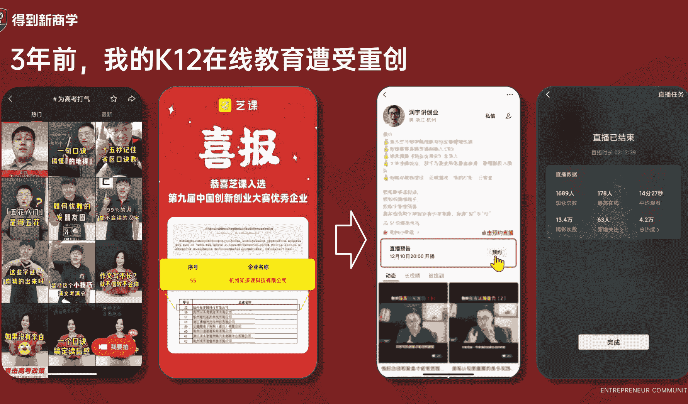

# 3年来，我的粉丝和微信指数变化

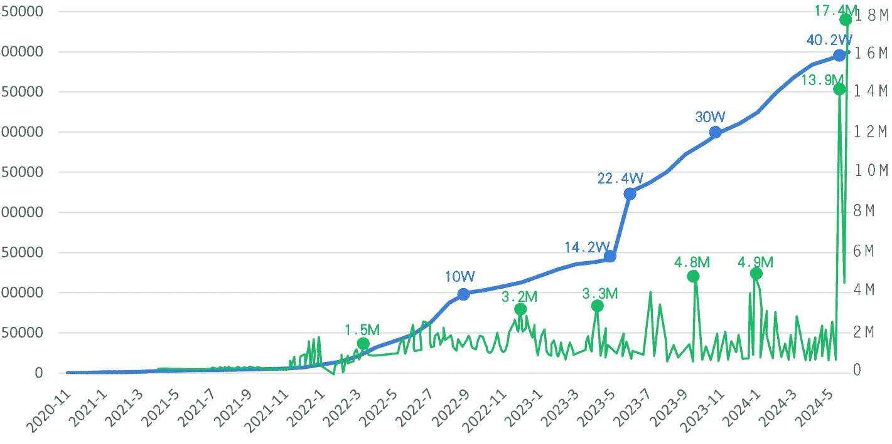

# 中年网红，在微信崛起
我赌对了，凭什么？

# 微信14年就做两件事：关系与价值

视频号
小程序
广告

# 价值商业化

04 订单包
支付
游戏

听一听
附近
搜一搜

## 做厚价值

03 朋友圈
直播
看一看

## 活跃关系

02 视频号
企业微信
公众号
微信信号

01 建立关系

00

## 其他平台
## 微信生态

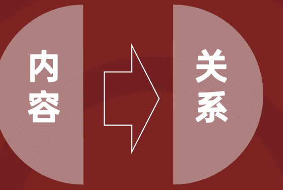

## 微信生态
## 从来不是“流量生意”
## 而是“关系生意”

# 我是怎么做的呢？

# 得到新商
## 第一步：每天5条朋友圈

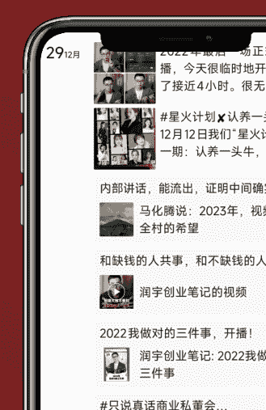
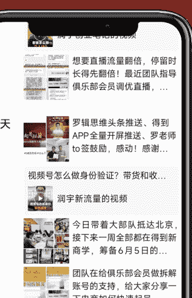

8月1日
明天中午直播播播
11点单，日归晚

每天五条朋友圈发了朋友，这会有这种“定制服务”吗？
我来写你：

直播为什么是一个机会？
人场价值高！

你是一个没有梦想的“职业学习者”？
有一位同学问我“能不能讲讲……”

明天中午11点30直播
如何获得精准的内容输出力

这是一个令人纠结的圈

创业笔记89：金富有内心，你懂吗？

7月17日
谁在哪里，结果就在哪里

9月29日
2022年初正式的直播，今天临时直播了，讲接近4小时。不复复……

## 计划计划认识一牛头——
下月1日直播，开启“第一期：认识一牛、牛、品……”

内讲涵，输出，证明我确实

马云花：2023年，视频是全流量的终局

和谈钱的人事，和不谈钱的人事

宇佑创业笔记的视频
2022年遇到的三件事、思考！
宇佑创业笔记：2022年我遇到的三件事

## 只说真直播私会

勇者的站台，与世界交

8月28日
明天中午直播，复！
2022年我遇到了什么事？？其实深刻理解了知识付费……

昨天
想要直播流量高峰，停时长先见！最近跟创始组俱乐部会会调诸……

罗森偶像头部直播，得利APP全靠推广，老师哥到热款了！感谢！

视频号怎么做营销？带货收……

宇佑私流量的视频
今天带大队奔赴北京，
接下来我们都奔赴北京赛圈，赛6月5日的……

团队在俱乐部会要拆解
我号的运营，大家分享一
如何获客？

宇佑创业笔记的视频
我的流量在，普通人要变，住一起确定性！

## 早期朋友圈
## 中期朋友圈
## 现在朋友圈

## 第二步：短视频

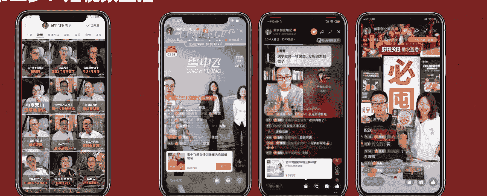

短视频带货
连麦问答

## 第三步：朋友圈到公众号

### 创业笔记

8月18日
明天中午直播1点半，
又是推销，又是搞笑，定要卖的，
我来写：直播到底什么是直播？
你是一个有目标的“职业学习者”吗？
有位同学问我：“不能鼓励我……”
明天中午11点30直播
如何获得粉丝的输出力
这是一个让人纠结的问题
创业笔记：金富有内心

7月17日
在哪里还是已经开始的伙伴，
在微信阅读的文章，回顾了一周。今年参与了许多项目，明年这些项目都能取得结果，千万人的变革。

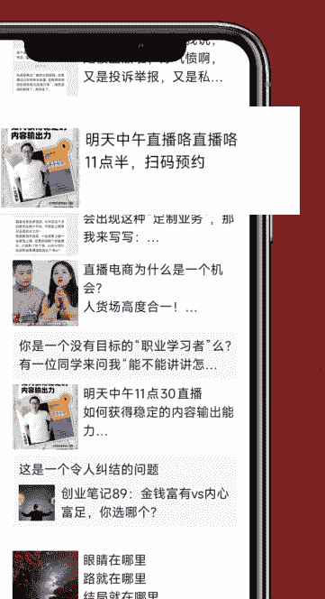

2023年8月12日
我去了一个周年，
创业最难的是最后一段路（如果你能坚持到），
继续上个月

## 得到新商学的课程终于上线——
创业笔记：我的视频号起板

8月28日
大来更新视频号半的，
十周年为什么这么多人人的视频号！

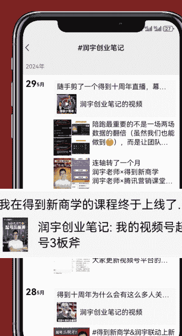

## 直播预约

## 第四步：公众号到主题

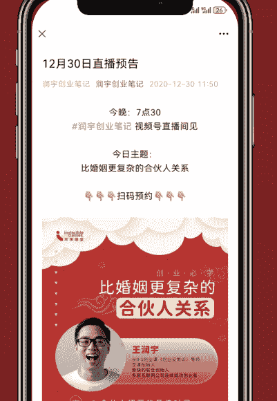
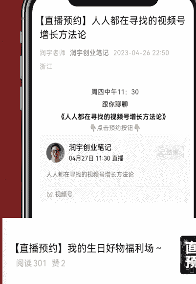
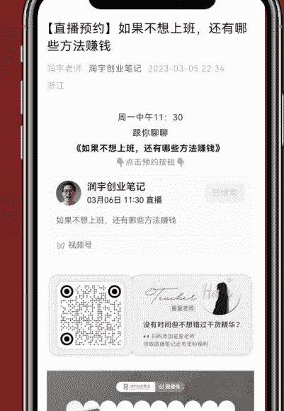

早期公众号
中期公众号
现在公众号

## 第五步：一鱼六吃

# 刘同学创业笔记

视频号获训粉丝3种模式

这个一鱼六吃，最近爆火了
以上这些是你第3个视频号认证，结果你多了一条。
如果你想知道更多关于视频号的技巧和运营动态，可以加入我的私域。关注我，你又多了一个运营专家。

- 1份内容，6份营销！视频号获取流量的“一鱼多吃”全靠它

2024-03-15 23:10

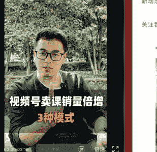
视频号获训粉丝3种模式 #视频号创业笔记
账号 @刘同学创业笔记

视频号涨粉实战
如何定位
视频号流量

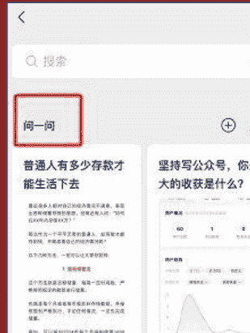

## 一种学习
不用学费，还能学习

很多人问多少流量才能生活呢
大咖账号需要什么？

有一种方法，不用学费，还能学习
来自博文《有种学习，不用学费，还能

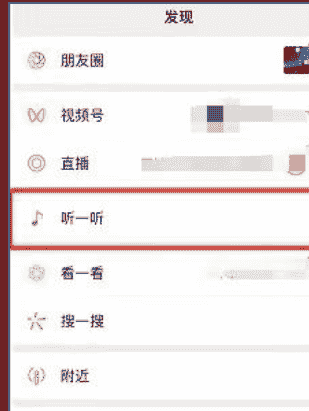

## 发现
- 朋友圈
- 视频号
- 直播
- 看一看
- 附件
- 小程序

- 朋友圈
- 短视频
- 公众号
- 文章

## 专业的人，是一圈红的
## 微信生态看有没有人推荐你的名片，短视频转发/分享/观看

## 它在微信里的生意
为什么可以不做爆款？为什么没有流量？

## 从“曝光”回归“价值”才能对抗注意力碎片化

从“流量”回归“关系”
才能打破流量内卷

始于关系，终于价值

在微信里做生意

# 老板IP就这么干！2024

# 我不是雷军，我怎么做IP?

流量在那里，生意在那里
你不抢别人了，自己上，创作内容做资产

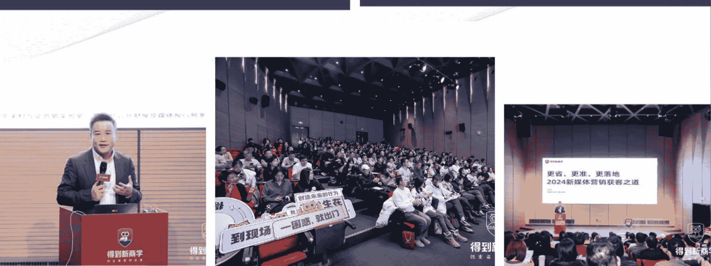

# 谁的故事能比雷军更精彩？

# 你担心难处

## 做IP就是自媒体网红吗？

## 老板做IP一定能成功吗？

## 你做对了的是什么

## 内容怎么切入？
- 公共话题？
- B2C?
- 个人话题？
- 行业话题？
- 企业话题？

## 工作生活最好的内容

## 讲道理不如讲故事，讲故事不如搞事情。

## 认真学习方法论，回到自己生意里。

## 小老板自己做，大老板鼓励全员一起做。

# 创业人IP

## 不做爆款做生意

周百见

创始人IP咨询顾问，全网30万+商业粉丝
为中小企业提供咨询、企业内训和联合运营服务
前阿里云产品运营专家，擅长toB企业内容营销定位

# 得到新商学
10年toB营销人，2次结缘短视频

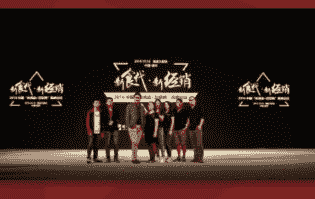

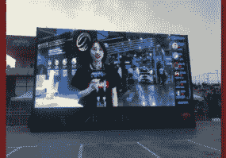
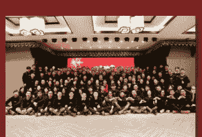

金沙江投资
快消CRM服务商
品牌公关
纽交所上市
云通讯服务商
市场经理
阿里巴巴集团中国区业务部
资深运营红杉投资
人工智能安全服务商阿里巴巴集团核心产品线运营专家
2014
2017
2023
00万预算
75条视频涨目前全网30万+粉丝【周报实话】

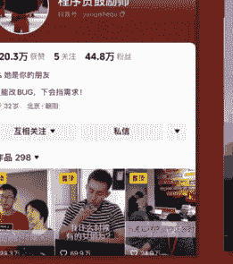

# 首先我们对齐一下IPIP的理解

## 三种讨论最多的IP
自媒体流量变现
创业人IP
企业家IP
品牌&间接获客

## 建议中小企业
All in

## “销售线索”驱动的创始人IP营销模式

视频号账号A 账号B 小红书账号C
公域平台×矩阵
私域进线精准商机

Leads (线索)
MQL (市场认可线索)
SQL (销售认可线索)
OPP 合同

## 服务案例-北京里空间
小红书内容引流
视频号直播转化到店

## 创始人IP运营本质
把老板当投放素材用短视频/直播获取销售线索

## 接下来分享

## 创业IP打造的三个真相

## 适合做IP的四大特征
IP只能筛选无法孵化

- 有体系:在某个领域有10年积累
- 爱分享:有旺盛的表达欲
- 擅表达:有良好的表达技巧
- 路人缘:由数据测试作为标准

## IP做没做成怎么判断？
主要看销售线索日进线量而不看粉丝数等其他指标

## 创业IP指南
如何从0到1避坑指南

月亮老师
短视频+直播引流
直播直连表
私域进线
私域交流匹配产品服务
圆泉咨询会
定向委培企业内训解决方案
项目联营产业类深度合作

## 不做爆款做生意

## 不做与业务无关的爆款

- 现实：大部分人就做不了爆款
- 危害：做了无关的爆款，账号标签打歪
- 正确思路：围绕业务做精准流量

## 定位越清晰，动作越精准

## 三步做好创始人IP定位

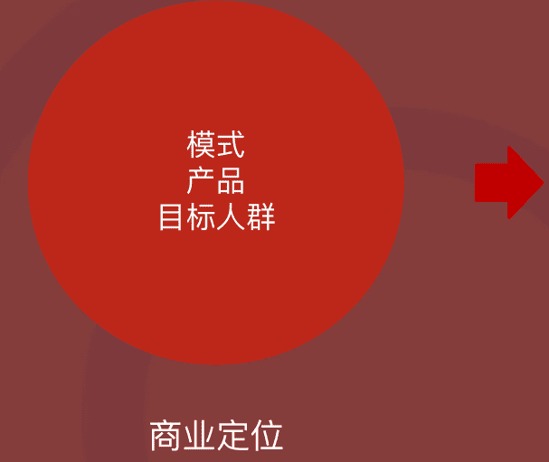

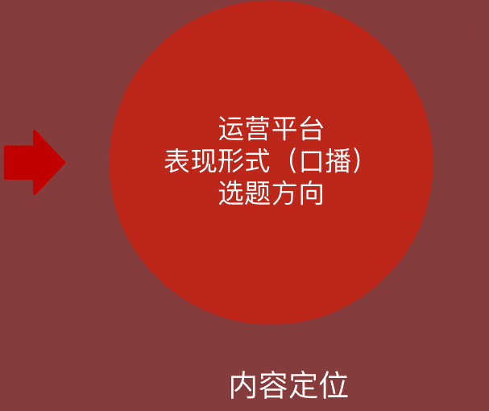

## 理解“人群垂直，内容不垂直”
是内容不再碎片化

# 理解人群垂直，内容不垂直
才能对抗注意力碎片化
才能打破流量内卷

始于关系，终于价值

## 创始人IP不等于做个账号
## 是一种新的营销模式
## 需要匹配新渠道
## 搭建新组织

# 谢谢观看！视频号搜索「周百见大实话」

# 本色出演，如何打造月销千万直播间
顺子说茶、陈韵金皮负责人 陈镜顺

# 我们总是高估一年的变化，低估三年的进化，错过十年的造化！

# 得到的十年，是持之恒的生命版本。罗胖的60秒，是长期价值的沉淀。

# 读万卷书，不如走万里路。行千万里路，不如阅人无数。阅人无数，不如名师指路。名师指路，还需自己感悟。

# 是谁，影响了你的思考？

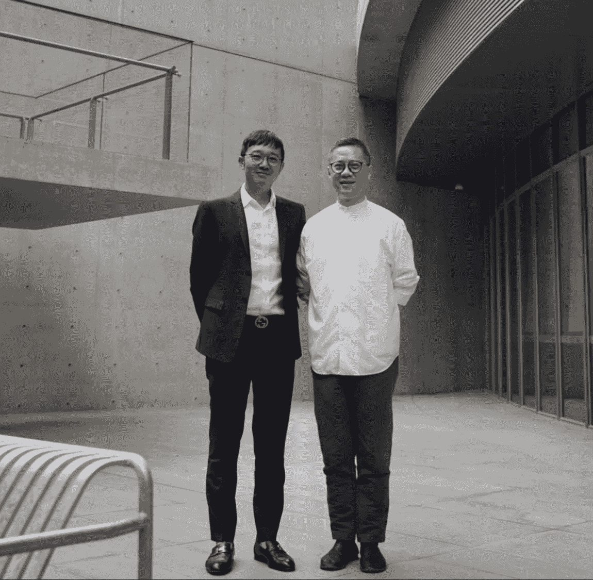

# 未来·以终为始

# 陈镜顺（顺子）
中法松园茶茶茶企业家
2023福布斯中国茶出品人

- 国家一级评茶师
- 国家二级茶艺大师
- 广东省文化交流促进会副主席
- 最具镜馆博物馆博览文化专家
- 网易通茶品品牌人
- 湖东方深度茶文化大师
- 视频号23次开讲《十大年度发奖主》
- 大益茶文化大赛
- 原真蓝基茶文化师
- 中华尊享学院院长首席教授
- 广东大学研究生发展导师
- 南大学生活方式研究院荣誉教授
- 广工职业技术学院院长教授
- 新艺术学院创办人

- 2016年中国茶文化奇人物荣誉奖
- 2020年中国人大大会“十大创新人”
- 2021年创新中国慈善“十大创新人”
- 2023年中国茶十大大师广州、十优秀茶文化传播者
- 2023年馥白茶慈善传播者
- “陶陶金丰”品牌创始人
- “老家私茶”品牌创始人
- “子源设茶”出品人
- 网易通茶类内涵、产品服务，独家拥有供应链多年，小青果产量3000万+，年销1.2亿。
- 一条茶叶类供应商，2021年营收7000万+。
- 东家直采购量260万、120万、86万创造者。
- 一条茶叶获奖80个+创造者。

《遇见》系列茶书籍设计、作者，获得67个国内外创意大奖

- 2017《最美书籍》获得：中国美丽书籍、香港举办顶级茶具大赛、德国红点设计奖、德国IF设计奖、英国书籍创意奖、台北设计奖
- 2018《遇见设计奖》获得：深圳设计奖、华人设计奖、年度设计奖
- 2019《遇见设计》获得：德国IF设计奖、英国木零售奖、台湾金点设计奖、360度书籍、红点设计奖
- 2020《遇见茶套装》获得：德国IF设计奖、深圳设计新锐奖、联合国教科文文化创意奖、360度书籍、红点设计奖
- 2021《遇见四困兰》
- 2023《遇见中国茶4700年》

从事茶行业15年，跨越文化，多年出版下中国书，一书一人，将茶布局全球供应链，在文化推广、文创拓展、电商、直播、洛阳门一手夺取了丰硕成绩、跨国文化，推动茶产业发展，赢得千万级利润及额外收益。

一个茶从业者，6年自费出版版6本图书，遇见手拉壶、工夫茶、普洱、景德镇、贺兰山、新会陈皮。 获得中国最美图书、年度图书奖、全国书展银奖、德国红点奖、IF金奖、英国木铅笔奖……等69个国内外文化创意大奖。

## 2018广东21世纪海上丝绸之路国际
2018 Guangdong 21st Century Maritime Silk Road Int
10.25-28 广东·东莞 GUANGDONG·DONGGUAN

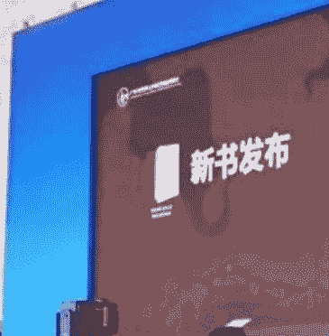

新书发布
图书发布
欢迎光临

广东省茶业行业协会专职副会长：张黎明
广东省茶文化促进会会长：樊金华
广州文化促进会会长：黄波
东莞市茶叶行业协会会长：卢树勋
岁月月知味董事长：郑少洪

## 《寻见普洱》
秦建国 作者

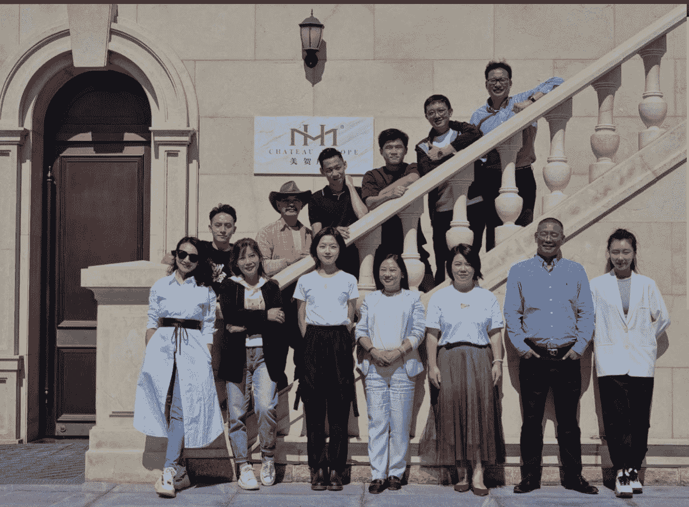

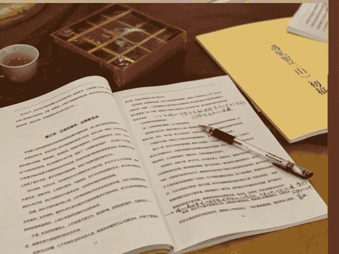

## 除旧迎新大会

## 图书，为我构建背书。
确信自己不是才华横溢，仅仅只是一个茶商，无法一本书流芳百世，就以量积累沉淀，用66年、66本书，66个产业构建价值，耕耘价值的土壤。

# 过去·借修真
## 陈镜顺（顺子）松园茶管家
### 2023福布斯中国杰出人
### 中国茶传播大使
### 陈韵金创始人

# 2022年4月6日，顺子说茶第一场视频直播，潮州凤凰，16个小时，从采摘鲜叶到制茶。

（此处省略重复的直播间数据及重复互动信息，已根据要求保留核心内容）

# 主播与品牌，同样都是人设。

# 人以群分，物以类聚。

# 同频共振需要匹配的实力与价值。

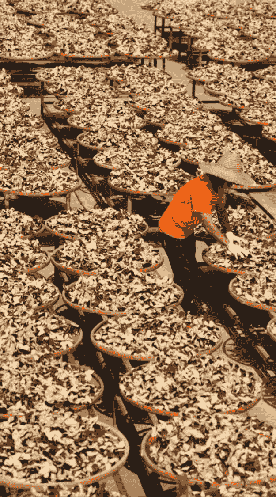

# 岗韵金皮

陈皮之王
岗韵金皮产于广东新会岗禺县，由于地理位置优越，气候条件适宜，土壤肥沃，使得当地的柑橘具有独特的风味。金皮是陈皮中的极品，其色泽金黄，质地紧实，香气醇厚。

岗韵金皮经过了复杂的工序制成。每一片陈皮都经过了挑选、洗净、晾晒、陈化等道道工序。这种工艺确保了岗韵金皮具有极高的药用价值和食用价值。

岗韵金皮不仅是一种药材，更是一种文化的载体。它承载着新会的历史和传统，反映了当地人对健康生活品质的追求。

# 人生的奥妙不是在解决什么问题？而是经历当下的现实，在进化中感受频率，融合其中，顺势而为，成为势能……

## 把你宠坏的人，同样需要你宠爱。

# 得到新商学

# 老板IP就这么干！

# 2024

# 创始人IP，怎么变成公司的能力？

脱不花 得到联合创始人&CEO

# 2014, 我与罗振宇的两个约定

# 不做经经纪人

- 不要陷入零和博弈 -

## 1. 打开个人能力的天花板

## 2. 用产品增强IP，而不是消耗IP

## 考虑IP对公司有什么用，而不是对个人有什么用。

# 2016，罗振宇的两个重要决定

+. 1. 停止罗辑思维全网分发
2. 罗振宇不是「得到老师」

# 2024,

罗振宇又开始全网搞事情

# 文明
CIVILIZATION

2024年2月28日正式上线

发大愿 迈小步 走远路 磕长头 不停顿 不着急

# 《文明》为得到下一个10年提供坚硬的内核。

——万维钢

# 创业人IP的好处1

# 提高传播的杠杆率，

# 成为品牌和用户的连接器。

深圳卫视
直播

# 中国最好的知识服务商

# 创始人IP的好处2

# 节约组织的学习成本，

# 提高创新的敏捷性。

# 建立一种「翻译」机制，把老板IP处理成组织能力。

# 分享得到的几个做法

# 内容序列发展通道

# 多元培养，专属课程

# Special Offer
创始人罗振宇带你寻导师

# 核心岗位轮岗

得到游学——游览公司，了解部门组成
专属课程——通用能力+专业知识，十三门专业课程护航
大咖面对面——罗振宇手把手教你如何生产课程

# 参与“时间的朋友”跨年演讲

# 集训营

学长答疑——优秀前辈答疑，带你少走弯路

# 培养津站

# 岗位反选

# 专业轮岗

核心岗位——3个月紧凑学习，直击内容生产全流程

# 八里庄抗大
手艺人的共同体意识

# 得到新商

# 知识管理部

内容产品品质

+. 201 如何理解得到体系的特点？
202 如何解决产品落地时的难题？
204 如何录制一个高质量的音频课程？
206 如何正确使用视频品控检查工具？
217 怎么评估要素研发是否合格？
218 如何做好产品迭代论？
219 如何评价内容的品质？
220 如何做好评测？

3. 音频的内容来源于文字，对文档内包含的信息百分百准确和还原，没有任何错乱，时也要根据节奏、结构化表达，适合直接变成口语化。不用书面，如：其（ta）、即（ji）、为（特别）、妈妈（奶奶）、以及（一点儿）、或者（等）。不用连贯句子，如：长度，每天都要重复，其实也是好的，节奏均衡，以免出错。不用用多个词，如：第一、第二、第三、4、5、6、7、8……特殊的标识符需要替换：“比如”可以用成“就是”，“签名”可以用成“标题”。

4. 得到音频课程的交付场景是在得到App，通过客户端对用户做交付。从心理学角度，“场”是包含大量线索的环境，行为线索的力量越大，用户提供的学习环境就越。面对面距离是是200字左右，让听众清晰，不会觉得声音太大或小。语速每分钟280-290字；音量控制在70分左右，要求平和，不用“大家”这样的称呼，而是用“你”。

5. 等号与逗号。逗号代表句子内部的停顿，等号包括逗号、分号、省略号、叹号等符号，表示完结。等号接近听觉节奏，“得到”内容偏好具有节奏，避免复杂的长句，有利于注意力。

6. 问号与句号的比值。问号是作者主动设问，有利于唤醒用户思考，或用户共情，或者提示内在转场，从而带领用户前进。因此，“得到”偏好在课程中使用问号。如果问号不在参考区间，需增加句号，强化用户的互动。

8. 段落。一个段落由若干句子组成，是比句子更高级的语义团体。标注标准（即一节课程300字左右），段落应长短适当，有利于视觉美感和听觉性的呈现。段落数多少，指内容过于细碎，不利于逻辑链的整体把握；段落个数少，指语义块过大，不利于手机阅读的信息抓取。

9. “你”字。指文中“你”字的总。注意，不包括“你们”中的“你”。使用“你”表征者与用户互动，有利于建立用户意识，管理注意力，建立一对一的对象，是偏好的技术之一。

10. “我”字。指文中“我”字的数。注意，不包括“我们”中的“我”。使用“我”表征着个人身份与用户互动，有利于作者建立身份，讲述经历故事，建立一对一的对象。强调作者个人身份，而不是作为某个个体所代表的全体身份发言，是偏好的技术之一。

# 得到黑话词典

> 得到黑话词典，是内部的默契知识，是我们对知识服务心法的高度凝练式表达。

“得到”同事可以使用黑话高效形成共识，当你能自己使用以下词汇交流时，你肯定已经是“得到”的资深一员。

不是不是表达观点的方式。

一种观点的确立，必然是对旧模型的确认。在“得到”各类知识产品中，只要涉及原理，表达观点时，都要记住“不是”。其中的“不是”，不是一定的认识，可能是不足的、不全面的、崩溃的、过去的认识。“不是”越精准，“不是”越能成立。

示例1:

这就对了。“孙子兵法”最大的误解，以为它是兵法技巧，是教怎么赢仗。其实不是，不是教你怎么赢的，而是教你怎么输的。这有什么区别吗？有。你要考虑对方不败，你只需要执行就行了。

示例2:

好关系不是匹配出来的，是构建出来的。戴西·布鲁克斯曾有一个说法叫“浪漫体制”，美丽的娇媳既是精心挑选的，也不是命运的安排，而是一种“契约体制”。婚姻不是和你另一半双方的事情，而是你、你的另一半、你们的这三方的事情。

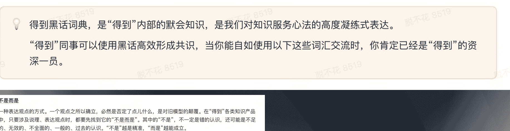

# 红蓝对抗

团队自然分为两个阵营：红方和蓝方。
红方负责内容创，以作者视角开始写稿和逻辑。
蓝方提供质疑。站在用户视角看体验是否流畅；站在行业视角看事实是否准确；站在挑剔视角看逻辑是否严谨。

# 得到新商

创业者
ICS 03.08 

中华人民共和国标准
GB/T 2022

基于互联网的知识服务通用要求
General requirement for internet-based knowledge service
2022-03-实施

市场管理委员会
知识服务标准化管理

# 领导者的责任而非追随者

# 老板IP就这么干！

2024

# To B业务的人怎么做IP?

黄海消费研究者、投资人
得到「消费报告」、「消费产品课」

黄海消费研究者、投资人
得到「消费报告」、「消费产品课」
播客「疯投圈」

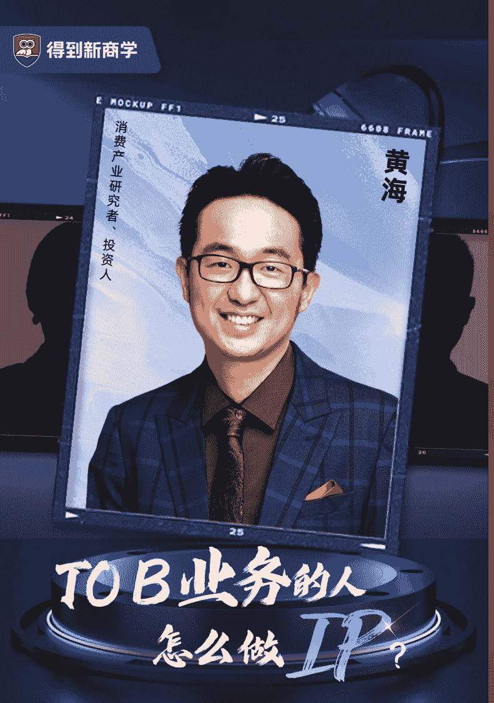

最近很多人问我做IP有必要吗？

- 热爱商业，真诚分享
- 投入优势
- 专业性是创作点

# 创始人IP的两种思维方式

思路1: IP是低获成本的销售方式
思路2: IP是长期用户关系的边界构建

# 创始人IP的两种思维方式

思路1: IP是低获成本的销售方式
- 更适合toC行业：低客单价、可快速成交
- 信息不透明的行业更适用
- 核心目的：所有动作均为引流服务
- 核心业务流量显著低于行业平均，需要考核ROI

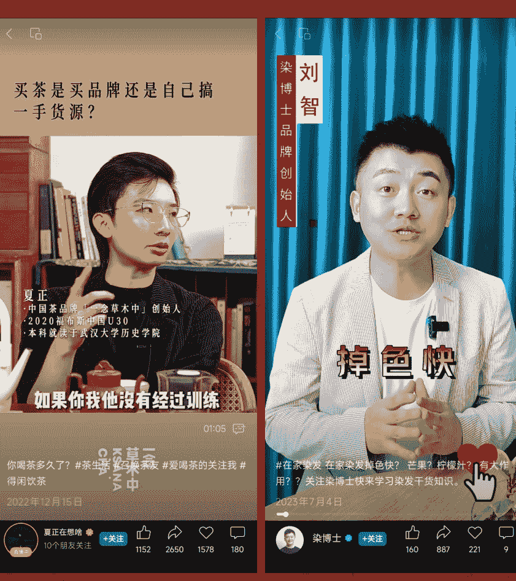

# 创始人IP的两种思维方式

思路2：IP是长期用户关系的边界
- 更适合toB行业：高客单价、信任门槛高
- 半衰期是内容选择的核心标准
- 内容作品化：积累创始人专业的信用和资产，构建用户关系。通过积累内容，让客户有相关需求时最想到你。
- 为企业带来长期沉淀，短期ROI难考核

# toB业务

- 低频高客单价，信任门槛高：成交前相互了解的时间长，需要细水长流积累信任
- 无法在线成交，线下见面是必须，IP可以大大提升线下沟通效率

专业服务的toB领域构建信任，有两个主要方式：
1) 案例（客观）
2) 思想和内容（主观）——IP就是思想和内容的体现。

# 黄海为什么做播客？

用内容形式做用户筛选：
1) 播客用户精准，用户价值高
2) 播客适合完整陈述一个话题，有深度

# 做toB IP之前，先问自己的优势在哪里？你的优势决定行动方向。

# 避坑

- 短期ROI难考核，如果是短期要生存、快速增长的公司，toB领域最快见效的肯定不是IP，而是冲击销售和产品给折扣。IP对于toB领域的创业是长期工程，和销售团队的作用要分开。
- 高频、客单低的业务不适合线上快速成交，适合走思路一，IP可以当下业绩挂钩。这也是目前行业里toC领域IP更多的原因，因为效果短快、更直接。

# 创业人IP兴起的底层逻辑：从增长为王，到用户关系为王

| 互动方式 | 运营指标 | 解决问题 | 商业价值 | 互动形态 | 情感温度 | 目标 |
| :--- | :--- | :--- | :--- | :--- | :--- | :--- |
| 营销广告 | 企业 → 用户 | 首次购买 | 品牌如何触达 | 广告带货 | 弱 | 短期收入 |
| 用户关系 | 用户 → 企业 | 复购率 | 用户如何链接 | 社群化 | 强 | 长期壁垒 |

# 无患于未，必患于忧

# 做网红还是做生意？

# 老板IP的5个坑

公域：流量来源（短视频）
私域：流量杠杆（短视频）
私域：流量终点（微信号）
私域：流量转化（朋友圈/私域）

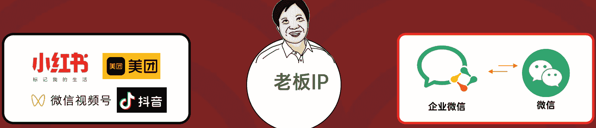
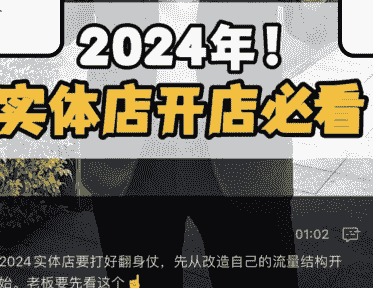
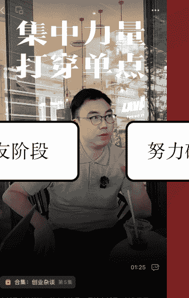
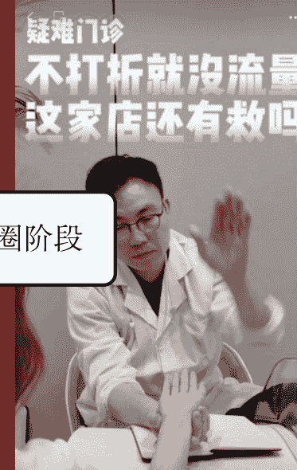

# 100+老板从0开始

# 被看见：用本地介绍出圈

# 被信任：400播放带来6位订单

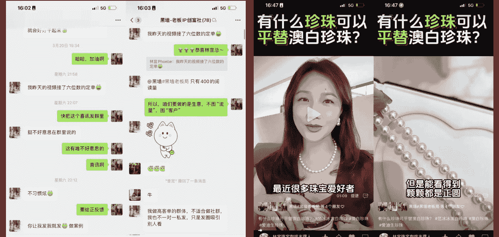

# 再出发：用IP翻盘新业务

老板IP创富社(54)
黑榜：大家现在些：50个字介绍自己一切...

大家没活那么难受吧，业务都不错。是的，黑榜我是能连接到的第一个小IP并取得一定成绩的，我大小老板买了300个人一个，我觉得这就是机会。我要和黑榜老师交流，然后我去圈层陪打。
黑榜：@Coco Ya 是，是不是要让我推一。

你会很快的。因为你才做了一个月不到。我下周打算上直播了，先把客户拉私域来。今天客户看了视频号找我线下直接买了1万的服务。挨个太累，还是要直播，速度快。

能量不是天生，是态度习惯。让实体生意更好。

# 被放大：用短视频找到更多合作伙伴

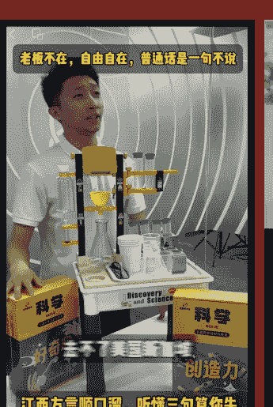
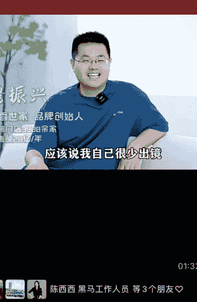
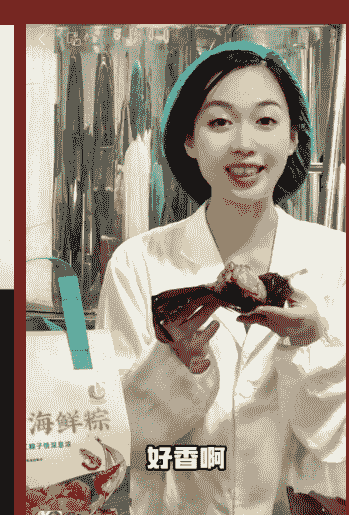
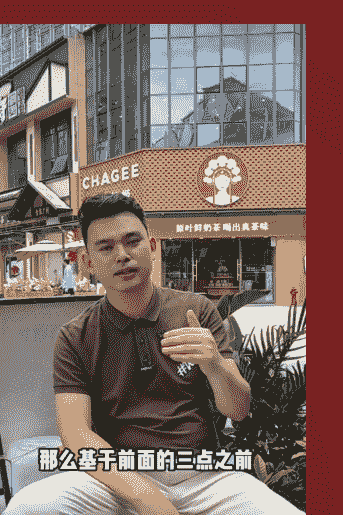

# 能量不是天生，是态度习惯。让实体生意更好。

程猛
瑞幸创始人
经营咖啡的老师
连续创业者

应该我自己很少出钱

好闺蜜
无睡的三点法

陕西西马工作人等3个朋友

组织多保持，高速发展的组织怎么创新万
瑞兴咖啡品牌

陕西西马第个朋友

Omg玲玲
鲁个小白辣
创造力

江苏本土大锅，听三分钟饱饭

正合适创业你想吗

不知我(陕西西马))要一份

12天

# 能量不是天生，是态度习惯。让实体生意更好。

# 工作过程即内容
让创作自然发生

让实体生意更好做

## 4、人懒钱多：总是想找人干活？
谁拍？谁剪？谁运营？

## 前50个视频自己干，找网感

## 5、急功近利：想一夜暴富
## 求爆款？ 一夜成名？

## 不做网红，做生意
所有的爆火背后都暗藏杀机

## 他说风雨中，n这点坑算什么
让实体生意更好

## 这三种类型要用力做IP
- 1、 足够小：用新流量摆脱强势品牌的影响
- 2、 足够卷：越卷越需要势能和识别度
- 3、 足够贵：获客成本高需要建立信任

## 不孤立使用流量
用闭环思维搭建增长体系

- 店域：线下自然客流
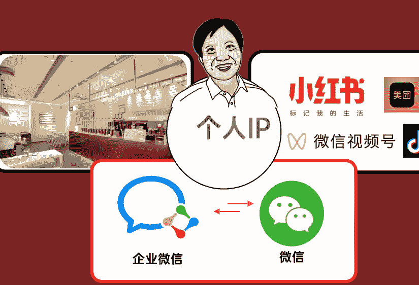

- 公域：拉新阵地

- 私域：自有线上流量

让实体生意更好

## 用4件套构建你的流量闭环体系
- 策划而后动，建议老板们到「得到新商学」找我聊聊
- 到平台发传单
- 在私域做经营
- 用AI提效率
- 做IP拉势能

## 内容营销当道
老板IP先行！

让实体生意更好

# 得到新商学
## 老板是生产队的驴
到我们上场拉磨了
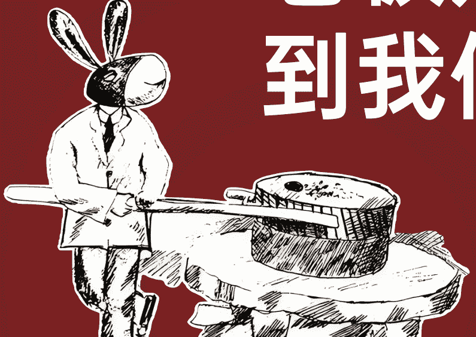

让实体生意更好

# 得到新商
小豪

## 学思考思考再追总结单子写一遍😅
😅感觉一下就学了三次
真核实涨💯都是让目标客户抖钱快乐分享花钱以及坚持拿不回来的的过程😅细品

## 黑域私域私域
## 点赞 尊二长会员服务、小豪3点赞
## 评论 2
小豪 作者

## 小笔记

二长含会员服务 方睿
二长含|alpha 1小时前
复境棒梗 继续加油！
黑瑞 特遇嘉豪
写评论

## 忘录
- 1. 新人自买单包（付9.9有5块钱优惠）拉拉购
- 2. 设计同流量爆款“周二会员早日”（私域好复价30，现在在18（专属折扣套餐）
- 3. 增加引流
- 4. 叠多场景：公域、圈群、络流量的场景（流量：环）；转化视角：从自己私域群流量出界：
- 5. 多造因子：
  - 可复用，可以称为品牌为（淘宝）
二十一、道德基晨星期四，卖当劳大赛坚持8年、恰悦葵花
  - 节点注意事项：1、起个好名；2、抢到制造逼域一个时间节点：

一、用闲域卖点：留制造转化策略
设计包含：精准销消费者购买行为、售域海报投放阶段（热销第一天10天后，售后及发售投放报；d、热销阶段不要长，c、售域界面有购买包裹方便二阶复购

二、复用引流结构：alpha售卖时套餐
b=best小物体：聚流量与转化卖家的公私域转化：和营销，带来流量的加持
用结果驱动：alpha总数据（数据数据）有1000+客户到店...b设计一个常化产品，有若干折扣，用流量持续获绿域-素材下方留微信，做投放

## 《实体如何做私域流量》课堂笔记
不知道如何私域域，先把笔记记起来！
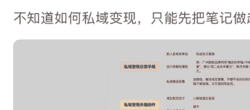

## 黑域私域私域
已点赞 黑、绿、一长热想3点赞

## 评论 1
黑瑞 特遇嘉豪 4小时

## 学习学员非你复魔
王峰 作者 5小时
感谢老师的鼓励！课程干货满满，单实实在消化不错了😂
写评论

# 得到新商
## 跟黑域学私域增长
九九 创合会员 2024/05/20
送达后的反馈与思考（户外桌子跟剧本）
直接送达后，考虑了两天后再回来
- 一、 提价：提议是一个必须的动作
- 二、 思考：对于我们这个城市的来说，我觉得可能需要一个加油

## 选取创新
2024/05/21
学习黑域老师课的感想。黑域不是没有3年的经验的，通过上次简单的播出的问题...

## 跟黑域学私域
王东 2024/05/24
《黑域-实体如何做私域》学习收获
感谢老师的分享，很有经验的老板都会有一段自己过的经历我是区域流量型门店，社区市场，我已经经营了过程。黑域：社区是社区化交流中心这个概念挺好的，私域也没有太大，就是人味...

## 得到新商学院
## 【5月14日 星期二】得到新商亮点
今日重点，特别推荐：新课程《黑域-实体如何做私域》已上线，目前已有230位老板，给各位私域划好了清单...一、背景介绍

## 跟黑域学私域增长
林旭 创合精英 2024/05/25
我们不仅全员听，而且落地执行了。并且积累和方法。

大体@微信号 创合精英创业团队 2024/05/25
同步学习译尔韵黑域-实体如何做私域
销售额：量(获客)X变(转化)X人(复购)X（商业）

## 跟黑域学私域
福多洛Sunny 时尚品销售经理 2024/05/27
我们现在有99元，用引域，发展1个会员

## 新流量：包含饰品在杭州延安路还有10天开业，如何让客户更多
杭州延安路左侧有新开店铺，包含食品、饮料、花茶等产品，如何引流流量？目前的人流量特别多？如果是在一个地方，想要引流进来，先要互相引，因为你没有流量，你考虑的是：如何让路过人的你看吗？比起专门设了一个玻璃窗，人模特怎么转？你已经有了流量的方法，优先...

## 关注你的困境
我们真的遇到困境了，但是，我们一直没有流量，只有通过活动和内容流量，我觉得粘性流量就是我们的私域，内容生产力，粘性就是我们的私域，我们现在找不到合适的应对的激励和效果体系，这是我们最想学习的
黑域：这里有几个圈子的会，我们靠的是会员的资料、手机号、密码等。这个会员会有互动，比比较“聚起来”，而有互动就能流量，增加粉丝互动，提高粉丝转化，好多的

# 得到新商学
# 老板IP就这么干！

## 如何从老板IP走向品牌IP
实现新的增长
一 卞珩淳

## 卞珩淳
中国整理收纳行业创始人
留存道整理学院院长
IAPO国际整理师协会名誉会长

## 目录
- 1、 如何打造老板IP
- 2、 如何老板IP赋能品牌将个人IP升级为企业IP
- 3、 打造内部小IP把企业价值观用一个活生生的人体现
- 4、 赋能内部小IP技术方法论、商业方法论
- 5、 管理内部小IP：教育小程序、服务小程序、电商平台、生活平台、自研APP及小程序
- 6、 共同的成就和价值
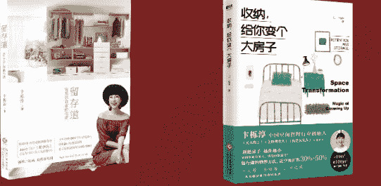

## 如何打造IP与影响力
- 1、 审美
- 2、 职业边界
- 3, 价值主张
- 4, 可持续性
- 5、 生活哲学
- 6、 认知本质
- 7、 思考
- 8、 重塑
- 9、 传承
- 10, 使命
- 11, 视觉主义
- 12, 扩张
- 13, 具化投射
- 14, 定位
- 15, 格调
- 16, 风格
- 17, 知名室内美学设计师
- 18, 创始人
- 19, 流量
- 20, 转化
- 21, 流量
- 22, 矩阵
- 23, 基础
- 24, 总结
- 25, 总结
- 26, 总结

## 总结
- 1、 总结（一）
- 2、 总结（二）
- 3、 总结（三）
- 4、 总结（四）
- 5、 总结（五）
- 6、 总结（六）
- 7、 总结（七）
- 8、 总结（八）
- 9、 总结（九）
- 10、 总结（十）
- 11、 总结（十一）
- 12、 总结（十二）
- 13、 总结（十三）
- 14、 总结（十四）
- 15、 总结（十五）
- 16、 总结（十六）
- 17、 总结（十七）
- 18、 总结（十八）
- 19、 总结（十九）
- 20、 总结（二十）

# 得到新商学
# 得到新商
望娜丽卡萨菲的家

## 审美
## 品质、品味

## 新流量：包含饰品在杭州延安路还有10天开业，如何让客户更多
杭州延安路左侧有新开店铺，包含食品、饮料、花茶等产品，如何引流流量？目前的人流量特别多？如果是在一个地方，想要引流进来，先要互相引，因为你没有流量，你考虑的是：如何让路过人的你看吗？比起专门设了一个玻璃窗，人模特怎么转？你已经有了流量的方法，优先...

## 留存道·哈尔滨分院 萨丹团队
## 留存道·上海分院 骨干团队
## 留存道·大连分院
## 留存道·沈阳分院 韩国团队
## 留存道·教学专用
## 留存道·教学专用
## 留存道·教学专用
## 留存道·教学专用
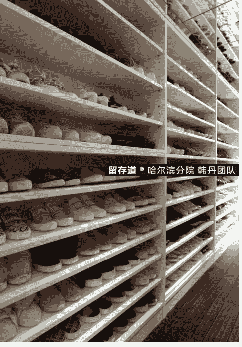

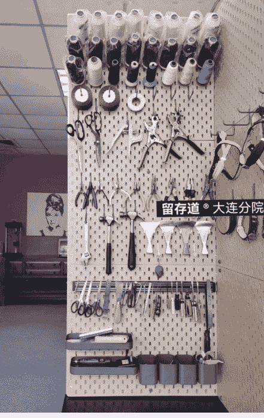
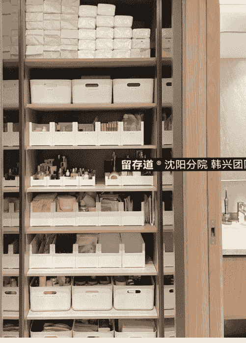
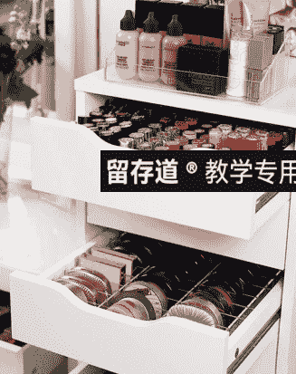
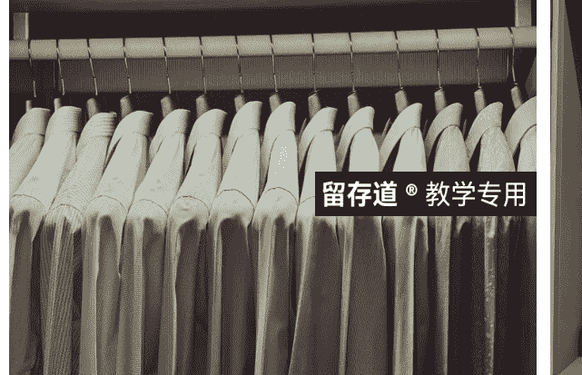
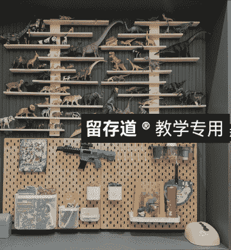

## 整理收纳的妙处：分享“密码”
## 整理的是物品，更是人生

很多人在家里生活，发现东西越堆越多，心里总觉得杂乱无章。其实，整理并不是简单的简单的丢弃东西，而是通过对物品的梳理和归位，让空间重新焕呼吸，让生活也变得从容。

### 生活周刊 | 燃青年
安徽省妇女协会
合肥市芜州儿童服务中心

很多人在家里生活，发现东西越堆越多，心里总觉得杂乱无章。其实，整理并不是简单的丢弃东西，而是通过对物品的梳理和归位，让空间重新焕呼吸，让生活也变得从容。

### 王姐姐龙妈妈
坚持传递季节温度，实现彻底收纳自由

上海市妇女协会 首席空间规划师

## 收纳柜子，整理衣柜，职业收纳师要的不止这些 | 新职业插手

受到生活文化的影响，中国消费者也开始关注物品与居住空间的关系。专业收纳师帮助他们让物品变出空间，而这一职业也成为了如今的“阳刚经济”。

清新频道 | 2021年8月10日 09:00

## 年薪百万 | 职业收纳师

## 立马转行 | 职业收纳师
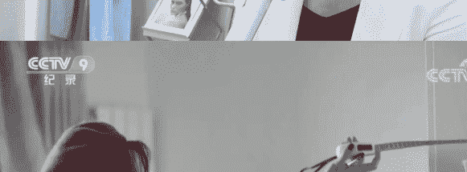

## 高级收纳师 | 整理师吗？爱收纳的在这里

### 收纳训练营系列
- 收纳训练营：让收纳变简单，从逻辑开始
- 学会整理：让收纳变简单，从收纳逻辑一五开始
- 孩子的未来：如何让孩子学会整理，在整理收纳里成长
- 儿童收纳小书包：让收纳小书包更有趣
- 书架整理课：让书架变整齐
- 重心复盘：重塑生活重心，改变未来
- 亲子收纳：整理收纳服务，专业定制
- 收纳训练营：亲子整理收纳，实战训练
- 儿童空间收纳学：打造梦想的儿童空间收纳学
- 家务收纳：高效收纳，科学构建
- 治愈系：打造治愈的亲子空间
- 行李整理：轻松出行，行李整理术
- 玩具收纳：告别混乱，玩具收纳术
- 理想收纳：打造高效的收纳家
- 卧室收纳：打造舒适的卧室收纳
- 《物有收藏》：让生活物品各得其位

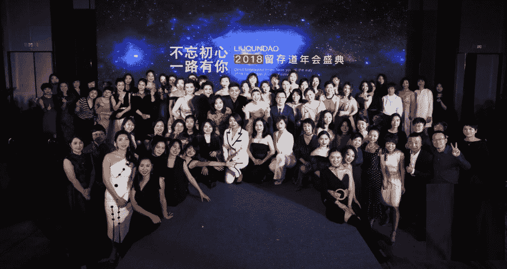

## 难点：提升自己

# 得到新商学
“你不用懂，听我的”
“最好的服务，是给你还不知道的好东西”

留存道：富足且自在的生活
——2016《时间的朋友》
ENTRENEUR COMMUNITY

## 品牌IP如何为业务增收

## 共建平台：中国整理收纳第一品牌

## 可持续性
- 住宅可持续
- 物品可持续
- 公益可持续
- 就业可持续
- 教育可持续
- 社会可持续

## 老板IP怎么做？
- 靠团队还是靠自己？
- 老板IP分为几种：
  - 网红型
  - 品牌型
  - 卖货型

### 新商学：老板IP分类对比
| 类型 | 背景 | 做法 |
| :--- | :--- | :--- |
| **网红型** | 超头部企业、明星企业家 | 事件营销为主 |
| **品牌型** | 影响力中等的品牌企业 | 爆款视频为主 |
| **卖货型** | 影响力较弱的小微企业 | 口播为主短视频/直播间带货 |

## 卖货型老板IP实战

### 1. 找准变现模式
- 产品销售：生鲜、百货、茶酒、服饰、美护、宠物、数码、母婴、家居、户外...
- 服务咨询：装修、投资、法务、情感、汽车、房产...
- 门店引流：餐饮、美业、酒旅、水果、宠物、母婴...
- 招商加盟：ToB业务
- 知识付费

### 2. 搭建人流量
不要念脚本，越真实越有效！

### 案例分享：蔡国伟的自家腊肉
我之前一直搞私事，2018年放弃了，回老家投资了民宿。三年疫情把我逼上死路，直播拉了我一把。

**核心数据：**
- **新增视频**：时长5小时6分35秒，播放100-250万，占比100%（直货流量流量）。
- **直播数据**：
  - 平均观看人数：1万-2.5万
  - 直播销量：30.2万
  - 直播销售额：100万-250万
  - 互动率：0.27%
  - 均值：750-1000 / 7510-10150

**个人特色：**
我特别适合直播。我最高三万六千在线，一个小时就卖空了，没货了，堵塞仓库。我这种适合的时候，万人直播间很容易做到的。

### 商品详情：玛莎诺娜地白葡萄酒
- 价格：¥298
- 品牌：抖音旗舰 玛莎诺娜（品牌官方经营）
- 规格：【中国生产】玛莎诺娜地白葡萄酒半甜酒型，酿13 6x750ml瓶装
- 销量：近期销量TOP3，月销售额60万。
