# 前沿洞察 · 2025
# 中国新型储能应用蓝皮书

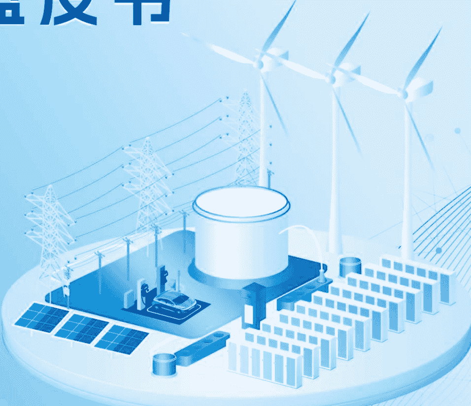

# 免费 价值 及时 专注

# 扫码加入 知识星球TOP 免费资源群

- 每日免费获取价值资源
- 可提供各类资源搜索服务

| 热门付费文章 | 各行行业报告 |
| :--- | :--- |
| 精选图书资源 | 副业赚钱方法 |
| 职场实用资源 | AI政经自媒体 |

公众号：知识星球TOP 微信信号：jntsg8 微信信号：jnts2

分享资料仅供个人学习，请及时删除，切勿商用传播

# Ampace 能安

# 工商储 就选新能安

15年陪伴不变“芯”

2025年4月 敬请期待

新能安公众号

新能安官网

## 企业简介

厦门新安科技有限公司是全球的新能源创新科技公司，致力于为全球用户提供极佳的绿色能源解决方案，助力能源转型，赋美好生活。

新安总部位于福建厦门，投资超200亿，建设用地超1670亩，拥有电芯-电池-电池系统集成全链条的产品研发与制造体系，具有CNAS/ISO17905、IATF16949等等认证资质，新安通过深度定制的制造平台、实时智能数据分析、全自动化作业等智能制造布局，满足客户多样化、多场景需求。

新安在能源系统、微型车、电动、吸尘器、无人机等领域与行业头部企业开展全面战略合作，为全球30个国家与地区，5000万用户提供“安全可靠、极致性能、极致体验”的新能源产品与服务。

## 研发

新安不断加大在电能领域的研究投资，以创新推动升级与产业发展

- 10% 研发投入率
- 1000+ 专利申请
- 48% 研发人才占比
- UL 直接参与国际标准制定

## 业务领域

| 储能系统 | 解决方案 |
| 智能产品聚动 | 电池解决方案 |
| 微型车 | 解决方案 |

## 创新产品

15000次 长循环 15年不变“芯”

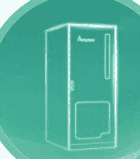

2025年4月 重磅发布

# 目录

- 序言 01
- 国内新型储能发展洞察
- 国内新型储能市场发展洞察 13
  - 新型储能机容量释放增长快
  - 锂储能在新型储能占比超过95%
  - 主要分布在源侧，独立储能是新增储能主机
  - 北北、西北地区规模领先
  - 中均差异整体后进步企业
- 工业储能前沿洞察 19
  - 处于发展初期，聚量速度增长快
  - 峰谷差异显著，盈利模式多元化
  - 分布式光伏仍规模，光储结合未来长期
- 储能政策前沿洞察
- 技术路线发展跟踪 23
- 我国能源转型大幕拉 03
- 新型储能前沿技术跟踪 23
- 我国坚定推进能源转型 03
- 钠离子电池储能 23
- 新型电力系统建设有效 03
- 压缩空气储能 24
- 储能是新型电力系统关键 05
- 液流电池 25
- 我国新型储能政策洞察 06
- 行业储能案例 27
- 新型储能政策 06
- 新型高压电站调频 28
- 国家产业趋势研究
- 奇能源东宁 13
- 200MW独立储能项目 29
- 易事特江苏聚 30
- 东方日升并迁 31
- 利能聚潮 32
- 贵宇电源 34

# 海外市场需求

| 海外市场 | 35 |
| :--- | :--- |
| 美国市场 | 36 |
| 欧洲市场 | 39 |
| 中东市场 | 43 |

# 我国储能企业出海趋势

| 国内领先 | 44 |
| :--- | :--- |
| 龙头企业充足，海外订单爆发 | 45 |
| 新兴市场需求凸显，国内企业加速布局 | 46 |
| 产品出海 | 48 |

## 行业榜单

| 中国新型储能行业榜单 | 51 |
| :--- | :--- |
| 综合竞争力榜单 | 52 |
| 市场份额榜单 | 55 |
| 技术创新榜单 | 56 |

## 市场前景

| 新型储能未来装机趋势 | 49 |
| :--- | :--- |
| 全球新增装机预测 | 49 |
| 我国新增装机预测 | 49 |

# 优秀企业汇编

| 厦门新安科技有限公司 | 57 |
| 西安奇能源股份有限公司 | 58 |
| 易事特集团股份有限公司 | 59 |
| 东方日升（能源）股份有限公司 | 60 |
| 浙江利能实业发展有限公司 | 61 |
| 昆宇电源股份有限公司 | 62 |

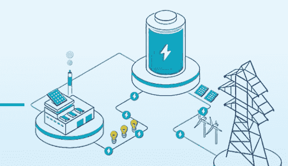

## 序言

在全球能源转型的大浪潮中，储能行业正扮演关键角色，为推动可持续发展核心力量。在全球能源转型浪潮中，储能产业正向战略高迈进。“双碳”目标为新型储能发展注入强劲动力，赋予行业全新使命。储能不仅是电力供应，更是可再生能源消耗的关键，更是推动可持续发展的引领者。

2022年以来，行业经历了深刻变革，迎来重大变化。在储能领域掀起波动，智能化技术在储能领域的应用。AI技术开始在储能全周期管理中深度应用。全球新型储能市场区域性爆发，中东地区的沙特、阿联大型新型储能项目迎来潮，巴基斯坦、东南亚等新兴市场亦需强劲动力。

Ampace作为新能源领域的领军企业，以科技领先，深耕储能领域，为全球储能行业提供高效、智能的储能解决方案。新型储能技术是核心关键，致力于建立行业领先的研发中心和自动化生产体系。经历多年，Ampace已从电芯创业成长为全球领先的电池供应商。面向未来，Ampace将继续在储能领域不断向“新”，为全球能源转型提供技术支持，助力储能行业快速发展。

在此行业变革之际，锂电行业再次携手安全，共创事业。宇电电源、星源、奇能源、东方日升等多储能行业联合编制《前沿洞察·2025中国新型储能行业蓝书》，聚焦新型储能行业最新趋势与发展，旨在为政策制定者、从业者及投资者提供新型储能前沿趋势和未来机遇，携手构建、共赢中国的美好未来。

更多报告访问 www.gaoweconsulting.com

# 储能政策前沿观察

## 我国能源转型大局

01 我国坚定推进能源转型

党的十八大以来，我国能源领域进入高质量发展新阶段。2014年，习近平总书记指出要推动能源消费革命、供给革命、技术革命、体制改革和全方位加强国际合作“四革命”，一个“能源安全新战略”。在能源安全新战略指导下，我国已开启能源转型之路，加速构建低碳、安全高效体系。“30660”目标已成为我国能源清洁安全高效转型的重要指引。2020年9月22日，我国在第十五届全国人民大会上正式提出：力争在2030年前二碳排放达到达峰，争取在2060年前实现碳中和。“双碳”目标意味着能源体系的根本转变，将促进绿色清洁转型，逐步减少对化石能源的依赖。

> 2024年，我国坚定不移地推进能源转型；
> 系列政策密集落地，为我国能源的长远发展提供充足法律保障。《2024—2025年电力行业降碳实施方案》明确目标，从生产到消费各环节发力，推动能源利用提升。《加快构建新型电力系统行动（2024—2027年）》将构建新型电力系统的任务落实，从源网荷储环节全方位布局。这些政策从顶层设计到具体落实，明确了能源转型的决心，并在电力系统中发挥关键作用。

02 新型电力系统建设成效

能源转型长期依赖自然资源，煤炭在能源结构中仍占主导地位。能源转型目标是实现能源的清洁化、低碳化、高效化。电力作为能源转换、传输和配送枢纽，是能源转型的核心。为了满足能源转型需求，我国提出构建低碳、安全可靠、高效灵活、开放的新型电力系统。新型电力系统由多个相互关联、相互作用的部分，涵盖电源、电网、负荷等环节。

03 转型趋势

## 前沿洞察-2025

## 电网侧

特高压建设持续推进。2024年国家电网累计建成特高压工程，显著提升了电网容量和传输能力。展望2025年，预计国家电网规模首次超过XX亿元。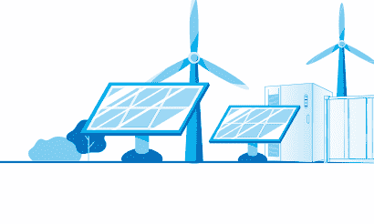

## 源侧

清洁能源发展快速提升。截至2023年，我国清洁发电占电机组总量的58.2%，清洁能源发电量达到39.7%。

## 负荷侧

社会电气化程度不断提升。2024年全国能源消费比接近30%，预计“十五五”期间以每年约个百分点的增幅持续提升。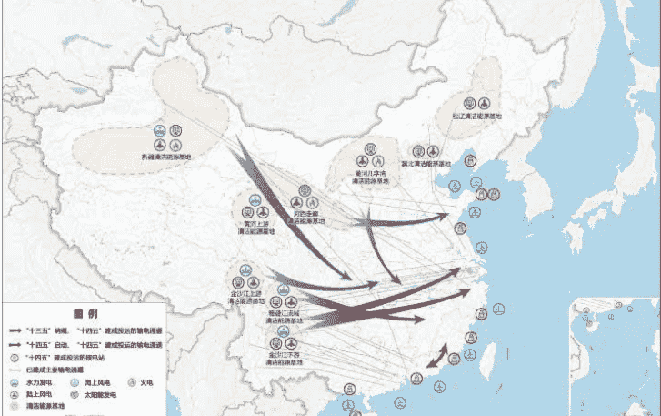

资料来源：新华社、行业研究中心

03 储能是新型电力系统的关键

储能利用是一个供需平衡的过程，新能源发电占比的提升为电力系统带来了挑战。新能源发电受天气、季节等多种影响，具有间歇性、波动性和不稳定特点，给电力系统的稳定运行带来了诸多挑战。储能作为新型电力系统的重要组成，在源网荷端均发挥着不可缺的作用。

图2: 光伏发电曲线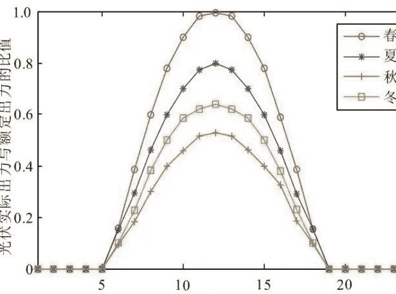

资料来源：《考虑源网主动配电规划》

## 源端

- 平滑新能源出力：在新能源功率波动时进行存储和释放，使得新能源输出更加平滑，减少功率突变对电网的冲击，提升电力质量；
- 提高新能源消纳能力：解决新能源出力与负荷在时间和空间上的平衡问题，提高新能源在电力系统中的占比；
- 参与调频辅助服务：在电网出现频率波动时，快速响应调频指令，替代原有机组出力。

## 电网端

- 扩容投资：缓解电网负荷压力，推进新建电网电站、输电线路等电网设施的投资；
- 提升电网稳定性：通过快速的充电调节，抑制电网电压波动和频率偏移，增强电网应对故障和干扰的能力，极端情况下保障电网的持续性；
- 优化电网运行效率：根据电网的需求，灵活调整发电状态，实现电网的灵活调度，减少电网传输过程能量损耗。

## 负荷端

- 降低用电成本：利用峰谷电差，用户可以在低价段将电存在储能设备中，在高价段使用储能设备充电，减少从电网购电的费用；对于工业用户，还可以通过系统降低高峰功率，节省基本效益，实现需求弹性；
- 应急电源：在电网故障、停电或电压波动等情况下，为用户提供可靠的电力供应；
- 促进分布式能源消纳：存储分布式多余发电，实现分布式能源的就地消纳，提高用户的自给率。

# 我国新型储能政策前沿洞察

## 01 新型储能政策概况

我们关注我国储能持续提升，近年来我国储能市场持续延长，对于一种新型储能系统“稳定器”和“调节器”的需求日益迫切，储能落地地位持续提升。2024年、“发展新型储能”首次写入《政府报告》，意味着我国将新型储能提升为2024年及未来若干年国民经济社会工作的重要之一。《中华人民共和国国务院》明确“推进新型储能高质量发展”，在国家层面为新型储能全面发展奠定了基础，将储能打造为提升能源电力系统可靠性、效率和安全保障的能力。

国家政策密集，引导新型储能行业高质量发展。近年来我国储能产业规模快速增长，2023年新型储能产值突破3000亿元，产业生态初步形成。2024年新型储能增长领先地位进一步提升，储能规模已接近200GW，从起步逐步向快速发展。作为新型储能行业实现高质量发展，国家政策方向从项目站、政策激励等逐步向新型储能市场主体引导，完善市场机制，构建行业标准体系并引领。

# 图表3：我国新型能产业政策

| 产业政策 | 形成机构 | 形成时间 | 相关内容 |
| :--- | :--- | :--- | :--- |
| 《深化新能源上网市场改革促进能源发展的通知》 | 国家能源局、发改委 | 2025年2月 | 坚决纠正电力市场行为，合理费用，解决新能源消纳等问题。 |
| 《新型储能制造行动方案》 | 工信部、发改委 | 2025年2月 | 新型储能制造竞争力显著，实现数据化、智能化、绿色化，形成区域聚集格局。 |
| 《西部地区鼓励储能发展》 | 发改委 | 2024年1月 | 将新型储能电站运营、电力调度等提升至行业水平。 |
| 《国家能源局关于加强电力安全管理的意见》 | 国家能源局 | 2024年1月 | 完善新型储能技术，助力电力市场，打破垄断、安全风险，构建电力安全体系。 |
| 《中华人民共和国法》 | 国家能源局 | 2024年1月 | 有序建设，推进能源高质量发展，聚焦新型储能领域、前瞻性研究。 |
| 《电力市场注册准则》 | 国家能源局 | 2024年9月 | 明确经营主体入市条件，为建立统一电力市场，有助于基础设施建设，提升电力市场的整体效率。 |
| 《做好新能源消纳》 | 国家能源局 | 2025年4月 | 实施积极推进电力调节，协调新能源功率预测，提升预测精度和主动调度能力。 |

# 产业政策

| 产业政策 | 布设机构 | 布设时间 | 相关内容 |
| :--- | :--- | :--- | :--- |
| 《关于促进新型储能和调用的通知》 | 国家能源局 | 2024年4月 | 提出加强新型储能技术，强化新型储能多元化发展，完善储能配套措施。 |
| 《2024年能源工作指导意见》 | 国家能源局 | 2024年3月 | 明确新型储能需求，强化新型储能运行，发展新能源接入上网，完善储能数据支撑。 |
| 《政府报告》 | 国务院 | 2024年3月 | 科学安排新型储能建设，按照需求布局，发展电力储能，有序开发，国际交流，促进可持续发展。 |
| 《关于建立全电力辅助市场机制的通知》 | 国家能源局、发改委 | 2024年2月 | 完善储能市场机制，区域调度，及时作为电力调节，增强储能容量，形成电力用作用。 |
| 《关于加强新型电力系统稳定工作的指导意见（征求意见）》 | 发改委 | 2023年10月 | 科学安排储能建设，按照科学规划和需求，鼓励开展类储能，多应用场景构建多元化融合优势，灵活应用、空气储能、氢能、热（冷）储能等。 |
| 《新型化储能工程实施方案（2023-2025年）》 | 工信部、科技部、国家能源局、国家标准化管理委员会 | 2023年8月 | 向新型储能方向，聚焦锂离子电池、储能足迹、溯源原材料等基础标准，正负极材料、保护组件等关键材料以及回收标准。向钠离子电池、氢能/锂电池、固态电池等新型储能技术趋势加速安全等标准。 |
| 《工业稳增增长方案（2023-2024年）》 | 工信部 | 2023年7月 | 电池领域，加速快储电池、锂离子电池、原燃料电池等关键技术及材料研究。大力发展高安全性电池、铅铁电池、钠离子电池等产品，扩大在新能源汽车、储能、通信等领域应用。 |

## 前沿洞察 - 2025

## 02 国家产业政策趋势析

### 1、鼓励新型储能技术多元化发展

随着我国能源绿色低碳转型的深入，新型发电侧储能市场增长，电力设备可靠性比比例接入，高压直流交流交流直流混合运行，电力系统低负荷、低频、弱压支撑等问题凸显，电力供需失衡引发频率、电压不稳定等问题的增加，新型电力系统安全面临更加严峻的挑战。

为应对新型电力系统日益复杂的需求，国家将继续推进新型储能体系多元化发展。《新型储能行业高质量发展行动方案》中提出“加快储能电池等技术升级，支持碱、锂离子等技术创新，提升高端产品供给能力。推动储能电容、钠电池、燃料电池工程化和应用技术攻关，压缩空气等长时储能技术、超级电浮、储能等长时储能技术，支持新型电池、热能储冷及新型物理储能等前瞻技术基础。”

### 2、新型储能标准体系快速构建

安全是储能发展的基础。新型储能通常使用大量高密度的电池等设备，若存在电池热失控、短路等安全隐患，可能引发火灾、爆炸等严重事故，对操作人员、周边居民的生命安全造成直接威胁。行业标准助力新型储能高质量发展。行业标准明确新型储能项目建设、设备性能、安全等方面的要求，使储能在技术研发、生产制造、项目实施等方面具有统一的规范和依据，有效降低储能系统在运行过程中的安全风险。

图4：新型储能标准体系架构

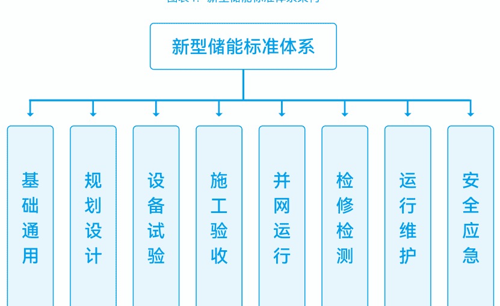

材料来源：《新型储能标准体系建设指南》，科网网产业研究中心

国家加速构建新型储能标准体系。行业的健康、规范发展不开国家标准。国家能源局（新型储能标准体系建设指南）中指出，2023年修订100项以上新型储能重点标准，到2025年，在电化学储能、压缩空气能、燃料电池、超级储能、飞行储能、超导储能等形成一系列的标准。2024年，多国标准实施，新型储能标准体系加速构建，对新型储能技术的性能、技术参数等进行规范引导，推动储能技术向更高效率、更高安全性、更低成本的方向发展。

## 图5:中国新型储能产业政策

| 标准名称 | 实施日期 |
| :--- | :--- |
| 《电化学储能电站接入电网测试规范》 | 2025/1/1 |
| 《电化学储能电站接入电网技术规范》 | 2024/12/1 |
| 《电化学储能电站模型参数测试规范》 | 2024/12/1 |
| 《用户侧电化学储能系统和运行管理规范》 | 2024/12/1 |
| 《电化学储能电站检修验收规范》 | 2024/12/1 |
| 《智能电化学储能电站技术指南》 | 2024/12/1 |
| 《电化学储能系统接入低压电网运行控制规范》 | 2024/12/1 |
| 《预制式锂离子电池储能系统技术规范》 | 2024/12/1 |
| 《电力系统配置电化学储能规划指南》 | 2024/12/1 |
| 《电化学储能电站接入电网运行控制规范》 | 2024/12/1 |
| 《电化学储能电站后评价导》 | 2024/10/1 |
| 《电能力用压缩空气储能系统技术要求》 | 2024/10/1 |
| 《锂离子电池和电池组能源转换效率要求和测量方法》 | 2024/10/1 |
| 《电化学储能系统变流器调试技术要求》 | 2024/7/1 |
| 《移动式电化学储能系统通过通用技术条件》 | 2024/7/1 |
| 《电力系统电化学储能系统接入电网技术规范》 | 2024/7/1 |
| 《用户侧电化学储能系统接入电网技术规范》 | 2024/7/1 |
| 《电化学储能电池管理通信技术要求》 | 2024/7/1 |

资料来源：锂电产业研究中心

### 3、加速新型能源收益市场化

新型能源发展初期依赖政策。新型技术在诞生初期、成本高、市场认知低、技术成熟度有限等挑战、政策支持必不可少。装机补贴政策成为新型能源行业的重要驱动力、降低了项目的投资成本、提高了投资回报率、吸引了更多企业加入。

新型产业蓬勃发展、政策引导收益市场化。随着新型能源技术的成熟，为了更大部分程度促进新型能源产业发展、提高新型能源渗透率，我国需要引导收益市场化：

- 全国电力市场已具备规模，电力市场已涵盖了80%以上地区，23个省启动电力市场试点，其中山西、广东、山东、甘肃等进入电力市场。
- 电力辅助服务市场机制逐步建立，《关于建立电力辅助服务机制的通知》完善了辅助服务交易及价格机制，推动各类经营主体参与辅助服务市场。
- 电力市场基础规则明确了经营主体的入市条件，对于新型储能、虚拟电厂等进入电力市场提供了保障。

### 4、推进新型能源需求市场化

强制性政策在新型能源发展前期创造需求。在行业发展早期，政策引导新能源规模化发展、吸引了大量的资金和投入，促使新能源技术不断进步。许多地区对新能源与传统电源仍存在困难、缺乏配套和考核，新能源配比较低，存在“弃风弃光”等问题。

强制性政策转向。随着新型能源积累提升，国内新能源发展从量向质转变。2021年9月，国家发布了《关于深化新能源上网发展的通知》，明确新型储能不合理配置电源、上网等前提。未来新能源的价值直接关系到市场。强制性政策取消后，新型能源必须综合考虑全生命周期、价格、运行机制成为重要。

## 国内新型储能发展洞察

### 1 新型储能容量翻倍

在政策、技术、成本等因素下，2024年我国新型储能容量翻倍。2024年，我国新型储能规模突破7000万千瓦。截至2024年底，全国已投新型储能累计规模达36.8GW，约为“十三五”末的2倍，增长130%。

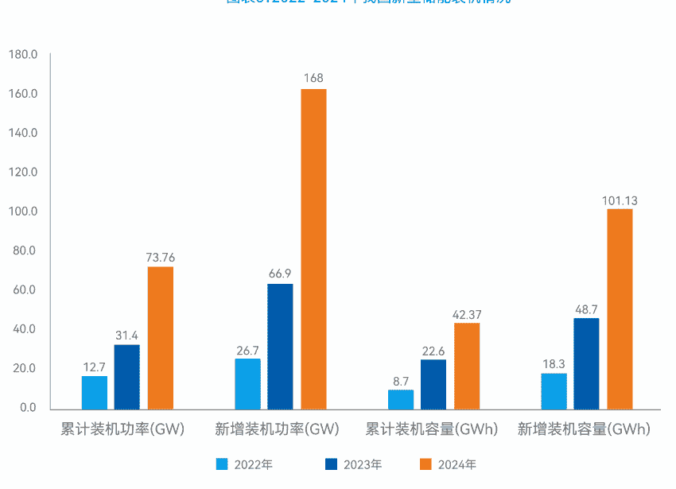

储能曾经是主流。储能具有容量大、效率高、运行长、响应快、技术成熟等优点，但储能建设需要特定地理条件，无法满足持续增长的需求。新型储能将成为主流。与储能相比，新型储能具备建设周期短、选址简单、调节能力强、新能源消纳适配性更好。根据国家能源局数据，截至2024年，新型储能突破7000万千瓦。

### 02 锂电占比超过95%

新型储能种类多样，锂电为主。新型储能包括锂离子电池、液流电池、飞轮、压缩空气、气（氢）储能、热（冷）储能等。经济性是新型储能规模应用的关键。锂离子电池技术在新能源、消费电子等领域广泛应用，产业链成熟。在规模效应下，锂电池脱颖而出。

图7：2024年中国电力储能分类路线分布（按功率）

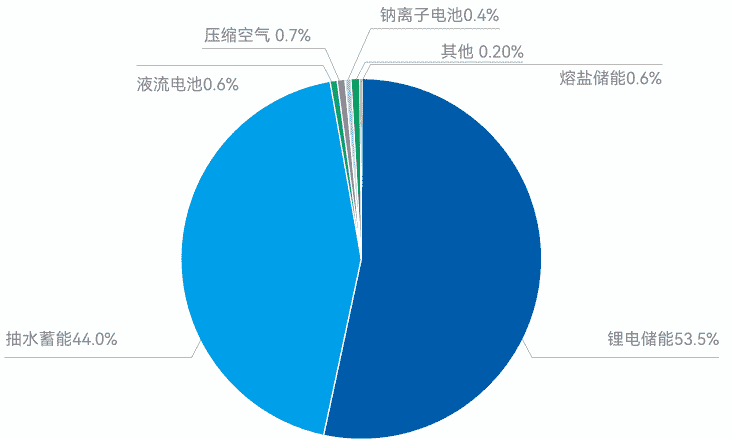

资料来源：国家能源局、科网产业研究中心

除锂电池外，液流电池、压缩空气储能技术发展较快。锂电池储能方面，国内已实现百瓦级液流储能站的示范应用；全球首100MW液流储能调峰站稳定运行。压缩空气储能方面，全球最大的300MW压缩空气储能项目已经在山东实现并网发电，多个大型压缩空气储能项目正在建设。

### 03 主要分布在源网侧，独立储能是新增的主流

分布在源网侧。从视角看，源网侧占据国内储能市场的主要地位。根据国家能源局数据，截至2024年上半年，已投运的新型储能中45.3%为独立储能和共享储能，42.8%为新能源配储，上述两项主要分布于电源侧和电网侧。

图8：2024年上半年中国新型储能装机应用场景

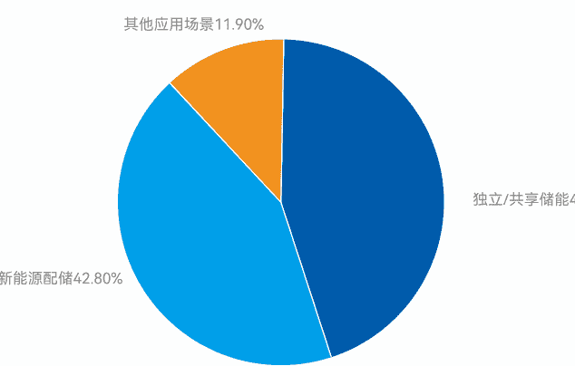

资料来源：国家能源局、锂电产业研究中心

独立储能是新型储能需求主力。独立储能独立于电源和负荷，以独立主体形式接入电网的储能项目，具有独立的产权和运营权，不与特定的发电项目或用电负荷直接连接。独立储能主要功能是电网提供灵活调节服务，提高电网的稳定性和可靠性，保障电力的安全运行。对比新能源配储，独立储能市场化更高，依赖电力市场交易，利用率更高。2024年新增新型储能中，独立储能占比超过60%。

图9：2024年新型储能装机应用场景分布（功率率）

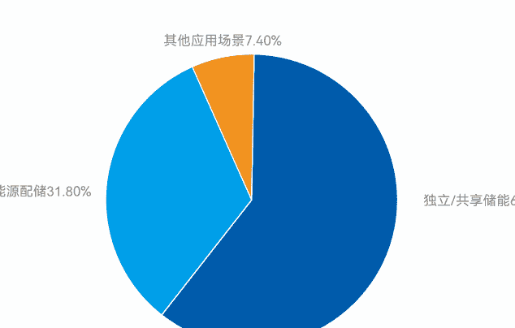

资料来源：锂电产业研究中心

### 华北、西北地区装机量领先全国

西北地区、华北地区新型储能累计装机占比超过50%。西北、华北地区风力、太阳能资源丰富，是我新能源发电的重要基地，规模大的新能源源产生了对新型储能的需求。华北电网是全国重要的电力枢纽，电力市场发展成熟，电力辅助服务市场、现货市场较为完善，多元的盈利渠道让华北地区独立储能装机快速增长。

根据国家能源局数据，华北地区已投运新型储能占全国30.1%，西北地区占25.4%，华地区占16.9%，中地区占14.7%，南方地区占12.4%，东北地区占0.5%。

图10：截至2024年末各地新型储能累计装机占比

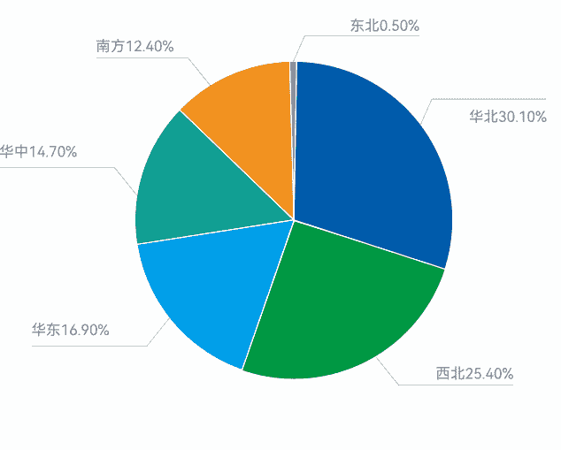

资料来源：国家能源局、科网产业研究中心

### 内蒙古、新疆、江苏和宁夏2024年装机量迅速增长

2024年装机规模名前五的省分别为：内蒙古、新疆、山东、江苏和宁夏。对比2023年末，内蒙古、新疆装机同比增长200%；江苏、宁夏则超过300%。除上述五省外，河北、北京、广东、湖南、广西、安徽、湖北、贵州等省区也有增长。

资料来源：国家能源局、科网产业研究中心

### 05 中标价整体趋后逐步企稳

锂离子电池价格在2022年至2023年经历了一轮产能过剩，锂电池的价格在2023年以来大幅波动并持续下跌。正极材料、隔膜、电解液、负极材料也出现不同程度下跌。供需结构影响下，锂电池价格下跌。

新型储能系统中标价整体下跌，降幅逐步企稳。2024年，锂酸铁储能系统中标价从年初的0.72元/Wh至0.675元/Wh；EPC价从0.9元/Wh至1.08元/Wh。第四季度，锂酸铁储能系统价格明显企稳。

图12：2024年新型储能系统中标价（元/Wh）

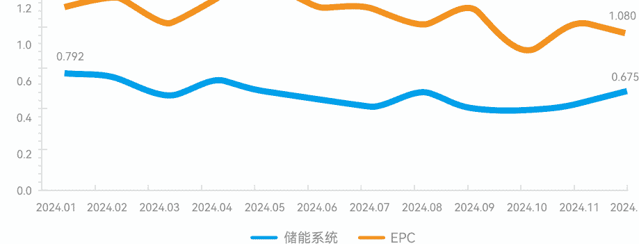

资料来源：科网产业研究中心

## 工业储能前沿洞察

### 01 处于爆发初期，装机容量快速增长

政策共同推了2024年工业储能装机容量快速增长。2023年以来，各地积极引导工业储能发展，出台了辅助服务、调峰以及“源储一体化”等相关政策，为工业储能提供了支持和方向。自2022年开始，显著提升了储能项目的经济性。2024年，我国工业储能新增装机容量达到7.8GWh，增66%。

工业储能仍面临收益相对单一、行业标准、时间验证等问题，潜力尚未充分释放。工业储能市场进入产业化阶段，部分厂商采取观望态度。未来限制逐步消除，工业储能装机增速进一步提升。

图13：2022-2026年工业储能新增装机容量及预测 (GWh)

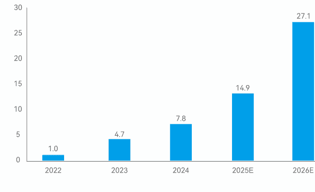

资料来源：储能产业研究中心

### 02 峰谷价收敛，渠道多元化

峰谷套利是现阶段商业最重要的盈利渠道。我国针对商业用电领域，实施了分时电价制度，依据各时段电力供应差异化定价。工业用户在电价低时段从网购低价电进行充电，在电价高峰或尖峰段供给负载使用，获得显著的峰谷电价收益。在电力交易日益频繁的背景下，国家政策引导和市场运行准则将引导峰谷价差趋于合理，避免价差过大对市场产生不利影响。

2024年以来各省市峰谷价差整体缩小趋势。共有15个省及地区峰谷价差超0.7元/kWh，对比2024年3月浙江、山东等省份峰谷价差缩小。

图1：2025年3月电价峰谷价差超0.7元/kWh省及地区

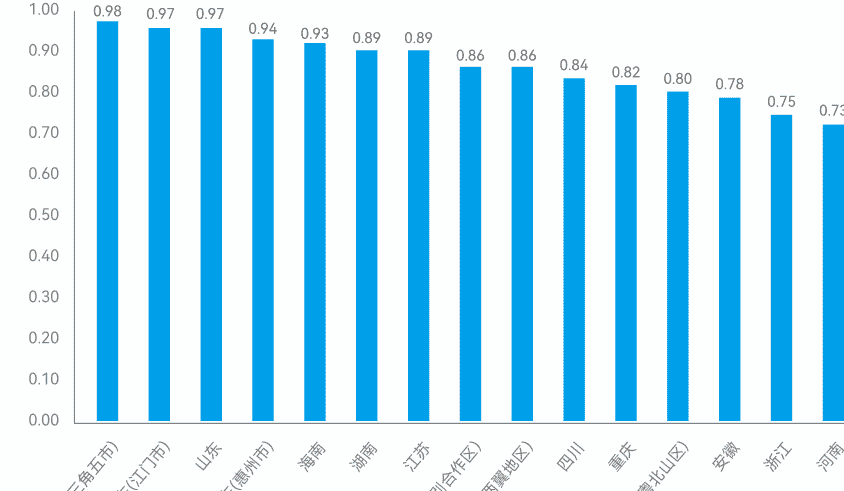

注：一般工业（单一制）

广东、浙江等省份拥有丰富工商业虚拟盈利渠道，需求管理、需求引导、电力补助等，电力交易未来有望为工商业行业带来盈利重重补充。《2025年浙江省电力市场交易实施方案》规定虚拟电等新型模式有望虚拟市场出现，适时探索参与电力市场。虚拟电可根据规则与能量市场、需求市场。随着政策的推进，工商业企业能够通过虚拟电的形式参与电力市场，获得更多收益机会。

图表15：工业储能盈利模式

## 盈利模式

峰谷套利是工业储能的主要模式之一，这种模式利用储能系统...

图表17:大唐潞钠离子新型储能电站

## 02 压缩气储能

### 1、 特点与抽水蓄能相似，但更具灵活性

压缩气储能系统以高压空气能作为能量存储形式，并在需要时通过高压空气膨胀功发电的系统。该系统的工程过程可分为储能和释放两个环节：

储能环节：压缩气储能系统利用风/光/水电或低谷电带动压缩机，将电能转化为空气压力能，随后高压空气密封储存在废弃的矿井、岩洞、废弃的油井或者人造的储气库中；

释放环节：通过释放高压空气膨胀，存储的空气压力能再次通过机械能或者发电。传统的压缩气储能系统在储能需要在燃烧室内燃烧化石燃料来加热空气，以实现利用空气发电的功能。

更多报告访问 www.gaoweiconsulting.com

图18：压缩空气储能工作原理

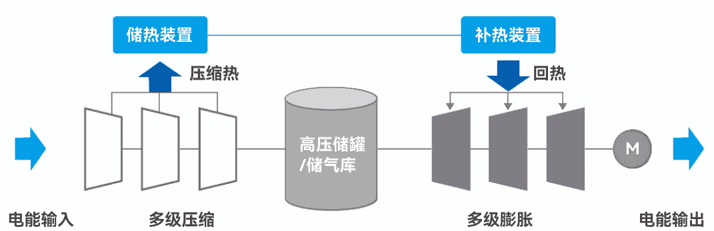

| 储热装置 | 补热装置 |
| :--- | :--- |
| 压缩能 | 回热 |
| 高压储能/储气库 | 电能输入 |
| 多级压缩 | 多级膨胀 |
| 电能输出 | |

数据来源：国家能源局、中国电网研究中心

压缩空气储能能够满足长时间储需求，压缩空气储能可以利用地下的空洞、废弃矿井等储气库，实现大规模的储能。理论上，压缩空气储能规模可从几十千瓦至百万瓦，初步已实现抽水蓄能电站的调节能力和性能，且建设周期和灵活性高于抽水蓄能，能够满足电网大规模、长时间的需求。对比主流的锂储能电池，压缩空气储能具有运行成本低、安全性高、循环寿命等优势。

### 2、我国已突破30兆瓦压缩空气储能项目

2023年，国际首300兆瓦领先压缩空气储能系统机组下线，由中国科学院矿热物理研究所和中国能源联合开发的国际首300兆瓦领先压缩空气储能系统机组集成调试、顺利下线。300兆瓦领先压缩空气储能机组的成功，是我国压缩空气储能领域的重要进展，标志着中国压缩空气储能项目有望取得突破。

两大百兆瓦压缩空气储能工程计划于2024年上线。继山东300兆瓦领先压缩空气储能项目后，两大型压缩空气储能项目将于2024年投产。山东300兆瓦领先压缩空气储能项目已发电，系统设计效率达72%，可实现连续运行8小时，年发电量2亿度。在高温时利用20-30兆瓦压缩机提供电力供给，2025年1月，中国能源“储能一号”300兆瓦领先压缩空气储能项目将发电。

压缩空气储能正处于向商业化推广的推进期。压缩空气储能技术原理和基础已经成熟。全球范围内，压缩空气储能的项目数量不断增加，规模逐步扩大。我国中国能、中国华能、中国电等诸多企业已布局了一批压缩空气储能项目，重点聚焦荒戈、海上风、风电等新型基地。预计2025年，压缩空气储能装机规模将快速实现。

## 03 流体电池

### 1、长时间储能技术之一

流体电池是一种新型储能电池，其特点是将正负极电解液分开于电池外部的各自容器中，通过正负极电解溶液活性物质发生氧化还原反应实现电能和化学能量的相互转换。与其他电池储能技术相比，流体电池在安全性、循环寿命等方面具有优势，是长时间需求需优质的技术路线。

## 前沿洞览 - 2025

图14：流电池储能优势

| 特性 | 优势 |
| :--- | :--- |
| 安全性 | 通常用水溶液为电解质，无潜在爆炸或着火危险 |
| 循环寿命 | 电极反应过程中无相变，可深度充放电，部分技术循环次数可达两万次以上，使用寿命20年以上或更多 |
| 自放电小 | 放置数天或数周后电量减少不明显 |
| 设计灵活 | 功率和容量设计相互独立，要增加输出功率可增加电极面积，增加容量可增加电解体积 |
| 放电快速转换 | 电极充完成后整个电池组，在运行过程中仅需0.02秒即可切换放电状态，响应速度仅需毫秒 |

资料来源：锂产业研究中心

**成本是目前限制流电池行业发展的难题。** 目前国内流电池产业链尚不完善，关键组件如电解液、隔膜等行业企业规模相对较小，规模化生产能力不足导致成本高。流电池中的某些重要部件，如化学反应提供场所的双极板和离子交换隔膜等仍依赖进口，进一步推高了成本。现阶段，流电池与其他电池技术在成本上并无竞争优势。

## 二、产业链快速迭代

流电池根据电解液活性物质的不同，可以分为全钒流电池、铁铬流电池、铁锌流电池、锌锰流电池、全流电池。其中，全钒流电池具有高效率、循环寿命长的优势，是目前商业化程度和技术成熟度最高的流电池。

等流电池核心技术已由国内企业实现突破。华能电气已实现5kW/25kW/50kW/65kW系列，润正科技与国瑞科技共同研发的先进控制技术已取得，预计2025年第一套万级电池将投入使用，助力我国行业发展，降低生产成本。流电池自动化生产线。2024年10月25日，某钠电池在河北廊坊投产；2025年1月，新能源领先自动化生产线在海州滨区投产；2025年1月，某实现万级电池系统集成生产线。百亿级巨型电池已启动。随着技术的迭代和成熟，流电池在大型项目中应用日益广泛。2024年1月，家德四川规划100兆瓦储能项目已启动；2025年2月，永银金丰启动储能项目已建设，预计2025年5月30日投产。

## 行业创新案例展示

## 领先高压储能项目

### 项目背景

该项目是世界上最长的，远距离输电损耗和负荷平衡问题显著，进一步为企业带来挑战。储能系统成为电网强大的关键。工程师们多年来，用专业的产品和服务为客户带来“确定性”。此次项目在当地选址选择上，推荐体积小、灵活性更高的方案。2024年10月，项目顺利完成作业，有效解决了部分时段负载的问题，使得整个储能项目有了里程碑式的意义。

### 创新特点

- 采用“可靠性量化分析”优化产品设计，携手协作打造领先储能项目，确保绿色电力的持续输出。
- 选用新安UniS500D工业级电池，历时精心建设，初装容量为3MWh，末期仍保持2MWh高效，刷新了业内对储能系统的全新认知。
- 在电芯设计上，先进改进技术解决了储能寿命短、自放电率高等问题，提升了储能综合性能。
- 在系统设计上，结合电池生命周期安全，针对不同地形应用场景，初期详细规划，通过严格验证实现了机组性能科学评估，确保在当地稳定运行。

更多报告访问 www.gaoweiconsulting.com

## 深圳天津工商园区项目

### 01 项目概况

天健云创中心作为深圳市文化园区，是专为落实“双碳”目标而精心设计的源网一体化智慧低碳园区，引领“源-网-储-充”全方位绿色园区潮流。项目总储能容量为0.53MW/1.06MWh，核心采用新安UniCS500D、先进的PCS（能量转换器）和EMS（能量管理系统）密集集成，实现了充电过程的高度智能化和高效控制。项目每日完成两次充放电循环，总放电量约100kWh。项目2023年12月中开始运行，截至2024年7月底，系统始终保持较高状态，循环效率达到了88%，电池实际运行8个月衰约为1.6%。同时EMS反复优化电池循环状态，实现SOC0%~100%范围内运行，同时智能控制DOD100%运行，充分释放容量，最大化放电。

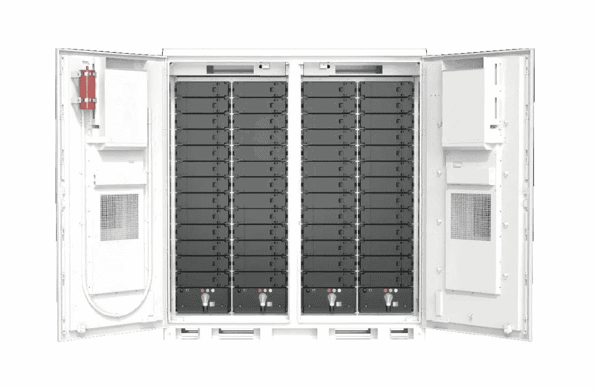

### 02 创新趋势

项目通过妙用“峰谷电价差异策略”积极参与“需求响应机制”，成功构建了多元化的盈利模式，日均收益超千元，展现了卓越的经济效益。项目的落地实施得益于技术创新与产品升级方面的深耕。新安UniS500D商业产品采用模块化设计，大幅节省了40%的安装时间，极大提高了项目实施效率。产品寿命15年，即便在9900次充放电循环后，电池健康状态（SOH）仍能维持在70%以上，确保项目的长期稳定与收益能力。此外，UniS500D在-20℃至55℃温度范围内稳定运行，具备良好的适应性，为绿色园区的可持续发展奠定了坚实基础。

## 奇点能源东营津锐100MW/200MWh独立共享储能项目

东营津锐储能项目是2023年山东省示范项目，2024年1月，入选国家能源局国家级新型储能试点项目名单，也是全国单体容量最大的化学独立储能电站。该项目也是全国数不多的风电大基地近负荷中心的超大型电站，也是全国首座500千瓦级与光伏大基地共线并网的电站。该项目与165万瓦光伏基地共线并网，将有效解决北风大基地送出限额问题。

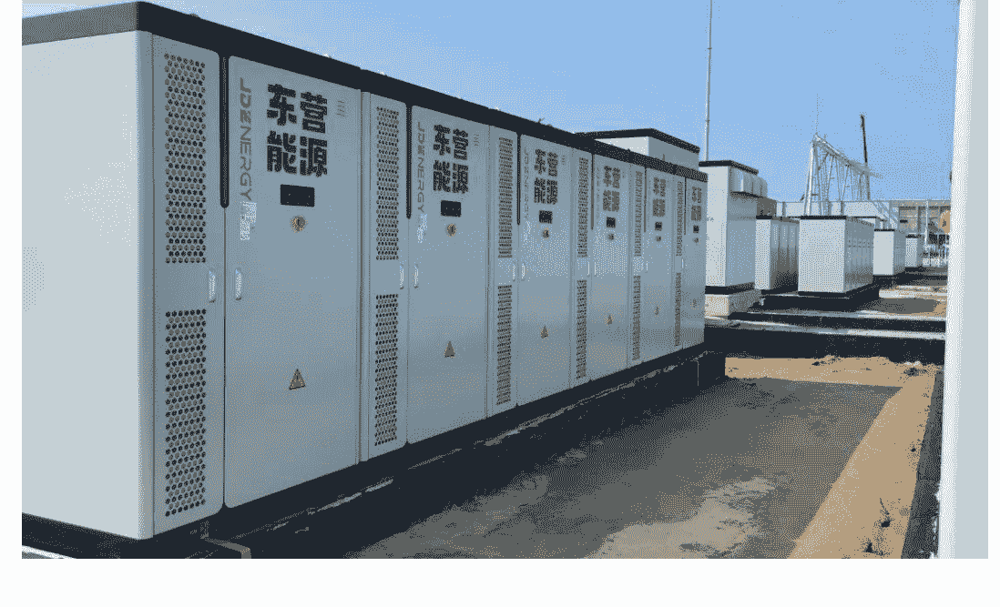

### 创新特点

奇点能源为东营津锐提供共享储能，本项目是山东的首个百MWh示范项目。

## 浙江环斯特格电力6.99MWh储能项目

### 01 项目概况

浙江环斯特格电力成立于1988年，是国内领先的制造企业。随着行业进入规模化，项目积极转型升级，通过布局实现储能。项目总容量6.99MWh，利用电谷价，每天进行两次充放电，每月可节省电费24万元，投资回收期2.5年，收益率34.8%。

### 02 产品特点

采用“ONE STANDARD”设计理念，集成电池系统（BMS/PCS/EMS）。

- 安全：核心组件防护等级高达IP65，具备多种安全功能，全方位保障。
- 高效：采用液冷技术，精细化热管理，温差控制在3℃以内，实现高效充放。
- 经济性：一体化设备，即插即用，维护简单，节省成本。

## 浙江一鸣食品储能项目

### 01 项目背景

浙江一鸣食品有限公司成立于2005年，是一家集牛奶养殖、乳制品加工、烘焙销售于一体的农业龙头企业。项目位于浙江省阳县，专为小型工业场景设计，适用于工厂、商业中心、社区等多种场景。项目配置PCS（功率转换系统）、BMS（电池系统）和EMS（能量管理系统），一体化设计，容量达到3MWh。通过错峰调度策略，提升能源利用率，降低循环率至10%以上，增强了系统的安全可靠性，收益10,000元。

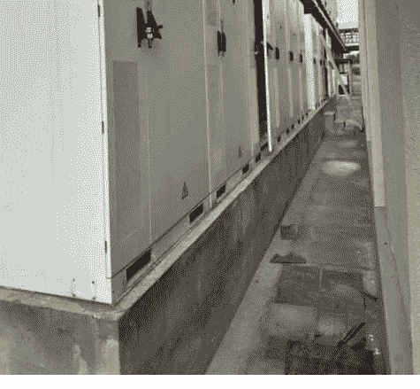

### 02 产品特点

- BMS+EMS+PCS一体化直，系统，高效运行。
- EMS智能调度与实时数据分析，精准定位，快速处理。
- 电控系统九重安全防护，快速抑制失控。
- AI诊断预测，全生命周期云端管理，精细化运维。
- 一体化设备，配电系统出厂即安装，节省10%。

## 利斯能源湖南桂阳60MWh用户侧储能项目

### 01 项目概况

针对高耗能企业用电需求，电力负荷占比高、电网调压电压高等一系列问题，利斯能源在湖南桂阳采用集成箱式设计方案，共8套4MW/20MWh系统，每套包含1台变压器和5MWh储能电池箱组，并以‘两线一管理’架构实现高效与灵活运行。项目投资2亿元，占面积8.5亩，年转移负荷7500千瓦，每年为企业节省用电约400万元，全生命周期收益达7亿元，在减少厂区对传统电网依赖的同时，有效解决电网调压压力，助力调度避峰与冬季。

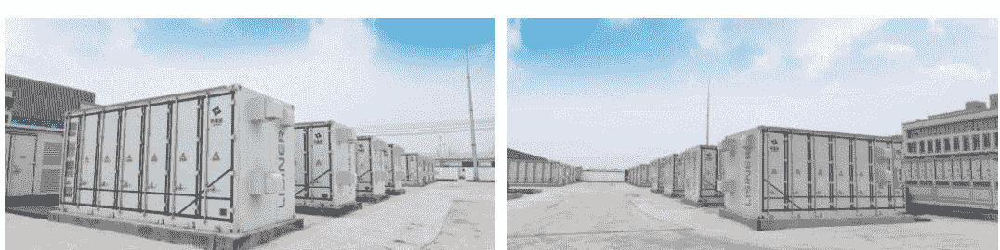

### 02 创新特点

该项目具备‘安全、数字化、高适用’三大特点。

安全：基于锂离子电池智能化和热管理，构建四级防护+双重安全保障体系，从电芯到电池全方位保障安全，在消防安全层面执行‘一、二、三消除’措施，监控AI监控技术，故障早发现早警，双管齐下打造一体无死角防护。

数字化：依托电力负荷智能的一体化调度平台，实现系统透明和可视化，电池状态、季节性、环境变化、负载波动等数据进行分析。

美国电网基础设施老化严重，新能源发展背景下，多州发布储能机规划。美国电网基础设施老化严重，存在设备故障、储效率低下等问题，且本土三大电网互联程度低，区域化问题严重。随着风电、光伏等再生能源储能量不断增长，美国电网对于储能的需求日益突出。纽约、加州、内华达等州相继推出储能机规划。其中新能源市场发展最快的加州是美国前景最快、最大的市场。

## 表22：美国各州储能目标

| 储能目标（MW） | 目标年份 |
|---|---|
| 加利福尼亚州 | 15000 | 2030 |
| 内华达州 | 54200 | 2045 |
| 俄亥州 | 1000 | 2030 |
| 缅因州 | 400 | 2030 |
| 纽约 | 3000 | 2030 |
| 马萨诸塞州 | 1000 | 2025 |
| 康涅狄格州 | 1000 | 2030 |
| 新泽西州 | 2000 | 2030 |
| 佛吉尼亚州 | 3100 | 2035 |

资料来源：InfoLink，枢科刚产业研究中心

## 2、提升大储机效率，简化并流流程

2024年5月13日，FERC发布区域传输规划和成分规定（1920令），通过调度规划和成分规定规则，要求每个运营商应当考虑在现有发电机组中多次确定尚未完成的传输线路，以满足与互相关的需求。该规定促进了美国新增电力的效率，让更多的再生能源能够接入网络，从而增加了对储能的需求，推动了储能电池的快速增长。

2023年7月，联邦电力监管委员会（FERC）发布Order《发电互联和协议的议定》，从多个方面简化了并流流程。“新规涵盖闲询、优先服务的集群研究流程以及严格的期限，确保真正备用条件的机组更快速进入互联并完成相关研究，减少了即用调度和流程遵循的负担，加速新增电力、储能等机组的落地。

## 3、特朗普当选，美国储能需面临不确定性

特朗普是能源资源者，对发展新增能源产业有益。美国新任总统特朗普将发展能源转型，这将让美国在能源上实现自给自足。特朗普上任第一天就宣布国家进入紧急状态，提出要最大限度提高美国化石和天然气等传统能源产量。发展储能必须填补新增缺口。

IRA法案或将影响美国新增储能机组增速。2025年1月，特朗普将签署命令，要求联邦机构立即暂停《通胀削减法案》（IRA）审查。IRA是近年来新增储能增长的重要因素。扶持政策后，美国州对储能的需求可能未消失，但装机节奏将受到影响。

2024年美国储能市场表现强，受政策影响，2025年新增储能机组增速将缩慢。政策与市场遭遇波动，美国新增储能市场装机延续了高速增长趋势。新增机组规模预计到11.9GW/34.GWh，同比增长36%/4%。根据美国301关税审查结果，储能电池及其材料的关税率将从2026年的7%升至25%，2025年将成为大抢险年，预期2025年美国新增储能机组将

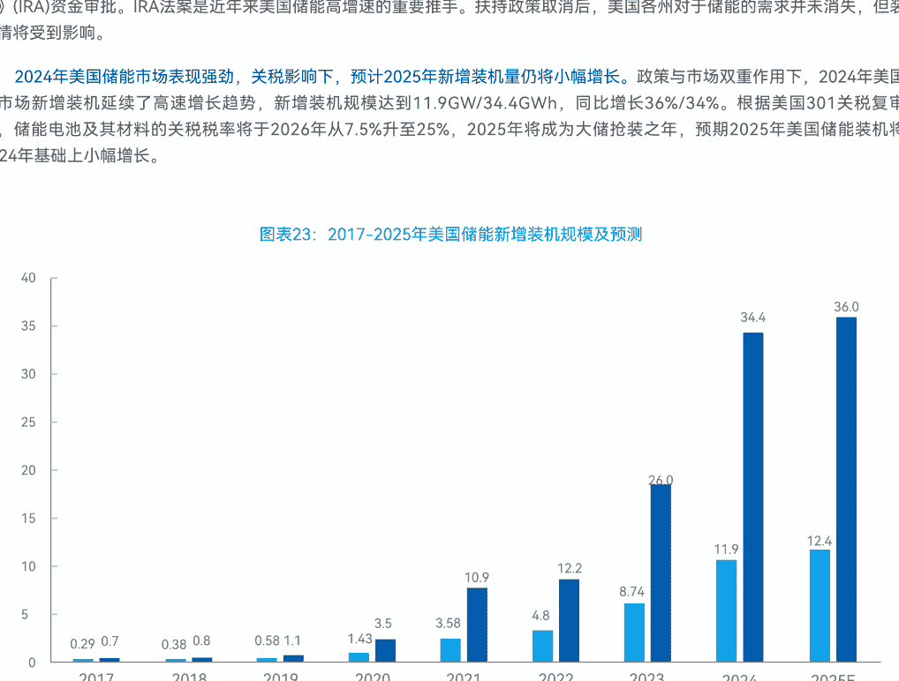

数据来源：WoodMackenzie，博安产业研究中心

## 02 欧洲市场

### 1、新能源占比占比，储能需求旺盛

欧洲可再生能源占比接近50%，储能需求旺盛。欧洲可再生能源储备充足，欧洲石油、天然气、煤炭三大能源进入存储期，欧洲大力发展可再生，2022年发布REPowerEU计划，将2030年再生能源的目标从40%提高到45%。为独立领先，欧洲国家将通过资金规划的后期风电目标。欧洲电力工业会显示，2024年再生能源占比48%。

## 图24：欧洲各国能源规划

| 国家 | 规划 |
|---|---|
| 德国 | 2030年光伏装机215GW，2030年风电160GW |
| 法国 | 2030年再生能源发电570GW，光伏发电54-60GW，风电35GW |
| 意大利 | 2030年再生能源结构占比40% |
| 英国 | 2030年海上风电150GW，包含5GW的漂浮式风电 |
| 西班牙 | 2030年光伏累计装机81GW，光伏62GW，再生能源占比81% |
| 荷兰 | 2050年光伏装机173GW，其中45GW为屋顶建筑光伏 |
| 瑞士 | 预计2050年光伏装机容量37.5GW |
| 波兰 | 2030年光伏装机29.3GW |
| 瑞典 | 计划2040年实现100%的可再生能源 |
| 比利 | 2030年海上风电规模较2020年的水平左右 |
| 奥地利 | 计划2030年光伏装机21GW |
| 爱尔兰 | 2030年再生能源占比达80% |
| 挪威 | 到2040年建设30GW的海上风 |
| 丹麦 | 2030年建设两座海上岛，初始发电容量5GW |
| 芬兰 | 计划在2024年至2025年投入30亿欧元的风电机，2030年再生能源占比55% |
| 罗马尼亚 | 2030年光伏装机8.3GW，风电7.6GW，2030年再生能源占比30.7% |
| 捷克 | 2030年再生能源占比30%，2020年前增长10.1GW |
| 葡萄牙 | 2026年实现再生能源占比80%，实际光伏装机20.4GW，海上风电7.7GW |
| 希腊 | 2030年再生能源消费占比31% |

资料来源：高位咨询产业中心

旺盛需求下，欧洲储能新增机快速释放。2020-2023年，欧洲储能新增机规模2.3GWh至17.2GWh，复合增长率达到95.6%。2024年，欧洲储能新增机规模达到23.1GWh，延续了快速增长趋势。

## 图表25：2018-2025年欧洲储能新增机规模及预测（GWh)

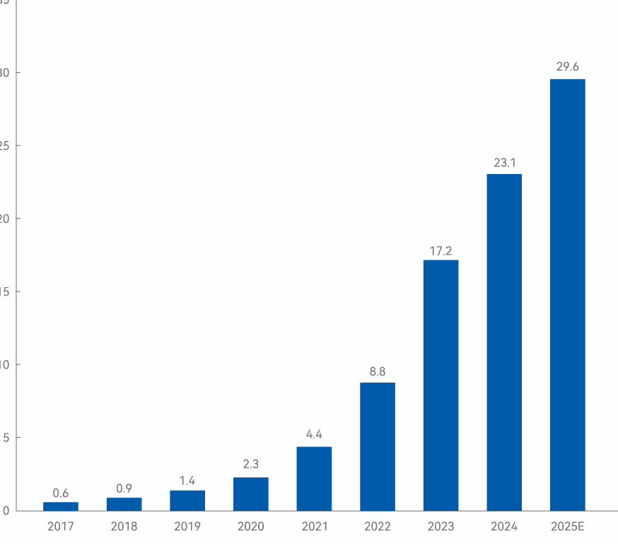

资料来源：SolarPower Europe、燃料和产业中心

## 2、装机结构从储能扩大发展

2023年以前，欧洲储能市场以用户侧需求为主。欧洲家庭对电力的供应稳定性和自主性有较高需求，大量新能源机以分布式光伏的形式，多国政府为分布式光伏提供补贴。2022年乌克兰冲突导致能源供应紧张，天然气价格暴涨，居民对能源独立性和供电稳定性的需求激增，推动储能机新增增长。2023年欧洲新增储能机用户占比达70%。

## 图26：2023年欧洲新增储能机组结构

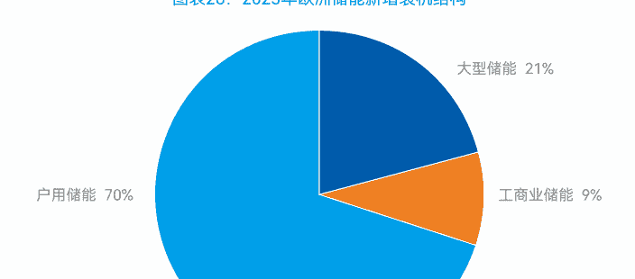

资料来源：SolarPower Europe、维科网产业研究中心

成本下行加支持，2024年欧洲大型储能新增机组爆发。2024年，欧洲大型储能系统需求受储能价格下行、盈利机制改革、政策支持等多重因素催化，新增储能机组迅速增长。意大利17亿欧元新增投资计划获批，为大型项目的建设提供了充足的资金支持，积极开展容量市场招标，加速储能建设。英国取消电池储能机组容量限制，并为大型项目提供多样化套利渠道。

根据维科网产业研究中心测，2024年欧洲储能市场大型储能新增机组量达11.5GW，占比接近50%，对比2023年21%的占比显著提升。

## 图27：2023年欧洲新增储能机组结构

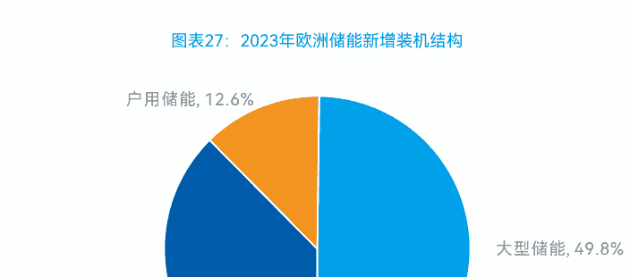

资料来源：维科网产业研究中心

## 前沿洞察-2025

### 3、意大利、英国成为欧洲新引擎

扩大储能计划，意大利需求充分。2023年，欧洲批准了意大利大达7.7GWh的储能系统建设，持续10年至带来平均增长。除储能计划外，意大利还通过储能招标机制（MACSE）等多种方式推动装机。测，2024年意大利新增储能容量达7.7GWh，同比增长15%，其中电池占比高达67%。2024年集中释放，预测2025年意大利储能将恢复。

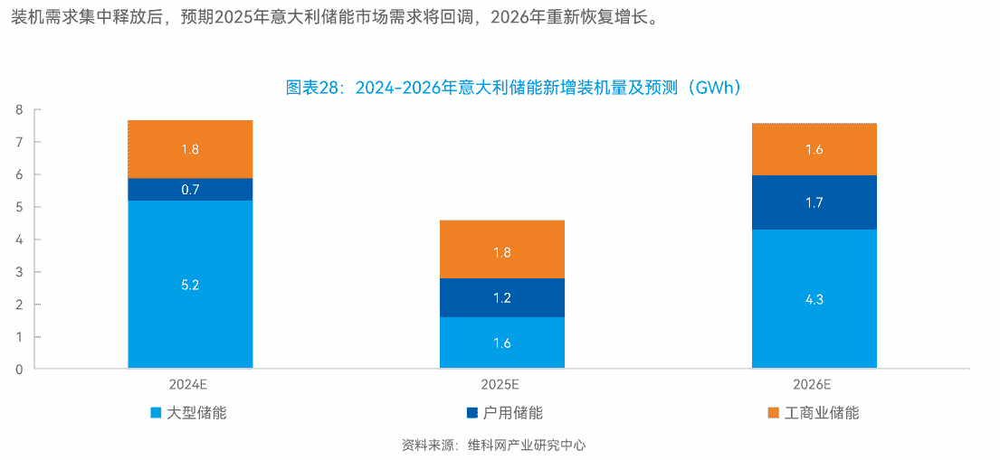

作为欧洲先驱，英国作为岛屿国家，电力供应相对独立，通过电网进行调控、提升储能稳定性的诉求，发展市场较为成熟，诸多实现收益。2024年，英国最新《未来能源愿景》中大幅拓展2030年储能装容量至24.6GWh，较2023年提高55%/79%。测，2024年英国新增储能装容量预计到1GWh。

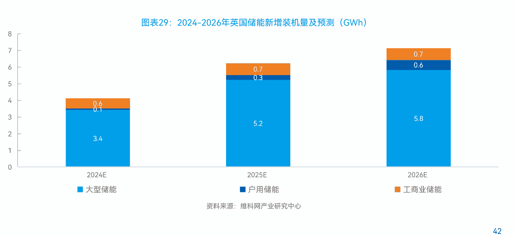

## 03 中东市场

### 1、资源优势优，坚定新能源发展

丰富的油气提供了转型机机，优质的资源为新能源提供了坚实基础。中东地区石油产量占总量的一半，占比31.5%，天然气储备量全球超过40%。中东地区石化工业积累了财富，为转型打下了坚实基础。中东地区能源资源极其丰富，优质光资源充足。沙特阿拉伯年日辐射强度为640瓦/平方米，阿联酋年日辐射总额极高。中东国家大力推动转型，多个国家已发布规划。沙特与阿联酋作为中东油大国，在新能源转型上走在了前列。中东国家经济发展普通，易受地政治、国际政策等影响，可再生能源有望助力经济多元化，培育新的增长点。2016年，沙特推出“2030愿景”、承诺新建新能源计划、允许国际贸易和投资、“国家环保部”，将新能源推向产业化。

## 图30：中东国家新能源转型规划

| 国家 | 中期目标 |
|---|---|
| 沙特阿拉伯 | 可再生能源发电量5.8TWh，占比1.4% | 2030年发电占比达30% |
| 阿联酋 | 可再生能源发电量13.8TWh，占比8.4% | 2030年发电占比达32% |
| 卡塔尔 | 可再生能源发电量1.5TWh，占比2.7% | 2030年发电占比达18% |
| 科特 | 可再生能源发电量0.2TWh，占比0.2% | 2030年发电占比达15% |
| 埃及 | 可再生能源发电量24.8TWh，占比11.3% | 2035年发电占比达42% |
| 摩洛哥 | 可再生能源发电量8.8TWh，占比20.9% | 2025年装容量占比达52% |

资料来源：华信产业研究中心

## 2、需求已爆发，多个大型项目落地

新能源发展拉动清洁需求，随着新能源机组占比的提升，配置储能成为中东国家的必之路。2024年成为中东能源需求的爆发年。沙特计划在2024-2025年间建设24GWh的储能电池，2024年在建项目高达8GWh。此外，中东大型项目众多：阳光电源与沙特ALGIHAZ签约容量7.8GWh大型项目；2025年1月，宁德成功签约沙特全能光伏项目“碧RTC”19GWh新能源储能电池系统；2025年2月，比亚迪与沙特电力公司成功签约12.5GWh，万级项目规模已达1.5GWh。

## 中国企业出海趋势

价格内卷，厂商需准出海

### 01 国内行业价格内卷，厂商需准出海

国内行业入局众多，市场内在在全球能源转型的背景下，储能行业作为关键支撑，近年来发展迅速。作为全球能源链重构的新星，已吸引国内众多不同领域的企业。然而，国内储能市场正面临一个突出的问题——储能系统价格不断下降，中甚至优于海外企业的单价。在竞争激烈的环境下，海外成为储能行业的新机遇。2024年以来，阳光电源、旺仕、国轩高科、海博创等国内企业密集参加各类储能展会，展示创新产品，有效提升市场知名度和品牌。在国际光伏展览会上，锂电池与中美本土企业订单和合作；在德国光伏展览会上，阳光电源、旺仕、海博创等国内企业超过100GWh。

## 02 龙头企业竞争力十足，海外订单频爆发

我国储能产业发展全球领先，历多年高速发展，已形成诸多制造环节，龙头企业竞争力水平领先。2024年以来，阳光电源、比亚迪、海博创等国内企业凭借全产业链成本优势、优质的服务和过硬的产品，在海外市场表现出强大的竞争力。

## 图31：2024年以来储能部分订单

| 时间 | 企业 | 国家 | 主要内容 |
|---|---|---|---|
| 2024.01 | 海威储能 | 美国 | 与储能集成商Powin, LLC签署5GWh储能架构 |
| 2024.02 | 阿特斯 | 美国 | 阿特斯为AypaPower提供487兆瓦的SolBank储能 |
| 2024.02 | 天能储能 | 英国 | 天能与国际知名开发者LowCarbon公司签订190MW液冷储能系统供货协议 |
| 2024.02 | 力神 | 欧洲 | 与欧洲某大型能源集团签订2GWh储能订单 |
| 2024.03 | 华为数字 | 欧洲 | 欧洲储能电站开发EPCSUNOTEC与华为技术加利在深圳签署储能合作备忘录，双方在储能技术开发与应用、规模化电站建设与运营方面全面合作 |
| 2024.03 | 光源 | 美国 | 与SSE签约320MW/640MWh的英国储能订单 |
| 2024.05 | 光源 | 德国 | 与德国SolarEnergy签订116.5MW/230MWh储能系统（BESS）项目协议 |
| 2024.05 | 远景储能 | 英国 | 与英国CellAhead签订储能电池项目订单，项目规模300MW/624MWh. |
| 2024.07 | 远景集团 | 英国 | 远景集团与可再生能源企业Field达成合作协议，为位于英国布莱克的whitebrick储能项目订单 |
| 2024.08 | 科陆电子 | 中国 | 全资子公司电力国际与英国客户签订了储能系统供货续约，提供800MW储箱式储能系统 |
| 2024.08 | 比亚迪 | 英国 | 获得多数客户Chickeral附近400MW/2400MW储能系统（BESS）的规划订单 |
| 2024.08 | 光源 | 美国 | 与德国集团SparmEnergy签订签订合同，将提供超过1GWh的液冷装箱 |
| 2024.11 | 华电源 | 英国 | 与FiraEnergy签署了4GWh储能项目，为供应商给客户的ThorpeMarsh和WestBurn两座标准柱储能电站 |
| 2024.11 | 蓝能新能源 | 意大利 | 与意大利Celestial公司在北京签署战略合作协议，双方在短期内在建立1.5GWh的储能系统 |
| 2024.12 | 远景储能 | 法国 | 与德国EDF签订供货合同，为其在南非洲投资的三个独立储能项目提供储能系统，项目合计机组容量为257MW/1028MWh |

资料来源：离子产业研究中心

45 *数据来源

## 更多报告访问 www.gaoweiconsulting.com

| 时间 | 企业 | 国家 | 主要内容 |
| --- | --- | --- | --- |
| 2024.09 | 光源 | 马来西亚 | 与马来西亚SRGE签署协议，在马来西亚沙巴推进100MW/400MWh电池能项目 |
| 2024.10 | 海博思德 | 澳大利亚 | 与澳大利亚能源集团Tesseract达成战略合作，项目规模近1GWh |
| 2024.10 | 旺近达 | 澳大利亚 | 与 Gryphon Energy签署战略合作协议，项目位于澳大利亚维多利亚州，容量1.6GWh |
| 2024.10 | 宁德时代 | 智利 | 与智利哈马源太阳能储能项目第四期1.25GWh电池能系统 |
| 2024.12 | 光源 | 菲律宾 | 与菲律宾Citicore Renewable Energy Corporation（CREC）签署1.5GWh储能系统合作协议 |
| 2024.12 | 华为数字能源 | 菲律宾 | 与Gen可再生能源的子公司Tesserat Solar Meter Solar项目签署4.5GWh电池能系统 |
| 2024.12 | 海底储能 | 澳大利亚 | 宣布将为Lightsourcebp开发的Wooloonga储能项目提供640MWh的储能系统 |
| 2024.12 | 天合光能 | 埃及 | 宣布与AMEPower达成合作，共同建设位于埃及南部地区的Abydos储能项目，提供供给总容量超过300MWh的储能系统 |
| 2025.01 | 宁德时代 | 德国 | 与德国相关方达成合作，其德国19GWh储能项目成为全球最大单体订单 |
| 2025.01 | 比亚迪 | 沙特 | 与沙特电力公司签署合同，订单规模迈到25GW/12.5GWh |
| 2025.01 | 东方日储能 | 巴西 | 与巴西MTR Solar公司成功签署1GWh储能系统战略合作协议，未来两年将为其提供储能系统产品 |

## 前沿溯源·2025 |

## 04 产品出海：向海外发展

全球化化潮之下，储能存在政策差异。近年来，以美国为代表的西方国家以贸易保护理由对中国汽车、电池等等产品征收高关税，贸易保护主义日益盛行。2024年9月，美国贸易办公室声明，自9月27日起，中国制造的电动汽车的关税率将升至100%，太阳电池的关税率将升至25%。作为快速增长的新兴产业，目前尚未受到欧美政府政策影响。考虑到储能规模正处于快速增长期，我国在制造领域优势巨大，未来有望。

储能产业链正向海外出海。美国、德国等欧洲储能电池市场通过相关政策要求电池本土化，推动本土电池发展。通过政策引导，储能电池正从中国向出海，以应对贸易壁垒。

锂环节的海外产能建设正在进行，系统集成等任务正在进行，储能产业链核心环节储能电池市场规模扩大，已能欧美等国家和地区的需求，海外产能建设已具规模。2024年，中国电池将积极布局储能：宁德时代与Stellantis集团在西班牙萨尔瓦亚伊拉格拉斯市投资建设20GWh高性能电池及配套项目。目前面临的政策风险，光伏电池、海储能等等地已开始布局海外储能产能。

| 厂商 | 公布时间 | 海外产能规划 |
| --- | --- | --- |
| 远能科技 | 2023.05 | 全资公司与意大利公司Energy共同建设储能工厂 |
| 亿锂能源 | 2024.01 | 与土当地Aksa组合公司从电池、模块、户外、装箱的生产、营销和销售，以及在当地作为工程为主施行电式储能系统构建 |
| | 2024.01 | 设立储锂电池马来西亚工厂，开启储能工厂建设，截至2024年6月，马来西亚工厂进展顺利，已基本完成项目主体建设 |
| 光源能源 | 2024.10 | 计划投资48.76亿元人民币，其中17.6亿元用于海外配套设备及储能产品扩建项目，通过新建厂房，构建50GW级储变设备，15GWh级储能产品的生产线 |
| Hithium | 2024.10 | 计划在沙特建立储能电池制造厂，目标产能为50GWh。 |
| 海底储能 | 2024.10 | 海底储能与沙特MANAT集团宣布合资公司Hithium Manat，计划在沙特建立储能电池制造厂 |

资料来源：储能产业研究中心

## 市场前景

## 新型储能未来装机趋势预测

### 01 全球新增储能容量预测

中、美、欧三大市场加速，新型储能新增装机速度快速增长。2024年，容量达到176GWh，同比增长181%。中、美、欧作为全球新增储能发展最快速的地区，是储能新增装机的核心。热门市场装机容量提升，未来将成为全球储能装机引擎。中东多个新型储能项目，阿联Masdar200GWh项目已落地，智利2024年在建大型储能项目达9GWh，澳大利亚2024年1月开始，菲律宾TerraSolar5GWh储能项目2024年1月开。需求增强，预计2026年全球新型储能新增装机接近300GWh。

### 02 我国新增装机容量

2021年以来，我国新型储能装机显著飞跃。2021年7月，国家发改委和国家能源局发布了《关于加速新型储能发展的意见》，明确指出到2025年新型储能从小型化向规模化转变，并提出装机规模到300万千（GW）以上。在顶层文件下，钠铁锂的新型储能将成为各地新能源的主要调节资源，贵州、内蒙古、山东等地按照新型储能的要求，2021-2024年，我国新型储能新增装机规模还将猛增。

## 前沿洞察·2025 |

图表35：2022-2026年中国新型储能电池市场装机规模及预测 (GWh)

图表36：2024年我国新型配储电站运行数据

强制配储取消预计将影响2025年新增装机增速，但不改变长期趋势。新型储能是我国储能的重要组成，当前阶段独立储能市场尚在完善，强制配储政策的短期影响内新增装机带来压力。然而，对发电稳定的特性的需求仍需释放。在强制配储取消和2024年后高基数影响下，预计2025年新型储能装机增速将持续，2026年将恢复高增长。

## 行业榜单

综合竞争力榜单聚焦企业综合实力、全产业链、出海、工业储能等细分榜单，综合考虑企业的市场地位、创新能力、行业知名度等多维度指标，展现各领域优秀企业的竞争表现。

## 综合竞争力榜## TOP50 中国新型储能产业链综合竞争力企业

| 01 阳光电源 | 17 晖辉能源 | 34 上能电气 |
| 02 比亚迪 | 18 楚能新能源 | 35 科华数能 |
| 03 中车株洲所 | 19 锦锋储能 | 36 智胜储能 |
| 04 宁德时代 | 20 聚和元储 | 37 国南源 |
| 05 亿钛储能 | 21 欣廷达 | 38 金风零碳 |
| 06 远景集团 | 22 莱聚能源 | 39 索莱英电气 |
| 07 海威储能 | 23 电工时代 | 40 沛储能 |
| 08 海博思创 | 24 力电力 | 41 沃太能源 |
| 09 中创新航 | 25 南瑞基培 | 42 许壁电气 |
| 10 瑞瑞数字合约 | 26 阿特斯 | 43 弘弦股份 |
| 11 华亚数字能源 | 27 天信能源 | 44 采日能源 |
| 12 新能安 | 28 远信储能 | 45 天合储能 |
| 13 精控能源 | 29 中天储能 | 46 领孚储能 |
| 14 南都电源 | 30 特变电工 | 47 鸿顺 |
| 15 国轩高科 | 31 易事特 | 48 望为智能 |
| 16 奇点能源 | 32 利星能 | 49 望星电气 |
| | 33 永泰数能 | 50 象新能源 |

## 中国新型储能产业链出海竞争力企业

| 01 宁德时代 | 11 南瑞维保 | 21 昆宇电源 |
| 02 阳光电源 | 12 派能科技 | 22 天合储能 |
| 03 比亚迪 | 13 阿特斯 | 23 欣旺达 |
| 04 亿锦储能 | 14 汇川技术 | 24 艾罗能源 |
| 05 远景集团 | 15 科华数能 | 25 索英电气 |
| 06 华为数字能源 | 16 鹏辉储能 | 26 海博思创 |
| 07 海迈储能 | 17 上能电气 | 27 电工时代 |
| 08 中创新航 | 18 特变电工 | 28 远信储能 |
| 09 国轩高科 | 19 古瑞瓦特 | 29 鑫盛股份 |
| 10 瑞浦兰境 | 20 楚能新能源 | 30 科隆电子 |

## 中国工商储能系统竞争力企业

| 01 奇点能源 | 07 南瑞维保 | 14 太能源 |
| 02 阳光电源 | 08 新能安 | 15 莱聚能源 |
| 03 鹏辉能源 | 09 易事特 | 16 领星宇宙 |
| 04 融和元值 | 10 利星能 | 17 华为数字能源 |
| 05 中车株洲所 | 11 精控能源 | 18 为恒智能 |
| 06 东方日储能 | 12 南都电源 | 19 亿兰科 |
| 13 天合储能 | 20 艾罗能源 | |

## TOP20 中国新型储能PCS竞争力企业

- 光阳电源
- 上能电气
- 科华数能
- 中车株洲
- 国电南瑞
- 索英电气
- 南瑞瑾保
- 许雄电气
- 盛弘股份
- 华为数字能源
- 汇川技术
- 驰电子
- 英博电气
- 科土达
- 易事特
- 首脑新能
- 古瑞瓦特
- 锦瑞科技
- 华自科技

## TOP10 中国新型储能EMS竞争力企业

- 长圆深瑞
- 国电南瑞
- 许雄电气
- 德联软件
- 南瑞瑾保
- 四方股份
- 国电南自
- 平高电气
- 永福能能
- 国电日新

## TOP10 中国新型储能BMS竞争力企业

- 高特电子
- 协能科技
- 科工电子
- 华思系统
- 力高新能
- 华塑科技
- 沛城电子
- 高泰昊能
- 优胜科技
- 科列技术

## 市场份额榜

市场份额领先榜聚焦市场地位、企业营收、行业知名、产能规模等多个维度进行考量，综合反映企业在各领域的市场地位。

## TOP20 中国储能电池市场领先企业

- 宁德时代 7
- 远景动力 14
- 力神电池
- 亿纬锂能 6
- 国轩高科 15
- 南都电源
- 鹏辉能源 9
- 昆宇电源
- 比亚迪储能 10
- 楚能能源 17
- 新能安
- 海辰储能 11
- 镁鳍锂电 18
- 天旷能源
- 瑞浦兰Keys12
- 德赛电池
- 中创新航 6
- 蜂巢能源 20
- 芜科技

## TOP20 中国大型储能市场领先企业

- 光源电源 7
- 精控能源 14
- 特变电工
- 比亚迪储能 6
- 阿特斯 15
- 天合储能
- 中车株洲 9
- 信储能 16
- 永泰电池
- 南都电源 10
- 智光储能
- 海博思能 4
- 中天储能 18
- 金风零碳
- 远景储能 12
- 南瑞继能 19
- 新源智储
- 电工时代 13
- 融和元元 20
- 安诚能科

## 技术创新榜单

技术创新领先者聚焦企业创新能力、企业资金实力、研发实力、研发投入、创新产品等许多维度的进行考虑、综合影响各环节企业的创新实力。

## TOP20 中国储能系统技术创新企业

- 奇点能源 7
- 科华数能 14
- 电工时代
- 精控能源 8
- 中天储能 15
- 国轩
- 新能安 9
- 易事特 10
- 天合储能 17
- 东方日升能 1
- 远景储能 18
- 昆宇电源 12
- 阿特斯 19
- 融和元元 20
- 金风零零

## TOP20 中国储能电池技术创新企业

- 宁德时代 7
- 国轩高科 14
- 新能安 8
- 海辰储能 15
- 亿锂储能 9
- 远景动力 16
- 比亚迪储能 10
- 蜂巢能源 17
- 瑞浦兰境 1
- 中创新航 12
- 莱能新能源 19
- 锦锋锂 20
- 德赛电池

## 优秀企业汇

厦门新安是全球领先的新能源创新公司，致力于为全球用户提供绿色解决方案，助力能源转型美好生活。新安位于福建，投资超过70亿，拥有电池-电芯全链条的研发与制造体系，具备CNAS/ISO27025、IATF16949等认证。新安通过深度定制的制造平台、实时数据分析、全自动化布局，满足客户多元化、场景需求。新安在储能系统、微型车、电动工具、无人机领域与行业头部开展全面合作，为全球30个国家和地区提供极安全、极可靠、极性能的新能源产品与服务。

- 研发投入10%
- 研发人才占比48%
- 专利申请1000+
- 长循环15年
- 直接参与标准制定

## 前沿洞察 - 2025 |

## 西安奇点能源

西安奇点能源成立于18年，由行业著名的电力电子专家和多位多年开发经验的硕士级资深工程师创立，专注于领先储能的核心技术研究与开发，积极推动规模化储能接入，以全球目标实现储能优质解决方案。奇点能源采用“All in One”的设计理念，创新性将增长寿命、高效双向EMS、高性能PCS和物联网技术驱动储能的规模化应用，让能源更高效、更友好。通过电力存储及连接技术，物联网和大数据技术，推动储能变革，提升能源质量，为电力地区带来光明和活力，改善人类环境。

## 01 企业简介

奇点eBlock-4、eBlock-26具备高效储能和直流功率转换能力，可安全、稳定、可长周期运行，系统控制更加高效、容量转换和转换效率大幅提升，同时同步交流并最大化后期成本，真正实现客户的安全无忧、经济高效、智能运行。

奇点储能解决方案基于“物-网”的设计理念，通过能量Block进行集成，通过能量eLink进行储能和信息的交互，在云端通过能量MiEnd进行智能分析与管理。可以实现小型储能单元到GW级储能站的木石级高安全设计，解决了传统集成式储能方案存在的安全性问题，并提高效率、可靠性。

## “物-网”系统解决方案

奇点储能解决方案基于“物-网”的设计理念，通过能量Block进行集成，通过能量eLink进行储能和信息的交互，在云端通过能量MiEnd进行智能分析与管理。可以实现小型储能单元到GW级储能站...

来源：企业官网、锂博产业研究中心

## 浙江节能产业发展有限公司

## 01 企业简介

星能能源锐于科技集团，以领先的数据智能与能源系统研发技术为核心，致力于清洁能源的可持续发展。将数据、AI、IoT等智控技术创新、能源产业链深度融合，以“储+能”为定位，打造“比特流驱动互优”的数据能源解决方案，探索实现能源服务新模式，推动能源智能未来的全域生态构建。

## 02 创新产品

星能MV&HV列中高压集成箱式储能产品为高压储能解决方案配套产品，应用在具有充裕空间的大规模模块建设场景。主要应用模式包括调频调度、电能质量治理、能源消纳、削峰填谷等，广泛用于发电侧、电网侧、工业园区、商业楼、光储智能充电站、数据中心、台区扩容等场景，具有多重优势：

| BMS&EMS双控融合 | 降本增效 |
| --- | --- |
| BMS+EMS双智能控制，灵活策略应对，提高放电量 | 高度集成、能量密度提升30%，系统损耗下降20% |

| 长寿命管理 | 高效热管理 |
| --- | --- |
| 全生命周期管理机制，包括全新冷控技术、智能化电池健康管理等 | 高效热管理，严控系统温度<35℃，族级温度≤3℃，系统级温度≤5℃ |

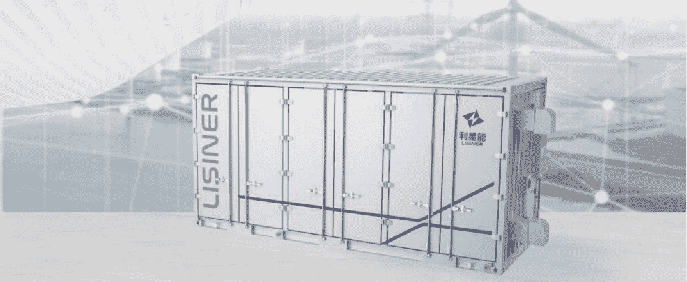

前沿洞察 - 2025 |

## 昆宇电源股份有限公司

## 01 企业介绍

昆宇电源股份有限公司是一家专注于新能源储能领域的国家级新技术企业。技术团队深耕储能领域30余年，具备从材料、电芯、电池管理系统、系统集成等研发、制造、销售、服务能力，已为全球60多个国家和地区提供电力储、通信储、用户端、数字电源、光类储能等领域的产品和系统化解决方案。

## 02 创新产品

昆宇电源5MW/10MW液冷储能系统由2.5MW/5.016MWh储能子系统组成。每个2.5MW/5.016MWh储能子系统由1.25MW/2MWh的变流升压一体机和1台2.5MWh的电池组成，具备多重优势：

组式柜架构：采用模块化设计，将储能系统分为多个独立单元，以便灵活扩展维护。每个单元可独立运行，提升系统可靠性和兼容性能力。

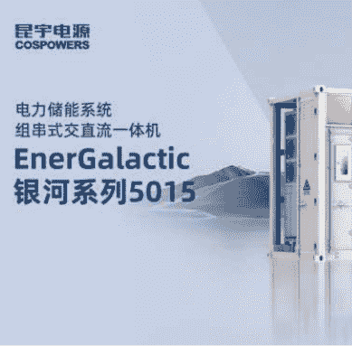

优化液冷技术：均衡调节电池温度，延长电池寿命。采用节能设计，减少能耗，提升转换效率。

智能管理系统：实时监测电池状态，及时预测潜在问题，智能调节充放，优化能量利用。

先进电池技术：采用高能量密度电池，优化电池材料和结构，提升储能容量，更延长使用寿命。

多重防护：配备热、湿、机械多重防护机制，采用先进的电芯及系统集成技术，并不断散热和隔热技术，有效防止热失效。

系统集成化：采用高效转换技术，减少能量损失。内部结构紧凑设计，节省空间，便于安装和维护。

智能分析：利用数据分析优化系统运行，通过精准算法提升系统管理和预测能力。

## 全球数字经济产业大会 OFWeek 数字经济产业

## 2025全数字智能工业展
光伏储能工业应用大会暨展览会

7.30 周三 2025 8.01 周五
深圳福田会展中心（1号馆）

## 展区规划

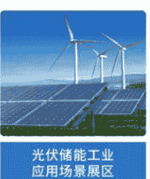

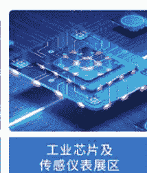

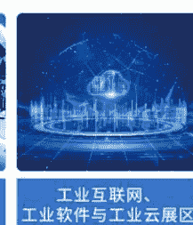

## 展览范围

光伏产业链：太阳能光伏生产设备、光伏原材料、光伏电池与组件、光伏相关组件、光伏应用产品、光伏工程及系统、系统工程设备与安全防护

储能产业链：储能电池及材料、储能变流器（PCS）及相关产品、储能系统集成及安装、储能系统制造、储能应用场景展示

储能系统解决方案：工业光伏储能、家庭储能系统、微电网、电动汽车充电、工业领域应用

## 同期活动

- OFWeek2025（第十六届）太阳能光伏产业大会
- 维科杯-OFWeek2025（第十一届）太阳能光伏行业年度评选颁奖典礼
- OFWeek2025工业储能大会
- OFWeek2025光伏储能应用场景专项研讨会
- OFWeek2025储能产业抢占高端蓝硅片（内含规模权威榜发布）

参展及合作赞助

专属：19168597392（同微信）

市场合作及媒体合作

专属：1925265437（同微信）

## 免责声明

本报告由高维产业咨询出品，报告版权归维科网络所有。
本报告是维科网络旗下高维咨询的研究与统计成果。
