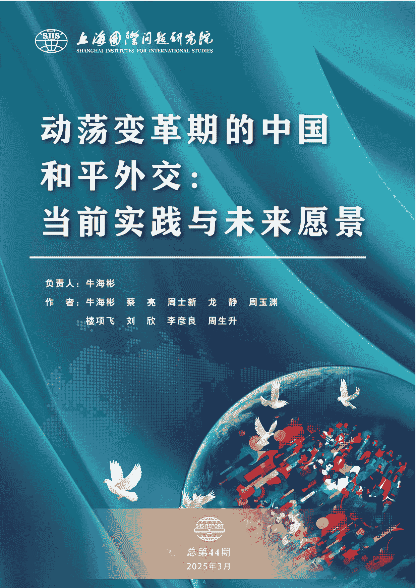
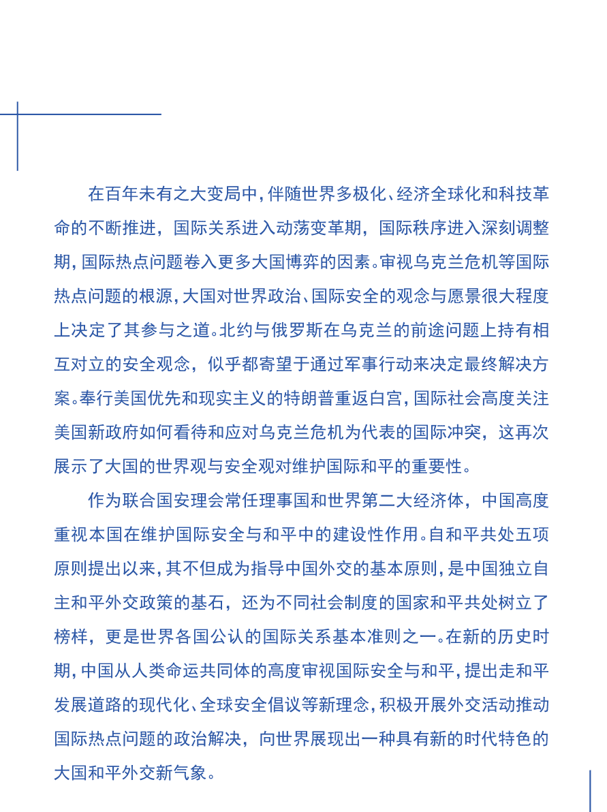

# 动荡变革期的中国
##和平外交：当前实践与未来愿景

负责人：牛海彬
作者：牛海彬 蔡亮 周士新 龙静 周玉渊 楼项飞 刘欣 李彦良 周生升

总第44期
2025年3月



# 免费 价值 及时 专注

# 扫码加入 知识星球TOP 免费资源群

- 每日免费获取有价值资源
- 可提供各类资源搜索服务

| 热门付费文章 | 各行行业报告 |
| :--- | :--- |
| 精选图书资源 | 副业赚钱方法 |
| 职场实用资源 | AI经营自媒体 |


公众号：知识星球TOP 微信：jntsg8 微信：jntsg2


分享资料仅供个人学习，请及时删除，切勿商用传播

# 动荡变革期的中国和和平外交：当前实践与未来愿景（注：原文OCR为“n当前”或“中国和和平外交”，此处已根据语义纠正）

# 动荡变革期的中国和和平外交：当前实践与未来愿景

China’s Peace Diplomacy in a Period of Turbulence and Transformation:
Current Practice and Future Vision

负责人：牛海彬
作者：牛海彬 蔡亮 周士新 龙静 周玉渊 楼项飞 刘欣 李彦良 周生升

上海国际问题研究院 ●外交政策研究所
2025年3月

## 动荡变革期的中国外交：当前实践与未来愿景

## 作者简介


牛海彬
上海国际问题研究院
外交政策研究所主任
拉美研究中心主任


蔡兢
上海国际问题研究院
外交政策研究所中国外交研究室主任
东北亚研究中心主任


周士新
上海国际问题研究院
外交政策研究所周边外交研究室主任
东南亚研究中心主任


龙静
上海国际问题研究院
欧洲研究中心主任


周玉渊
上海国际问题研究院西北非中心主任

# 动荡变革期的中国和平外交：当前实践与未来愿景

楼项飞
上海国际问题研究院
民间外交研究基地秘书长

刘欣
上海国际问题研究院
外交政策研究所助理所长助理

李彦良
上海国际问题研究院
外交政策研究所助理研究员

周生升
上海国际问题研究院
外交政策研究所助理研究员

# 目录

- 摘要 . . . . . . . . . . . . . . . . . . . . . . . . . . . . . . . . 01
- 一、和平发展：大国和平外交的新探索 . . . . . . . . . . . . . . . . . . . . . . . . 02
- （一）百年变局维护国际和平路径 . . . . . . . . . . . . . . . . . . . . . . 03
- （二）中国之道：从和平共处到人类命运共同体 . . . . . . . . . . . . . . . . 06
- 二、和平之路：中国推动国际热点的政治解决 . . . . . . . . . . . . . . . . . . . 10
- （一）和平缓冲：中国外交与乌克兰危机 . . . . . . . . . . . . . . . . . . 11
- （二）和平斡旋：中国外交与中东局势 . . . . . . . . . . . . . . . . . 16
- （三）和平治理：中国外交与南海问题 . . . . . . . . . . . . . . . 20
- 三、和平之辩：国际社会对中国和平外交的多元认知 . . . . . . . . . . 25
- （一）美西方对中国在乌克兰问题上的错误认知 . . . . . . . . . 26
- （二）美西方对中国在中东开展和平外交的错误认知 . . . . . . . . . . . . 30
- （三）全球南方国家对中国和平外交的认知 . . . . . . . . . . . . . . 32
- 四、和平之维：新时代的中国和平外交将发挥更大作用 . . . . . . . . . . 37
- （一）持续弘扬与命运共同体使命，提升全球安全倡召 . . . . . . . . . . . . . 38
- （二）维护国际准则和联合国体系的权威性 . . . . . . . . . . . . . . . . 39
- （三）持续开展外交，妥善处理热点问题 . . . . . . . . . . . . . . . 41
- （四）持续构筑共识，团结国际社会的力量 . . . . . . . . . . . . . . . 42

# 摘要

在未有百年变局中，国际关系进入动荡变革期，大国竞争使得国际安全面临严峻挑战。不确定性上升，联合国安理会在乌克兰危机、巴以冲突等国际问题上变得日益困难。战后国际秩序结束后，世界亟需创新的理念和实现路径。中国践行命运共同体理念，坚定走和平发展道路，积极致力于热点问题的解决，为国际社会引入了确定性。中国的和平外交主要遵循以下思路：一是从人类命运共同体的整体角度看待国际和平问题；二是强调国际关系之间的良好互动与共同发展；三是坚持以联合国安全理事会治理责任与协作，推进制度化、法治化进程。全球南方获得重视，而西方国家更多地用威胁和对立视角看待中国的和平外交，这反映出当前安全体系的复杂性和二元性。在此新形势下，以中国为代表的南方国家将继续推动冲突的政治解决。

# 第一章
## 和平发展：大国和平外交的新探索

## 动荡变革期的中国外交：当前实践与未来愿景

在百年未有的变局中，伴随着世界极化、全球化和科技的推进，国际关系进入动态变革期，国际秩序进入深刻调整，热点问题卷入更多大国博弈。审视乌克兰危机等热点问题的根源，国际政治、安全观念与愿景在很大程度上决定了其参与。美国优先和美国主义的回归使得国际社会高度关注，再次展示了大国的安全观对维护和平的重要性。

作为联合国安会常任国和世界第二经济体，中国高度重视在维护国际安全与和平中的建设性作用。自和平共处五项原则提出以来，其不仅成为中国外交的基本原则，是中国独立自主外交政策的基石，还为许多国家的和平发展树立了榜样。在新的历史时期，中国是各国公认的国际关系基本准则之一。从命运共同体的高度重视国际安全与和平，提出和平发展道路、全球安全倡议等理念，积极开展外交活动促进问题问题的解决，向世界呈现一种具有新时代特色的大国外交气象。



### 百年变局呼唤维护国际和平之路

身处无政府权威状态的国际社会，主权国家的首要任务是确保自身的安全，这可是确保国家利益的基础，也是各国行为的基准则和最低目标。其实现方式无助于用战争和极端在国际上营造一个和平的外部环境。一般而言，所谓和平是对和平主义相对和和平主义。前者指导的是一种理想，并以此与其约定一致的行为与行动；另一方面，它对一切战争行为（如民族解放战争等）均采取否定的立场。虽然它强调非暴力主义作为一种国际制度和政策的基本原则，但不排除在任何情况下（如自卫战争等）可以使用暴力。然而，和平和和平主义更多停留在观念层面上，而在实际实践中更多强调现实。换言之，在现实政治中战争作为维护和平的最后手段这一功能不能否定。然而，基于武力的和平是一种脆弱的和平，且确保和平的代价势难以长久维持，战争不能与和平共存，而是只是最后的手段。

欧纳弗特斯·梅赛·罗义认为，“外交是与和平时期处理国际事务的事务”。从这个角度来说，和平与外交就是不可分割的，外交本身就是和平的表现之一，而要求和平的外交是必不可的内容。外交不仅是避免冲突的工具，更是当今和平的成功导向，地缘政治的严重重构有助于弥补冲突之间的赤字，有利于各国实现和平和合作，而外交是实现和平的共同目标。

参考文献：
- 莱东·布梅斯（Raymond Boas），《外交理论与实践》，杨立等译，上海人民出版社，1984年，第1页。
- “我们的共同议程”：联合国，2023年7月，https://www.un.org/sites/en/files/our-common-agenda-policy-brief.pdf

## 动态变革期的中国外交：当前实践与未来愿景

在二战结束后，国际体系的一个重大进步就是主权平等原则得到了《联合国宪章》的正式认可，人类进入了一个没有大战的时代。然而，随着世界变局的出现，国际体系开始调整，国际格局进入变革期，全球治理体系深刻重塑。二战以来，国际安全领域出现了适应性，大国竞争使得国际安全面临严峻挑战。战后国际秩序的终结，国际格局面临着重新调整的需求。一方面，新一代国际政治的平衡正在引发国家关系的巨变，关键涉及科学技术市场的竞争进入了新的阶段；另一方面，国际格局从两极、单极向多极化的快速推进对国家安全事务的协调与能力提出了更高要求。新势力抬头，新兴大国成为联合国理事会的常任国，而常任国的协调能力可能面临缺乏信任与共识。乌克兰危机典型地反映了当今世界安全架构的缺陷，当安理会常任国直接或间接介入国际冲突后，面临的是的影响深远和具有破坏性。面对传统安全与非传统安全挑战，多极化引发的失序，时代呼唤具有创新的理念和实现路径，将生成具有各国特色的外交之路。

### （二）中国之道：从和平共处原则到人类命运共同体

中国传统战略的核心是“和”，强调“爱仁仁善”的思想已远古人，体现了中国人民对和平的热爱与向往。即便曾遭受外侵略的情况下，这种思想并未成为主流，反而进一步激发了对和平的向往。近代百年的历史使得中华民族一方面渴望强大富国、抵御外霸，另一方面也深感和平发展的珍贵，相信有和平才能实现安居乐业。中国民族热爱和平、反对强国霸权的逻辑，与世界各国和谐共处，共谋和平发展。

和平共处原则的起源是中国传统战略策略，在现代外交中的传承与发展，继承了崇尚和的民族精神和价值理念，同时开辟了特殊的路径。尊重和平共处的前提，是和思想的基础，和谐格局。

调和解决冲突，互不干涉内政要求各国在承认差异的基础上寻求和谐发展。正因其符合国际共识，和平共处原则不仅指导了对外关系，也对政治解决国际热点问题起到重要作用。提出以后，该原则在中国外交战略中的地位得到了提升，又是涉及行为准则，升格为区域性主要指导原则。中国在1954年和平会议上提出的原则，在国际范围内得到了广泛认可，并被联合国体系接纳。


## 动态变革中的中国外交：创新的实践与未来承诺

一种制度，不是以一种文明代替另一种文明，而是不同社会制度、不同意识形态、不同历史文化、不同发展国家在国际事务中利益共生、权利共享、责任共担，形成共同体世界的最大众选择。

三是坚持维护联合国为核心的国际体系，支持联合国在国际事务中发挥核心作用。这一立场不仅体现了我们对国际法和多边主义的坚持，也反映了中国履行大国的安全责任与协作义务，推动国际安全事务的治理走向制度化与法治化轨道的理念，面对日益复杂的国际形势，联合国宪章宗旨和原则未过时，反而更加重要。倡导共同共享的全球治理，推行真正的多边主义话语，根据联合国宪章宗旨和原则，由大家共书、共同维护，“不能谁的拳头大、嗓门大谁就说了算。”只有通过联合国这一参与全球的机制，才能有效应对全球性挑战，如气候变化、恐怖主义以及公共卫生危机等。中国始终是和平地区和世界的坚定力量，无论国际形势如何变化，中国始终坚持和平发展道路，积极发展全球伙伴关系，参与全球治理，致力于在和平共处五项原则的基础上，与各国共同构建人类命运共同体，这一目标是新时代中国外交的任务与努力方向。

《习近平在金砖国家领导人第十五次会议上的讲话（全文）》新华，2023年8月23日。

```
http://www.news.cn/politics/2023-08/23/c_1129819257.htm
```

## 第二章

### 和平之路：中国推动国际热点问题政治解决的外交实践

## 动荡变革期的中国外交：当前实践与未来展望

在百年未有之大局中，世界进入了动荡变革期，和平与发展面临严峻挑战，国际热点问题凸显了和平之不易。中国作为维护和平的稳定力量，积极加强全球安全治理，探索本土兼全球的热点解决之道。中国外交在全球安全倡议的引领下，在维护国际和地区稳定等多个领域取得收获，在国际社会赢得了积极反响。推动乌克兰危机局势缓和，推动中东进程，推动南海问题和解解决是观察中国和对外外交的重要案例。

### （一）应对和促谈：中国外交与乌克兰危机

#### 1. 美国对乌克兰危机的解决之道

乌克兰危机已进入第三年，冲突的复杂性、长期性和惨忍性引发了人们对后国际秩序有效性的担忧，这场危机破坏了冷战后建立的欧洲地区安全架构，并带来了一系列波及世界的消极影响，包括国际能源价格上涨、世界经济复苏缓慢、全球减贫任务更加艰难以及国际关系恶化和集团化特征加剧等。

美欧对乌克兰危机的立场和态度随着事实的发展不断变化。战争之初，美欧以帮助乌克兰赢得支持为目标，推出针对俄罗斯的制裁，但并没有提高对乌克兰武器和军事援助的帮助。随着乌克兰逐渐深入俄境，美欧在不同程度地出现了胜利情绪和反对持续增加军事援助的声音，援乌目标逐渐调整为乌克兰不能赢，俄罗斯不能赢。美欧将俄罗斯政府处于完全的被批地位，在对俄罗斯进行全面制裁之余，还动员各国孤立俄罗斯和对乌克兰提供经济和军事援助，更是针对乌克兰危机在会议上排斥俄罗斯代表离席，然而这些措施并未促成乌克兰危机的顺利解决。

## 动荡变革中的中国外交：当前实践与未来展望

同样变化的还有欧美国家对中国的态度。冲突爆发之初，美欧不切实际地希望中国能劝俄罗斯停止对乌克兰的军事行动，对中方未公开谴责俄罗斯、未跟随欧美对俄实施制裁表态不满，但其将对俄正常贸易的中国企业进行制裁。美欧对中方的期待可能随着前线局势的变化而变化，当俄军处于战场优势地位下降时，美欧希望对俄罗斯施压的期待有所下调，对开展对话的意愿下降；当俄军处于劣势地位时，则对对话的期待增加。美欧在乌克兰危机解决问题上的立场并不相同，指责中国保持了与俄罗斯之间的密切关系，但同样与经俄贸易关系密切的印度、巴西等国指责：对中国的政治立场对于解决乌克兰危机的系列诸于抵制和揽损，其无端根据乌克兰形势将其作为武器支持乌克兰和涉海的海权的依据。

随着俄罗斯的转变，欧美在乌克兰危机的应对思路上越来越付较大的分歧。

特朗普提出的俄政策调整尚未能如其首，特朗普政府试图以实力换来解决乌克兰危机的信念，视俄罗斯认为“24 小时内结束乌克兰危机”，但为打破乌克兰局势提供了一些变量。

大国，不再是主动与俄罗斯建立外交关系并启动欧洲大国和乌克兰不在场的调，并指乌克兰危机的持续负责责任。这一次，特朗普政府推行美国优先的交易政策，提出以领土换首的停战协议，不允许乌克兰加入北约，呼吁俄罗斯在乌克兰完成后的退出，欢迎俄罗斯重返七国集团，同时，与乌克兰分歧加剧，呼吁俄罗斯为安全妥协的欧洲盟友寻求自我防御力，美欧不应为保护乌克兰承担过多的成本。

欧美在乌克兰危机中遭遇严重挫折，欧洲面临倾向似乎仍然向乌克兰提供支持的困境。特朗普政府声称其正在对俄进行观察，并不会在乌克兰问题上回听欧洲和乌克兰的意见，但对欧洲态度的巨变猛然暴露了北约的裂痕并动摇了乌克兰危机的欧洲愿景。美国副总统在慕尼黑安全会议上批评欧洲的言论，进一步削弱了北大西洋方的价值共识。

### 和平和促进：中国外交与乌克兰危机

#### 2. 中国促进政治解决乌克兰危机的外交交流

中国并不是乌克兰危机的制造者和当事人，但中国始终用自己的方式，为和平解决危机发挥建设性作用，中方的努力主要从以下方面开展。其一，说明中国立场和主张，增强国际社会在政治解决乌克兰危机上的理解和认知。2022年2月24日冲突爆发后，中国外交部长第一时间发表了中方看法。中方领导人通过视频通话或面对面的交流，推动乌克兰危机的解决，先后提出“四个应当”、“四个共同”、“三点思路”，作为中方解决乌克兰问题的根本立场。2023年2月24日，中国外交在乌克兰危机爆发周年之际发布了关于解决乌克兰危机的中国立场，文件全面系统地涵盖了中方的有关立场，为推动解决乌克兰危机指明了正确路径，也引起了国际社会的共识。文件涵盖了联合国宪章原则则应当严格遵守“一个国家的安全不能以损害各国安全为代价”、“不受制裁、限能施压不可解决的问题”、“核武器扩散、核战略扩散不得”等中方坚持的重大原则，也有“尽快直接对话”、“为平民难民交坚持人道主义主张”等解决问题的思路和方法。中国向世界表明的立场就是坚定站在和平一边、站在立场一边、站在历史正义的一边，坚持国际社会一切共同维护全球安全。

其二，在国际社会关注的乌克兰安全等关键问题上明确态度，对冲突相关方可能动用核武器的危险引起警示和防范作用。2022年1月，中国主席习近平会见德国总理朔尔茨时明确表示中方反对使用或威胁核武器，倡导核武器不再、核战略扩散。在2023年2月发布的《关于解决乌克兰危机的中国立场》中专门包含了一项核武器的内容。联合国秘书长古特里希表示，中国政府提出的方案是一项重要。

### 和平倡议：中国外交与乌克兰危机

#### 3. 中国在乌克兰危机上的努力

中国在乌克兰问题上的努力呈现出特色：

首先，中国立场具有客观性和公正性。冲突爆发以来，中国一直维护国际法和国际规则，对俄乌冲突的判断，指出俄乌冲突是多种因素共同的结果。这种判断具有历史深度，得到国际社会多数国家的接受和认可，也有助于当事方保持沟通，为其磋商奠定了基础。

其次，中国行动展现积极性和全局性。中国的积极性体现在多层级的外交行动中。中国主席习近平与世界各国领导人的会晤中就乌克兰危机深入交流，外长王毅在各类多边场合和双边对话中阐明了中立场。值得关注的是，中国的行动不仅面对危机的当事国，还覆盖到间接方以及南方国家，在视野上更具全球性。中国通过与高层领导人互动、与乌克兰总统泽连斯基、欧盟委员会、欧盟安全政策代表等重要组织保持密切接触，并与德国领导人会晤，开展了多轮穿梭外交，传递消息，为消除误解和寻求和平解决。

其三，中国倡议积极兼顾责任与前瞻性。当前，许多国家和国际组织对纷结持有不同观点，中国不仅坚持通过对话、协商的方式解决冲突，而且呼吁这样的国际社会必须满足“俄乌双方认可，各方要参与、共同讨论所有和平方案”的条件。外长拉夫罗也曾在中国最高领导人访华后公开表示希望在和平条件下解决乌克兰问题，中国倡议的精神有助于当前局势走向稳定，向更具希望的预期迈出关键一步。关于在北京期间全球停止战争的倡议也符合国际诉求的价值理念，中国在方交流时，还倡导共同维护国际能源安全、供应链稳定等等出现危机的关键领域。

为止，乌克兰危机尚未得到持久解决的明确前景，但中国在乌克兰问题上所坚持的立场、主张和开展的行为已经成为中国对国际社会提出的全球安全倡议的重要实践，得到国际社会日益广泛的理解和认可。中国外交理念将在乌克兰危机的政治解决过程中得到不断的丰富和传播。

## 和平变革中的中国外交：当前实践与未来愿景

### （二）和平秩序：中国外交与中东局势

#### 1. 致力于推动中东地区的政治和解进程

中国在2023年3月成功促成中东大国哈沙特与伊兰的和解与复交。2024年7月，中国再度成功斡旋巴勒斯坦内部达成和解，包括巴勒斯坦解放运动（哈塔斯）和巴勒斯坦南部抵抗运动（马哈曼）在内的巴勒斯坦南部取得重要进展，别在北京签署了《关于结束分裂加巴勒斯坦部族团结的北京宣言》（简称《北京宣言》）。这两大和旋均被视为中国在中东“外交”理念和“安全、发展、文明”三大成就，被认为很好地取得了“中国特色外交”与安全、发展、文明三大成就，也是中国践行和平外交结出的最新成果，中东地区为全球提供了积极作用。从上述两个案例中，我们可以看到如何以中国的力量让中东最脆弱地区实现突破，也是国际社会感兴趣的话题。

#### 2. 中国开展两大和旋的积极成就

首先，斡旋沙特、伊兰。2023年3月，在中国的斡旋下，两国经历了七年的对立关系后，恢复了外交并重新开放大使馆。在政治层面上通过直接洽，加强了彼此更加明确，也给和解的落实打下了良好的基础。中国作为具有影响力的大国，早在以前国家主席习近平访问阿拉伯酋并发言，阐释了处理中东问题的“三个关键”，即化解分裂、加强对话、发展道路；同时，主席还提到“不被外势力控制”。


## 未来：从实务到未来承诺

当前，许多国家对末结束分裂、组建民族政府和巴以冲突两国方案存在分歧，这也是哈马斯在巴以冲突正在进行的恶劣环境下积极推动内部和解的意义。

首先，中国坚持和平外交为原则，在乌东范围内，无意填补美国留下的“真空”。

其次，2023年3月沙特与伊兰达成和解改变了阿拉伯国家的对抗，拨乱了海湾地区的安全框架，助力地区进一步推进。

其三，中国在巴勒斯坦问题上一直投入，参与中东地区解决的路径。

其四，沙伊和解是中国特色外交的重大红利。2024年4月，中国邀请在沙特举办历史上首次巴勒斯坦14个国家参加的会议，并最终达成《北京宣言。《宣言》明确表示所有巴勒斯坦人民的合法代表，意味着其内部同意让哈马斯加入组织开展对话；二是，哈马斯公开承诺接受“两国方案”，也认可了以色列的生存权；4月4日哈马斯宣布在约旦西岸建立一个拥有完全权威的巴勒斯坦政府，并接受巴勒斯坦难民根据国际决议。在7月的会议上，哈马斯接受了联合国理事会242号决议，接受“两国方案”。实际上，在2017年哈马斯接受了这一决定，并没有公开宣布。

在巴勒斯坦主要族别中，只有哈马斯加入了法塔赫主导的组织。通过两次谈判，哈马斯与法塔赫的关系已经实现了突破，表明内部和解绝无希望。2007年哈马斯武力夺取了加沙地带控制权，巴勒斯坦陷入了内部分裂状态。众多国家和联合国一直试图缓解这两个族别之间的冲突，但巴以仍未能实现突破。

作为第一次由阿拉伯国家组织的巴勒斯坦内部达成的文件，如此组织主席穆斯塔哈·巴尔古提所言，“北京宣言”近年来比其他达成的族别走得更远。

这些转变构成了可能：是哈马斯公开表示愿意加入巴以组织。哈马斯与法塔赫在北京的会前一天，哈马斯政治要员获得胜利，哈马斯愿意解除武装并转成为一个国家，并将好人加入巴以组织，在加沙地带与西岸地区建立政府。


## 流动变革中的中国外交与未来愿景

### （三）和平治理：中国外交与南海问题

南海位于印度洋和太平洋的重要国际航线上，南海和平稳定对全球地区安全与发展都具有极其重要的价值。中国和南海周边国家在一些岛礁领土主权和海域管权上存在争议，但中国自成立以来始终强调和平解决南海问题，并取得了一定的进展。

### 1. 中国积极推进与南海周边国家和平解决南海争端

中国坚持要与南海周边国家将南海建设一个和平之地，这与东盟建立和平、自由和中立政策基本上是一致的。1992年7月22日，东盟6个成员国在菲律宾签署了《南海宣言》，2002年后，中国与东盟成员国磋商《南海行为准则》，并取得了一定的进展。2002年11月4日，中国与10个东盟国家代表签署《南海行为宣言》（简称DOC），并在此基础上启动了评估落实DOC高层会议和联合工作组会议。2011年7月20日，在印尼望加里岛举行了《南海宣言》高层会议，并案达成一致，指出各方均要在共同认知的基础上采取决定落实《宣言》的具体措施或活动，并向最新修订《南海行为准则》。

2016年8月15日，中国与东盟国家举行的《宣言》第13次高层会和第18次联合工作会议，审通过了《中国与东盟国家对海洋紧急事务外交热线平台指导方针》和《中国与东盟国家关于南海适用联合国海洋法公规则的联合声明》两份文件。2017年6月12日，中国与东盟国家初步并达成了“准则”框架。2018年8月2日，中国与东盟成员国完成了《南海行为准则》的单一文本草案。2019年，“准则”通过第一轮审议，2023年7月13日，《南海行为准则》单一磋商文本草案达成二谈，为早日达成有效、实质的行为准则制定了指导方向。2022年9月10日至12日，中国和东盟国家还举行了落实《南海各方行为宣言》第22次、24次高层会和第22次联合工作会议。

上述进程表明，中国与东盟国家通过外交磋商并在9月13日后，维持了南海地区的总体和平和稳定，并朝着规则机制化和法治化的方向发展。

### 2. 中国推动和和平解决南海问题的成效

从目前来看，中国与东盟国家促进解决南海问题的进展至少在以下几个方面取得了较为明显效果。

- 第一，南海局势保持长期和稳定的态势。从冷战结束以来，中国积极寻求与东盟及其成员国的接触，并同意与东盟国家共同推进《南海各方行为宣言》的进程，并推进相关方切实落实《南海各方行为宣言》。除了建立并完善相应的机制外，中国还开展了一项《南海各方行为宣言》的早期收获项目，与东盟国家建立了一套维护南海安全稳定的机制。尽管我国某些没有采取积极的军事行动，中国严格按照《南海宣言》，努力保持克制，始终强调通过外交途径解决争端，没有主动向他国索取采取军事或军事行动。

- 第二，中国与东盟国家积极努力达成《南海行为准则》。《南海行为准则》的磋商分为三个阶段：第一阶段是东盟在冷战结束后结束的，最后达成东盟版本的《南海宣言》；第二阶段是随着东盟扩张和南海紧张局势上升，东盟国家邀请中国磋商并签署了具有约束力的《南海行为宣言》，第三阶段是2016年中国加入之后与东盟国家开始磋商更为实质的内容，目前已经完成二谈，预计完成三谈后就会进入结项阶段。令人认为，《南海行为准则》是以南海各方行为宣言为基础，并不涉及主权争议问题，但却有助于预防和管理中国与部分东盟国家可能产生的冲突。随着《南海行为准则》，在问题上立场活跃的是菲律宾，其总统小马菲律宾试图快速推进《南海行为准则》。

- 第三，中国与东盟国家南海安全合作日益增多。基于对地区非传统安全威胁的需要，中国与部分东盟国家开展安全合作，提升了各国的政治安全信任水平。2018年的中国与东盟“海上巡练–2018”分为两个阶段：第一阶段是8月2日至3月3日在新加坡海峡湾口举行军事演习，第二阶段是10月22日至28日，《海上巡航准则》的使用和联合搜救、联合演习等内容，在中国南海及其东南部海域进行实演训练，期间还涵盖离队、编队通信、编队运动、联合救援、直升机歇、补给飞机占位等多个项目的技术演练。2023年5月25日至26日以及8月14日至18日与柬埔寨、老挝、马来西亚、泰国、越南五个东盟国家分别在中国广州和湛江举行“和平友谊演练–2023”联合磋商和第二轮演练。

- 第四，国外国家影响南海局势的效应大幅减弱。随着中国与东盟国家南海磋商，《南海行为准则》取得阶段性进展，中国维护南海地区和平稳定的能力和意愿大幅提升，美西方等国外国家打着航行与航越自由的旗号，试图扰乱南海局势的行动效应已大幅减弱。由于低于国际航行标准，南海本来并不存在所谓跨境外国家合法航行与航越自由的情况，部分国外国家试图在中国南海执法合法的活动难以取得其预期的效果，甚至遭遇中国反对。尽管菲律宾等国外国家经常进行联合巡航或演习挑衅，实际效果较为有限。

### 3. 中国促进和平治理南海问题的经验

中国在南海地区推行的和平政策，反映了中国外交已形成以和平治理为特色：

- 第一，中国坚持平等的对待盟友国家。中国始终没有以超级大国的姿态对待东盟及其成员国，而是平等地对待盟友国家发展。此外，盟友国家不是追求全球霸权的国家，中国占据了地区合作中的中心地位。中国在磋商《南海行为准则》过程中，也强调高度尊重盟友国家的主权和关注。

- 第二，中国努力与盟友国家达成共识。中国自1976年起与东南亚国家友好合作，在处理亚洲事务时遵循基本规范。近年来，“盟友方式”逐渐演变为包括中国在内的国家间的“东方方式”。中国和盟友国家以对话达成了许多共识，增强了伙伴关系南海治理的巨大信心，《南海行为准则》磋商中创造了基础条件。

- 第三，中国强调通过外交解决冲突。由历史和现实证明，大多数盟友国家与其领土或海洋管辖权存在争议，主要是通过长期的外交解决。除了马来西亚和印度尼西亚及菲律宾，东南亚国家内部存在默契。2014年5月23日，中国与印度尼西亚正式签署了《南海海专属经济区界定》，这也反映了中国通过外交解决争议。

- 第四，中国保持治理的连续性。冷战结束以来，南海政策并没有因国际形势的变化而变化，体现了中国的韧性。中国始终坚持“和平治理”的态度，并没有选择军事手段解决问题，即使面临一些威胁性的行动，也尽量以和平方式处理。中国维持了对黄岩岛的实际管控，允许菲律宾在南海内捕捞，无论是在双方达成的“君子协议”还是之前的“临时协定”，都体现了中国避免南海失控。

## 变革中的中国和海外外交：当前实践与未来愿景

在展望的未来的世界里，以中国、巴西等为代表的全球南方在国际热点问题上采取了不同于西方的路径，引发了欧美国家的负面评价甚至攻击。这反映了西方对国际理解仍然处于意识形态、势力范围，这种迷信也是和平解决问题的重大障碍，从根本反映了国际两种安全观的差异。

### （一）美西方对中国在乌克兰问题上的错误认知

西方高度关注并重视中国在乌克兰危机中的影响，但态度较为负面。它看来，中国在乌克兰危机上的立场表面上是中立，但实际上通过经济、外交和战略合作支持俄罗斯；中国的立场不仅助长了俄罗斯的“侵略”行径，还使中国在俄关系中获得了更多的利益，认为中国的立场和行动对所谓“自由主义的国际秩序”构成了严重威胁。以下是美西方认为中国在经济与外交上支持俄罗斯的五个方面和所谓的说法：

- 片面上认为中国在经济与外交上支持俄罗斯。西方媒体和学者多数认为，中国在俄乌冲突中的立场表面上是中立的，但实际上在经济和外交层面倾向于支持俄罗斯。比如，中国没有谴责俄罗斯对乌克兰的军事行动，而是指责北约扩张和美国对乌克兰提供武器，并称其引发了代理人战争。中方规格接待俄罗斯总统普京访华显示中俄关系紧密。尽管中国告诫俄罗斯不要在乌克兰使用武器，但这场战争对俄国的双边关系影响并不大，俄罗斯的军事行动在乌克兰危机期间没有出现任何妥协的迹象。

- 认为中国损害了西方对俄罗斯制裁的效果。西方认为中国保持与俄罗斯的贸易削弱了对其制裁的效果，并加强了对俄罗斯制裁。拉斯·托尔斯贝尔向英国广播记者表示，如果俄罗斯不改变行为，则可能需要承担经济后果。美国认为，没有任何一个国家提供的材料能够与美国相比，无论范围如何，更没有哪一个国家能够支持俄罗斯赢得战争。

- 中国认为购买俄罗斯石油和其他贸易活动支撑了俄罗斯的经费，俄利用这些资金购买制造武器。同时，在西方一些国家看来，中国正在出口许多物资支持俄罗斯胜利；俄罗斯数据显示，自中国的进口的重型机械、车辆和用于军事用途的制成品产量有所增加，俄罗斯90%的电子设备来自中国，这些电子产品被用于导弹、坦克和飞机的生产等。西方认为，如果没有中国的支持，俄罗斯或许会继续，但其状态将更为窘迫。


# 外交变革的中国和和平外交 当前实践与未来展望

中国展现出显著表现的那样，中国通过政府媒体的扩张和收购当地媒体，开展公共外交，不仅针对发达国家，还将新兴国家作为主要目标，展开台湾问题常态化与舆论战。基于上述认知，该机构建议在地理上遥远的非洲和中东地区，对包括台湾海峡在内的东亚局势的关注，美西方如果不提供平衡的信息，则有可能形成接近中国立场的结论和政策观点。

## （二）美西方对中国在中东开展和和平外交的错误认知

这种美西方对中国和平外交在中东地区的成就颇关注，总体上对中国在巴以冲突中的立场怀疑和批评态度，认为其政策策略缺乏清晰性和实质性影响，更多是为了实现自身的战略利益而采取的一种的外交策略。中国在冲突中的表现反映了其在国际事务中的灵活立场和战略布局，希望提升国际声望和战略地位，也面临缺乏实际影响力和政策权威性的挑战。这种矛盾和局限使得中国在巴以冲突中的角色和立场备争议，难以发挥更大的调解作用。美西方关于中国在巴以问题上和平外交努力的主要看法如下：

- 1. 中国是巴勒斯坦的支持者，但在巴以问题上的立场具有一定的复杂性。中国一直是巴勒斯坦的支持者，长期通过两国方案解决问题。在本次冲突中，中国继续保持对巴勒斯坦的支持立场，呼吁持续提供人道主义援助。然而，在国际立场上支持巴勒斯坦的正当权利，但在实际行动中却没有足够的资源和支持，似乎使得中国的支持软弱无力。美西方认为中国在巴勒斯坦靠近的时候，小心调整避开与以色列直接对抗，这是因为以色列是列国在中东大量投资的国家之一，中国私下认为与以色列的关系与巴勒斯坦的关系具有更大的战略重要性。这种双重态度使得中国在中东冲突中的立场变得模糊和不稳定，也是中国试图在中东地区保持中立立场的一种表现，揭露了其外交的窘迫和局限性。此外，中国在中东有重要的经济利益，是许多中东国家和非洲国家的最大伙伴，但中国的对外显得较为保守，主要表现为对意见的呼吁和回应，而缺乏直接影响事件发展的能力。

- 2. 美国在巴以冲突中的立场反映了其拥有更广泛的利益。美国方在以色列进行军事行动的同时，刻意回避哈马斯的袭扰行为，希望将自己定位为美国盟友国家的保护者，以及冲突解决的调停者。美国方还认为中国在中东地区通过将沙特、阿俄和伊拉克等阿拉伯国家卷入伊朗和俄罗斯的持续冲突中，从而加强了中国的负面影响。美西方一些学者认为，中国在巴以冲突中的立场反映了其在西方言辞上的立场，这引发了西方国家对于中国海湾国家寻求与美国达成战略成功的担忧，认为像中国试图在此项设计中寻找平衡的国家，能否良好地满足美国的战略需求是有前景的，尽管中国在海湾国家的投资逐年增加，但该国家与美国的安全关系仍然脆弱，海湾国家不可能在中东地区出现严重危机。

- 3. 中国在中东逐渐影响力，但其在巴以冲突中的影响力被认为不足以带来实际的解决方案。一方面，如果选择改变其未来外交策略，将在两国之间发挥核心作用，有证明意味着它愿意通过大量投资资本来换两国国家或阿拉伯和平提议的双方提供不同的解决方案。中国在巴以冲突上的立场可以可信度，只要能与以色列和加沙地、西岸与更广地区无人直接对待中国的提议，这种可能或许预计还会增加。尽管中国对美国的立场逐渐施加压力，它并不意味着直接挑战美国作为冲突中唯一对话者的历史色彩。由于中国想发挥更大的作用，这种情况将不可避免地发生变化。推进延续替代并与美国发生冲突是一项高风险的行动，将继续阻止北京考虑进行真实的干预。

另一方面，中国的风险防意识和交易意局限了其发挥影响的空间，其政策首要自自身利益驱动。这种情况使得美国无法在中东增强影响的能力。正如波洛和以色列之间的争夺提高了他们对中国在该地区发挥更大作用的愿望，那么引发战争实际上则毁了他们的理想。中国在南方国家之间建立战略面临多重障碍，包括美国安全承诺的持久、文化障碍以及经济挑战，其可能失去与以色列建立深层次的联系。

- 4. 中国试图以以色列来获取话权和自身目标。美国的一些智库认为，在巴以与全球竞争的背景下，该地区显示出与中国的关系在增长，这表明北京对国家主权的重视、公平、多极世界政治蓝图是实现和维持稳定的关键。这种观点有助于中国作为该地区的积极参与者，从而在国际事务中获得更多影响力，而且还得到对于台湾、新疆等问题的支持。

## （三）全球南方国家对中国和平外交的认知

与西方总体不同，广大全球南方国家认为和平外交是国际社会一致的重要力量。面对当前严峻复杂的国际形势，中国始终坚持和平外交政策，以客观的立场倡导、合作和努力，积极维护世界大多数利益，获得了全球南方国家各国认可。

- 1. 中国方案获得了全球南方国家广泛认可。首先，针对乌克兰危机，中国始终致力于解决危机的政治办法，并得到了全球南方国家的普遍适用。2023年8月，中国与南非发表联合声明，强调解决乌克兰危机的唯一可行路径。2024年5月23日，外交部长与巴西的总统卢伊斯·奥马马讨论解决乌克兰危机，巴西也对解决乌克兰危机达成共识（简称“六点共识”），“六点共识”包括有关外交立场、解决乌克兰危机、反对使用大规模武器与攻击等和平设施等重要呼吁。六点共识很快得到了国际社会许多国家积极回应，得到五大洲10多个国家和国际组织的响应，其中52个国家和国际组织已确认加入或认真研究加入方式。2024年8月，中国政府欧亚事务代表李辉访问巴西、南非，推动政治解决乌克兰危机事项，体现出中国政府对全球南方国家在解决乌克兰危机中至关重要和建设性作用的高度重视。在第79届大会期间，中国、巴西、南非等南方国家共同成立“和平之友”小组，旨在联合联合国宪章和原则，为解决乌克兰危机聚力，为实现和平景象贡献力量。在此次冲突问题上，中国强调在和平立场上一保持一致，并与各国领导人和国际组织人员进行深入沟通，为推动冲突熄火和落实和平解决方案积极斡旋，呼吁冲突双方尊重国际人道主义，加强南方对中国和平外交的广泛认可。2023年11月29日，在联合国安理会当月主席中国提议下，安理会举行以冲突为主题的高级会议。会议提交了《关于应对冲突的文件》，提出在冲突全面推动停止火，确保和平，保护人道救援，加强外交，通过“两国方案”寻求解决乌克兰危机等方面达成一致。巴西、巴勒斯坦、卡塔、绍约、沙特阿拉伯、巴拉克、印度尼西亚等。2024年6月10日，中国与非洲国家联合发表联合声明，共同呼吁保障和平安全，提供援助，立即停火，释放犯民。再次，以东南亚国家为代表的全球南方持多边主义，高度评价中国和平共享和维护人类命运共同体的重要性，愿与中方一致，继承和发展人类命运共同体价值。


# 第四章

## 和平之愿：新时代的中国和平外交将发挥更大作用

## 流动变革的中国外交：当前实践与未来愿景

全人类的共同愿望，就是和平与发展。然而，这项任务至今仍远没有完成”。当前，全球地缘政治冲突频发，传统安全困境与非传统安全挑战交织。而在一些主要发达国家内部，民主主义、孤立主义和保护主义潮流兴起，国际关系中权力竞争、零和博弈、相互武器扩散日益频繁，为日益削弱的国际秩序带来更多不确定性。作为中国现代化的有机组成部分，中国将坚定走向和平发展道路，从共建人类命运共同体的高度继续通过外交努力落实全球安全倡议，为人类社会的长久安宁贡献中国特色的和平外交智慧方案。

### （一）坚持弘扬命运的精神、提升全球安全倡议的召力

人类社会的很多争议很大程度上源于自身利益的狭隘性和排他性，特别是基于意志意识、零和博弈、权力思维以及对安全等理念的重视。长期经历战争争抗的欧州之所以能够在二战赢得和平，与欧洲大国视角从整体利益和命运来看国家利益有关。汲取世界历史的经验教训和中华优秀文化的精神，中国外交坚持平等等的世界观和普惠的经济学，坚持共同、综合、合作、可持续的安全观有助于预防和消除冲突的根源，也有助于寻求国际热点问题的政治解决，国际社会应对给予足够的重视。为此，中国外交将继续改进事各方的沟通谈判，最大程度地消除疑惑、构建共识，寻求兼顾双方利益的政治解决方案。唯有如此，才能与和平外交取得实效提供更好的观念转变和认知建构。

56 《习近平对待国际理论》2卷，北京：外交出版社，2017年第538页。

### 坚持弘扬命运的精神、提升全球安全倡议实力

## 变革中的中国外交：当前实践与未来展望

特朗普再次执政后，其“美国优先”政策可能进一步削弱全球多边的动力，推动地缘政治局势呈现更多大国利益交易的安全治理格局。美俄在乌克兰危机解决方案上的对在某种程度上有利于大国的直接战略略，欧洲国家与乌克兰也将在此背景下寻求自身利益的最大公约。乌克兰危机的持久缓解，需要共同解决危机的根源性，找到均衡、可持续的安全框架，兼顾双方的利益诉求，同时，对乌克兰的安全供应需要外部的保障。面对日益波动的局势，中方一直致力于维护和和平的努力，包括为促成俄乌和解的战略沟通，中方一直致力于维护和和平的努力，力有约束，有望达成开放、持久、所有当方都达成和平协议。乌克兰危机的局势发展趋势表明，中方的客观、公正、理性与专业性，体现了对国际社会的广泛共识。

鉴于大国互动对国际安全维护的重要性，中国外交将继续推动构建新型大国关系，对反对战略竞争大国关系，致力于在促进大国间的对话、协商与合作，维护以联合国宪章为核心的秩序。中国外交将继续坚持正确的多边主义，反对对抗、反对对抗性和阵营化的集团小圈子，主张包容、平等协商的方式，让世界各国的安全关切，促进地区和国际局势的和平与稳定。中国外交将继续维护新安全与全球发展之间的辩证关系，关注气候变化、网络空间、人工智能等新议题对人类社会带来的非传统安全挑战，在中国可能能力的范围内积极提供全球公共产品。

### （二）持续维护国际准则和联合国体系的权威性

以促进和平为宗旨的外交符合国际公正，和平理念本身就是一种价值取向，反映了相关的长期期待与现实，然而双方和对方对和平的内涵及实现路径却有着不相相同的理解，这既是开展和外交的契机，也充满了调整立场的挑战。一国家的和平外交必须符合普遍公认的国际法和国际规范，特别是要符合《联合国宪章》等国际准则，才有可能得到相关的利益得以顺利实施，取得令各方比较具有效的效果。《联合国宪章》开篇

> 持续外交与和平的精神，提升全球安全议识

尽管，联合国宗旨旨在维持国际和平和平，防止并消除对于和平之威胁，以和平方法且依据正义及国际法之准则，调整或解决以破坏和平之国际争端和局势并增强普遍和。在联合国成立80周之际，作为联合国安理会常任理事国，中国作为联合国外交信坚持国际基本准则，维护以联合国为核心的国际体系，真正正义的多边主义，不能坐视多维度视角因联合国无法合作而实现失效，力能联合国安理会发挥维护国际和平与安全的作用。

中国和外交强调以《联合国宪章》和相关国际原则为基础，积极推进中国外交的法制化进程，得到了国际社会的认可，也得到了各方的理解。中国对于解决乌克兰冲突和巴以冲突的政策主张以历史和现在为基础，以国际法为准则，脱离接触、缓解紧张局势，通过谈判寻求妥善解决。中国致力于推动上述问题的公正解决，实现此地的长久和平，中国外交积极终止冲突，各国为实现目标和平提供帮助，加剧紧张局势将增加难度而不是相反。中国和东盟国家强调要共同公认的国际规范，如1982年《联合国海洋法公约》、《东南亚国家间友好与合作条约》，与共和平五项原则以及其公认的国际原则为处理国家关系的基本准则。这有助于促进南亚解决问题得到妥善解决信心。

对于当前联合国安理会，贸易组织、世界组织等国际组织受到大国分歧、竞争、退潮等诸多挑战，多边机制的有效缺乏大国协调的重大挑战。为了重振正义的多边主义，一方面，中国持续提供国际贡献和中国方案，积极进行多边全球的合作，支持联合国在国际事务中发挥核心作用，坚持国际法治权威，积极积极履行国际责任和义务。另一方面，中国方面各国一方，特别是重视全球南方国家的作用，重视世界主要力量的良性互动，提升国际多边机制的效能，共同构建更加公正的全球治理体系。全球性挑战呼吁全球合作，只有得到会员国的广泛支持，联合国

> 58 《联合国宪章（全文）》,联合国,https://www.un.org/about-us/un-charter/full-text.,

## 维护国际准则与联合国体系的权威

### （三）持续开展外交行动、妥善处理热点

中国和韩国强调外交行动，维护现在和安全的全球治理，坚持和平与发展道路，坚持以和平手段解决冲突，推动热点解决建设作用等诸多方面。王毅外长强调，联合国不能空口，而要解决问题，加强协调，做好“地缘化”为“工程”，在丰富实践过程中，中国外交曾试图解决地缘政治矛盾顽固和复杂性，中国外交还有任务，中国和韩国外交重视当事方的合理诉求。面对日益波动的局势，中方一直致力于维护和和平的努力，积极开展外交，避免冲突长期化，导致局势有效缓解。乌克兰危机的国际立场应当如何保持客观公正的立场。中方关注当事方，注入新的变量，期待所有当方能够参与到谈判的过程中，持续开展为推动冲突解决。在加沙实现停火之际，由美国政府对接的加沙提议，引发了国际社会的高度关注。中方坚持公正立场，中方认为加沙是巴勒斯坦人民的，是巴勒斯坦的一部分，中国外交致力于巴勒斯坦主权，坚持共和平五项原则以及其公认的国际原则，双方方案相互衔接，最终实现和平长久安。针对热点问题，中国和韩国外交将从不同的角度解决冲突渊源和复杂性。中国外交继续包含所有

### （四）持续构建国际共识，团结国际社会

从上讲，国际冲突需要包括双方在内的广泛共识，单边主义行为经常危害国际秩序，削弱全球多边动力。在国际事务中采取对抗性的立场，忽视国际共识，中国外交将继续加强协调，最大程度地消除疑惑、构建共识，寻求兼顾双方利益的政治解决方案。中国外交将继续维护新安全与全球发展之间的辩证关系，关注气候变化、网络空间、人工智能等新议题对人类社会带来的非传统安全挑战，在中国可能能力的范围内积极提供全球公共产品。中国外交积极携手全球南方，推动全球化进程，努力打造“全球南方”机制，共同推动和平事业。中国和韩国外交持续构建国际共识，团结

## 关于上海国际问题研究院

上海国际问题研究院成立于960年，属于上海市人民政府的高级机构和知名智库。我院的主要任务是以党和政府决策为宗旨，以政策咨询为方向，对当代国际政治、经济、外交等方面研究，为党和政府决策提供有力的支持；通过国内外学者之间的交流，增强国际影响力和话语权，提升国家的实力。多年来，我院一直被国内外权威评为中国最重要的国际问题和外交智库之一。上海国际问题研究院设有六个研究所和十个研究中心，分别是：全球治理研究所、外交政策研究所、世界经济研究所、国际战略与安全研究所、公共政策与创新研究所、美国中心、拉美中心、俄罗斯中心、西非洲中心、欧亚中心、南亚中心、东北亚中心、东南亚中心、海洋与极地中心、世界中心。为进一步加强对外影响力，我院专门成立了国际传播中心。此外，我院还是国际战略学会和国际关系学会的会员。上海国际问题研究院出版中文《国际展望》双月，《国际报告》（英文版）和英文《China Quarterly of International Studies》期刊已成为国际问题研究领域的重要学术平台。

主编 陈东晓 上海国际问题研究院院长、国际传播中心执行主任 李开盛 上海国际问题研究院副院长 执行主编 执行出品人 李珩 上海传播中心执行主任 毛瑞鹏 上研院智库发展与科研管理处副长 编辑 陈雪 上海传播中心助理研究员

© 本报告版权归 上海国际问题研究院所有
联系方式：
地址：上海市徐汇区田林路195弄15号
邮政编码：0020233
联系电话：+86-21 54614900
传真：+86-21 64850100
http://www.siis.org.cn


© 2025 Shanghai Institutes for International Studies

Shanghai Institutes for International Studies
195-15 Tianlin Road, Xuhui District
Shanghai 200233, PRC
Tel/Fax: +86 21 64850100
www.siis.org.cn

# 免费 价值 及时 专注

## 扫码加入知识星球TOP 免费资源群

- 每日免费获取价值资源
- 可提供各类资源搜索服务

| 热门付费文章 | 各行行业报告 |
| :--- | :--- |
| 精选图书资源 | 副业赚钱方法 |
| 职场实用资源 | AI政经自媒体 |

公众号:知识星球TOP 微信信号:jntsg8 微信信号:jntsg2


分享资料仅供个人学习，请及时删除，切勿商用传播
