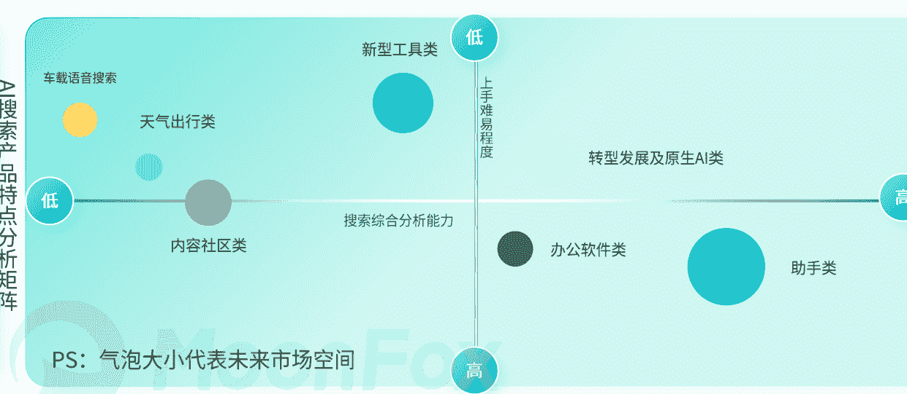
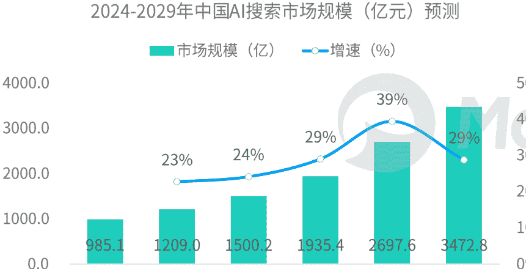
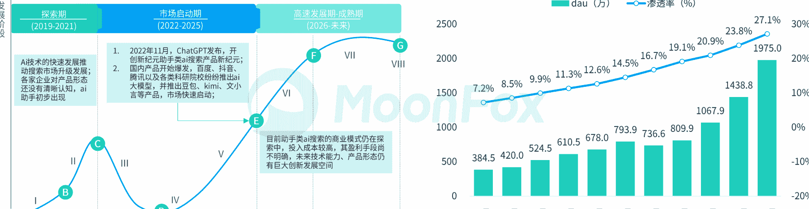
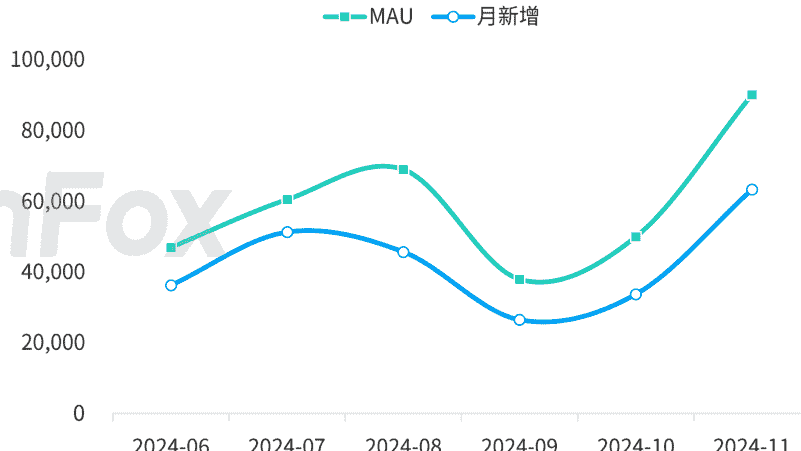

# 中国AI搜索行业发展报告2024

科技惠带来搜索变革

月狐数据（MoonFox Data）

2025年1月

深深圳市和讯谷信息技术有限公司 版权所有 ©2011-2023 粤ICP12056275号-13

# 扫码加入 知识星球TOP 免费资源群

免费

公众号: 知识星球TOP

- 每日免费获取高价值资源
- 可提供各类资源搜索服务

价值

微信信号: jntsg8

| 热门付费文章 | 各行各业报告 |
| :--- | :--- |
| 精选图书资源 | 副业赚钱方法 |
| 职场实用资源 | AI政经自媒体 |

及时

微信信号: jntsg2

专注

分享资料仅供个人学习，请及时删除，切勿商用传播

# 核心观点

- 一、AI助推信息获取进入新时代，科技普惠改变用户生活
- 二、AI搜索产品丰富，未来五年将突破3000亿大关
- 三、新型工具类AI搜索降低科技普惠门槛，在第一界面帮助用户获取信息
- 四、助手类AI搜索支持更复杂的搜索需求，寻求深度分析能力
- 五、转型发展AI搜索依托技术升级，提升分析处理能力
- 六、AI的风终将吹向各行行业，生根发芽

# 研究说明

本报告主要聚焦AI搜索市场，由于大模型的推动，AI搜索形态早已脱离过去传统搜索引擎的形态，因此极光在本次报告中，将具备“AI”信息获取功能的各类产品和企业共同归纳为AI搜索研究范畴，报告内容包含传统搜索、输入法至AI助手等各类产品。

# 数据说明

报告收集多数据源进行综合分析研究，包括：

- 1. 政府公布、市场公开、媒体披露、企业财报等公开数据和资料；
- 2. 月狐数据：是中国领先的全景数据洞察与分析服务专家。凭借全面稳定、安全合规的移动数据根基以及专业精准的数据分析技术、人工智能算法，月狐数据先推出移动应用数据（iApp-旗舰版、小程序版、厂商版、海外版）、月狐洞察数据（iBrand）、营销洞察数据（iMarketing）、金融类数据等产品，以及提供月狐研究院的专业研究咨询服务，旨在用数据帮助企业洞察市场增量，赋能商业决策。

# AIGC已覆盖超2.3亿人，科技普惠信息获取新时代到来

AIGC在国内市场渗透率快速提高

AI本质是落实科技普惠，搜索场景贴近用户需求，首迎迎来变革

- AI的快速发展超过市场预期，用户对其整体认知、参与、试用程度快速提高。
- 各类信息和知识的获取是用户刚需，AI的技术进步推动用户进入新时代，搜索渠道、搜索形式，乃至搜索分析能力都发生了巨大变化。

2.3亿 使用生成式人工智能产品

3.5亿 听过生成式人工智能产品

回答问题是用户当前使用AIGC的核心目的

| 回答问题 | 占比 |
| :--- | :--- |
| 回答问题 | 62.2% |
| 生成会议纪要、PPT | 31.5% |
| 休闲娱乐 | 28.6% |
| 生成、处理成本 | 27.4% |
| 生成图片、视频 | 25.6% |
| 作为生活助手 | 25.2% |
| 帮助写代码 | 11.1% |

数据来源：中国互联网信息中心《生成式人工智能应用发展报告(2024)》

数据来源：中国互联网信息中心《生成式人工智能应用发展报告(2024)》

深圳市和华谷信息技术有限公司 版权所有 © 2011-2023 ICP备12056275-13

# AI搜索更新了用户获取各类信息的方式，实现搜索内容和功能双重优化

AI搜索内核丰富，产品形态包万象具备智能化搜索的形态，包括整合性的、基于细分场景的各类信息获取形式（如驾驶场景、天气搜索等）、输入输出内容下的搜索、以及能够型AI助手的搜索功能。

## 传统搜索引擎

| 用户 | 搜索引擎 |
| :--- | :--- |
| 问题 | |
| 拆解 | |
| 关键词 | 搜索结果 |
| 查看1 | |
| 查看2 | |
| 查看N | 返回信息列表 |
| 找到内容 | |
| 整合答案 | |

## AI搜索引擎

| 用户 | 搜索引擎 |
| :--- | :--- |
| 问题 | 理解问题 |
| 提交 | |
| 整合内容 | |
| 查看答案 | |

## 搜索内容：融合专业化、个性化、场景化信息

在AI的支持下，搜索的广度将极大拓展，工业制造、医学、金融等专业内容，办公、娱乐等不同场景，满足不同需求的搜索内容快速精准，推动搜索结果持续优化；

## 功能：实现多任务并行、复杂表达解析、高质量合成等

技术支持下，搜索质量和用户体验也得到进一步提升：

- 1. 多任务并行并提高效率和处理能力；
- 2. 深入理解个性化搜索的表达，更符合“感知”的搜索结果；
- 3. 基于以上能力，是更好的回答生成，有效提高用户满意度；
- AI其搜索路径更短，支持实时交互、交互性强。

## AI搜索产品高度多元化，跨界发展层出不穷

- 在AI搜索的发展过程中，范围和形式持续丰富，早已不再是传统搜索的升级；大量领域在大模型的支持下，AI搜索嵌入自身，各类场景下，AI搜索均覆盖，跨界发展成为主流。

### AI搜索产品类型图

| AI搜索输入法 | 讯飞输入法 | 百度输入法 | 微信输入法 | 工艺输入法 |
| :--- | :--- | :--- | :--- | :--- |
| AI助手类 | | | 语音 | | |
| 内容社区类 | 知乎 | 小红书 | 文小言 | 智谱清言 |
| 豆包 | Kimi | 通义千问 | 讯灵星 | |
| & 原生AI搜索 | | | 原生类 | |
| 百度 | 360 | Microsoft Bing | UC测速 | 纳米搜索 |
| 办公软件类 | 钉钉 | 腾讯文档 | | |

## 不同产品碰撞出火花，各有优势

新型工具类产品实现AI普惠，形态丰富，情况和质量受关注

- AI搜索作为当前最热的创新产品，用户要关注上手难度和结果。
- 助手类虽然可以实现复杂的搜索，但需要投入更多学习和培训时间。
- 新型工具类相比其他产品，上手难度最低，方便快捷，在移动和PC场景下实现初期级搜索。

| 新型工具类 | 助手类 | 泛AI类 |
| :--- | :--- | :--- |
| 实际需求 | 泡泡 | |
| 学习成本低 | 门槛较高 | |
| 转型发展及原生 | | |
| 搜索功能多样 | 深度更好 | |
| 使用简单利 | 快速高效 | |

## AI搜索预计五年后突破3000亿大关，智能体成为必然选择

市场开始进入发展周期，行业景气高涨

- 玩家纷纷入局，从大型企业到各类机构，活跃频繁；
- 从市场容量来看，AI搜索空间巨大，未来五年将保持20%以上增速，预计2029年达到3472亿。

2024-2029年中国AI搜索规模（亿元）预测

> 搜索过程逐渐弱，AI搜索向AI全能助手演进
> 嵌入更多场景化的智能体开拓更多增长空间
> 基于分场景的智能体开拓了更多场景，AI搜索的内涵持续丰富，通过底层的深度理解用户核心意图，目前部分企业已尝试功能模块

数据来源：月狐研究院

### 新型工具类AI搜索功能在第一场景提升用户获取效率

01、输入即搜索，AI普惠程度最高，用户快速上手
02、场景及应用平台覆盖率越高、使用成本越低的产品越获得用户青睐

- 在新型工具产品中，AI以跨平台终端能力覆盖海量用户和全场景，实现输入即搜索全新体验，带来更大想象空间。
- 搜索输入法具备大量用户基础，并整合日常和专业场景提供更多化搜索能力，在新型工具领域占据领先优势。

AI以多元优势成为聚合AI能力的重要载体

| 入口优势 | 协同及场景优势 | 流量优势 | AI输入产品移动端用户覆盖率 |
| :--- | :--- | :--- | :--- |
| AI搜索+AI快速功能 | AI智能辅助 | 在输入、浏览场景中，提供便捷AI检索能力、在专业领域提供深度搜索，覆盖PC及移动端 | |
| 综合型AI辅助 | 可定制化提供帮助多项AI功能 | 搜狗输入法 | 48% |
| 百度输入法 | 40% | | |
| 讯飞输入法 | 19% | | |

AI搜索赋能各场景的信息获取需求

办公 | 学习 | 生活 | 娱乐 | 社交
0% 20% 40% 60% 80% 100%

> 数据来源：月狐MobileApp；数据周期：2024.11
注：AI输入产品覆盖渗透率是指具有AI能力的输入法产品的渗透率。

深圳市和华谷信息科技有限公司 版权所有 ©2011-2023 京ICP10205675-13

### 搜狗输入法独有AI查实现科技普惠，帮助用户快捷获取信息

第三章 新型工具类AI搜索发展

头部产品AI搜索能力对比总结

| 底层模型 | 移动端-快查能力 | PC端-AI深度搜索 | 交互方式 |
| :--- | :--- | :--- | :--- |
| 搜狗输入法 | 腾讯混元大模型 | 独有AI查能力，提供简单答案+信息卡，覆盖场景广 | PC端功能更强大，AI搜首位入口+快捷唤起方式+PC侧边栏 |
| 百度输入法 | 文心一言大模型 | 提供简单答案+信息卡片 | AIGC强化写功能聚合于超会写功能中 |
| 微信输入法 | 腾讯混元大模型 | “问AI”功能在知识搜索方面 | 输入法界面直接入口+快捷唤起方式

| 搜狗输入法 | 百度输入法 | 微信输入法 |
| :--- | :--- | :--- |
| 搜狗输入法：独有AI查是目前便捷入口，无需开启或选中即可。 | 百度输入法：以超会写搜索等功能。 | 微信输入法：界面简洁，功能丰富，支持多种模态创作，AI搜索生成图片。 |

深圳市和华谷信息有限公司 版权所有 ©2011-2023 ICP备1205675-13

## AI搜索能力对比：新型工具类AI搜索产品综合能力最强

- 在新型工具产品中，AI以跨平台终端覆盖海量用户和全场景，实现输入即搜索全新体验，带来更大想象空间。
- 搜索输入法具备大量用户基础，并整合日常和专业场景提供更多化搜索能力，在新型工具领域占据领先优势。

新型工具类AI搜索产品：低门槛、跨场景，实现“输入即搜索”

- 在AI搜索的发展过程中，范围和形式持续丰富，早已不再是传统搜索的升级；大量领域在大模型的支持下，AI搜索嵌入自身，各类场景下，AI搜索均覆盖，跨界发展成为主流。

- 新型工具类AI搜索：低门槛、跨场景，实现“输入即搜索”

- AI搜索功能丰富，针对不同人群、场景调用模型能力差异化满足需求
- 社交 | 学习 | 生活 | 娱乐 | 创作
- 办公 | 常识 | 翻译

- AI搜索功能丰富，智能性体验
- 基于语义理解能力，准确识别用户表达及查询需求，精准提供服务
- 移动端：聚合AI搜索，快捷唤起
- PC端：侧边栏提供更深度服务

---

## 助手类AI能够支持更复杂的搜索需求，寻求深度分析力正处于高速发展期，渗透率高达27%

- 相比其他AI，助手类基于模型实现更复杂的搜索，用户理解能力、综合分析优势明显，成长性更强，从行业发展来看，助手正处于高速发展前期，尤其是2024年入局企业数量爆发增长，其用户规模快速增长，整体活跃达到975万。

### 生命周期模型：助手处于爆发和高速发展过渡期

## 豆包：字节跳动旗下AI助手，兼具效率赋能和互动陪伴能力

- 2023年8月，字节跳动推出基于大模型开发的AI产品“豆包”，通过持续升级功能，豆包已发展为集成智能功能的AI助手，结合多模态生态能力和丰富的智能体，为用户提供学习、工作、社交及创作等多场景的赋能和虚拟陪伴。

测试及上线：2023.06-2023.08
取得阶段成果：2024.05
加速完善：2024.08-2024.12

### 豆包AI发展历程

字节跳动AI对话类产品Grace在内迎来完善阶段；字节跳动宣布，豆包APP下载量1亿次，超800万智能体被创建大模型产品及对话AI实时交互解决方案持续升级，上线音乐生成、视频大模型开放内测；推出AI工具、眼镜等。

### 豆包大模型家族为豆包AI提供底层支持

### 豆包AI产品形成智能助手+互动陪伴能力

- 基于字节动内部50+业务场景和每日万亿级token，提供多种模型形态，以优化模型效果适配多种任务场景
- 聚合对话、搜索、AIGC内容生成等核心功能，发展为许多AI助手，为生活、学习、工作、娱乐等场景提供智能辅助和互动陪伴。

深圳市和华谷信息有限公司 版权 ©2011-2023 粤ICP号1205675-13

## 转型升级类AI搜索依托技术升级，提升分析处理能力；原生AI搜索引擎更理解用户意图

### 转型升级类AI搜索逻辑发展历程

第一阶段-分类目录检索
用户从分类目录找到网址

第二阶段-文本检索
计算用户输入的查询信息与网页内容相关程度高

第三阶段-整合分析
智慧整合第二代返回的信息为立体的界面，用户直接进入相关分类获取信息

第四阶段-用户为中心的AI搜索
理解APP核心需要，以文、图、视频、语句等形式更深度理解用户，最终输出搜索结果

### 百度APP日流量在AI赋能下变化

- 转型升级类以百度、360、优优等老牌搜索引擎企业为主，其主要是以自身产品为主，依靠AI技术进行转型升级，或推出其他新型AI搜索产品，占领新赛道，但在发展中一直面临新产品对传统搜索市场份额的挑战
- 原生AI搜索具有技术领先性更，产品形态更加开放，更适配当下用户偏好，更相似助手+传统搜索的结合，典型企业如秘塔等

| 转型升级类 | 原生AI类 |
| :--- | :--- |
| 1月 2月 3月 4月 5月 6月 7月 8月 9月 10月 11月 | |
| 数据来源:月狐App (MoonFox App)；数据周期:2024年 | |

## 原生AI搜索蓬勃发展，秘塔用户快速增长

原生AI搜索快速增长，用户体验更佳

### 秘塔搜索发展轨迹

2018 | 2022
秘塔科技成立，聚焦人工智能和自然语言处理技术的研发
秘塔AI搜索获得《生成式大模型备案》（第二批）”，产品用户量达到千万级

2019 | 2024
推出秘塔翻译，专注法律、公文的AI翻译
推出AI搜索产品“秘塔AI搜索”，利用自研的大模型进行理解和回答

2021 | 2024
正式推出秘塔AI搜索；完成Pre-A轮融资
3月访问量达700万次；8月超过1亿人民币的战略投资

2024年秘塔AI搜索MAU与月新增用户变化
数据来源：月狐iApp(MoonFoxApp); 数据周期：2024年

## AI搜索前探索，普惠仍是行业主要发展方向

AI搜索改造的本质是科技普惠的深度落地，大量用户对AI兴趣浓厚，实际操作和最终搜索结果仍与预期存在差距，未来AI搜索的产品内涵将继续丰富，如何更好让用户手机便捷获得优质搜索结果是产品升级的核心

### 新型工具是AI普惠最佳入口

AI搜索产品丰富多样，用户学习、理解学习成本较高，新型工具位于用户第一入口，输入即搜索，普惠程度最高

### 泛AI搜索遍及各个分领域

AI的广泛落地将更多产品带入搜索领域，从多方面更好帮助用户获取信息

### 助手类用户理解能力更强

助手类具备较强的用户理解能力，随着模型升级，其AI搜索结果持续优化，深度明显

### 原生AI搜索开放程度更高

其产品融合属性非常明显，由于没有历史负担，产品形态更加丰富，满足传统用户升级需求

# 数据需求请联系

data@moonfox.cn

# 数据洞见未来

Think Big with Data

深圳市和讯华谷信息技术有限公司 版权所有 © 2011-2023 ICP备12056275号-13

MoonFox

# START YOUR FINANCE

起点财经，网罗天下报告
