# 中国与非洲茶叶进出口
贸易报告(2024)

ANALYSIS REPORT OF TEA IMPORT AND EXPORT BETWEEN CHINA AND AFRICA 2024

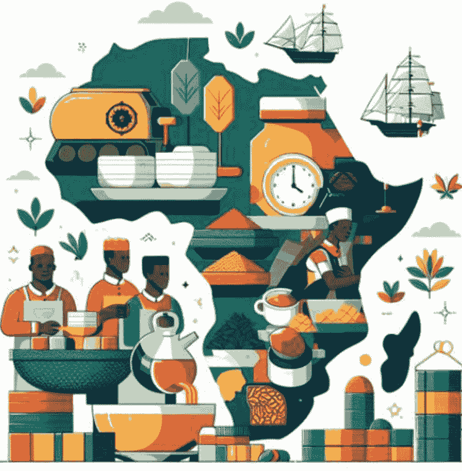

中国农业国际合作促进茶产业分会
TEA INDUSTRY COMMITTEE OF CHINA ASSOCIATION FOR THE PROMOTION OF INTERNATIONAL AGRICULTURAL COOPERATION

“一带一路”国际贸易基金
BRIT 产业科技创院

# 免费 价值 及时 专注

# 扫码加入 知识星球TOP 免费资源群

- 每日免费获取有价值资源
- 可提供各类资源搜索服务

| 热门付费文章 | 各行行业报告 |
| --- | --- |
| 精选图书资源 | 副业赚钱方法 |
| 职场实用资源 | AI经营自媒体体 |

公众号：知识星球TOP 微信信号：jntsg8 微信信号：jntsg2

分享资料仅供个人学习，请及时删除，切勿商用传播

# 编辑单位

中国农业国际合作促进会茶产业分会

“一带一路”国际茶贸产业科技创新院

# 版权须知

中国农业国际合作促进会茶产业分会保留对本报告的所有权利，未经许可任何机构和个人不得以任何方式翻版、复制。欢迎转载、引用，但须注明出处。

# 目录

2024 年 1-6 月中国内地对非洲出口茶叶概况.......................................................5

2024 年 1-6 月中国内地自非洲进口茶叶概况.......................................................13

2023 年中国内地对非洲出口茶叶概况......................................................21

2023 年中国内地对非洲出口茶叶分析......................................................30

出口茶类分析......................................................................................30
出口省市分析......................................................................................52
区域内出口贸易伙伴分析......................................................................110

2023 年中国内地自非洲进口茶叶概况......................................................169

2023 年中国内地自非洲进口茶叶分析......................................................177
进口茶类分析......................................................................................177
进口省市分析......................................................................................198
区域内进口贸易伙伴分析......................................................................227

联系我们......................................................................................244

根据中国海关提供的相关数据，中国茶叶出口产品主要分类：

## 茶叶分类

| 茶类 | 本文表格种类 | 备注 |
| --- | --- | --- |
| 绿茶，内包装每件净重>3kg | 绿茶，内包<3kg | 绿茶包括普洱生茶 |
| 绿茶，内包装每件净重≤3kg | 绿茶，内包<3kg | 普洱生茶 |
| 黑茶（普洱熟茶外），内包装每件净重>3kg | 黑茶（普洱熟茶外），内包<3kg | 黑茶 | 2021年新增分类，不包括普洱生茶 |
| 红茶及其他种类发酵（乌龙茶和黑茶外），内包装每件净重>3kg | 红茶，内包<3kg | 红茶 | 2021年新增分类 |
| 红茶及其他种类发酵（乌龙茶和黑茶外），内包装每件净重≤3kg | 红茶，内包<3kg | 红茶 | |
| 茉莉花，内包装每件净重>3kg | 茉莉花，内包<3kg | 花茶 | 2023年新增分类 |
| 茉莉花，内包装每件净重≤3kg | 茉莉花，内包<3kg | 花茶 | 2023年新增分类 |
| 其他茶，内包装每件净重>3kg | 其他茶，内包<3kg | 花茶 | 2023年新增分类 |
| 其他茶，内包装每件净重≤3kg | 其他茶，内包<3kg | 花茶 | 2023年新增分类 |
| 白茶，内包装每件净重>3kg | 白茶，内包<3kg | 白茶 | 2023年新增分类 |
| 白茶，内包装每件净重≤3kg | 白茶，内包<3kg | 白茶 | 2021年新增分类 |
| 普茶（熟茶），内包装每件净重>3kg | 普茶（熟茶），内包>3kg | 黑茶 | 2021年新增分类 |
| 普茶（熟茶），内包装每件净重≤3kg | 普茶（熟茶），内包≤3kg | 黑茶 | |
| 乌龙茶，内包装每件净重>3kg | 乌龙茶，内包>3kg | 乌龙茶 | |
| 乌龙茶，内包装每件净重≤3kg | 乌龙茶，内包≤3kg | 乌龙茶 | |

## 2024 年 1-6 月中国境内对非洲出口茶叶概况

2024 年 1-6 月中国境内对非洲出口量10.81 万吨，同比增长4.14%；出口额3.62 亿美元，同比0.38%；均价3.35 美元/吨，降幅3.61%。

表格1 2024年1-6月中国境内对非洲出口茶叶量、出口额、均价

| 年份 | 出口额(亿美元) | 出口增长(%) | 出口量(万吨) | 出口量增长(%) | 均价(美元/吨) | 均价同比增长(%) |
| --- | --- | --- | --- | --- | --- |
| 2015 | 3.02 | 8.28 | 3.66 | | | |
| 2016 | 3.13 | 3.79 | 9.00 | 8.69 | 3.48 | -4.51 |
| 2017 | 3.12 | -0.44 | 9.83 | 9.26 | 3.17 | -8.88 |
| 2018 | 3.47 | 11.71 | 10.17 | 3.42 | 3.41 | |
| 2019 | 3.44 | -0.91 | 10.29 | 1.16 | 3.34 | -2.04 |
| 2020 | 3.27 | -4.85 | 10.18 | -1.06 | 3.21 | -3.83 |
| 2021 | 3.33 | 1.87 | 9.12 | -10.41 | 3.65 | 13.71 |
| 2022 | 3.62 | 8.64 | 10.40 | 14.04 | 3.48 | -4.74 |
| 2023 | 3.61 | -0.29 | 10.38 | -0.22 | 3.48 | -0.06 |
| 2024 | 3.62 | 0.38 | 10.81 | 4.14 | 3.35 | -3.61 |

图1 2015-2024年中国境内对非洲出口情况
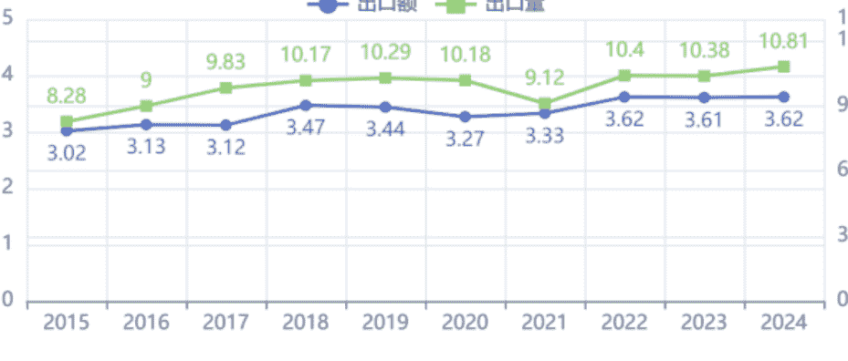

### 图表2 2023，2024年1-6月内地对非洲出口额（美元）
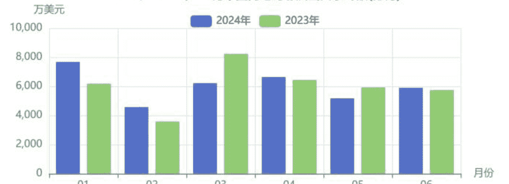

### 图表3 2023，2024年1-6月内地对非洲出口量（吨）
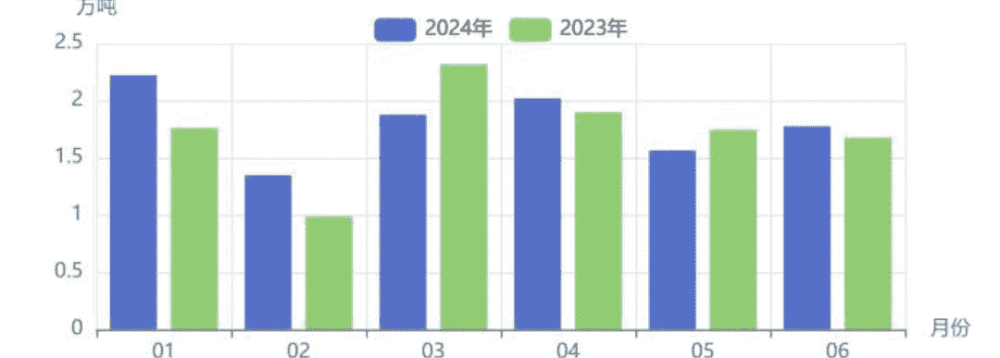

从出口量看，绿茶是1-6月内地最大的出口茶类，出口量10.74万吨，占99.43%；花茶为二品种之一，出口量0.08吨，占0.37%；红茶居第三，出口量19.35吨，占0.11%。从出口额看，绿茶出口3.59亿美元，占茶叶总额的99.11%；花茶出口21.62万美元，占0.60%；红茶出口83.72万美元，占0.23%；乌龙茶出口额21.7万吨。

### 中国农业合作促进茶叶协会
TEA INDUSTRY COMMITTEE OF CHINA ASSOCIATION FOR THE PROMOTION OF INTERNATIONAL AGRICULTURAL CORPORATION

表格2 2024年1-6月对非洲出口茶量、均（规格）

| 商品名称 | 出口量(万美元) | 出口增长(%) | 出口量(kg) | 出口量同比增长(%) | 均价(美元/kg) | 均价同比增长(%) |
| --- | --- | --- | --- | --- | --- | --- |
| 乌龙合计 | 21.70 | 517.23 | 90.00 | -53.73 | 2.40 | 1234.11 |
| 乌龙，内包>3kg | 20.47 | 623.17 | 89.00 | -54.25 | 2.30 | 1480.66 |
| 乌龙，内包<3kg | 1.23 | 79.15 | 1.38 | 67.72 | 8.87 | 6.82 |
| 白茶合计 | 0.20 | -98.01 | 0.14 | -98.18 | 14.17 | 93.96 |
| 白茶，内包<3kg | 0.20 | -98.01 | 0.14 | -98.14 | 14.17 | 93.96 |
| 红茶合计 | 83.72 | 0.64 | 119.35 | 48.09 | 7.01 | -32.04 |
| 红茶，内包>3kg | 13.48 | 1330.00 | 30.36 | 1417.85 | 4.44 | -5.79 |
| 红茶，内包<3kg | 70.24 | -14.60 | 88.99 | 13.23 | 7.89 | -24.58 |
| 绿茶合计 | 35899.59 | 0.31 | 107443.92 | 4.16 | 3.34 | -3.70 |
| 绿茶，内包>3kg | 13901.12 | 16.73 | 51822.46 | 20.62 | 2.68 | -3.22 |
| 绿茶，内包<3kg | 21988.47 | -7.88 | 55621.46 | -7.59 | 3.96 | -0.32 |
| 花茶合计 | 217.62 | 10.14 | 402.08 | -53.73 | 5.41 | -13.76 |
| 茉莉茶，内包>3kg | 23.51 | 1290.89 | 112.38 | 4213.62 | 2.09 | -67.76 |
| 茉莉茶，内包<3kg | 194.11 | -0.91 | 289.71 | -7.21 | 6.70 | 7.79 |

2024年1-6月对非洲出口产品结构（出口额）
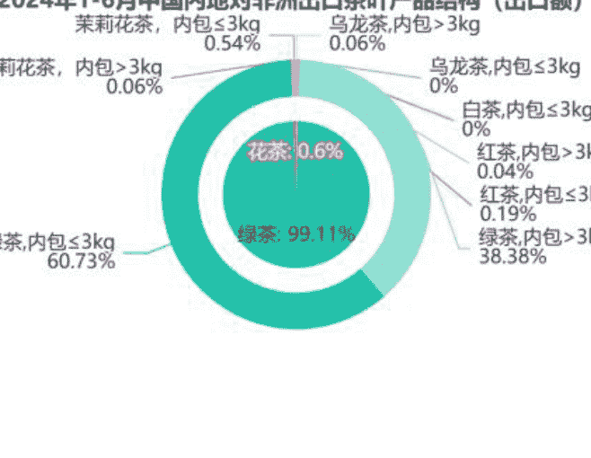

图4

### 图表5 2024年1-6月中国内地对非洲出口产品结构（量）
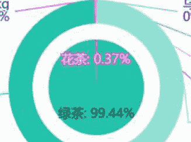

图6 2015-2024年中国内地对非洲出口额
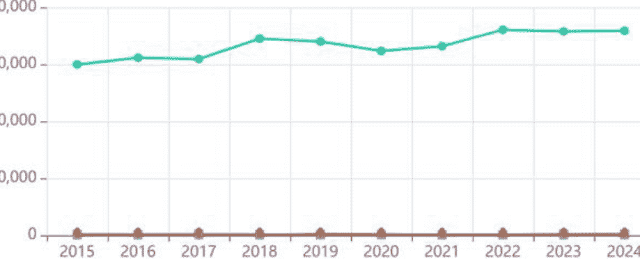

2024年1-6月对非洲出口前五市为浙江省、安徽省、湖北省、江西省，分别为出口1.69亿美元、出口额1.04亿美元、出口额3400万美元、出口额1251万美元，合计出口规模的92.98%。

表格3 2024年1-6月中国国内对非洲出口规模

| 省市 | 出口额(万元) | 排名变化 | 出口增长(%) | 出口量(吨) | 出口量增长(%) | 均价(美元/Kg) |
| --- | --- | --- | --- | --- | --- | --- |
| 浙江省 | 16936.40 | 0 | 9.71 | 56829.69 | 9.47 | 2.98 |
| 安徽省 | 10385.79 | 0 | -6.43 | 27687.22 | -0.30 | 3.75 |
| 湖北省 | 3400.14 | 0 | 31.79 | 8938.30 | 38.12 | 3.80 |
| 湖南省 | 1707.66 | 1 | -12.96 | 5726.22 | -15.30 | 2.99 |
| 江西省 | 1251.26 | 1 | -24.57 | 3210.99 | -23.45 | 3.90 |
| 福建省 | 1176.75 | -2 | -42.31 | 2244.61 | -37.59 | 5.24 |
| 河南省 | 949.66 | 0 | 29.28 | 1972.37 | 82.41 | 4.81 |
| 贵州省 | 239.18 | 0 | -26.55 | 691.44 | -29.23 | 3.46 |
| 四川省 | 86.93 | 0 | -54.83 | 314.41 | -63.11 | 2.76 |
| 上海市 | 85.14 | 0 | 78.11 | 443.00 | 30.51 | 1.92 |
| 陕西省 | 3.12 | 0 | 208.31 | 0.80 | 60.00 | 38.96 |
| 山东省 | 0.76 | 1 | -35.11 | 0.78 | -35.42 | 9.87 |

### 2024年1-6月中国内地对非洲出口茶叶量各省市占比

- 福建省: 3.25%
- 江西省: 3.45%
- 湖南省: 4.71%
- 湖北省: 9.39%
- 安徽省: 28.67%
- 浙江省: 46.76%

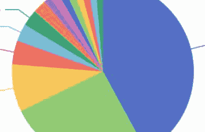

### 图表8 2024年1-6月中国内地对非洲出口量各省市占比

- 湖南省: 5.3%
- 湖北省: 8.27%
- 安徽省: 25.62%
- 浙江省: 52.59%

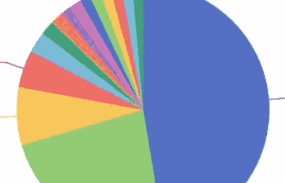

### 表格4 2024年1-6月中国对非洲出口主要贸易伙伴（出口前30）

| 贸易伙伴 | 出口额（万美元） | 排名 | 出口占比（%） | 出口量（吨） | 均价（美元/Kg） | 出口占比（%） |
| --- | --- | --- | --- | --- | --- | --- |
| 摩洛哥 | 10455.88 | 0 | 46.27 | 35234.09 | 55.69 | 28.87 |
| 加纳 | 8298.73 | 0 | 30.66 | 20673.42 | 31.46 | 22.19 |
| 毛里堡 | 3372.46 | -1 | -2.42 | 90189.98 | -8.88 | 4.21 |
| 塞内加 | 2771.27 | -1 | -15.15 | 67422.55 | -17.64 | 7.62 |
| 阿尔利亚 | 1780.03 | -2 | -49.44 | 50232.55 | -50.68 | 4.91 |
| 几比亚 | 1605.68 | 6 | 14.42 | 44464.62 | 19.84 | 4.13 |
| 尼利亚 | 1126.93 | 4 | 31.18 | 42425.61 | 11.61 | 5.55 |
| 马利 | 1123.37 | -1 | -52.17 | 25452.82 | -56.25 | 4.58 |
| 比利亚 | 937.36 | -1 | -36.67 | 25339.35 | -30.85 | 3.70 |
| 安哥拉 | 869.90 | -4 | -64.04 | 31230.59 | -39.54 | 2.79 |
| 多豪 | 828.18 | -1 | -40.78 | 30460.91 | -11.67 | 2.72 |
| 赞比亚 | 795.80 | 12 | 12.78 | 13700.40 | -27.70 | 2.34 |
| 几内利亚 | 692.18 | 0 | 24.44 | 24745.16 | 13.09 | 4.13 |
| 乍得 | 465.86 | 1 | 24.47 | 2846.76 | 141.01 | 1.64 |
| 纳米比亚 | 281.83 | 2 | 193.05 | 12739.47 | 165.35 | 2.21 |
| 布基纳法索 | 185.93 | -2 | -25.64 | 53095.98 | -8.65 | 3.50 |
| 科提维利亚 | 179.83 | 3 | 169.72 | 443.82 | 95.94 | 4.05 |
| 埃及 | 124.84 | 1 | 48.33 | 5728.45 | 47.13 | 2.17 |
| 安哥尼亚 | 78.14 | -3 | -25.29 | 7318.48 | -19.84 | 1.07 |
| 刚果 | 58.82 | 2 | 31.97 | 1336.46 | 43.34 | 0.13 |
| 利利亚 | 39.42 | 3 | 33.88 | 6090.00 | -30.74 | 5.71 |
| 塞隆 | 36.37 | 4 | 92.51 | 275.00 | 115.52 |

### 图表 10
### 2024年1-6月中国内地-非洲茶叶出口主要贸易伙伴(出口金额)

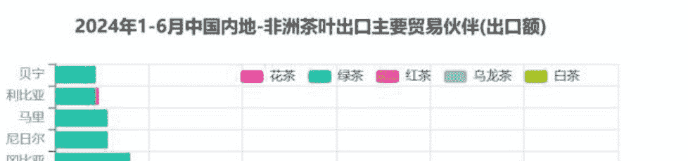

### 图表 11
### 2024年1-6月中国内地-非洲茶叶出口主要贸易伙伴(出口量)

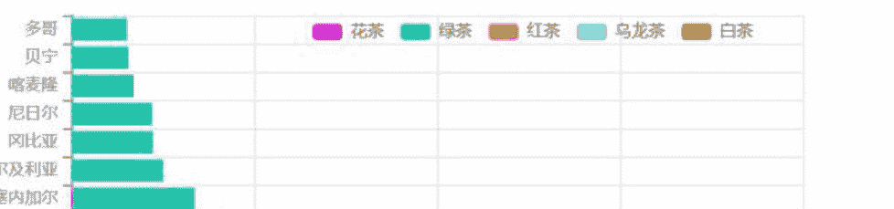

## 2024年1-6月中国内地非非洲进口茶叶概况

2024年1-6月中国内地非非洲进口茶叶量6569.16吨，同比增长49.09%；进口额1153.00万美元，同比增长8.38%；均价17.66美元/吨，降幅27.31%。

| 年份 | 进口额(万美元) | 进口额同比增长(%) | 进口量(吨) | 进口量同比增长(%) | 均价(美元/吨) | 均价同比增长(%) |
|---|---|---|---|---|---|---|
| 2015 | 244.94 | | 1090.94 | | 2.25 | |
| 2016 | 312.71 | 27.67 | 1326.46 | 21.59 | 2.36 | 5.00 |
| 2017 | 477.27 | 52.62 | 2047.34 | 54.35 | 2.33 | -1.12 |
| 2018 | 549.23 | 15.08 | 2236.84 | 9.26 | 2.46 | 5.33 |
| 2019 | 543.61 | -1.02 | 2212.91 | -1.07 | 2.46 | 0.05 |
| 2020 | 595.60 | 9.57 | 3150.40 | 42.36 | 1.89 | -23.04 |
| 2021 | 887.27 | 48.97 | 4179.67 | 32.68 | 2.12 | 12.28 |
| 2022 | 617.48 | -30.41 | 2788.17 | -33.30 | 2.21 | 4.33 |
| 2023 | 1063.83 | 72.29 | 4406.13 | 58.03 | 2.41 | 9.02 |
| 2024 | 1153.00 | 8.38 | 6569.16 | 49.09 | 1.76 | -27.31 |

### 图 12 2015-2024年中国内地非非洲进口茶叶情况

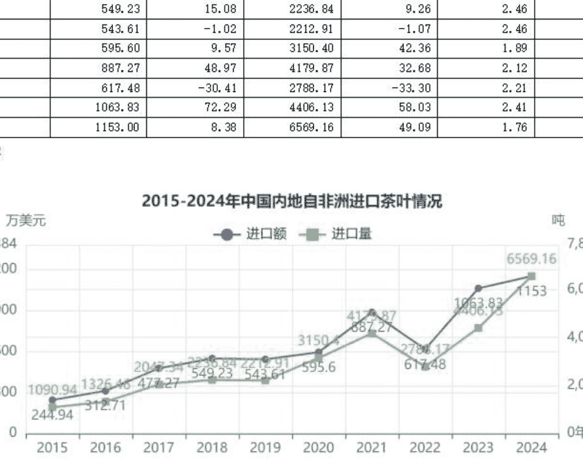

### 图表 13
### 2023、2024年1-6月中国内地非非洲进口茶叶额（分月）

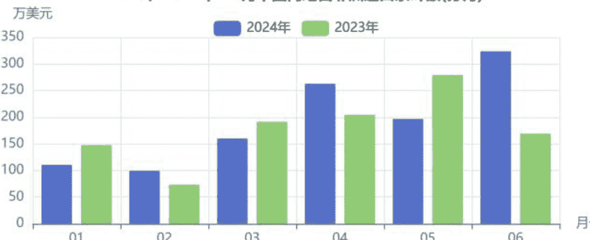

### 图表 14
### 2023、2024年1-6月中国内地非非洲进口茶叶量（分月）

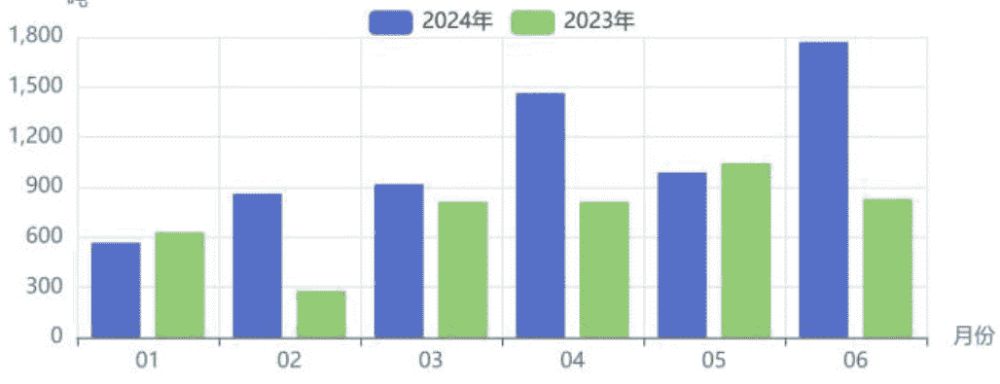

进口量看，红茶为1-6月中国内地非非洲最大的进口茶类，绿茶6556.56吨，占99.96%；绿茶为二品种之一，进口量2.43吨，占0.04%；花茶位第三，进口量131千克，占0.00%；从进口额看，红茶进口额1144.57万美元，占进口总额的99.27%；绿茶进口额8.02万美元，占0.70%；花茶进口额3244美元，占0.03%；白茶进口额586美元，占0.01%。

## 表格 2024年1-6月中国内地及非洲进口茶叶籽、均价(规格)

| 商品名称 | 进口量(美元) | 进口量比增长(%) | 进口量(千吨) | 进口量比增长(%) | 均价(元/kg) | 均价比增长(%) |
| :--- | :--- | :--- | :--- | :--- | :--- | :--- |
| 白茶合计 | | 586.00 | | 17.00 | | 34.47 |
| 白茶，内包≤3kg | | 586.00 | | 17.00 | | 34.47 |
| 红茶合计 | | 11445700.00 | 9.58 | 6566564.00 | 50.40 | 1.74 | -27.14 |
| 红茶，内包≤3kg | | 11007733.00 | 8.83 | 6551684.00 | 50.49 | 1.68 | -27.68 |
| 红茶，内包≤3kg | | 437997.00 | 32.71 | 14880.00 | 21.00 | 29.44 | 9.68 |
| 绿茶合计 | | 80242.00 | -58.51 | 2433.00 | -93.94 | 32.98 | 594.86 |
| 绿茶，内包≤3kg | | 8500.00 | -86.71 | 316.00 | -99.16 | 26.90 | 1475.41 |
| 绿茶，内包≤3kg | | 71742.00 | -44.58 | 2117.00 | -21.68 | 33.89 | -29.24 |
| 花茶合计 | | 3244.00 | 40450.00 | 131.00 | | 24.76 | -100.00 |
| 其他茶，内包≤3kg | | 3244.00 | | 131.00 | | 24.76 |
| 黑茶合计 | | 205.00 | | 20.00 | | 10.26 |
| 黑茶，内包≤3kg | | 205.00 | | 20.00 | | 10.26 |

### 2024年1-6月中国内地及非洲茶叶产品结构（进口额）

- 黑茶，内包≤3kg 0.00%
- 白茶，内包≤3kg 0.01%
- 其他茶，内包≤3kg 0.03%
- 绿茶，内包≤3kg 0.62%
- 绿茶，内包≤3kg 0.07%
- 红茶，内包≤3kg 99.27%

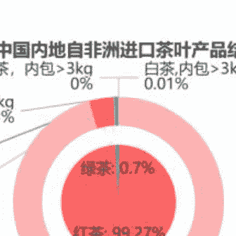

### 2024年1-6月中国境内非洲茶叶产品结构（进口量）

- 黑茶，内包≤3kg 0%
- 白茶，内包≤3kg 0%
- 其他茶，内包≤3kg 0%
- 绿茶，内包≤3kg 0%
- 绿茶，内包≤3kg 0.03%
- 红茶，内包≤3kg 0.04%
- 红茶，内包≤3kg 99.96%

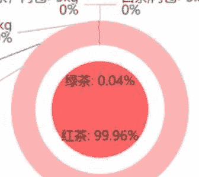

### 2015-2024年中国境内非洲茶叶额变化

- 红茶
- 绿茶
- 花茶
- 白茶
- 乌龙茶

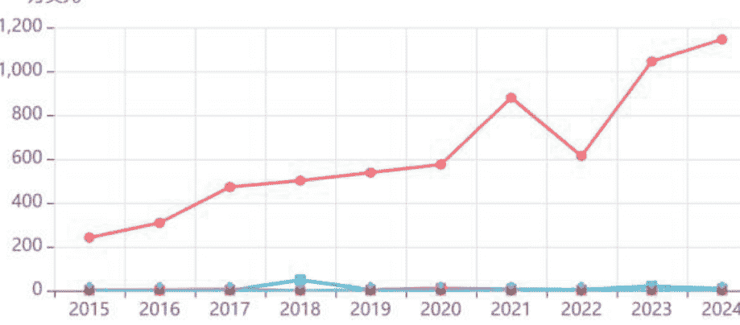

### 2015-2024年中国境内非洲茶叶量变化

- 红茶
- 绿茶
- 花茶
- 白茶
- 乌龙茶

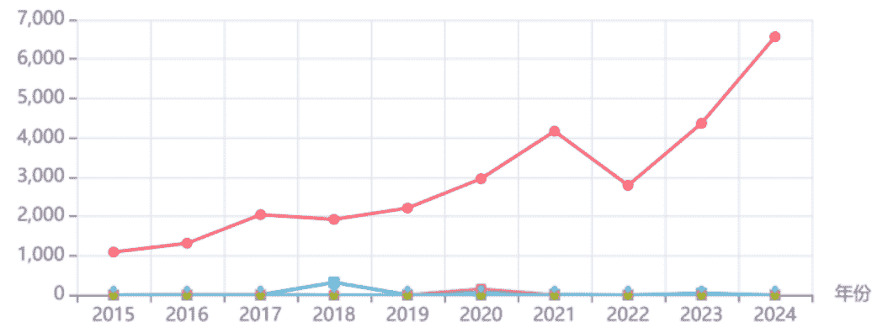

2024年1-6月非洲进口量前5市为浙江省、福建省、北京市、广东省、山东省，分别为进口额510.57万美元、403.36万美元、128.48万美元、76.85万美元、合计占规模的97.78%。

### 2024年1-6月中国境内非洲进口量前10省市

| 名称 | 进口额（万美元） | 排名 | 进口额同比增长（%） | 进口量（吨） | 进口量同比增长（%） | 均价（美元/kg） |
|---|---|---|---|---|---|---|
| 浙江省 | 510.57 | 0 | 5.7 | 3170.78 | 48.98 | 1.61 |
| 福建省 | 403.36 | 0 | 29.97 | 1893.02 | 63.72 | 2.13 |
| 北京市 | 128.48 | 1 | 60.10 | 1240.73 | 134.54 | 1.04 |
| 广东省 | 76.85 | -1 | -26.01 | 157.08 | -40.09 | 4.89 |
| 山东省 | 8.12 | 2 | -28.31 | 38.05 | -2.67 | 2.13 |
| 上海市 | 7.55 | 2 | -25.40 | 20.82 | -33.27 | 3.63 |
| 湖南省 | 6.33 | 2 | -37.35 | 20.70 | -10.77 | 3.06 |
| 西藏自治区 | 6.11 | 5 | - | 15.36 | - | 3.98 |
| 贵州省 | 4.57 | 1 | -11.45 | 12.14 | -19.07 | 3.77 |
| 天津市 | 0.88 | 1 | 3892.73 | 0.44 | 14400.00 | 20.19 |

### 图表 19
### 2024年1-6月中国内地非洲进口茶叶量各省市占比

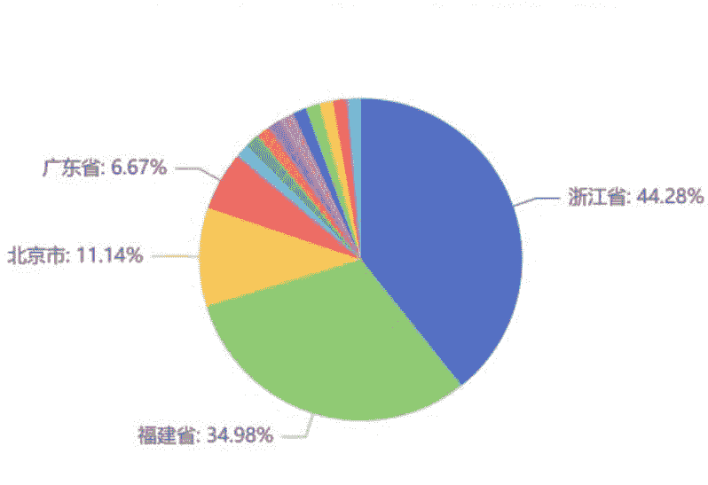

### 图表 20
### 2024年1-6月中国内地非洲进口茶叶量各省市占比

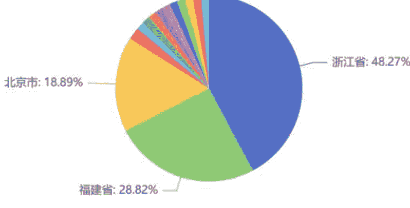

## 中国企业合作助力非洲产业发展
TEA INDUSTRY COMMISSION OF CHINA FOR INTERNATIONAL AGRICULTURAL COOPERATION

2024年1-6月中国内地对非洲茶叶主要伙伴依次为肯尼亚、布布洛维、乌甘达、马哈萨、摩洛哥，分别进口额619.67万美元、进口额247.82万美元、进口额122.77万美元、进口额69.55万美元、进口额48.59万美元，合计占进口规模的96.13%。进口前5贸易伙伴依次为肯尼亚、布布洛维、乌甘达、马哈萨、喀旺达，分别进口额4007.92万、进口额1018.99万、进口额913.90万、进口额147.42万美元，合计占规模的97.11%。

### 2024年1-6月中国内地非洲茶叶主要贸易伙伴（进口额）

| 贸易伙伴 | 进口额（万美元） | 排名 | 占比 | 进口量（吨） | 进口增长 | 均价（美元/kg） | 出口额（%） | 出口量（%） |
|---|---|---|---|---|---|---|---|
| 肯尼亚 | 619.67 | 1 | 20.73 | 4007.92 | 31.27 | 1.55 | 53.74 | 61.01 |
| 布布洛维 | 247.82 | -1 | -43.80 | 1018.99 | -35.46 | 2.43 | 21.49 | 15.51 |
| 乌甘达 | 122.77 | 2 | 79.30 | 913.90 | 43.62 | 1.34 | 10.65 | 9.91 |
| 马哈萨 | 69.55 | 0 | -36.73 | 423.10 | -40.57 | 1.64 | 6.03 | 6.44 |
| 摩洛哥 | 48.59 | 2 | -11.48 | 157.71 | 20.42 | 30.92 | 4.21 | 0.24 |
| 喀旺达 | 35.02 | -3 | -35.10 | 147.42 | -64.44 | 2.38 | 3.04 | 2.24 |
| 赞比亚 | 4.80 | -2 | -70.35 | 20.00 | -94.11 | 2.40 | 0.42 | 0.30 |
| 坦桑尼亚 | 2.60 | 0 | 8.29 | 20.80 | 69.11 | 1.25 | 0.23 | 0.32 |
| 南非 | 1.00 | 0 | 75.24 | 466.61 | 13.08 | 0.09 | 0.01 |
| 毛里索 | 0.86 | 3 | | 19.77 | 0.07 | 0.01 |

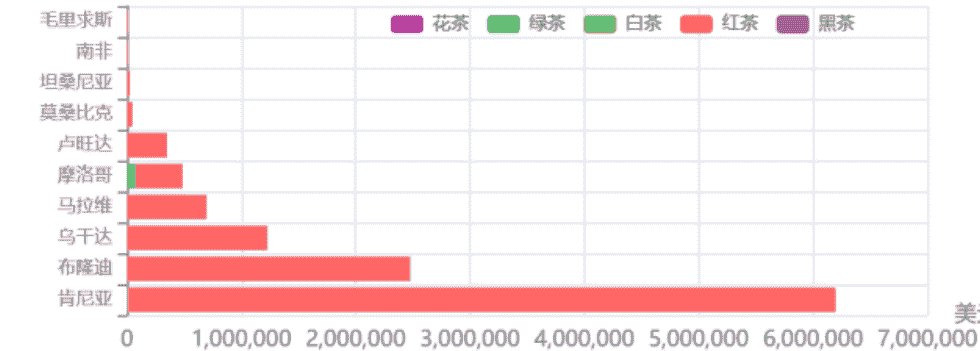

### 2024年1-6月中国内地非洲茶叶主要贸易伙伴（进口量）

| | 花茶 | 绿茶 | 白茶 | 红茶 |
|---|---|---|---|---|
| 毛里索 | | | | |
| 南非 | | | | |
| 摩洛哥 | | | | |
| 埃塞俄比亚 | | | | |
| 坦桑尼亚 | | | | |
| 马拉维 | | | | |
| 乌甘达 | | | | |
| 布隆基迪 | | | | |

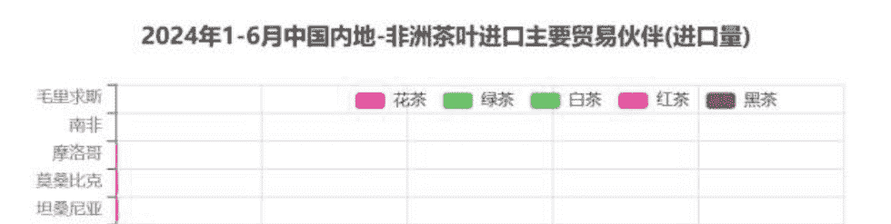

### 2023年中国对非洲茶叶概况

2023年中国对非洲茶叶出口22.17吨，同比增长5.27%，出口7.73亿美元，同比增长5.45%。均价3.49美元/Kg，增幅0.17%。

### 表格 9 2015-2023年中国对非洲茶叶出口量、均价

| 年份 | 出口额（亿美元） | 出口增长率（%） | 出口量（万吨） | 出口增长率（%） | 均价（美元/Kg） | 均价增长率（%） |
|---|---|---|---|---|---|---|
| 2015 | 6.26 | | 17.29 | | 3.62 | |
| 2016 | 6.22 | -0.61 | 17.67 | 2.18 | 3.52 | -2.73 |
| 2017 | 6.35 | 2.06 | 19.41 | 9.89 | 3.27 | -7.13 |
| 2018 | 6.74 | 6.16 | 20.05 | 3.27 | 3.36 | 2.80 |
| 2019 | 6.71 | -0.42 | 20.17 | 0.60 | 3.33 | -1.01 |
| 2020 | 6.61 | -1.55 | 19.78 | -1.91 | 3.34 | 0.37 |
| 2021 | 7.34 | 11.13 | 20.75 | 4.90 | 3.54 | 5.94 |
| 2022 | 7.33 | -0.17 | 21.06 | 1.47 | 3.48 | -1.62 |
| 2023 | 7.73 | 5.45 | 22.17 | 5.27 | 3.49 | 0.17 |

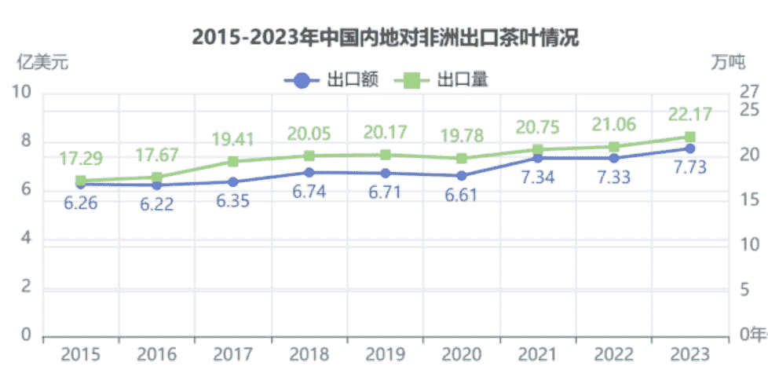

### 2023年中国内地对非洲出口茶产品结构（出口额）

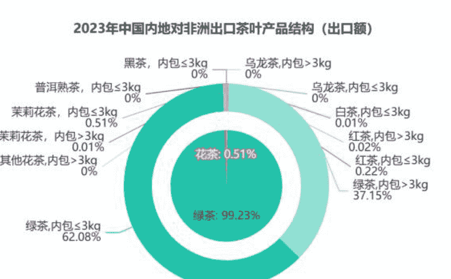

### 2023年中国内地对非洲出口茶产品结构（出口量）

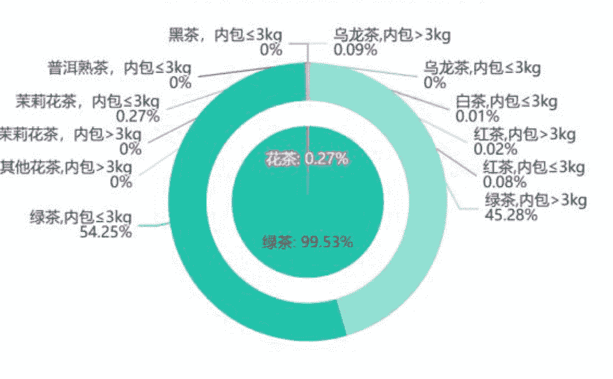

图表 27

图表 28

### 2015-2023年中国内地对非洲茶叶出口额历年变化

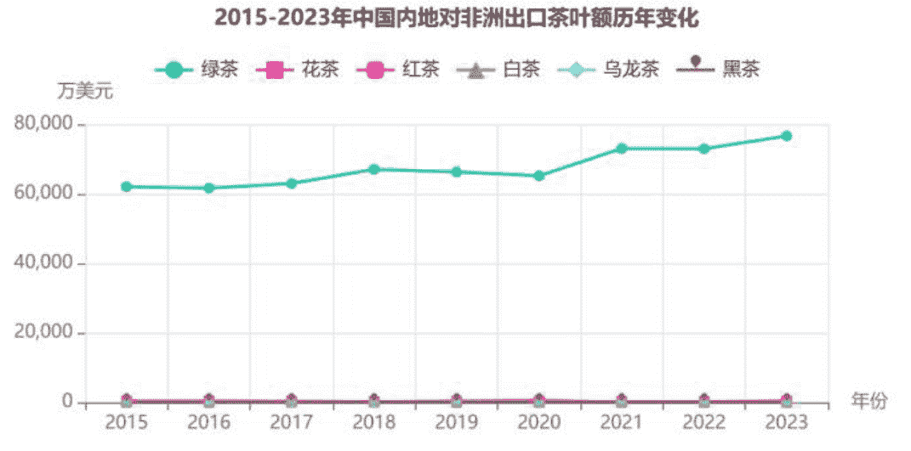

图表 29

### 2015-2023年中国内地对非洲茶叶量历年变化

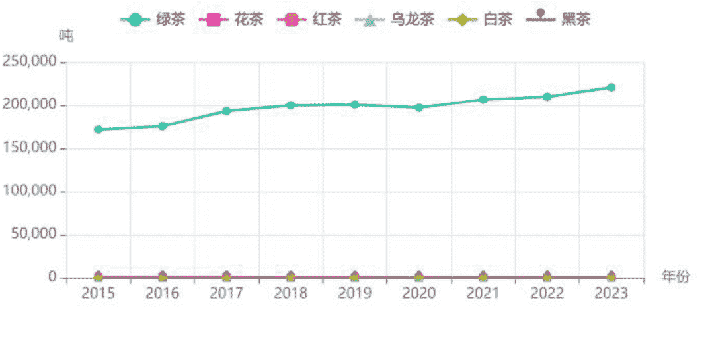

2023年对非洲茶叶出口额前5省市依次为浙江省、安徽省、湖北省、福建省、湖南省，分别为出口额3.47亿美元、出口额2.24亿美元、出口额5979.05万美元、出口额4783.65万美元、出口额3811.02万美元，合计占茶叶出口规模的29.66%。

### 2023年中国内地对非洲出口茶叶额各省市占比

表格11 2023年中国内地对非洲绿茶出口额前15省市

| 注册名称 | 出口额(万元) | 排名变化 | 出口同比增长(%) | 出口量(吨) | 出口同比增长(%) | 均价(美元/kg) |
|---|---|---|---|---|---|---|
| 浙江省 | 34658.81 | 0 | -2.17 | 115668.04 | -0.22 | 3.00 |
| 安徽省 | 22408.40 | 0 | 9.12 | 53865.90 | 14.62 | 3.90 |
| 湖北省 | 5979.05 | 0 | 31.68 | 14599.69 | 19.83 | 4.10 |
| 福建省 | 4783.65 | 0 | 14.13 | 8589.84 | 14.02 | 5.57 |
| 湖南省 | 3811.02 | 0 | -1.25 | 12651.90 | -0.47 | 3.01 |
| 江西省 | 2667.71 | 0 | -9.35 | 6540.53 | -2.42 | 4.08 |
| 河南省 | 1865.48 | 2 | 420.54 | 2701.24 | 125.94 | 6.91 |
| 贵州 | 588.32 | -1 | -6.27 | 1727.12 | 2.27 | 3.41 |
| 四川省 | 312.47 | -1 | 115.23 | 31.54 | 123.13 | 2.04 |
| 广东省 | 106.56 | | -23.53 | 1530.08 | -5.78 | 23.78 |
| 上海市 | 94.25 | -1 | -72.66 | 208.17 | -77.53 | 4.53 |
| 江苏省 | 3.98 | 3 | | 3.00 | | 13.28 |
| 陕西省 | 3.86 | 3 | | | | 1.68 |
| 北京市 | 2.71 | 3 | | 10.00 | | 2.71 |
| 山东省 | 1.55 | -3 | -31.23 | 1.50 | 21.07 | 10.36 |

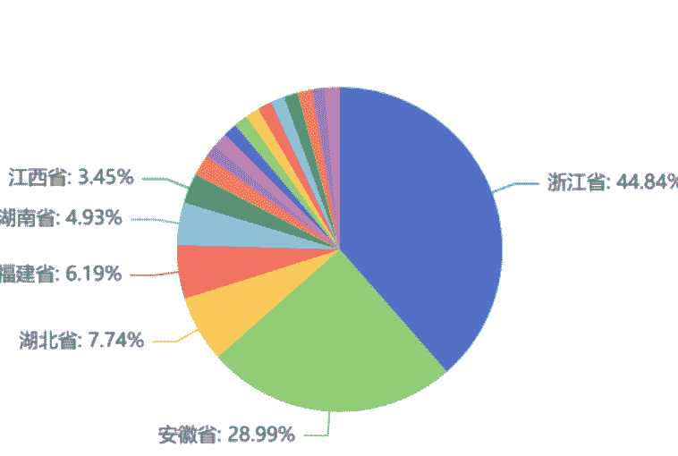

- 浙江省: 3.45%
- 湖南省: 4.93%
- 福建省: 6.19%
- 湖北省: 7.74%
- 安徽省: 28.99%
- 江西省: 44.84%

### 2023年中国内地对非洲茶叶省市占比

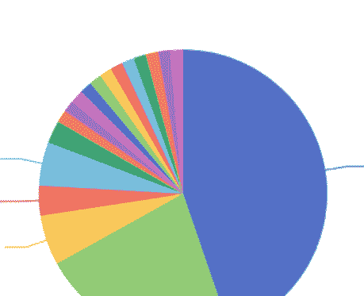

- 湖南省: 5.71%
- 福建省: 3.88%
- 湖北省: 6.59%
- 安徽省: 25.89%

2023年中国内地对非洲茶叶出口额前5伙伴依次为摩洛哥、加纳、阿尔利亚、塞内加尔、毛里塔尼亚，分别为出口额1.9亿美元、出口额1.42亿美元、出口额7085.80万美元、出口额6913.90万美元，合计出口规模69.73%。出口量前5伙伴依次为摩洛哥、加纳、阿尔及利亚、塞内加尔、毛里塔尼亚，分别为出口量3.53万吨、出口量2.03万吨、出口量1.67万吨，合计出口量66.72%。

表格12 2023年中国内地-非洲茶叶主要伙伴（出口额前3）

| 贸易伙伴 | 出口额(万美元) | 排名变化 | 出口占比(%) | 出口量(万吨) | 增长(%) | 均价(美元/kg) | 出口占比(%) | 出口量占比(%) |
|---|---|---|---|---|---|---|---|---|
| 摩洛哥 | 19007.58 | 0 | -20.64 | 59831.51 | -20.69 | 3.18 | 24.59 | 26.99 |
| 加纳 | 14171.08 | 0 | 35.25 | 35289.67 | 43.98 | 4.02 | 18.34 | 15.92 |
| 阿及利亚 | 7086.80 | 2 | 49.47 | 20265.54 | 76.80 | 3.50 | 9.17 | 9.14 |
| 塞内加尔 | 6913.90 | -1 | 0.56 | 16677.81 | -2.79 | 4.15 | 8.95 | 7.52 |
| 毛里塔尼亚 | 6716.18 | -1 | 0.20 | 20284.53 | 25.68 | 4.24 | 8.69 | 7.14 |
| 马里 | 5032.09 | 0 | 19.28 | 19456.92 | 29.27 | 4.21 | 6.51 | 5.39 |
| 贝宁 | 3118.26 | 2 | 30.81 | 9821.96 | 15.11 | 3.17 | 4.03 | 4.43 |
| 安比利亚 | 2952.96 | 4 | 49.60 | 10818.46 | 43.29 | 3.67 | 3.82 | 3.63 |

## 中国农业国际合作发展非洲产业

| | | | | | | | | |
|---|---|---|---|---|---|---|---|---|
| 利比亚 | 2724.89 | -1 | 8.92 | 6158.68 | -9.22 | 4.42 | 3.50 | 2.78 |
| 桑比亚 | 2257.60 | -3 | -40.96 | 5625.55 | -33.63 | 4.01 | 2.92 | 2.54 |
| 晴晨 | 1833.38 | 1 | 11.13 | 10173.37 | -8.94 | 1.80 | 2.37 | 4.59 |
| 尼日利亚 | 1494.06 | -1 | -15.03 | 6768.77 | -7.25 | 2.21 | 1.93 | 3.05 |
| 刚果 | 1403.72 | 0 | 16.03 | 3528.78 | -8.09 | 3.98 | 1.82 | 1.59 |
| 乍得 | 537.79 | 4 | 19.10 | 3729.26 | 28.03 | 1.44 | 0.70 | 1.68 |
| 布基纳 | 482.70 | 0 | 9 | 1119.44 | 20.35 | 4.31 | 0.62 | 0.50 |
| 突维斯坦 | 276.71 | -2 | -38.40 | 2380.04 | -21.75 | 1.20 | 0.36 | 1.04 |
| 几内利亚 | 266.98 | -3 | 26.61 | 1368.18 | -108.50 | 1.95 | 0.26 | 0.62 |
| 科特维亚 | 261.43 | -2 | -24.97 | 728.40 | -15.05 | 3.58 | 0.34 | 0.33 |
| 赞及 | 177.08 | -2 | -30.66 | 807.43 | -27.41 | 2.19 | 0.23 | 0.38 |
| 格内亚 | 97.12 | 14 | 12.14 | 80.00 | 0.13 | 0.01 | | |
| 加纳 | 88.14 | 0 | 34.39 | 198.20 | 37.61 | 4.68 | 0.11 | 0.08 |
| 刚果共和国 | 65.52 | -1 | 35.90 | 142.89 | 26.45 | 4.59 | 0.08 | 0.06 |
| 南非 | 60.06 | -4 | | 183.30 | -6.20 | 3.28 | 0.08 | 0.08 |
| 摩西利亚 | 57.17 | -2 | 5.45 | 322.00 | -2.13 | 1.78 | 0.07 | 0.15 |
| 比索利亚 | 54.30 | 0 | 141.74 | 174.70 | 95.20 | 3.11 | 0.07 | 0.08 |
| 几内亚比 | 48.12 | 0 | 161.95 | 96.00 | 180.37 | 5.01 | 0.06 | 0.04 |
| 肯尼亚 | 47.84 | 3 | 1429.70 | 323.40 | 1334.17 | 1.48 | 0.06 | 0.15 |
| 安哥 | 29.51 | -1 | 92.98 | 67.50 | 101.49 | 4.37 | 0.04 | 0.03 |
| 萨丹 | 17.24 | -4 | -46.59 | 57.35 | -39.35 | 3.01 | 0.02 | 0.03 |
| 赤道内 | 4.43 | 5 | -54.09 | 10.44 | | 4.24 | 0.01 | 0.00 |
| 毛利维基 | 2.78 | -2 | | 3.30 | -20.44 | 8.44 | 0.00 | 0.00 |
| 中华 | 1.40 | 4 | | 3.50 | | 4.01 | 0.00 | 0.00 |
| 赞比亚 | 0.65 | -5 | -92.40 | 58.76 | 109.52 | 0.11 | 0.00 | 0.03 |

### 2023年中国内地-非非洲出口额主要贸易伙伴（出口额）

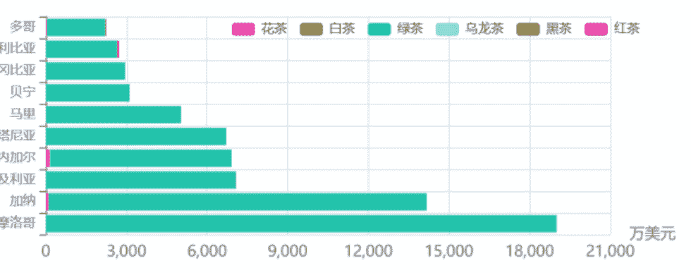

图表 33

### 2023年中国内地-非非洲主要贸易伙伴（出口量）

| | 花茶 | 白茶 | 绿茶 | 乌龙茶 | 红茶 |
|---|---|---|---|---|---|
| 尼日尔 | | | | | |
| 比利亚 | | | | | |
| 贝宁 | | | | | |
| 喀麦隆 | | | | | |
| 马里 | | | | | |
| 毛里基亚 | | | | | |
| 塞内加尔 | | | | | |
| 阿及利亚 | | | | | |
| 摩洛哥 | | | | | |

### 2023年中国国内对非洲茶叶分析

### 2023年中国国内对非洲绿茶情况

2023年中国国内对非洲绿茶22.06万吨，在茶类排名1，同比增长5.23%；出口额6.67亿美元，位第1，同比增长5.09%；均价3.48元/kg，跌0.13%。

表格13 2015-2023年中国国内对非洲出口额、均价

| 年份 | 出口额（亿美元） | 出口增长（%） | 出口量（万吨） | 出口量增长（%） | 均价（美元/kg） | 均价同比增长（%） |
|---|---|---|---|---|---|---|
| --- | | | | | | |
| 2015 | 6.21 | | 17.19 | | 3.61 | |
| 2016 | 6.17 | -0.60 | 17.58 | 2.26 | 3.51 | -2.80 |
| 2017 | 6.30 | 2.13 | 19.32 | 9.89 | 3.26 | -7.07 |
| 2018 | 6.71 | 6.47 | 19.98 | 3.42 | 3.36 | 2.95 |
| 2019 | 6.63 | -1.13 | 20.08 | 0.49 | 3.30 | -1.61 |
| 2020 | 6.52 | -1.68 | 19.72 | -1.80 | 3.31 | 0.13 |
| 2021 | 7.31 | 12.06 | 20.65 | 4.75 | 3.54 | 6.98 |
| 2022 | 7.30 | -0.12 | 20.97 | 1.53 | 3.48 | -1.63 |
| 2023 | 6.67 | 5.09 | 22.06 | 5.23 | 3.48 | -0.13 |

图 34

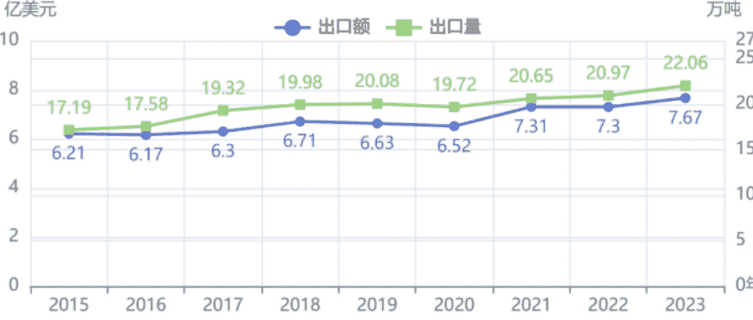

### 2022、2023年中国内地对非洲出口绿茶量（分月）

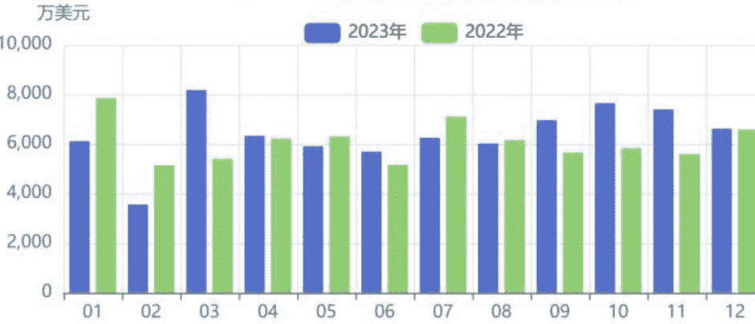

### 2022、2023年中国内地对非洲出口绿茶量（分月）

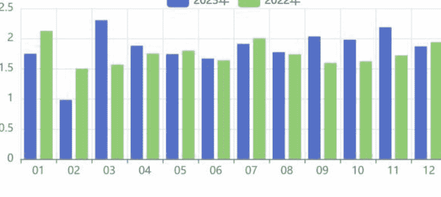

2023年对非洲绿茶出口前5省市依次为浙江省、安徽省、湖北省、福建省、湖南省，分别为出口额3.46亿美元、出口额2.24亿美元、出口额5962万美元、出口额4745.63万美元、出口额3559.93万美元，合计占绿茶出口规模的92.22%。

### 表格 2023年中国内地对非洲洲绿茶前15省省市

| 注册名称 | 出口额(万美元) | 排名变化 | 出口同比增长(%) | 出口量(吨) | 出口同比增长(%) | 均价(美元/Kg) |
|---|---|---|---|---|---|---|
| 浙江省 | 34953.11 | 0 | -2.21 | 115546.7 | -0.22 | 2.99 |
| 安徽省 | 22937.34 | 0 | 9.22 | 57366.92 | 14.80 | 3.90 |
| 湖北省 | 5962.53 | 0 | 31.38 | 14579.9 | 19.70 | 4.09 |
| 福建省 | 4745.63 | 0 | 13.55 | 8352.00 | 16.59 | 5.68 |
| 湖南省 | 3559.93 | 0 | -5.27 | 12363.12 | -1.75 | 2.88 |
| 江西省 | 2454.57 | 0 | -13.47 | 6184.58 | -5.23 | 3.97 |
| 河南省 | 1865.48 | 2 | 420.54 | 2701.24 | 125.94 | 6.91 |
| 贵州 | 588.32 | -1 | -6.27 | 1727.12 | 2.27 | 3.41 |
| 四川省 | 312.47 | -1 | -23.53 | 1530.08 | -5.78 | 2.04 |
| 广东省 | 106.56 | -1 | 153.23 | 31.54 | 33.78 | 23.78 |
| 陕西省 | 92.04 | -1 | -73.30 | 207.50 | -76.60 | 4.44 |
| 上海市 | 3.98 | 3 | | 3.00 | | 13.28 |
| 江苏省 | 3.86 | 3 | | 23.00 | | 1.68 |
| 北京市 | 2.71 | 3 | | 10.00 | | 2.71 |
| 山东省 | 1.55 | -3 | -21.13 | 1.50 | 32.63 | 10.36 |

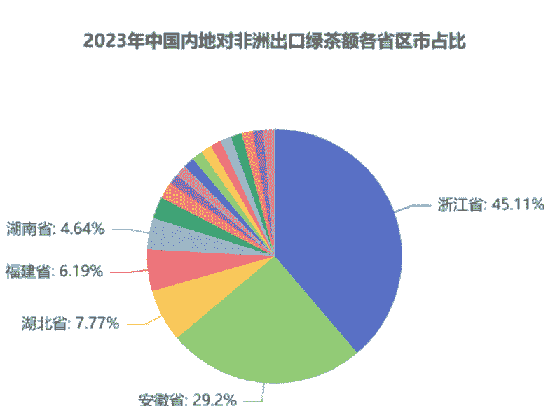

图表 38

2023年中国内地对非洲绿茶量各省市占比

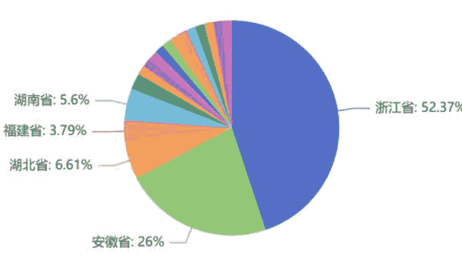

- 湖南省: 5.6%
- 福建省: 3.79%
- 湖北省: 6.61%
- 安徽省: 26%

表格15 2023年中国内地对非洲出口绿茶额、量、均价（分规格）

| 商品名称 | 出口额(万美元) | 出口同比增长(%) | 出口量(万吨) | 出口同比增长(%) | 均价(美元/Kg) | 均价同比增长(%) |
|---|---|---|---|---|---|---|
| 绿茶，内包>3kg | 2.87 | -4.77 | 10.04 | -5.20 | 2.86 | 0.45 |
| 绿茶，内包<3kg | 4.80 | 12.02 | 12.03 | 15.86 | 3.99 | -3.31 |

### 2023年中国境内对非洲绿茶产品结构（出口额）

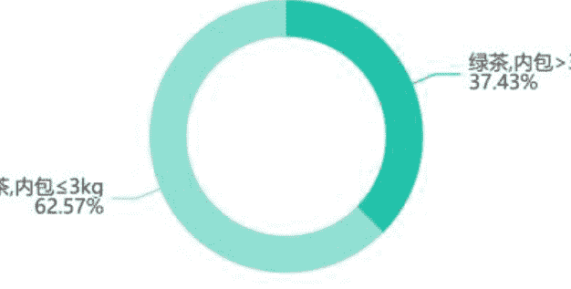

### 2023年中国境内对非洲绿茶产品结构（出口量）

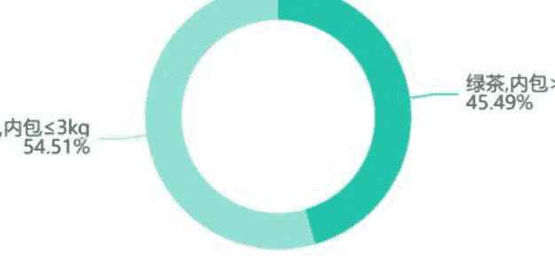

图表 41

### 2015-2023年中国境内对非洲出口绿茶出口量历年变化

- 绿茶，内包≤3kg - 绿茶，内包>3kg

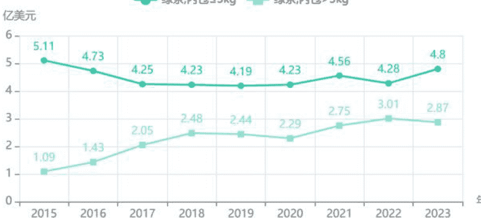

图表 42

### 2015-2023年中国境内对非洲出口绿茶出口量历年变化

- 绿茶，内包≤3kg - 绿茶，内包>3kg

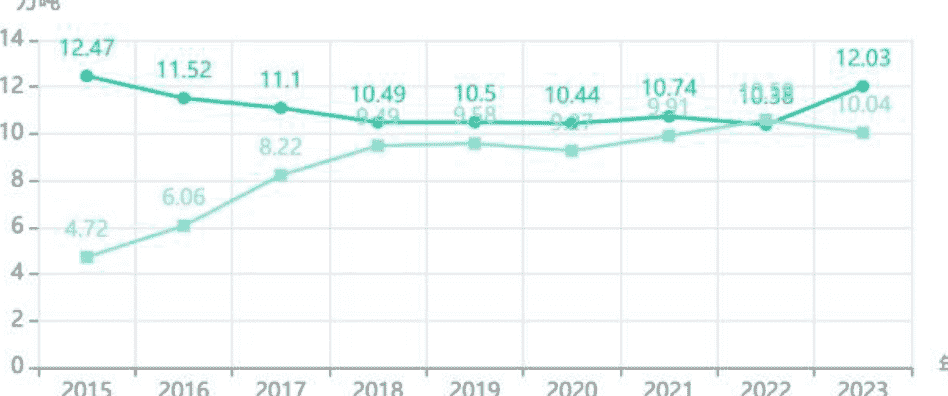

2023年中国境内对非洲出口绿茶出口前5贸易伙伴接下来为摩洛哥、加纳、阿尔及利亚、塞内加尔、毛里塔尼亚。

北京市海淀区中国农业科学院传播中心4楼 010-82106329 www.capiaccti.org.cn

### 图表 44

### 2023年中国内地-非洲绿茶主要伙伴（出口量）

| | 绿茶 |
|---|---|
| 尼日尔 | | |
| 阿比俄比亚 | | |
| 贝宁 | | |
| 喀麦隆 | | |
| 马里 | | |
| 毛里塔尼尼亚 | | |
| 塞内加尔 | | |
| 阿尔及及尼利亚 | | |
| 加纳 | | |
| 摩洛哥 | | |

## 中国内地对非非洲出口花茶情况分析

2023年中国内地-非非洲花茶出口611.89万，在同类茶排名第2，同比增长94.95%；出口395.88万，位居第2，同比增长82.15%，均价6.47美元/kg，降幅6.57%。

| 年份 | 出口(万美元) | 出口同比增长(%) | 出口量(吨) | 出口量同比增长(%) | 均价(美元/kg) | 均价同比增长(%) |
|---|---|---|---|---|---|--|
| 2015 | 391.26 | | | 839.15 | | 4.55 | |
| 2016 | 402.59 | 5.59 | 804.96 | -3.96 | 5.00 | 9.95 | |
| 2017 | 348.82 | -13.36 | 840.08 | 4.36 | 4.15 | -16.98 | |
| 2018 | 228.10 | -34.61 | 497.44 | -40.79 | 4.59 | 10.44 | |
| 2019 | 325.05 | 42.50 | 263.68 | -46.99 | 12.33 | 168.84 | |
| 2020 | 182.30 | -43.91 | 188.57 | -28.48 | 9.67 | -21.58 | |
| 2021 | 239.39 | 31.31 | 335.69 | 78.02 | 7.13 | -26.24 | |
| 2022 | 217.34 | -9.21 | 313.87 | -6.50 | 6.92 | -2.90 | |
| 2023 | 395.88 | 82.15 | 611.89 | 94.95 | 6.47 | -6.57 | |

图 45

## 2015-2023年中国内地对非非洲花茶出口情况

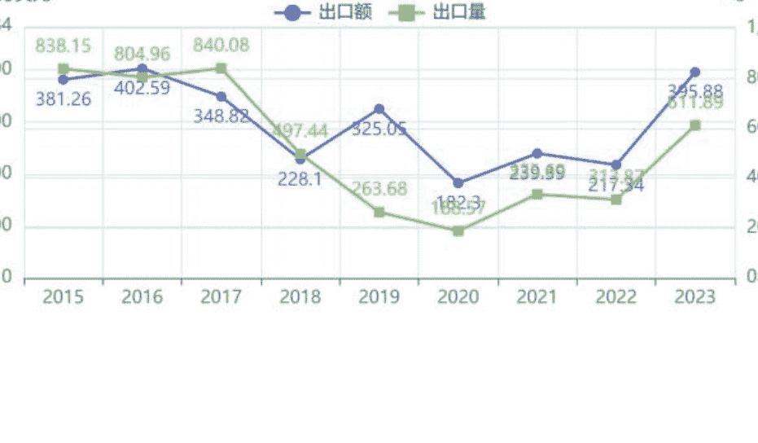

## 2022, 2023年中国内地对非洲出口花茶额（分月）

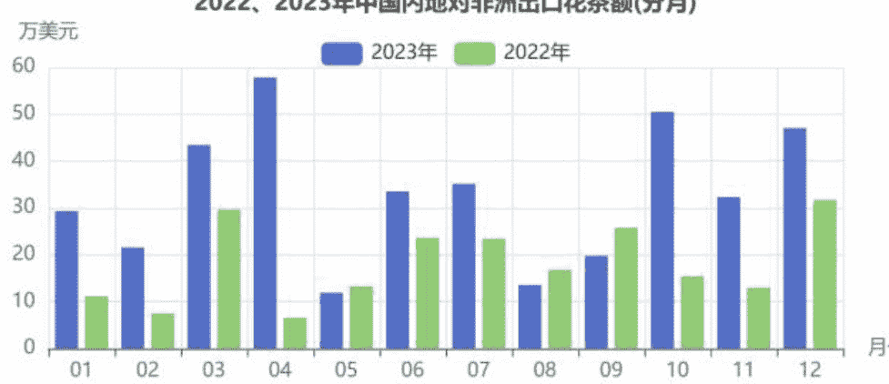

## 2022, 2023年中国内地对非洲出口花茶量（分月）

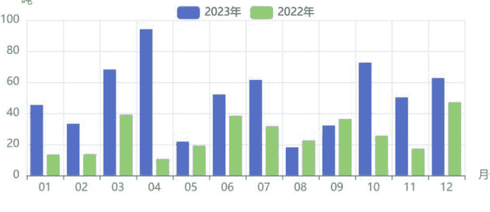

2023年对非洲花茶出口额前5省市市为江西省、湖南省、浙江省、上海市、安徽省，分别为出口额213.13万美元、出口额145.45万美元、出口额33.92万美元、出口额2.08万美元、出口额1.08万美元，合计占花茶出口规模的99.94%。

## 2023年中国内地对非洲花茶出口额前5省市

| 注册地名称 | 出口额(万元) | 排名变化 | 出口同比增长(%) | 出口量(吨) | 出口量增长(%) | 单价(元/Kg) |
|---|---|---|---|---|---|--|
| 江西省 | 213.13 | 0 | 100.81 | 355.95 | 101.19 | 5.99 |
| 湖南省 | 145.45 | 0 | 46.41 | 200.90 | 58.44 | 7.24 |
| 浙江省 | 33.92 | 2 | 1141.65 | 52.20 | 1000.04 | 6.42 |
| 上海市 | 2.08 | 5 | | 0.63 | | 33.00 |
| 安徽省 | 1.08 | 3 | 107.33 | 1.48 | 123.82 | 7.31 |

图 48 2023年中国内地对非洲花茶额各省占比
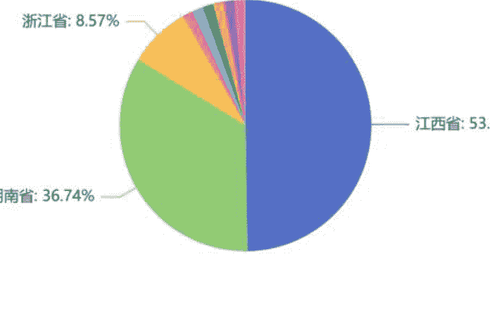

图 49 2023年中国内地对非洲花茶量各省占比
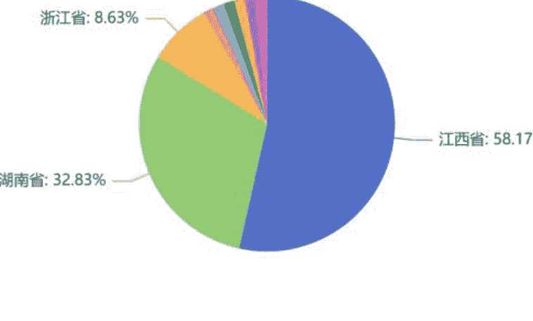

## 表格19 2023年中国内地对非洲出口花茶类、量、均价（分规格）

| 商品名称 | 出口额(万美元) | 出口同比增长(%) | 出口量(吨) | 出口同比增长(%) | 均价(美元/kg) | 均价同比增长(%) |
|---|---|---|---|---|---|---|
| --- | | | | | | |
| 其他花茶，内包<3kg | | 2.08 | 0.63 | | 33.00 | |
| 茉莉茶，内包<3kg | | 3.82 | 6.86 | | 5.58 | |
| 茉莉茶，内包<3kg | 389.98 | 604.40 | | 6.45 | | |

图 50 2023年中国内地对非洲花茶结构(出口额)
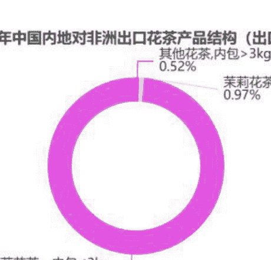

图 51 2023年中国国内对非非洲花茶产品结构（出口量）

- 其他花茶，内包>3kg：0.1%
- 茉莉茶，内包>3kg：1.12%
- 茉莉茶，内包≤3kg：98.78%

图 52 2015-2023年中国国内对非洲出口花茶额变化

- 茉莉茶，内包≤3kg
- 茉莉茶，内包>3kg
- 其他花茶，内包>3kg：万美元

图 53 2015-2023年中国对非洲出口花卉规模变化

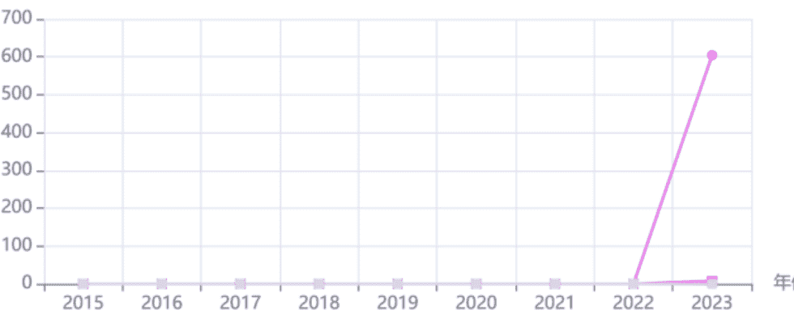

2023年中国对非洲出口花卉前5贸易伙伴依次为内利亚、加纳、几内亚、多哥、马里，分别为出口额151.57万美元、出口额98.62万美元、出口额70.83万美元、出口额43.05万美元、出口额11.83万美元，合计占花卉规模的94.95%。出口前5贸易伙伴依次为内利亚、加纳、几内亚、多哥、利比亚，分别为出口量208.56吨、出口量176.40吨、出口量104.66吨、出口量70.28吨、出口量21.45吨，合计占花卉规模的93.38%。

## 表 2023年中国内地-非洲出口花卉主要贸易伙伴（出口前10）

| 贸易伙伴名称 | 出口额（万美元） | 排名变化 | 出口量同期 | 出口量（吨） | 出口量增长 | 均价（美元/Kg） | 出口占比（%） | 出口量占比（%） |
|---|---|---|---|---|---|---|---|---|
| 内利亚 | 151.57 | 0 | 208.56 | 70.99 | 7.27 | 38.29 | 34.08 | |
| 加纳 | 98.62 | 9 | 176.40 | 46.27 | 5.59 | 24.91 | 28.83 | |
| 几内亚 | 70.83 | | 104.66 | | 6.77 | 18.79 | 17.10 | |
| 多哥 | 43.05 | -1 | 86.07 | 70.28 | 6.13 | 10.87 | 11.49 | |
| 马里 | 11.83 | | 161.91 | 14.58 | 150.10 | 8 | 2.99 | |
| 利比亚 | 8.21 | -1 | 139.30 | 21.45 | 97.88 | 3.83 | 2.07 | 3.51 |
| 南非 | 4.41 | -1 | 27.97 | 5.07 | 82.51 | 1.12 | 0.83 | |
| 涉及 | 3.12 | -4 | 58.56 | 3.78 | -58.41 | 8.27 | 0.79 | 0.62 |
| 加蓬 | 2.77 | | 5.60 | | 4.96 | 0.7 | 0.92 | |
| 洛达 | 1.09 | -2 | 59.98 | 1.02 | -60.33 | 10.70 | 0.28 | 0.17 |

图 54 2023年中国内地-非洲花茶主要伙伴（出口额）
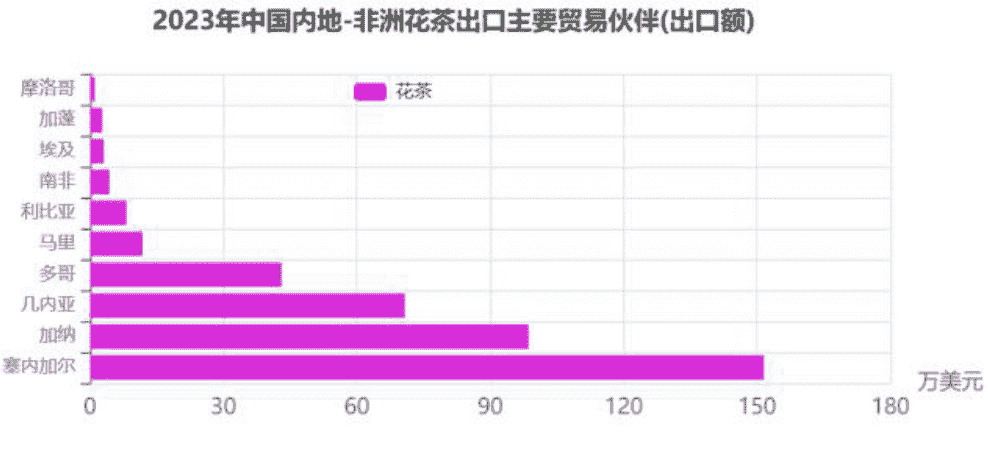

图 55 2023年中国内地-非洲花茶主要伙伴（出口量）
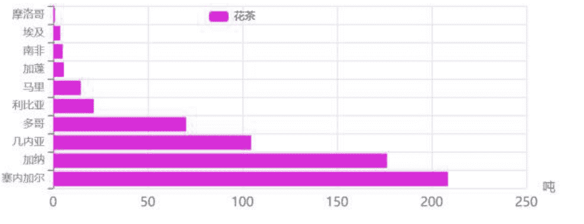

### 2023年中国内地对非非洲茶叶分析

2023年中国内地-非非洲茶叶量218.92万，在茶叶排名第3，同比增长0.48%；出口量185.91万，位第3，同比增长17.83%；均价8.49万美元/kg，增幅116.79%。

## 表格21 2015-2023年中国内地对非非洲红茶、量、均价

| 年份 | 出口量(万元) | 出口量同比(%) | 出口量(吨) | 出口量同比增长(%) | 均价(万美元/kg) | 均价同比增长(%) |
|---|---|---|---|---|---|---|
| 2015 | 90.03 | | 110.46 | | 8.15 | | |
| 2016 | 78.09 | -13.26 | 48.36 | -56.22 | 16.15 | 98.13 | |
| 2017 | 59.85 | -23.36 | 97.49 | 101.60 | 6.14 | -61.98 | |
| 2018 | 62.82 | 4.97 | 182.36 | 87.05 | 3.45 | -43.88 | |
| 2019 | 379.12 | 503.45 | 619.12 | 239.51 | 6.12 | 77.74 | |
| 2020 | 594.95 | 56.93 | 201.62 | -67.43 | 29.51 | 381.99 | |
| 2021 | 64.33 | -89.19 | 88.56 | -56.08 | 7.26 | -75.38 | |
| 2022 | 85.35 | 32.68 | 217.88 | 146.02 | 3.92 | -46.07 | |
| 2023 | 185.91 | 117.83 | 218.92 | 0.48 | 8.49 | 116.79 | |

图 56 2015-2023年中国内地对非非洲出口茶叶情况
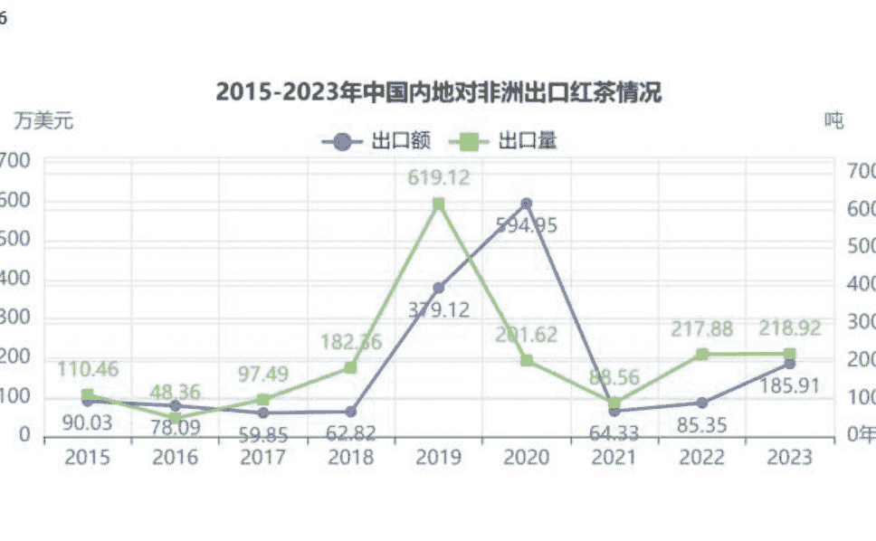

## 图表 57 2022, 2023年中国内地对非洲出口红茶差额（月万）
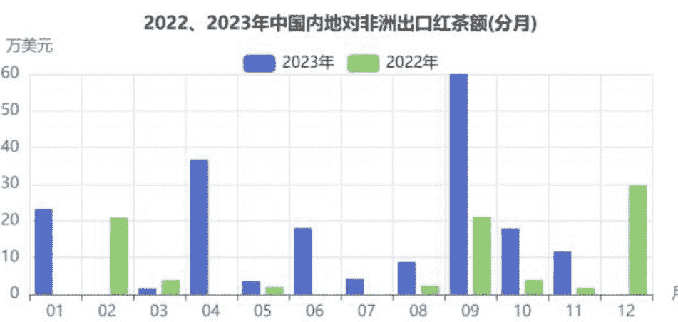

## 图表 58 2022, 2023年中国内地对非洲出口红茶量（吨）

2023年对非洲红茶出口前5省市为湖南省、福建省、浙江省、湖北省、安徽省，分别为出口额94.31万美元、出口额34.57万美元、出口额31.78万美元、出口额16.52万美元、出口额8.59万美元，合计占红茶规模的99.93%。

## 2023年中国内地对非洲红茶出口前5省市

| 注册地名称 | 出口额(万元) | 排名变化 | 出口同比增长(%) | 出口量(吨) | 出口量增长(%) | 均价(美元/Kg) |
|---|---|---|---|---|---|---|
| 湖南省 | 94.31 | 5 | 5160.45 | 72.94 | 3099.08 | 12.93 |
| 福建省 | 34.57 | 1 | 1379.23 | 42.39 | 2495.25 | 8.16 |
| 浙江省 | 31.78 | -2 | -35.33 | 64.48 | -42.65 | 4.64 |
| 湖北省 | 16.52 | 0 | 748.26 | 19.70 | 552.32 | 8.39 |
| 安徽省 | 8.59 | -3 | -69.55 | 15.37 | -83.17 | 5.69 |

2023年中国内地对非洲红茶出口额各省市占比
- 安徽省：4.62%
- 湖南省：8.89%
- 浙江省：17.09%
- 福建省：18.66%

2023年中国内地对非洲红茶出口量各省市占比
- 安徽省：7.02%
- 湖北省：9%
- 湖南省：33.32%
- 浙江省：31.28%
- 福建省：19.36%

## 表格22 2023年中国内地对非洲出口红茶、量、均价（规格）

| 商品名称 | 出口量(万美元) | 出口同比增长(%) | 出口量(吨) | 出口量同比增长(%) | 均价(美元/kg) | 均价同比增长(%) |
|---|---|---|---|---|---|---|
| 红茶，内包>3kg | 16.10 | -75.45 | 52.98 | -70.35 | 3.04 | -17.21 |
| 红茶，内包≤3kg | 169.82 | 758.63 | 165.94 | 323.36 | 10.23 | 102.81 |

图表 61 2023年中国内地对非洲出口红茶产品结构（出口量）

图表 62 2023年中国内地对非洲出口红茶产品结构（出口量）

## 图表 63 2015-2023年中国境内对非非洲红茶出口历年变化

## 图表 64 2015-2023年中国境内对非非洲红茶出口历年变化

2023年中国境内对非非洲绿茶出口额前5贸易伙伴依次为利比亚、多哥、尼日利亚、苏丹、科特迪瓦，分别为出口额72.28万美元、出口额41.18万美元、出口额36.69万美元、出口额9.87万美元、出口额8.76万美元，合计占红茶出口规模的91.32%。出口额前5大贸易伙伴为利比亚、苏丹、阿尔及利亚、科特迪伦、南非，分别为出口规模107.04万、出口量37.95万、出口量32.42万、出口量20.52万、合计占红茶规模的79.03%。

## 表2023年中国内地-非非洲红茶主要贸易伙伴（出口额前8）

| 贸易伙伴名称 | 出口额（万美元） | 排名变化 | 出口额占比 | 出口量（万吨） | 出口量占比 | 均价（美元/Kg） | 出口占比（%） | 出口占比（%） |
|---|---|---|---|---|---|---|---|---|
| 利比亚 | 72.28 | 1 | 133.62 | 107.04 | 18.25 | 6.75 | 38.88 | |
| 多哥 | 41.18 | 6 | 105.17 | 22.69 | 1.83 | 2.30 | | |
| 尼日利亚 | 36.69 | 6 | 104.82 | 3.50 | 19.73 | 1.60 | 17.33 | |
| 苏丹 | 9.87 | 6 | 37.95 | 20.52 | -80.34 | 4.27 | 4.71 | 9.37 |
| 科特迪伦 | 8.76 | -4 | -79.11 | 20.52 | -80.34 | 2.22 | 3.87 | 14.81 |
| 南非 | 5.58 | -4 | 14.76 | 8.44 | 6.60 | 3.00 | 3.86 | |
| 摩洛哥 | 3.36 | -4 | -10.27 | 5.04 | -4.94 | 6.66 | 1.81 | 2.30 |

图表 65 2023年中国内地-非非洲茶主要贸易伙伴（出口额）

图表 66 2023年中国内地-非洲茶主要贸易伙伴（出口量）

注：因白茶、乌龙茶、黑茶出口非洲的量太少，不具备分析价值，故不做分析

## 出口区域分析

### 2023年浙江省对非洲出口叶片

2023年浙江省非非洲出口叶片11.57万吨，位全国第1，同比减少0.22%；出口额3.47亿元，位列全国第1，同比减少2.17%；均价3.00美元/kg，增长1.96%。

##表格25 2015-2023年浙江省对非洲出口叶片、量、均价

| 年份 | 出口(亿美元) | 出口额同比增长(%) | 出口量(万吨) | 出口量增长(%) | 均价(美元/kg) | 均价同比增长(%) |
|---|---|---|---|---|---|---|
| 2015 | 3.68 | | 10.97 | | 3.36 | |
| 2016 | 3.37 | -8.42 | 10.68 | -2.68 | 3.16 | -5.90 | |
| 2017 | 3.62 | 7.23 | 12.12 | 13.45 | 2.98 | -5.48 | |
| 2018 | 3.82 | 5.59 | 12.62 | 4.16 | 3.03 | 1.37 | |
| 2019 | 3.44 | -9.98 | 11.67 | -7.75 | 2.96 | -2.63 | |
| 2020 | 3.15 | -8.36 | 10.91 | -6.44 | 2.89 | -2.03 | |
| 2021 | 3.47 | 10.09 | 11.24 | 2.98 | 3.09 | 6.90 | |
| 2022 | 3.54 | 2.18 | 11.59 | 3.16 | 3.06 | -0.95 | |
| 2023 | 3.47 | -2.17 | 11.57 | -0.22 | 3.00 | -1.96 | |

图 67 2015-2023年浙江省对非洲出口叶片情况

### 图表 6

# 2022、2023年浙江省对非洲出口茶额（分月）

### 图表 69

# 2022、2023年浙江省对非洲出口茶叶量（分月）

从出口量看，绿茶为浙江-非洲最大的茶叶类，出口量11.55万吨，占99.90%；红茶为第二大出口品种，出口量68.48万吨，占0.06%；花卉位第三，出口量52.80万吨，占0.05%。出口额看，绿茶出口额3.46亿美元，占茶叶出口总额的99.81%；茶叶出口额33.92万美元，占0.10%；红茶出口额31.78万美元，占0.09%。

# 中国农业企业协会非洲茶产业协会
TEA INDUSTRY COMMITTEE OF CHINA FOR THE
PROMOTION OF INTERNATIONAL AGRICULTURAL COOPERATION

表格 2023年浙江省对非洲出口茶叶总量、 均价（分规格）

| 商品名称 | 出口量(万美元) | 出口量增长(%) | 出口量(吨) | 出口总量增长(%) | 均价(美元/kg) | 均价增长(%) |
| --- | --- | --- | --- | --- | --- | --- |
| 红茶合计 | 31.78 | -35.33 | 68.48 | -42.65 | 4.64 | 12.75 |
| 红茶,内包>3kg | 8.76 | -79.11 | 20.52 | -60.34 | 6.27 | |
| 红茶,内包≤3kg | 23.02 | 219.73 | 47.96 | 219.73 | 4.80 | |
| 绿茶合计 | 34593.11 | -2.21 | 115546.76 | -0.22 | 2.99 | -2.00 |
| 绿茶,内包>3kg | 16419.28 | -19.80 | 66862.37 | -11.85 | 2.46 | -9.02 |
| 绿茶,内包≤3kg | 18173.82 | 21.94 | 48684.38 | 21.87 | 3.73 | 0.06 |
| 花茶合计 | 33.92 | 1141.65 | 52.80 | 1000.04 | 6.42 | 12.87 |
| 茉莉花茶,内包>3kg | 1.26 | | 2.96 | | 4.24 | |
| 茉莉花茶,内包≤3kg | 32.66 | | 49.84 | | 6.55 | |

# 2023年浙江省对非洲茶叶产品结构（出口额）

茉莉花茶，内包≤3kg 0.09%
红茶，内包>3kg 0.03%

茉莉花茶，内包≤3kg 0.07%
绿茶，内包>3kg 47.37%

绿茶，内包≤3kg 52.44%

### 图表 70

### 图表 71

# 2023年浙江省对非洲出口茶叶产品结构（出口量） 花茶，内包≤3kg 红茶，内包≤3kg

花茶，内包>3kg

绿茶，内包≤3kg 42.09%

红茶，内包≤3kg 0.04%

绿茶，内包>3kg 57.81%

### 图表 72

# 2015-2023年浙江省对非洲出口茶叶额多年变化

+ 绿茶 花茶 红茶 乌龙茶

# 2015-2023年浙江省对非洲出口茶叶量历史年变化

2023年浙江省对非洲出口量前5贸易伙伴依次为摩洛哥、塞内加尔、刚果、马里，出口量1.27亿美元、出口量3128.86万美元、出口量2694.31万美元、出口量2521.18万美元，合计占规模的68.18%。出口量前5贸易伙伴依次为摩洛哥、塞内加尔、刚果、马里，出口量4.24万吨、出口量9730.56吨、出口量7903.14吨、出口量7486.92吨，合计占规模的61.64%。

表格27 2023年浙江省对非洲主要贸易伙伴（出口量）

| 贸易伙伴 | 出口额（万美元） | 排名 | 出口占比（%） | 出口量（吨） | 出口量同比增长（%） | 均价（美元/kg） | 出口钻石（%） | 出口量（%） |
| --- | --- | --- | --- | --- | --- | --- | --- | --- |
| 摩洛哥 | 12734.42 | | -0.23 | 42745.21 | -21.21 | 3.00 | 36.7 | 36.68 |
| 塞内加尔 | 3128.86 | | -0.77 | 7973.9 | -9.90 | 3.96 | 9.3 | 6.83 |
| 刚果 | 2694.31 | 1 | 51.73 | 7486.92 | 43.87 | 3.60 | 7.7 | 6.47 |
| 马里 | 2551.59 | 2 | 59.96 | 7104.44 | 65.88 | 3.59 | 7.3 | 6.14 |
| 加纳 | 2521.18 | 5 | 139.21 | 6371.98 | 127.27 | 3.96 | 7.27 | 5.51 |
| 喀麦隆 | 2141.06 | -3 | -1.95 | 5182.77 | 5.29 | 4.13 | 6.18 | 4.48 |
| 阿及利亚 | 2076.21 | 2 | 45.97 | 6769.26 | 67.47 | 3.09 | 5.99 | 5.80 |
| 贝宁 | 1634.65 | | 12.06 | 6309.02 | 11.99 | 2.58 | 7.42 | 5.48 |
| 尼日利亚 | 1173.75 | -2 | -23.59 | 4516.88 | -19.87 | 2.60 | 3.39 | 3.91 |
| 喀麦隆 | 1091.20 | -5 | -32.95 | 9730.56 | -12.11 | 1.12 | 3.15 | 4.84 |

### 图表 74

### 2023年浙江省-非茶叶主要贸易伙伴（出口额）

| 抹茶 | 绿茶 | 红茶 | 花茶 |
| --- | --- | --- | --- |
| 尼日尔 | | | |
| 贝宁 | | | |
| 阿及利亚 | | | |
| 毛里塔尼亚 | | | |
| 加纳 | | | |
| 马里 | | | |
| 阿比俄亚 | | | |
| 塞内加尔 | | | |
| 摩洛哥 | | | |

### 图表 75

### 2023年浙江省-非茶叶主要贸易伙伴（出口量）

| 尼日尔 | 绿茶 | 红茶 | 花茶 |
| --- | --- | --- | --- |
| 毛里塔尼亚 | | | |
| 贝宁 | | | |
| 加纳 | | | |
| 阿及利亚 | | | |
| 马里 | | | |
| 阿比俄亚 | | | |
| 塞内加尔 | | | |
| 抹茶 | | | |
| 摩洛哥 | | | |

# 2023年安徽省对非洲出口茶叶分析

2023年安徽省对非洲出口茶叶5.74万吨，全国第2，同比增长14.62%；出口额2.24亿元，位第2，同比增长9.12%；均价3.90美元/kg，增长4.80%。

表格28 2015-2023年安徽省对非洲出口茶叶量、均价

| 年份 | 出口额(亿美元) | 出口同比增长(%) | 出口量(万吨) | 出口同比增长(%) | 均价(美元/kg) | 均价同比增长(%) |
| --- | --- | --- | --- | --- | --- | --- |
| 2015 | 1.73 | | 4.03 | | 4.29 | |
| 2016 | 1.83 | 5.90 | 4.36 | | 4.19 | -2.28 |
| 2017 | 1.84 | 0.82 | 4.57 | 4.72 | 4.04 | |
| 2018 | 1.98 | 7.56 | 4.63 | 1.32 | 4.29 | 6.16 |
| 2019 | 2.07 | 4.30 | 4.83 | 4.30 | 4.29 | 0.01 |
| 2020 | 2.33 | 12.74 | 5.61 | 16.07 | | -2.87 |
| 2021 | 2.45 | 5.06 | 5.65 | 0.88 | 4.34 | 4.15 |
| 2022 | 2.05 | -16.23 | 5.01 | -11.46 | 4.10 | -5.38 |
| 2023 | 2.24 | 9.12 | 5.74 | 14.62 | 3.90 | -4.80 |

### 图表 76

### 2015-2023年安徽省对非洲出口茶叶

### 2022、2023年安徽省对非洲茶叶量（分月）

### 2022、2023年安徽省对非洲茶叶量（分月）

从出口量看，绿茶为安徽省-非洲最大的茶叶类，出口量5.74万吨，占99.97%。红茶为第二大出口品种，出口量15.37吨，占0.03%。黑茶位第三，出口量1.50万，占0.00%。出口额看，绿茶出口额2.24亿美元，占茶叶出口总额的99.95%；红茶出口额8.59万美元，占0.04%；花茶出口额1.08万，占0.00%；黑茶出口额99万美元。

# 中国国际合作促进茶叶协会
TEA INDUSTRY COOPERATION OF CHINA FOR THE
PROMOTION OF INTERNATIONAL AGRICULTURAL COOPERATION

2023年安徽省对非洲出口茶叶类、均价

| 商品名称 | 出口额(万美元) | 出口同比增长(%) | 出口量（吨） | 重量同比增长(%) | 均价（美元/吨） | 均价同比增长(%) |
| --- | --- | --- | --- | --- | --- | --- |
| 乌龙合计 | 0.49 | -45.51 | 0.63 | -38.94 | 7.75 | -10.76 |
| 乌龙茶、内包≤3kg | 0.49 | -45.51 | 0.63 | -38.94 | 7.75 | -10.76 |
| 红茶合计 | 8.59 | -69.55 | 15.37 | -83.17 | 5.59 | 80.92 |
| 红茶、内包≤3kg | 1.62 | -92.56 | 4.94 | -93.14 | 3.29 | 8.40 |
| 红茶、内包<3kg | 6.96 | 9.20 | 10.43 | -46.07 | 6.68 | 102.50 |
| 绿茶合计 | 22397.34 | 9.22 | 57366.92 | 14.80 | 3.90 | -4.85 |
| 绿茶、内包≤3kg | 2481.95 | 42.45 | 8213.79 | 47.36 | 3.02 | -3.34 |
| 绿茶、内包<3kg | 19915.39 | 6.14 | 49153.13 | 10.71 | 4.05 | -4.13 |
| 花茶合计 | 1.08 | 107.33 | 1.48 | 123.82 | 7.31 | -7.37 |
| 茉莉花茶、内包≤3kg | 1.08 | | 1.48 | | 7.31 | |
| 黑茶合计 | 0.90 | | 1.50 | | 5.97 | |
| 普洱熟茶、内包≤3kg | 0.90 | | 1.50 | | 5.97 | |

### 图表 79

### 2023年安徽省对非洲茶叶产品结构（出口额）

### 图表 80

### 2023年安徽省对非洲茶叶产品结构（出口量）

普洱熟茶，内包≤3kg
乌龙茶，内包≤3kg

茉莉花茶，内包≤3kg 0%

红茶，内包>3kg 0.01%
红茶，内包≤3kg 0.02%
绿茶，内包>3kg 14.31%

红茶: 0.03%

绿茶: 99.97%

绿茶，内包≤3kg 85.66%

### 图表 81

### 2015-2023年安徽省对非洲茶叶份额历年变化

+ 绿茶 — 红茶 — 花茶 — 黑茶 — 乌龙茶

### 2015-2023年安徽省对非洲茶叶量历史年变化

2023年安徽省对非洲茶叶前5贸易伙伴依次为加纳、毛里塔尼亚、塞内加尔、阿尔及利亚、多哥，出口量1.04亿美元、出口量3478.64万美元、出口量2384.22万美元、出口量1879.32万美元、合计占规模的84.29%。

表格30 2023年安徽省非茶叶主要贸易伙伴（出口量）

| 贸易伙伴 | 出口额（万） | 排名 | 出口占比（%） | 出口量（吨） | 出口量同比增长（%） | 均价（美元/kg） | 出口钻石（%） | 出口量（%） |
| --- | --- | --- | --- | --- | --- | --- | --- | --- |
| 加纳 | 10385.66 | | 25175.14 | 41.88 | 4.13 | 46.3 | 43.87 |
| 毛里塔尼亚 | 3478.64 | 2 | 8406.9 | 39.91 | 4.14 | 15.52 | 14.65 |
| 塞内加尔 | 2384.0 | | 6044.11 | -17.85 | 3.94 | 10.64 | 10.53 |
| 阿及利亚 | 1879.32 | -1 | 3506.54 | 62.28 | 3.27 | 8.39 | 10.02 |
| 多哥 | 1181.28 | -3 | 2997.46 | -55.12 | 3.94 | 5.27 | 5.22 |
| 尼日利亚 | 1059.23 | 1 | 7037.21 | 40.96 | 4.45 | 4.7 | 4.15 |
| 玫瑰语 | 804.90 | -1 | 2759.79 | 7.92 | 2.92 | 3.9 | 4.81 |
| 莱内亚 | 344.79 | -18 | 966.00 | -14.29 | 3.57 | 1.5 | 1.68 |
| 比利亚 | 205.97 | -0 | 928.96 | -38.56 | 2.22 | 0.92 | 1.62 |
| 阿比亚 | 200.20 | -1 | 471.65 | 32.03 | 4.27 | 0.8 | |

### 图表 83

### 2023年安徽省-非洲主要贸易伙伴（出口量）

| 绿茶 | 乌龙茶 | 红茶 | 黑茶 | 花茶 |
| --- | --- | --- | --- | --- |
| 肯尼亚 | | | | |
| 利比亚 | | | | |
| 几内亚 | | | | |
| 摩洛哥 | | | | |
| 贝宁 | | | | |
| 多哥 | | | | |
| 阿及利亚 | | | | |
| 塞内加尔 | | | | |
| 毛基尼亚 | | | | |
| 加纳 | | | | |

### 图表 84

### 2023年安徽省-非洲茶叶主要贸易伙伴（出口量）

| 绿茶 | 乌龙茶 | 红茶 | 黑茶 | 花茶 |
| --- | --- | --- | --- | --- |
| 肯尼亚 | | | | |
| 利比亚 | | | | |
| 几内亚 | | | | |
| 贝宁 | | | | |
| 摩洛哥 | | | | |
| 多哥 | | | | |
| 阿及利亚 | | | | |
| 塞内加尔 | | | | |
| 毛基尼亚 | | | | |
| 加纳 | | | | |

# 2023年湖北省对非洲出口茶叶分析

2023年湖北省-非非洲出口量16.4万吨，位全国第3，比增长19.83%；出口额5979.5万万美元，n位列全国第3，比增长31.68%;均价41.50美元/吨，增幅9.89%。

表格 31 2015-2023年湖北省对非洲出口茶叶量、均价

| 年份 | 出口额(万美元) | 出口额同比增长(%) | 出口量(吨) | 均价(美元/kg) | 均价同比增长(%) |
| --- | --- | --- | --- | --- | --- | --- |
| 2015 | 1521.20 | | 2832.34 | | 5.37 | |
| 2016 | 1475.28 | -3.02 | 2901.07 | 2.43 | 5.09 | -5.32 |
| 2017 | 1902.88 | 28.99 | 4303.14 | 48.33 | 4.42 | -13.04 |
| 2018 | 1304.41 | -31.45 | 3054.14 | 29.03 | 4.27 | -3.42 |
| 2019 | 1987.32 | 52.35 | 4966.82 | 62.63 | 4.00 | -6.32 |
| 2020 | 2724.39 | 37.09 | 7110.01 | 43.15 | 3.83 | -4.23 |
| 2021 | 4442.41 | 63.06 | 12823.72 | 80.36 | 3.46 | -9.59 |
| 2022 | 4540.46 | 2.21 | 12183.40 | -4.99 | 3.73 | 7.58 |
| 2023 | 5979.05 | 31.68 | 14599.64 | 19.83 | 4.10 | 9.89 |

### 图表 85

# 2015-2023年湖北省对非洲出口茶叶

# 2022、2023年湖北省对非洲出口茶叶量（分月）

# 2022、2023年湖北省对非洲出口茶叶量（分月）

从出口量看，绿茶为湖北-非洲最大的出口茶叶，出口量1.46万吨，占99.87%；红茶为第二大出口品种，出口量19.70万，占0.13%。从出口额看，绿茶出口额5962.53万美元，占茶叶出口总额的99.72%；红茶出口额16.52万美元，占0.28%。

### 表格 2023年湖北省对非洲出口茶叶量、均价（规格）

| 商品名称 | 出口(万美元) | 出口增长 (%) | 出口量(吨) | 出口增长 (%) | 均价(美元/kg) | 均价增长 (%) |
| :--- | :--- | :--- | :--- | :--- | :--- | :--- |
| 红茶合计 | 16.52 | 748.26 | 19.70 | 552.32 | 8.39 | 30.04 |
| 红茶，内包≤3kg | 16.52 | 740.26 | 19.70 | 552.32 | 8.39 | 30.04 |
| 绿茶，内包≤3kg | 5962.53 | 31.38 | 14579.99 | 19.70 | 4.09 | 9.75 |
| 绿茶，内包>3kg | 3966.85 | 35.06 | 11085.66 | 10.29 | 3.58 | 22.46 |
| 绿茶，内包≤3kg | 1995.67 | 24.62 | 3494.33 | 64.14 | 5.71 | -24.08 |

### 2023年湖北省对非洲茶叶产品结构（出口额）

中国农业国际合作促进茶产业分会
TEA INDUSTRY COMMITTEE OF CHINA ASSOCIATION FOR THE PROMOTION OF INTERNATIONAL AGRICULTURAL COOPERATION

图表 89

# 2023年湖北省对非洲出口茶产品结构（出口量）

绿茶，内包≤3kg
23.93%

红茶，内包≤3kg
0.14%

绿茶，内包>3kg
75.93%

红茶: 0.13%

绿茶: 99.87%

图表 90

# 2015-2023年湖北省对非洲出口茶份额历年变化

绿茶 红茶

北京市海淀区中国农业科学研究院标准4号楼 010-821106329 www.capiaccti.org.cn 67

# 2015-2023年湖南省对非洲出口茶量历史年变化

2023年湖南省对非洲出口茶量前5个贸易伙伴依次为摩洛哥、利比亚、塞内加尔、阿尔及利亚、尼日尔，分别为出口量3288.47万美元、出口量850.82万美元、出口量623.69万美元、出口量483.20万美元、出口量262.46万美元，合计出口规模的92.13%。出口量前5贸易伙伴依次为摩洛哥、尼日尔、阿尔及利亚、利比亚、塞内加尔，分别为出口量7640.54吨、出口量2158.00吨、出口量1647.54吨、出口量1230.58吨、出口量970.81吨，合计出口规模的93.48%。

表格 33 2023年湖南省出口非洲主要贸易伙伴（出口量前10）
| 贸易伙伴名称 | 出口额（万美元） | 排名变化 | 出口量占比(%) | 出口量（吨） | 出口量占比(%) | 均价（美元/kg） | 出口额占比(%) | 出口量占比(%) |
| :--- | :--- | :--- | :--- | :--- | :--- | :--- | :--- | :--- |
| 摩洛哥 | 3288.47 | 0 | 24.34 | 7640.54 | 0.36 | 4.30 | 55.00 | 52.33 |
| 利比亚 | 850.82 | 0 | -3.16 | 1238.56 | 0.37 | 6.91 | 14.23 | 8.43 |
| 塞内加尔 | 623.69 | 1 | 19.54 | 970.81 | 0.34 | 6.42 | 10.43 | 6.55 |
| 阿尔及利亚 | 483.20 | 1 | 14.68 | 1647.54 | 0.13 | 2.93 | 8.08 | 11.28 |
| 尼日尔 | 262.46 | 1 | 31.96 | 2158.00 | 0.33 | 1.2 | 4.4 | 14.78 |
| 比利亚 | 216.17 | -5 | 298.68 | 0.269 | 7.24 | 3.62 | 2.05 | |
| 坦桑尼亚 | 97.12 | 8 | | 121.14 | 80.00 | 1.62 | 0.09 | |
| 多哥 | 56.68 | 0 | 6.22 | 65.40 | 0.417 | 8.67 | 0.95 | 0.45 |
| 加纳 | 43.82 | | 182.60 | | 2.40 | 0.73 | 1.25 | |
| 马里 | 21.15 | 7 | 47.00 | | 4.50 | 0.35 | 0.32 |

图表 92

# 2023年湖北省-非茶主要贸易伙伴（出口额）

图表 93

# 2023年湖北省-非茶主要贸易伙伴（出口量）

## 中国农业国际促进委员会非洲产业分析

2023年江西省对非洲茶叶6540.53吨，位全国第6，同比减少2.42%；出口额2667.1万美元，2023年江西省-非非洲茶叶6540.53吨，位全国第6，同比减少9.35%；均价4.08美元/kg，降幅7.10%。

表格 34 2015-2023年江西省对非洲出口茶叶量、均价

| 年份 | 出口额（万美元） | 出口额同比增长(%) | 出口量（吨） | 出口量同比增长(%) | 均价（美元/kg） | 均价同比增长(%) |
| :--- | :--- | :--- | :--- | :--- | :--- | :--- |
| 2015 | 1162.26 | | 3291.6 | | 3.53 | 4.10 |
| 2016 | 1010.87 | -13.03 | 2750.15 | -16.45 | 3.68 | -5.61 |
| 2017 | 1206.71 | 19.37 | 3477.96 | 26.46 | 3.47 | |
| 2018 | 2483.15 | 105.78 | 7031.71 | 102.18 | 3.53 | 1.78 |
| 2019 | 3406.06 | 37.17 | 8674.66 | 23.36 | 3.93 | 11.19 |
| 2020 | 3807.48 | 11.79 | 8764.91 | 1.04 | 4.34 | 10.63 |
| 2021 | 3189.28 | -16.24 | 7149.40 | -18.43 | 4.46 | 2.69 |
| 2022 | 2942.90 | -7.73 | 6703.06 | -6.24 | 4.39 | -1.58 |
| 2023 | 2667.71 | -9.35 | 6540.53 | -2.42 | 4.08 | -7.10 |

图 94

# 2015-2023年江西省对非洲出口茶叶

### 2022、2023年江西省对非洲茶叶额（分月）

### 2022、2023年江西省对非洲茶叶量（分月）

从出口量看，绿茶为江西省-非洲最大的茶类，出口量6184.58吨，占94.56%；花茶为第二大品种，出口量355.95吨，占5.44%。从出口额看，绿茶出口额2454.57万美元，占茶叶总额的92.01%；花茶出口额213.13万美元，占7.99%。

表格 35 2023年江西省对非洲出口茶叶、均价（规格）

| 商品名称 | 出口额（万美元） | 出口增长(%) | 出口量（吨） | 出口增长(%) | 均价（美元/kg） | 均价同比(%) |
| :--- | :--- | :--- | :--- | :--- | :--- | :--- |
| 绿茶合计 | 2454.57 | -13.47 | 6184.58 | -5.23 | 3.97 | -6.69 |
| 绿茶，内包≤3kg | 2083.31 | -51.69 | 6549.94 | 39.08 | 3.18 | -20.71 |
| 绿茶，内包>3kg | 2246.26 | -6.62 | 5529.64 | 1.44 | 4.06 | -7.95 |
| 花茶合计 | 213.13 | 100.81 | 355.95 | 101.19 | 5.99 | -0.19 |
| 茉莉花茶，内包≤3kg | 1.23 | | 1.39 | | 8.84 | |
| 茉莉花茶，内包>3kg | 211.91 | | 354.56 | | 5.98 | |

### 2023年江西省对非洲茶叶茶叶结构（出口量）

茉莉花茶，内包≤3kg 7.94%
绿茶，内包>3kg 7.81%
茉莉花茶，内包>3kg 0.05%
绿茶 92.01%

图 98

### 2023年江西省对非洲出口茶叶结构（出口量）

茉莉花茶，内包≤3kg 5.42%
绿茶，内包>3kg 10.01%
茉莉花茶，内包>3kg 0.02%
绿茶 94.56%

绿茶，内包≤3kg 84.55%

### 2015-2023年江西省对非洲出口茶叶量历年变化

### 2015-2023年江西省对非洲出口茶叶量历年变化

# 2023年江西省对非洲茶叶出口主要贸易伙伴次为毛里求堡、几内亚、索内加尔、阿尔及比分别为出口额969.29万美元、出口额845.90万美元、出口额154.87万美元、出口额133.37万美元、出口额123.14万美元，合计出口额占出口总规模的83.70%。出口前5大贸易伙伴次为毛里求堡、阿尔及比和几内亚，分别为出口量2456.73吨、出口量1879.30吨、出口量463.76吨、出口量323.00吨、出口量306.70吨，合计出口规模的82.59%。

表格 2023年江西对非洲茶叶主要贸易伙伴（出口前10）

| 贸易伙伴 | 出口额（万元） | 排名变化 | 出口量（吨） | 出口占比(%) | 均价（美元/kg） | 出口占比(%) | 出口量占比(%) |
| :--- | :--- | :--- | :--- | :--- | :--- | :--- | :--- |
| 加纳 | 969.29 | 0 | 2456.73 | -13.24 | 3.95 | 36.33 | 37.56 |
| 毛里求堡 | 845.90 | 0 | 1879.30 | 38.62 | 4.50 | 31.71 | 28.73 |
| 几内亚 | 154.87 | 7 | 620.36 | 30.70 | 5.05 | 5.81 | 4.69 |
| 索内加尔 | 133.37 | 3 | 192.70 | 220.87 | 4.52 | 5.00 | 4.51 |
| 阿尔及比 | 123.14 | 4 | 358.73 | 383.07 | 2.66 | 4.62 | 7.09 |
| 多哥 | 113.48 | -2 | 262.75 | -47.21 | 4.32 | 4.25 | 4.02 |
| 象牙 | 109.13 | -4 | 280.60 | -73.01 | 3.89 | 4.09 | 4.29 |
| 贝宁 | 106.60 | -3 | 323.00 | -34.69 | 3.30 | 4.00 | 4.94 |
| 利比亚 | 54.89 | -3 | 147.56 | 12.34 | 3.72 | 2.06 | 2.26 |
| 安比比亚 | 19.81 | -1 | 46.00 | -0.65 | 4.31 | 0.74 | 0.70 |

图 10

# 2023年江西省-非洲茶叶主要贸易伙伴（出口额）

图表 102

# 2023年江西省-非洲茶叶主要贸易伙伴（出口量）

中国农业国际促进会茶叶协会
TEA INDUSTRY COMMITTEE OF CHINA ASSOCIATION FOR THE PROMOTION OF INTERNATIONAL AGRICULTURAL COOPERATION

# 2023年湖南省对非洲出口茶叶情况

2023年湖南省对非洲出口茶叶量12.7万吨，位全国第4，同比减少0.47%；出口额3811.02万美元，位全国第3，同比减少1.25%；均价3.01美元/kg，增长0.78%。

| 年份 | 出口额（万美元） | 出口额同比增长(%) | 出口量（吨） | 均价（美元/kg） | 均价同比增长率(%) |
| :--- | :--- | :--- | :--- | :--- | :--- |
| 2015 | 1884.54 | | 7233.4 | | 2.61 | |
| 2016 | 1962.96 | 4.16 | 7028.7 | -2.83 | 2.79 | 7.19 |
| 2017 | 1751.40 | -10.75 | 7139.6 | 1.58 | 2.45 | -12.14 |
| 2018 | 1522.78 | -13.08 | 5255.9 | -26.39 | 2.90 | 18.09 |
| 2019 | 1963.87 | 28.97 | 8260.1 | 57.18 | 2.38 | -17.95 |
| 2020 | 1505.42 | -23.34 | 5824.9 | -29.49 | 2.58 | 8.71 |
| 2021 | 2631.72 | 74.82 | 8414.6 | 44.47 | 3.13 | 21.00 |
| 2022 | 3859.23 | 46.64 | 12712.23 | 51.07 | 3.04 | -2.93 |
| 2023 | 3811.02 | -1.25 | 12681.90 | -0.47 | 3.01 | -0.78 |

表格 37 2015-2023年湖南省对非洲出口茶叶量、均价

图 103 2015-2023年湖南省对非洲出口茶叶

中国农业国际促进茶分会
TEA INDUSTRY COMMITTEE OF CHINA ASSOCIATION FOR THE PROMOTION OF INTERNATIONAL AGRICULTURAL COOPERATION

图 104 2022、2023年湖南省对非洲茶叶额（分月）

图 105 202222023年湖南省对非洲茶叶量（分月）

从出口量看，绿茶为湖南省-非洲最大的茶类，出口量12.4万吨，占97.72%；花茶为第二大品种，出口量20.90万，占1.59%；红茶位居第三，出口量72.94万，占0.58%。从出口额看，绿茶出口额3559.93万美元，占茶叶总额的93.41%；花茶出口额145.4万美元，占3.82%；红茶出口额94.31万美元，占2.47%；白茶出口量9.83万美元，占0.26%。

# 2023年湖南省对非洲出口茶叶总额、均价（规格）

| 商品名称 | 出口额(万元) | 出口增长(%) | 出口量（吨） | 出口增长(%) | 均价（元/kg） | 均价同比增长(%) |
| :--- | :--- | :--- | :--- | :--- | :--- | :--- |
| 乌龙茶合计 | | | 0.17 | | 42.40 | |
| 乌龙茶，内包≤3kg | 0.72 | | 0.17 | | 42.40 | |
| 白茶合计 | | 9.83 | | 13.77 | 7.14 | |
| 白茶，内包≤3kg | | 9.83 | | 13.77 | 7.14 | |
| 红茶合计 | 94.31 | 5160.45 | 72.94 | 3009.08 | 12.93 | 64.44 |
| 红茶，内包≤3kg | 5.58 | 211.10 | 27.48 | 1105.26 | 2.03 | -74.19 |
| 红茶，内包≤3kg | | 88.74 | | 45.46 | | 19.52 |
| 绿茶合计 | 3559.93 | -5.27 | 12363.12 | -1.75 | 2.88 | -3.59 |
| 绿茶，内包≤3kg | 2129.84 | -21.63 | 8060.96 | -10.81 | 2.64 | -12.13 |
| 绿茶，内包≤3kg | 1430.09 | 37.44 | 4302.16 | 21.35 | |

图 106

# 2023年湖南省对非洲茶叶茶叶结构（出口量）

+   - 黑茶、内包≤3kg: 0.02%
- 乌龙茶、内包≤3kg: 0.02%
- 茉莉花茶、内包≤3kg: 3.78%
- 白茶、内包≤3kg: 0.26%
- 茉莉花茶、内包≤3kg: 0.03%
- 红茶、内包≤3kg: 0.15%
- 绿茶、内包≤3kg: 37.52%
- 红茶、内包≤3kg: 2.33%
- 绿茶、内包≤3kg: 55.89%

## 2023年湖南省对非洲出口茶叶产品结构（出口量）

- 黑茶，内包≤3kg 0.01%
- 乌龙茶，内包≤3kg 0%
- 茉莉花茶，内包≤3kg 1.57%
- 茉莉花茶，内包>3kg 0.02%
- 绿茶，内包≤3kg 34%
- 白茶，内包≤3kg 0.11%
- 红茶，内包>3kg 0.22%
- 红茶，内包≤3kg 0.36%

## 2015-2023年湖南省对非洲茶叶茶叶额历史变化

+ 绿茶 花茶 红茶 白茶 黑茶 乌龙茶

## 2015-2023年湖南对非洲出口茶叶历年变化

+ - 绿茶 - 花茶 - 红茶 - 白茶 - 黑茶 - 乌龙茶

2023年湖南省对非洲出口茶叶前5类贸易伙伴依次为摩洛哥、阿尔及利亚、利比亚、塞内加尔、贝宁，分别为出口额1495.43万美元、出口量799.3万、出口量52.04万、出口额138.13万美元、出口额147.93万美元，合计出口规模的87.18%。出口前5类贸易伙伴依次为摩洛哥、阿尔及利亚、利比亚、塞内加尔、突尼斯，分别为出口量4937.14吨、出口量2911.15吨、出口量1887.05吨、出口量809.64吨、出口量508.20吨，合计出口规模的85.36%

## 表格 39 湖南省对非洲出口茶叶主要贸易伙伴（出口额前10）

| 贸易伙伴 | 出口额（万美元） | 排名变化 | 出口量（吨） | 出口量比增长 | 均价（美元/Kg） | 出口额比（%） | 出口量比（%） |
| :--- | :--- | :--- | :--- | :--- | :--- | :--- | :--- |
| 摩洛哥 | 1496.43 | 0 | 4937.14 | -36.27 | 3.03 | 39.04 | 39.02 |
| 阿尔及利亚 | 799.03 | -1 | 2911.15 | 15.93 | 2.74 | 14.22 | 20.97 |
| 利比亚 | 542.04 | -1 | 1887.05 | -8.28 | 2.87 | 14.92 | 14.92 |
| 塞内加尔 | 338.13 | 0 | 809.64 | 80.28 | 4.18 | 5.87 | 6.40 |
| 贝宁 | 147.93 | 3 | 751.90 | 254.35 | 5.82 | 5.38 | 2.01 |
| 坦桑 | 93.84 | 11 | 691.01 | 13.60 | 2.46 | 0.55 | |
| 突尼斯 | 60.98 | -2 | 508.20 | -27.94 | 1.20 | 1.60 | 4.02 |
| 尼日利亚 | 57.83 | -1 | 92.90 | 93.54 | 6.22 | 1.52 | 0.73 |
| 赞及 | 52.37 | -3 | 264.54 | 264.93 | 1.98 | 1.37 | 2.09 |
| 肯尼亚 | 47.84 | 6 | 1429.70 | 323.30 | 1.48 | 1.26 | 2.56 |

## 图表 110

## 2023年湖南省-非洲茶叶出口主要贸易伙伴（出口量）

| | 花茶 | 白茶 | 绿茶 | 红茶 | 乌龙茶 | 黑茶 |
|---|---|---|---|---|---|---|
| 肯尼亚 | | | | | | |
| 埃及 | | | | | | |
| 尼日尔 | | | | | | |
| 突尼斯 | | | | | | |
| 多哥 | | | | | | |
| 贝宁 | | | | | | | |
| 塞内加 | | | | | | | |
| 利比亚 | | | | | | | |
| 阿及利亚 | | | | | | | |
| 摩洛哥 | | | | | | | |

### 图表 111

## 2023年湖南省-非洲茶叶出口主要贸易伙伴（出口量）

| | 花茶 | 白茶 | 绿茶 | 红茶 | 乌龙茶 | 黑茶 |
|---|---|---|---|---|---|---|
| 利比亚 | | | | | | | |
| 乍得 | | | | | | | |
| 贝宁 | | | | | | | |
| 肯尼亚 | | | | | | | |
| 突尼斯 | | | | | | | |
| 塞内加 | | | | | | | |
| 利比亚 | | | | | | | |
| 阿及利亚 | | | | | | | |
| 摩洛哥 | | | | | | | |

## 2023年福建对非洲出口情况

2023年福建省非非洲出口量8589.84吨，列全国5位，同比增长14.02%；出口额4783.65万美元，列全国4位，均价5.75美元/吨，增幅10%。

| 年份 | 出口额（万美元） | 出口额同比增长（%） | 出口量（吨） | 出口量同比增长（%） | 均价（美元/Kg） | 均价同比增长（%） |
|---|---|---|---|---|---|---|
| 2015 | 1188.72 | | 1025.66 | 11.59 | | |
| 2016 | 2600.88 | 118.80 | 1977.52 | 92.81 | 13.15 | 13.48 |
| 2017 | 1046.24 | -59.77 | 1290.28 | -34.75 | 8.11 | -38.35 |
| 2018 | 649.08 | -37.96 | 1089.14 | -15.59 | 5.96 | -26.50 |
| 2019 | 809.94 | 24.78 | 1073.31 | -1.45 | 7.55 | 26.62 |
| 2020 | 712.79 | -11.99 | 1278.52 | 19.15 | 5.82 | -26.14 |
| 2021 | 2264.73 | 217.73 | 3939.73 | 208.08 | 5.75 | 3.13 |
| 2022 | 4191.48 | 85.08 | 7533.66 | 91.22 | 5.56 | -3.21 |
| 2023 | 4783.65 | 14.13 | 8589.84 | 14.02 | 5.57 | 0.10 |

## 2015-2023年福建省对非洲茶叶茶叶

## 图表 113

### 2022、2023年福建省对非洲茶叶量（分月）

## 图表 114

### 2022、2023年福建省对非洲茶叶量（分月）

从出口量看，绿茶为福建省最大的出口量，出口量8352.00吨，占97.23%。乌龙茶为第二大品种，出口量194.87吨，占2.27%。红茶位第三，出口量42.39吨，占0.49%。从出口额看，绿茶出口额4745.63万美元，占茶叶总额的99.21%。红茶出口额34.57万美元，占0.72%。乌龙茶出口额2.63万美元，占0.05%。白茶出口额4408万

## 中国农业促进非洲协会 TEA INDUSTRY COMMITTEE OF CHINA ASSOCIATION FOR THE PROMOTION OF INTERNATIONAL COOPERATION

2023年福建省对非洲茶叶叶量、均价（规格）

| 商品名称 | 出口额（万美元） | 出口额增长（%） | 出口量（吨） | 出口量增长（%） | 均价（美元/kg） | 均价增长（%） |
| --- | --- | --- | --- | --- | --- |
| 乌龙茶合计 | 2.63 | -60.80 | 194.87 | -46.83 | 0.13 | -26.42 |
| 乌龙茶、内包≤3kg | 2.11 | -43.76 | 194.36 | -46.77 | 0.11 | 5.65 |
| 乌龙茶、内包<3kg | 0.52 | -82.47 | 0.51 | -62.90 | 10.16 | -52.76 |
| 白茶合计 | 0.44 | | | 0.29 | | 15.04 |
| 白茶、内包≤3kg | 0.44 | | | 0.29 | | 15.04 |
| 红茶合计 | 34.57 | 1379.23 | 42.39 | 2494.25 | 8.16 | -92.98 |
| 红茶、内包≤3kg | 34.57 | 1379.23 | 42.39 | 2494.25 | 8.16 | -92.98 |
| 绿茶合计 | 4745.63 | 13.55 | 8352.0 | 16.59 | 5.68 | -2.61 |
| 绿茶、内包≤3kg | 1429.28 | 66.65 | 1896.46 | 82.99 | 7.54 | -8.93 |
| 绿茶、内包<3kg | 3316.35 | -16. | 6455.54 | 5.36 | 5.14 | -5.24 |
| 花茶合计 | 0.11 | | | 0.03 | | 38.62 |
| 茉莉花茶、内包≤3kg | 0.11 | | | 0.03 | | 38.62 |
| 果茶合计 | 0.26 | | | 0.26 | | 10.31 |
| 苦味茶、内包≤3kg | 0.26 | | | 0.26 | | 10.31 |

## 图表 115

### 2023年福建省对非洲茶叶结构（出口额）

## 图表 116

## 2023年福建省对非洲茶叶产品结构（出口量）

普洱茶，内包≤3kg
乌龙茶，内包≤3kg
茉莉花茶，内包≤3kg
乌龙茶，内包≤3kg
白茶，内包≤3kg
红茶，内包≤3kg
绿茶，内包≤3kg
绿茶，内包≤3kg

## 图表 117

## 2015-2023年福建省对非洲茶叶金额变化

+ 绿茶 红茶 乌龙茶 白茶 花茶

### 2015-2023年福建省对非洲茶叶历史变化

+ - 绿茶 乌龙茶 - 白茶 - 花茶

2023年福建省对非洲茶叶前五贸易伙伴依次为马里、阿尔及利亚、几内亚、布基纳法索、几内亚，分别为出口额2427.23万美元、出口额1424.21万美元、出口额527.61万美元、出口额194.62万美元、合计出口规模的96.62%。出口前五贸易伙伴依次为马里、阿尔及利亚、几内亚、布基纳法索、几内亚，分别为出口量4774.40吨、出口量1892.50吨、出口量1056.00吨、出口量384.00吨。

## 表42 2023年福建省非洲茶叶主要贸易伙伴（出口额前10）

| 贸易伙伴 | 出口额（万美元） | 排名变化 | 出口量（吨） | 出口量增长 | 均价（美元/Kg） | 出口占比（%） | 出口量占比（%） |
|---|---|---|---|---|---|---|---|
| 马里 | 2427.23 | -7.32 | 4774.40 | -4.35 | 5.12 | | |
| 阿尔及利亚 | 1424.21 | 0.51 | 1892.50 | 59.98 | 7.53 | 29.77 | 22.03 |
| 几内亚 | 527.61 | -9.01 | 1056.00 | 10.59 | 5.00 | 11.03 | 12.29 |
| 布基纳法索 | 194.62 | -16.05 | 384.00 | -11.06 | 5.07 | 4.07 | 4.47 |
| 几内亚 | 48.12 | 1.61 | 96.00 | 180.37 | 5.01 | 1.01 | 1.12 |
| 利比亚 | 44.32 | - | 51.35 | - | 8.63 | 0.93 | 0.60 |
| 塞内加尔 | 43.60 | - | 242.65 | 281.01 | 4.77 | 0.91 | 1.06 |
| 冈比亚 | 38.63 | - | 45.99 | - | 8.40 | 0.81 | 0.54 |
| 肯尼亚 | 16.96 | 5 | 34.26 | 24.96 | 4.95 | 0.35 | 0.40 |
| 南非 | 7.65 | -5 | 32.09 | 32.05 | 2.38 | 0.16 | 0.37 |

## 图表 119

### 2023年福建省-非洲茶叶主要贸易伙伴（出口量）

| 南非 | 白茶 | 绿茶 | 乌龙茶 | 黑茶 | 花茶 | 红茶 |
| :--- | :--- | :--- | :--- | :--- | :--- | :--- |
| 科特迪哥 | | | | | | | |
| 肯比亚 | | | | | | | |
| 塞内加加尔 | | | | | | | |
| 利比亚 | | | | | | | |
| 几内亚比培 | | | | | | | |
| 布基纳法苏 | | | | | | | |
| 几内亚 | | | | | | | |
| 阿及利亚 | | | | | | | |

### 图表 120

### 2023年福建省-非洲茶叶主要贸易伙伴（出口量）

| | 白茶 | 绿茶 | 乌龙茶 | 黑茶 | 花茶 | 红茶 |
|---|---|---|---|---|---|---|
| 肯比亚 | | | | | | | |
| 利比亚 | | | | | | | |
| 坦比亚 | | | | | | | |
| 尼日利亚 | | | | | | | |
| 塞内加加尔 | | | | | | | |
| 几内亚比培 | | | | | | | |
| 布基纳法苏 | | | | | | | |
| 阿及利亚 | | | | | | | |

## 2023年四川省对非洲出口茶叶分析

2023年四川省-非洲出口量1530.9吨，位全国9，同比减少5%；出口额312.47万美元，位全国9，同比减少23.55%；均价2.04美元/kg，增长18.8%。

| 年份 | 出口额（万美元） | 出口额同比增长（%） | 出口量（吨） | 出口量同比增长（%） | 均价（美元/kg） | 均价同比增长（%） |
|---|---|---|---|---|---|---|
| 2015 | 1514.03 | | 4977.52 | | 3.04 | | |
| 2016 | 2099.46 | 38.67 | 8255.01 | 65.85 | 2.54 | -16.39 |
| 2017 | 1954.93 | -6.88 | 7633.75 | -38.80 | 2.54 | -0.09 |
| 2018 | 2126.57 | 8.76 | 7644.33 | -0.64 | 2.78 | 9.48 |
| 2019 | 2278.73 | 71.16 | 8643.06 | 13.06 | 2.64 | -5.23 |
| 2020 | 1028.98 | -54.84 | 4490.67 | -48.04 | 2.29 | -13.09 |
| 2021 | 621.31 | -39.62 | 2652.37 | -40.94 | 2.34 | 2.23 |
| 2022 | 408.60 | -34.24 | 1623.97 | -38.77 | 2.52 | 7.41 |
| 2023 | 312.47 | -23.53 | 1530.08 | -5.78 | 2.04 | -18.84 |

### 2015-2023年四川省对非洲出口茶叶

### 图表 122

### 2022、2023年四川省对非洲茶叶额（分月）

### 图表 123

### 2022、2023年四川省对非洲茶叶量（分月）

从出口量看，绿茶为四川省-非洲最大的出口茶叶，出口量1530.09吨，占100.00%。从出口额看，绿茶出口额312.47万元，占出口总额的100.00%。

## 表44 2023年四川省对非洲茶叶量、均价（规格）

| 商品名称 | 出口额（万美元） | 出口额同比增长（%） | 出口量（吨） | 出口量增长（%） | 均价（美元/吨） | 均价同比增长（%） |
|---|---|---|---|---|---|---|
| 绿茶 | | | | | | |
| 茶合计 | 312.47 | -23.53 | 1530.08 | -5.78 | 2.04 | -18.84 |
| 绿茶,内包>3kg | 66.96 | -16.61 | 439.36 | -1.39 | 1.52 | -15.43 |
| 绿茶、内包≤3kg | 245.51 | -25.22 | 1090.72 | -7.44 | 2.25 | -19.21 |

### 图表 124

### 2023年四川省对非洲茶叶产品结构（出口额）

### 图表 125

### 2023年四川省对非洲茶叶产品结构（出口量）

# 中国农业国际合作促进茶叶产业分会

图表 126

# 2015-2023年四川省对非洲出口茶叶量历年变化

图表 127

# 2015-2023年四川省对非洲出口茶叶量历年变化

2023年四川省对非洲茶叶出口量5大贸易伙伴依次为加纳、摩洛哥、阿尔及利亚及贝宁、利比亚，分别为出口额240.52万美元、出口额47万美元、出口额20.70万美元、出口额5.54万美元、出口额4.99万美元，合计出口规模的100.00%。出口前5贸易伙伴依次为加纳、摩洛哥、阿尔及利亚、贝宁、利比亚分别为出口量1080.22吨、出口量260.96吨、出口量111.36吨、出口量67.05吨、出口量10.50吨，合计出口规模的100.00%。

## 表格2023年四川-非洲茶出口主要贸易伙伴（出口前5）

| 贸易伙伴名称 | 出口额（万美元） | 排名变化 | 出口增长率% | 出口量（吨） | 出口增长率% | 均价（美元/Kg） | 出口占额占比% | 出口占比% |
| :--- | :--- | :--- | :--- | :--- | :--- | :--- | :--- | :--- |
| 加纳 | 240.52 | 0 | -18.23 | 1080.22 | -0.47 | 2.23 | 76.97 | 70.60 |
| 摩洛哥 | 40.72 | 0 | -47.56 | 260.96 | -41.30 | 1.56 | 13.03 | 17.06 |
| 阿尔及利亚 | 20.70 | 0 | 29.97 | 111.36 | 158.72 | 1.86 | 6.62 | 7.28 |
| 贝宁 | 5.54 | 3 | | 67.05 | | 0.83 | 1.77 | 4.38 |
| 利比亚 | 4.99 | 3 | | 10.50 | | 4.76 | 1.60 | 0.69 |

## 2023年四川-非洲茶出口主要贸易伙伴（出口量）

图 128

# 2023年四川-非洲茶出口主要贸易伙伴（出口量）

中国农业国际促进会农业产业协会
TEA INDUSTRY COMMITTEE OF CHINA ASSOCIATION FOR THE
PROMOTION OF INTERNATIONAL AGRICULTURAL COOPERATION

## 2023年河南省对非洲出口茶叶情况分析

2023年河南省对非洲出口茶叶2701.24吨，位居全国第7，同比增长125.9%；出口1865.48万美元，位居全国第7，同比增长420.5%，均价66.1美元/kg，增幅130.39%。

## 表格 46 2015-2023年河南省对非洲出口茶叶量、均价

| 年份 | 出口额（万美元） | 出口同比增长（%） | 出口量（吨） | 出口同比增长（%） | 均价（美元/kg） | 均价同比（%） |
| :--- | :--- | :--- | :--- | :--- | :--- | :--- |
| 2015 | 580.49 | | 1953.87 | | 2.97 | -6.51 |
| 2016 | 621.02 | 6.98 | 2235.86 | 14.43 | 2.78 | -6.12 |
| 2017 | 506.64 | -18.42 | 1942.97 | -13.10 | 2.61 | 28.01 |
| 2018 | 564.58 | 11.44 | 1691.35 | -12.95 | 3.34 | -8.48 |
| 2019 | 1142.69 | 102.40 | 3740.25 | 121.14 | 3.06 | 1.46 |
| 2020 | 971.01 | -15.02 | 3132.66 | -16.24 | 3.10 | -16.45 |
| 2021 | 456.39 | -53.00 | 1762.24 | -43.75 | 2.59 | |
| 2022 | 358.37 | -21.48 | 1195.57 | -32.16 | 3.00 | 15.74 |
| 2023 | 1865.48 | 420.54 | 2701.24 | 125.94 | 6.91 | 130.39 |

图 130 # 2015-2023年河南省对非洲出口茶叶

图 表 131 # 2022、2023年河南省对非洲茶叶额（分规格）

图 表 132 # 2022、2023年河南省对非洲茶叶量（分规格）

从出口来看，绿茶为河南省最大的出口类，出口量2701.24吨，占比100%。从出口额看，绿茶出口1865.48万美元，占出口总额的100%。

### 表格2023年河南省对非洲茶叶量、额（分规格）

| 商品名 | 出口额（万美元） | 出口额同比增长（%） | 出口量（吨） | 出口量同比增长（%） | 均价（美元/kg） | 均价同比增长（%） |
| :--- | :--- | :--- | :--- | :--- | :--- | :--- |
| 绿茶合计 | 1865.48 | 420.54 | 2701.24 | 125.94 | 6.91 | 130.39 |
| 绿茶、内包>3kg | 1644.39 | 1280.03 | 2111.56 | 257.06 | 7.79 | 286.50 |
| 绿茶、内包<3kg | 221.09 | -7.58 | 589.68 | -2.40 | 3.75 | -5.30 |

图表 133 # 2023年河南省对非洲出口茶叶结构（出口额）

绿茶，内包≤3kg：11.85%

绿茶，内包>3kg：88.15%

图表 134 # 2023年河南省对非洲出口茶叶结构（出口量）

绿茶，内包≤3kg：21.83%

绿茶，内包>3kg：78.17%

图表 135 # 2015-2023年河南省对非洲出口茶叶量历年变化

图表 136 # 2015-2023年河南省对非洲出口茶叶量历年变化

2023年河南省对非洲出口茶叶量前五贸易伙伴依次为喀麦、利比亚、阿尔及利亚、摩洛哥、尼日利亚，分别为出口额726.65万美元、出口额551.29万美元、出口额279.08万美元、出口额182.29万美元、出口额106.38万美元，合计出口规模的98.40%。出口量前5伙伴为尼日利亚、阿尔及利亚、摩洛哥、喀麦、利比亚，分别为出口量799.75吨、出口量781.44吨、出口量496.57吨、出口量313.50吨、出口量160.79吨，合计出口规模的94.48%。

### 表格428 2023年河南省-非洲茶叶主要贸易伙伴（出口额前6）

| 贸易伙伴名称 | 出口额（万美元） | 排名变化 | 出口额增长率（%） | 出口量（吨） | 出口量增长率（%） | 均价（美元/Kg） | 出口占比（%） | 出口占比（%） |
| :--- | :--- | :--- | :--- | :--- | :--- | :--- | :--- | :--- |
| 喀麦 | 726.65 | 4 | | 313.50 | | 23.18 | 38.95 | 11.61 |
| 利比亚 | 551.29 | 4 | | 160.70 | | 34.29 | 29.55 | 5.95 |
| 阿尔及利亚 | 279.08 | -2 | 0.63 | 781.44 | 6.84 | 14.96 | 28.93 |
| 摩洛哥 | 182.29 | 3 | | 496.57 | | 3.67 | 9.77 | 18.38 |
| 尼日利亚 | 106.38 | -3 | 134.26 | 799.75 | 211.19 | 5.70 | 29.61 |
| 乍肯 | 19.79 | -3 | -43.50 | 149.20 | -27.88 | 1.33 | 1.06 | 5.52 |

图 137 # 2023年河南省-非洲茶叶主要贸易伙伴（出口额）

图表 138 # 2023年河南省-非洲茶叶主要贸易伙伴（出口量）

## 2023年贵州省对非洲出口茶叶分析

2023年贵州省-非洲出口茶叶1227.2吨，位居全国第8，同比增长2.27%；出口588.32万美元，位列全国第8，同比减少6.27%；均价减少8.35%。

| 年份 | 出口（万美元） | 出口同比增长率（%） | 出口量（吨） | 均价（美元/kg） | 均价同比增长率（%） |
| :--- | :--- | :--- | :--- | :--- | :--- |
| 2015 | 169.18 | | 605.37 | 2.79 | -10.60 |
| 2016 | 131.53 | -22.25 | 526.49 | -13.03 | 2.50 |
| 2017 | 122.23 | -6.32 | 555.22 | 5.46 | 2.22 | -11.17 |
| 2018 | 119.82 | -2.76 | 535.78 | -3.50 | 2.24 | 0.76 |
| 2019 | 138.53 | 15.62 | 326.60 | -39.60 | 4.28 | 91.43 |
| 2020 | 94.42 | -31.84 | 200.63 | -38.00 | 4.71 | 9.93 |
| 2021 | 213.57 | 126.19 | 542.86 | 170.58 | 3.93 | -16.40 |
| 2022 | 627.65 | 193.88 | 1688.80 | 211.09 | 3.72 | -5.53 |
| 2023 | 588.32 | -6.27 | 1727.12 | 3.41 | -8.35 |

图 139 # 2015-2023年贵州省对非洲出口茶叶

### 表格 50 2023年贵州出口茶叶量、额（分规格）

| 商品名称 | 出口额（万美元） | 出口增长（%） | 出口量（吨） | 出口量增长（%） | 均价（美元/kg） | 均价增长（%） |
| :--- | :--- | :--- | :--- | :--- | :--- | :--- |
| 绿茶合计 | 588.32 | -6.27 | 1727.12 | 2.27 | 3.41 | -6.35 |
| 绿茶、内包≤3kg | 290.02 | -37.89 | 907.05 | -32.99 | 3.20 | -7.31 |
| 绿茶、内包<3kg | 298.31 | 85.60 | 820.07 | 144.67 | 3.64 | -24.14 |

图表 142 # 2023年贵州省对非洲出口茶叶结构（出口额）

绿茶，内包≤3kg：50.7%

绿茶，内包>3kg：49.3%

图表 143 # 2023年贵州省对非洲出口茶叶结构（出口量）

绿茶，内包≤3kg：47.48%

绿茶，内包>3kg：52.52%

图表 144 # 2015-2023年贵州省对非洲出口茶叶量历年变化

图表 145 # 2015-2023年贵州省对非洲出口茶叶量历年变化

2023年贵州省对非洲茶叶出口额前4位贸易伙伴依次为摩洛哥、塞内加尔、宁宁，分别为出口额287.64万美元、出口额157.86万美元、出口额142.81万美元，合计占出口规模的100.0%。出口量前4类贸易伙伴依次为摩洛哥、塞内加尔、宁宇，分别为出口量901.05吨、出口量533.85吨、出口量85吨、出口量292.22吨，合计出口规模的100.0%。

### 表格51 2023年贵州省-非洲茶叶主要贸易伙伴（出口额）

| 贸易伙伴名称 | 出口额（美元） | 排名变化 | 出口额同比增长率 | 出口量（吨） | 出口占比增长率 | 均价（美元/Kg） | 出口占比（%） | 出口占比（%） |
| :--- | :--- | :--- | :--- | :--- | :--- | :--- | :--- | :--- |
| 摩洛哥 | 287.64 | 0 | -37.71 | 901.05 | -32.94 | 3.19 | 48.89 | 51.11 |
| 塞内加尔 | 157.86 | 0 | | 533.85 | 39.65 | 2.96 | 26.83 | |
| 宁宁 | 142.81 | 0 | | 292.22 | 24.17 | 3.19 | 24.27 |

## 表格 50 2023年上海市对非洲出口茶量、均价（规格版）

| 商品名称 | 出口(万吨) | 出口同比增长(%) | 出口量(千克) | 出口同比增长(%) | 均价(美元/kg) | 均价同比增长(%) |
| :--- | :--- | :--- | :--- | :--- | :--- | :--- |
| 红茶合计 | | 0.13 | | 40.00 | | 33.00 |
| 红茶，内包>3kg | | 0.13 | | 40.00 | | 33.00 |
| 绿茶合计 | 92.04 | -73.30 | 207500.0 | -77.60 | 4.44 | 19.21 |
| 绿茶，内包>3kg | 61.08 | -80.91 | 126500.0 | -85.60 | 4.83 | 30.43 |
| 绿茶，内包<3kg | 30.96 | 25.13 | 81000.0 | 30.43 | 3.82 | -4.07 |
| 花茶合计 | | 2.08 | | 630.00 | | 33.00 |
| 其他茶，内包>3kg | | 2.08 | | 630.00 | | 33.00 |

### 2023年上海市对非洲出口茶产品结构（出口额）

### 图表 151

### 图表 152

### 2023年上海市对非洲出口茶叶产品结构（出口量）

其他花茶、内包>3kg 0.3%
红茶、内包>3kg 0.02%

绿茶、内包≤3kg 38.91%
绿茶、内包>3kg 60.77%
绿茶 99.68%

### 图表 153

### 2015-2023年上海市对非洲出口茶叶额历年变化

绿茶 花茶 红茶 乌龙茶

# 图 154

# 2015-2023年上海对非洲出口茶量历史年变化

2023年上海对非洲出口茶量前5贸易伙伴依次为摩哥、加纳、贝宁、利比亚、南非，分别为出口额62.33万美元、出口额10.60万美元、出口额8.56万美元、出口额5.36万美元、出口额5.07万美元，合计出口规模的97.52%。出口量前5贸易伙伴依次为摩哥、加纳、贝宁、利比亚、南非，分别为出口量128.40吨、出口量23.00吨、出口量23.00吨、出口量22.00吨、出口量11.00吨，合计出口规模的96.63%。

表 54 2023年上海对非洲出口茶主要贸易伙伴（出口额前6）

| 贸易伙伴 | 出口额 (万美元) | 排名变化 | 出口额比增长 | 出口量 (吨) | 出口量同比增长 | 均价 (美元/Kg) | 出口额占比 (%) | 出口量占比 (%) |
| :--- | :--- | :--- | :--- | :--- | :--- | :--- | :--- | :--- |
| 摩哥 | 62.33 | 0 | -80.03 | 128.40 | -84.88 | 4.65 | 66.13 | 61.68 |
| 加纳 | 10.60 | 1 | -3.99 | 23.00 | | 4.61 | 11.25 | 11.05 |
| 贝宁 | 8.56 | -1 | -30.32 | 23.00 | | 3.72 | 9.08 | 11.05 |
| 利比亚 | 5.36 | 0 | 0.29 | 22.00 | | 2.44 | 5.69 | 10.57 |
| 利比亚 | 5.07 | 1 | | 11.00 | | 4.61 | 5.38 | 5.28 |
| 南非 | 2.21 | 1 | | 0.67 | | 33.00 | 2.35 | 0.32 |

# 中国农业国际合作促进茶产业分会
TEA INDUSTRY COMMITTEE OF CHINA ASSOCIATION FOR THE PROMOTION OF INTERNATIONAL AGRICULTURAL COOPERATION

图表 155

图表 156

北京市南淀区中国农业科学院国际标准楼 4 楼 010-82106329 www.capiacctli.org.cn 109

# 中国农业国际合作茶叶产业委员会
TEA INDUSTRY COMMITTEE OF CHINA ASSOCIATION FOR PROMOTION OF INTERNATIONAL AGRICULTURAL COOPERATION

# 区域内出口伙伴

# 2023年中国内地对摩哥出口茶叶分析

2023年中国内地对摩哥出口茶叶5.98万吨，在所有贸易伙伴中第一，同比减少20.69%；出口额1.90亿美元，位所有贸易伙伴第三，同比减少20.64%；均值3.18美元/Kg，增幅0.07%。

表格 55 2015-2023年中国内地对摩哥出口茶叶量、均值

| 年份 | 出口额(亿美元) | 出口同比增长(%) | 出口量(万吨) | 出口同比增长(%) | 均值(美元/Kg) | 均值同比增长(%) |
| :--- | :--- | :--- | :--- | :--- | :--- | :--- |
| 2015 | 2.27 | | 6.44 | | 3.52 | |
| 2016 | 2.27 | -0.02 | 6.73 | 4.42 | 3.37 | -4.25 |
| 2017 | 2.29 | 1.07 | 7.53 | 11.88 | 3.04 | -9.66 |
| 2018 | 2.37 | 3.47 | 7.76 | 3.03 | 3.06 | 0.42 |
| 2019 | 2.25 | -4.95 | 7.43 | -4.23 | 3.03 | -0.76 |
| 2020 | 2.28 | -12.05 | 6.72 | -9.59 | 2.96 | -2.72 |
| 2021 | 2.28 | 15.19 | 7.46 | 11.09 | 3.06 | 3.68 |
| 2022 | 2.39 | 4.92 | 7.54 | 1.11 | 3.17 | 3.77 |
| 2023 | 1.90 | -20.64 | 5.98 | -20.69 | 3.18 | 0.07 |

图 157

### 2022、2023年中国内地对摩哥出口量（分月）

### 2022、2023年中国内地对摩哥出口量（分月）

从出口量看，绿茶为2023年中国内地对摩哥最大的茶叶类，出口量5.98万吨，占99.99%；紅茶为第二品种，出口量5.04吨，占0.01%。从出口额看，绿茶出口额1.90亿美元，占茶叶额的99.97%；紅茶出口额3.36万美元，占0.02%；花茶出口额1.09万美元，占0.01%；乌龙茶出口额720美元。

# 中国农业合作促进茶产业分会
TEA INDUSTRY COMMITTEE OF CHINA ASSOCIATION FOR THE PROMOTION OF INTERNATIONAL AGRICULTURAL COOPERATION

表格 5 2023年中国内地对摩哥出口茶叶量、均价（规格）

| 商品名称 | 出口额(美元) | 出口比增长 (%) | 出口量 (吨) | 出口环比增长 (%) | 均价 (美元/kg) | 均价环比增长 (%) |
| :--- | :--- | :--- | :--- | :--- | :--- | :--- |
| 乌龙合计 | 0.72 | | 0.17 | | 42.40 | |
| 乌龙、内包≤3kg | 0.72 | | 0.17 | | 42.40 | |
| 红茶合计 | 3.36 | -10.27 | 5.04 | -4.94 | 6.66 | -5.60 |
| 红茶、内包≤3kg | 3.36 | 72.32 | 5.04 | 66.82 | 6.66 | 3.30 |
| 绿茶合计 | 19002.41 | -20.64 | 59825.28 | -20.69 | 3.18 | 0.07 |
| 绿茶、内包≤3kg | 18750.05 | -20.88 | 59339.97 | -20.75 | 3.16 | -0.16 |
| 绿茶、内包≤3kg | 252.36 | 2.56 | 485.31 | -12.85 | 5.20 | 17.69 |
| 花茶合计 | 1.09 | -59.98 | 1.02 | -60.33 | 10.70 | 0.88 |
| 花茶、内包≤3kg | 0.98 | | 0.99 | | 9.89 | |
| 茉莉花茶、内包≤3kg | 0.11 | | 0.03 | | 38.62 | |

# 2023年中国对摩哥出口茶叶产品结构（出口额）

- 茉莉花茶、内包≤3kg 0%
- 乌龙茶、内包≤3kg 0%
- 茉莉花茶、内包≤3kg 0.01%
- 红茶、内包≤3kg 0.02%
- 绿茶、内包≤3kg 1.33%
- 绿茶、内包≤3kg 98.64%

### 2023年中国内地对摩哥出口产品结构（出口量）

- 茉莉茶、内包≤3kg 0%
- 乌龙茶、内包≤3kg 0%
- 茉莉花茶、内包≤3kg 0%
- 红茶、内包≤3kg 0.01%
- 绿茶、内包≤3kg 0.81%
- 绿茶、内包≤3kg 99.99%
- 绿茶、内包>3kg 99.18%

### 2015-2023年中国内地对摩哥出口额历年变化

- 绿茶
- 红茶
- 花茶
- 乌龙茶

# 图 163

### 2015-2023年中国内地对摩哥出口量变化

2023年对摩哥出口额前5省分别为浙江省、湖北省、湖南省、安徽省、贵省，分别为出口额1.27亿美元、出口额3288.47万元、出口额1495.43万美元、出口额804.90万元，合计占出口规模97.91%。

表格 57 2023年中国内地对摩哥出口额前10省

| 名称 | 出口额（万元） | 排名变化 | 出口增长(%) | 出口量（吨） | 出口量增长(%) | 均价（美元/kg） |
| :--- | :--- | :--- | :--- | :--- | :--- | :--- |
| 浙江省 | 12734.42 | 0 | -23.94 | 42425.71 | -21.21 | 3.00 |
| 湖北省 | 3288.47 | 0 | 24.34 | 7640.54 | 0.36 | 4.30 |
| 湖南省 | 1495.43 | 0 | -38.50 | 4937.14 | -36.27 | 3.03 |
| 安徽省 | 804.90 | 0 | -5.42 | 2759.99 | 7.98 | 2.92 |
| 贵州省 | 287.64 | 0 | -37.71 | 901.05 | -32.94 | 3.19 |
| 河南省 | 182.29 | 5 | | 496.57 | | 3.67 |
| 江西省 | 109.13 | -1 | -74.43 | 280.60 | -73.01 | 3.89 |
| 上海市 | 62.33 | -1 | -80.03 | 128.40 | -84.88 | 4.85 |
| 四川省 | 40.72 | -1 | -47.56 | 260.96 | -41.30 | 1.56 |
| 福建省 | 2.24 | 2 | | 0.55 | | 4.88 |

### 图表 164

 2023年中国内地对摩哥出口茶叶各省市区占比

安徽省: 4.24%
湖南省: 7.87%
湖北省: 17.3%
浙江省: 67%

### 图表 165

 2023年中国国内对摩哥出口茶叶量各省市占比

安徽省: 4.61%
湖南省: 8.25%
湖北省: 12.77%
浙江省: 70.91%

# 2023年中国内地对加纳茶叶出口分析

2023年中国内地对加纳茶叶出口量3.53万吨，在所有贸易伙伴中第2，同比增长43.98%；出口额1.42亿美元，位列所有贸易伙伴第4，同比增长35.25%；均价4.02美元/kg，均增长6.06%。

表格 58 2015-2023年中国内地对加纳茶叶出口量、均价

| 年份 | 出口额（万元） | 出口同比增长（%） | 出口量（万吨） | 均价（美元/kg） | 均价同比增长（%） |
| :--- | :--- | :--- | :--- | :--- | :--- |
| 2015 | 3867.21 | | 0.86 | 4.48 | |
| 2016 | 7455.62 | 92.80 | 1.69 | 96.33 | 4.40 | -1.80 |
| 2017 | 8550.06 | 14.68 | 1.99 | 16.67 | 4.32 | -1.79 |
| 2018 | 6453.45 | -24.52 | 1.49 | 24.76 | 4.34 | 0.32 |
| 2019 | 7178.83 | 11.24 | 1.65 | 10.61 | 4.36 | 0.57 |
| 2020 | 7984.37 | 11.22 | 1.87 | 13.78 | 4.26 | -2.25 |
| 2021 | 10330.99 | 29.39 | 2.28 | 21.90 | 4.52 | 6.15 |
| 2022 | 10477.33 | 1.42 | 2.45 | 7.35 | 4.27 | -5.53 |
| 2023 | 14171.08 | 35.25 | 3.53 | 43.98 | 4.02 | -6.06 |

图 166

### 图表 167

 2022、2023年中国内地对加纳出口额（万美元）

### 图表 168

 2022、2023年中国内地对加纳出口量（吨）

从出口量看，绿茶为2023年中国内地对加纳最大的茶叶类，出口量3.51万吨，花茶为第二品种，出口量1.40吨，占0.50%。从出口额看，绿茶出口额1.41亿美元，占出口总额的99.30%；花茶出口额98.62万美元，占0.70%。

# 表格 59 2023年中国境内对加纳出口茶叶数量、量、均价（规格）

| 商品名称 | 出口额(万美元) | 出口增长(%) | 出口量(万吨) | 出口比增长(%) | 均价(美元/kg) | 均价比增长(%) |
| :--- | :--- | :--- | :--- | :--- | :--- | :--- |
| 绿茶合计 | 14072.46 | 35.23 | 3.51 | 43.97 | 4.01 | -6.07 |
| 绿茶、内包≤3kg | 14072.46 | 35.23 | 3.51 | 43.97 | 4.01 | -6.07 |
| 花莉花 | 98.62 | 39.40 | 0.02 | 46.27 | 5.59 | -4.69 |
| 莉花、内包≤3kg | 98.62 | | 0.02 | | 5.59 | |

# 图 169

2023年中国境内对加纳出口茶叶结构（出口额）

# 图 170

2023年中国境内对加纳出口茶叶结构（出口量）

### 图表 171

 2015-2023年中国内地对加纳出口额历年变化

# 图表 172

 2015-2023年中国内地对加纳出口量历年变化

2023年对加纳出口额前5省市依次为安徽省、浙江省、江西省、四川省、湖北省，分别为北京市（注：此处原文可能有误，已保留）

# 表格 60 2023年中国内地对加纳茶叶出口前6省市

| 注册地名称 | 出口额（万元） | 排名变化 | 出口增长(%) | 出口量（吨） | 出口量增长(%) | 均价（美元/kg） |
| :--- | :--- | :--- | :--- | :--- | :--- | :--- |
| 安徽省 | 10385.68 | 0 | 32.16 | 25175.4 | 41.88 | 4.13 |
| 江苏省 | 2521.18 | 1 | 139.21 | 6371.98 | 127.27 | 3.96 |
| 江西省 | 969.29 | -1 | -22.37 | 2456.73 | -13.24 | 3.95 |
| 四川省 | 240.52 | 0 | -18.23 | 1080.22 | -0.47 | 2.23 |
| 湖北省 | 43.82 | 2 | | 182.60 | | 2.40 |
| 上海市 | 10.60 | -1 | -3.99 | 23.00 | | 4.61 |

## 2023 年中国境内对塞内尔加尔出口茶叶分析

2023 年中国境内对塞内尔加尔出口茶叶 1.67 万吨，在所有贸易伙伴中第6，同比减少 2.79%；出口额 6913.90万美元，位列所有贸易伙伴第6，同比增长 0.56%；均价 4.15美元/kg，增幅 3.44%。

| 年份 | 出口额(万美元) | 出口同比增长(%) | 出口量(万吨) | 出口同比增长(%) | 均价(美元/kg) | 均价同比增长(%) |
|---|---|---|---|---|---|---|
| 2015 | 7536.30 | | 1.72 | | 4.38 | |
| 2016 | 7632.13 | 3.90 | 1.82 | 5.85 | 4.30 | -1.84 |
| 2017 | 5611.49 | -28.35 | 1.40 | -23.03 | 4.00 | -6.91 |
| 2018 | 7471.68 | 33.14 | 1.79 | 27.36 | 4.18 | |
| 2019 | 6203.37 | -16.97 | 1.51 | -15.32 | 4.10 | -1.95 |
| 2020 | 6741.58 | 8.68 | 1.69 | 11.70 | 3.99 | -2.71 |
| 2021 | 6993.26 | 3.73 | 1.63 | -3.32 | 4.28 | 7.29 |
| 2022 | 6875.68 | -1.68 | 1.72 | 4.99 | 4.01 | -6.36 |
| 2023 | 6913.90 | 0.56 | 1.67 | -2.79 | 4.15 | 3.44 |

图 175 2015-2023年中国境内对塞内尔加尔出口茶叶情况

### 图表 176

## 2022, 2023年中国对塞内尔出口茶叶金额（分月）

### 图表 177

## 2022, 2023年中国国内对塞内尔加尔出口茶叶量（分月）

从出口量看，绿茶为2023年中国国内-塞内尔加尔最大的出口茶叶，出口量1.64万吨，占98.54%；花茶为第二大出口品种，出口量208.56吨，占1.25%，乌龙茶出口第三，出口量21.11吨，占0.13%。从出口额看，绿茶出口6752.28万美元，占茶叶出口总额的97.66%；花茶出口151.57万美元，占2.19%；白茶出口9.83万，茶叶出口总额2253万美元，占0.00%。

## 2023年中国内地对塞内尔加尔出口茶叶、量、均价(规格)

| 商品名称 | 出口额(万元) | 出口量增长 (%) | 出口量(吨) | 出口量增长 (%) | 均价(元/kg) | 均价比增长 (%) |
| :--- | :--- | :--- | :--- | :--- | :--- | :--- |
| 乌龙茶合计 | | 0.23 | | 21.11 | | 0.11 |
| 乌龙茶、内包≤3kg | | 0.23 | | 21.11 | | 0.11 |
| 白茶合计 | | | 9.83 | | 13.77 | 7.14 |
| 白茶、内包≤3kg | | | 9.83 | | 13.77 | 7.14 |
| 绿茶合计 | | 6752.28 | -0.45 | 16234.38 | -3.55 | 4.11 | 3.22 |
| 绿茶、内包≤3kg | | 16192.00 | -42.26 | 16234.20 | -46.34 | 4.04 | 7.59 |
| 绿茶、内包≤3kg | | 6590.36 | 1.35 | 16033.18 | -1.59 | 4.11 | 2.99 |
| 花茶合计 | | 151.57 | 63.26 | 208.56 | 79.09 | 7.27 | 7.14 |
| 花茶、内包≤3kg | | 1.34 | | 208.50 | | 5.35 |
| 花茶、内包≤3kg | | 150.23 | | 206.06 | | 7.29 |

2023年中国内地对塞内尔加尔出口茶叶结构(出口额)

图表 179 2023年中国内地对塞内尔加尔出口茶叶结构（出口量）

图表 180 2015-2023年中国内地对塞内尔加尔出口额变化

图表 181 2015-2023年中国内地对塞内尔加尔出口量变化

2023年对塞内尔加尔出口额前5省依次为浙江省、安徽省、湖北省、湖南省、贵州省，分别为出口额3128.86万美元、出口额2384.22万美元、出口额623.69万、出口额338.13万美元、出口额157.86万，合计占出口规模95.93%。

表格 63 2023年中国内地对塞内尔加尔出口额排名8省市

| 注册名称 | 出口额（万元） | 排名变化 | 出口同比增长率(%) | 出口量（吨） | 出口量同比增长率(%) | 均价（美元/kg） |
| :--- | :--- | :--- | :--- | :--- | :--- | :--- |
| 浙江省 | 3128.86 | 0 | -7.97 | 7903.14 | -9.90 | 3.96 |
| 安徽省 | 2384.22 | 0 | -16.16 | 6044.11 | -17.85 | 3.94 |
| 湖北省 | 623.69 | 1 | 195.84 | 970.81 | 34.79 | 6.42 |
| 湖南省 | 338.13 | -1 | 58.72 | 809.64 | 80.28 | 4.18 |
| 贵州省 | 157.86 | 0 | 39.65 | 533.85 | 126.12 | 2.96 |
| 江西省 | 133.47 | 0 | 192.70 | 295.20 | 220.87 | 4.52 |
| 广东省 | 104.06 | 0 | 181.25 | 296.69 | 220.97 | 35.05 |
| 福建省 | 43.60 | 0 | 242.65 | 91.37 | 281.01 | 4.77 |

## 中国农业国际合作促进茶产业分会
TEA INDUSTRY COMMITTEE OF CHINA ASSOCIATION FOR THE PROMOTION OF INTERNATIONAL AGRICULTURAL COOPERATION

图表 182 2023年中国境内对塞内尔加尔出口茶叶额各省市占比

- 湖南省: 4.89%
- 湖北省: 9.02%
- 浙江省: 45.26%
- 安徽省: 34.48%

图表 183 2023年中国境内对塞内尔加尔出口茶叶量各省市占比

- 贵州省: 3.2%
- 湖南省: 4.85%
- 湖北省: 5.82%
- 浙江省: 47.39%
- 安徽省: 36.24%

## 2023年中国内地对塞内尔加尔出口茶叶分析

2023年中国内地对塞内尔加尔出口茶叶1.58万吨，在贸易伙伴中第6，同比增长25.68%；出口额6716.18万美元，位列所有贸易伙伴第7，同比增长20.04%；均价4.32美元/kg，涨4.4%。

| 年份 | 出口额（万美元） | 出口同比增长（%） | 出口量（万吨） | 均价（美元/kg） | 均价同比增长（%） |
|---|---|---|---|---|---|
| 2015 | 5566.24 | | 1.29 | | 4.33 | |
| 2016 | 5991.41 | 7.64 | 1.38 | | 4.33 | 0.20 |
| 2017 | 6463.58 | 7.88 | 1.54 | | 4.19 | -3.41 |
| 2018 | 6027.73 | -6.74 | 1.41 | | 4.27 | 1.95 |
| 2019 | 6361.18 | 5.53 | 1.45 | | 4.38 | 2.66 |
| 2020 | 6020.95 | -5.35 | 1.41 | | 4.27 | -2.54 |
| 2021 | 7600.09 | 26.23 | 1.76 | | 4.33 | 1.32 |
| 2022 | 5594.87 | -26.39 | 1.26 | | 4.44 | 2.68 |
| 2023 | 6716.18 | 20.04 | 1.58 | | 4.24 | -4.49 |

图 184 2015-2023年中国内地对塞内尔加尔出口茶叶

## 2022, 2023年中国内地对塞内尔加尔出口茶叶量（万吨）

## 2022, 2023年中国内地对塞内尔加尔出口茶叶量（吨）

从出口量看，绿茶为2023年中国内地-塞内尔加尔最大的茶类，出口量1.58万吨，占100.00%。从出口额看，绿茶出口6716.18万美元，占茶叶出口总额的100.00%。

表格 2023年中国内地对塞内尔加尔出口茶叶种类、量、均价（规格）

| 商品名称 | 出口额（万美元） | 出口同比增长（%） | 出口量 | 出口量同比增长（%） | 均价（美元/kg） | 均价同比增长（%） |
| :--- | --- | --- | --- | --- | --- | :--- |
| 绿茶合计 | 6716.18 | 20.08 | 1.58 | 26.16 | 4.24 | -4.83 |
| 绿茶,内包>3kg | 1.99 | -91.34 | 0.00 | -96.22 | 8.30 | 129.00 |
| 绿茶,内包≤3kg | 6714.19 | 20.54 | | 26.79 | 4.24 | -4.93 |

图表 187 2023年中国内地对塞内尔加尔出口茶叶产品结构（出口额）

图表 188 2023年中国内地对塞内尔加尔出口茶叶结构（出口量）

## 2023年中国内地对塞内尔加尔出口额前5省市

| 注册名称 | 出口额（万美元） | 排名变化 | 出口同比增长率（%） | 出口量（吨） | 出口量同比增长率（%） | 均价（美元/kg） |
| :--- | :--- | :--- | :--- | :--- | :--- | :--- |
| 浙江省 | 3128.86 | 0 | -7.97 | 7903.14 | -9.90 | 3.96 |
| 安徽省 | 2384.22 | 0 | -16.16 | 6044.11 | -17.85 | 3.94 |
| 湖北省 | 623.69 | 1 | 195.84 | 970.81 | 34.79 | 6.42 |
| 湖南省 | 338.13 | -1 | 58.72 | 809.64 | 80.28 | 4.18 |
| 贵州省 | 157.86 | 0 | 39.65 | 533.85 | 126.12 | 2.96 |

## 2023年中国内地对多哥比亚出口茶叶分析

2023年中国内地对多哥比亚出口量5625.55万，在所有贸易伙伴中第21，同比减少33.63%；出口额2257.60万美元，位列所有贸易伙伴第9，同比减少40.96%；均价4.01美元/kg，降幅11.04%。

表格 67 2015-2023年中国内地对多哥比亚茶叶量、量、均价

| 年份 | 出口(万美元) | 出口量同比增长(%) | 出口量(万吨) | 出口量同比增长(%) | 均价(美元/kg) | 均价同比增长(%) |
|---|---|---|---|---|---|---|
| 2015 | 6000.81 | | 1.33 | | 4.51 | |
| 2016 | 3909.85 | -34.84 | 0.89 | -33.00 | 4.38 | -2.76 |
| 2017 | 4203.27 | 7.50 | 0.98 | 10.36 | 4.27 | -2.59 |
| 2018 | 6257.70 | 48.88 | 1.40 | 42.66 | 4.46 | 4.36 |
| 2019 | 6554.94 | -16.97 | 1.51 | -15.32 | 4.10 | -1.95 |
| 2020 | 6741.58 | 8.68 | 1.69 | 11.70 | 3.99 | -2.71 |
| 2021 | 6993.26 | 3.73 | 1.63 | -3.32 | 4.28 | 7.29 |
| 2022 | 6875.68 | -1.68 | 1.72 | 4.99 | 4.01 | -6.36 |
| 2023 | 6913.90 | 0.56 | 1.67 | -2.79 | 4.15 | 3.44 |

# 中国农业国际合作促进茶产业分会
TEA INDUSTRY COMMITTEE OF CHINA FOR THE
PROMOTION OF INTERNATIONAL AGRICULTURAL COOPERATION

图 196

# 2023年中国内地对多哥茶产品结构（出口额）

- 茉莉花茶，内包≤3kg：1.91%
- 红茶，内包≤3kg：1.87%
- 绿茶，内包>3kg：3.25%
- 红茶：96.91%
- 绿茶：96.22%
- 绿茶，内包≤3kg：92.97%

图 197

# 2023年中国内地对多哥茶产品结构（出口量）

- 茉莉花茶，内包≤3kg：1.25%
- 红茶，内包≤3kg：0.07%
- 绿茶，内包>3kg：7.7%
- 红茶：12.25%
- 绿茶：98.68%
- 绿茶，内包≤3kg：90.98%

# 2015-2023年中国内地对多哥出口茶壶量历年变化

图表 198

# 2015-2023年中国内地对多哥出口茶壶量历年变化

图表 199

2023年对多哥茶出口额前5省市市依次为安徽省、浙江省、江西省、湖南省、湖北省，分别为北京市淀山区农业科学标准所4楼，中国出口额1181.28美元、出口额112.32美元、出口额113.48美元、出口额93.84美元、出口额56.68万美元，合计占出口规模的100.00%。

# 表格 6023年中国境内对多国茶茶叶出口额前5省市

| 注册地名称 | 出口额（万元） | 排名变化 | 出口额增长(%) | 出口量（吨） | 出口量增长(%) | 均价（美元/kg） |
|---|---|---|---|---|---|---|
| 安徽省 | 1181.28 | 0 | -61.76 | 2997.46 | -55.12 | 3.94 |
| 浙江省 | 812.32 | 0 | 78.87 | 2230.93 | 77.95 | 3.64 |
| 江西省 | 113.48 | 0 | -50.06 | 262.75 | -47.21 | 4.32 |
| 湖南省 | 93.84 | 1 | | 69.01 | | 13.60 |
| 湖北省 | 56.68 | -1 | 6.22 | 65.40 | 42.17 | 8.67 |

图表 201

# 2023年中国内地多哥出口茶叶量各省各市占比

- 江西省: 4.67%
- 浙江省: 39.66%
- 安徽省: 53.28%

## 2023年中国内地对阿尔及利亚出口茶叶情况分析

2023年中国内地对阿尔及利亚出口茶叶2.03万吨，为所有贸易伙伴中第4，同比增长76.80%；出口额7085.80万美元，位列所有贸易伙伴中第5，同比增长49.47%；均价3.50美元/公斤，增幅15.46%。

| 年份 | 出口额（万美元） | 出口同比增长（%） | 出口量（万吨） | 出口量同比增长（%） | 均价（美元/公斤） | 均价同比增长（%） |
|---|---|---|---|---|---|---|
| 2015 | 5222.73 | | 1.44 | | 3.64 | |
| 2016 | 4684.94 | -10.30 | 1.28 | -11.21 | 3.67 | 1.02 |
| 2017 | 4489.28 | -4.18 | 1.35 | 6.19 | 3.31 | -9.76 |
| 2018 | 5048.72 | 12.46 | 1.45 | 6.87 | 3.49 | 5.23 |
| 2019 | 5019.79 | -0.57 | 1.50 | -3.74 | 3.34 | -4.12 |
| 2020 | 4710.62 | -6.16 | 1.39 | -7.44 | 3.39 | 1.38 |
| 2021 | 5026.85 | 6.71 | 1.31 | -6.00 | 3.85 | 13.52 |
| 2022 | 4740.54 | -5.70 | 1.15 | -12.24 | 4.14 | 7.45 |
| 2023 | 7085.80 | 49.47 | 2.03 | 76.80 | 3.50 | -15.46 |

表格 70 2015-2023年中国内地对阿尔及利亚出口茶叶、量、均价

图表202

# 中国农业国际促进会分会
TEA INDUSTRY COMMITTEE OF CHINA FOR THE PROMOTION OF INTERNATIONAL AGRICULTURAL COOPERATION

图表 203

# 2022、2023年中国内地对阿尔及利亚出口流量额（分月）

图表 204

# 2022、2023年中国内地对阿尔及利亚出口流量（分月）

从出口量看，绿茶为2023年中国内地阿尔及利亚最大的出口类，出口量2.02万吨，占99.8%；红茶为第二大品种，出口量32.42万吨，占0.16%；花茶位居第三，出口量400千吨，占0.0%。从出口额看，绿茶出口额7078.35万美元，占茶叶总额的99.89%；红茶出口额7.20万美元，占0.10%；花茶出口额2498美元，占0.0%。

# 中国农业国际促进会茶叶分会
TEA INDUSTRY COMMITTEE OF CHINA ASSOCIATION FOR THE PROMOTION OF INTERNATIONAL AGRICULTURAL COOPERATION

表格 7 2023年中国内地对阿尔及利亚出口茶叶叶、量、均价（分规格）

| 商品名称 | 出口（万美元） | 出口同比增长 (%) | 出口量（吨） | 出口同比增长 (%) | 均价（美元/吨） | 均价同比增长 (%) |
|---|---|---|---|---|---|---|
| 红合计 | 7.20 | 270.01 | 32.42 | 170.05 | 2.22 | 37.01 |
| 红茶，内包>3kg | 7.20 | 270.01 | 32.42 | 170.05 | 2.22 | 37.01 |
| 绿茶 | 7078.35 | 49.38 | 20232.72 | 76.70 | 3.50 | -15.46 |
| 绿茶，内包>3kg | 4756.34 | 94.24 | 13198.24 | 146.08 | 3.60 | -21.07 |
| 绿茶，内包>3kg | 2322.02 | 1.40 | 7034.48 | 15.57 | 3.30 | -12.25 |
| 花茶合计 | 0.25 | | 0.40 | | | 6.24 |
| 茉莉花茶，内包>3kg | 0.25 | | 0.40 | | | 6.24 |

图表 205

# 2023年中国内地对阿尔及利亚出口产品结构（出口量）

- 茉莉花茶，内包>3kg：34.71%
- 红茶，内包>3kg：65.13%
- 绿茶，内包≤3kg：99.84%
- 绿茶，内包>3kg：（此处数据不全）

# 2015-2023年中国内地对阿尔及利亚出口额历年变化

图表 208

# 2015-2023年中国内地对阿尔及利亚出口量历史变化

2023年对阿尔及利亚出口量名前五市为浙江省、安徽省、福建省、湖南省、湖北省，分别为出口额2076.21万美元、出口额1879.32万美元、出口额1424.21万美元、出口额799.03万美元、出口额483.20万美元，合计茶叶规模的94.02%。

表格 72 2023年中国内地对阿尔及利亚茶叶量前省市

| 注册地区名称 | 出口额（万美元） | 排名变化 | 出口同比增长（%） | 出口量（吨） | 出口量同比增长（%） | 均价（美元/Kg） |
|---|---|---|---|---|---|---|
| --- | --- | | | | | |
| 浙江省 | 2076.21 | 0 | 45.97 | 6709.26 | 67.47 | 3.09 |
| 安徽省 | 1879.32 | 0 | 35.06 | 5774.55 | 62.28 | 3.27 |
| 福建省 | 1424.21 | 0 | 45.11 | 1892.50 | 59.98 | 7.53 |
| 湖南省 | 799.03 | 0 | 87.97 | 2911.15 | 153.92 | 2.74 |
| 湖北省 | 483.20 | 1 | 146.38 | 1647.54 | 133.54 | 2.93 |
| 河南省 | 279.08 | -1 | 0.63 | 781.44 | 6.84 | 3.57 |
| 江西省 | 123.14 | 0 | 358.73 | 463.76 | 383.07 | 2.66 |
| 四川省 | 20.70 | 0 | 29.97 | 111.36 | 158.72 | 1.86 |
| 辽宁省 | 0.52 | 1 | 0 | 0.50 | - | 10.43 |

图表 209

# 2023年中国内地对阿尔及利亚茶叶出口额各省份占比

图表 210

# 2023年中国内地对阿尔及利亚茶叶量各省市占比

## 2023年中国内地对马里出口茶叶情况分析

2023年中国内地对马里出口茶叶量1.2万吨，在所有贸易伙伴中第8，同比增长29.27%；出口额5032.09万美元，位列所有贸易伙伴第13，同比增长19.28%；均价4.21美元/kg，降幅7.73%。

| 年份 | 出口额(万美元) | 出口量同比增长（%） | 出口量同比增长（%） | 均价(美元/kg） | 均价同比增长（%） |
|---|---|---|---|---|---|
| 2015 | 2779.77 | - | 5889.26 | 4.72 | - |
| 2016 | 2239.65 | -19.43 | 5351.26 | -9.12 | 4.19 | -13.35 |
| 2017 | 2167.43 | -3.22 | 4972.64 | -7.08 | 4.36 | 4.14 |
| 2018 | 2411.59 | 12.26 | 5591.20 | 12.44 | 4.31 | -1.04 |
| 2019 | 1598.54 | -33.71 | 3771.88 | -32.54 | 4.24 | -1.74 |
| 2020 | 1383.87 | -13.43 | 3230.27 | -14.36 | 4.28 | 1.09 |
| 2021 | 2477.84 | 79.05 | 5495.98 | 70.14 | 4.51 | 5.24 |
| 2022 | 4218.60 | 70.25 | 9249.02 | 68.29 | 4.56 | 1.17 |
| 2023 | 5032.09 | 19.28 | 11956.42 | 29.27 | 4.21 | -7.73 |

图表 212

# 2022、2023年中国内地对马里出口额（万月）

图表 213

# 2022、2023年中国内地对马里出口量（万吨）

从出口量看，绿茶为2023年中国内地-马里最大的出口茶，出口量1.19万吨，占99.88%；花茶为二大品种之一，出口量14.58万吨，占0.12%。从出口额看，出口额5020.26万美元占茶叶出口总额的99.76%；花茶出口额11.83万美元，占0.24%。

### 表格 74 2023年中国内地对马里出口茶叶类、量、均价（分级）

| 商品名称 | 出口额（万美元） | 出口同比增长 (%) | 出口量（吨） | 出口同比增长（%) | 均价（美元/kg） | 均价同比增长（%） |
|---|---|---|---|---|---|
| 绿茶合计 | 5020.26 | 19.13 | 11941.84 | 29.20 | 4.20 | -7.79 |
| 红茶，内包≤3kg | 5020.26 | 19.13 | 11941.84 | 29.20 | 4.20 | -7.79 |
| 茉莉花茶 | 11.83 | 161.91 | 14.58 | 150.10 | 8.12 | 4.72 |
| 茉莉花茶，内包≤3kg | 11.83 | | 14.58 | | 8.12 | |

# 2023年中国内地对马里茶叶产品结构（出口额）

图表 214

# 2023年中国内地对马里茶叶产品结构（出口量）

图表 215

# 2015-2023年中国内地对马里出口茶壶量历年变化

# 2015-2023年中国内地对马里出口茶壶量历年变化

2023年对马里出口量前五省市为浙江省、安徽省、福建省、湖南省、湖北省，分别为出口额2076.21万美元、出口额1879.32万美元、出口额1424.21万美元、出口额799.03万美元、出口额483.20万美元，合计茶叶规模的94.02%。

中国农业国际合作促进茶产业分会
TEA INDUSTRY COMMITTEE OF CHINA FOR THE PROMOTION OF INTERNATIONAL AGRICULTURAL COOPERATION

2023年对多哥茶出口额前5省市依次为安徽省、浙江省、江西省、湖南省、湖北省，分别为北京市淀山区农业科学标准所4楼，中国出口额1181.28美元、出口额112.32美元、出口额113.48美元、出口额93.84美元、出口额56.68万美元，合计占出口规模的100.00%。

# 表格 6023年中国境内对多国茶茶叶出口额前5省市

| 注册地名称 | 出口额（万元） | 排名变化 | 出口额增长(%) | 出口量（吨） | 出口量增长(%) | 均价（美元/kg） |
|---|---|---|---|---|---|---|
| 安徽省 | 1181.28 | 0 | -61.76 | 2997.46 | -55.12 | 3.94 |
| 浙江省 | 812.32 | 0 | 78.87 | 2230.93 | 77.95 | 3.64 |
| 江西省 | 113.48 | 0 | -50.06 | 262.75 | -47.21 | 4.32 |
| 湖南省 | 93.84 | 1 | | 69.01 | | 13.60 |
| 湖北省 | 56.68 | -1 | 6.22 | 65.40 | 42.17 | 8.67 |

## 2023年中国内地对阿尔及利亚出口茶叶情况分析

2023年中国内地对阿尔及利亚出口茶叶2.03万吨，为所有贸易伙伴中第4，同比增长76.80%；出口额7085.80万美元，位列所有贸易伙伴中第5，同比增长49.47%；均价3.50美元/公斤，增幅15.46%。

| 年份 | 出口额（万美元） | 出口同比增长（%） | 出口量（万吨） | 出口量同比增长（%） | 均价（美元/公斤） | 均价同比增长（%） |
|---|---|---|---|---|---|---|
| 2015 | 5222.73 | | 1.44 | | 3.64 | |
| 2016 | 4684.94 | -10.30 | 1.28 | -11.21 | 3.67 | 1.02 |
| 2017 | 4489.28 | -4.18 | 1.35 | 6.19 | 3.31 | -9.76 |
| 2018 | 5048.72 | 12.46 | 1.45 | 6.87 | 3.49 | 5.23 |
| 2019 | 5019.79 | -0.57 | 1.50 | -3.74 | 3.34 | -4.12 |
| 2020 | 4710.62 | -6.16 | 1.39 | -7.44 | 3.39 | 1.38 |
| 2021 | 5026.85 | 6.71 | 1.31 | -6.00 | 3.85 | 13.52 |
| 2022 | 4740.54 | -5.70 | 1.15 | -12.24 | 4.14 | 7.45 |
| 2023 | 7085.80 | 49.47 | 2.03 | 76.80 | 3.50 | -15.46 |

### 2023年中国内地对阿尔及利亚出口茶叶叶、量、均价（分规格）

| 商品名称 | 出口（万美元） | 出口同比增长 (%) | 出口量（吨） | 出口同比增长 (%) | 均价（美元/吨） | 均价同比增长 (%) |
|---|---|---|---|---|---|---|
| 红合计 | 7.20 | 270.01 | 32.42 | 170.05 | 2.22 | 37.01 |
| 红茶，内包>3kg | 7.20 | 270.01 | 32.42 | 170.05 | 2.22 | 37.01 |
| 绿茶 | 7078.35 | 49.38 | 20232.72 | 76.70 | 3.50 | -15.46 |
| 绿茶，内包>3kg | 4756.34 | 94.24 | 13198.24 | 146.08 | 3.60 | -21.07 |
| 绿茶，内包>3kg | 2322.02 | 1.40 | 7034.48 | 15.57 | 3.30 | -12.25 |
| 花茶合计 | 0.25 | | 0.40 | | | 6.24 |
| 茉莉花茶，内包>3kg | 0.25 | | 0.40 | | | 6.24 |

### 2023年中国内地对阿尔及利亚茶叶量前省市

| 注册地区名称 | 出口额（万美元） | 排名变化 | 出口同比增长（%） | 出口量（吨） | 出口量同比增长（%） | 均价（美元/Kg） |
|---|---|---|---|---|---|---|
| --- | --- | | | | | |
| 浙江省 | 2076.21 | 0 | 45.97 | 6709.26 | 67.47 | 3.09 |
| 安徽省 | 1879.32 | 0 | 35.06 | 5774.55 | 62.28 | 3.27 |
| 福建省 | 1424.21 | 0 | 45.11 | 1892.50 | 59.98 | 7.53 |
| 湖南省 | 799.03 | 0 | 87.97 | 2911.15 | 153.92 | 2.74 |
| 湖北省 | 483.20 | 1 | 146.38 | 1647.54 | 133.54 | 2.93 |
| 河南省 | 279.08 | -1 | 0.63 | 781.44 | 6.84 | 3.57 |
| 江西省 | 123.14 | 0 | 358.73 | 463.76 | 383.07 | 2.66 |
| 四川省 | 20.70 | 0 | 29.97 | 111.36 | 158.72 | 1.86 |
| 辽宁省 | 0.52 | 1 | 0 | 0.50 | - | 10.43 |

## 2023年中国内地对马里出口茶叶情况分析

2023年中国内地对马里出口茶叶量1.2万吨，在所有贸易伙伴中第8，同比增长29.27%；出口额5032.09万美元，位列所有贸易伙伴第13，同比增长19.28%；均价4.21美元/kg，降幅7.73%。

| 年份 | 出口额(万美元) | 出口量同比增长（%） | 出口量同比增长（%） | 均价(美元/kg） | 均价同比增长（%） |
|---|---|---|---|---|---|
| 2015 | 2779.77 | - | 5889.26 | 4.72 | - |
| 2016 | 2239.65 | -19.43 | 5351.26 | -9.12 | 4.19 | -13.35 |
| 2017 | 2167.43 | -3.22 | 4972.64 | -7.08 | 4.36 | 4.14 |
| 2018 | 2411.59 | 12.26 | 5591.20 | 12.44 | 4.31 | -1.04 |
| 2019 | 1598.54 | -33.71 | 3771.88 | -32.54 | 4.24 | -1.74 |
| 2020 | 1383.87 | -13.43 | 3230.27 | -14.36 | 4.28 | 1.09 |
| 2021 | 2477.84 | 79.05 | 5495.98 | 70.14 | 4.51 | 5.24 |
| 2022 | 4218.60 | 70.25 | 9249.02 | 68.29 | 4.56 | 1.17 |
| 2023 | 5032.09 | 19.28 | 11956.42 | 29.27 | 4.21 | -7.73 |

### 表格 74 2023年中国内地对马里出口茶叶类、量、均价（分级）

| 商品名称 | 出口额（万美元） | 出口同比增长（%) | 出口量（吨） | 出口同比增长（%） | 均价（美元/kg） | 均价同比增长（%） |
|---|---|---|---|---|---|---|
| 绿茶合计 | 5020.26 | 19.13 | 11941.84 | 29.20 | 4.20 | -7.79 |
| 红茶，内包≤3kg | 5020.26 | 19.13 | 11941.84 | 29.20 | 4.20 | -7.79 |
| 茉莉花茶 | 11.83 | 161.91 | 14.58 | 150.10 | 8.12 | 4.72 |
| 茉莉花茶，内包≤3kg | 11.83 | | 14.58 | | 8.12 | |

## 2022, 2023年中国国内对埃塞比亚出口茶叶量（分月）

| 美元 | 2023年 | 2022年 |
|---|---|---|
| 500 | | |
| 400 | | |
| 300 | | |
| 200 | | |
| 100 | | |
| 0 | | |
| 01 | 02 | 03 | 04 | 05 | 06 | 07 | 08 | 09 | 10 | 11 | 12 月份 |

图表 221

## 2022, 2023年中国国内对埃塞比亚出口茶叶量（分月）

| 吨 | | 2023年 | 2022年 |
|---|---|---|---|
| 1,200 | | | |
| 1,000 | | | |
| 800 | | | |
| 600 | | | |
| 400 | | | |
| 200 | | | |
| 0 | | | |
| 01 | 02 | 03 | 04 | 05 | 06 | 07 | 08 | 09 | 10 | 11 | 12 月份 |

图表 222

从出口量看，绿茶为2023年中国国内对埃塞比亚最大的出口茶叶，出口量8048.16 吨，占100.00%。从出口额看，绿茶出口额2952.95万美元，占茶叶出口总额的100.00%。

| 表 77 2023年中国国内对埃塞比亚出口茶叶量、额、均价（分规格） |
| 商品名称 | 出口额（万美元） | 出口同比增长（%） | 出口量（吨） | 出口量同比增长（%） | 均价（美元/kg） | 均价同比增长（%） |
|---|---|---|---|---|---|---|
| 北京市海淀区中国农业科学研究所4楼 | | | 010-82106329 | www.capiacctl.org.cn | 154 | |

## 茶叶合计

| | | | | | | |
|---|---|---|---|---|---|---|
| 茶叶合计 | 2952.95 | 49.60 | 8048.16 | 43.29 | 3.67 | 4.40 |
| 绿茶、内包>3kg | 3.18 | | 10.00 | | | |
| 绿茶、内包<3kg | 2949.76 | 49.44 | 8038.16 | 43.12 | 3.67 | 4.42 |

图表223

## 2023年中国内地对埃塞比亚出口茶叶产品结构（出口额）

图表224

## 2023年中国内地对埃塞比亚出口茶叶产品结构（出口量）

## 中国农业国际合作促进茶产业分会
TEA INDUSTRY COMMITTEE OF CHINA ASSOCIATION FOR THE
PROMOTION OF INTERNATIONAL AGRICULTURAL COOPERATION

图表 225

## 2015-2023年中国内地对埃塞比亚亚洲出口茶叶量历史变化

- 绿茶
- 红茶

图表 226

## 2015-2023年中国内地对埃塞比亚亚洲出口茶叶量历史变化

- 绿茶
- 红茶

2023年对埃塞比亚茶叶出口额前五省市依次为浙江省、安徽省、福建省、江西省，分别为出口额
2694.31万美元、出口额20.20万美元、出口额38.63万美元、出口额19.81万美元、合计茶叶出口规模
的100.00%。

表格 78 2023年中国内地对埃塞比亚亚洲茶叶出口额前4省省市

| 注册地名称 | 出口额(万元) | 排名变化 | 出口额增长(%) | 出口量增长(%) | 均价（美元/kg） |
|---|---|---|---|---|---|
| 浙江省 | 2694.31 | 0 | 51.73 | 7486.92 | 3.60 |
| 安徽省 | 200.20 | | 27.15 | 469.25 | 37.03 |
| 福建省 | 38.63 | 2 | | 45.99 | 8.40 |
| 江西省 | 19.81 | | 14.02 | 46.00 | 4.65 |

2023年中国内地对埃塞比亚亚洲出口额各省市
安徽省: 6.78%

图表 227

2023年中国内地对埃塞比亚亚洲出口量各省市
安徽省: 5.83%

## 2023年中国国内对利比亚茶叶出口情况

2023年中国国内对利比亚茶叶出口量6158.82吨，在所有贸易伙伴中第19，同比12.99%；出口额2724.89万美元，位所有贸易伙伴第18，同比增长8.92%；均价4.42美元/kg，增长25.18%。

| 年份 | 出口额（万美元） | 出口同比增长（%） | 出口量（吨） | 出口量增长（%） | 均价（美元/kg） | 均价同比增长（%） |
|---|---|---|---|---|---|---|
| 2015 | 1438.30 | | 5007.04 | | 2.87 | |
| 2016 | 991.23 | -31.08 | 3285.83 | -34.38 | 3.02 | 5.02 |
| 2017 | 2048.66 | 106.68 | 8234.74 | 150.61 | 2.49 | -17.53 |
| 2018 | 2324.06 | 13.44 | 7423.87 | -9.85 | 3.13 | 25.83 |
| 2019 | 1698.55 | -26.91 | 5137.71 | -30.79 | 3.31 | 5.61 |
| 2020 | 1101.76 | -35.14 | 3125.79 | -39.16 | 3.52 | 6.61 |
| 2021 | 1656.34 | 50.34 | 4143.95 | 32.57 | 4.00 | 13.40 |
| 2022 | 2501.78 | 51.04 | 7078.20 | 70.81 | 3.53 | -11.57 |
| 2023 | 2724.89 | 8.92 | 6158.82 | -12.99 | 4.42 | 25.18 |

## 2015-2023年中国国内对利比亚茶叶出口情况

图表 230

## 2022, 2023年中国国内对利比亚出口茶叶量（分月）

图表 231

## 2022, 2023年中国国内对利比亚出口茶叶量

从出口量看，绿茶为2023年中国国内对利比亚最大的出口茶类，出口量6029.33吨，占97.90%；红茶为第二大出口品种，出口量1070.04吨，占1.74%；花卉位居第三，出口量21.45吨，占0.35%。从出口额看，绿茶出口额2643.62万美元，茶叶出口总额的97.02%；红茶出口额72.28万美元，占2.65%；花卉出口额8.21万美元，茶叶出口7.56美元，占0.03%。

## 2023年中国内地对比利比亚茶叶出口量、均价（规格）

| 商品名称 | 出口额（万美元） | 出口同比增长（%） | 出口量（吨） | 出口量同比增长（%） | 均价（美元/kg） | 均价同比增长（%） |
|---|---|---|---|---|---|---|
| 红茶 | 72.28 | 133.62 | 107.04 | 18.25 | 6.75 | 97.56 |
| 红茶、内包≤3kg | 72.28 | 553.76 | 107.04 | 250.71 | 6.75 | 86.41 |
| 绿茶 | 2643.62 | 7.31 | 6029.33 | -13.58 | 4.38 | 24.17 |
| 绿茶、内包≤3kg | 558.16 | 908.73 | 1674.60 | 33.27 | 4.85 | 485.40 |
| 绿茶、内包>3kg | 2085.46 | -15.33 | 5861.58 | -15.97 | 3.56 | 0.76 |
| 花合计 | 8.21 | 13.90 | 21.45 | 97.88 | 3.83 | -42.44 |
| 花茶、内包≤2kg | 8.21 | | 21.45 | | 3.83 | |
| 黑合计 | 0.78 | | 1.00 | | 7.76 | |
| 黑茶、内包≤3kg | 0.78 | | 1.00 | | 7.76 | |

## 2023年中国内地对比利比亚茶叶产品结构（出口额）

图表 232

## 2023年中国内地对利比亚茶叶产品结构（出口量）

- 黑茶、内包≤3kg: 0.02%
- 红茶、内包≤3kg: 1.74%
- 绿茶、内包>3kg: 0.35%
- 红茶: 74.0%
- 绿茶: 97.9%
- 绿茶、内包≤3kg: 95.17%

图表 234

## 2015-2023年中国内地对利比亚出口茶叶额多年变化

- 绿茶
- 红茶
- 花茶
- 黑茶

## 图 235

## 2015-2023年中国内地对比利比亚茶叶出口量年变化

2023年对比利比亚茶叶出口额前5省市依次为湖北省、河南省、湖南省、浙江省、安徽分别为出口额850.82万美元、出口额551.29万美元、出口额542.04万美元、出口额465.49万美元、出口额205.97万美元，合计占出口规模的99.99%。

表格823年中国内地对比利比亚茶叶出口额前9省市

| 注册地区 | 出口额（万元） | 排名变化 | 出口额同比增长（%） | 出口量（吨） | 出口量同比增长（%） | 均价（美元/Kg） |
|---|---|---|---|---|---|---|
| 湖北省 | 850.62 | 0 | -3.16 | 1230.58 | 37.61 | 6.91 |
| 河南省 | 551.29 | 4 | | 160.70 | | 34.29 |
| 湖南省 | 542.04 | 0 | 6.79 | 1887.05 | -8.23 | 2.87 |
| 浙江省 | 465.49 | -2 | -37.52 | 1731.02 | -30.29 | 2.69 |
| 安徽省 | 205.97 | -1 | -34.53 | 928.96 | -38.56 | 2.22 |
| 江西省 | 54.89 | -1 | -1.93 | 147.56 | 12.34 | 3.72 |
| 福建省 | 44.32 | 0 | | 51.35 | | 8.63 |
| 上海市 | 5.07 | 0 | | 11.00 | | 4.61 |
| 四川省 | 4.99 | 0 | | 10.50 | | 4.76 |

## 2023年中国国内对利比亚茶叶额各省市
安徽省: 7.56%
湖北省: 31.22%
浙江省: 17.08%
湖南省: 19.89%

## 2023年中国国内对利比亚茶叶量各省市
安徽省: 15.08%
湖北省: 19.98%
浙江省: 28.11%
湖南省: 30.64%

## 2023年中国内地对利比亚茶叶量分析

2023年中国内地对利比亚茶叶量9821.96吨，在所有贸易伙伴中第11，同比增长15.11%；出口额3118.26万美元，位所有贸易伙伴第16，同比增长30.81%；均价3.17美元/kg，增幅13.64%。

| 年份 | 出口（万美元） | 出口同比（%） | 出口量（吨） | 出口量同比（%） | 均价（美元/kg） | 均价同比（%） |
|---|---|---|---|---|---|---|
| 2015 | | 781.65 | 4564.25 | | 1.71 | |
| 2016 | 928.94 | 18.84 | 5925.38 | 29.82 | 1.57 | -8.46 |
| 2017 | 1229.74 | 32.38 | 7447.82 | 25.69 | 1.65 | 5.32 |
| 2018 | 1647.45 | 33.97 | 8703.14 | 16.85 | 1.89 | 14.64 |
| 2019 | 1778.57 | 7.96 | 10458.74 | 20.17 | 1.70 | -10.16 |
| 2020 | 1519.45 | -14.57 | 5878.29 | -43.60 | 2.58 | 52.00 |
| 2021 | 1471.96 | -3.13 | 8187.90 | 39.29 | 1.80 | -30.45 |
| 2022 | 2383.77 | 61.94 | 8532.65 | 42.21 | 2.79 | 55.40 |
| 2023 | 3118.26 | 30.81 | 9821.96 | 15.11 | 3.17 | 13.64 |

图表 238

## 中国农业国际合作发展产业协会
TEA INDUSTRY COMMITTEE CHINA ASSOCIATION FOR 
PROMOTION OF INTERNATIONAL AGRICULTURAL COOPERATION

## 2022, 2023年中国内地对埃塞比亚出口额（分月）

## 2022, 2023年中国内地对埃塞比亚出口茶叶量（分月）

## 2023年中国内地对埃塞比亚出口量（规格）

| 商品名称 | 出口（万美元） | 出口增长（%） | 出口量（吨） | 出口量增长（%） | 均价（美元/kg） | 均价增长（%） |
|---|---|---|---|---|---|---|
| 红茶 | 72.28 | 133.62 | 107.04 | 18.25 | 6.75 | 97.56 |
| 红茶、内包≤3kg | 72.28 | 553.76 | 107.04 | 250.71 | 6.75 | 86.41 |
| 绿茶 | 2643.62 | 7.31 | 6029.33 | -13.58 | 4.38 | 24.17 |
| 绿茶、内包≤3kg | 558.16 | 908.73 | 1674.60 | 33.27 | 4.85 | 485.40 |
| 绿茶、内包>3kg | 2085.46 | -15.33 | 5861.58 | -15.97 | 3.56 | 0.76 |
| 花合计 | 8.21 | 13.90 | 21.45 | 97.88 | 3.83 | -42.44 |
| 花茶、内包≤2kg | 8.21 | | 21.45 | | 3.83 | |
| 黑合计 | 0.78 | | 1.00 | | 7.76 | |
| 黑茶、内包≤3kg | 0.78 | | 1.00 | | 7.76 | |

## 2023年中国内地对比利比亚茶叶产品结构（出口额）

## 中国农业国际促进茶产业分会
TEA INDUSTRY COMMITTEE OF CHINA ASSOCIATION FOR THE
PROMOTION OF INTERNATIONAL AGRICULTURAL COOPERATION

## 2023年中国内地对利比亚茶叶产品结构（出口量）

- 黑茶、内包≤3kg: 0.02%
- 红茶、内包≤3kg: 1.74%
- 绿茶、内包>3kg: 0.35%
- 红茶: 74.0%
- 绿茶: 97.9%
- 绿茶、内包≤3kg: 95.17%

## 2015-2023年中国内地对利比亚茶叶额多年变化

- 绿茶
- 红茶
- 花茶
- 黑茶

## 2015-2023年中国内地对比利比亚茶叶出口量年变化

## 2023年中国境内对内绿茶叶出口前8省市

| 注册名称 | 出口额(万吨) | 排名变化 | 出口额同比增长(%) | 出口量(吨) | 出口量同比增长(%) | 均价(美元/Kg) |
|---|---|---|---|---|---|--|
| 河南省 | 1634.65 | 0 | 12.06 | 6339.02 | 11.99 | 2.58 |
| 安徽省 | 1059.23 | 0 | 70.37 | 2381.72 | 40.96 | 4.45 |
| 湖南省 | 147.93 | 3 | 751.90 | 254.35 | 450.90 | 5.02 |
| 贵州省 | 142.81 | 1 | 241.18 | 292.22 | 240.03 | 4.89 |
| 江西省 | 106.60 | -2 | -36.60 | 323.00 | -34.69 | 3.30 |
| 湖北省 | 12.93 | -2 | -80.01 | 141.60 | -73.43 | 0.91 |
| 上海市 | 8.56 | 0 | -30.32 | 23.00 | | 3.72 |
| 四川省 | 5.54 | 0 | | 67.05 | | 0.83 |

图表 245

图表 246

## 2023年中国境内非非洲茶叶概况

2023年中国境内非非洲茶叶进口量1.03万吨，同比增长33.40%，进口额2302.96万美元，同比增长29.27%；均价2.23美元/kg，涨幅3.14%。

| 年份 | 进口额(万美元) | 进口量同比增长(%) | 进口量(吨) | 进口量同比增长(%) | 均价(美元/kg) | 均价同比增长(%) |
|---|---|---|---|---|---|--|
| 2015 | 505.47 | | 2273.84 | | 2.22 | | |
| 2016 | 569.62 | 12.69 | 2545.83 | 11.96 | 2.24 | 0.65 |
| 2017 | 750.86 | 31.82 | 3123.95 | 22.71 | 2.40 | 7.42 |
| 2018 | 1138.71 | 51.65 | 4594.62 | 47.08 | 2.48 | 3.11 |
| 2019 | 1148.52 | 0.86 | 5491.63 | 19.52 | 2.09 | -15.61 |
| 2020 | 1347.37 | 17.31 | 7326.46 | 33.41 | 1.84 | -12.07 |
| 2021 | 2034.68 | 51.01 | 9818.38 | 34.01 | 2.07 | 12.68 |
| 2022 | 1781.57 | -12.44 | 7727.92 | -21.29 | 2.31 | 11.25 |
| 2023 | 2302.96 | 29.27 | 10313.87 | 33.46 | 2.23 | -3.14 |

图表 24
2015-2023年中国境内非非洲茶叶进口情况

## 图表 248

## 2022, 2023年中国内地自非洲进口茶叶量（月）

### 图表 249

## 2022, 2023年中国内地自非洲进口茶叶量（月）

从进口量看，红茶是中国内地-非洲最大的进口茶类，进口量 1.01 万吨，占 97.62%；绿茶为第二大品种，进口量 232.58 万吨，占 2.25%；花茶为第三，进口量 12.45 万吨，占 0.12%；从进口额看，红茶进口额 2250.33 万美元，茶叶进口总额的 97.71%；绿茶进口额 47.45 万美元，占 2.06%；花茶进口额 5.18 万美元，占 0.23%。

## 2023年中国内地自非非洲茶叶量、价（含分检）

| 商品名称 | 进口量(万元) | 进口同比增长(%) | 进口量(吨) | 增长(%) | 均价(美元/吨) | 均价增长(%) |
| --- | --- | --- | --- | --- | --- | --- |
| 红茶合计 | 2250.33 | 27.13 | 10068.84 | 30.50 | 2.23 | -2.59 |
| 红茶、内包>3kg | 2213.36 | 27.47 | 10065.04 | 30.59 | - | -2.39 |
| 红茶、内包≤3kg | 36.96 | 9.36 | 13.80 | -12.35 | 26.78 | 24.77 |
| 绿茶合计 | 47.45 | 36.68 | 232.58 | 1860.68 | 2.04 | -76.45 |
| 绿茶、内包>3kg | 32.46 | 94.38 | 229.38 | 234.36 | 1.42 | -67.15 |
| 绿茶、内包≤3kg | 14.98 | 108.74 | 32.20 | 29.02 | 2.86 | 61.79 |
| 花茶合计 | 5.18 | 2907.13 | 12.45 | 3112.00 | 4.16 | -99.03 |
| 其他花茶、内包>3kg | 5.13 | | 12.44 | | 4.12 |
| 其他花茶、内包≤3kg | 0.06 | | 0.01 | | 45.54 |

2023年中国内地自非非洲茶叶结构（进口量）

- 其他花茶、内包≤3kg 0.22%
- 绿茶、内包≤3kg 0.65%
- 绿茶、内包>3kg 1.41%
- 红茶、内包≤3kg 1.61%
- 红茶、内包>3kg 97.71%

## 图 250

### 2023年中国内地非非洲茶叶结构（进口量）

- 其他花茶、内包≤3kg 0.12%
- 绿茶、内包≤3kg 0.03%
- 绿茶、内包>3kg 0.23%
- 红茶 2.26%
- 红茶、内包>3kg 97.49%

## 2015-2023年中国内地非非洲茶叶额变化

- 红茶
- 绿茶
- 花茶
- 乌龙茶

## 2015-2023年中国境内非洲茶叶额变化

2023年非非洲进口前5省为浙江省、福建省、北京市、上海市，分别为进口额1272.90万美元、进口额618.07万美元、进口额145.85万美元、进口额133.65万美元，占茶叶规模的95.6%。

表格 87 2023年中国境内非洲茶叶进口前11省

| 注册名称 | 进口额(万美元) | 排名变化 | 进口额同比增长(%) | 进口量(吨) | 进口量同比增长(%) | 均价(美元/Kg) |
|---|---|---|---|---|---|---|
| 浙江省 | 1272.90 | 0 | 35.58 | 6070.38 | 38.49 | 2.10 |
| 福建省 | 618.07 | 0 | 0.51 | 2455.25 | 165.31 | 2.52 |
| 北京市 | 145.85 | -1 | 98.25 | 930.78 | 165.31 | 1.57 |
| 广东省 | 133.65 | -1 | 53.62 | 372.31 | 53.02 | 3.59 |
| 上海市 | 32.12 | 4 | 253.80 | 96.70 | 192.87 | 3.32 |
| 江苏省 | 29.99 | -1 | 29.65 | 159.18 | 4.52 | 1.89 |
| 江西省 | 25.26 | -1 | 23.51 | 94.40 | -16.90 | 2.68 |
| 山东省 | 20.98 | -1 | 15.88 | 76.54 | -23.77 | 2.74 |
| 湖南省 | 10.10 | 2 | 297.67 | 23.20 | 928.41 | 4.35 |
| 广西壮自治区 | 8.73 | 0 | 11.80 | 19.20 | -26.15 | 4.55 |
| 贵州省 | 5.27 | -3 | -45.22 | 15.02 | -36.26 | 3.51 |

### 图表 254

### 2023年中国内地自非洲进口茶叶额各省占比

## 2023年中国内地非非洲茶叶量各省市占比

广东省: 3.62%
北京市: 9.02%
浙江省: 58.86%
福建省: 23.81%

2023年中国内地对非洲茶叶量前5大贸易伙伴为布隆迪、肯尼亚、马拉维、卢旺达、乌干达，分别为进口量852.57万美元、进口量434.70万美元、进口量384.02万美元、进口量276.88万美元、进口量181.07万美元，合计占进口规模的92.46%。进口量前5大贸易伙伴为布隆迪、马拉维、肯尼亚、乌干达、卢旺达，分别为进口量3277.55吨、进口量2410.03吨、进口量1790.57吨、进口量134.92吨、进口量1012.82吨，合计占进口规模的93.33%。

## 表格88 2023年中国内地-非洲茶进口主要贸易伙伴（进口量前10）

| 贸易伙伴 | 进口量(万美元) | 排名变化 | 进口占比(%) | 进口量(吨) | 进口量比增长(%) | 均价(美元/Kg) | 出口量占比(%) | 出口量占比(%) |
|---|---|---|---|---|---|---|---|---|
| 布隆迪 | 852.57 | 0 | 17.88 | 3277.55 | 27.43 | 2.60 | 37.02 | 31.78 |
| 肯尼亚 | 434.70 | 1 | 33.00 | 1790.50 | 23.35 | 2.43 | 18.88 | 17.36 |
| 马拉维 | 384.02 | -1 | 14.41 | 2410.02 | 20.38 | 1.59 | 16.67 | 23.37 |
| 卢旺达 | 276.88 | 0 | 7.34 | 1012.82 | 75.23 | 2.73 | 12.02 | 9.92 |
| 乌干达 | 181.07 | 1 | 12.15 | 1134.92 | 133.29 | 1.60 | 7.86 | 11.00 |
| 赞比亚 | 85.71 | -1 | 23.92 | 386.50 | -36.54 | 2.22 | 3.72 | 3.75 |
| 豪刚 | 47.38 | 0 | 31.28 | 141.10 | -5.60 | | 33.59 | 0.24 |
| 坦桑尼亚 | 33.81 | 5 | 7.51 | 284.75 | 112.04 | 1.26 | 1.51 | 2.66 |
| 赞津 | 5.15 | 2 | 347.86 | 2073.00 | | 0.14 | 0.12 |
| 南非 | 0.67 | 0 | 154.5 | 114.9 | 46.7 | 0.03 | |

### 图表 256

 2023年中国内地-非非洲茶叶贸易伙伴（进口量）

### 图表 257

 2023年中国内地-非洲茶叶贸易伙伴（进口量）

## 2023年中国境内非非洲红茶分析

2023年中国境内非非洲红茶1.01万吨，同比增长30.50%；进口额2250.33万美元，位列第一，同比增长27.13%；均价2.23美元/kg，降幅2.59%。

| 年份 | 进口额(万元) | 进口额同比增长(%) | 进口量(吨) | 进口量同比增长(%) | 均价(美元/Kg) | 均价同比增长(%) |
|---|---|---|---|---|---|---|
| 2015 | 492.44 | | 2267.6 | | 2.17 | | |
| 2016 | 560.19 | 13.76 | 2524.55 | 11.32 | 2.22 | 2.19 |
| 2017 | 727.20 | 29.81 | 3002.29 | 18.92 | 2.44 | 9.16 |
| 2018 | 1086.29 | 49.38 | 4251.66 | 41.61 | 2.55 | 5.48 |
| 2019 | 1115.62 | 2.70 | 5399.68 | 27.00 | 2.07 | -19.44 |
| 2020 | 1311.49 | 17.56 | 7006.76 | 29.76 | 1.87 | -9.41 |
| 2021 | 2019.18 | 53.96 | 9795.76 | 39.80 | 2.06 | |
| 2022 | 1770.14 | -12.33 | 7715.52 | -21.24 | 2.29 | 11.30 |
| 2023 | 2260.30 | 27.13 | 10068.84 | 30.50 | 2.23 | -2.59 |

## 表格89 2015-2023年中国境内非非洲红茶分析

2015-2023年中国境内非非洲红茶情况图

### 图表 259

## 2022, 2023年中国内地自非洲进口红茶额（月）

### 图表 260

## 2022, 2023年中国内地自非洲进口红茶量（月）

2023年自非洲红茶进口额前5省市为浙江省、福建省、北京市、广东省、上海市，分别为进口额1241.66万美元、进口额618.07万美元、进口额145.72万美元、进口额118.74万美元、进口额32.12万美元，合计占进口红茶进口规模的95.82%。

## 2023年中国境内非洲红茶进口前11省

| 注册名称 | 进口额(万美元) | 排名变化 | 进口额同比增长(%) | 进口量(吨) | 进口量同比增长(%) | 均价(美元/Kg) |
|---|---|---|---|---|---|---|
| 浙江省 | 1241.66 | 0 | 33.54 | 5942.26 | 33.13 | 2.13 |
| 福建省 | 618.07 | 0 | 0.51 | 2455.25 | 165.31 | 2.52 |
| 北京市 | 145.72 | -1 | 98.25 | 930.78 | 165.31 | 1.57 |
| 广东省 | 118.74 | -1 | 53.62 | 372.31 | 53.02 | 3.59 |
| 上海市 | 32.12 | 4 | 253.80 | 96.70 | 192.87 | 3.32 |
| 江苏省 | 29.99 | -1 | 29.65 | 159.18 | 4.52 | 1.89 |
| 江西省 | 25.26 | -1 | 23.51 | 94.40 | -16.90 | 2.68 |
| 山东省 | 20.98 | -1 | 15.88 | 76.54 | -23.77 | 2.74 |
| 湖南省 | 10.10 | 2 | 297.67 | 23.20 | 928.41 | 4.35 |
| 广西壮自治区 | 8.73 | 0 | 11.80 | 19.20 | -26.15 | 4.55 |
| 贵州省 | 5.27 | -3 | -45.22 | 15.02 | -36.26 | 3.51 |

### 2023年中国内地自非洲红茶额各省占比

### 2023年中国内地非非洲红茶量各省市占比

广东省: 3.67%
北京市: 9.02%
浙江省: 58.02%
福建省: 24.39%

图表 263

## 2023年中国内地自非非洲进口红茶产品结构（进口额）

- 红茶,内包≤3kg
1.64%

- 红茶,内包>3kg
98.36%

图表 264

## 2023年中国内地自非非洲进口红茶产品结构（进口量）

- 红茶,内包≤3kg
0.14%

- 红茶,内包>3kg
99.86%

### 图表 265

## 2015-2023年中国境内地非洲进口红茶量年变化

### 图表 266

## 2015-2023年中国境内地非洲进口红茶量年变化

2023年中国内地对非洲红茶进口量前5贸易伙伴依次分别为布隆迪、肯尼亚、马拉维、卢旺达、乌干达，分别为进口量852.57万美元、进口量430.33万美元、进口量358.16万美元、进口量276.88万美元、进口量181.07万美元，合计占红茶进口规模的93.4%。进口量前5贸易伙伴分别为布隆迪、马拉维、肯尼亚、乌干达，进口量1789.28吨、进口量1134.92吨、进口量1012.82吨，合计占红茶进口规模的93.69%。

## 2023年中国内地-非洲红茶主要贸易伙伴（进口前9）

| 贸易伙伴名称 | 进口额(万元) | 排位变化 | 进口量占比(%) | 进口量(吨) | 进口量占比增长(%) | 均价(美元/Kg) | 出口量比重(%) | 出口量比重(%) |
| :--- | :--- | :--- | :--- | :--- | :--- | :--- | :--- | :--- |
| 布隆迪 | 852.57 | 0 | 17.88 | 3277.5 | 27.43 | 2.60 | 37.89 | 32.55 |
| 肯尼亚 | 433.30 | 1 | 33.69 | 1789.28 | 23.35 | 2.42 | 19.25 | 17.77 |
| 马拉维 | 358.16 | -1 | 6.71 | 2218.5 | 10.81 | 1.61 | 15.92 | 22.03 |
| 卢旺达 | 276.88 | 0 | 73.64 | 1012.8 | 75.23 | 2.73 | 12.30 | 10.06 |
| 乌干达 | 181.07 | 1 | 120.15 | 1134.2 | 133.29 | 1.60 | 8.05 | 11.27 |
| 赞比亚 | 80.41 | -1 | -27.71 | 349.9 | -40.86 | 2.30 | 3.57 | 3.48 |
| 坦桑尼亚 | 34.08 | 1 | 736.66 | 2764.74 | 1171.48 | 1.24 | 1.51 | 2.73 |
| 象刚 | 33.22 | -1 | 14.17 | 1109.1 | -11.15 | 29.96 | 1.48 | 0.11 |
| 南非 | 0.64 | 1 | 239.23 | 0.14 | 115.62 | 46.12 | 0.03 | 0.00 |

图表 267

### 2023年中国内地-非洲红茶主要贸易伙伴（进口量）

- 南非
- 摩洛哥
- 坦桑尼亚
- 埃塞俄比亚
- 卢旺达
- 乌干达
- 肯尼亚
- 马拉维
- 布隆迪

红茶

## 2023年中国内地自非洲绿茶进口情况分析

2023年中国内地-非非洲绿茶进口量232.58万，在非洲排名第2，同比增长1860.68%；进口额47.45万美元，位列第2，同比增长31.68%；均价2.04美元/Kg，降幅76.45%。

表格 3 2015-2023年中国内地自非洲绿茶进口量、均价

| 年份 | 进口额（万美元） | 进口额同比增长（%） | 进口量（吨） | 进口量增长（%） | 均价（美元/Kg） | 均价同比增长（%） |
| --- | --- | --- | --- | --- | --- | --- |
| 2015 | 4.56 | | 2.29 | | 19.87 | |
| 2016 | 0.04 | -99.01 | 0.07 | -96.86 | 6.24 | -68.62 |
| 2017 | 17.58 | 3906.03 | 113.84 | 15806.94 | 1.54 | -75.23 |
| 2018 | 49.85 | 183.49 | 318.33 | 179.64 | 1.57 | 1.38 |
| 2019 | 15.58 | -67.74 | 61.76 | -80.60 | 2.52 | 61.12 |
| 2020 | 18.77 | 7.64 | 45.53 | -26.28 | 3.68 | 46.01 |
| 2021 | 11.35 | -32.36 | 18.88 | -58.55 | 6.01 | 63.17 |
| 2022 | 10.28 | -9.42 | 11.86 | -37.15 | 8.66 | 44.13 |
| 2023 | 47.45 | 361.68 | 232.58 | 1860.68 | 2.04 | -76.45 |

### 2015-2023年中国内地自非洲绿茶情况

### 2022、2023年中国内地自非洲绿茶进口额（分月）

图 269

图表 271

### 2022、2023年中国内地自非洲绿茶总量（分月）

2023年自非洲绿茶进口量前5市为浙江省、广东省、湖南省、北京市，分别为进口额31.24万美元、进口额14.85万美元、进口额61.75万美元、进口额58.00万美元、进口额132.30万美元，合计占绿茶规模的94.95%。

表格 94 2023年中国境内自非洲绿茶进口量前4市

| 省份名称 | 进口额（万美元） | 排名变化 | 进口额同比增长（%） | 进口量（吨） | 进口量同比增长（%） | 均价（美元/Kg） |
| :--- | :--- | :--- | :--- | :--- | :--- | :--- |
| 浙江省 | 31.24 | 1 | 1427.4 | 228.12 | 2424.28 | 1.37 |
| 广东省 | 14.85 | -1 | 85.16 | 3.24 | 15.70 | 45.92 |
| 湖南省 | 0.62 | 5 | | 0.61 | | 10.14 |
| 山东省 | 0.58 | 5 | | 0.58 | | 10.00 |

### 2023年中国境内自非洲绿茶额各省占比

广东省: 31.31%
浙江省: 65.84%

### 2023年中国境内自非洲绿茶量各省占比

浙江省: 98.09%

| 商品名称 | 进口额(万元) | 进口同比增长(%) | 进口量(吨) | 进口量同比增长(%) | 均价(美元/Kg) | 均价同比增长(%) |
| --- | --- | --- | --- | --- | --- |
| 绿茶，内包≤3kg | 32.46 | 947.38 | 229.38 | 2344.36 | 1.42 | -67.15 |
| 绿茶，内包>3kg | 14.98 | 108.74 | 3.20 | 29.02 | 46.86 | 61.79 |

图表 274

## 2023年中国内地自非非洲进口绿茶产品结构（进口额）

- 绿茶，内包≤3kg 31.58%
- 绿茶，内包>3kg 68.42%

图表 275

## 2023年中国内地自非非洲进口绿茶产品结构（进口量）

- 绿茶，内包≤3kg 1.37%
- 绿茶，内包>3kg 98.63%

图表 276

## 2015-2023年中国境内非非洲绿茶额年变化

## 图表 277

## 2015-2023年中国境内非非洲绿茶量年变化

中国农业促进非洲产业协会（TEA INDUSTRY OF CHINA ASSOCIATION FOR THE PROMOTION OF AGRICULTURAL CORPORATION）尼日利亚，分别为进口额25.86万美元、进口额14.15万美元、进口额5.31万美元、进口额14.41万美元，合计占绿茶规模的99.75%。进口量前5贸易伙伴为马拉维、莫桑比克、摩洛哥、坦桑尼亚，分别为进口量191.52吨、进口量36.59吨、进口量3.01吨、进口量1.29吨，合计占绿茶规模的99.99%。

## 2023年中国国内绿茶主要贸易伙伴（进口量前5）

| 贸易伙伴名称 | 进口额（万元） | 排位变化 | 进口额占比（%） | 进口量（吨） | 进口量占比（%） | 均价（美元/Kg） | 出口占比（%） | 出口占比（%） |
| :--- | :--- | :--- | :--- | :--- | :--- | :--- | :--- | :--- |
| 马拉维 | 25.86 | 11 | | 191.52 | | 1.35 | 54.49 | 82.35 |
| 摩洛哥 | 14.15 | -1 | 102.61 | 3.01 | 22.63 | 46.97 | 29.83 |
| 莫桑比克 | 5.31 | 0 | 271.89 | 36.60 | 311.55 | 1.45 | 11.19 | 15.73 |
| 肯比亚 | 1.41 | -2 | 19.63 | 1.29 | 155.75 | 10.91 | 2.96 | 0.55 |
| 坦桑尼亚 | 0.61 | 6 | 1338.44 | 0.14 | 4733.33 | 41.85 | 1.28 | 0.06 |

## 2023年中国国内-绿茶主要贸易伙伴（进口额）

## 2023年中国内地-非非洲绿茶主要贸易伙伴（进口量）

| 年份 | 进口额（万元） | 进口额同比增长（%） | 进口量（吨） | 进口量增长（%） | 均价（美元/kg） | 均价同比增长（%） |
| --- | --- | --- | --- | --- | --- | --- |
| 2015 | 8.48 | | 3.78 | | 22.39 | |
| 2016 | 9.38 | 10.70 | 21.21 | 460.40 | 4.42 | -80.25 |
| 2017 | 5.94 | -36.71 | 7.77 | -63.38 | 7.65 | 72.84 |
| 2018 | 2.57 | -56.66 | 24.63 | 217.07 | 1.04 | -86.34 |
| 2019 | 17.15 | 66.65 | 29.71 | 20.64 | 5.77 | |
| 2020 | 18.81 | 9.69 | 273.92 | 821.99 | 0.69 | -88.10 |
| 2021 | 1.46 | -92.22 | 1.30 | -99.53 | 11.26 | 1539.11 |
| 2022 | 0.17 | -88.23 | 0.00 | -99.69 | 431.00 | 3729.35 |
| 2023 | 5.18 | 2907.13 | 12.45 | 311225.00 | 4.16 | -99.03 |

## 2023年中国内地非非洲绿茶情况分析

2023年中国内地-非非洲绿茶进口量12.45吨，在茶类排名第3，同比增长311225.00%；进口额5.18万美元，位列第3，同比增长2907.13%；均价4.16美元/kg，增长99.03%。

表格97 2015-2023年中国内地非非洲进口绿茶情况。量、均价

## 图表 280

## 2015-2023年中国内地自非洲进口花茶出口情况

图表 281

### 2022、2023年中国内地自非洲绿茶进口额（分月）

### 2022、2023年中国内地自非洲绿茶总量（分月）

2023年自非洲绿茶进口量前5市为浙江省、广东省、湖南省、北京市，分别为进口额31.24万美元、进口额14.85万美元、进口额61.75万美元、进口额58.00万美元、进口额132.30万美元，合计占绿茶规模的94.95%。

表格98 2023年中国境内非非洲绿茶进口额

| 省份名称 | 进口额（万美元） | 排名变化 | 进口额同比增长（%） | 进口量（吨） | 进口量同比增长（%） | 均价（美元/Kg） |
| :--- | :--- | :--- | :--- | :--- | :--- | :--- |
| 浙江省 | 31.24 | 1 | 1427.4 | 228.12 | 2424.28 | 1.37 |
| 广东省 | 14.85 | -1 | 85.16 | 3.24 | 15.70 | 45.92 |
| 湖南省 | 0.62 | 5 | | 0.61 | | 10.14 |
| 山东省 | 0.58 | 5 | | 0.58 | | 10.00 |

## 2023年中国境内非非洲绿茶额各省占比

广东省: 31.31%
浙江省: 65.84%

## 2023年中国国内-绿茶主要贸易伙伴（进口额）

## 2015-2023年中国境内非非洲绿茶额年变化

## 2015-2023年中国境内非非洲绿茶量年变化

>  注：因白茶、乌龙茶、黑茶进口非洲的量太少，不具备分析价值，故不做分析

## 进口省区分析

## 2023年浙江省非非洲进口茶叶分析

2023年浙江省非非洲进口茶叶量6070.38吨，位列全国第1，同比增长38.49%；进口额1272.90万美元，位列全国第1，同比增长35.58%；均价21.10美元/吨，降幅2.10%。

表格 101 2015-2023年浙江省非非洲进口茶叶量、均价
| 年份 | 进口额（万美元） | 进口额同比增长(%) | 进口量（吨） | 进口量同比增长(%) | 均价（美元/吨） | 均价同比增长(%) |
|---|---|---|---|---|---|---|
| 2015 | 68.50 | | 289.42 | | 2.37 | |
| 2016 | 120.41 | 75.77 | 629.39 | 117.46 | 1.91 | -19.17 |
| 2017 | 60.74 | -49.56 | 357.31 | | 1.70 | -11.25 |
| 2018 | 137.54 | 126.44 | 683.00 | 90.94 | 2.01 | 18.60 |
| 2019 | 342.14 | 148.76 | 2161.47 | 216.47 | 1.58 | -21.39 |
| 2020 | 357.60 | 4.52 | 3024.13 | 39.91 | 1.18 | -25.30 |
| 2021 | 979.25 | 173.84 | 5100.16 | 68.65 | 1.92 | 62.37 |
| 2022 | 938.88 | -4.12 | 4383.39 | -14.05 | 2.14 | 11.56 |
| 2023 | 1272.90 | 35.58 | 6070.38 | 38.49 | 2.10 | -2.10 |

图 291

## 2015-2023年浙江省非非洲进口茶叶情况

## 图表 292

## 2022、2023年浙江省非洲进口茶叶额（分月）

## 图表 293

## 2022、2023年浙江省非洲进口茶叶量（分月）

从进口量看，红茶为浙江省非非洲最大的进口茶类，进口量 5842.27 吨，占 96.24%；绿茶为第二大进口品种，进口量228.12 吨，占 3.76%。从进口额看，红茶进口额1241.66 万美元，占茶叶总额的97.55%；绿茶进口额31.24 万美元，占2.45%。

##表格 102 2023年浙江省非洲进口茶叶量、均价（规格）
| 商品名称 | 进口量（美元） | 进口量占比(%) | 进口量（kg） | 进口量占比(%) | 均价（美元/kg） | 均价占比(%) |
|---|---|---|---|---|---|---|
| 红茶合计 | 1241.66 | 32.54 | 5842.26 | 33.56 | 2.13 | -0.76 |
| 红茶，内包>3kg | 1240.90 | 32.58 | 5842.09 | 33.56 | 2.12 | -0.73 |
| 红茶，内包≤3kg | 0.76 | -16.51 | 0.18 | -46.97 | 43.41 | 57.44 |
| 绿茶合计 | 31.24 | 142.74 | 228.12 | 24.28 | 1.37 | -39.48 |
| 绿茶，内包>3kg | 31.16 | 147.91 | 228.12 | 24.50 | 1.37 | -37.51 |
| 绿茶，内包≤3kg | 0.08 | 12.43 | 0.00 | 33.33 | 19.75 | -15.68 |

图 294

图 295

## 图表 296

## 2015-2023年浙江省非非洲进口金额历变化

## 图表 297

## 2015-2023年浙江省非非洲进口量历变化

2023年浙江省对非洲进口量前5贸易伙伴依次为布隆迪、马拉维、卢旺达、肯尼亚、莫桑比克，进口额515.37万美元、进口额364.71万美元、进口额162.35万美元、进口额161.89万美元，合计进口规模的98.22%。进口前5贸易伙伴马拉维、卢旺达、肯尼亚、莫桑比亚，分别为进口量2287.44吨、进口量2008.73吨、进口量631.26吨、进口量571.97吨、进口量234.09吨，合计进口规模的95.75%。

表格 103 2023年浙江-非洲主要贸易伙伴（进口额前7）
| 贸易伙伴名称 | 进口额（万美元） | 排名变化 | 进口额同比(%) | 进口量（吨） | 进口量增长(%) | 均价（美元/kg） | 出口占比(%) | 出口占比(%) |
|---|---|---|---|---|---|---|---|---|
| 布隆迪 | 515.37 | 0 | 32.46 | 2008.73 | 39.64 | 2.47 | 40.49 | 34.41 |
| 马拉维 | 364.71 | 0 | 26.01 | 2287.44 | 33.60 | 1.59 | 28.65 | 37.68 |
| 卢旺达 | 162.35 | 0 | 7.34 | 631.26 | 14.52 | 2.57 | 12.75 | 10.40 |
| 肯尼亚 | 161.89 | 0 | 204.70 | 571.96 | 103.00 | 2.83 | 12.72 | 9.42 |
| 赞比亚 | 45.88 | 0 | 11.51 | 234.10 | -9.59 | 1.96 | 3.60 | 3.86 |
| 坦桑尼亚 | 15.27 | 5 | | 161.72 | | 0.94 | 1.20 | 2.66 |
| 乌干 | 6.86 | -1 | -51.30 | 95.04 | 14.23 | 0.72 | 0.54 | 1.57 |

图 298 2023年浙江-非非洲茶叶主要贸易伙伴（进口额）

## 图表 299

## 2023年浙江省-非洲茶叶进口主要贸易伙伴（进口量）

## 2023年福建省-非洲茶叶分析

2023年福建省-非洲进口茶叶2455.25吨，位全国第2，同比增长6.84%；进口额618.07万美元，位列全国第2，同比增长0.51%；均价2.52美元/kg，降幅5.92%。

| 年份 | 进口额（万美元） | 进口额同比增长(%) | 进口量（吨） | 进口量同比增长(%) | 均价（美元/kg） | 均价同比增长(%) |
|---|---|---|---|---|---|---|
| 2015 | 141.48 | | 837.60 | | 1.69 | |
| 2016 | 203.95 | 44.15 | 936.50 | 11.81 | 2.18 | 28.93 |
| 2017 | 206.04 | 1.03 | 851.13 | -9.12 | 2.42 | 11.16 |
| 2018 | 427.90 | 107.68 | 1778.91 | 109.01 | 2.41 | -0.64 |
| 2019 | 496.32 | 15.99 | 2185.84 | 22.88 | 2.27 | -5.60 |
| 2020 | 609.91 | 22.89 | 2358.78 | 7.91 | 2.59 | 13.88 |
| 2021 | 629.85 | 3.27 | 2687.34 | 13.93 | 2.34 | -9.36 |
| 2022 | 614.92 | -2.37 | 2298.09 | -14.48 | 2.68 | 14.17 |
| 2023 | 618.07 | 0.51 | 2455.25 | 6.84 | 2.52 | -5.92 |

图表 300
## 2015-2023年福建省-非洲茶叶情况

## 图表 301

## 2022、2023年福建省自非洲茶叶额（分月）

## 图表 302

## 2022、2023年福建省自非洲茶叶量（分月）

从进口量看，红茶为福建省非非洲最大的进口茶，进口量2455.25吨，占100.00%。从进口额看，红茶进口额618.07万美元，占进口总额的100.00%。

表格 105 2023年福建省自非洲进口茶叶量、均价（规格）
| 商品名称 | 进口额（万美元） | 进口额同比增长（%） | 进口量（吨） | 进口量同比增长（%） | 均价（美元/吨） | 均价同比增长（%） |
|---|---|---|---|---|---|---|
| 红茶合计 | 618.07 | 0.51 | 2455.25 | 6.84 | 2.52 | -5.92 |
| 红茶，内包>3kg | 617.92 | 0.53 | 2455.24 | 6.84 | 2.52 | -5.90 |
| 红茶，内包≤3kg | 0.15 | -40.78 | 0.01 | -74.51 | 118.38 | 132.31 |

图表 303
## 2023年福建省从非洲茶叶产品结构（进口额）

图表 304
## 2023年福建省从非洲茶叶产品结构（进口量）

## 图表 305

## 2015-2023年福建省非洲进口茶叶量历史变化

## 图表 306

## 2023年福建省对非洲进口量历史变化

2023年福建省对非洲进口量前5贸易伙伴依次为布隆迪、乌干达、肯尼亚、莫桑比克，分别为进口量337.20万、进口量89.28万、进口量86.08万、进口量52.36万，合计进口规模的94.65%。进口前5贸易伙伴布隆迪、乌干达、肯尼亚、莫桑比克，分别为进口量1188.82吨、进口量525.65吨、进口量287.16吨、进口量198.60吨，合计进口规模的94.9%。

表格 107 2023年福建省-非洲茶叶主要贸易伙伴（进口额）
| 贸易伙伴名称 | 进口额（万美元） | 排名变化 | 进口额同比(%) | 进口量（吨） | 进口量比增长(%) | 均价（美元/kg） | 出口占比(%) | 入口占比(%) |
|---|---|---|---|---|---|---|---|---|
| 布隆迪 | 337.20 | 0 | 0.92 | 1188.82 | 10.46 | 2.84 | 54.56 | 48.42 |
| 卢旺达 | 89.28 | 3 | 987.65 | 287.16 | 771.45 | 3.11 | 14.45 | 11.70 |
| 乌干达 | 86.08 | 1 | 89.31 | 525.65 | 115.54 | 1.64 | 13.93 | 21.41 |
| 肯尼亚 | 52.36 | -2 | -64.27 | 198.60 | -64.84 | 2.64 | 8.47 | 8.09 |
| 赞比亚 | 32.04 | -2 | -55.19 | 131.20 | -61.59 | 2.44 | 5.18 | 5.34 |
| 坦桑尼亚 | 16.40 | 1 | 302.76 | 100.62 | 365.83 | 1.63 | 2.65 | 4.10 |
| 马拉维 | 4.69 | -1 | -4.84 | 23.20 | 0.00 | 2.02 | 0.76 | 0.94 |

图表 308
## 2023年福建省-非洲茶叶主要贸易伙伴（进口量）

## 2023年北京市非洲进口分析报告

2023年北京市-非洲茶叶930.78吨，位居全国第三，同比增长165.31%；进口额145.85万美元，位列全国第3，同比增长198.25%；均价1.57美元/kg，增幅12.42%。

| 年份 | 进口额（万美元） | 进口额同比增长(%) | 进口量（吨） | 进口量同比增长(%) | 均价（美元/kg） | 均价同比增长(%) |
|---|---|---|---|---|---|---|
| 2015 | 28.54 | | 80.00 | | 3.57 | -29.01 |
| 2016 | 30.24 | 5.95 | 119.38 | 49.24 | 2.53 | -12.08 |
| 2017 | 198.49 | 556.41 | 891.36 | 644.65 | 2.23 | |
| 2018 | 38.04 | -80.84 | 132.36 | -85.15 | 2.87 | |
| 2019 | 111.18 | 192.29 | 470.26 | 255.32 | 2.36 | -17.74 |
| 2020 | 223.66 | 101.17 | 1254.30 | 166.73 | 1.78 | -24.58 |
| 2021 | 257.12 | 14.96 | 1356.31 | 8.13 | 1.92 | |
| 2022 | 614.92 | -2.37 | 2298.09 | -14.48 | 2.68 | |
| 2023 | 145.85 | 198.25 | 930.78 | -31.0 | 1.57 | |

图表 309
## 2015-2023年北京市非洲茶叶情况

## 图表 310

## 2022、2023年北京市非洲进口茶叶额（分月）

## 图表 311

## 2022、2023年北京市非洲进口茶叶量（分月）

从进口量看，红茶为北京市非非洲最大的进口茶，进口量930.75吨，占100.00%。绿茶为第二大进口品种，进口量30千克，占0.00%。从进口额看，红茶进口额145.72万美元，占茶叶总额的99.91%；绿茶进口额1.32美元，占0.09%。

## 图表 313
## 2023年北京市自非洲进口叶茶产品结构（进口量）

- 绿茶，内包≤3kg：0%
- 红茶，内包≤3kg：0.27%
- 红茶，内包>3kg：99.73%
- 绿茶：0%
- 红茶：100%

## 图表 314
## 2015-2023北京市自非洲进口叶茶叶贸易额历年变化
（红茶、绿茶、花茶、红茶、乌龙茶；单位：万美元）

年份：2015 2016 2017 2018 2019 2020 2021 2022 2023

## 图表 315
## 2015-2023北京市自非洲进口茶叶贸易额历年变化

2023年北京市对非洲进口茶叶前5大贸易伙伴依次为肯尼亚、乌干达、南非、摩洛哥、埃及，分别为进口额 79.24万美元、进口额 66.52万美元、进口额 706万美元、进口额 144万美元、进口额 69万美元，合计占进口规模的100.00%。进口量前5大贸易伙伴依次为肯尼亚、乌干达、南非、摩洛哥、埃及，分别为进口量 506.55吨、进口量 42.23吨、进口量 11千克、进口量 1千克、进口量 1千克，合计占进口规模的

### 表格109 2023年北京市-非洲进口贸易伙伴-进口额前2

| 贸易伙伴名称 | 进口额（万美元） | 排名变化 | 进口额占比增长 | 进口量（吨） | 进口量占比增长 | 均价（美元/Kg） | 出口占占比（%） | 出口量占比（%） |
| :--- | :--- | :--- | :--- | :--- | :--- | :--- | :--- | :--- |
| 肯尼亚 | 79.24 | 0 | 101.29 | 506.55 | 98.32 | 1.56 | 54.33 | 54.42 |
| 乌干达 | 66.52 | 0 | 598.43 | 424.23 | 344.63 | 1.57 | 45.61 | 45.58 |

## 图表 316
## 2023年北京市-非洲茶叶进口主要贸易伙伴(进口额)

## 图表 317
## 2023年北京市-非洲茶叶进口主要贸易伙伴(进口量)

## 2023年上海市非洲进口茶叶行情分析

2023年上海-非洲进口茶叶量96.70 吨，位列全国第6，同比增长192.87%；进口额32.12万美元，位列全国第5，同比增长253.80%；均价3.32美元/kg，增幅20.80%。

| 年份 | 进口额(万美元) | 进口额同比(%) | 进口量(吨) | 进口量同比(%) | 均价(美元/kg) | 均价同比(%) |
| :--- | :--- | :--- | :--- | :--- | :--- | :--- |
| 2015 | 236.01 | | 981.75 | | 2.40 | |
| 2016 | 198.51 | -15.89 | 798.49 | -18.67 | 2.49 | 3.42 |
| 2017 | 224.76 | 13.22 | 819.24 | 2.60 | 2.74 | |
| 2018 | 214.79 | -4.44 | 835.46 | 1.98 | 2.57 | -6.29 |
| 2019 | 24.42 | -88.63 | 66.73 | -92.01 | 3.66 | 42.37 |
| 2020 | 18.99 | -22.25 | 41.91 | -37.19 | 4.53 | |
| 2021 | 15.76 | -17.03 | 78.24 | 86.68 | 2.01 | -55.55 |
| 2022 | 9.08 | -42.38 | 33.02 | -57.80 | 2.75 | 36.53 |
| 2023 | 32.12 | 253.80 | 96.70 | 192.87 | 3.32 | 20.80 |

## 图表 318

## 图表 319
## 2022、2023年上海市非非洲进口茶叶叶额（分月）

| | 01 | 02 | 03 | 04 | 05 | 06 | 07 | 08 | 09 | 10 | 11 | 12 |
| :--- | :--- | :--- | :--- | :--- | :--- | :--- | :--- | :--- | :--- | :--- | :--- | :--- |
| 2023年 | | | | | | | | | | | | |
| 2022年 | | | | | | | | | | | | |

## 图表 320
## 2022、2023年上海市非非洲进口茶叶量（分月）

| | 01 | 02 | 03 | 04 | 05 | 06 | 07 | 08 | 09 | 10 | 11 | 12 |
| :--- | :--- | :--- | :--- | :--- | :--- | :--- | :--- | :--- | :--- | :--- | :--- | :--- |
| 2023年 | | | | | | | | | | | | |
| 2022年 | | | | | | | | | | | | |

从进口量看，红茶上海市非非洲最大的种类，进口量96.70吨，占100.00%；绿茶为第二大品种，进口量千克，占0.00%。从进口额看，红茶进口额32.12万美元，占进口额的99.99%；绿茶进口额39美元，占0.01%。

### 表格111 2023年上海市非洲进口茶叶量、均价（规格）

| 商品名称 | 进口额(美元) | 进口额增长率(%) | 进口量(千吨) | 进口量增长率(%) | 均价(美元/kg) | 均价增长率(%) |
| :--- | :--- | :--- | :--- | :--- | :--- | :--- |
| 红茶合计 | 3211.00 | 254.58 | 96..00 | 192.90 | 3.32 | 21.06 |
| 红茶,内包>3kg | 3093.00 | 255.76 | 96..00 | 193.01 | 3.32 | 21.42 |
| 红茶,内包<3kg | 21.00 | -36.54 | 6.00 | -57.14 | 38.50 | 48.08 |
| 绿茶合计 | 39.00 | -81.69 | 1.00 | -75.00 | 39.00 | -26.76 |
| 绿茶,内包<3kg | 39.00 | -81.69 | 1.00 | -75.00 | 39.00 | -26.76 |

## 2023年上海市非洲茶叶产品结构（进口额）

## 图表 322
## 2023年上海市自非洲茶叶产品结构（进口量）

- 绿茶，内包≤3kg：0%
- 红茶，内包≤3kg：0.01%
- 绿茶：0%
- 红茶：100%
- 红茶，内包>3kg：99.99%

## 图表 323
## 2015-2023年上海市自非洲茶叶额历年变化

## 图表 324
## 2015-2023年上海自非洲茶叶进口量历史变化

2023年上海对非洲茶叶进口额前4贸易伙伴依次为肯尼亚、埃及，分别为进口额32.12万美元、进口额39.0美元，合计占进口规模的100.00%。进口量前4贸易伙伴依次为肯尼亚、埃及，分别为96.70吨、进口量1.0千吨，合计占进口规模的100.00%。

### 表格112 2023年上海-非洲茶叶主要贸易伙伴（进口额前4）

| 贸易伙伴名称 | 进口额（万美元） | 排名变化 | 进口额增长 (%) | 进口量（吨） | 进口量增长 (%) | 均价（美元/Kg） | 出口额占比(%) | 出口量占比（%) |
| :--- | :--- | :--- | :--- | :--- | :--- | :--- | :--- | :--- |
| 肯尼亚 | 32.12 | 0 | 256.01 | 96.70 | 193.02 | 3.32 | 99.99 | 100.00 |

## 中国农业国际合作茶叶产业分会
TEA INDUSTRY COMMITTEE OF CHINA ASSOCIATION FOR THE TEA PROMOTION OF INTERNATIONAL AGRICULTURAL COOPERATION

## 图表 325
## 2023年上海市-非洲茶叶主要贸易伙伴(进口额)

## 图表 326
## 2023年上海市-非洲茶叶主要贸易伙伴(进口量)

## 2023年广东省-非洲茶叶行情

2023年广东省-非洲进口量373.21吨，位列全国第4，同比增长53.02%；进口额133.65万美元，位列全国第4，同比增长53.62%；均价3.58元/kg，增长0.40%。

| 年份 | 进口额(万美元) | 进口额同比(%) | 进口量(吨) | 进口量同比(%) | 均价(元/kg) | 均价同比(%) |
| :--- | :--- | :--- | :--- | :--- | :--- | :--- |
| 2015 | 24.64 | | 76.83 | | 3.21 | -16.63 |
| 2016 | 12.15 | -50.69 | 45.45 | 2.67 | 40.85 |
| 2017 | 53.30 | | 338.70 | 194.49 | 2.73 | |
| 2018 | 84.44 | | 328.80 | 2.58 | 68.46 |
| 2019 | 93.76 | 10.52 | 277.78 | 3.38 | -15.39 |
| 2020 | 93.78 | 0.02 | 368.88 | 2.54 | 32.79 |
| 2021 | 88.35 | -5.80 | 260.72 | 3.39 | -29.32 |
| 2022 | 87.00 | -1.52 | 243.90 | 3.57 | -6.45 |
| 2023 | 133.65 | 53.62 | 373.21 | 3.58 | 0.40 |

## 图表 327
## 2015-2023年广东省-非洲进口情况

## 中国农业国际合作茶叶分会
TEA INDUSTRY COMMITTEE OF CHINA ASSOCIATION FOR THE PROMOTION OF INTERNATIONAL AGRICULTURAL COOPERATION

## 图表 328
## 2022、2023年广东省非洲进口茶叶额（分月）

## 图表 329
## 2022、2023年广东省非洲进口茶叶量（分月）

从进口量看，红茶为广东省非洲最大的茶类，进口量369.96吨，占99.13%；绿茶为第二大品种，进口量3.23吨，占0.87%，花茶居第三，进口量13吨，占0.00%。从进口额看，红茶进口额118.74万美元，占茶叶总额的88.85%；绿茶进口额14.85万美元，占11.11%；花茶进口额52美元，占0.04%。

### 表格114 2023年广东省自非洲进口茶叶量、均价（规格）

| 商品名称 | 进口额(万元) | 进口额增长比(%) | 进口量(吨) | 进口量增长比(%) | 均价(美元/kg) | 均价增长比(%) |
| :--- | :--- | :--- | :--- | :--- | :--- | :--- |
| 红茶合计 | 118.74 | 52.23 | 369.96 | 53.78 | 3.21 | -1.01 |
| 红茶,内包≤3kg | 85.46 | 72.63 | 358.87 | 57.16 | 2.38 | 9.84 |
| 红茶,内包>3kg | 33.29 | 16.81 | 11.09 | -9.29 | 30.01 | 28.77 |
| 绿茶合计 | 14.85 | 85.16 | 3.24 | 15.70 | 45.92 | 60.04 |
| 绿茶，内包≤3kg | 0.10 | -90.51 | 0.08 | -78.57 | 14.00 | -65.70 |
| 绿茶，内包>3kg | 14.75 | 113.26 | 3.16 | 29.19 | 46.67 | 65.07 |
| 花茶合计 | 0.05 | 2082.61 | 0.01 | - | 38.62 | -100.00 |
| 其他花，内包≤3kg | 0.05 | - | 0.01 | - | 38.62 | - |

## 2023年广东省非洲茶叶产品结构（进口额）

## 图表 331
## 2023年广东省非非洲进口叶茶产品结构（进口量）

- 其他茶，内包≤3kg：0.85%
- 绿茶，内包≤3kg：-
- 绿茶，内包>3kg：0.02%
- 红茶，内包≤3kg：2.97%
- 红茶，内包>3kg：96.16%
- 红茶：99.13%
- 绿茶：0.87%

## 图表 332
## 2015-2023年广东省非非洲进口茶叶额历年变化

## 2015-2023年广东省对非洲茶叶量历史变化

### 表格115 2023年广东省-非洲茶叶主要贸易伙伴（进口量前4）

| 贸易伙伴名称 | 进口额（万美元） | 排名变化 | 进口额增长 (%) | 进口量（吨） | 进口量增长 (%) | 均价（美元/Kg） | 出口额占比(%) | 出口量占比（%） |
| :--- | :--- | :--- | :--- | :--- | :--- | :--- | :--- | :--- |
| 肯尼亚 | 63.96 | 0 | 66.47 | 268.94 | 62.77 | 2.38 | 47.86 | 72.06 |
| 摩洛哥 | 47.34 | 0 | 33.99 | 14.10 | -3.56 | 33.57 | 34.42 |
| 乌干达 | 21.60 | 0 | 64.13 | 90.00 | 40.62 | 2.40 | 16.16 | 24.12 |
| 坦桑尼亚 | 0.66 | 1 | 145.00 | 0.16 | 51.67 | 41.58 | 0.49 | 0.04 |

## 图表 334
## 2023年广东省-非洲茶叶主要贸易伙伴（进口量）

| 绿茶 | 红茶 | 花茶 |
| :--- | :--- | :--- |
| 南非 | | | |
| 坦桑尼亚 | | | |
| 乌干达 | | | |
| 肯尼亚 | | | |

## 图表 335
## 2023年广东省-非洲茶叶主要贸易伙伴（进口量）

| 绿茶 | 红茶 | 花茶 |
| :--- | :--- | :--- |
| 南非 | | | |
| 坦桑尼亚 | | | |
| 乌干达 | | | |
| 肯尼亚 | | | |

## 图表 337
## 2022、2023年中国境内自肯尼亚茶叶量（分月）

## 图表 338
## 2022、2023年中国境内自肯尼亚茶叶量（分月）

从进口量看，红茶为2023年中国境内-肯尼亚最大的茶类，进口量1789.28吨，占99.93%；绿茶为第二进口品种，进口量1.29吨，占0.07%。从进口额看，红茶进口额433.30万美元，占茶叶总额的99.68%；绿茶进口额1.41万美元，占0.32%。

### 表格117 2023年中国内地自东南亚进口茶叶量、量（规格）

| 商品名称 | 进口量(万美元) | 进口占比(%) | 进口量(kg) | 进口量占比(%) | 均价(美元/kg) | 均价占比(%) |
| :--- | :--- | :--- | :--- | :--- | :--- | :--- |
| 红茶合计 | 430.30 | 33.69 | 1789.28 | 23.35 | 2.42 | 8.38 |
| 红茶,内包>3kg | 430.40 | 34.21 | 1786.73 | 23.39 | 2.41 | 8.77 |
| 红茶,内包<3kg | 2.87 | -15.89 | 2.55 | -1.12 | 11.26 | -14.93 |
| 绿茶合计 | 1.41 | -19.63 | 1.29 | 155.75 | 10.91 | -68.58 |
| 绿茶,内包>3kg | 1.30 | -21.25 | 1.26 | 156.91 | 10.30 | -69.35 |
| 绿茶,内包<3kg | 0.10 | 8.21 | 0.02 | 108.33 | 41.64 | -48.06 |

## 图表 339
## 2023年中国内地自东南亚进口茶叶产品结构（进口量）

## 图表 340
## 2023年中国内地自东南亚进口茶叶产品结构（进口量）

## 图表 341

## 2015-2023年中国内地自肯尼亚进口茶叶量历年变化

## 图表 342

## 2015-2023年中国内地自肯尼亚进口茶叶量历年变化

2023年自肯尼亚茶叶进口量前5省区依次为浙江省、北京市、广东省、福建省、上海市，分别为进口量 161.89万美元、进口茶 79.24万美元、进口料 63.96万美元、进口料 52.36万美元、进口额 32.12万美元，合计茶叶规模的 89.62%。

## 表格 118 2023年中国内地自肯尼亚茶叶进口前10个省市

| 注册地区名称 | 进口额(万元) | 排名变化 | 进口额增长(%) | 进口量(吨) | 进口量增长(%) | 均价(美元/Kg) |
| --- | --- | --- | --- | --- | --- | --- |
| 浙江省 | 161.89 | 1 | 204.70 | 571.96 | 103.00 | 2.83 |
| 北京市 | 79.24 | 1 | 101.29 | 506.55 | 98.32 | 1.56 |
| 广东省 | 63.96 | 1 | 66.47 | 268.94 | 62.77 | 2.38 |
| 福建省 | 52.36 | -3 | -64.27 | 198.60 | -64.84 | 2.64 |
| 上海市 | 32.12 | 3 | 256.01 | 96.70 | 193.02 | 3.32 |
| 江苏省 | 22.70 | -1 | 103.88 | 96.00 | 100.00 | 2.37 |
| 广西自治区 | 8.73 | 2 | 11.80 | 19.20 | -26.15 | 4.55 |
| 山东省 | 6.15 | -1 | -33.93 | 15.60 | -69.77 | 3.94 |
| 贵州省 | 5.24 | -3 | -45.20 | 15.01 | -36.19 | 3.49 |
| 湖南省 | 2.31 | 0 | -9.04 | 2.00 | -11.30 | 11.55 |

## 2023年中国内地自肯尼亚茶叶进口各省市占比

江苏省: 5.22%

上海市: 7.39%

浙江省: 37.24%

福建省: 12.05%

广东省: 14.71%

北京市: 18.23%

图表 343

## 图表 344

## 2023年中国内地自布隆尼亚进口茶叶各省份分布

## 2023年中国内地自布隆尼亚进口茶叶情况分析

2023年中国内地自布隆尼亚进口茶叶量3277.55吨，在所有贸易伙伴中第3，同比增长27.43%，进口额852.57万美元，位所有贸易伙伴第4，同比增长17.88%，均价2.60美元/kg，跌幅7.49%。

| 年份 | 进口额(万元) | 进口额同比增长(%) | 进口量(吨) | 进口量同比增长(%) | 均价(美元/Kg) | 均价同比增长(%) |
|---|---|---|---|---|---|---|
| 2015 | 36.52 | | 122.03 | | 2.99 | | |
| 2016 | 108.95 | 198.36 | 473.96 | 288.39 | 2.30 | -23.18 |
| 2017 | 115.95 | 6.42 | 344.93 | -27.22 | 3.36 | | |
| 2018 | 257.34 | 121.93 | 842.92 | 144.37 | 3.05 | -9.18 |
| 2019 | 275.55 | 7.08 | 1049.19 | 24.47 | 2.63 | -13.97 |
| 2020 | 329.50 | 19.58 | 1177.22 | 12.20 | 2.80 | 6.57 |
| 2021 | 486.42 | 47.62 | 1891.14 | 60.64 | 2.57 | -8.11 |
| 2022 | 723.23 | 48.68 | 2572.05 | 36.01 | 2.81 | 9.32 |
| 2023 | 852.57 | 17.88 | 3277.55 | 27.43 | 2.60 | -7.49 |

## 图表 345

## 2015-2023年中国内地自布隆尼亚进口茶叶情况

## 图表 346

## 2022、2023年中国内地自布隆尼亚进口茶叶额（月份）

## 图表 347

## 2022、2023年中国境内自布隆尼亚进口茶叶量（月份）

从进口量看，红茶为2023年中国境内自布隆尼亚进口茶类，进口量3277.55吨，占100.00%。从进口量看，红茶进口额852.57万美元，占茶叶进口总额的100.00%。

## 表格 120 2023年中国境内自布隆尼亚进口茶叶量、量、均价（分级规格）

| 商品名称 | 进口额（万美元） | 进口额占比（%） | 进口量（吨） | 进口量占比（%） | 均价（美元/kg） | 均价占比（%） |
|---|---|---|---|---|---|---|
| 红茶合计 | 852.57 | 17.88 | 3277.55 | 27.43 | 2.60 | -7.49 |
| 红茶，内包>3kg | 852.57 | 17.88 | 3277.55 | 27.43 | 2.60 | -7.49 |

## 2023年中国境内自布隆尼亚进口茶叶产品结构（进口额）

## 图表 348

## 2023年中国境内自布隆尼亚进口茶叶产品结构（进口量）

## 2015-2023年中国境内自布隆尼亚进口茶叶额变化

## 图表 351

## 2015-2023年中国内地自布隆尼亚进口茶叶量历年变化

- 红茶

2023年自布隆尼亚茶叶进口额前2省区为浙江省、福建省，分别为进口额 515.37万美元、进口额 337.20万美元，合计茶叶规模的 100.00%。

## 表格 121 2023年中国内地自布隆尼亚茶叶进口额前2省市

| 注册名称 | 进口额(万美元) | 排名变化 | 进口额增长(%) | 进口量(吨) | 进口量增长(%) | 均价(美元/kg) |
| --- | --- | --- | --- | --- | --- | --- |
| 浙江省 | 515.37 | 0 | 2088.73 | 39.64 | 2.47 |
| 福建省 | 337.20 | 0 | 1188.82 | 10.46 | 2.84 |

## 图表 352

## 2023年中国境内自布隆尼亚进口茶叶量各省占比

福建省: 39.55%

## 图表 353

## 2023年中国境内自布隆尼亚进口茶叶量各省占比

福建省: 36.27%

## 图表 354

## 2023年中国境内马拉维亚进口茶情况

2023年中国境内马拉维亚茶进口量2410.03吨，在所有贸易伙伴中第5，同比增长20.38%；进口额384.02万美元，位所有贸易伙伴第8，同比增长14.41%，均价1.59美元/Kg，下降4.96%。

## 表格 122 2015-2023年中国境内马拉维亚茶进口统计、均价

| 年份 | 进口额(万美元) | 进口额同比(%) | 进口量(吨) | 进口量同比(%) | 均价(美元/Kg) | 均价同比(%) |
|---|---|---|---|---|---|---|
| 2015 | 101.33 | | 589.59 | | 1.72 | |
| 2016 | 71.98 | -28.96 | 397.62 | -32.56 | 1.81 | 5.33 |
| 2017 | 156.39 | 117.27 | 765.03 | 92.40 | 2.04 | 12.92 |
| 2018 | 140.58 | -10.11 | 629.56 | -17.71 | 2.23 | 9.23 |
| 2019 | 181.13 | 28.84 | 1397.41 | 121.97 | 1.30 | -41.95 |
| 2020 | 158.54 | -12.47 | 1424.51 | 1.94 | 1.11 | -14.14 |
| 2021 | 172.41 | 8.75 | 970.31 | -31.88 | 1.78 | 59.66 |
| 2022 | 335.65 | 94.68 | 2002.08 | 106.33 | 1.68 | -5.65 |
| 2023 | 384.02 | 14.41 | 2410.02 | 20.38 | 1.59 | -4.96 |

## 图表 355

## 2022、2023年中国境内自马拉维进口茶叶额（分月）

## 图表 356

## 2022、2023年中国境内自马拉维进口茶叶额（月份）

从进口量看，红茶为2023年中国境内自马拉维最大的茶类，进口量2218.51吨，占92.05%。绿茶为第二大，进口量191.吨，占7.95%。从进口额看，红茶进口额358.16万美元，占茶叶进口总额的93.73%。
