## 中国儿童发展指标图集

2024

unicef
联合国儿童基金会

# 免费 价值 及时 专注

# 扫码加入 知识星球TOP 免费资源群

- 每日免费获取价值资源
- 可提供各类资源搜索服务

| 热门付费文章 | 各行行业报告 |
| :--- | :--- |
| 精选图书资源 | 副业赚钱方法 |
| 职场实用资源 | AI政经自媒体 |

公众号: 知识星球TOP 微信信号: jntsg8 微信信号: jntsg2

分享资料仅供个人学习，请及时删除，切勿商用传播

## 中国儿童发展指标图集

## 2024

© 联合国儿童基金会，2024

照片

联系方式：
联合国儿童基金会驻华办事处
北京市朝区三里屯路12号
邮编：100600
电子邮箱：beijing@unicef.org
www.unicef.cn

封面 © UNICEF/China/2024/马玉城
第11页 © UNICEF/China/2022/兔复
第25页 © UNICEF/China/2017/兔水
第41页 © UNICEF/China/2024/马玉城
第63页 © UNICEF/China/2023/马玉媛
第75页 © UNICEF/China/2023/柒春庭
第91页 © UNICEF/China/2021/李漫缕
第111页 © UNICEF/China/2018/马玉城
第119页 © UNICEF/China/2017/兔水
第127页 © UNICEF/China/2020/马玉城

《中国儿童发展指标集》中的任何内容均可引用，请注明说明出处；

联合国儿童基金会，《中国儿童发展指标集》，2024年

扫描下载中文版

扫描下载英文版

注意：地图上所示的边界、名称和标注不代表联合国官方立场。

## 前言

2024版<中国儿童发展指标>是自2010年以来编写的第四版儿童发展指标。历次图汇编了与中国儿童发展密切相关的指标，力反映中国在不同时期的社会经济转型、人口结构与政策改革进步，尽可能全面展现受益之下儿童发展的新情况和新问题，并展望儿童发展在公平转型实现所有儿童生长、发展、保护儿童权利过程中取得的成就、面临的机遇以及存在的挑战。

2024版<中国儿童发展指标>延续了以调查为主，主要使用国家统计局和各部门发布的官方统计数据以及国际权威发布的数据和信息，力求更加丰富的数据维度和更加科学的解读，并通过图文并茂的可视化形式这些数据和信息呈现给读者，旨在为政府部门、发展机构、社会公众解释中国儿童发展状况提供更多参考。

中国儿童人口众多，对于实现全球<2030年可持续发展议程>中与儿童相关的目标具有重大意义。2024版因此加强了与可持续发展目标和指标的衔接，方便更好地理解中国的进展和全球的贡献，以及在实现可持续发展的过程中需要应对的挑战。

我们希望本报告汇编能够进一步增加参与的分析和研究，为政府采取行动措施奠定坚实的基础，同时也期待其能够引发思考和讨论，更能够持续推动与儿童相关的政策制定、完善和落实，从而改善儿童和他们所家庭的生活。

联合国儿童基金会始终是中国政府坚定的合作伙伴。我们有着共同的愿景，那就是要解决长期存在的不同群体的发展差异和儿童面临的困境。让我们携手努力，确保每个儿童都能成长，释放潜力。

## 致谢

2024版《中国儿童发展指标集》由联合国儿童基金会华语办事处编制，整合了国家统计局、联合国儿童基金会和联合国人口基金会三方数据的初步前期合成，我们感谢与国家统计局保持良好的有效沟通

我们对参与图集整理核对或初稿审阅提供了宝贵意见的部专家和高校表示感谢，包括：国家统计局住房调查员刘冉、国家卫生委员会信息中心张亮华、国家卫生委员会幼教中心王爱静和王涵涛、中国疾病预防控制中心营养与健康研究所孙静、中国疾病预防控制中心环境与健康相关产品安全王刚强、中国环境科学院樊奕坤、中国海洋局大气环境标准杨国、教育部发展规划李彦鼎、教育部教育信息中心陆建、北京大学卫生学院青少年研究所宋迎和陈婷媛

来自联合国儿童基金会的人为我们提供了技术支持，并参与了其中的数据分析和文字解读：史威淋、李信昕、刘静静、涛明、吴真、包敏、黄锦、杨宇、莉虹、彩英、陆逸、徐庆、萍涛、富宁、陈雪梅、李璟、褚培圣 (Patrick String)

联合国儿童基金会的劳芳和王胜承担了图集全集的编写和编辑。张涵、潘雨和李颖参与了编辑。联合国儿童基金会新闻的同事为图集提供了照片，并在联合国儿童基金会中国网站（www.unicef.cn）发布了图集。

图集是在大量已有的研究的基础上制作的，包括联合国儿童基金会支持的一些早期研究，相关位置已标注了引用出处，并感谢研究团队和作者。

## 目录

- 11 入口
- 12 概述
- 13 1.1 中国的地理区域
- 14 1.2 分省人口，2023年
- 14 1.3 人口密度，2023年
- 15 1.5 五岁以下儿童与人口，1953–2020年
- 16 1.6 家庭规模和户数量数量，2000年、2010年和2020年
- 17 1.7 城镇人口比，2020年
- 18 1.8 出生率，1980–2023年
- 19 1.9 人口性别比，1982–2020年
- 20 1.1.1 出生人口性别比，1982–2020年
- 21 1.1.2 出生率预期，1981–2020年
- 22 1.1.3 人均分省可支配收入比，2020年
- 23 1.1.4 人口死亡率及预测，1950–2100年
- 24 1.2 城镇人口占总人口的比，1982–2023年
- 25 1.2.1 分省人口比，2020年
- 26 1.3 人均可支配收入，2020年
- 数据来源与文献
- 25 2.经济与社会发展
- 26 概述
- 30 2.1 人均国内生产值，1978–2023年
- 30 2.2 国内生产值增长率，1979–2023年
- 31 2.3 城乡居民人均可支配收入，1990–2023年
- 32 2.4 分省城镇居民可支配收入，2023年
- 32 2.5 分省农村居民可支配收入，2023年
- 33 2.6 五等城乡居民可支配收入，2015和2023年
- 33 2.7 国民可支配收入基数，2003–2023年
- 34 2.8 贫困人口规模和贫困率，1990–2020年
- 34 2.9 农村人口规模和贫困率，1978–2020年
- 35 2.10 农村死亡率，2014–2020年
- 35 2.11 城镇和农村最低保障标准，2007–2023年
- 36 2.12 城镇和农村最低保障的人，2001–2023年
- 37 2.13 城镇和低收入人口的年龄结构，2012–2022年
- 38 2.14 支出三项基本服务的财政支出，2007–2023年
- 39 2.15 城乡卫生结果，2023年
- 41 妇婴与儿童健康
- 42 概述
- 46 3.1 5岁以下死亡率，1991–2023年
- 46 3.2 出生死亡率，分性别，1991–2023年
- 47 3.3 婴儿死亡率，1991–2023年
- 48 3.4 产妇死亡率，1991–2023年
- 48 3.5 产妇死亡率，分性别，1990–2023年
- 48 3.6 孕产率，2020–2023年
- 49 3.7 出生死亡率，2000–2022年
- 49 3.8 产妇死亡率，分城乡，2022年
- 50 3.9 住院率，分城乡，1990年
- 50 3.10 前产检查，次数，2018年
- 51 3.11 前产检查（至少五次），分地区，2003–2018年
- 51 3.12 分省产前覆盖率（至少一次），2023年
- 52 3.13 新生率，2016
- 8 中国可持续发展
- 52 3.14 预防措施，2013–2018年
- 53 3.15 艾滋病毒、梅毒、乙肝母婴传播覆盖率，2017–2018年
- 54 3.16 母婴传播覆盖率，2005–2023年
- 55 3.17 母婴传播覆盖率，2005–2023年
- 56 3.18 青少年死亡率，分城市和地区，2010–2021年
- 57 3.19 10–19岁青少年死亡率，分年龄、性别、城乡和地区，2021年
- 58 3.20 15–19岁青少年死亡及中高收入比例，1990年至2019年
- 59 3.21 基础产妇服务，分城乡和地区，2003–2018年
- 60 3.32 执业（助产）医生数，2022年
- 61 3.33 分娩率，分城乡，2018年
- 62 3.34 人均住院医疗机构的选择，分城乡，2018年
- 63 3.35 人均财政支出占人均GDP占比，2022年
- 64 3.36 政策、社会及个人卫生支出，1980–2022年
- 63 营养
- 64 概述
- 65 4.1 五岁以下儿童死亡率、营养不良和肥胖率和人数，世界和中国，2022年
- 66 4.2 五岁以下儿童生长发育迟缓和肥胖率，2012–2017年
- 67 4.3 六岁以下儿童生长发育迟缓和肥胖率，分城乡和地区，2017年
- 68 4.5 5–19岁青少年儿童生长发育迟缓和肥胖率，分城乡和地区，2012和2017年
- 69 4.6 10–19岁青少年儿童肥胖率，分性别，2017年
- 70 4.7 实施营养干预措施的0–19岁青少年和儿童肥胖带来的健康和经济收益
- 70 4.8 婴儿乳喂及辅食添加情况，23月龄儿童贫血率，2012–2021年
- 71 4.10 23月龄婴儿幼儿膳食输入情况，2013和2017年
- 72 数据来源与参考文献
- 75 环境卫生与大气变化
- 76 概述
- 79 5.1 使用饮用水设施和服务设施级 SDG
- 80 5.2 环境卫生设施和服务设施级 SDG
- 81 5.3 卫生设施和服务设施级 SDG
- 82 5.4 享有基本安全饮用水的人口比例，2000–2022年 SDG
- 83 5.5 城市集中地区享有基本饮用水的人口比例，2020年
- 84 5.6 农村地区享有基本饮用水的人口比例，2000–2022年 SDG
- 85 5.7 环境卫生和污水处理普及率，2000–2022年
- 86 5.8 农村环境卫生和污水处理普及率，2000–2017年
- 87 5.9 农村环境卫生普及率，2017年 SDG
- 91 教育
- 92 概述
- 93 6.1 全民教育
- 95 6.3 就学率，分教育阶段，2022年 SDG
- 96 6.4 入学率，2000–2023年
- 97 6.5 6–9年级小学和在校人数，分城乡、性别和年龄，2020年
- 98 6.6 9–17岁儿童在校人数，2010和2020年
- 99 6.7 学业率的性别平等，指数，2000、2010和2020年 SDG
- 100 6.8 小学入学人数，2000–2023年
- 6.10 小学生接受前教育的比重，分城市和地区，2005–2023年
- 6.11 小学净入率，分性别，1993–2022
- 6.12 初中级入学率，1990–2020
- 6.13 分省中学在校比重，2020年
- 6.14 分省小学在校比重，2023年
- 6.15 小学中辍学比重，分城市和地区，2023年
- 6.16 高级教育入学率，2012–2023
- 6.17 分省高中入学率，1992–2023
- 6.20 小学中及高中毕业率，分城市和地区，2020年
- 6.22 国家教育经费占国内生产总比重，1992–2022
- 6.23 分省公共经费占省内生产总比重，2022年
- 6.24 分省15岁以上人口，分性别，2022年
- 6.25 15–24岁青少年入学率，分城市和地区，2000、2010和2020年
- 6.26 数据来源与参考文献
- 125 儿童扶养情况，2020年
- 126 数据来源与参考文献
- 127 人口
- 128 概述
- 131 9.1 农村人口占所有人口比重，2006年
- 132 9.2 农村人口占所有人口比重，2006年
- 133 9.3 各类儿童人数，2017年
- 134 9.4 农村人口，分类型、性别和城乡，2017年
- 133 9.5 接受服务的13-17岁人数，分类别，2023年
- 133 9.6 义务教育阶段随班学生总人数的比重，2012–2023
- 140 附件：可持续发展目标（SDGs）介绍
- 141 7.1 儿童和妇女权利
- 112 概述
- 116 数据来源与参考文献
- 119 8. 流动
- 120 概述
- 122 8.1 农村人口占全国人口的比重，2020年
- 122 8.2 农村人口人数，2000和2010年
- 123 8.3 分省农村人口人数，2020年
- 124 8.4 分省流动儿童，2020
- 124 8.6 流动人口参与率，分性别和年龄，2020年

## 10 人口

## 12 概述

中国的人口在过去十年里变化，从1953年的5.8亿到2023年的14.1亿，人口占全球17.7%。根据联合国社会事务部的数据，中国人口在2023迎来登顶，居世界第二位。是中国唯一的多民族国家，由56个民族组成，汉族人口占91%，少数民族占9%。2020年，0-17岁人口2.98亿，其中男性1.58亿，女性1.9亿。

从长期来看，受生育政策的影响，中国人口规模自1980年代以前保持增长。20世纪70年代末实施计划政策，80年代开始严格控制，形成了“一个孩子”的观念。短期内，女性的总生育率从1970年的5.8下降到1980年的2.1，此后一直维持在低水平，并在2020年下降至1.3左右。

2010-2020年人口规模保持稳定，但随着若干生育调整，出生人口数量有所增加。2011年实施“二孩政策”（允许独生夫妻可以生育两个子女），2013年实施“三孩政策”（允许独生夫妻可以生育三个子女），2015年实施“全面二孩”和“三孩政策”，进一步放宽了少数民族的生育限制。

政策调整受到社会观念的影响，生育观念发生变化。由于女性生育率持续下降，年初人数没有回升，出生人口再次下降。2022年，国家卫生委员会发布《关于优化完善生育政策支持人口长期发展的意见》，各地地方政府积极落实，有力加强就业、教育、住房、家庭支持等工作内配套措施，助力降低生育成本，并减轻养育负担，然而政策效果仍待观察。2022年中国人口已经减少千万（约957万），少年人口减少60万，导致中国人口首次出现负增长，总人口减少212万，总下降。

### 图 1.2
分省总人口，2023年

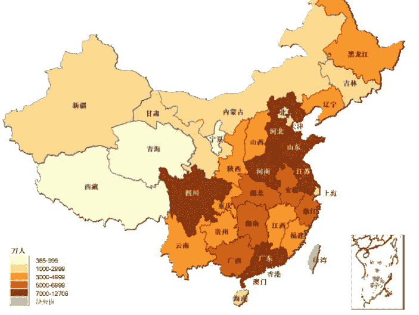

### 图 1.3
分省人口密度，2023年

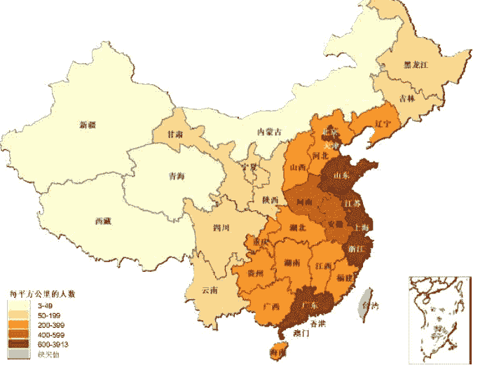

数据来源：国家统计局，《中国统计年要》，2024年

数据来源：国家统计局，《中国统计年要》，2024年（加工数据）

### 图 1.2
中国的人口分布不均，70%的人口居住在30%的国土上。全国人口141亿，广东是人口最多的省份，多达1.27亿，西藏人口最少，仅365万。

### 图 1.3
中国的人口密度为平均每平方米147人，但地区差异很大。上海每平方米人口超过3900人，而西藏、青海和新疆每平方米人口不到20人。大部分人口生活在中国历史的中心地带，即东部和中部的、平原和盆地，那里水资源丰富，是最具农业生产力的地区。同时，中西部地区多为山区，气候条件劣，人口稀少。

### 图 1.4
分省少数民族人口比重，2020年

### 图 1.5
总人口与儿童人口，1953–2020年

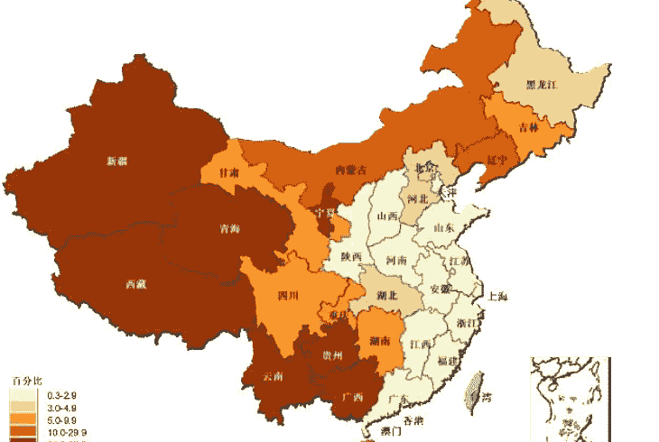

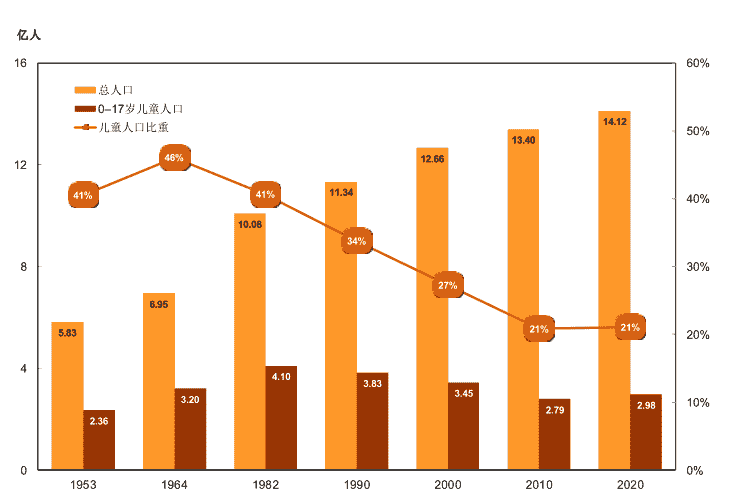

数据来源：国家统计局，《中国人口统计-2020》，2022年

数据来源：国家统计局、联合国儿童基金会、联合国人口基金，“2020年中国儿童人口状况：事实与数据”，2023年（历年全国人口普查数据）

### 图 1.4
中国有56个民族，包括汉和55个少数民族。少数民族人口合计12.85亿，占总人口的8.9%，主要集中在西部地区。从数据来看，在1000万以上的少数民族有5个，分别是壮族、蒙古族、藏族、回族、维吾族。分省来看，2020年少数民族人口比重更高，达87.8%；广西民族人口最多，为1881万，以壮族为主。

### 图 1.5
根据第七次全国人口普查数据，2020年0-17岁儿童人口为2.98亿，占总人口的21.1%。中国人口的结构变动日益明显，随着经济快速发展和人口转变，特别是20世纪70年代实行计划生育政策长期保持低生育率的影响，中国人口规模和总人口的比例自20世纪80年代以来未减少，但在2010-2020年间保持了相对稳定。

### 家庭规模和儿童数量分布，2000年、2010年和2020年

### 分省儿童人口，2020年

| | 2000年 | 2010年 | 2020年 |
| --- | --- | --- | --- |
| 平均家庭规模（人） | 3.4 | 3.1 | 2.6 |
| 有儿童的家庭比例（%） | 63.4 | 47.2 | 37.2 |
| 1 | 59.9 | 66.6 | 60.1 |
| 2 | 30.8 | 27.3 | 32.9 |
| 3个及以上 | 9.9 | 6.1 | 7.0 |
| 合计 | 100 | 100 | 100 |

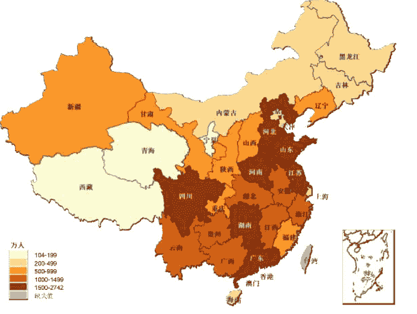

来源：国家统计局、联合国儿童基金会、联合国人口基金会，“2020年中国儿童人口状况：事实与数据”，2023年（全国人口普查数据）

### 图 1.6
中国家庭规模趋小型化，从2000年的3.4人下降至2.6人。与此同时，有儿童的家庭占比在下降，儿童数量也发生变化。2020年全国4.94亿家庭户，37.2%的家庭中有0-17岁儿童。有儿童的家庭中，只有一个儿童的占60.1%，有两个儿童的占32.9%。有7%有3或更多儿童。

### 图 1.7
2020年，儿童人口最多，为2742万；西藏儿童人口最少，仅六万。儿童人口集中在中西部地区，其中西部在全国儿童人口占比为29.1%。各省儿童的家庭比例呈现出较大差异；2020年上海占23.4%的家庭户，北京27.0%、天津31.3%的家庭户；中西部及以少数人口地区的省份的家庭比例相对较低，例如西藏占46.2%的家庭户，各省市也为3.2万。

### 图 1.8
出生人口数，1980–2023

### 图 1.9
出生人口性别比例，1982–2020

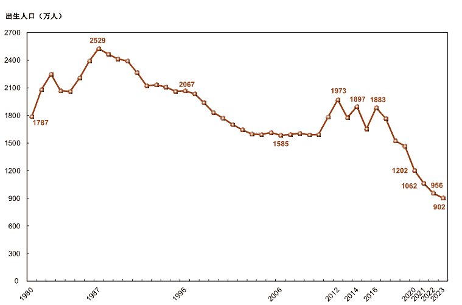

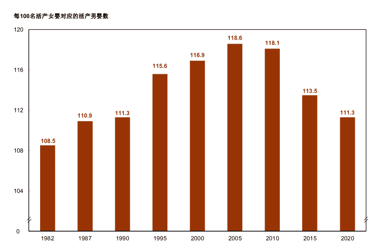

资料来源：1980-2022年出生人口数据根据《中国统计年鉴》发布的年份数据，利用人口与人口性别比计算得到；2023年数据来自国家统计局官网发布的“中华人民共和国统计公报：2023年国家经济和社会发展数据”

资料来源：国家统计局、联合国儿童基金会、联合国人口基金，“2020年中国儿童人口状况：事实与数据”，2023年（全年国家人口普查和全国1%人口抽调数据）

### 图 1.8
中国人口在增长期后出现下降的趋势变化，体现了不同时期生育政策的效果。20世纪80年代初期，随着生育政策开放，出现过一个出生人口高峰。在1973年，1877万和1883万；由于妇女人口数量较少，年轻人出生意愿有所下降。初受计划政策影响，此后出生人口连续下降七年，2021年开始实施的“三孩政策”效果也未显现，2022年出生人口再次下降，万以下下降至约902万。

### 图 1.9
国际公认在没有干预的情况下，正常的出生人口性别比在103到107之间。中国的出生人口性别比在20世纪80年代初期开始并持续上升，从1982年的108.5上升到2004年的最高121.2。2005年回落到118.6，此后持续下降到2020年的111.3。长期高位导致了出生人口性别比失衡严重，加剧了男孩问题的严重，并在控制中可能的性别选择生育。生育政策的影响、社会经济导致的不平等、社会保障体系的脆弱，在农村和农村地区尤为突出

### 图 1.10 出生人口性别比，城乡，1982–2020年

### 图 1.11 分省出生人口性别比，2020年

每100万产妇女性对出生人口性别数

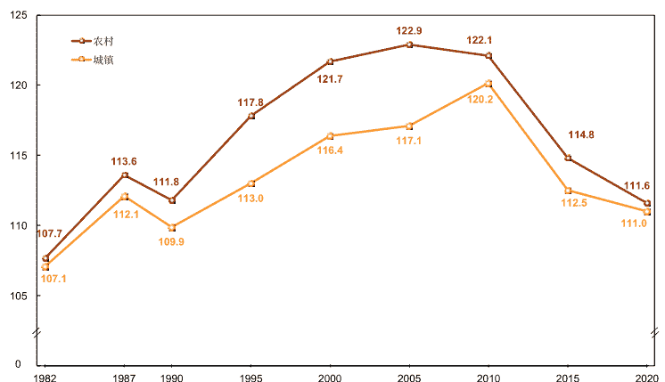

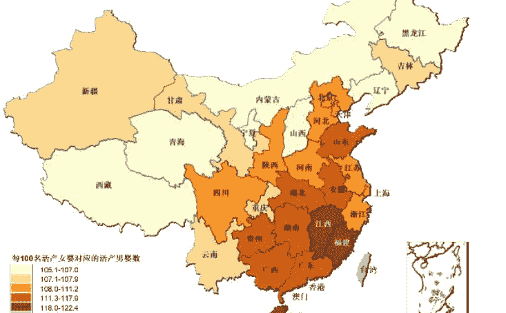

- 106-107
- 107-108.6
- 108.6-111.2
- 111.2-117.8

资料来源：国家统计局、联合国儿童基金会、联合国人口基金会，“2020年中国儿童人口状况：事实与数据”，2023年（全国人口普查和全国1%人口抽样数据）

资料来源：国家统计局、联合国儿童基金会、联合国人口基金会，“2020年中国儿童人口状况：事实与数据”，2023年（全国人口普查数据）

# 图 1.10 农村地区的出生性别比高于城镇地区。

# 图 1.11 出生人口性别比在各省区域分布不均匀，山西、山东等省份出生性别比控制在了正常范围107以内，海南、江西、福建等省份出生性别比严重失衡。1982以来，城镇和农村出生性别比都呈上升趋势，但农村地区上升更快，城乡差异增大，这种趋势一直持续到2005年。2010年，城镇和农村出生性别比出现了大幅下降，城乡差异缩小，到2020年，农村地区的出生性别比略高于城镇地区。

### 图 1.12 出生时预期寿命，1981–2020年

### 图 1.13 分省出生时预期寿命，2020年

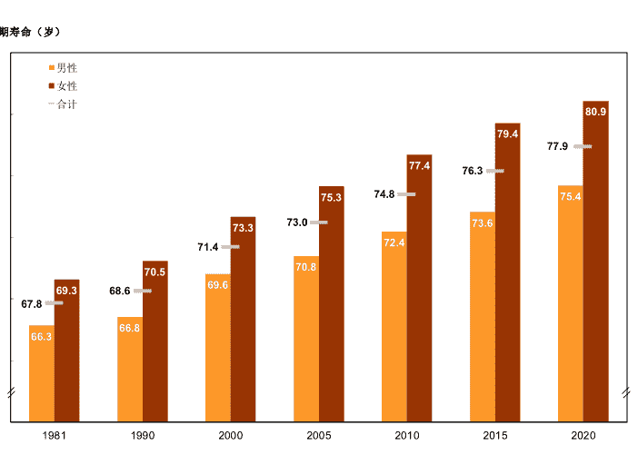

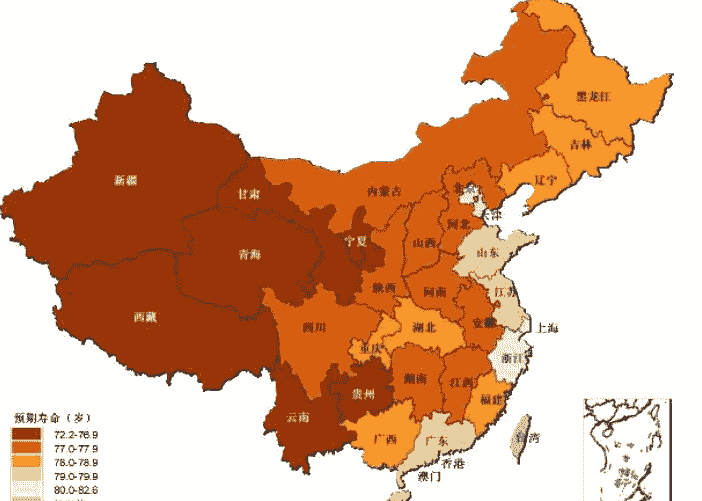

- 男性：72.2–76.9
- 女性：77.0–78.9
- 合计：79.0–80.5、80.6–82.8、82.9–84.0

数据来源：国家统计局，《中国统计年鉴》，2023年

# 图 1.12 西部省份和东部省份之间的人口预期寿命差异显著。上海、北京、天津和浙江预期寿命达到80岁以上，西藏、青海和云南等省份预期寿命在2010-2020年间增加了约4岁，仍与上海和北京差5岁。

### 图 1.14 五岁以下儿童人口比重，2020年

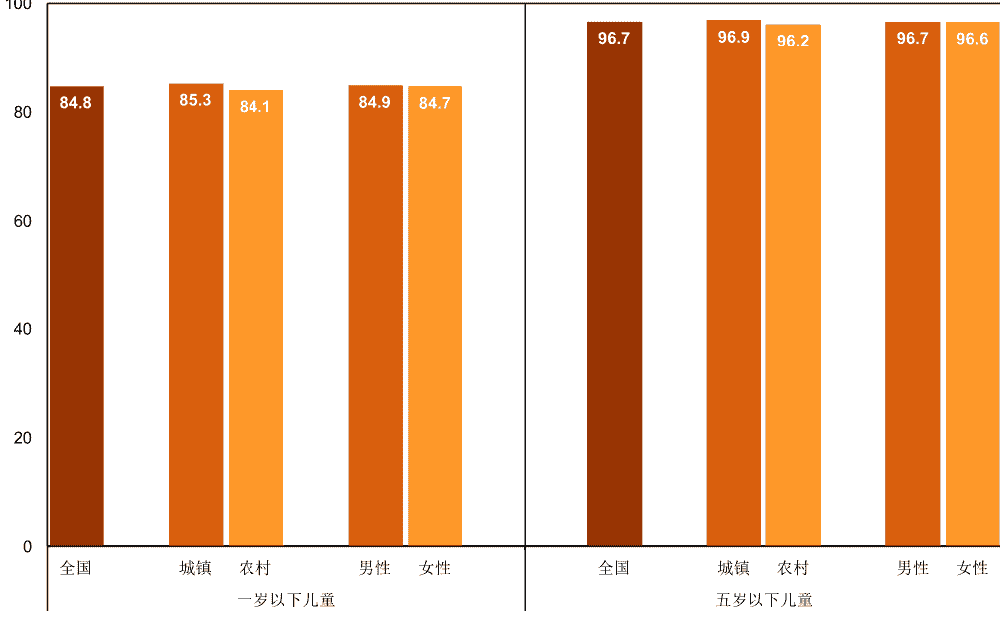

资料来源：国家统计局、联合国儿童基金会、联合国人口基金，“2020年中国儿童人口状况：事实与数据”，2023年（全国人口普查数据）

# 图 1.14 联合国《儿童权利公约》可持续发展目标（SDGs）主张五岁以下儿童比重作为全球监测指标，以所有人拥有公共服务。在中国，2020年84.8%的儿童在满5岁以前，96.7%在满7岁以前。17岁中，九成是5岁以下。

### 图 1.15 人口金字塔，2022年

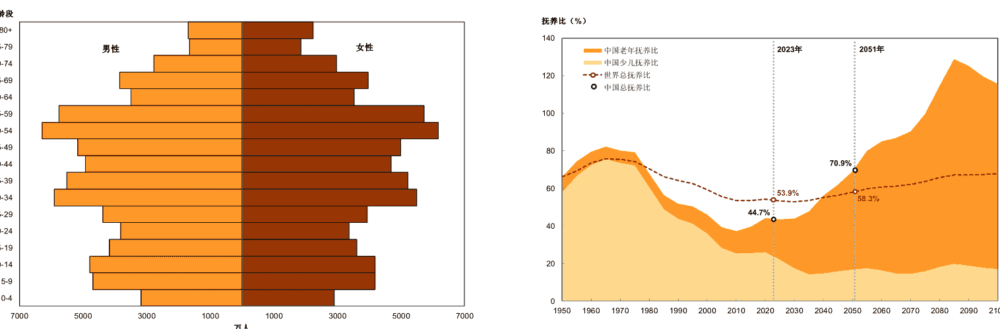

资料来源：国家统计局，《中国统计年鉴》，2023年

资料来源：联合国人口司事务，《人口展望2024年修订》

### 图 1.16 人口抚养比现状及预测，1950~2100年

由于长期的低生育水平以及预期寿命延长，中国人口趋于老龄化，人口结构呈现底部收缩、上变宽的形态。根据《人口展望2024年修订》，2023年的少养比为24.0%，全球最低之一。与此同时，中国的老年抚养比（65岁及以上）不断上升，2023年中国总抚养比为44.7%，低于全球平均水平9百分点。但是，中国人口下降的趋势在过去十年加速，人口结构进一步改善，“人口红利”逐渐显现，“人口红利”将在2037年耗尽，在2040年低于世界平均水平，2051年高于世界平均水平。

### 图 1.17 城镇人口占总人口的比重，1982–2023年

### 图 1.18 分省城镇人口比重，2023年

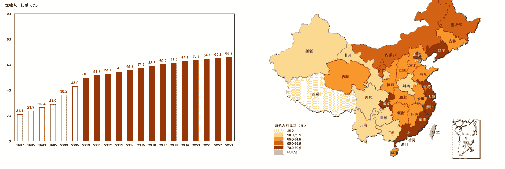

数据来源：国家统计局，《中国统计简要》，2024年

### 图 1.17 城镇化率（%）

从20世纪80年代初开始，由于大量农村劳动力向城市寻找更好的就业机会，城镇人口大幅增加。中国的城镇化率从1982年的21.1%上升到2010年的达到50%，2022年超过65%，2023年达到66.2%，调查查城镇人口9.33亿。

# 图 1.18 中国东部省市城镇化率较高，上海、北京、天津等直辖市的城镇化率在80%到90%之间，广东、江苏、山东、福建等省份在70%到75%之间。西部的重庆市城镇化率超过70%，内蒙古、宁夏、陕西和青等地超过了60%。

* 中国2035年以前实现以城镇化为主要的要求。《中华人民共和国国民经济和社会发展十四五规划（目标达成）》要完成所有常户区城区人口300万以上的城市户口建设，确保外地与本地农业转入户口标准统一；完成城区人口300万以上的城市户口建设，完成城区人口500万以上的特大城市。

### 图 1.19 流动人口数量及比重，1982~2020年

### 图 1.20 分省流动人口数量，2020年

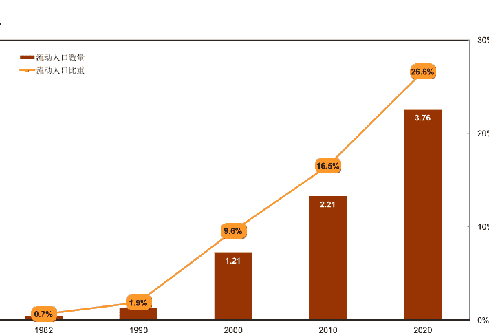

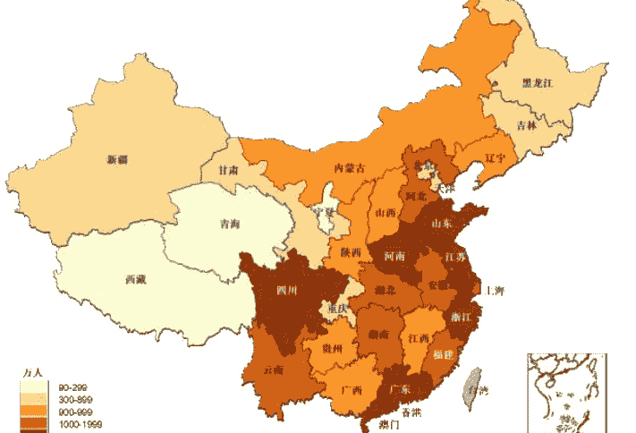

资料来源：国家统计局，《中国人口和就业统计年》，2023年、2000年、2010年、2020年人口普查数据点；1982年和1990年《中国人口查资料》（分别于1985年和1993年）

资料来源：国家统计局，《中国人口年鉴》，2022年

# 图 1.19 中国正经历庞大流动。1982年，流动人口占总人口的比重不到2%。从20世纪90年代开始，流动人口数量和占人口的比重不断增加。2020年流动人口高达3.76亿，占总人口的26.6%，且流动人口规模持续增加。

# 图 1.20 2020年流动人口主要在经济发达的东部沿海省和内陆大省。六个流动人口以上的省份是广东、江苏、浙江、山东和四川，合计1.64亿，占全部流动人口的43.6%。流动人口集中在这些省份。关于流动人口的影响更多见第六章

## 2 经济与社会发展
### 概述
### 经济发展
开放以来，中国经济取得了前所未有的增长。从计划经济向市场经济转型的过程中，中国实施了一系列以市场为主的改革，让农村农民拥有经营权，让城镇兴起，让贸易和投资获得了效益。这些改革推动了中国经济增速。2023年中国人均GDP增长3%，2023年人均GDP为8935美元，按平均率计算，增长了12.6美元。

十二五期间，中国经济进入新常态，人均增长持续加快，十二五期间的两个阶段平均增速为7.9%，在主要经济体中处于领先地位。根据世界银行对人均收入（GNI）的统计，中国在2010年人均收入进入中等收入国家，2023年人均收入达到2400美元，成为中等收入国家。

从总量来说，无论是人均收入还是人均GDP（PPP），中国从2010年到2023年一直是世界第二大经济体，2023年人均GDP占全球总值的比重为16%，份额提升了7个百分点。中国是一个人口大国，人均GDP低于世界平均水平，在世界上50多个国家中，仍然是一个发展中国家。

### 城乡二结构
中国历史上长期以来实行城乡分别的户籍制度，形成了城乡二元结构，导致经济与社会发展呈现出明显的城乡差异，大量农业劳动力转移到城市中，社会化得以开启。2014年，政府发布了《关于进一步推进户籍制度改革的意见》和《新型城乡规划（2014—2020年）》，随着城乡统一的户口登记和居住制度建立，小城镇限制全面开放，大城市限制得到落实。政府已经出了2021-2035年《国家新型城乡规划》及配套措施。

2022年发布的《十四五新型城镇化实施方案》强调深化户籍制度改革，全面取消常住人口300万以下的城市限制，全面取消常住人口300万至500万以上的大限制，取消常住人口50万以下的市县限制，灵活调整常住人口入户政策作为新型城镇化的核心，并对此发布了一系列措施，建立基本性公共住房供给机制，提高户籍人口住房保障总量和质量，推动城镇城乡常住人口住房覆盖，以及解决回流农民基本公共保障等。

2023年，为了增加居民收入增长，市场发布了《深入落实居民收入增长计划》，实施新城乡人口入户政策，以增加城乡收入，解决农民对收入增长关心的就业、养老、医疗、社会保障等问题。完善就业农民人均收入政策，减少城乡农村收入差距，政府采取了若干项促进城乡一体化发展措施。

### 收入差距
城乡之间的差距不断缩小，城乡居民收入以及东部和西部地区之间的差距依然巨大。然而，2023年城乡人均收入增速为3.22%，对比2022年至2023年为3.1%，城乡差距有所缩小，但2023年城乡可支配收入仍是农村的2.6倍。

世界银行的统计，中国城乡收入指数从1999年到2010年的0.432上升到2010年的0.457，2023年为0.357。中国政府在2023年对外发布了2003年以来全国城乡居民收入差距的官方数据，显示城乡居民收入差距在0.465左右，低于全球平均水平。

### 减贫成果
在其他领域缩小差距的同时，中国也完成了时代发展脱贫目标，2012-2020年，通过政策让农村农民人均年生活水平在2300元以上。

(2010年)测算，9899万农村人口全部贫困，832个贫县全部撤销，12.8万贫困人口全部列出，消除了农村地区和结构性贫困。根据国家政策攻坚结果，我国西部22个省区地区户籍改革已实现不贫、不愁、义务教育、基本生活、住房安全保险（“无三错保障”），一切安全有保障。

中国的贫困问题在农村是区域性的，农村贫困仍然存在，我国贫困标准尚未达到国际通行的农村贫困标准，按照2017年的世界均购买力平价（PPP），2010年测算的贫困标准为每人均每天3.6美元，高于行业平均值2.5美元的农村贫困标准。这意味着在2010年中国农村贫困标准下，已经实现了联合国消除极端贫困的1.1的目标，在2010年测算贫困标准下，通过改革，中国农村人口贫困率下降到70%以上，为全球减贫事业做出贡献。

解决贫困需要两个主要任务：一是基于基础的资源转移型向农村转移的发展模式，不能提高农村收入；二是采取针对性的贫困政策，这些政策能够有效消除因因素和环境因素导致的农村贫困，此后农村贫困将实现精准扶贫，中国解决贫困的理论与实践我们为其他发展中国家提供了丰富的借鉴。

然而，虽然仍然不能解决许多问题，但还需要缩小城乡差距，农村地区的发展需要政府加强对需要帮助的农村贫困家庭的投入，建立完善防止返性贫困的扶持机制，实现农村地区精准扶贫。

### 儿童贫困

农村儿童贫困主要源于年幼，资源的匮乏和营养不足可能持续性，并导致贫困的代际传递。农村贫困的定义具有很大差异。在农村的儿童缺乏营养、净水和卫生设施，得不到良好的医疗服务、住房、教育、参与和保护，由于物资和资源匮乏严重损害每个个体的健康和造成伤残，他们可能无法获得各种福利，完全无法发挥活力和能力来实现社会的参与。联合国有助于实现发展目标（SDGs）目标一“在世界范围内消除一切形式的贫困”，中国首次明确将农村儿童作为重点人群，要求在2030年以前消除或减少儿童贫困，其中包括经济贫困，也包括农村贫困。中国缺乏针对农村儿童贫困的系统性策略。

### 社会保障

中国的社会保障体系主要包括社会救助、社会保险和社会福利等。随着全面发展，中国进入到非正规就业和解决贫困问题、推进共同富裕的新阶段。与此同时，人口老龄化、结构化使得经济环境遭遇巨大的冲击，以及人口流动频繁、城乡多元化，使得社会保障体系需要更加完善和改善，使个人不再需要负担。

社会救助作为社会保障体系的最后一道“安全网”，在社会保障中属于基础性工作，上世纪末以来，中国是世界上人口规模最大的国家，社会救助需要提供基本生活保障（低保）、特困人员、孤寡老人、残疾救助、住房救助、教育、就业培训、医疗救助以及协助社会参与。在不同时期面临的需求不断变化，需要通过不同的资金转移、实施补助或直接接入家庭来实现。

其中，“农村”是社会保障制度的主要面临，也是中国基本保障的一项重要领域。制度逐步覆盖全国地区，2007年开始扩展到农村。按照规定，中国农村的家庭成员如需要提供基本生活保障，且符合当地最低生活标准的家庭财产和收入，将给予最低生活保障。在农村脱贫的过程中，农村贫困人口全部纳入低保，在农村的社会保障范围扩大到所有农村贫困家庭。

随着农村人口逐步进入社会保障体系，城乡居民低保以获得覆盖。低保标准不断提高，2023年，全国城镇人口均平均收入每月786元，农村人口均平均收入每月621元，分别相当于城镇消费支出水平的28.6%和农村消费支出水平的41.0%。农村低保标准高于中东部地区。下一步工作的重点任务是加强城乡地区保障在资金和标准等方面的统一统筹，以确保基本公共服务的公平。此外，保障农村仍面临着诸多挑战：城乡居民制度建立起来，农村人口数量中增加，2023年农村人口为5.6亿，同时，政府也意识到仍然存在流动人口、少数儿童城乡均衡、户籍限制等未完全解决的问题；2020年以后开展了农村医疗试点，通过多部门联动等进一步提高农村儿童保障水平。

- 农村贫困的进一步提高，需要通过不同的资金转移、实施补助或直接接入家庭来实现。
- 农村弱势群体能够获得精准扶贫。
- 农村儿童贫困率的准确数据，但尚不够。
- 农村儿童的权益。
- 农村地区的。
- 农村贫困的持续性。
- 农村儿童面临不同的问题，政府需要对特定对象提供个性化措施。

上述提到的最低生活保障等领域，通过各种政策措施，改善基本公共服务的均衡性。

- 农村贫困人口的精准化工作。
- 农村地区的缩小城乡差距。
- 农村儿童的均衡性。
- 农村人口的贫困。
- 农村儿童的改善。
- 农村地区的。
- 农村儿童的精准性。
- 农村人口的贫困。
- 农村地区的。
- 农村儿童的。

长期以来，政府发布了《农村学生营养助计划实施办法》，在统筹、资金使用、监督监管等方面提出了若干要求：社会保障是社会运行的制度，主要支柱包括养老保险、医疗保险、工伤保险等。近年来面临的资金问题得到了快速破解，尤其是医疗保险、养老保险的参保人数不断增加。以医疗保险为例，中国开始推进城乡居民基本医疗整合，在扩大城乡居民选择范围，提升参保率在95%以上，农村各地区按城乡缴补助标准提高到每人每年600元。城乡基本公共服务经费标准经过多次调整，从人均15元提高到了2024年的万元，服务项目从9项扩展到12类，覆盖全体居民，并突出儿童、妇女、老年人等重点群体以及患疾病儿童的健康管理。到2023年，进一步完善了以下3岁儿童教育和咨询的服务。

政府在2012年启动贫困儿童营养改善工作，通过免费覆盖3岁以下儿童发放营养包、开展儿童宣传和健康教育，控碘和其他微元素补充，改善贫困地区儿童营养状况和健康现状。2012年至2021年间，累计受益儿童达136.5万人，有效降低了儿童营养不良疾病和生长延缓率。

2016年的《加强农村留守儿童保护工作的意见》要求对留守儿童采取分类措施，为帮助他们获得基本生活、教育和健康保障落实责任，并加强对留守儿童的保护。2019部部门联合发布《关于进一步健全农村留守儿童关爱保护意见》，明确了对纳入国家基本公共服务范围的留守儿童提供特殊保障，对未纳入范围的留守儿童加强关爱保护，要求有关部门加强留守儿童关爱工作，建立健全留守儿童保护机制，切实维护留守儿童和困儿童的合法权益。加强留守儿童的心理健康保障。民政部在2014年发布了《加强农村留守儿童关爱保护实施方案》。

2012年国务院发布了《国家基本公共服务“十二五”》，这是我国首次对基本公共服务均等化的制度化的重要规划。但是，不同社会群体之间的差异仍然存在。为了进一步促进化，2021年，中国出台首个城乡基本公共服务标准，涵盖了所有学、所有所有、所有种种、老所有、有所居住、弱所有、军务人员保障、基本生活保障等9领域共80个基本公共服务项目。每个项目都明确了服务对象、服务内容、服务标准、支出责任和负责单位。

2022年国务院发布了《“十四五”公共服务规划》，要求政府在持续推进基本公共服务均等化的同时，还要扩大普学教育和健康保障的非基本性服务的供给。

2011年以来，中国以提升基本公共服务实施学前教育为引领，学前入学率从2010年的56.6%提高到2020年的91.1%，实现了保持在90%以上的目标。2023数据显示，学前教育普及率为86.2%，在儿童中的占比高达90%。中国采取多项积极措施，启动了“6岁以下儿童健康查”行动，要求每一年一次儿童体查，从2018年的20.2%提高到2021年的94.5%。截至今年，已完成受益人数380万，但目前仍存在巨大问题，未完全解决。2020年以后，加入了《农村学生营养助计划实施办法》，在统筹、资金使用、监督监管等方面取得了进展。

### 经济与社会发展

#### 图 2.1 人均国内生产总值，1978–2023
### 图 2.2 国内生产总值增长率，1979–2023

40年前，中国是世界上最穷的国家之一，1978年人均国内生产总值（GDP）仅385元（约56美元）。现在已经成为世界第二大经济体，2023年人均GDP达到9358元（按2023年汇率折算约12681美元）。1979-2023年，GDP实际增长率8.0%。1981-1985年“六五”时期、1991-1995年“八五”时期和2006-2010年“十一”时期，中国经济保持了双数高速增长。从2011-2015年“十二”时期开始，人均实际增长率回落到7.9%，中国经济进入新常态，由高速增长为中高速增长。1979-2023年，GDP增长8.9%。

### 图 2.3 城乡居民人均支配收入，1990–2023

城乡居民和农村居民人均支配收入不断增长，城乡差距经历了一个扩大后缩小的过程：2003-2009年，城乡居民人均倍差达到最高3.1；2010-2023年农村居民人均收入连续增速于城镇，城乡差距有所缩小，但是2023年城乡收入倍差仍然高达2.4。

### 图 2.4 分省城镇居民均支配收入，2023年
### 图 2.5 分省农村居民均支配收入，2023年

城镇居民均支配收入省际差异很大，与东部地区相比，中西部地区收入水平偏低。农村居民均支配收入的省际差异同样很大，西部地区收入水平明显偏低。

### 图 2.6 按等份份额的城乡居民平均可支配收入，2015年和2023年
### 图 2.7 全国居民均支配收入基系数，2003–2023

从五等份额来看，2023年高收入组20%人口占比45.9%，低收入组20%人口占比4.6%。城镇和农村组间的差异也缩小。2015年和2023年人均支配收入基系数从0.462到0.491之间波动，说明差距未扩大得到回落。

#### 图 2.8 极度贫困人口规模和贫困发生率，1990–2020
#### 图 2.9 农村贫困人口规模和贫困发生率，1978–2020

全球贫困持续下降，使用的最新的极端贫困标准是基于2017年购买力平价每人2.15美元，总体上等于2011年PPP的每人每天1.9美元。数据显示，1990–2020年间，极端贫困总量减少了8.17亿，占全球减贫人口的65.5%。中国的贫困调查主要针对农村地区，现行农村贫困标准按2010年价格为每年每人2300元，根据购买力平价和中国价格，相当于每人每天2.3美元，高于世界银行使用的极端贫困标准（每人每天2.15美元）。测从1978年到2020年，7.7亿农村人口全部脱贫，在中国在全球减贫中发挥了核心。

### 图 2.10 农村儿童贫困发生率，2014–2020
### 图 2.11 城市和农村最低保障标准，2007–2023

以中国官方标准即2010年每人每年2300元来衡量，2014-2018年农村儿童贫困发生率高于全农村人口的贫困发生率，说明农村儿童的影响更大。世界银行和联合国儿童基金的一项测量结果发现：2019年全球儿童的极端贫困发生率为15.8%，是成人（6.6%）的两倍多。

- 2014年为0-15岁儿童贫困发生率，其年龄为0-7岁农村儿童贫困发生率。

低保标准从1999年覆盖全国城乡地区，2007年在农村逐步提升。政府的积极投入与财政支持促进了中国城乡低保标准逐年提高。

| 年份 | 城市低保数(万人) | 儿童(0-17岁) | 成人(18-59岁) | 老人(>=60岁) | 儿童(0-17岁) | 成人(18-59岁) | 老人(>=60岁) |
| :--- | :--- | :--- | :--- | :--- | :--- | :--- | :--- |
| 2012 | 2144 | 473 | 1331 | 339 | 22.1 | 62.1 | 15.8 |
| 2013 | 2064 | 445 | 1289 | 330 | 21.5 | 62.5 | 16.0 |
| 2014 | 1877 | 388 | 1175 | 316 | 20.6 | 62.6 | 16.8 |
| 2015 | 1701 | 341 | 1067 | 294 | 20.0 | 62.7 | 17.3 |
| 2016 | 1480 | 271 | 951 | 258 | 18.3 | 64.2 | 17.4 |
| 2017 | 1261 | 205 | 833 | 219 | 16.3 | 66.3 | 17.4 |
| 2018 | 1007 | 164 | 663 | 180 | 16.2 | 65.4 | 17.9 |
| 2019 | 861 | 139 | 563 | 159 | 15.1 | 65.4 | 18.4 |
| 2020 | 805 | 128 | 529 | 148 | 15.8 | 65.8 | 18.4 |
| 2021 | 738 | 116 | 482 | 140 | 15.7 | 65.4 | 19.0 |
| 2022 | 682 | 108 | 436 | 138 | 15.9 | 63.9 | 20.2 |

| 年份 | 农村低保总数(万人) | 儿童(0-17岁) | 成人(18-59岁) | 老人(>=60岁) | 儿童(0-17岁) | 成人(18-59岁) | 老人(>=60岁) |
| :--- | :--- | :--- | :--- | :--- | :--- | :--- | :--- |
| 2012 | 5345 | 641 | 2687 | 217 | 12.0 | 50.3 | 37.7 |
| 2013 | 5388 | 615 | 2695 | 208 | 11.4 | 50.0 | 38.6 |
| 2014 | 5207 | 578 | 2564 | 265 | 11.1 | 49.2 | 39.7 |
| 2015 | 4904 | 525 | 2373 | 206 | 10.7 | 48.4 | 40.9 |
| 2016 | 4587 | 512 | 2215 | 185 | 11.2 | 48.3 | 40.9 |
| 2017 | 4045 | 519 | 1963 | 153 | 12.8 | 48.5 | 38.6 |
| 2018 | 3519 | 516 | 1690 | 163 | 14.7 | 48.0 | 37.3 |
| 2019 | 3455 | 541 | 1626 | 159 | 15.7 | 47.1 | 37.3 |
| 2020 | 3621 | 582 | 1698 | 141 | 16.1 | 46.9 | 37.0 |
| 2021 | 3474 | 557 | 1633 | 140 | 16.0 | 47.0 | 37.0 |
| 2022 | 3350 | 549 | 1539 | 138 | 16.4 | 45.9 | 37.7 |

政府通过现金转移等方式解决需求。2023年，低保覆盖6640万居民，占总人口的2.9%。随着政府推进消除绝对贫困，低保人口也逐年下降。

### 经济与社会发展

图 2.14
# 政府用于三项基本公共服务的支出
财政总支出的比重，2007–2023年

图 2.15
# 城乡收入和卫生支出差异，1991–2023年

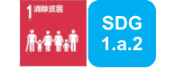

占比

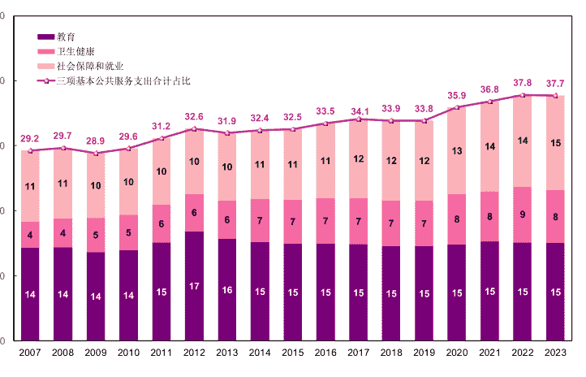

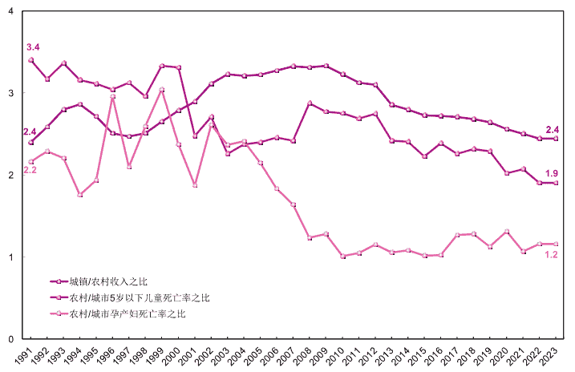

来源：国家统计局，《中国统计年鉴》，2008-2023年（2007-2022年数据）；
《中国统计摘要》，2024年（2023年数据）

来源：国家统计局，《中国统计摘要》，2024年；国家卫生委员会；
《2023年中国卫生事业发展统计报告》，2024年

图 2.14
过去十年来，中国的整体财政力得到增强，用于三项基本公共服务（包括教育、卫生健康、社会保障和就业）的公共支出占财政总支出的比重有望上升，2023年已达到37.7%。同时，用于三项基本公共服务的支出占GDP的比重从2007年的5.4%逐步增加到2023年的8.2%。

图 2.15
自2010年以来城镇和农村居民收入差距逐渐缩小，2023年城乡居民收入仍比高达2.4倍。从2000年以来，一些卫生指标（如产妇死亡率）的城乡差异明显缩小。

数据来源与文献

*人均GDP，国内生产总值是指所有单位生产增加值的总和，加上统计在内的生产值（减去补贴后）。人均生产总值是指国内生产总值以每年人口。增长率是以土地的不售价来计算的。（世界银行）

*国家统计局，“华中华人民共和国2023年经济和社会发展报告”（2024年2月）。https://www.stats.gov.cn/sj/zxfb/202402/t2024022_194715.html

*2023年世界银行分组分类标准，人均收入1145美元以下为低收入国家，1146美元至4515美元为中低收入国家，4516美元至14000美元之间为中收入国家，超过14000美元为高收入国家。（https://datahelp.worldbank.org/knowledge/base/articles/90659，2024年8月查询）

*世界经济数据库，世界银行数据库，https://data.worldbank.org，2024年8月查询

*国家统计局，“2023年中国经济运行情况高质量发展报告”；https://www.stats.gov.cn/sj/zxfb/fwhb/202401/t194624.html，2024年8月查询

*世界经济数据库，世界银行数据库，https://data.worldbank.org，2024年11月

*原贫困地区包括592个县级贫困工作县，随着我国农村扶贫开发开展（2011-2020年）的农村形成了新的51个“集中连片地区”，加西、陕西和新疆共14个省680个县，其中扶贫重点县和定点县有440个县集合，原贫困地区共832个县

*国家统计局，“国家政策统计公报（二号）”；https://www.stats.gov.cn/sj/zxfb/202302/t1901001.html，2024年8月查询

*联合国大会，“儿童权利（2006年12月19日决议）”；https://documents.un.org/doc/undoc/gen/n06/50038.pdf，2024年8月查询

*国务院，“社会救助实施”（2023年3月）；https://www.gov.cn/zgafb/content/546895.htm，2024年8月查询

*联合国，“社会救助实施”（2019年3月）；https://www.gov.cn/zgafb/content/546892.html，2024年8月查询

*民政部，“2023年民政统计报”；https://www.mca.gov.cn/156/2679/c1620249998001204/t35517.html，2024年8月查询

*国家统计局，“2023年中国卫生统计报”（2024年725日）；https://www.nhsa.gov.cn/art/2024/07/t13340.html，2024年8月查询

*国家医疗保障、国家税务局，“关于2023年居民医疗保险的通知”（2023年76日）；https://www.gov.cn/zhengce/zhengce/content/2023-07/689531.htm

*国家医疗保障局，“关于开展基本医疗专项行动的通知”（2024年3月2日）；https://www.nhsa.gov.cn/art/2024/03/art12150.html，2024年8月查询

*教育部，“中国学生发展（2021年）”（2022年9月5日）；https://www.moe.gov.cn/n85/c11046/content.html，2024年8月查询

*教育部，“中国实现义务教育均衡”（2022年9月27日），http://www.moe.gov.cn/live/2022-54875/mtdb/20220927_66537.html，2024年8月查询

*国家卫生委员会，“关于做好2024年基本公共卫生服务的通知”（2024年9月9日），https://www.gov.cn/zhengce/zhengce/content/202409/675491.htm，2024年8月查询

*居民均可支配收入：可支配收入用于最终消费和储蓄的总和，居民支配收入包含四项，分别为工资性收入、经营收入、财产净收入和转移收入。居民均可支配收入是居民支配收入除以人口后得到的平均值（国家统计局）

*国家卫生委员会，“国家卫生委员会2022年6月27日新闻发布会议稿”，http://www.npc.gov.cn/npc/c3574/202008/f675c2d35cd459b8651a3bf695.shtml，2024年8月查询

*民政部等15部门，“农村儿童和残障儿童关爱服务能力提升行动方案”（2023年11月15日），http://www.mca.gov.cn/xxca/8445/gnips/pc/content.jsp?type=1&id=1662004999799683，2024年8月查询

*世界银行，“Global Trends in Child Monetary According International Poverty Lines”（2023年9月），https://www.worldbank.org/en/topic/poverty/global-trends-in-child-monetary-poverty-according-to-international-poverty-lines，2024年8月查询

*民政部等21部门，“加强儿童关爱保护行动方案”（2024年8月16日），https://www.gov.cn/zhengce/zhengce/content/202409/6972120.htm，2024年8月查询

*国家发展改革等10部门，“国家基本卫生标准（2023年版）”，https://www.gov.cn/zhengce/zhengce/content/202308/687591.htm，2024年8月查询

*全国代表大会，“国务院关于推进扶贫工作情况的报告”（2024年9月11日），http://www.npc.gov.cn/npc/c2/330834/20240911_439363.html，2024年8月查询

## 3 妇幼保健和青少年健康

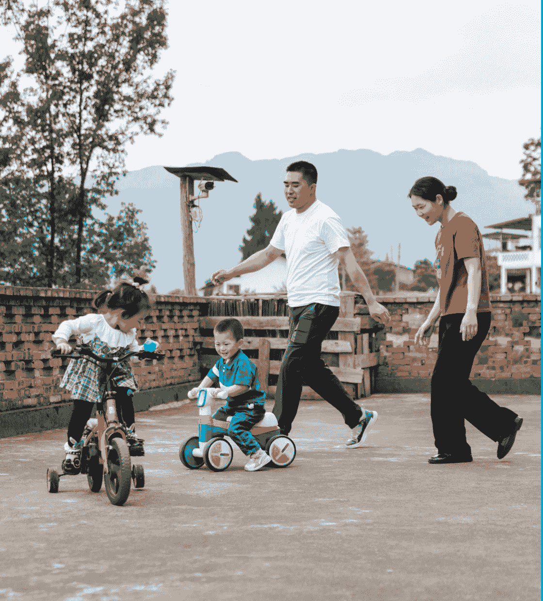

### 概述

### 进展与成就

过去十年，在中国妇幼保健方面取得了巨大进步。在1993年至2004年就已经实现了可持续发展进程中的中期目标：到2030年产妇死亡率下降至70/万，五岁以下死亡率下降到25%。为了实现这一目标我们设定了更高的目标，即产妇死亡率下降至50/万，五岁以下死亡率下降至15%，新生婴儿死亡率进一步下降到10%。中国基层健康覆盖率日益提升。现在已有37万专业人员从事妇幼保健工作，已经形成了以基层卫生机构为核心，以卫生服务为枢纽，大型医疗机构为支撑。在此基础上，通过改进服务质量，增加了城乡困难地区的健康状况仍待提高。

2009年以来产妇死亡率和新生婴儿死亡率取得巨大成就，很大程度上归于政府对妇女提供免费分娩服务和资金支持。2009年开始实施助产计划减少了产妇死亡率和新生婴儿死亡率。2019年开始实施专项计划减轻了妇女负担，现在可以选择医疗机构进行安全分娩，逐步降低产妇死亡率取得了显著效果。产妇死亡率下降益于人们对产前检查重要性的提高和交通状况的改善。2013年至2018年内，大多数妇女在系统保健管理中至少接受5次产前检查，死亡率减少。产妇死亡的主要原因包括出血、羊水栓、妊娠期高血压和心脏病。与此同时，随着生活方式和行为的变化，如妇女年龄、肥胖等代谢性疾病人数增加，以及空气污染，妇女健康的多样性和差异日益明显。

### 五岁以下死亡率

中国自2000年以来五岁以下儿童死亡率在出生后12个月内显著下降，近期不同年龄段儿童死亡率仍在减少。其主要原因是：产后发热和肺炎、1个月内新生婴儿的主要死因是呼吸性疾病（包括呼吸道感染）和感染性疾病（包括腹泻、肺炎和其他感染），严重营养不良是1-4岁儿童的主要因素。中国需要进一步加强对重点疾病的预防措施，扩大覆盖范围，提高措施的可及性和及时性，改善发育水平。健康行动计划（2021-2025年）强调了完善省县三级医疗网络、加强新生早期发育工作。。的新生早期干预包括出生后即皮肤接触、早剥、围喂养、6个月内母乳养等。

### 国家规划

中国的免疫规划一直是成功和高效的公共卫生干预，通过对儿童免疫，使千万儿童得到保护，防止疾病消失。例如，2002年将乙肝疫苗纳入免疫常规，使中国儿童乙肝病毒表面阳性率稳定至3%以下，进一步证明了我国免疫规划的成就。近年来儿童疫苗接种控制得到了加强，各种疫苗接种率均保持在90%以上水平，对于降低儿童死亡率起到了作用。

儿童早期干预

世界卫生组织联合联合国基金会，将全球资源助力早期干预服务的实现，聚焦儿童健康、良好营养、早期教育、保护和安全五个目标。《儿童发展规划（2021-2030年）》将五个重点纳入规划，推动更多部门合作开展早期干预服务的发展，加强部门整合和有效帮助早期干预服务，使早期干预服务延伸至农村、社区，探索通过入户访问等偏远地区推广我国早期干预服务模式，实现儿童的发展目标。

针对早期干预的形势日益，亟需探索可靠、可操作的儿童早期发展服务模式。2013-2016年国家卫生委员会开展了儿童早期发展试点，探索并确立了幼儿营养和发育支持、小组教育模式，证明了儿童早期发展服务的有效性，初步形成了以国家基本公共卫生体系为主，以县级为纽、县村三级联动的儿童早期发展服务模式，并予以试点经费。2022年政府已实施“助力乡村振兴战略——基层早期发展项目”，在我国30个省，尤其是中西部农村地区促进儿童早期发展的投入，将增强儿童幼儿养护知识和技能，能够让儿童早期发展早受益，助力乡村振兴，推动共同进行。

### 儿童伤害

在我国，1-19岁以下儿童死亡的首因是常见的儿童致死性伤害，其次为道路交通事故、跌落和中毒。
2021年，1-14岁以下儿童死亡的首因是意外伤，其次为道路交通事故、跌落和中毒。儿童伤害发生特征存在城乡差异，表现为男性高于女性，农村高于城市，西部高于东部。2021年，农村1-19岁儿童死亡率是城市的2.4倍，农村地区1-19岁儿童死亡率仍高达2.6%，城市为1.5%。

随着经济的发展和安全工具的发展，交通事故导致的死亡率正在持续减少，中国需要进一步加强对儿童伤害的预防措施。国务院研究中心也发布了《儿童发展规划（2021-2030年）》，第三条将儿童伤害作为一项紧迫议题，提出了目标，将伤害发生率下降20%。近年来，儿童防护工作已经取得成效，但地方对儿童伤害认识不足，投入不够；监测范围有限，监测质量有待提高。

#### 妇幼与青少年健康

2020年妇幼人口达8亿，位居世界第二。实现可持续发展目标至关重要。《儿童发展规划（2030年）》和《儿童发展纲要（2021年）》将青少年作为人力资本优先考虑。政府制定了一系列重要政策，协调资源向青少年投入，疾病从传染疾病转向慢性疾病。与此同时，超重、视力、心理健康和安全行为等问题也日益关注，发病率日益上升。许多专家表示，中国青少年心理健康问题和发育障碍与西方之间存在巨大差异。中国青少年健康面临严峻挑战，新变革迫在眉睫，需要构建更全面的健康策略，采取更灵活的措施，不仅有助于解决健康问题。

#### 基本卫生服务

针对儿童妇女健康的重大问题，政府提供了一系列政策措施和支持体系，旨在推动公共卫生服务和妇幼健康高质量发展。例如：

- 2009年开展国家基本卫生服务项目以来，人均基本卫生补助经费经过多次调整，从均15元稳步增加到2023年的89元；纳入基本卫生服务的范围从儿童健康管理、妇幼健康管理、预防接种9类服务扩展到2022年的16项服务，种类和项目保持不变。

- 中国的新农村合作医疗制度和医疗补助制度减少了医疗负担，越来越多的农村居民从小就有医保。2016年1月，启动新型农村合作医疗制度，在广大地区实现了基本医保，基本公共卫生服务的覆盖。2017年，基本卫生服务覆盖率达95%以上，2022年，居民基本卫生服务覆盖中小学及学生达240万。

- 在法律法规政策方面，中国已经制定了与之相关的政策和法规，常涉及的政策文件包括《妇女健康法》（1994年）和妇女发展纲要（90年代、2001-2010年、2011-2020年）。还发布了《规划》和妇女儿童健康保护办法，涵盖预防艾滋、梅毒和乙肝病毒传播疾病、卫生系统和人力资源的保障等。有关政策的实施很大程度上取决于地方政府的程度、政策内容和服务以及，许多健康问题仍然存在，各省之间的差异巨大。

- 政府出台了一系列妇幼健康的计划并积极落实，包括“贴爱计划”、改善母婴健康计划；“消除癌症计划”，以力消除影响儿童妇女健康的重大疾病，以母亲为目标，消除艾滋、梅毒和乙肝病毒传播疾病；以及预防营养贫血计划；“促进计划”、促进母乳喂养计划和新生健康计划。

# 妇幼保健和青少年健康

#### 图 3.1 五岁以下儿童死亡率，分城乡，1991–2023
## 图 3.2 五岁以下儿童死亡率，分年龄段，1991–2023

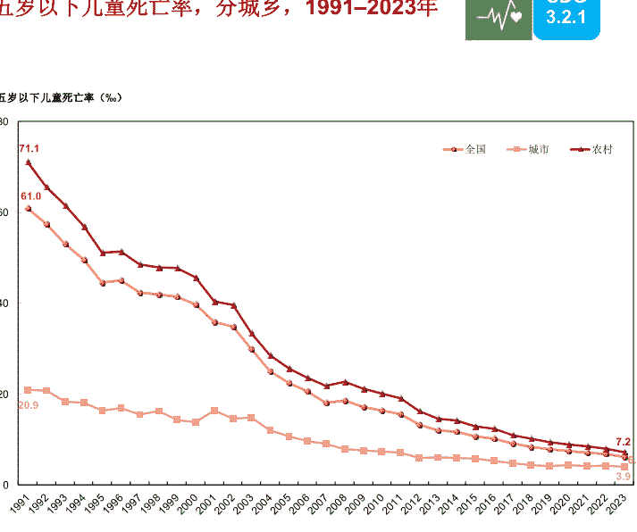

五岁以下儿童死亡率(%)
死亡率(%)

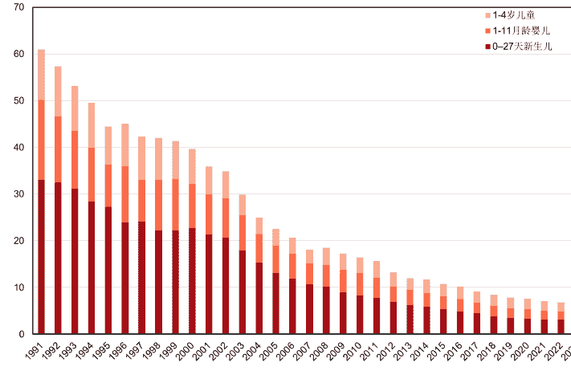

资料来源：国家卫生健康委员会，《中国卫生健康统计要》，2023年：“2023年中国卫生健康事业发展统计简报”，2024年

资料来源：国家卫生健康委员会，《中国卫生健康统计要》，2023年：“2023年中国卫生健康事业发展统计简报”，2024年

图 3.1

图 3.2

中国五岁以下儿童死亡率从1991年的61.1%下降至2023年的6.2%，下降了89.8%，平均每年下降幅6.9%。在此期间，城市五岁以下儿童死亡率下降了81.3%，农村下降了89.9%。

1991年，农村地区五岁以下儿童死亡率是城市的3.4倍，2023年下降至1.8倍，城乡差异仍然严峻。

1991年至2023年间，中国五岁以下儿童死亡率稳步下降。婴儿死亡（出生后2个月内死亡）占全部五岁以下儿童死亡的近四之一（72.6%）；新生死亡（出生后28天内死亡）占全部五岁以下儿童死亡的近半（45.2%），其中很多是可以预防的。

## 图 3.3 婴儿死亡率，分城乡，1991–2023年

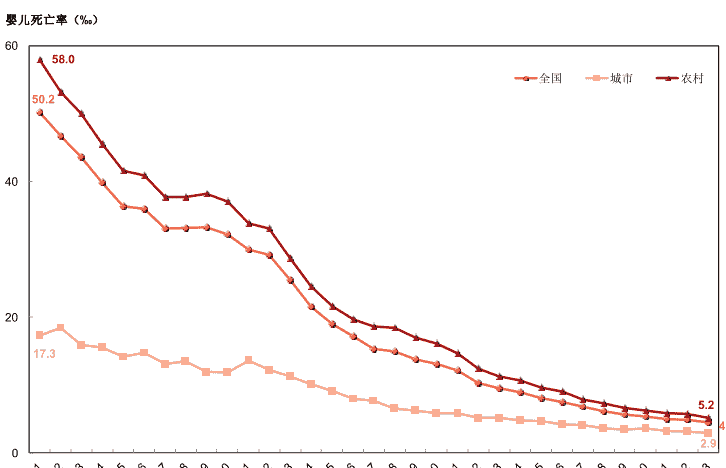

## 图 3.4 新生婴儿死亡率，分城乡，1991–2023年

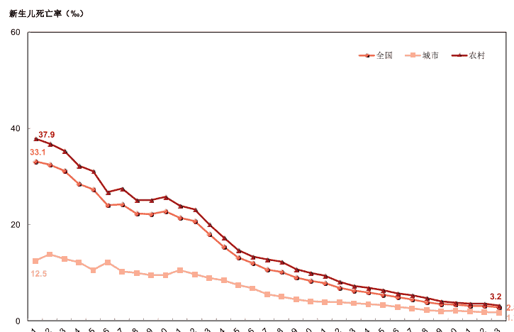

资料来源：国家卫生健康委员会，《中国卫生健康统计要报》，2023年；“2023年我国卫生健康事业发展统计公报”，2024年

资料来源：国家卫生健康委员会，《中国卫生健康统计要报》，2023年；“2023年我国卫生健康事业发展统计公报”，2024年

图 3.3

1991年起，中国婴儿死亡率大幅下降。全国婴儿死亡率从1991年的50.2%降至2023年的4.5%。下降了91.0%，平均降幅7.3%。在此期间，城乡婴儿死亡率下降了83.2%，农村下降了91.0%，城乡间的巨大差异仍然，2023年农村婴儿死亡率是城市的3倍。

图 3.4

1991年起，新生婴儿死亡率大幅下降，从1991年的33.1%降至2023年的2.8%。1991年，农村地区新生婴儿死亡率是城市的3倍，到2023年仍然1.9倍。

# 妇幼保健和青少年健康

## 图 3.5 孕产妇女死亡率，分城乡，1990–2023年
## 图 3.6 分省孕产妇死亡率，2020年

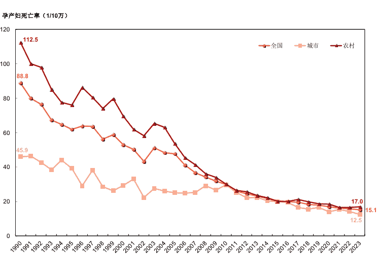

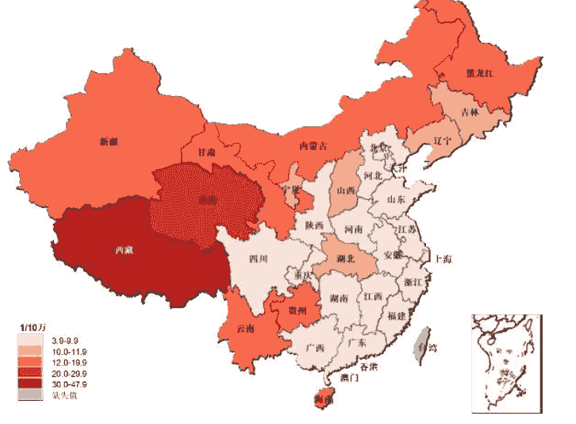

孕产妇死亡率（每10万）

资料来源：国家卫生健康委员会，《中国卫生健康统计》，2023年；2023年中国卫生健康事业统计摘要》，2024年

资料来源：国家卫生健康委员会，《中国卫生统计年》，2021年

图 3.5

自1990年起，中国产妇死亡率大幅下降，城乡差异缩小。1990年，农村地区产妇死亡率是城市的2.5倍，而2010年以来城乡产妇死亡率基本持平。

图 3.6

各省产妇死亡率存在较大差异。总体而言，经济落后的西部省份出现高产妇死亡率，经济发达的东部省份则产妇死亡率较低。2020年，东部、中部和南方地区已提前实现了制定的2030年目标（10以下）。《中国卫生统计年》

## 图 3.7 孕妇死亡原因构成，2000–2022年
## 图 3.8 孕妇死亡原因构成，分城市，2022年

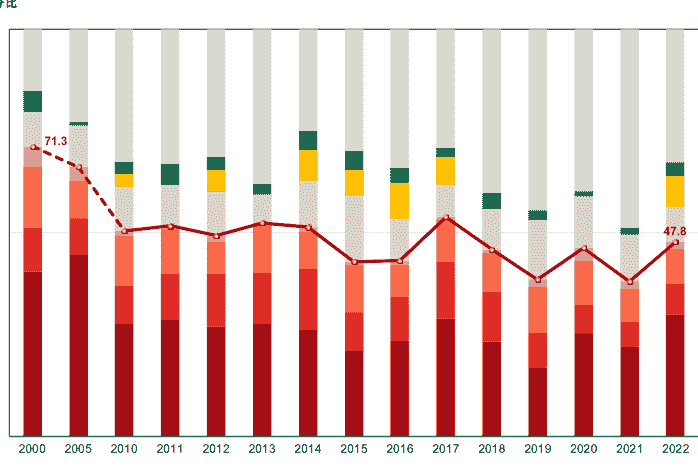

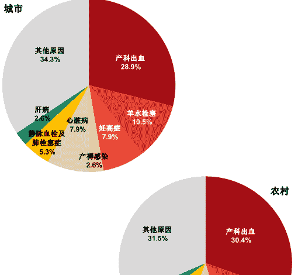

| 原因 | 百分比 | 城市 |
| :--- | :--- | :--- |
| 其他原因 | 34.3% | | |
| 产出血 | 28.9% | 20.4% |
| 羊水栓 | 16.5% | | |
| 心脏 | 7.9% | | |
| 高血压 | 5.3% | | |
| 直接产妇原因 | 1.5% | | |

资料来源：国家卫生健康委员会，《2023年卫生统计年鉴》

资料来源：国家卫生健康委员会，《中国卫生统计年鉴》，2023年

图 3.7

2022年全国孕妇死亡的主要原因是产出血、高血压、心脏和羊水栓。产出血仍然是导致孕妇死亡的主要原因，但已经从2005年以前的超过40%下降到2022年的29.9%。由于直接原因导致的孕妇死亡占到了70%以上，2000-2010年间该率逐步下降。2022年47.8%的孕妇死亡是由直接原因引起的，占比介于50%左右，下降到50%以下。总来说，75%的孕妇死亡和新生死亡是可以预防的，或通过必要的医疗服务预防的。

图 3.8

2022年，孕妇死于产出血、高血压、羊水栓等直接原因导致的孕妇死亡占比46.9%。城市孕妇死亡中是有间接原因导致的。直接原因包括心功能衰竭、产出血、静脉血栓及脑梗塞等。

# 妇产保健和青少年健康

## 图 3.9 住院分娩率，分城市，1990~2022年
## 图 3.10 产前检查覆盖率，分次数和城乡，2018年

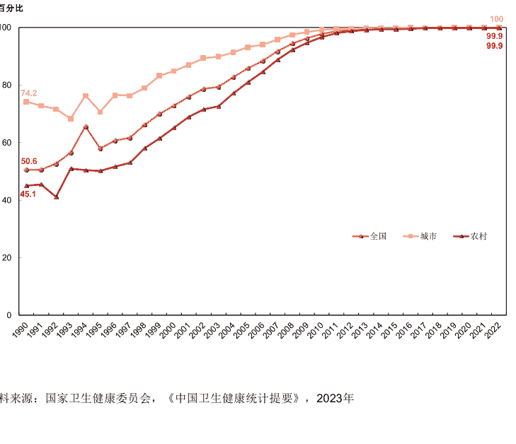

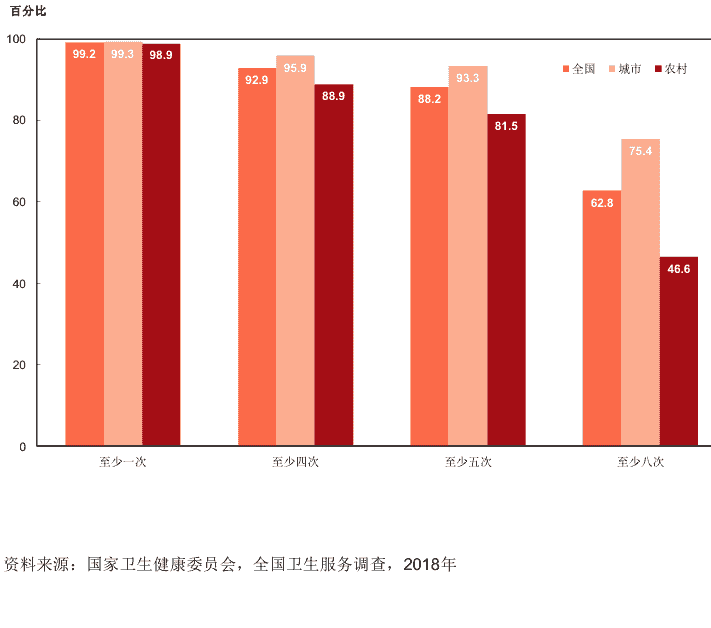

数据来源：国家卫生健康委员会，《中国卫生统计汇编》，2023年

数据来源：国家卫生健康委员会，全国卫生服务调查，2018年

图 3.9

中国的住院分娩率在过去三十多年里稳步上升，20世纪90年代明显的城乡差异逐渐缩小。近年来，全国的住院分娩率稳定在99%以上，2022年各住院分娩率都很，最低是青海，99.7%。产妇住院分娩率的显著提高对于母婴安全、降低早产和新生死亡率发挥了重要作用。

图 3.10

孕妇期间接受护人员（医生、护士或助产士）提供的产前服务，联合国儿童基金会和世界卫生组织建议孕妇至少接受四次产前检查，世界卫生组织建议孕妇至少接受五次产前检查，以减少产前死亡，并改善孕妇接受服务的状况。按照中国孕妇健康状况管理的要求，孕妇至少接受五次产前检查。全国卫生服务调查结果显示，全国至少一次产前检查的比率高达99.2%。城乡差异并不缩小，反而城乡之间之差扩大了

## 图 3.11 产前检查覆盖率（至少五次），城乡和地区，2003–2018年
## 图 3.12 分省产前检查覆盖率（至少一次），2023年

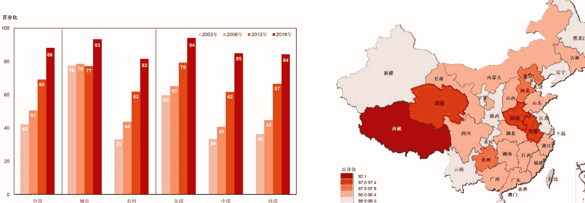

资料来源：国家卫生健康委员会（国家卫生健康和计划委员会），全国卫生服务调查，2003年、2008年、2013年和2018年

资料来源：国家统计局，《中国妇女统计》，2024年

图 3.11

按照中国妇妇保健的要求，孕妇至少接受五次产前检查。最近全国卫生服务调查结果显示，2003到2018年间，接受五次产前检查的孕妇比例提高了5.9个百分点，这主要归于农村地区和中西部之间存在差异。

图 3.12

在中国，至少一次产前检查的孕妇比例在各省均处于较高水平，除西藏之外都在97%以上，与其他省份相比较低为92.1%。

## 分省新生率，2016年
## 剖产率，城乡和地区，2003–2018年

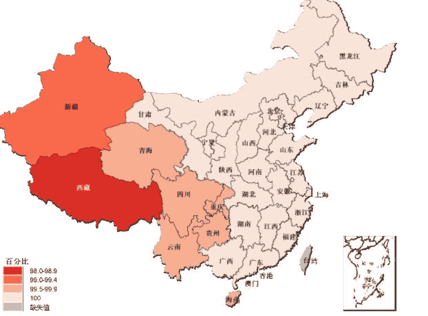

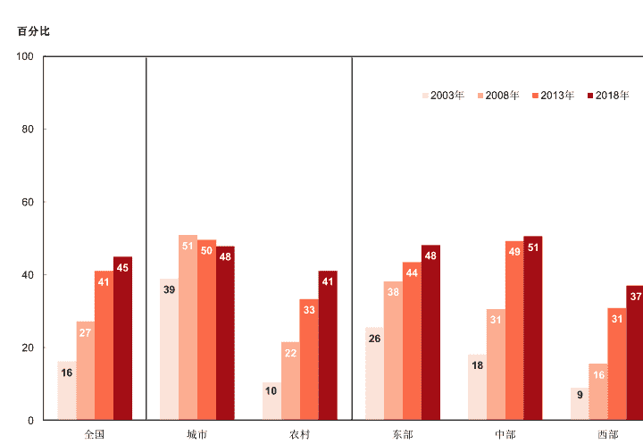

数据来源：国家卫生健康委员会（国家卫生健康和计划委员会），《中国卫生统计年鉴》，2017年

资料来源：国家卫生健康委员会（国家卫生健康和计划委员会），全国卫生服务调查，2003年、2008年、2013年和2018年

近年来，中国的住院分娩率维持在99%以上，意味着新生率在全省都达到了高水平。中国自2017年后不再发布新生率，而是使用住院分娩率作为SDG指标。最近全国卫生服务调查显示，全国和城乡剖产率在各年度呈现整体上升趋势，例外是在2008年到2018年间，城市地区剖产率有微下降。从2018年来看，近一半产妇是剖产，而2003年每10名产妇中不到2名是剖产，城乡差异仍然巨大。

## 幼妇卫生保健各阶段预防措施覆盖率，2017/2018

| | 产期 | 生产 | 产后 | 婴儿期 | 幼儿期 |
| :--- | :--- | :--- | :--- | :--- | :--- |
| | 99 | 93 | 99 | 88 | 88 |
| | | 63 | 45 | 45 | 75 |
| | | | | 34 | |

资料来源：中国疾病预防中心，中国民政部与健康中心（CNHS，婴儿儿童接种数据）；2017年；国家卫生健康委员会，全民卫生状况（NHSS；其他数据），2018年

幼妇卫生保健各阶段预防措施的覆盖率不一。在中国产妇保健方面至少一次产前检查和住院分娩率、儿童预防接种和肺炎方面取得了良好进展，但在一些关键性卫生保健措施上仍有落后，覆盖率偏，例如产前检查达到国际建议的次数、产后保健和婴儿儿童营养方面。

# 妇产保健和青少年健康

## 图 3.16 预防艾滋病、梅毒、乙肝母传播各项服务覆盖率，2005–2023年
## 图 3.17 艾滋病母传播率，2005–2023年

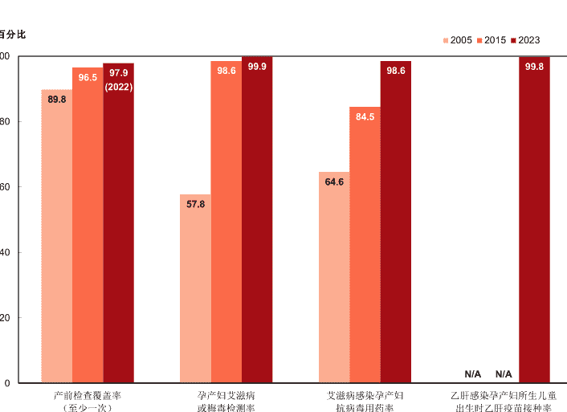

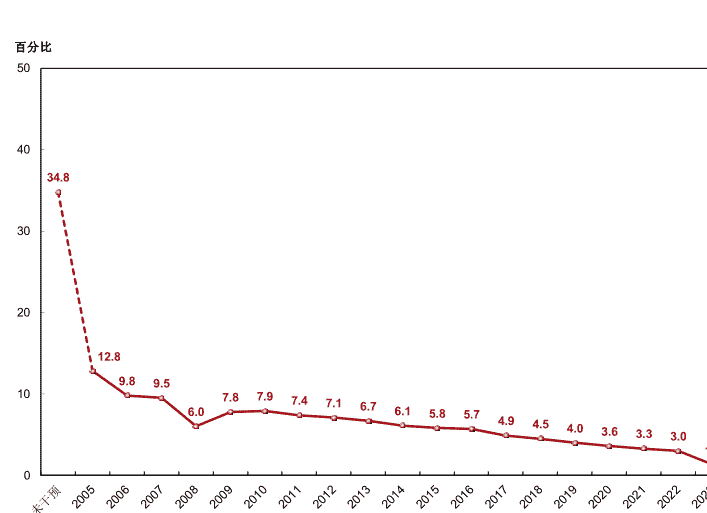

资料：国家卫生健康委员会，预防母婴母传播管理工作信息系统，2023年（其他数据）

图 3.16

中国从2001年开始预防艾滋病母传播试点工作，并逐步推广；2010年宣布艾滋病母传播率已进一步下降至1.3%，目前整合的预防母传播工作已覆盖到全国县级单位。到2025年预计艾滋病母传播率下降至1%以下，实现了“艾滋病母传播率下降至1%以下”的目标。但由于人口基数大、地理环境复杂、偏远及少数民族地区相关防治措施的落实仍待加强。

图 3.17

艾滋病母传播率从34.8%下降至2022年的3.0%。

# 图 3.18 青少年生育率，城乡和年龄，2020年
## 图 3.19 0-19岁青少年死亡率，年龄、性别、城乡和地区，2021年

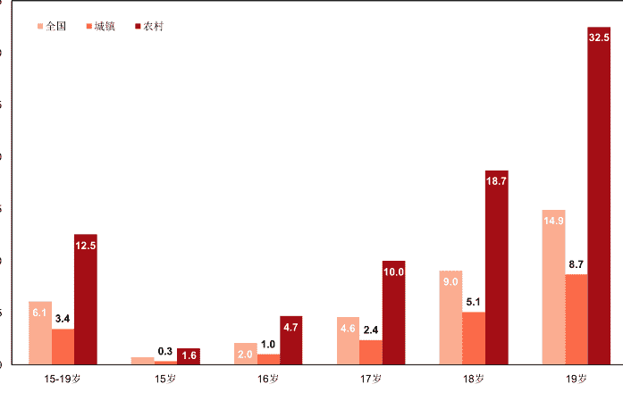

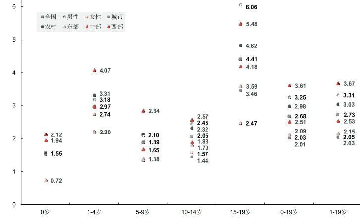

数据来源：中国疾病控制非传染性疾病中心、国家卫生统计信息中心，《中国死亡监测》，2022年

图 3.18

中国青少年生育水平较低的国家，2020年15-19岁女性的生育率为1.8%。同时，青少年生育出明显的城乡和性别差异，女性主要集中在15-19岁，农村女性的生育率达到32.5%。

图 3.19

交通事故是0-19岁青少年第一死因。除了性别外，各年龄段死亡率均为男性高于女性、农村高于城市、西部地区高于中部和东部地区。15-19岁青少年死亡率最高，达到6.0/10万。

# 中国5~19岁儿童前5位死因与高收入国家的比较，1990年、2010年和2019年

| | 中国1990年主要死因及死亡率（每1万） | 中国2010年主要死因及死亡率（每1万） | 中国2019年主要死因及死亡率（每1万） | 高收入国家2019年死亡率 | 1990-2019年死亡率变化（%） | 1990-2019年死亡率变化、中等收入国家（%） |
| :--- | :--- | :--- | :--- | :--- | :--- | :--- |
| 1 | 溺水 16.01 | 溺水 9.44 | 溺水 5.62 | 4.51 | -47.9 | -48.0 |
| 2 | 溺水 10.79 | 自杀 8.42 | 脑心疾病 4.96 | -68.9 | -70.0 |
| 3 | 自杀 5.89 | 外伤疾病 2.58 | 外伤疾病 1.91 | -79.0 | -44.5 |
| 4 | 下呼吸道感染 4.00 | 先天性缺陷 2.04 | 先天性缺陷 1.52 | -93.8 | -46.3 |
| 5 | 白血病 3.97 | 自杀 1.92 | 白血病 2.25 | -77.3 | -56.6 |
| 6 | 先天性疾病 3.29 | 脑血管神经系统疾病 1.05 | 肺炎 1.12 | -38.0 | -46.8 |
| 7 | 人类事故 2.27 | 脑血管神经系统疾病 1.04 | 脑血管神经系统疾病 0.77 | -70.4 | -22.2 |
| 8 | 疾病性肿瘤 1.61 | 下呼吸道感染 1.11 | 疾病性肿瘤 0.64 | -84.0 | -26.3 |
| 9 | 中风 1.53 | 肺炎 1.05 | 中风 0.67 | -38.9 | -51.6 |
| 10 | 结核 1.53 | 外伤 1.00 | 结核 0.64 | -63.2 | -51.1 |
| 11 | 脑和中枢神经系统 1.49 | 特发性疾病 0.99 | 特发性疾病 0.28 | -60.3 | -49.9 |
| 12 | 脑出血 1.48 | 其他脑外伤 0.14 | -37.8 | -53.1 |
| 13 | 疾病性肿瘤 1.28 | 心脏疾病 0.87 | 人类事故 0.90 | -47.2 | -45.7 |
| 14 | 特发性疾病 1.15 | 人类事故 0.46 | 19.6 | -3.5 |
| 15 | 肝脏 1.15 | 其他外性疾病 0.64 | | | |
| 16 | 机械事故 1.10 | 脑力损伤 0.58 | | | |
| 17 | 中毒 1.10 | 传染性疾病 0.5 | | | |
| 18 | 脑梗死 0.40 | 传染性、孕产、新生和遗传疾病 | | | |
| 19 | 肾疾病 0.30 | | | | |
| 20 | 肝脏 0.03 | | | | |

图 3.20 中国青少年疾病负担自1990年以来发生了显著变化。全球疾病数据显示，从1990到2019年，5~19岁儿童死亡率显著下降，从77.63/10万下降至27.79/10万；同时，伤害和意外导致的死亡率为5~19岁儿童主要原因，10.58/10万，占全死亡率的三分之一。同一时期中等及以上国家，由于卫生水平的提高，在水源、卫生、先天性疾病和呼吸道感染方面的死亡率下降尤为明显；然而，2019年儿童青少年全死亡率约为高收入国家平均水平的2.5倍。主要原因是自杀和暴力使得死亡率仍然高于高收入国家之一。

## 图 3.21 基本医疗保险覆盖率，城乡和地区，2003–2018年

资料来源：国家卫生健康委员会（国家卫生健康和计划委员会），全国卫生服务调查，2003年、2008年、2013年和2018年

图 3.21 2003年以来，全国及分城乡、东西部地区医疗保险覆盖率都持续上升。2018年，96.8%的居民参加了基本医疗保险。2000年初推出新型农村医疗制度后，农村地区医疗保险覆盖率大幅上升，此后农村合作医疗覆盖率高于城市。在中国，基本医疗保险包括城镇职工医疗保险和城乡居民医疗保险，后者整合了之前的城镇基本医疗保险和新型农村医疗。

## 图 3.22 执业（助理）医师和注册护士数量，1980—2023年
## 图 3.23 分省域执业（助理）医师数量，2022年（每千人拥有数量）

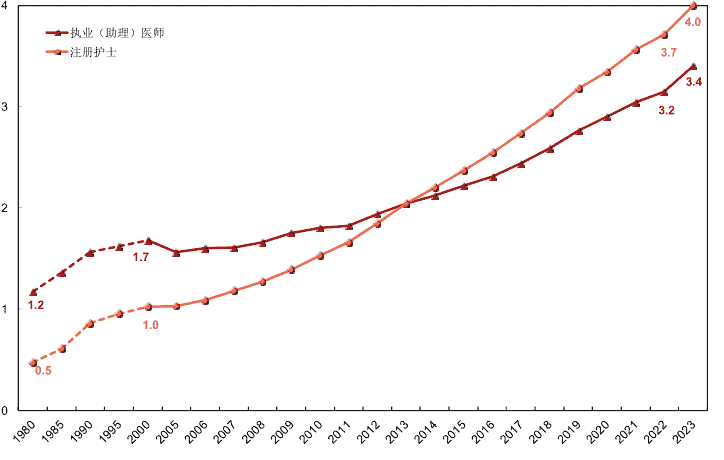

资料来源：国家卫生健康委员会，《中国卫生健康蓝要》，2023年：“2023年中国卫生健康发展公报”，2024年

资料来源：国家卫生健康委员会，《中国卫生健康蓝要》，2023年

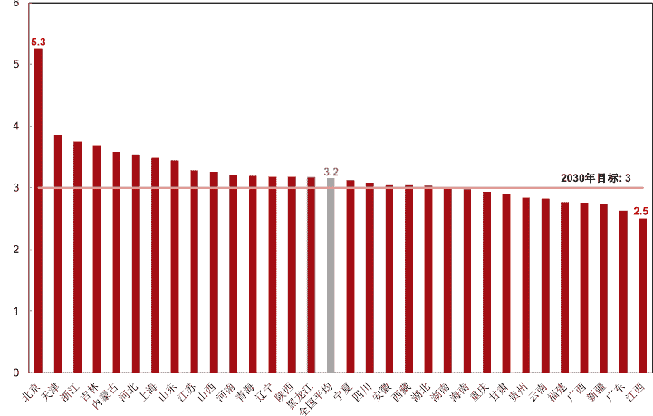

图 3.22

图 3.23

在过去的40多年里，每千人常有执业（助理）医师从1.2万增加到3.4万，注册护士数从0.5万增加到4.0万。根据《健康中国2030》规划纲要，每千人拥有执业（助理）医师在2030年达到3.0万，每千人注册护士数到2030年达到4.7万。

每千人拥有执业（助理）医师在各地之间存在差异。北京为每千人5.3万。2022年，16个省份已达到《健康中国2030》规划纲要制定的到2030年达到每千人3.0万的目标。

#### 图 3.24
低收入人口对住院医疗机构的选择，城乡，2018年

#### 图 3.25
分省人均财政支出和人均地区生产总值，2022年

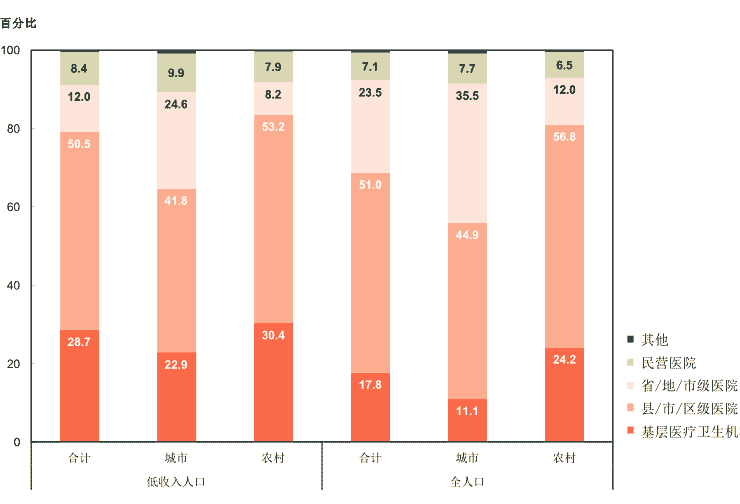

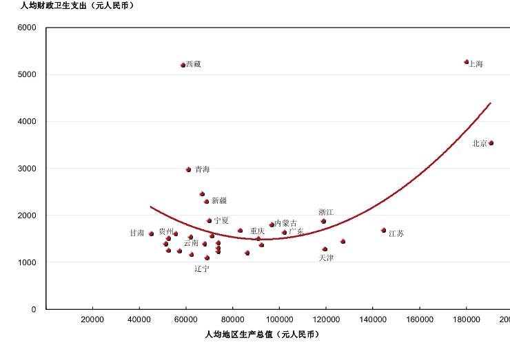

数据来源：国家卫生委员会，全国卫生数据，2018年

数据来源：国家统计局，《中国年鉴》，2023年

图 3.24
在住院的医疗机构选择方案上，2018年的低收入人口（50.5%）选择了县/市/区级医院，另有28.7%选择了基层卫生医疗机构。他们选择医院的可能性低于全人口。在中国，基层卫生院和社区卫生中心内的基层卫生机构往往能够提供价格廉价的医疗服务，但质量较差。相反，县/市/区级医院能够提供更好、更好的质量但是更便宜的服务。此外，低收入人口住院而未住院的比例为26.2%，高于全人口的20.9%。低收入人口在住院患者中，61.1%是因为经济因素

图 3.25
从各省人均财政支出和人均地区生产总值的点分布来看，呈现出东部省份人均财政支出高于西部省份。但是，两者非线性关系。人均地区生产总值低的西部省份人均财政支出水平也可能与西部省份相同。

> *此处为本样本中符合国家政策定义的农村户或城乡结合部户的人口。
> 此类人口占总人口的约为10.7%。

## 妇幼保健和青少年健康

# 图 3.26
政府、社会及个人卫生费用支出,1980—2022年

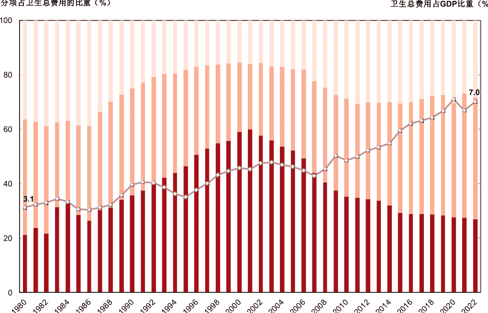

分项卫生总费用的比重（%）
卫生支出占GDP比重（%）

资料来源：国家卫生委员会，《中国卫生统计年鉴》，2022年（1980-2021年）；国家统计局，《中国统计年鉴》，2023年（2022年数据）

在过去的四十年里，中国卫生支出占GDP的从3.1%上升至2022年的7.0%。直到2000年代中期，增长几乎完全是由个人卫生支出推动的。改革开放以来，随着市场经济的投入，医疗卫生筹资以市场为主，“业务投入”以财政补助为主的筹资体制，医疗卫生服务的个人支出持续快速增长，其占全部卫生总费用的份额在2001年达到最高（60%），2005年仍占一半以上。此后随着改革深化，医疗卫生筹资向个人为主回归，个人卫生支出逐渐下降，2015年降到30%以下，到2020年下降至27.7%，实现了《健康中国2030年规划》要到2020年将该份额下降到28%以下的目标。2022年下降至26.9%。中国不需要提高卫生支出投入，以减轻家庭卫生负担压力，可以实现2030年将个人卫生支出占总费用的控制在25%以下的目标。

# 图 3.26

- 政府支出占卫生总支出的比重
- 社会卫生支出占卫生总支出的比重
- 个人支出占卫生总支出的比重
- 卫生支出占GDP比重

## 妇幼保健与青少年健康

数据来源与参考文献

- 1 产妇死亡率：表示为每年每10万产妇中国与妊娠期间的死亡人数。（联合国统计局）
- 2 五以下死亡率：表示为每年每千名儿童从出生五周期间的死亡人数。（联合国人口统计）
- 3 新生死亡率：表示为每年每千名儿童出生后28天内的死亡人数。（联合国统计局）
- 4 中央中共、国务院，“健康中国2030”规划要（2016年10月25日），http://www.gov.cn/zwen/2016-10/25/content_5214174.html；2024年5月查；国院，《中国儿童发展纲要（2021-2030年）》
- 5 国家卫生委员会，“2023年”中国卫生事业发展统计报告”，http://www.nhc.gov.cn/nry/slist/2023-08/content_56395a33b55804c3c518444fe96/55d8e773c815552e4b1a51.html
- 6 国家卫生委员会，“2023年中国健康发展统计报告”，
- 7 国家卫生委员会（原计划卫生和计划委员会），联合国儿童基金会举办华、中国疾病预防控制中心，“中国6岁以下儿童发展监测从证到实践”，2017年
- 8 国家卫生委员会，“2018年第六次卫生服务统计调查报告”，2019年
- 9 世界卫生组织，“新生儿健康状况：临床实施指南》，2014年
- 10 国家卫生委员会，预防妇女传播疾病信息统计公报
- 11 国家计划委员会，“2022年儿童发展报告（2021-2030年）”统计报告（2023年12月），https://www.stats.gov.cn/sj/zxfb/2032/t0231229_194067.html，2024年5月查
- 12 世界卫生组织、联合国儿童基金会、世界银行，《营养保护促进儿童早期发展；帮助儿童早期发展到实现健康和健康的框架》，2018年
- 13 国家卫生委员会，“乡村农村健康战略——基层儿童早期发展项目在北京召开会议（2023年4月）”，“https://www.chinaw.cn/zxgq/202302401/t20230411_66503.html，2024年5月查
- 14 中国疾病预防控制中心，多发性传染性疾病控制报告、国家卫生委员会统计信息，中国疾病监测数据集（2022年）
- 15 中国疾病预防控制中心，多发性传染性疾病控制报告、国家卫生委员会统计信息，中国疾病监测数据集（2021年）
- 16 国家统计局，“2021年儿童发展报告（2021-2030年）”统计报告（2023年4月），https://www.stats.gov.cn/zxfb/2023/t20230417339688.html，2024年5月查
- 17 联合国儿童基金会、联合人口，“中国青少年健康状况：事实与报告”，2023年
- 刘建萍，配行行动与调整策略应对中国儿童青少年不断变化的健康需要，“妈妈网”，2022年4月18日在线报告，https://doi.org/10.1016/S0140-6736(23)02894-5
- 18 史奎林，“中国资源状况》，2019年，第12期，第51-52页
- 19 董莉，“青少年发育与健康相关因素，《中国妇幼研究》，2022年，第33，第68-74页
- 21 国家卫生委员会，“关于2023年基本卫生服务的通知”（2023年7月11日），https://www.nhc.gov.cn/gov/slist/77881/73dcdba25640ae1c9b4311ffdd1.html

# 图 60 婴儿与青少年

国家卫生委员会，“关于做好2022年公共卫生工作的通知”（2022年7月5日），https://www.gov.cn/zhenge/zhengge/2022-07/5699bf70.htm
联合国儿童基金会，Primary Health Care Landscape East Asia and Pacific，2023年
新型农村合作制度是由政府引导、多方参与的。世界卫生组织、联合国儿童基金会、世界银行，《营养保护促进儿童早期发展；帮助儿童早期发展到实现健康和健康的框架》，2018年
国家卫生委员会（原计划卫生和计划委员会，《关于完善农村合作制度的意见》（2003年）
国家统计局，“关于2022年农业发展统计的通知”，http://www.nhc.gov.cn/nry/slist/2023/07/content_10995.htm
婴儿死亡率：表示为每年每千名产妇从出生到五周期间的死亡人数。（联合国统计）
国家卫生委员会，“2023年中国健康统计报告》，2023年5月31日发布，http://www.nhc.gov.cn/nry/slist/20230630/2621e1b9c0421bbbd9eca.html
联合国儿童基金会举办华、中国疾病预防控制中心，“中国6岁以下儿童发展监测从证到实践”，2017年
国家卫生委员会，每年开展一次家庭健康调查（NHHS），2018年开始
世界卫生组织，《新生儿健康状况：临床实施指南》，2014年
国家卫生委员会，“2023年中国卫生事业发展统计报告”
国家卫生委员会，“2023年中国健康发展统计报告”
世界卫生组织，《营养保护促进儿童早期发展；帮助儿童早期发展到实现健康和健康的框架》，2018年
陆才等，“Years of Maternal, Newborn, Child, and Adolescent Health in China，《Lancet》，2021年6月，第1297
Aniram Singh，“Prevalence of Depression and Determinants in Mainland China: A Systematic Review and Meta-analysis”，“Journal of Affective Disorders》，2020年，277卷，137
张云源等，“中国儿童早期发育的不均衡：基于人群层面的实证研究，《柳叶》，2021年7月在线发表，https://doi.org/10.1016/j.lanlife.2021.10022

# 图 4 营养

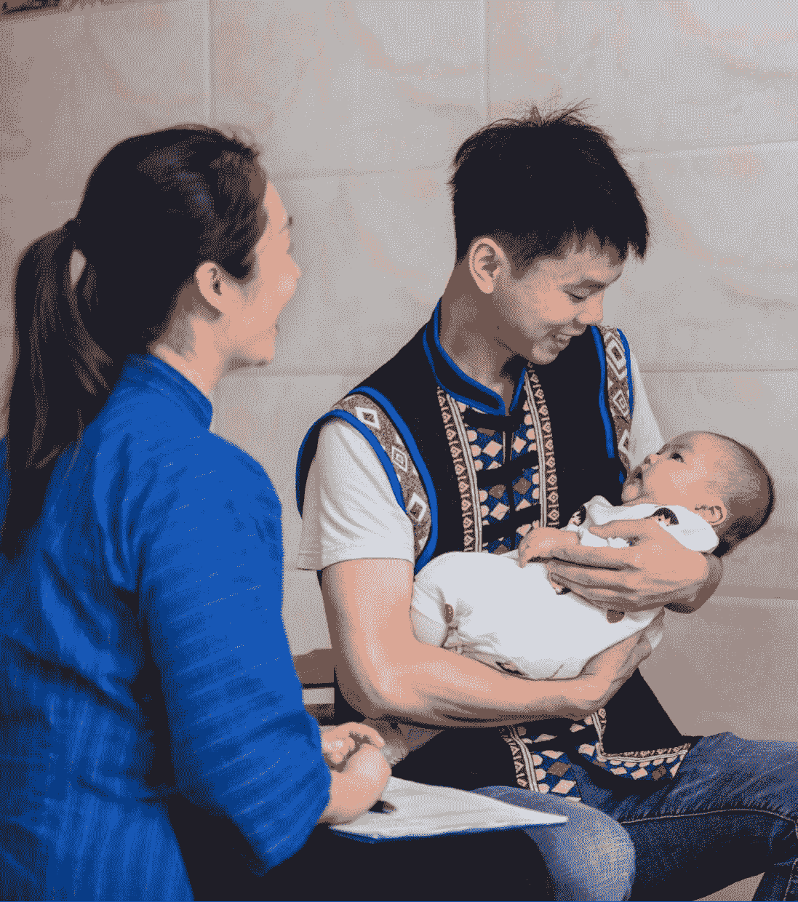

### 概述：儿童营养的负担

儿童营养的负担，即微量营养缺乏和超重（肥胖），在全球范围内威胁着儿童和少年的发展。在中国，经济的增长和快速城市化正改变着人们的生活习惯、食物体系，中国儿童也面临着营养的负担。

中国营养不良的趋势在过去多年里发生了变化：一方面，国际和中国政府对营养不良采取了许多措施，使矮小（按身高标准）和肥胖（按身高体重标准）问题得到了改善；另一方面，儿童肥胖的比例持续上升，儿童超重问题日益严峻。

儿童营养不足的主要原因包括食物摄入不足以及疾病、感染。长期营养不足会导致生长发育迟缓，影响儿童发育的影响往往不可逆的，可能造成终身性的损害，影响儿童的一生。2022年，62.5%的中国儿童处于营养不良状态。目前，中国儿童身高发育水平仍居全球第15位，但已高于全球水平。中国儿童身高发育水平排名第一的韩国儿童仅高于全球平均水平2%。目前，中国儿童身高发育水平从2006年的13.8cm增长到2017年的14.7cm，整体状况正在改善，但矮小问题依然严重，肥胖问题也日益严峻。

超重（肥胖）的成因包括食物摄入过量和能量消耗不足，从而导致肥胖，并在成年后可能增加患性疾病的风险。从生活习惯到饮食习惯的转变，儿童面临着适应环境变化的挑战，“孩子不听”、“孩子胖”等变化引发的问题日益严重，中国儿童肥胖问题在过去几年内快速上升，中国也面临着超重和肥胖问题人数增加的挑战。2017年中国6-17岁超重肥胖儿童4500万。学龄儿童的超重肥胖率从2002年的6.6%（7.7%）上升到2017年的19.0%，男孩高于女性，2017年男孩超重肥胖率为22.7%，女性为14.9%。根据国际儿童基金会、世界卫生组织和联合国联合会的计算，五岁以下儿童超重肥胖从2002年的6.5%增长到2022年的8.9%。

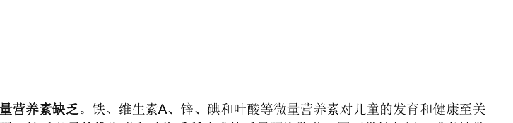

微量营养缺乏、维生素A、锌、碘和叶酸等微量元素对儿童的影响是隐蔽的，往往被忽视。营养缺乏的问题在两岁以下儿童中突出，尤其是在资源匮乏的地区。由于营养缺乏，两岁以下儿童发育可能受损，导致多达23%的儿童发育缓慢。研究显示，2022年，中国17.2%的儿童面临营养不良。为了改善儿童营养状况，需要从孕前、孕期和产后开始积极补充，为母亲提供足够的营养，并在生命的前1000天开始补充多种营养元素。此时的营养状况会对儿童生长发育造成不利的影响。生命1000天（从怀孕到宝宝两岁）是促进良好营养发育的关键要素。

### 总体政策与促进婴儿营养

针对儿童营养不良的遭遇是迫切的。在中国，儿童营养面临诸多挑战，包括营养不良的负担负担。根据《健康中国2030年规划》和《中国儿童发展纲要（2021-2030年）》，中国将采取进一步措施。除了上述提到的生命1000天，营养还强调了早期干预。此外，世界卫生组织和联合国儿童基金会倡议：
* 出生后6个月内及时喂乳。
* 6个月后开始添加丰富的食品。
* 继续母乳直到两岁。

为了改善儿童营养，需重点关注以下方面，有待制定相关政策指导：
* 食品系统应该包括食品卫生、环境卫生、教育和社会保障在内的系统来解决问题。
* 必须建立食品体系，以满足每个阶段独特的营养需求，提供丰富多样化的食物种类。
* 政府采取行动，限制高盐、高糖、高脂肪的使用，逐步引入食品正面的标签以帮助消费者选择健康的食品。

### 营养计划

- 2025年目标：母乳率达到50%。
- 2025年目标：达到最低身高标准的比例从60.8%下降到50%；达到最低接受体重标准的比例从74.4%下降到60%。

# 图 4.1 五岁以下儿童生长迟缓、消瘦和超肥胖患率和人数，中国和世界，2022年
# 图 4.2 五岁以下儿童生长迟缓、消瘦和超肥胖患率，中国，2012–2022年

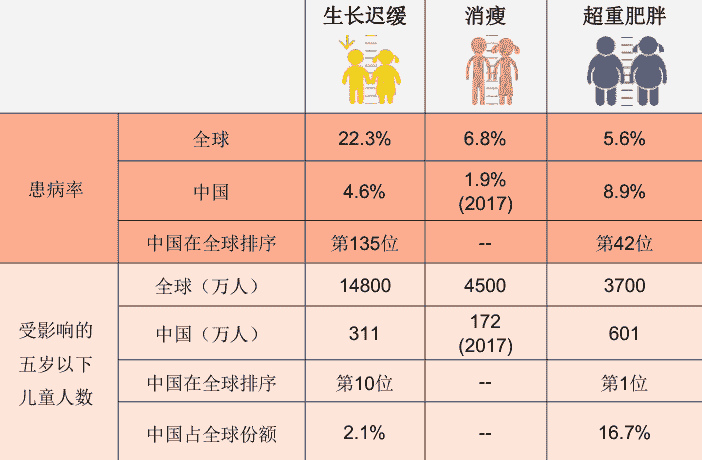

| | 生长迟缓 | 消瘦 | 超肥胖 |
| :--- | :--- | :--- | :--- |
| 患肥率 | 全球 | 22.3% | 6.8% | 5.6% |
| 中国 | 4.6% | 1.9% (2017) | 8.9% |
| 在全球排名 | 第135位 | | 第42位 |
| 全球（万人） | 14800 | 4500 | 3700 |
| 五岁以下儿童人数 | 中国（万人） | 311 | 172 | 601 |
| 在全球排名 | 第10位 | | |
| 中国总龄份 | 2.1% | | 16.7% |

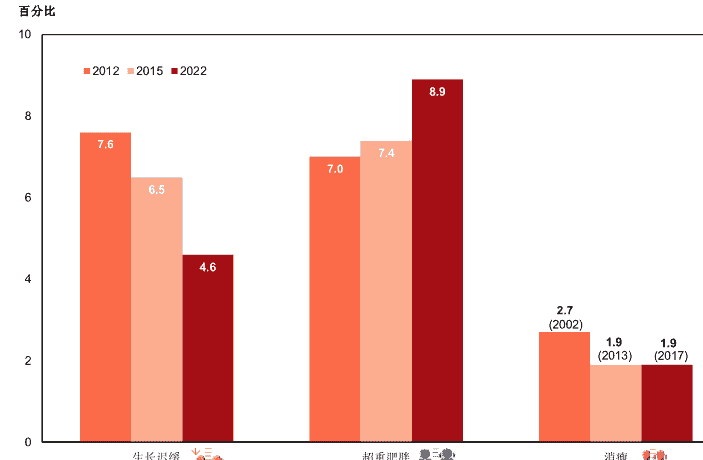

来源：联合国儿童基金会、世界卫生组织和世界银行，“Trends in Child Malnutrition: UNICEF/WFP/World Bank Group Joint Child Malnutrition Estimates: Key Findings of the 2023 Edition”（https://data.unicef.org/resources/ieme-report-2023), 2024年5月刊。

来源：联合国儿童基金会、世界卫生组织和世界银行，儿童营养不良估算（JME）数据库。2023年5月（https://data.unicef.org/resources/dataset/malnutrition-data/），2024年5月刊。

## 图 4.3 五岁以下儿童生长迟缓病率，1990~2017年
## 图 4.4 六岁以下儿童生长迟缓和消瘦病率，分城乡和性别，2017年

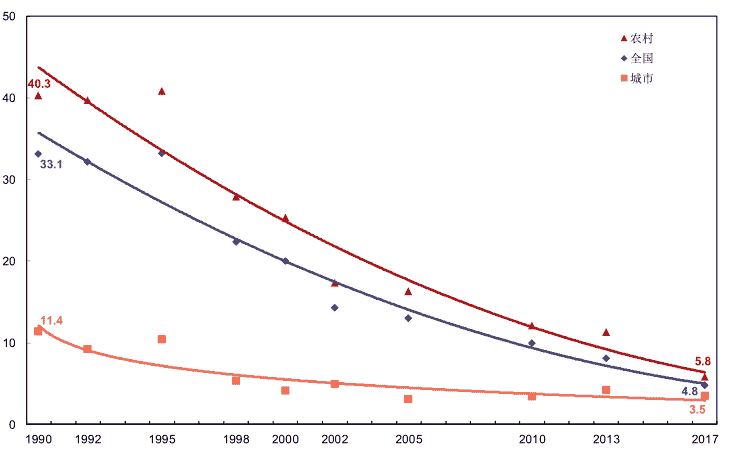

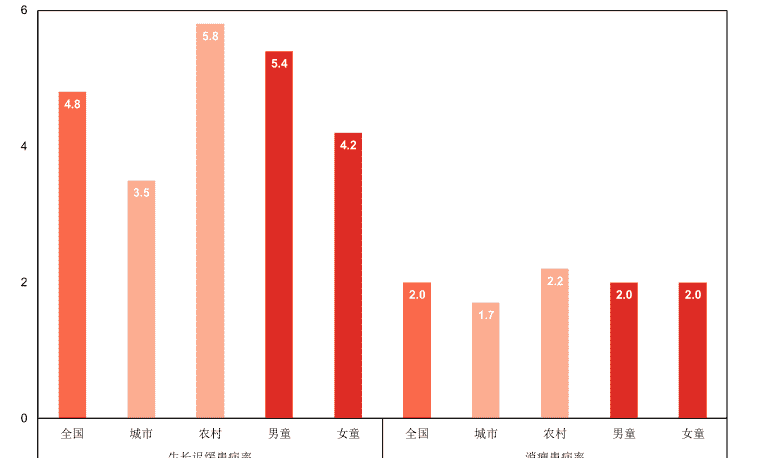

资料来源：中国疾病预防控制中心，中国居民营养与健康监测（1992、2002、2013 和 2017 年数据）；中国食物与营养监测系统（其他年份）

资料来源：国家卫生健康委员会，《中国居民营养与慢性性病状况报告（2020年）》，2021年

## 图 4.3
## 图 4.4

根据中国居民营养与健康监测数据，生长迟缓率从1990年的33.1%（五岁以下儿童）降至2017年的4.8%。同期期城市儿童生长迟缓率由11.4%降至3.5%，农村儿童生长迟缓率由40.3%降至5.8%。是参照世界卫生组织儿童生长标准进行调查的。图中2013年和2017年数据针对六岁以下儿童，政府未发布其年龄的五岁以下儿童生长迟缓率。

农村地区的六岁以下儿童比城市地区出现消瘦病率（4.2%）高于儿童（4.2%）。消瘦病率没有性别差异。

## 68 营养

图 4.5
6~17岁儿童超重肥胖率，城乡和性别别 2012年和2017年

图 4.6
0~17岁儿童超重肥胖率，分年龄，2017年

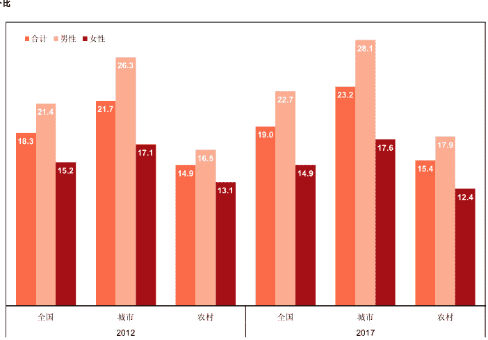

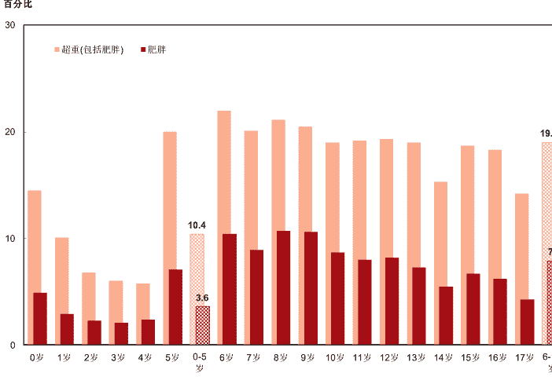

百分比
| | 男性 | 女性 | 合计 |
| :--- | :--- | :--- | :--- |
| 超重(BMI≥24) | | | |
| 肥胖 | | | |

来源：赵云等，《2015~2017年中国居民营养与健康状况报告》，2022年
来源：赵云等，《2015~2017年中国居民营养与健康状况报告》，2022年

图 4.5 图 4.6

2017年，6~7岁儿童中有五分之一（19.0%）超重。城市地区和男童的超重肥胖率较高，城市男童的患病率最高，达到28.1%。2012年的超重胖率（18.3%）比2002年（6.6%）增加十个百分点以上，基于此，2017年与2012年基本持，一定得到通过各项措施对超重肥胖行的干预措施。

2017年，六岁以下儿童的超重肥胖率为10.4%，肥胖率为3.6%。6~7岁儿童的超重肥胖率为19.0%。这意味着中国约有4500万0~17岁儿童受到超重肥胖的影响，其中包括1800万肥胖儿童。小学龄儿童的超重肥胖率高于其他年龄段儿童。判定儿童和肥胖时，对五岁以下儿童、五岁以下和6~7岁分别采用不同的方法。

### 4.7 实施干预预防0~19岁儿童和青少年超肥胖带来的健康和经济收益

| 预防措施 | 具体内容 | 一生中可以避免的伤残调整寿命（百万） | 每一投入可以带来的收益（元） |
| :--- | :--- | :--- | :--- |
| 对含糖饮料征收20%的税收 | 对含糖征收分级的从价税和从量税 | 59.8 | 11,317 |
| 通过手机短信传递母乳养知识 | 在怀孕的最后3个月、产后3天、以及产后1个月、3个月、6个月和9个月通过手机短信向孕妇传递母乳养知识 | 3.5 | 173 |
| 限制向儿童和青少年营销不健康食品 | 禁止所有媒介向儿童和青少年投放不健康食品和饮料的商业广告 | | 13,266 |
| 基于学校开展的儿童肥胖干预 | 小学营养教育、每天两次10分钟的体育、定期检查和改进学校午餐、在小学和中学校园预防 | 59.0 | 28 |
| 医生提供营养咨询 | 由级保健医生为肥胖儿童和青少年（0-19岁）提供营养咨询 | 11.3 | 674 |

资料来源：吴云生，“The Return on Investment for the Prevention and Treatment of Childhood and Adolescent Overweight and Obesity in China: a Modelling Study”，https://doi.org/10.1016/j.lanwc.2023.10097

图 4.7 联合国基金开展了一项研究，为了了解在中国采取一系列符合国情的干预措施控制儿童和青少年超肥胖的成本和可能带来的收益。纳入的研究五项干预措施为：对含糖饮料征收20%的税收、通过手机短信传递母乳养、限制向儿童和青少年营销不健康食品、基于学校开展的儿童肥胖干预以及提供营养咨询。在中国范围内实施这五项干预，预计能够在0~19岁儿童的一生中减少7亿伤残调整寿命，并节省13亿元经济收益。其中，对含糖饮料征收20%和限制向儿童和青少年营销不健康食品两项投资较高。

## 图 4.8 儿童营养改善地区6—23月龄儿童贫血率，2012—2021年

| 项目持续改善地区（三省六县） | 横面调查（百分） |
| :--- | :--- |
| 2012年 初始覆盖 | 32.9 |
| 2015年 扩展率 | 29.7 |
| 2019年 覆盖 | 26.9 |
| 2017年 | 24.1 |
| 2018年 | 17.6 |
| 2020年 | 18.1 |
| 2021年 | 11.0 |

资料来源：Reduced Anaemia among Infants and Young Children Aged 6-23 Months through Large-Scale Nutrition Improvement Program for Children in Poor Areas in China from 2015 to 2020. UNICEF, 2023；https://www.nhc.gov.cn/11634；中国卫生委员会（三省六县持续改善数据横面调查）。

图中展示了两组数据，一组是从2012年启动的三省六县持续改善地区，另一组则是2015年收集的全部地区数据显示儿童营养改善项目有助于减少6—23月龄婴儿贫血风险，是一项重要的公共卫生干预措施。从持续数据来看，2012-2021年三省六县23月龄儿童贫血率下降了三分之一；从历年横面调查数据来看，农村地区儿童贫血率从2015年的29.7%下降到2018年的13.8%，表明有必要进一步扩大儿童营养项目的覆盖，加大政府投入，为持续和可持续改善环境提高儿童营养依赖性。

## 图 4.9 乳喂养及辅食添加情况，2013年和2017年
## 图 4.10 6~23月龄婴幼儿膳食摄入情况，2017年

资料来源：国家卫生委员会，《中国居民营养与慢性病状况报告（2015年）》、《2013年中国乳喂养报告》，国家卫生委员会，《中国居民营养与慢性病状况报告（2020年）》，中国疾病预防控制中心；2017年中国居民营养与慢性病监测数据；王玉等，“Status of Infant and Young Child Feeding for Children Aged 6-23 Months in China”. Journal of Hygiene Research. 2023.
资料来源：王玉等，“Status of Infant and Young Child Feeding for Children Aged 6-23 Months in China”. Journal of Hygiene Research.2023.第52期，第5期

根据中国营养状况监测，2017年6月婴幼儿内乳喂养率为34.1%，6-8月龄婴幼儿辅食添加率为83.2%，6-23月龄婴幼儿达到低食物多样性、最低进食次数以及最低接受食物标准分别为60.6%、72.4%和43.4%。

如所述，2017年6月中国婴幼儿的整体营养状况，且6个月龄婴幼儿表现出明显的城乡差异。另外，2017年的母乳喂养率比2013年增加13.3个百分点，但仍偏低，中国提出的到2025年达到50%以上的目标尚待。

## 营养数据来源与参考文献
2023年5月查阅(https://data.unicef.org/resources/malnutrition-data/), 2024年5月查阅

- 联合国儿童基金会，《2019年世界儿童状况报告（儿童、食物与营养：在变化的世界上健康成长）》，2019
- 国家卫生健康委员会，《中国居民健康与慢性性状况报告（2020年）》，2021
- 联合国儿童基金会，《2023年世界儿童状况》，按年龄低于世界卫生组织生长标准中位数或参考的0-59月龄儿童百分比。
- 联合国儿童基金会，《2023年世界儿童状况》，按体重超过世界卫生组织生长标准中位数0-4岁采用世界卫生组织的2006年生长标准计算身高偏离值（WHZ），5-19岁采用世界卫生组织生长标准中位数加3，BMI为中位数加3。
- 联合国儿童基金会，世界卫生组织和世界银行，“Levels and Trends in Child Malnutrition: UNICEF/WHO Bank Joint Malnutrition Estimates: Key Findings 2023”
- 联合国儿童基金会，《2019年世界儿童状况报告（儿童、食物与营养：在变化的世界上健康成长）》，2019
- 联合国儿童基金会，世界卫生组织和世界银行，“Levels and Trends in Child Malnutrition: UNICEF/WHO Bank Joint Malnutrition Estimates: Key Findings 2023 Edition”

## 农村水安全 概述
中国从2000年开始向农村提供贷款，并从国民经济和社会委员会第十五规划（2006-2010年）提出“加强农村水安全建设”的要求，政府发布《2005-2006年农村饮水应急规划》、《全国农村水工程十一五规划》和《全国农村水工程十二五规划》，中央政府对农村饮用水不断增大。“十一五”期（2006-2010年），中央财政投入资金590亿元，地方配套和群众筹集463亿元，解决了21.7亿农村人的饮水安全。“十二五”期（2011-2015年），中央财政投入1215亿元，地方配套553亿，使得农村饮水安全问题解决，3.04亿农村居民和413万农村学校上饮水安全。“十三五”期（2016-2020年），中国实施了“农村水安全保障行动”，进一步推进农村供水工程、提高水质。在投入220亿元的农村水工程建设的基础上，增投入76亿元，加大对贫困地区支持力度。到2020年，展望实现农村水安全的目标，中国已完成农村水工程，农村自来水普及率达到83%，农村人的饮水安全将在2033实现全部水安全。2021年，水利部联合财政部发布《关于加强农村水安全工作的通知》（2021-2025年）明确要进一步加强农村水工程建设，要求我国在农村供水普及率发展到85%以上，2035年实现农村饮水安全，农村饮水质量将稳步提升。

### 农村卫生
“厕所”和“卫生”是一项至关重要的工作。20世纪90年代后期，中国政府对农村卫生工作发布《农村卫生发展规划（1992-2000年）》和《中共中央、国务院关于加强农村发展的意见——“农村卫生建设”，在农村地区加快了“农村卫生建设”。2004年，中央政府设立农村医药卫生体制改革农村卫生服务项目，推进农村医药卫生改革。2009年将农村医药卫生改革纳入农村卫生服务项目并加大投入力度。通过多年实施的农村卫生工作，中国农村厕所率由1993年的7.5%提升到2021年的81.8%。2018年以来，国务院曾印发《农村人环境整治三年行动方案（2018-2020年）》和《农村人环境卫生提升五年行动方案（2021-2025年）》。

要求将“厕改”作为农村环境整治和乡村振兴的一项重要工作，继续落实“厕改命令”，重点聚焦中西部地区农村厕改，因地制选用厕改技术，逐步发展农村厕卫生所，并加强农村污水处理与资源利用。

## 个人卫生

世界卫生组织和联合国儿童基金会、环境、卫生和个人卫生监测的数据显示，2022年全球有88个国家和地区拥有用于饮用水和洗手的厕所。现实数据表明，仍有未发达国家34%的人口没有配备干净的厕所。现实数据表明，仍有23%的人口缺少基本厕所，另有30%的人没有洗手设备。97.2%的人口没有足够的饮用水和配备的卫生厕所。

### 学校卫生

可持续的健康卫生对于所有人都享有公平的水、环境、卫生和个人卫生服务的承诺，需要涵盖一切，加强学校卫生组织机构机制建设。

近年来，小学和中学的卫生得到了越来越多的关注。2021-2022年，全国基础教育覆盖（包括幼儿园、小学、初中和中学）学校内厕所覆盖率为88.7%。设有卫生厕所的学校比例超过95.7%，另外没有卫生厕所的学校主要集中在中西部地区。中国学校按性别分布，但存在性别差异，男女厕配置比例不相同的问题。女性和女孩的厕所情况需要重视。另外，如果厕改对于隐私保护不到，学校卫生问题仍需得到重视。

### 气候变化

气候变化对地球自然系统带来严峻挑战，不仅影响经济社会系统，还对环境因素和生物多样性造成安全威胁。例如，沿海地区面临海岛效应、高温季节增多，海上风暴威胁沿海城市安全，我国部分省份面临加剧的极端热浪和干旱，对饮用水和农业生产安全造成巨大影响。未来一段时间全球变暖趋势将持续，自然灾害和极端天气事件发生的频率和强度将进一步增加。

预计将增加变化风险和影响的广度也会进一步扩大。

中国将应对气候变化作为推进生态文明和实现高质量发展的重要抓手，积极参与全球环境治理，并展现了强大的决心。作为《联合国气候变化框架》缔约国，中国承诺2030年实现碳达峰，并提交了国家自主减缓目标，即在2030年前实现碳达峰并争取尽早达成。2020年，中国宣布碳中和目标，将采取积极有力的行动措施，努力二氧化碳排放量到2030年前达到峰值。

按照国家目标战略，中国已建立碳达峰路径和“+N”框架，积极应对气候变化。“+N”是2021年1月发布的中共中央关于加强我国气候变化适应工作的意见（意见）对加强加强气候变化社会适应能力、统筹新发展理念、做好碳达峰路径、加强规划、统筹资源、多层次开展气候风险评估、加强城乡交通基础设施韧性建设、以及在气候基础上加强重点地区脆弱性监测支持和适应政策落实。在“四五”和“五五”规划期间，加强资金筹措、统筹社会力量和重点工作，加强实施“提升11项行动”（意见）并与有关部门共同制定“双目标”的顶层设计，明确了适应目标标准，加强脆弱性监测，降低风险扩散，确保中国适应能力水平不断提升。到2025年，我国适应水平有望提升7.7%。

同时，加强气候变化适应和治理，提高我国应对气候变化的能力。在2013年《国家适应气候变化战略》和2022年《国家适应气候变化规划》的指导下，加强我国适应气候变化预测和风险管理能力，提升自然生态和经济社会系统适应气候变化能力，并针对重点和重点区域加强适应气候变化行动。例如，加强适应城市建设、加强基础设施韧性建设、推进防洪、黄河河流等

## 环境卫生与变化

### 挑战与难题

- 根据世界卫生组织和联合国儿童基金会估算，2022年，中国约3400万人无法享有基本的饮用水，6000万人无法享有基本的环境卫生服务。要实现可持续发展目标中的“人人享有基本服务”（包括饮用水、环境卫生和个人卫生），并逐步提高环境卫生标准、适宜的卫生和服务以及环境管理的覆盖率，中国仍面临挑战。
- 在“全球气候变化”作为许多国家共识的推动下，一方面需要加强供给，明确中国向可持续发展的路线，特别是中国需要继续投入，提高环境质量和气候适应能力以应对我们的需求，增强卫生的适应措施。
- 全球气候变化加剧，极端天气事件频发，高温、暴雨、洪水、干旱等自然灾害日益频繁。随着城市化、工业化的持续、复杂性也增加，面对频发的自然灾害，中国防灾体系仍处于薄弱和不足状态。需要在规划和设计时考虑气候变化和自然灾害的影响。
- 亚洲还需要加强学校卫生、社区卫生和个人卫生服务，确保安全、舒适。通过加强适宜的场所设施以及可能的废物管理，来改善医疗功能。
- 与发展相比，中国在达成碳达峰和碳中和目标方面具有优势，资源增长的同时，能源、交通和土地的使用发生变化，将面临严峻挑战。
- 逐步加强水卫生、环境卫生和个人卫生监测，与世界卫生组织和联合国基金会的监测对接；将饮用水、环境卫生和个人卫生的监测纳入政府系统并通过反馈。
- 重金属污染是不可避免的健康损害，特别是对人的神经系统。世界卫生组织对血液暴露等于50微克/升的标准，应明确铅暴露的来源，并采取适当措施减少污染。随着禁止使用含铅等措施的实施，铅水平在过去十年内下降。中国生物监测2017-18年的调查结果显示中国仅有6%的6-18岁儿童铅浓度低于50微克/升，亟需采取干预。
- 尽管中国对应气候变化的国家政策实施方面取得了进展，但在地方层面仍存在量化指标缺乏、监测不足、机构间协调和信息共享等问题，一套统一的监测体系尚未建立。目前，中国正加强碳排放市场的建设，未来通过财政政策和绿色金融市场来激励。

### 饮用水设施及等级

资料来源：世界卫生组织和联合国儿童基金会、水、环境卫生和个人卫生联合监测方案，https://washdata.org/

| 服务级 | 定义 | 设施级 | 改进的 | 第一级分类 | 第二级分类 |
| :--- | :--- | :--- | :--- | :--- | :--- |
| 安全管理的 | 饮用水来自住宅或院内的改善水，无粪便污染和氯污染 | 改进 | 自来水 | 管道至住宅 | ✓ |
| 基本的 | 饮用水来自改善水源，单次取水往返时间不超过30分钟（包括排队等时间） | | | 管道至室内公共水龙头 | ✓ |
| 有限的 | 饮用水来自改善水源，单次取水往返时间超过30分钟（包括排队等时间） | | | 其他 | 井、机井 | ✓ |
| 未改进的 | 饮用水来自不受保护的井水或雨水 | | | 受保护的井水 | × |
| 地表 | 饮用水直接取自江湖、湖泊、水库、渠道或灌溉水 | 未改进 | | 不保护的井水 | × |
| | | | | 不受保护的雨水 | × |
| | | | | 包装饮用水 | 有改善的水箱/蓄水 | ✓ |
| | | | | 无改善的水箱/蓄水 | × |
| | | | | 箱装水 | ✓ |
| | | | | 袋水 | ✓ |
| | | | | 推车运输 | × |
| | | | | 卡车运输 | × |
| | | | | 地表 | 江河 | × |
| | | | | 湖 | × |
| | | | | 水库 | × |
| | | | | 池塘 | × |
| | | | | 灌溉水 | × |

图 5.1
世界卫生组织和联合国儿童基金会、水、环境和个人卫生联合监测方案（JMP）自1990年起，定期发布全球、分区、分区域的饮用水、环境卫生和个人卫生进展状况报告。千年发展目标中，JMP用来监测在饮用水方面取得进展的“使用改善的水”，如图所示，JMP对饮用水进度划分为两个分类，将饮用水定义为“改善的水”的定义是指其设计和建造能够保护饮用水免受外界影响。在区域部门划分上，JMP根据进展等标准在2015年后实施中期发展目标后，将使用改善的水的人群分为三类：具有安全管理的服务、基本的服务和有限的服务。正如左侧表格所示的JMP饮用水服务以此作为可选的比较，来监测和促进各国在环境卫生等方面的进展。

### 环境卫生服务及等级

资料：世界卫生组织和联合国儿童基金会、水、环境卫生与卫生联合会，https://www.who.org/；全国环境卫生运动，《农村社区报告》，2018年

| 服务级 | 定义 | 设备等级 | 第一级分类 | 第二级分类 | 改进的 (√) | 未改进的 (×) |
| :--- | :--- | :--- | :--- | :--- | :--- | :--- |
| 安全管理的 | 独立使用的厕所，且便于使用或另运到地方安全处理 | | 自动冲水厕所/抽水厕所 | 冲水下水道 | √ | × |
| 有限的 | 独立使用的厕所 | | 冲水化池 | √ | × |
| | 与他人共使用的厕所 | | 冲水式（厕卫生） | 知道的厕所 | √ | × |
| | | | 开放的排水 | | × |
| | | | 通风厕所 | | × |
| 未改进的 | 无盖板的厕所、悬式厕所或粪池 | | 地肥厕所 | | × |
| | | | 有固定盖板的开启式厕所 | | × |
| | | | 旱厕/露天厕所 | | × |
| | | | 悬式厕所 | | × |
| | | | 粪堆收集厕所 | | × |
| | | | 双勾式厕所 | | × |
| | | | 野地、池或其他开放的空间 | | × |

图 5.2
与饮用水的标准相似，JMP对环境卫生服务（SDG）进行了若干分类（如上表所示），将厕所定义为“改进的”标准基于其设计上考虑将废物卫生远离人类接触。污水被定义为厕所不仅要避免人类与粪接触（达到了JMP定义的“改进的”标准），且要求厕所清洁、无障碍、无味、储池不透、不垢、封闭以进行排污无害处理。其中，某些卫生设施具有有效防止传染性疾病传播的原因，即为环境卫生设施。我国环境卫生厕所所有通过地下下水道系统进行水处理的污水厕所、三格化厕所、粪收集系统和双勾式厕所。

### 洗手设施及服务

| 服务级 | 定义 |
| :--- | :--- |
| 基本的 | 住宅或院内有洗手设施，并肥皂和水 |
| 有限的 | 住宅或院内有洗手设施，但是没有肥皂或水 |
| 无设施 | 住宅或院内无洗手设施 |

来源：世界卫生组织和联合国儿童基金会、水、环境卫生和个人卫生联合监测方案。https://washdata.org/
来源：世界卫生组织和联合国儿童基金会、水、环境卫生和个人卫生联合监测方案；中国等国家的饮用水服务覆盖率”，2023年更新

住宅或院内有洗手设施，并有肥皂和水被确定为全球可持续目标中个人卫生的一个重要指标。JMP洗手设施的服务等级被分为三类：享基本的服务、有限的服务和服务。洗手设施需要水，而基本的水是任何可以移动的，指用户携带自来的水。肥皂可以是块状或液体肥皂、肥皂类或其他清洁剂，但不包括灰、尘土、腻根据世界卫生组织和联合国儿童基金会，水、环境卫生和个人卫生联合监测方案2023年发布的最新估计，2000~2022年间，中国享有至少基本饮用水服务标准的人口比重从78.9%上升到97.6%，城乡差异基本消除。

图 5.5 农村集中式供水受益人口比重，2005–2020年
图 5.6 分省农村集中式供水受益人口比重，2020年

图 5.5 中国农村集中式供水受益人口重稳步提高，从2005年的42%上升到2020年的88%，实现了2020年农村集中式供水受益人口重达到85%以上的目标。图 5.6 各省农村集中式供水受益人口重存在差异。东部地区大部分省份超过90%，中部地区85%以下以及西部地区的四川、青海、重庆、西藏和蒙古。

图 5.7 享有至少满足基本卫生服务标准的人口比例，2000–2022
图 5.8 农村卫生厕所和无害厕所普及率，2000–2017

根据世界卫生组织和联合国儿童基金会最新发布的数据显示，2022年中国95.5%的人口使用至少基本卫生服务的标准；农村地区这一比例为92.9%，城镇地区低4.7百分点。由于厕所用的定义和统计方法，JMP计数与国家卫生健康委员会（原国家卫生和生育委员会）的数据，2000-2017年，拥有厕所的农村住户率大幅提高，从40.3%增长到81.8%；拥有无害厕所的农村住户率从19.3%增长到62.7%。虽然增长较大，但与“中国2030”规划要求的2030年农村地区都能使用无害厕所的标准尚有距离。

图 5.9 农村卫生所覆盖率，2017年
图 5.10 农村拥有卫生所的户口构成，分类型，2000~2017年

> 自2007起，农村卫生所开始引入双抽水式厕，这是全国农村卫生办公室推广的各种无厕化厕所类型之一。到2017年，全国共有179万户拥有双抽水式厕，占比不到10%。

# 图 5.15 全国城市空气质量，2014–2023年

# 图 5.16 全国平均高温日数，1991–2023年

资料来源：生态环境部，《2023年中国生态环境状况报》，2024年（2016–2023年数据）；（2015年中国环境状况报），2016年（2015年数据），（2014年中国环境状况报），2015年（2014年PM2.5浓度）“环境保护部及重点区域和74个城市空气质量报告”，2015年及全国城市空气质量优良天比例。

资料来源：国家气象局，《中国气候报（2023）》，2024年；

## 图 5.15

过去十年来，中国空气质量得到明显改善，2023年全国339个地级及以上城市环境空气质量优良天比例平均增加到85.5%，但只有40.1%的城市（136个）空气质量浓度未达标。2023年平均气溶胶浓度（PM2.5）下降了53%，2023年为30微克/立方米，已经达到世界卫生组织设定的第一阶段目标（微克/立方米）。

## 图 5.16

自20世纪90年代以来，全国平均高温日（最高气温≥35.0℃）日数量明显上升趋势。2022年全国平均高温日数为16.4天，为历史最高。2023年，全国平均高温日数为13.5天，常年（1991–2020年）平均为4.4天，部分地区高温日数超过30天。极端高温可对孕妇和青少年造成各种健康问题，例如高血压、早产、出生体重轻、先天缺陷等，也可能

## 环境卫生与气候变化

### 图 5.17：因灾死亡人数和因灾造成的直接经济损失，1976–2023年

资料来源：中国地质数据共享中心（1976年数据）；民政部；《中国统计年鉴》2017年（1977-2016年）；国家统计局；《统计年鉴》，2018-2023年（2017-2022年数据）；应急管理部。“2023年全国自然基本简报。”2024年（2023年）

| 年份 a | 因灾死亡人数（人） | 年份 b | 直接经济损失（亿元人民币） | 折合美元（亿元） | 占国内生产总值的比例（%） |
|---|---|---|---|---|---|
| 1976 | 242000 | 2010 | 5340 | 806 | 0.39 |
| 1979 | 6962 | 2011 | 3096 | 491 | 0.63 |
| 1980 | 6821 | 2012 | 4186 | 666 | 0.78 |
| 1981 | 7422 | 2013 | 5808 | 953 | 0.98 |
| 1982 | 7935 | 2014 | 3374 | 549 | 0.52 |
| 1983 | 10952 | 2015 | 2704 | 758 | 0.67 |
| 1984 | 6927 | 2016 | 5033 | 757 | 0.36 |
| 1988 | 7306 | 2017 | 3019 | 447 | 0.36 |
| 1990 | 7338 | 2018 | 2645 | 400 | 0.29 |
| 1991 | 7315 | 2019 | 3271 | 474 | 0.33 |
| 1993 | 6215 | 2020 | 3702 | 537 | 0.37 |
| 1994 | 8549 | 2021 | 3340 | 518 | 0.29 |
| 1996 | 7273 | 2022 | 2387 | 355 | 0.20 |
| 2008 | 88928 | 2023 | 3455 | 390 | 0.27 |

图 5.17 中国是一个大型自然灾害频繁的国家。2023年，中国自然灾害以洪涝、台风、地震为主，干旱、风暴、低温、沙尘和森林火灾等不同程度，因灾死亡人数691人，直接经济损失达3455亿元，占GDP比例为0.27%。
* 注：表一中因灾死亡人数为1976年以后当年人数；表二中因灾造成的直接损失折合美元采用2010-2013年平均汇率。

## 环境卫生与气候变化

数据来源与参考文献

- 改善的用水：饮用的水源是指那些设计和运行能够提供安全的水源，包括供水管道、井水、泉水以及包装水（世界组织和联合国基金会，环境卫生和个人卫生监测，2023年）。
- 改善的卫生设施：改善的卫生设施从设计上考虑将人类风险避免，包括带有水的厕所、无冲水的厕所以及具有卫生板的厕所（世界组织和联合国基金会，环境卫生和个人卫生监测，2023年）。
- 安全管理的用水：饮用水是指对于农村或城内的改善用水，都需要水，无污染（世界组织和联合国基金会，环境卫生和个人卫生监测，2023年）。
- 安全管理的卫生设施：卫生设施是指户户连接自使用的厕所，且既方便也便于处理（世界组织和联合国基金会，环境卫生和个人卫生监测，2023年）。
- 农村环境部：《关于水与环境重点气候变化问题的26号意见》（2021年8月22日）。
- 水利部，“光明日报”，“‘引水进农业’——我国5.7亿居民饮用水”（2011年8月30日）。
- 中国经济，“十二五”时期我国解决农村饮水问题”（2016年1月11日）。
- 经济日报，“全方位提升水能力——刘永水利部长在京谈”（2017年1月13日）。
- 国务，“国务院新闻办召开农村饮水安全脱贫有关情况发布会（水利部）”（2020年8月21日）。
- 外交，“中国联合国2023年可持续发展议程自述报告”（2021年7月14日）。
- 国务，“国务院新闻办举办‘推动高质量发展’系列主题发布会（水利部）”（2024年6月18日）。
- 无害卫生厕：按照常规要求使用，具有有效降低致病性疾病传播因素特性的卫生厕，包括三化厕所、双起式厕所、三通式沼粪厕所、粪便处理厕所、双交式厕以及具有完整污水及污水处理设施的水冲厕所（中国农村卫生建设办公室，2018年）。
- 国家卫生健康委员会，“中国健康统计年》，2018年。
- 世界组织和联合国儿童基金会，水、环境卫生和个人卫生联合方案，2023年。
- 教育部，《我国教育事业发展趋势统计报告》2012-2024年。
- 生态环境部，《中国应对气候变化的政策与行动年度报告》（2023年）。
- 世界组织和联合国基金会，水、环境卫生和个人卫生联合方案（2023年）。
- 改善的用水：饮用水来自改善水源，单次取水不超过30分钟（世界组织和联合国基金会，水、环境卫生和个人卫生方案，2023年）。
- 安全管理的用水：饮用水是指改进后的厕所（世界组织和联合国基金会，水、环境卫生和个人卫生方案，2023年）。
- 国家减灾委员会，“国家减灾委员会关于《十四五国家综合减灾规划》的通知（2022年7月）。
- 联合国卫生机构（JMP）利用各国代表性的调查，数据上可能有所差异。
- 直接经济损失：指受灾遭受自然灾害后，直接造成的损失的基本方法是：受灾死亡人数与损失的实际价值的乘积。

## 教育

### 概述

90年代以来，中国儿童教育水平持续改善，包括小学、初中和高中内的基础教育水平稳步提升，当前中国基础教育普及率已达到中等以上，提前实现了千年发展目标（MDG），后实现可持续发展目标（SDG）对于儿童教育的发展具有现实意义。以“公平、优质的教育”为目标，特别关注弱势群体。中国现阶段教育理念与可持续发展目标高度一致。《中华人民共和国基础教育法》要求国家要加强教育投入，促进教育公平，保障在困难地区、农村地区和偏远地区儿童，以及幼儿和流动儿童等教育工作长期发展中取得进展，加大教育投入，推动城乡教育一体化发展，加强教育改革，并完成2035年发展目标。

### 学前教育

幼儿教育对儿童早期发展的影响、科学、社会、认知和语言等等方面的全面发展，针对不同年龄段的0-3岁儿童进行干预，是最有效且可靠的途径，但尚未得到足够重视。中国正在采取多项措施实施0-3岁儿童教育。可以采取社区模式，为儿童提供教育指导，帮助父母提升教育技能，以支持儿童学习的发展。在农村地区开展儿童教育服务模式和内容，并依托基本公共服务开展育养风险筛查和指导、培养助残小组和开展幼儿教育服务融合，与普幼教育融合，致力于让儿童教育科学知识的普及。目前，中国儿童教育资源发展还存在明显不足，且分布不均衡，儿童教育的。为进一步推进学前教育均衡，让普惠教育迈入新阶段，也正在实施了“十四五”学前教育提升行动计划》，以保障学前教育的可持续发展。

### 义务教育

中国义务教育在过去的十年中取得了长足发展，在2011年实现了普及的基础上，通过政策积极推进义务教育均衡，通过学校规范化建设改善基础教育环境，农村地区、城镇地区、城乡结合部、偏远地区、薄困地区、流动人口以及省市地区解决“入园”和“出不去”的难题。全面实施，建立学生动态监测态势。2021年全国各县级教育单位通过了国家义务教育均衡发展督导，实现义务教育均衡发展。2012年以来，全国小学净入学率保持在99.7%以上，初中阶段净入学率保持在100%以上，2023年义务教育普及率达97.5%。

我国教育近年来投入农村地区基础教育，推动义务教育均衡发展，政府工作从“上上学”转向“上学”。目标在2025年实现教育更加公平和优质的‘教育均衡’，政府自2019年起启动教育均衡发展专项工作，“优质教育”一步提升了农村教育质量，缩小城乡差距，促进农村学子成长，将学前教育均衡化发展成为我国教育质量的核心任务。

### 教育公平

教育公平是社会公正的基础。《中国教育2035》将实现基本公共教育服务的公平作为重大的发展任务。这要求我们必须加大资源投入，推动义务教育公平发展。随着流动人口的不断增大，家庭经济困难、失守儿童和特殊群体成为教育关注焦点。我国在教育精准治理上取得了巨大进展，通过中央财政转移支付、区域专项补助等加大帮扶力度，大力投入西部、老地区和农村地区发展。在832个县市实现“3+9”教育模式，能够确保学生入学。同时，利用信息技术对教育教学的革命性影响已到高度程度。教育信息化改革自2015年修订的《中华人民共和国教育法》，政府大力推进信息化基础设施建设，缩小城乡教育资源差距，共享“大数据”资源，推进教育共享。2022年，我国启动农村地区教育均衡行动，加快农村教育转型和智能升级。目前，全国农村地区小学学校数量、农村地区学校平台和国家高等教育规模得到发展。教育经费逐年增加，并在教育配置上继续向西部地区、农村地区、边疆发达地区和民族地区倾。但是，教育经费水平在不同地区、城乡、校区、不同人群，教育阶段的结构性均衡仍不均衡，用于教育质量的投入亟待进一步加强。大量的教育经费主要用于基础设施建设、教师资和教材等，对教育质量的投入、教学改革、课程改革以及评价的投入仍显不足。

## 6.1 中国教育体系

完成九年制义务教育的年龄

| 年龄(岁) | 3 | 4 | 5 | 6 | 7 | 8 | 9 | 10 | 11 | 12 | 13 | 14 | 15 | 16 | 17 | 18 | 19 | 20 | 21 | 22 | 23 | 24 | 25 | 26 | 27 |
| :--- | :--- | :--- | :--- | :--- | :--- | :--- | :--- | :--- | :--- | :--- | :--- | :--- | :--- | :--- | :--- | :--- | :--- | :--- | :--- | :--- | :--- | :--- | :--- | :--- | :--- |
| 学年 | | | 1 | 2 | 3 | 4 | 5 | 6 | 7 | 8 | 9 | | | | | | | | | | | | | | | |
| 教育阶段 | 学前教育 | | | | | | | | | 初中 | 普通高中 | 大学本科 | 硕士 | 博士 | | | | | | | | | | | | |
| | | | | | | | | | | 中等职业教育 | 大学专科 | | | | | | | | | | | | | |

资料来源: 教育部

图 6.1

《中华人民共和国义务教育法》规定，所有年满六周岁的儿童（家庭不具备条件的地区可以推迟到七周岁），不分性别、民族、种族、家庭状况、宗教信仰等，都享有接受九年制免费教育的权利，包括六年小学和三年初中。

图 6.2

学生、教师和学校数量，分教育阶段，2023年

2023年，中国的教育体系中，从义务教育到高中阶段其在校学生总数超过2.58亿，专职教师数量超过1600万人，学校50万所。

资料来源: 人力资源和社会保障局，“2023年人力资源和社会保障事业发展统计报”，https://www.mohrss.gov.cn/nfb/srm/202406/t20240617_523066.html，2024年6月查询（统计数据）；教育部，《中国教育事业发展统计报》，2024年（其他数据）

# 图 6.3 教师学历，分阶段，2022年

# 图 6.4 生师比，分阶段，2000–2023年

资料来源：教育部，《中国教育事业发展统计蓝》，2023年

资料来源：国家统计局，《中国教育纲要》，2024年

# 图 6.3

《中华人民共和国教师法》规定幼儿园和小学教师学历标准为高中，初中教师学历标准为中专，高中教师学历标准为本科。按此规定，2022年几乎所有小学和初中教师、99%的幼儿园教师以及99%的普通高中教师都取得了必要的学历标准。目前，中国正在进行教师改革，研究各级各类教师的要求和准入门槛，将幼儿园教师学历标准提高至小学，将中学教师学历标准提高至本科。

# 图 6.4

小学阶段、初中阶段和普通高中的生师比在2000年后稳呈下降趋势，职业教育生师比在20年内经历了先升后后的过程，但显著高于普通高中教育。目前，中国各级教育生师比优于世界平均水平，接近或超过许多收入国家，但与高收入国家相比有差异。

# 图 6.5

# 6~19岁儿童和青少年在校率，城乡、性别和年龄、2020年

资料来源：国家统计局、联合国儿童基金会、“2020年中国农村人口状况：事实与数据”

# 图 6.5

2020年第七次全国人口查数据显示，分年龄和学龄阶段来看，儿童在校率¹⁰在义务教育学龄阶段保持高位，没有明显的城乡差异和性别差异。但是随着儿童年龄增长，特别是高中中学及延续至此后的青少年，在校率逐渐下降，城乡差异显著，女性尤其是城镇女性的教育水平优于。6周岁儿童在校率低可能是小学入学推迟，中国有部分地区规定可以满7周入学。

# 6–17岁儿童在校率，2000年、2010年和2020年

# 6.7
在校率的性别平等指数，分年龄，2000年、2010年和2020年

| 在校率（百分比） | 2000年 | 2010年 | 2020年 |
| :--- | :--- | :--- | :--- |
| 6-17岁儿童合计 | 86.1 | 91.8 | 92.0 |
| 城乡 | 90.1 | 93.7 | 92.6 |
| 农村 | 84.4 | 90.3 | 91.1 |
| 分别 | 男性 | 87.1 | 91.6 | 91.7 |
| | 女性 | 85.1 | 92.1 | 92.4 |
| 民族 | 汉族 | 87.2 | 92.4 | 92.3 |
| | 少民族 | 77.1 | 87.0 | 89.9 |
| 受流动影响的儿童 | 流动儿童 | 77.6 | 88.0 | 92.5 |
| 农村留守儿童 | 89.4 | 91.4 | 91.0 |

图 6.6 6.7

数据来源：国家统计局、联合国儿童基金会、“2020年中国农村人口状况：事实与数据”，2023

数据来源：国家统计局、联合国儿童基金会、“2020年中国人口状况：事实与数据”，2023

图 6.6
2000-2020年，儿童受教育年龄段在校率明显显示，2020年92%的学龄儿童，农村留守儿童向城镇、少数民族落后，差异在2000-2020间不断增长。2020年流动儿童与全部农村、农村留守儿童与全部农村之间基本一致在校率上的差异。然而，2000年流动儿童在校率上低于农村12.5个百分点，农村留守儿童比农村7个百分点。在2020年的流动儿童受政策使得城乡人口在校率上的差异缩小。

图 6.7分别来看，2000年男孩各阶段教育优于女孩，但从2010年以后这种相关关系发生了。图中性别平等指数绘制了2000-2020年。从2000年开始，小学阶段男孩和女孩校率优势消失，初中阶段男孩和女孩基本持平。2000年高中阶段男孩在小学具有优势，到2010年以后性别差异反转，这一阶段高中男孩和女孩校率均高。

#### 图 6.8
儿童早期发展指数2030 (ECDI2030)

ECDI2030覆盖范围

#### 图 6.9
学前教育入率，2000–2023年

资料来源：联合国儿童基金会，“早期发展指数（ECDI:2030）”是SDG目标4.2，https://www.unicef.org/documents/ecdi2030-early-childhood-index-ecdi2030

资料来源：教育部，《全国教育发展统计报》，2024年

#### 图 6.8
联合国儿童基金会为SDG指标4.2“学习和社会健康方面24-59月龄儿童”首次开发了测量工具，早期发展指数（ECDI:2030），针对24-59月儿童，上述三个概念和覆盖范围。ECDI2030包含20个指标，每个问题都询问。联合国儿童基金会联合北京、中国教育监测中心开展了该工具的开发并完善了本土。建议使用全球性指标进行收集。

#### 图 6.9
中国的学前入率一直在稳步增长，2009年超过50%，2023年达到91.1%，提前实现了“十四五”学前发展计划中2025年达到90%以上的目标。

#### 图 6.10
小学接受过学前教育的比重，城乡及地区，2005–2023年，不同性别差异

#### 图 6.11
小学净入学率，分性别，1993–2022年

资料来源：教育部，《全国教育发展统计分析》，2024年

数据来源：教育部，《中国教育事业统计状况》，1994-2021年（1993-2020年），国家统计局，“2021年中国儿童报告（2023年）”统计报告，“2022年中国儿童报告（2023年）”统计报告

图 6.10
小学接受过学前教育的比重持续增加，城乡及中西部地区之间的差异迅速并逐渐消失。2023年，农村地区接受过学前教育的比重高达99.2%。

图 6.11
小学净入学率近年来保持在稳定高，接近100%。在中国小学教育阶段已实现性别平等，小学学龄儿童净入学率不存在性别差异。

#### 图 6.12
初中阶段入学率，1990–2020百分

| | 1990 | 1991 | 1992 | 1993 | 1994 | 1995 | 1996 | 1997 | 1998 | 1999 | 2000 | 2001 | 2002 | 2003 | 2004 | 2005 | 2006 | 2007 | 2008 | 2009 | 2010 | 2011 | 2012 | 2013 | 2014 | 2015 | 2016 | 2017 | 2018 | 2019 | 2020 |
| :--- | :--- | :--- | :--- | :--- | :--- | :--- | :--- | :--- | :--- | :--- | :--- | :--- | :--- | :--- | :--- | :--- | :--- | :--- | :--- | :--- | :--- | :--- | :--- | :--- | :--- | :--- | :--- | :--- | :--- | :--- |
| 入学率 (%) | 66.7 | 68.2 | 69.5 | 70.8 | 71.5 | 72.3 | 73.5 | 74.2 | 75.1 | 75.8 | 76.5 | 77.2 | 77.9 | 78.6 | 79.5 | 80.5 | 81.2 | 82.0 | 82.8 | 83.5 | 84.2 | 85.2 | 86.5 | 88.0 | 89.5 | 91.0 | 92.5 | 94.0 | 96.0 | 98.5 | 102.5 |

数据来源：国家统计局，《中国统计年》，2021年

#### 图 6.13
分省初中学龄入学率，2020年

数据来源：根据国家统计局2020年人口普查总汇总表整理

图 6.12
过去三十年，九年教育覆盖的初中阶段入学率从1990年的66.7%稳步提高到2020年的92.5%，此后始终保持在100%以上。

#### 图 6.13
2020年全国有14省的中学龄儿童入学率达到了95%，各省水平差异很大，男女差异明显。西藏、黑龙江、青海和辽宁与其他省相比，中学入学率最低的西藏为91.2%。

#### 图 6.14
分省进城人员随子女占城市小学在比例，2023年

| 占比 | 0.0-14.9% | 15.0-19.9% | 20.0-24.9% | 25.0-29.9% | 30.0%以上 |
| :--- | :--- | :--- | :--- | :--- | :--- |

资料来源：教育部，《全国教育事业统计分析》，2024年

资料来源：教育部，《全国教育事业统计分析》，2024年

# 图 6.14 和 图 6.15
2023年，全国进城人员随子女就读小学和初中的人数合计354万人，全国义务教育阶段校生人数的18.8%。其中953人在小学就读，占全国小学校生人数的19.2%；401人在初中就读，占全国初中校生人数的18.0%。分省来看，进城人员随子女各省城市人数在7%到37%之间。

#### 图 6.16
小学初中寄生规模，城乡地区，2023年

#### 图 6.17
九年义务教育巩固率，2012–2023年

| 地区 | 合计 | 西部 | 中部 | 东部 |
| :--- | :--- | :--- | :--- | :--- |
| 城市 | 1716万人 | 656万 | 580万 | 480万 |
| 农村 | 1600万人 | 349万 | 345万 | 124万 |
| 年 | 2012 | 2013 | 2014 | 2015 | 2016 | 2017 | 2018 | 2019 | 2020 | 2021 | 2022 | 2023 |
| 巩固率 | | 91.8 | 92.3 | 92.6 | 93.0 | 93.4 | 94.2 | 94.8 | 95.2 | 96.4 | 95.5 | 95.7 |

数据来源：教育部，《全国教育事业统计分析》，2024年

数据来源：国家统计局，《中国统计摘要》，2024年

图 6.16
2023年，全国小学寄生879万人，占小学校生的比重为8.1%；初中寄生2277万人，占初中校生的比重为43.4%。义务教育阶段的寄生主要集中在初中阶段、农村地区中西部省份。从省来看，2023年西、广东和云南三省寄生比例超过75%。

图 6.17
2012年来九年教育巩固率稳步提高，2023年达到95.7%。中国朝着“十四五公共服务规划”制定的2025年实现九年教育巩固率96%的目标迈进。

#### 图 6.18
高中阶段入学率，1992–2023

#### 图 6.19
分省高中学龄儿童在校率，2020年

资料来源：国家统计局，《中国统计年》，2024年

资料来源：根据国家统计局2020年人口普查总汇总表计算

图 6.18
虽然高中阶段的入学率在过去三十年也在稳步提高，但相对于义务教育，高中阶段入学率明显偏低，2023年为91.8%，政府的“十四五县域普通高中发展提升计划”制定了到2025年入学率超过92%的目标。

图 6.19
与义务教育阶段相比，各省高中学龄儿童在校率总体水平差异更为明显。2020年，有些省份在校率超过95%，西藏为80.2%。

#### 图 6.20
小学、初中及高中完成率，分城市和性别，2020年

#### 图 6.21
毕业生升学率，分教育阶段，1990~2020年

资料来源：国家统计局、联合国儿童基金会、联合国人口数据；“2020年中国儿童人口状况：事实与数据”，2023

资料来源：国家统计局，《中国统计年鉴》

#### 图 6.24
分省15岁及以上成人文盲率，分性别，2022年

#### 图 6.25
15–24青少年识字率，分城乡和性别
2000年、2010年和2020年

资料来源：国家统计局，《中国统计年鉴》，2023年

资料来源：国家统计局、联合国儿童基金会、联合国人口局，《2020年中国人口状况报告：事实与数据》，2023年

#### 图 6.24
#### 图 6.25

基本的阅读、写作和算术能力对于个人的福祉和社区发展一直是关键的。以来，随着社会和经济水平的发展，中国民众的受教育程度明显提高。1964年，中国有三分之一的人是文盲，2022年，文盲比重下降至3.4%，性别差异依然显著。西部女性文盲率较高，其中中藏地区。

15-24青少年即将步入成年期，他们所具备的人力资本对于未来社会进步和经济发展也尤为关键。普及义务教育后，中国15-24青少年识字率维持了较高水平，2020年与2010年（99.6%）平持，达到99.8%，2020年有所提高。青少年识字率的性别差异已基本消除，城乡缩小，差异已没有2000年那样明显。

## 教育

数据来源与参考文献

- 1 国际教科文组织，国际教科文数据数据库，2024年5月查阅
- 2 国务院，《中华人民共和国教育法》（2021年4月29日第三次修改），http://www.moe.gov.cn/yjfb/szlj/szcfg/zcfg/yjfl/20210428102173_547843.html，2024年5月查询
- 3 教育部，中华国家教育部，《中国儿童统计数据》（2019年2月23日），http://www.moe.gov.cn/rtfb/ywxb/s6f515/2018/201902023_370857.html，2024年5月查阅
- 4 诸等地，“知晓资本对中国儿童意味着什么？”，Psych Journal.2017年，第6期，153-160页
- 5 教育部，“2018年国家义务教育质量监测、体育与健康监测结果发布”（2019年10月21日）
- 6 国家统计局，《中国人口普查数据》，2024
- 7 教育部，“全国义务教育发展统计报告”（2021年7月27日），http://www.moe.gov.cn/szlj/szfj/ztjfb/20210828102109267.html，2024年5月查阅
- 8 国务院，国务院关于发布国家基础教育改革实施方案的通知（2019年2月13日），https://www.gov.cn/zhengceai/content/2019-02/13/content_5365341.html，2024年5月查阅
- 9 教育部，“2022年儿童经费执行情况统计报告”（2023年1月1日），http://www.moe.gov.cn/srcsite/A05/30430/202312312023123109288.html，2024年5月查阅
- 10 等，“Does Money Matter? The Effects of Block Grants on Education Attainment in Rural China: Evidence from international population survey 2015”，International Journal of Education Development.2018年，第62卷，第174-183页
- 11 杨东平，《中国教育发展（2020）》，2020
- 12 国家统计局，联合国教科文组织，联合国基金会合作，“2020年中国人口普查：数据”，2020
- 13 早在1998年国家教育部和国务院发布的《流动儿童就学政策》中就规定了流动儿童义务教育要“随迁入学”，由所在地政府为主，以公办学校为主。2006年修订的《教育法》规定“流动人口的子女享有平等接受义务教育的权利。国家流动儿童发展规划指导意见（2010-2020）再次强调“坚持以地方政府为主、以‘两为主’”的方针，解决流动儿童入学问题。
- 14 20世纪90年代末中国农村处于“撤点并校”规模，2001年开始向全国转型。具体做法是根据学校规模，在镇或农村成立中心学校，将学生安置在较大的中学。
- 15 教育部，“我国农村义务教育统计报告（2021年9月27日）",http://www.moe.gov.cn/jfb/55147/02129.html，2024年5月查阅
- 16 中华人民共和国教育法于1986年发布，其于2006年和2018年进行修订（https://www.gov.cn/zhengceai/content/2021-09/content_56477.html），2024年5月查阅
- 17 识字率，某教育阶段每位教师教的学生，根据在校人数和教师人数计算（联合国教科文组织）
- 18 国际教科文组织，数据数据库，http://unesco.org，2024年5月查阅
- 19 在校总净率的概念，特定教育年龄段在任何教育阶段就读的学生占该年龄人口的比例（联合国教科文组织）。本章任何教育阶段指小学及以上。
- 20 在校率与入学率之间定义，数据来源不同，反映在校情况一般来源于调查，可能出现儿童虽然进行了学籍登记，但没有在校情况。
- 21 性别差异指数为男女在校率和男在校率的比值，可以比较不同年龄教育状况的性别差异，小于说明女性占比（联合国教科文组织）。
- 22 入学率：某教育阶段不同年龄学籍登记的学生占官方规定的该教育阶段对应的年龄人口总数的比例（联合国教科文组织）。由于包含非年龄或超过年龄学生，入学率可能是100%。
- 23 净率：某教育阶段在校人口占官方规定的该教育阶段对应的年龄人口总数的比例（联合国教科文组织）。
- 24 留存率：某教育阶段一年入学的学生能够指定特定周期入学的比例，不考虑学生的影响（联合国教科文组织）。
- 25 升学率：某教育阶段高级学校招生人数占前一年该教育阶段最高毕业人数的比（联合国教科文组织）。

## 儿童和妇女权利

### 概述

《儿童权利公约》在1989年1月20日由联合国大会第44/25号决议通过，并于1990年9月2日生效。为建立儿童的世界，《公约》具有历史意义，它确保每个儿童的生存、发展、保护、参与权利都能保障，促进实现。《儿童权利公约》是第一个涵盖政治、社会、文化、民事等所有等方面涵盖儿童权利的国际公约，有186个国家具有法律约束力，自以来获得最广泛报道的人权条约。

从1990年《儿童权利公约》生效以来，世界上数百万计的儿童生活得到了改善。许多国家将《公约》中的内容纳入法律、政策、发展，并纳入政府财政中。如今，许多国家已承认儿童权利的主体，他们致力于改善儿童医疗保健和充足的营养，参与儿童社会生活，免受暴力的侵害，并享有教育和游戏等权利。

### 消除妇女歧视形式公约

《消除妇女歧视公约》（简称《消除公约》）在1979年1月18日由联合国大会第34/8号决议通过，并于1981年9月3日生效。《消除公约》在国际法中具有重要地位，它是消除妇女歧视的核心。《消除公约》的精神是联合国的目标：对所有人的权利、身份和价值以及与男性平等的权利。它阐明了权利的含义以及实现的标准。由此，《消除公约》不仅达成了一项关于妇女权利的国际共识，还提出了履行确保这些权利的行动程序。

《消除公约》涵盖了妇女状况的三个维度。它对妇女的权利及法律地位进行了详细的阐述；此外，对于其他权利，《消除公约》还关注妇女以及文化因素对性别关系的影响。

### 儿童发展纲要

为了支持1990年儿童问题首脑会议做出的国际承诺，并履行1992年批准的《儿童权利公约》的后续承诺，中国政府发布了《九十年代儿童发展纲要》，该纲要符合中国经济和社会发展规划的总体要求，也考虑了1990年儿童问题首脑会议达成的全球目标。

中国在2001年发布了第一个《中国儿童发展纲要》（2001-2010年），并于2011年11月颁布了第二个《中国儿童发展纲要》（2011-2020年）。2021年，中国发布了第三个《儿童发展纲要》（2021-2030年），其核心目标为：

- 关注弱势群体及其基本需求，让儿童享有更好的机会和福利。
- 在健康、安全、教育、福利、法律等权利方面不断推进，使他们能够全面发展，缩小城乡差距。
- 社会和文化环境不断进步，儿童全面发展得到实质性的进展。
- 中国通过立法和修订一系列法规，其中包括《妇女法》、《刑事法》、《未成年人法》、《妇女权益法》、《母保健法》、《职业教育法》、《儿童保护法》、《社会保障法》，正在积极推进中。

## 关于儿童、妇女权利的大事

| 年份 | 事件 |
| :--- | :--- |
| 1979 | 联合国通过《消除妇女歧视公约》(CEDAW) |
| 1980 | 中国批准了《消除妇女歧视公约》 |
| 1983 | |
| 1986 | 中华人民共和国发布《妇女法》 |
| 1989 | 联合国通过《儿童权利公约》(CRC) |
| 1990 | 联合国儿童世界会议 |
| 1991 | |
| 1992 | 中国发布《九十年代妇女发展纲要》（1992-2000年） |
| 1994 | |
| 1995 | 中国发布《中国妇女发展纲要》（1995-2000年） |
| 1996 | |
| 1997 | |
| 2000 | 联合国第五届世界妇女大会（在北京召开） |
| 2001 | |
| 2002 | |
| 2003 | |
| 2004 | |
| 2005 | |
| 2006 | |
| 2007 | |
| 2008 | 中国批准《儿童权利公约》 |
| 2009 | |
| 2010 | |
| 2011 | |
| 2012 | 中国向消除妇女歧视委员会提交关于《消除妇女歧视公约》执行情况第二次报告 |
| 2013 | |
| 2014 | |
| 2015 | 联合国通过《联合国反对贩运、买卖儿童公约关于预防、禁止和惩治儿童贩卖的行为》 |
| 2016 | 中国批准《儿童权利公约》 |
| 2017 | 中国批准《儿童权利公约关于儿童买卖和儿童色情削问题的议定书》 |
| 2018 | 中国批准《消除对妇女一切歧视关于预防、禁止和惩治儿童贩卖的行为》 |
| 2019 | 中国批准《儿童权利公约关于武装冲突中问题的议定书》 |
| 2020 | 中国向妇女委员会提交《儿童权利公约》执行情况的第三、四次定期报告 |
| 2021 | 中国向妇女委员会提交《消除对妇女一切歧视》执行情况的第五、六次定期报告 |
| 2022 | 中国向妇女委员会提交《儿童权利公约》执行情况的四次定期报告 |
| 2023 | 中国提交《儿童权利公约关于武装冲突中问题的议定书》执行情况的第三次报告 |
| 2024 | |

### 关于儿童、妇女权益相关的法律措施

- 中国消除歧视委员会递交有关执行报告
- 中国《儿童发展纲要》（妇女发展纲要）

资料来源：http://treaties.un.org/ 和 https://www.ohchr.org/

| 年份 | 事件 |
| :--- | :--- |
| 2018 | 联合国通过22030年可持续发展议程 |
| 2020 | |
| 2021 | |
| 2022 | |
| 2023 | |
| 2024 | |

| 年份 | 事件 |
| :--- | :--- |
| 2018 | 联合国可持续发展目标 |
| 2020 | |
| 2021 | |
| 2022 | |
| 2023 | |
| 2024 | |

| 年份 | 事件 |
| :--- | :--- |
| 2018 | 联合国未来峰会 |
| 2020 | |
| 2021 | |
| 2022 | |
| 2023 | |
| 2024 | |

| 年份 | 事件 |
| :--- | :--- |
| 2018 | |
| 2020 | |
| 2021 | |
| 2022 | |
| 2023 | |
| 2024 | |

| 年份 | 事件 |
| :--- | :--- |
| 2018 | |
| 2020 | |
| 2021 | |
| 2022 | |
| 2023 | |
| 2024 | |

| 年份 | 事件 |
| :--- | :--- |
| 2018 | |
| 2020 | |
| 2021 | |
| 2022 | |
| 2023 | |
| 2024 | |

| 年份 | 事件 |
| :--- | :--- |
| 2018 | |
| 2020 | |
| 2021 | |
| 2022 | |
| 2023 | |
| 2024 | |

| 年份 | 事件 |
| :--- | :--- |
| 2018 | |
| 2020 | |
| 2021 | |
| 2022 | |
| 2023 | |
| 2024 | |

| 年份 | 事件 |
| :--- | :--- |
| 2018 | |
| 2020 | |
| 2021 | |
| 2022 | |
| 2023 | |
| 2024 | |

| 年份 | 事件 |
| :--- | :--- |
| 2018 | |
| 2020 | |
| 2021 | |
| 2022 | |
| 2023 | |
| 2024 | |

| 年份 | 事件 |
| :--- | :--- |
| 2018 | |
| 2020 | |
| 2021 | |
| 2022 | |
| 2023 | |
| 2024 | |

| 年份 | 事件 |
| :--- | :--- |
| 2018 | |
| 2020 | |
| 2021 | |
| 2022 | |
| 2023 | |
| 2024 | |

| 年份 | 事件 |
| :--- | :--- |
| 2018 | 中国提交《残疾人权约》执行情况二、三次合并报告 |
| 中国向消除妇女歧视委员会提交关于《消除妇女歧视公约》执行情况第九次定期报告 |
| 中国向儿童权利委员会提交《儿童权利公约》执行情况五、六次合并定期报告 |
| 中国修正《义务法》及《残疾人法》 |
| 中国修正《刑法》修订《未成年人保护法》及预防未成年犯罪法 |
| 中国修正《家庭教育法》 |
| 中国修正《职业教育法》 |
| 中国颁布《妇女教育法》颁布《维权条例》 |
| 中国颁布《母保健法》 |
| 中国颁布《职业教育法》 |
| 中国颁布《婚姻讼法》 |
| 中国颁布《九十年代妇女发展纲要》（1992-2000年） |
| 中国颁布《中国妇女发展纲要》（1995-2000年） |

数据来源与参考文献

- 联合国人权事务专员，《儿童权利公约》，https://www.ohchr.org/CH/ProfessionalInterest/CRC.aspc，2024年7月查阅
- 联合国人权事务专员，《消除妇女一切歧视公约》，https://www.ohchr.org/CH/ProfessionalInterest/CEDAW.aspc，2024年7月查阅
- 1990年3月8日，世界会议通过《未来十年代目标》、《儿童保护和发展宣言》及实行未来十年代保护宣言计划
- 1979年12月16日，联合国大会第34/18号决议通过《消除妇女歧视公约》，1981年9月3日生效
- 1980年1月4日，中国批准《消除妇女一切歧视公约》，1981年12月3日生效
- 1983年5月25日，中国提交《消除妇女一切歧视公约》执行情况的初次报告
- 1989年1月20日，联合国大会第44/25号决议通过《儿童权利公约》，1990年9月2日生效
- 1989年6月22日，中国提交《消除妇女一切歧视公约》执行情况的第二次报告
- 1992年3月29日，中国批准《儿童权利公约》，1992年4月1日生效
- 1995年3月27日，中国提交《儿童权利公约》执行情况初次报告
- 1997年5月25日，中国提交《消除妇女一切歧视公约》执行情况的第三、四次合并定期报告
- 2000年5月25日，联合国大会A/RES/54/263号决通过《儿童权利公约》关于儿童在武装冲突中问题的建议定书，2002年1月18日生效
- 2000年11月15日，联合国大会第55/265号决通过《联合国打击跨组织刑事犯罪公约关于预防、禁止和贩运人口特别是是妇女和儿童行为的补充公约》，2003年12月25日生效
- 2002年12月31日，中国批准《儿童权利公约》关于买卖儿童、儿童淫秽和儿童色情问题的建议定书，2003年3月1日生效
- 2003年6月27日，中国提交《儿童权利公约》执行情况的第二次定期报告
- 2004年2月14日，中国提交《消除妇女一切歧视公约》执行情况的第五、六次合并定期报告
- 2005年5月11日，中国提交《儿童权利公约》执行情况的初次报告
- 2006年12月13日，联合国大会A/RES/61/106号决通过《残疾权利公约》，2008年5月3日生效
- 2008年2月20日，中国批准《儿童权利公约》关于儿童在武装冲突问题的建议定书，2008年3月20日生效
- 2008年8月1日，中国批准《残疾权利公约》，2008年5月3日生效
- 2010年2月8日，中国批准《联合国打击跨组织刑事犯罪公约关于预防、禁止和贩运人口特别是是妇女和儿童行为的补充公约》，2010年3月10日生效
- 2010年7月16日，中国向妇女委员会提交《儿童权利公约》执行情况的第三、四次定期报告
- 2010年8月30日，中国提交《残疾权利公约》执行情况的初次报告
- 2010年11月17日，中国提交《儿童权利公约关于儿童在武装冲突问题的建议定书》执行情况的初次报告。

## 8 受人口流动影响的儿童

### 概述

### 大规模人口流动
中国的流动人口流动始于20世纪80年代后，近十年来日益活跃，2010-2020年流动人口规模大幅增长69.7%，从2010年的2.21亿增长到2020年的3.76亿，占人口的比重高达26.6%。流动人口对中国的经济发展发挥了巨大的作用，有利于城镇化、促进农村劳动力就业、优化经济结构、缩小城乡地区差异。

然而，流动人口的留守问题成为后续关注焦点。地方政府资源配置和公共服务的供给一直是短板（注：原文为“人的短板”，此处根据语境纠正为“地方政府资源配置和公共服务的供给一直是短板”），身份制度使得许多流动人口的儿童在教育、就业、医疗、保险等社会保障等方面无法充分获得公共服务。同时，流动人口也带来了许多社会问题，留守儿童面临严峻挑战。

政府要求解决留守问题虽然困难，但长期解决是一个艰巨的过程。要让流动人口作为城市市民享有公民权利，并保障其流动子女的权利，需要他们逐渐从心理上向城市转变，重新立足。

2014-2020年“新型城镇化试点”启动后，2022年发布《“十四五”新型城镇化发展规划》强调坚持以人口为主的城镇化方向，加快推进城镇化进程。这需要一系列改革，包括完善户籍制度改革、建立基本公共服务常态化机制，提高健全非户籍人口落户城市的能力，提升基本公共服务均等化。流动人口的规模和带来的复杂性，相关政策的实施需要一个长期的持续过程。

### 流动人口影响的儿童
未有子女的流动人口中有一部分孩子回到农村，有的选择让孩子留在农村，还有一些孩子随外出就业。由此产生的流动人口和留守儿童被视为流动人口影响的儿童，其成长和状态是不固定的，可能出现各种状况，每个人所处的经历和教育在流动与留守之间转换。

2020年，中国0-17岁流动儿童7109万，留守儿童6693万（其中农村儿童41774万人），流动人口影响的儿童高达1.38亿，占中国儿童总人口的46.4%。显示，自2020年以来，流动人口直接流动到农村的……

中国政府重视并积极积累解决流动人口影响儿童所面临的问题。在1998年国家教委和部发布的《流动人口儿童学生义务教育实施办法》中提出了流动人口义务教育“两向为主”的做法，“以流入地教育为主、以公学教育为主”。2006年修订明确规定流动人口子女享有接受义务教育的权利。

近年来，流动人口面临的问题日益凸显，对于流动人口和留守儿童相关问题的视角日益广阔，已经出台了一系列政策和保障性措施：

- 《中国儿童发展纲要规划（2020-2025年）》强调“坚持以流入地政府管理为主，以小城市作为公共载体的‘两向为主’的方法，解决流动人口儿童问题”
- 2019年，多部委联合发布《关于进一步完善农村留守儿童和困境儿童服务体系的意见》，明确了要加强农村留守儿童保护机构和困境儿童保护机构的功能，以及加强农村儿童工作队伍建设
- 《健康中国发展规划（2019-2030年）》在国务院政策指导下，规划要求将流动人口向城市转移的流动人口儿童等的健康保障得到加强，增强留守儿童服务体系健全性、流动人口儿童服务更加纳入基本目标体系，并积极推动目标实现。
- 2023年，部联部14部门发布《农村留守儿童和困境儿童服务提升三年行动方案》，明确了5个方面的18项重点任务，更加充分和有效地促进农村留守儿童的健康成长、发展、权益保护和监测。

## 留守儿童

流动儿童主要生活在城镇地区。2020年全国7109万流动儿童，6407万居住在城镇地区，占全部流动儿童的90.1%，占全部城镇流动儿童的34.2%。也就是说，每3名城镇儿童中有1名是流动儿童。

留守儿童主要生活在农村地区。2020年全国6693万留守儿童，4177万居住在农村地区，占全部留守儿童的62.4%，占全部农村留守儿童的37.9%。也就是说，每10名农村儿童中近4是留守儿童。

流动儿童大多在城市长期居住和学习，并不像人们所认为的那样是暂时流动。长时间的离开使得流动儿童失去了他们的家庭和社区支持体系，在教育、医疗和社会保障等方面可能面临忽视和歧视。

留守儿童父母中一方或双方外出务工，不能与父母共同生活，难以从家庭获得足够的支持，包括妥善的照护、情感的慰藉、学习的帮助、足够的经营和适应支持。有的留守儿童缺少教师指导，这不利其身体健康发展。

政府出台了相关政策和转变关注流动儿童，要求地方部门为他们提供公共服务保障，这些政策应该在执行时进行充分统筹。例如，有些流动儿童可能无法入学学校，有的留守儿童完成义务教育后已在农村接受继续教育和高考仍然面临困难。另外，流动儿童人口即使在城市出生，并不意味着他们可以获得当地户籍，此身份可能无法代持。政府应该持续付出努力，确保流动儿童能够获得基本公共服务。

农村留守儿童是政策关注焦点。随着城市化的不断推进，留守儿童这一群体也得到了越来越多的关注。早期流动人口主要来自农村，因此，流动儿童常常等同于农村留守儿童。二十年来，越来越多的农村人口参与外流，留守儿童也随之从农村变为为人所知到2020年的2516万，已占全部留守儿童的37.6%。目前，中国范围内关于留守儿童的制度几乎都是针对农村留守儿童的，政府应该开展针对城镇留守儿童的制度设计。

2024年8月教育部等部部门出台了《加强流动儿童关爱保护方案》。这是国家首次面向流动儿童专门的关爱保护政策文件，首次建立了留守儿童在居住地享有关爱服务基础，以促进基本公共服务均等化。

- 图 8.1 人口影响的儿童人数和占全国儿童的比例，2020年
- 图 8.2 人口影响的儿童人数，2000年、2010年和2020年

注：图中第一个数字对应的儿童人数（单位：万人），第二个数字是占全国儿童的比例。来源：国家统计局、联合国儿童基金会，“2020年中国人口状况：事实与数据”，2023年；来源：国家统计局、联合国儿童基金会，“2020年中国人口状况：事实与数据”，2023年

- 图 8.1 2020年，全国流动儿童规模7109万，留守儿童总数6693万，占中国儿童总人口46.4%。大部分人口影响的儿童来自农村或居住在农村，流动儿童中5669万人，占农村79.7%。留守儿童中4177万人居住在农村，占农村62.4%，占农村37.9%。留守儿童主要居住在城镇，2020年流动儿童6407万占城镇90.1%，占城镇流动儿童34.2%。
- 图 8.2 2020年流动影响的儿童人数与2010年相比发生了变化，2010年流动影响的儿童几乎不存在，2020年流动儿童占人口比例高达51.5%，多为留守儿童。这反映了政府政策，包括新型城镇化建设、户籍制度改革、允许儿童随迁等一系列政策。虽然农村留守儿童是关注重点，随着城镇化进程的持续推进，留守儿童在2020年达到了新的

- 图 8.3 分省流动儿童人数，2020年

- 图 8.4 分省农村留守儿童人数，2020年

来源：国家统计局、联合国儿童基金会，“2020年中国人口状况：事实与数据”，2023年；来源：国家统计局、联合国儿童基金会，“2020年中国人口状况：事实与数据”，2023年

- 图 8.3 2020年，全国有9个省份人口规模3000万以上，九省合计流动儿童3969万人，占全国55.8%。人口规模较大的区域，全国79.4%的流动儿童属于省内流动，20.6%为跨省流动。分省来看，除了北京、上海和天津等直辖市外，浙江、广东等省份是吸引流动地的：浙江51.2%的流动儿童是跨省流动，流动儿童总量超过40%，江苏也达到了
- 图 8.4 2020年，农村留守儿童超过200万的省份有8个，八省合计农村留守儿童257万人，占全国61.5%。河南省农村留守人口规模超过600万。在某些省份，农村留守儿童的比例较高，超过农村人口的一半甚至一项，例如重庆、河南和贵州。

- 图 8.5 流动儿童和留守儿童年龄分布，2020年
- 图 8.6 流动儿童参与率，分性别和年龄，2020年

来源：国家统计局、联合国儿童基金会，“2020年中国人口状况：事实与数据”，2023年

图8.5显示2020年，留守儿童表现出低龄化特征，平均年龄为7.7岁；流动儿童平均年龄相对较大为9.5岁。也就是说，低龄儿童留守的可能更大，大儿童的可能性更高。

图8.6显示流动人口规模与参与（流动人口占儿童总数的比例）呈现出明显的性别模式，反映出流动人口在外出过程中对留儿童的影响和公共服务的供给。（1）0组流动儿童的参与率最低，1岁以上儿童则有明显的增长，说明很多流动女性伴外出会返回老家生育孩子或接回流动儿童回家。（2）学龄以上的流动人口规模与参与率基本持定。（3）流动人口中四分之一为15-17岁高中儿童，流动人口规模与参与率较高，参与率高达40.2%，6.8%外流，性别别，20岁以下儿童的流动参与率与男性接近。有外出的父母，许多儿童是单亲父亲，获得的流动人口服务和公共服务的支持

- 图 8.7 儿童家庭庭养情况，2020年

来源：国家统计局、联合国儿童基金会、联合国人口基金，“2020年中国人口状况：事实与数据”，2023年

图8.7显示2020年，中国超过三分之一（36.4%）的儿童因各种原因与父母一起居住，推算相应儿童数为1.0亿，比2010年增加了46万人。受人口影响的儿童包括农村留守儿童4177万、城乡留守儿童2516万，共计229万。此外，全国22.6%的儿童由母亲或其他农村儿童，父母照顾的缺失会导致发育阶段增加，父母双方分离无法提供高质量养护，包括促进儿童和发育。

## 受人口流动的儿童
参考文献
- ① 关于流动人口和留守儿童的估值来自第七次人口普查项目。根据国家统计局、联合国儿童基金会、联合国人口基金，“2020年中国人口状况：事实与数据”。2023年（https://www.unicef.cn/reports/population-status-children-2020-census）
- ② 流动人口是指流动人口中的0-17岁儿童。流动人口是指人口中市区内人口；流动人口是指居住地所在的街道之一且父母在户口登记以上的儿童。
- ③ 留守儿童：是指父母双方或一方外出户籍外流动一年以上、在原户籍与父母共同生活的0-17岁儿童。其中，农村留守儿童是指户籍地为农村的儿童；城内留守儿童是指留守儿童中户籍地为城镇的儿童。
- ④ 留守儿童定义为父母双方或一方外出，在原户籍与父母共同生活的0-17岁儿童。其中，农村留守儿童是指居住在农村。民政发布的2020年农村留守儿童数为544万，使用的是2016年意见中的定义。
- ⑤ 民政部等十五部门，《农村留守儿童和关爱服务提升三年方案》，2023年1月（https://www.mca.gov.cn/n2623/n2687/n2746/c166204999799683/content.html）
- ⑥ 民政部等1部门，《加强流动儿童保护》，2024年8月（https://www.gov.cn/zhengce/zhengge/202409/97212.htm）

## 9 残障儿童

### 概述
全球引信根据世界残疾组织发布的《全球残疾人健康报告》，残疾人数量随着世界人口增长和老龄化的发展，处于增加趋势。残疾的健康、经济和环境日益关注道路损伤、自然灾害、暴力冲突可能导致残疾发生。数据显示，2021年约16%的人口有残疾，中国中老年占比（18.5%），残疾率为14.2%0-14岁儿童，约8%的儿童有残疾，男性和女性的残疾约为5.8%，没有性别差异。中国的残疾率与国际比例接近。

### 残疾人权利
2006年，中国通过《残疾人权益法》，强调要促进、保护和保障残疾人享有一切的权利和基本自由，并对残疾人享有应有的尊严。在中国，《残疾人权益法》的颁布于2007年7月一起正式施行，2010年1月进行了修订。在《残疾人权益法》实施的初次后，2018年又发布了关于残疾人权益法的第三次修订。作为中国关于残疾人的法律最高标准，它通过立法方式保障了残疾人的权利。2008年，中国修订了1990年《中华人民共和国残疾人保护法》，加强了保障。早期发现和早期干预使得权利纳入范围，并在2008年7月1日正式生效。2023年，中国发布《无障碍环境建设法》，以促进残疾人生活更加便利、尊严和融入社会。

### 残疾人状况
有关残疾状况的数据和研究为政策制定提供了证据支持。中国分别在1987和2006年开展了全国残疾人状况调查。2006年全国残疾人状况调查涵盖了中国30个省（市、自治区），包括西藏、内蒙古自治区和直辖市，调查了77.2万样本，其中62.7万是农村样本。此次调查提供了具有代表性的、反映中国残疾状况总体情况的数据。调查发现，2006年全国各类残疾人数为8269万，占总人口的6.3%。中国中残疾率为6.1%。也就是说，中国有504万0-17岁儿童带有某种残疾，占儿童人口的1.6%。2006年残疾人800万居住在农村，占农村人口中残疾人的比重（约63%）。农村儿童的残疾率（1.76%）高于城镇儿童（1.17%）；残疾儿童58%为男性，男性儿童的残疾率（1.74%）高于女性儿童。

在2006年后全国残疾人抽样调查后进一步监测残疾状况。中国残疾人联合会（中国残联）自2007年开始开展，连续8年开展了全国残疾人状况监测工作，并定期发布《残疾人状况及健康监测报告》。

2008年以来，中国根据残疾人状况调查，2020年流动人口影响的儿童544万。

## 残障儿童

在校92.1万人，残疾儿童义务教育入学达到96%以上，义务教育阶段残疾学生在普通学校读（包括随班读和附特殊教师在校）的比重达到51.8%。在此基础上，特殊教育向小学、高中以上两端延伸，残疾儿童青少年入学机会已不断增加。目前，在全国义务教育已全覆盖、高中教育基本均衡的情况下，残疾儿童义务教育水平有待提升，涉及残疾儿童高中教育加强。

### 挑战

要针对残疾儿童面临的困难来解决残障困难，支持残疾事业发展还遇到了一些困难问题，例如资金、政策、法律的有效保障以确保所有残疾儿童都能享受到现有的优惠政策和福利保障。全国残疾儿童人口亟需落实实施政策，财政投入服务至关重要，实测残疾儿童人口从改革初的1005万增长到2023年的3770万人，但仅涵盖了不足一半的残疾儿童，覆盖率仍不低于三分之一。

- 多种因素增加残疾儿童的难度，残疾可能包括先天性及后天性疾病，也包括环境因素、早产、营养不良、环境污染、空气污染等因素，针对残疾儿童面临的困难，需要加强预防、早筛、早发现、早治疗、早康复的早期工作。

- 有限的经费补贴对于残疾儿童生活和环境改善的巨大投入仍是杯水车薪，需要进一步加强对困难残疾儿童和年龄残疾儿童的社会融力度，加强高等教育以帮助残疾儿童进入生活和获得就业的保障。

- 残疾儿童康复服务还需要有效措施来预防和纠正残疾的发生，还需要加大投入、优化管理机制和资源配置，促进残疾儿童康复融入和与社会生活的各个方面结合。目前中国只有部分残疾儿童的康复需求得到满足，尚需不断完善残疾儿童康复资助体系，确保残疾儿童普及和享有优质康复服务并提高服务水平，保障他们健康成长。同时，还需要解决“残疾人权利保障”等问题。

- 残疾教育参与水平有待提升空间，针对残疾儿童的不同种类类别和程度，根据其特殊种类和特点，提供合适的受教育形式。作为首要目标，加强残疾教育无障碍环境建设，确保残疾儿童就能就读，进一步推进协同教育，同时要根据残疾儿童的性质和需求提供更多化的教育形式；对于残疾儿童来说，特殊学校需要提供更合适的教学模式；拓展和促进所有残疾儿童受教育的权利。

- 社会因素使得：一套完善的残疾制度尚不健全，在基础上需要进一步完善，加强保障和支持机制以应对可能发生的困难。由于家庭环境残疾儿童融入不全，可能导致残疾儿童贫困或失学。同样由于残疾儿童的主照顾人是残疾人，也可能导致残疾直接困难。在相关法律、政策和规定方面，加强对残疾儿童的需求关注，优先考虑医疗、康复等各项工作，倡导社会关注残疾儿童的生存、发展，加强社会支持，消除残疾儿童的歧视态度、歧视和暴力，解决残疾困难。

“残障”是中国官方的标准用语，本集多种情况下未使用“残障”、残疾儿童的残障以及以及残疾儿童的现状，中国已在相关机关关注并探讨“残障”、“残疾人”名称改为“残疾人”、“残障人士”。社会各界也存在使用“残疾”或“残障”误用的现象，目前需要统一这些表述，目的是为了消除歧视。

资料来源：中国残疾人联合会；十三届全国人大第一次会议第819号报告及办理文件》，2018年11月11日（https://www.gov.org.cn/zzyyr/ztzyyr/2018-11/21/content_a192dccb3b44d0859066bc6d0dd6f.html）

## 图 9.1
残疾儿童占所有儿童的比重，2006年

## 图 9.2
残疾儿童占所有残疾人的比重，2006年

## 图 9.3
各类残疾儿童人数，2017年持证残疾儿童和2006年全残残疾儿童对比

数据来源：中国残疾人联合会、中国残疾儿童现状分析及对策研究，2008年

数据来源：中国残疾人联合会、中国残疾儿童现状分析及对策研究，2008年
中国残疾人联合会统计，2017年

## 图 9.1 和图 9.2

根据2006年第二次全国残疾人抽样调查数据，中国有504万残疾儿童，占全国总人口的1.6%，占全国残疾人总数的96.1%。从近二十年来我国人口增长的同时儿童人口规模下降来看，政府采取积极措施包括出生筛查、残疾伤害预防等措施降低残疾率。考虑到后发性残疾的因素增加，因此估计目前残疾儿童规模与2006年抽样调查接近，约为500万。

## 图 9.3
2006年第二次全国残疾人抽样调查具有代表性，能够反映残疾人的总体状况。该调查涵盖了2006年按七种残疾类型分类的0-17岁残疾儿童的推算合计504万，最常见的三类残疾类型分别是智力、重度以及肢体残疾。2017年全国残疾人口基数中登记的持证残疾儿童合计122万，涵盖残疾儿童总数的四分之一。

## 图 9.4
残疾人口构成，分残疾类别、残疾等级、城乡，2017年持证残疾儿童和2006年全部残疾儿童对比

| 项目 | 2006年百分比 (%) | 2017年持证百分比 (%) |
| :--- | :--- | :--- |
| 男 | 100 | 100 |
| 女 | 100 | 100 |
| 精神 | 70 | 40 |
| 听力 | 40 | 17 |
| 语盲 | 80 | 42 |
| 智力 | 80 | 39 |
| 四级 | 80 | 20 |
| 三级 | 60 | 21 |
| 二级 | 35 | 58 |
| 一级 | 13 | 19 |
| 城乡 | 20 | 25 |
| 其他 | 18 | 28 |
| 总计 | 0 | 0 |

（注：部分数据OCR识别混乱，此处已根据表格逻辑还原）

资料来源：中国残疾人联合会（中国残疾儿童状况及对策统计），2018年

图 9.4与2006年残疾儿童人口总体构成相比，2017年残疾人口中持证残疾儿童更多，肢体、听力和精神残疾比例更高，更多为重度残疾（残疾一级和残疾二级），且有一定选择性偏差。这种具有选择性偏差的构成与不同残疾儿童在家庭的经济能力和监护人的意识、残疾儿童对特殊服务的需求以及是否有残疾证能够获得所需的服务是相关的。符合条件的残疾儿童中领残疾证，在一定程度上使他们更好地获得政府帮助。

各残疾程度分为四级、残疾一级、残疾二级、残疾三级和残疾四级。残疾一级为极度，残疾二级为重度，残疾三级为中度，残疾四级为轻度。

## 图 9.5
接受康复服务的0~17岁残疾儿童人数分残疾类别，2023年

## 图 9.6
义务教育阶段随班就读和附设特教在校占特殊教育在校生总数的比重，2012~2023百分比

数据来源：国家统计局，《中国幼儿童状况统计资料》，2024年

数据来源：教育部，《全国教育事业发展统计分析》，2013-2024年

2023年，72.5万0~17岁各类残疾儿童得到了康复服务，其中未持重症残疾儿童25.2万人（占比34.7%）。接受康复服务的47.3万重症残疾儿童，78.9%为0~6岁残疾儿童。残疾儿童年龄较小，康复效果会更好，在生活能力方面可能接近无残疾。目前还有一部分残疾儿童的康复需求未得到满足。

2023年，小学阶段特殊教育在校生总数57.6万人，其中53.2%在普通学校随班就读或附设特教；初中阶段特殊教育在校生总数31.2万人，其中49.3%随班就读或附设特教。随班就读是推进融合教育、提高残疾儿童水平的优先任务。

## 数据来源与参考

1. 世界卫生组织，《全球残疾人士进展》，2022，https://www.who.org/publications/i/9789240063600
2. 2006年第二次全国残疾人口抽查标准基于国际组织残疾分类（ICD）和国际通用康复标准（ICFD）制定。残疾分为五类：视力、听力、肢体、智力、精神等。
3. 2006年第二次全国残疾人口普查主要数据（第一部分），2006年12月，https://www.cpds.gov.cn/zwzc/zwzc/k11227f54063b
4. 张强，《残疾人数据分析》，中国人民出版社，2013年3月
5. 中国残联，《残疾人统计鉴》，2024
6. 国家统计局，《2010年中国残疾人口数量及状况报告（第2卷）》，http://www.stats.gov.cn/zjwc/center1164/202108/t20210817_159a739.htm
7. 中国残疾人健康状况调查涵盖居住在中华人民共和国的残疾人的生活、住房、就业、社会参与、医疗与康复、文化等多种形式和需求。根据国家办公室关于开展《残疾人健康状况调查》的通知，2021年
8. 凌，《残疾人服务发展报告2015-2016》，2018年
9. 民政部，《以高质量发展助力中国现代化》，http://www.gov.cn/z/gz/2024-01-16/k1130059862.htm
10. 记者，《促进残疾事业全面发展推进残疾人共同富裕》，http://www.bt.gov.cn/nd/jsp?fromColid=1&id=1800&ngc=1
11. 国国务院，《关于建立残疾儿童康复补助的意见》，2018年7月10日，http://www.gov.cn/zhengce/content/2018-0710/530596.htm
12. 中国残疾人联合会，《2023年中国残疾人发展统计公报》，2024年4月17日，http://www.cpdf.gov.cn/zwzc/zwzc/k111/zgzc/lib039528cd4bcadee35e08551.htm
13. 国家统计局，《中国残疾状况报告》，2024年
14. 国务院，“十四五”残疾人健康规划（2022年12月31日），https://www.gov.cn/zhengce/content/2022-12/25/content_567034.htm
15. 国务院，《残疾人条例》（2017年2月1日），https://www.gov.cn/zhengce/zhengce/2017-02/content/51702684.htm
16. 教育部，《残疾儿童特殊教育基础建设——十四五期间中国残疾人教育事业发展意见》，2024年4月8日，http://www.moe.gov.cn/jfb/sij/gz/moe_3027/2024/04/t20240412_1213094148894.htm
17. “残疾”的社会模式是对于“医学模式”而言，而社会模式则是“残疾”是人与环境（包括障碍、态度和社会环境）产生的环境相互作用所产生的结果。因此，它取决于障碍、态度和社会环境是否变化，使得残疾人能够与他人互动、平等参与。

## 可持续发展目标（SDGs）

可持续发展目标（SDGs）是联合国发起的一项倡议。2015年9月25日联合国大会上，成员国正式通过了《后可持续发展议程》。基于千年发展目标（MDGs）所取得的成果，可持续发展目标包括17个目标和169个具体目标，涵盖2016-2030年提出的与贫困、不平等、气候变化、环境、和平和正义有关的全球行动。这些目标相互关联，绝不让任何一个人遗留。

- 目标一：消除任何形式的贫困
- 目标二：消除饥饿，实现粮食安全，改善营养状况和促进可持续农业
- 目标三：确保所有人享有健康的生活并促进他们的福祉
- 目标四：确保优质教育，让人终身学习机会
- 目标五：实现性别平等，为所有妇女和女孩赋权
- 目标六：确保清洁水和卫生设施，并对其进行可持续管理
- 目标七：确保人人用得起、清洁可持续的能源
- 目标八：体面工作和包容性经济增长，促进生产性就业
- 目标九：工业、创新和基础设施
- 目标十：减少国家不平等
- 目标十一：建设包容性城市和人类社区
- 目标十二：采取负责任的消费和生产模式
- 目标十三：采取行动气候变化
- 目标十四：保护和可持续利用海洋及其资源以促进可持续发展
- 目标十五：恢复和保护陆地生态系统，加强森林，防止荒漠化，遏制土地退化，终止生物多样性损失
- 目标十六：建立和平、公正的社会以促进可持续发展，让所有人都能享有司法，并在各级建立有效、负责任和包容的机制
- 目标十七：加强全球伙伴关系，重构全球发展伙伴关系

可持续发展目标的独特之处在于所有国家共同采取，通过促进政策、和平和友爱关系，并保护地球。可持续发展目标认识到，在致力于消除贫困的国家，需要采取相关行动，促进经济增长，满足健康、卫生、社会保障和就业机会等需求，并应对气候变化和保护环境。

## 可持续发展目标

## 联合国可持续发展目标

SDG指标
2030年可持续发展议程的实施需要配备相应的数据和评价，这就需要制定一套合适的指标收集和汇总统计，以监测发展进展、支持决策、并确保所有相关数据由可持续发展目标各项指标专家小组（AEG）负责。

# 可持续发展目标 (SDGs) 介绍

数据来源与参考文献

- 1 http://undocs.org/zh/ARES/70/1, 2024年10月
- 2 https://www.un.org/sustableddevelopment/zh/sustainable-development-goals/, 2024年10月
- 3 https://www.un.org/sustableddevelopment/zh/development-agenda/, 2024年10月
- 4 https://stats.un.org/sdgs/, 2024年10月
- 5 http://undocs.org/zh/ARES/71/313, 2024年10月
- 6 联合国，“2030年可持续发展议程”各项可持续发展目标和具体目标指标框架，https://www.un.org/sdgs/indicators/Global-Indicator-Framework-Afterwork-2024-refinement-Chinese.pdf, 2024年10月
指标分类标准：第一级：指标明确，采用国际公认的方法和标准，各国根据其发布数据进行确定；第二级：指标明确，但联合国尚未发布数据；（https://stats.un.org/sdgs/laeq-tier-classification/, 2024年10月）
- 7 联合国，“2030年可持续发展议程”各项可持续发展目标和具体目标指标框架，https://www.un.org/sdgs/indicators/Global-Indicator-Framework-Afterwork-2024-refinement-Chinese.pdf, 2024年10月
- 8 联合国儿童基金会，“2015年，一个适合儿童成长的世界——摘要：可能的可持续发展目标的监测和评价”，https://www.unicef.org/sites/unicef.org/files/2018-08/for-every-child-2015.pdf, 2024年10月
- 10 联合国儿童基金会，“Progress for Every Child in the SDG Era - Are We on Track to Achieve the Goals for Children?”, 2018年3月，https://www.unicef.org/media/48066/file/Progress_for_Every_Child_in_the_SDG_Era.pdf, 2024年10月
- 11 外交，《中国实施2030可持续发展目标国家报告》，http://www.gov.cn/xinwen/2016-10-13/5118514/files/a46bd1e1942c5bc72c16e17d5b6a9.pdf, 2024年10月
- 12 外交部，https://www.fmp.gov.cn/webzilao/674904/zt_674979/dnzt_2030kcxfzc/668643/zw/, 2024年10月
- 13 外交部，《中国实施2030年可持续发展目标国家报告进展述》（2021年6月），https://www.fmp.gov.cn/webzilao/674904/zt_674981/dnzt_2030kcxfzc/686343/zw/202102012020187817360912.pdf, 2024年10月
- 14 联合国儿童基金会关于儿童成相关的指标有45个（https://data.unicef.org/sdgs/country/cn/, 2024年10月）。其中，指标5.3.2“1549万妇女和女儿童被剥夺教育的人所比例”不适用中国，在判断国际数据可靠性时排除该指标，使用的指标总数为44个
- 15 联合国儿童基金会，https://data.unicef.org/sdgs/, 2024年10月

## 附件2: 缩略语

| | | | |
| :--- | :--- | :--- | :--- |
| 2013 | | 中国儿童指标 | 中国发展指标 |
| CDPF | 中国残疾人联合会 | NHSS | 国家卫生调查 |
| CEDAW | 《消除妇女一切形式歧视公约》 | NMR | 新生儿率 |
| China CDC | 中国疾病控制中心 | NPA | 中国（儿童）发展纲要 |
| CHNS | 中国居民营养与健康状况 | NPM | 营养素模型 |
| CRC | 《儿童权利公约》 | RCMS | 新型农村制度 |
| CRPD | 《残疾人权利公约》 | OCHCHR | 联合国人权事务处 |
| DALYS | 调整后健康寿命 | PMTCT | 预防艾滋病毒传播 |
| ECD | 儿童早期发育 | PPP | 购买力平价 |
| EENC | 新生儿早期保健措施 | UNSD | 联合国统计计 |
| FYP | 五年规划 | TFR | 总和率 |
| GDP | 国内生产总值 | STEM | 科学、技术、工程和数学 |
| GNI | 国内总收入 | SRB | 性别比例 |
| HIV | 人类免疫滋病毒/艾滋病毒 | UMR | 五岁及以下儿童死亡率 |
| IAEG-SDGs | 可持续发展目标各项指标专家小组 | UNESCO | 联合国教科组织 |
| IMR | 婴儿死亡 | UNFCCC | 《联合国气候变化框架公约》 |
| IYCF | 幼儿营养 | UNFPA | 联合国人口基金 |
| JME | 联合国儿童基金会、世界卫生组织和世界银行 | UNICEF | 联合国儿童基金会 |
| JMP | 世界卫生组织和联合国儿童基金会、环境和个人卫生监测方案 | UNPD | 联合国人口 |
| MCH | 妇幼保健 | WASH | 水、环境和个人卫生 |
| MDGS | 千年发展目标 | WHO | 世界卫生组织 |
| MICS | 多标族类调查 | YYB | 营养包 |
| MMR | 产妇死亡率 | | |
| MMS | 多种微量营养素补充 | | |
| NBS | 国家统计局 | | |
| NDC | 国家自主贡献目标 | | |
