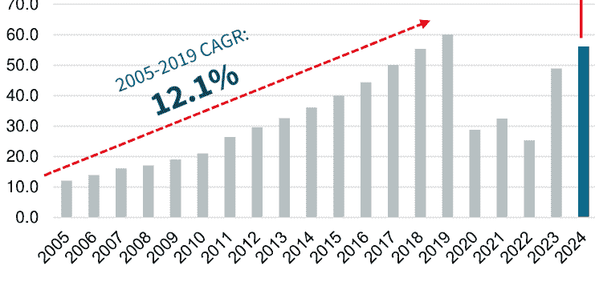
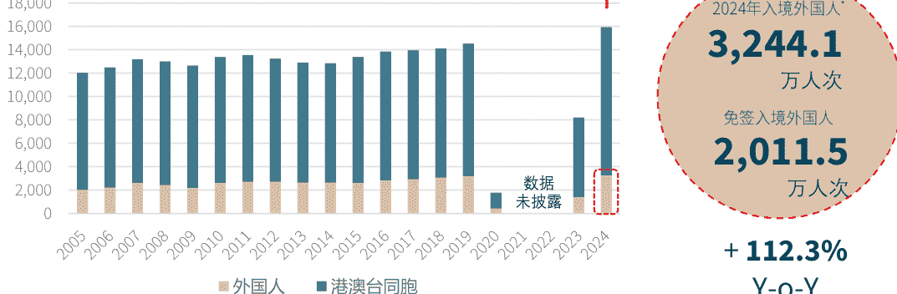
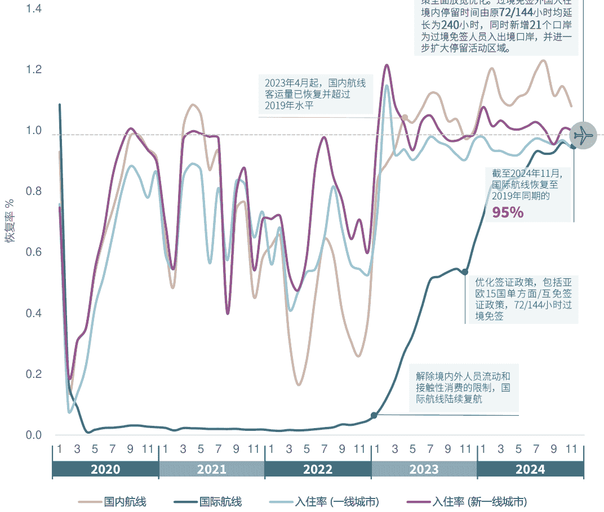
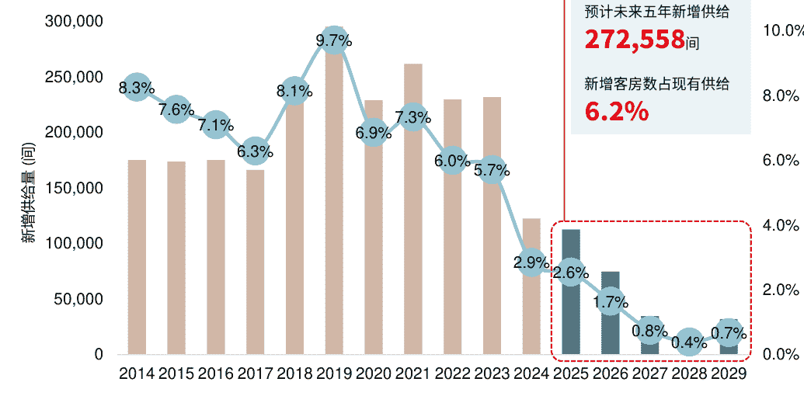
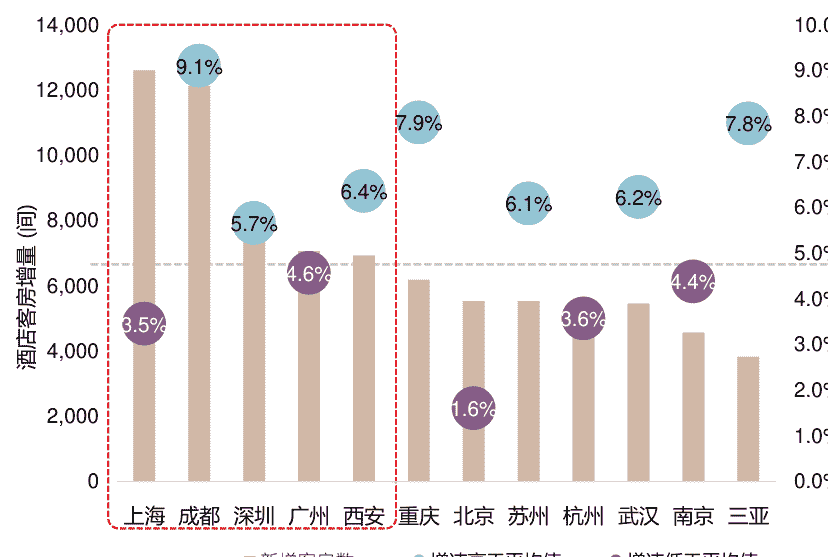

酒店及旅游地产部
中国 | 2025年2月
Joneslanglasalle.com.cn

# 中国内地酒店市场
2024年回顾与2025年展望

SEE A BRIGHTER WAY
向光而

# 免费 价值 及时 专注

# 扫码加入 知识星球TOP免费资源群

- 每日免费获取有价值资源
- 可提供各类资源搜索服务

| ◆热门付费文章 | ◆各行行业报告 |
| :--- | :--- |
| ◆精选图书资源 | ◆副业赚钱方法 |
| ◆职场实用资源 | ◆AI自媒体体 |

公众号：知识星球TOP 微信：jntsg8 微信：jntsg2

分享资料仅供个人学习，请及时删除，切勿商用传播

# 目录

01 中国内地酒店市场 3
02 中国内地酒店市场投资 10

# 中国内地酒店市场
最新动态

## 2024年中国内地酒店表现

2024年国内高端酒店市场基本恢复至2019年同期水平，热门旅游城市市场恢复表现优于一线城市。

2024年一线城市与三亚高端酒店运营表现良好，新一线城市酒店运营表现未及去年同期水平。

### 主要城市高端酒店每间可售客房收入增（跌）

| 城市 | 2024 VS 2019 | 2024 VS 2023 |
| :--- | :--- | :--- |
| 北京 | -9.9% | - |
| 上海 | -6.3% | 4.2% |
| 广州 | -6.6% | -2.6% |
| 深圳 | -17.3% | -3.7% |
| 成都 | -4.6% | 8.3% |
| 重庆 | -4.3% | 9.1% |
| 均值 | -5.5% | -3.0% |
| 杭州 | -6.7% | -6.7% |
| 南京 | -5.5% | -4.2% |
| 苏州 | -7.1% | -1.8% |
| 三亚 | -17.4% | 17.4% |
| 武汉 | -17.1% | -12.4% |
| 西安 | -20.0% | -10.0% |

数据来源：STR, 仲量收集整理

# 01 中国内地酒店市场
## 中国内地酒店需求趋势

国内旅游市场加速回暖，或恢复至2019年水平；一系列灵活、便利的外国人来华政策进一步刺激入境旅游市场。

### 国内旅游人数（万人次）

数据来源：中华人民共和国文化和旅游部、国家移民管理局

### 入境酒店人数（万人次）

*根据全国移民管理局2024年统计，入境入境6,488.2万人次*
数据来源：中华人民共和国文化和旅游部、国家移民管理局

## 国内酒店市场2024年回暖与2025年展望
### 需求趋势

国际度假及商旅需求拉动航线加速恢复，一线及新一线城市高端入住率继续提升。

### 旅客运量 vs 高端酒店入住率恢复

2024年12月，中国免签政策全面优化，入境停留时间由72小时延长240小时，同时新增21个口岸，并扩大了免签区域。2023年4月起，入境客量已恢复超过2019年水平。2024年1月，国内航线恢复至2019年的95%，包括对免签签证限制的解除，国内航线持续恢复。
数据来源：国家移民管理局、STR、仲量收集整理

## 中国内地酒店市场2024年回顾与2025展望
### 供给趋势

酒店客房新增增长速度于2019年达到峰值后逐步放缓，未来五年客房供给以中高端酒店为主。

### 中国内地酒店客房新增供给及增量(2024-2029)

| 预计未来五年新增供给 | 增量 |
| :--- | :--- |
| 新增客房数占现有供给 | 12.0% |
| 6.2% | 8.0% |
| | 6.0% |
| | 4.0% |
| | 2.0% |

*新增供给仅包含新建项目*
数据来源：STR，仲量收集整理

## 中国内地酒店市场2024年回顾与2025展望
### 需求趋势

未来五年中国内地酒店供应主要集中在一线和新一线城市，成都、重庆、三亚等热门旅游城市酒店房增长迅速。

### 中国内地主要市场供给情况

* 新增客房数增速高于平均值，增速低于平均值
* 新增供应量仅包含新建项目
数据来源：STR，仲量收集整理
平均新增客房数=6,927
平均新增客房数占供给比例=4.6%

## 中国内地酒店市场2024年回顾与2025展望
## 回顾与展望

- 免签“朋友圈”逐渐拓宽，国内旅游开放步伐持续加速；情绪旅游、银发群体推动市场“升级”。

### 入境旅游市场将呈强劲复苏多元化发展趋势

2024年中国入境签时间延长至240小时（10天），新增21个口岸，覆盖更多国家和地区。随着签证政策拉动，54个免签国家入境游客订单增长40%，增长率达189%。预计2025年政策将进一步放松，推动外国游客从单一城市向多城市游深度升级。

### 下沉及细分市场的崛起和潜力

随着深度旅行趋势，沉浸式的旅游项目越来越多受到游客青睐。二线城市及县域市场的增长潜力逐渐释放。中西部地区（如四川、云南等）依托旅游资源和政策支持，市场份额快速提升。本地酒店通过提升入住率（如独特的酒店设计和具有地域特色的活动），在同质化酒店市场中脱颖而出。

### 银发群体成为旅游市场的重要驱动力

2024年预计银发群体出行订单比2023年增加22%，31%的银发群体出行次数是2019年的2倍。此外，2024年银发群体出行酒店订单有望增长超100%。退休后的银发群体消费力强，更向高端酒店和休闲市场出行。预计2028年，银发旅游市场规模将达22.7亿元。

### 传统酒店业务的复苏与创新

根据行业展会《2024/2025中国酒店运营报告》显示，2024年国内会议和婚礼业务复苏缓慢，对2025年仍持乐观预期，餐饮、健身等成为新增长点。

# 中国内地酒店市场2024年回顾与2025年展望

近年来，地产企业纷纷剥离非核心资产以缓解杠杆压力并盘活资产，诸多优质酒店资产注入市场并成功交易。

## 中国内地酒店投资交易出售方（2024年全年，按交易额）

- 68% 开发商
- 12% 房地产基金
- 11% 企业
- 9% 其他（其中包含金融机构(4%)、高值人士(2%)、未披露出售方(4%)）

来源：仲量盛行酒店及旅游地产事业部（数据2025年1月7日）

# 中国内地酒店市场2024年回顾与2025年展望

截至2024年末，中国内地酒店投资总额累计178.7人民币，预计2025年投资交易额与2024年持平，约180人民币。

| 年 | 2014 | 2015 | 2016 | 2017 | 2018 | 2019 | 2020 | 2021 | 2022 | 2023 | 2024 | 2025F |
| :--- | :--- | :--- | :--- | :--- | :--- | :--- | :--- | :--- | :--- | :--- | :--- | :--- |
| 交易额(亿) | | | | | | | | | | | 178.7 | ~180.0 |
| 均值 | | | | 135.6 | | | | | | | | |

*排除2017年，2014-2016年交易均值*
数据来源：仲量行酒店及旅游地产部（数据2025年1月7日）

# 中国内地酒店市场2024年回顾与2025年展望

投资交易发生一线和新一线城市，前五城市分别为北京、上海、三亚、广州、成都。

### 中国内地酒店城市分布（2024年全年，按交易额）

包括南京、苏州、杭州、武汉、重庆、西安。
数据来源：仲量行酒店及旅游地产部（数据2025年1月7日）

# 中国内地酒店市场2024年回顾与2025年展望

成交以中端至高端酒店为主；位于市区的酒店资产更受投资关注。

### 中国内地酒店种类分布

- 48% 高端酒店
- 30% 中端酒店
- 10% 奢华酒店
- 5% 经济型酒店
- 4% 服务式公寓
- 3% 在建酒店

### 中国内地酒店区域分布

- 72% 市区
- 12% 度假区
- 10% 市郊
- 6% 远郊/小城镇

数据来源：仲量行酒店及旅游地产事业部（数据2025年1月7日）
