# Deloitte.

# 德勤

# 挖掘消费结构升级中的增长新机遇

德勤中国消费品和零售行业纵览2025

2025.04

# 扫码加入 知识星球TOP免费资源群

公众号:知识星球TOP

免费

- 每日免费获取高价值资源
- 可提供各类资源搜索服务

价值

微信信号:jntsg8

| 热门付费文章 | 各行各业报告 |
|---|---|
| 精选图书资源 | 副业赚钱方法 |
| 职场实用资源 | AI政经自媒体 |

及时

微信信号:jntsg2

专注

分享资料仅供个人学习，请及时删除，切勿商用传播

# 目录

01 研究范围与方法论

02 消费品零售行业宏观分析

03 主要消费品零售行业上市细分领域概览

## 主要发现

### 消费市场经历调整，政策支持提振市场信心

后期需求不足，特别是消费不振。2024年9月以来，政府通过一系列需求端的政策组合，多措并行稳定消费市场，取得了积极成果，2025年1-2月社会消费零售总额持续增长，资本市场活跃，政策效果显著，未来市场有望持续好转。

### 居民消费结构升级，消费偏趋多元化

居民消费结构升级，服务性支出比重带动交通、教育、文娱娱乐消费增加。人口老龄化和家庭小型化改变消费偏好。消费者偏向品质价值，且消费结构整体从传统、低端向高端、品质消费可持续增长。

### IP模式助力品牌价值和营销升级

在信息消费需求快速增长的背景下，结合IP的高强度独特特性，可以帮助企业吸引受众、提升品牌知名度，并通过共情互动体验创造新消费者对消费的需求。

### 技术助力消费行为提升运营效率

生成式AI智能分析，助力企业实现个性化推荐和精准消费，同时优化供应链和动态定价，全面提升运营效率和销售热度，推动消费体验升级。

### 绿色消费增长推动行业转型新动能

通过绿色消费增长的趋势，企业可以满足消费者对未来发展的需求，通过开发绿色消费和打造绿色消费场景，提升品牌吸引力和竞争力。同时，企业可以经营绿色资源、资源循环和环保等领域，提升企业竞争力，提升品牌价值和行业增长。

### 品牌助力企业探索海外新增长

通过探索海外市场，企业能够整合自身优势与当地市场，采用海外并购、投资自建、海外合作等多种打法，热门零售、轻型产品、家居、跨境电商等，从而实现全球化发展，推动品牌和市场价值的提升。

### 消费领域投资向确定性赛道领先

2024年，消费行业一级市场投资经历调整，餐饮、饮料、食品和国货化行业获得较多投资，二级市场企业数量减少，首发募资活跃，多数市场受益于家居、国货类烟酒和茶饮等领域成长。

### 消费品结构性化，增长与挑战并存

消费市场呈现结构化、高端化、健康化趋势。数据显示，白酒、宠物食品和饮料等领域增长强劲，但酒类、养殖、制品等行业仍面临需求不足、成本压力和政策调整的推动，增速出现波动。整体来看，市场的增长力和压力正在显现，中国消费市场结构正在转型中。

### 新零售业务常态持续，实体零售需创新

在零售消费领域，消费者对购物渠道的偏好进一步升级，消费者更倾向于线上线线下相结合的方式进行购物，但传统线下未恢复及预期，面临压力。与此同时，电商和即时零售等新零售保持持续增长，成为消费行业的主动力。

# 研究范围与方法论

## 研究范围

德勤研究了超过550家消费零售上市企业的绩效，通过每个细分行业头部企业的绩效对比，洞察消费零售行业细分领域的发展趋势，捕捉影响行业绩效的驱动因素。

## 企业概述

通过去重和剔市、变更主营业务和未披露当期业绩的企业，本次总体研究企业共计552家，2024年总市值规模到14.4万亿人民币。其中：

- A股上市企业369家，2024年总市值规模到8.3万亿元人民币
- 港股上市企业150家，2024年总市值规模到5万亿元人民币
- 中概上市企业33家，2024年总市值规模到1.1万亿元人民币

▲ 本报告研究数据来自上市企业中报，数据收集时间截止2025年3月。

## 消费品零售行业宏观分析

### 消费市场结构性调整

受居民就业增收预期不足等客观因素影响，国内有效需求不足，消费存在短板。

### 2023年12月以来消费对经济增长的贡献率逐步走弱

就业和收入预期的下行制约消费意愿回升

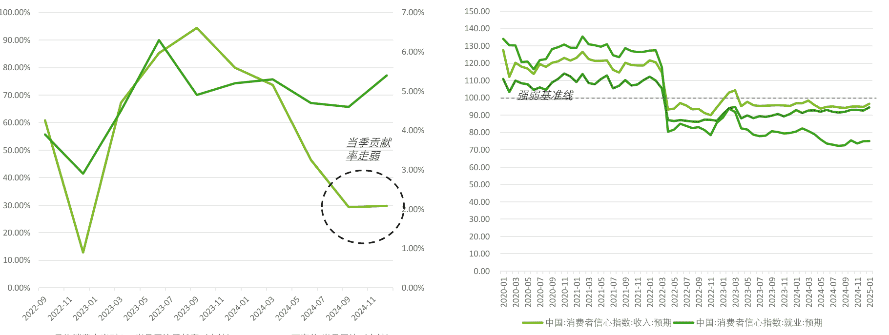

- 最终消费支出对GDP当季占比贡献率（左侧）
- GDP变价：当季占比（右）
- 中国消费者信心指数：收入预期--中国消费者信心指数：就业预期
- 中国消费者信心指数：消费意

数据来源：国家统计局
© 2025，了解更多信息，请联系畅中国。

### 2024年消费市场持续分化，消费者对传统可选消费品需求下降，同时线下实体普遍出现下降

### 零售限额以上消费品销售增速对比（2023与2024）

### 零售限额以上零售增速对比（2023与2024）

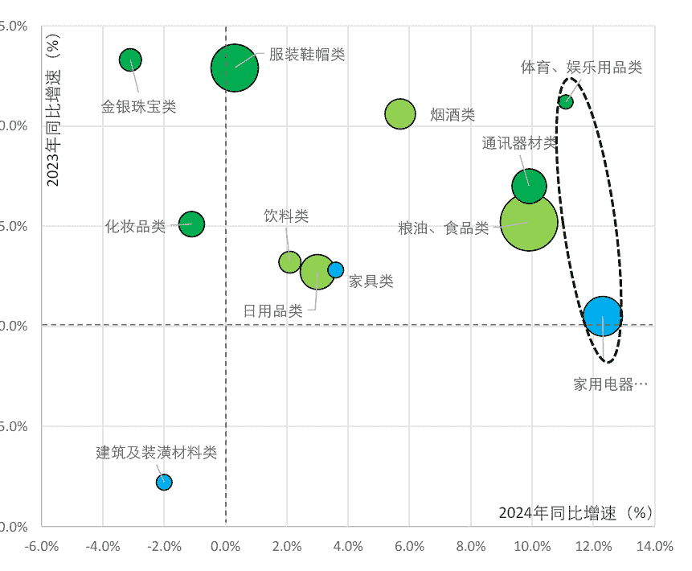
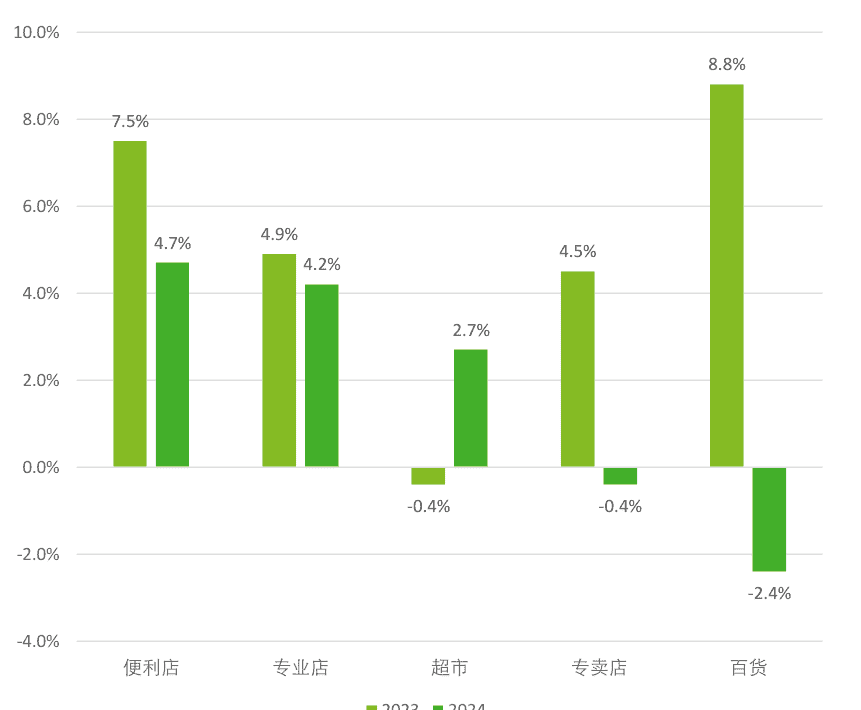

- 必需消费品
- 可选消费品
- 耐用品
- 两位增长

数据来源：国家统计局
© 2025，了解更多信息，请联系中国。

## 一揽子政策，从供需端发力，加速提升消费能力、意愿

### 2024年8月以来的消费政策

《关于促进高质量发展的意见》
《关于高水平推动高质量发展的意见》
商业性个人住房贷款调整力度支持大规模设备更新、扩大消费品以旧换新规模
政府工作报告
《关于进一步提振内需、深化消费》
《关于做好以旧换新工作的通知》
《关于完善城市免税政策的通知》
《关于调整存量住房贷款，构建友好型社会的若干规定》
中央经济工作会议促进消费为明年首要任务发展重点行业、领域中小微企业融资支持
《关于支持消费的意见》

### 2025年“以旧换新”政策从需求端提升消费能力

### “以旧换新”政策拉动不同消费品增长主要产品类销售增速对比

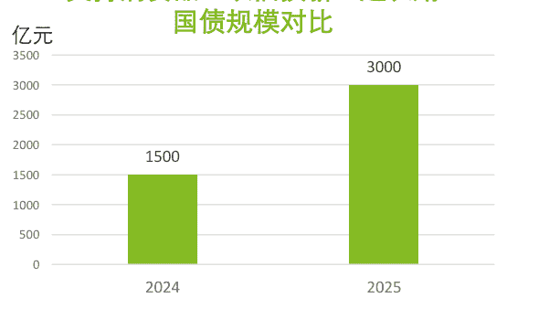

| 2023.10-12 | 2023.10-12 | 2024.10-12 |
|---|---|---|---|
| 家电 | 38.4% | 15.1% | 7.6% |
| 家具 | | | |
| 消费品 | | | |

### 进入2025年，在促消费惠民“组合拳”下，2025年1-2月零售额同比增长

### 2025年1-2月零售限额以上消费品增速环比

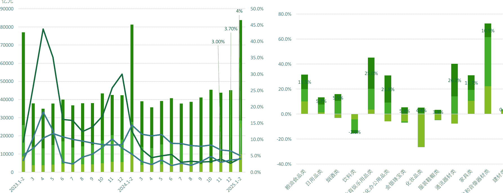

- 餐饮当月
- 餐饮增速
- 当月线上零售额
- 当月线下零售额
- 累计线上增速
- 当月同比增速

数据来源：国家统计局，wind
© 2025，了解更多信息，请联系中国。

### 同时，政策进一步激发了资本市场热情。国内零售领域资本活跃度快速提升

2025年初以来消费零售企业加速交IPO及行业涨跌（截至2025年3月27日）

| 最新公告日 | 证券简称 | Wind细分行业 | 上市类型 |
|---|---|---|---|
| 28/2/2025 | 周六服 | 金银珠宝 | 港股 |
| 7/2/2025 | 顾宁控股 | 化妆品 | 港股 |
| 27/1/2025 | 乐舒适 | 个人用品 | 港股 |
| 21/1/2025 | 乐乐吧 | 家居用品 | 港股 |
| 20/1/2025 | 大行科技 | 运动产品 | 港股 |
| 20/1/2025 | 安井食品 | 食品饮料 | 港股 |
| 17/1/2025 | 八马赛亚 | 食品饮料 | 港股 |
| 17/1/2025 | 聚智科技 | 母婴产品 | 港股 |
| 15/1/2025 | 奥克斯特电气 | 家电 | 港股 |
| 13/1/2025 | 海天美味 | 食品饮料 | 港股 |
| 3/1/2025 | 老许多鸡 | 餐饮 | 港股 |
| 2/1/2025 | 不同集团 | 家庭用品 | 港股 |

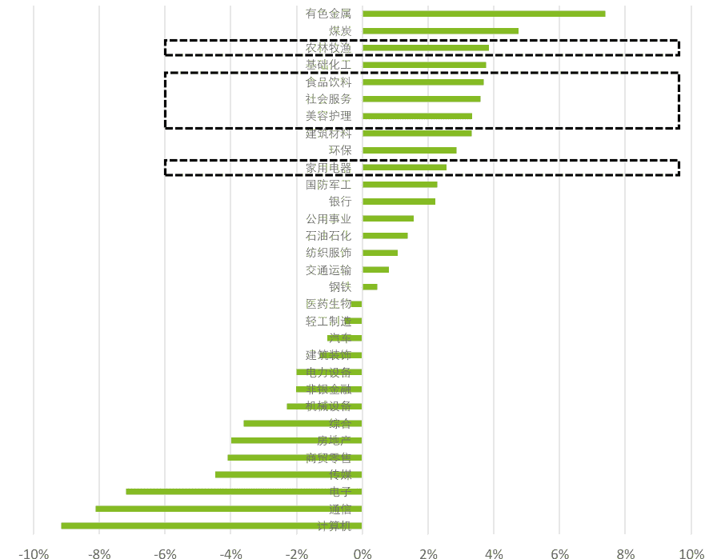

数据来源：wind
© 2025，了解更多信息，请联系我们中国。

### 随着国内居民服务性消费支出比重持续提升，居民消费结构升级的趋势日益显现

人均服务性消费支出逐年扩大推动居民消费结构升级

居民交通、教育、文化和娱乐类消费比逐步提升

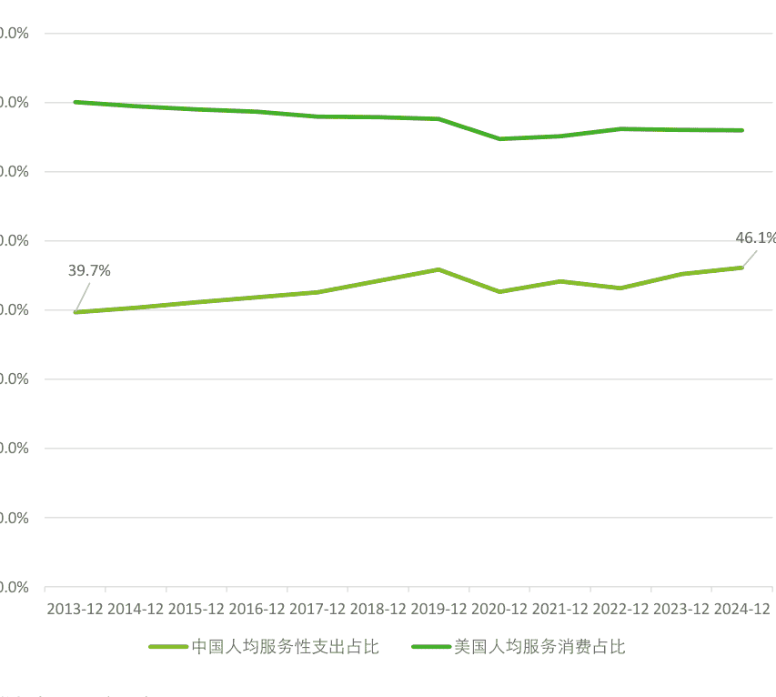
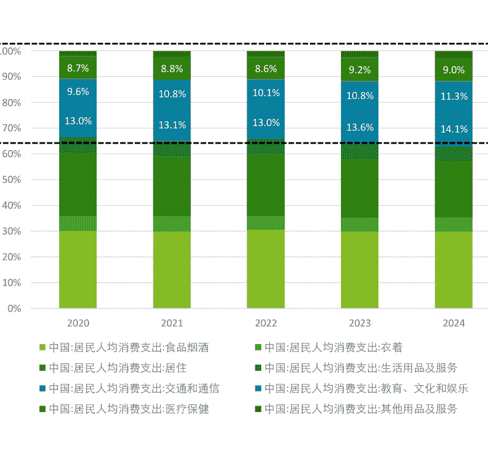

数据来源：国家统计局
2013-2014-2015-2016-2017-2018-2019-2020-2021-2022-2023-2024
中国人均服务性支出占比
- 美国均消费支出:食品
- 美国均消费支出:居住
- 美国均消费支出:交通
- 美国均消费支出:医疗保健
- 美国均消费支出:生活用品
- 美国均消费支出:教育和娱乐
- 美国均消费支出:其他

### 银发群体比例快速提升家庭结构小型化趋势加剧

2030年中国与4岁以下婴儿数量对比

中国经济规模（万亿）出生率(CBR):‰ 城镇市场规模

### 消费者偏向多元化发展，情绪价值和消费受到追逐IP消费热潮推动春节档票房历史新高

2025年春节档票房火爆，系列销售额超5000万，同比增长60%

### 二元后用户规模持续扩大

注：二元指的是与二元后文化相关的线下活动包括潮流演出、动漫、游戏等形式，与此对应，这类活动被定义为二元

### 理性、实用主义盛行，消费者开始选择可持续的生活方式，同时，健康消费理念向全年龄段渗透

老年龄段的消费者认为节资源、减少浪费是可持续的核心

- 是一种节资源，减少浪费的责任
- 是一种保护环境，维护生态平衡
- 是一种具有个性、更迭的生活方式
- 是一种品牌实力的展现
- 可持续产品在客观层面比普通产品更好
- 可获得物质利益，如早点、积分兑换商品
- 是一种潮流趋势，代表向

不同年龄段网购健康类比例

- X代消费者
- Y代消费者
- Z代消费者

问题：您认为可持续消费相比传统消费，其能带给核心价值是什么？
数据来源：趋势调研、互联网发展统计
© 2025，想要更多信息，请联系我们。

### 日趋多元的消费者需求、技术革新、可持续发展和高水平开放为消费行业带来发展机遇

- 持续丰富品牌内容为企业带来产品和营销焕新升级
- 生成式人工智能等技术迭代为企业带来运营效率提升
- 绿色消费新场景带来业务新增量
- 品牌出海探索发展新机遇

### 情绪价值需求高涨，持续丰富品牌内容为企业带来产品和营销焕新机遇

“IP+新模式推动消费营销升级

| 类型 | 特点 | 典型案例 |
|---|---|---|
| IP+消费品牌 | 借助IP关注拓宽品牌群众 | - Tiffany 与宝可联名蓝 - Gucci 与中国潮流 Marsper - 瑞幸与线条小狗等 |
| IP+零售业态 | 通过IP衍生品类合聚吸引渠道留客 | - 百联ZX+二次元店铺 - 上海大悦城+二次元店铺 - 南昌天红购物中心+“二次”文化综合区 |
| IP+地方文旅品品牌 | 发掘IP特征与地域属性结合 | - 西安文旅+黑鳍空 - 四川文旅+娜那叽 - 景德镇+泡泡玛特 |

### 中国泛二次元周边市场新规模（亿元）

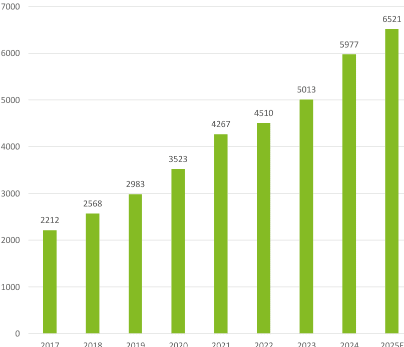

## 主要消费品和零售行业
### 上市细分领域概览

2024年开始消费行业投融资进入调整期，高确定性的餐饮娱乐、食品饮料、国货化妆品领域获得了更多的投资机会。

2019-2024年新消费企业获得投资数量和金额情况。2024年消费品零售行业细分领域新业态投融资情况

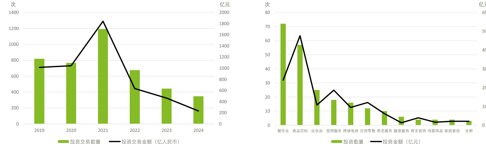

数据来源：IT桔，wind

| 2024年分行业投消费企业 | MB 奈茶 零零售 | 百里蜜冰巧克力 | 林清轩 | Seek 天商财龙 |
| :--- | :--- | :--- | :--- | :--- | :--- |
| | | | | |

消费行业上市步伐放缓，上市企业数量较一年有所下降。同时，由于集合了运动服、家电、国货美妆、茶饮等成长标的，2024年首募金额较过去两年有所提升。

消费品和零售上市公司数量
首募金额

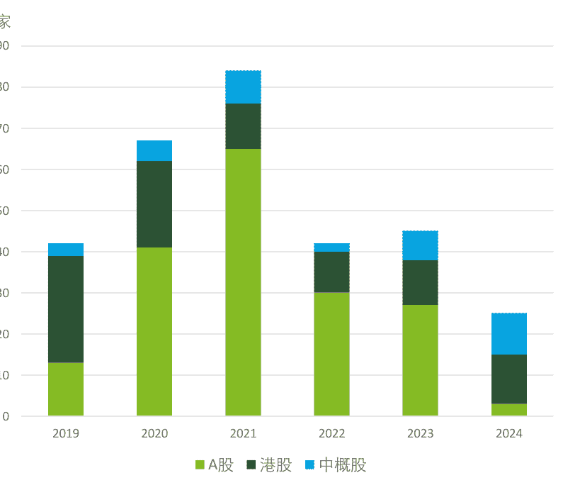
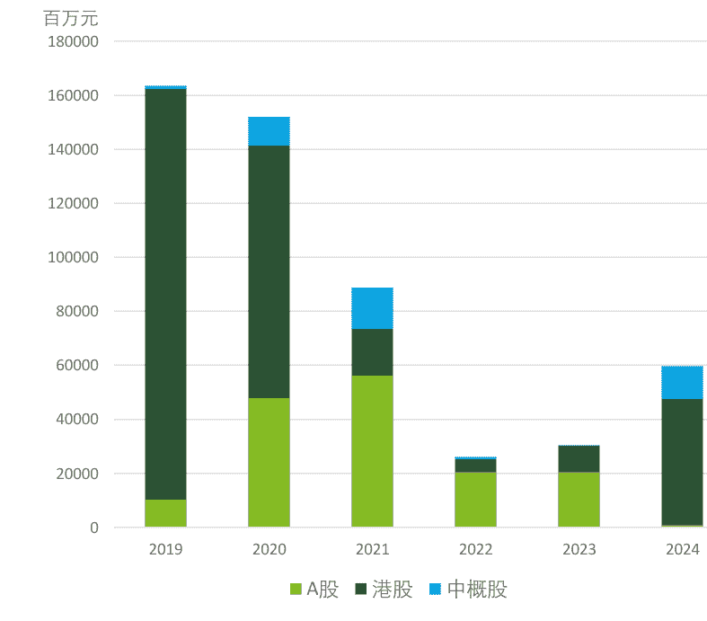

数据来源：WIND，德勤研究

消费结构加速转变的新形势，为消费者带来情绪价值、悦己和陪伴的类新颖保持高速增长。

2023上半年与2024年上半年营收增速

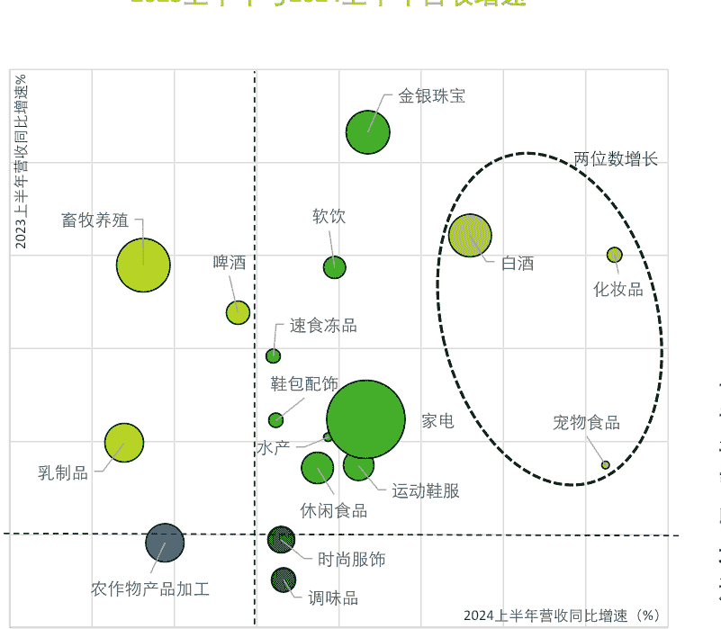

- 白酒：白酒企业通过高端化驱动产品口感和品牌升级，通过线上和私域数字化渠道拓展增长市场，使白酒营收保持较高增长。
- 优质食品：随着消费渗透的持续提升，消费主需求持续迭代、功能性、定制化产品（如处方级）需求提升，加家居需求持续增长，优质食品保持快速增长。
- 化妆：国货持续提升助力国货消费保持快速增长。另一方面国货品牌通过短视频和直播运营渗透年轻消费者，国货品牌以“成分驱动”等策略建立消费者信赖。
- 消费者需要多元化、消费场景复现、高性比消费、以及高价及金银、酒、软、配领域增长，较去年同期实现稳定增长。
- 运动行业保持稳定，健康意识和分众活跃度增长，加大行业产品创新并加强线上渠道渗透更多跑步的需求。
- 家电：2024年以前以新政策驱动落地，激发了活跃市场，受政策影响黑电、电器、肤电、带宠物潮流，冰箱、洗衣机等销量持续增长。
- 调味品：企业通过产品创新、功能化、多风味等产品升级和悦己场景实时释放，推动产品迭代，加强线上营销的传播渠道的影响。
- 饮酒：酒类渠道拓展、餐饮、社交、夜宵等场景出现消费需求下降，尤其是餐饮行业消费渗透量下降。
- 高效养：需求过剩、产能过剩、价格波动及市场竞争等多重因素导致胶原蛋白行业整体得到重塑。
- 乳制品：优质原奶供给和价格影响，人口结构演化、库存压力和存储优化等影响，乳制品行业出现增长机遇。
- 农副产品：农副产品价格下行影响，影响乳制品消费水平下滑，家居终端消费需求难以满足，整体增长乏力。

- 消费保持双位数增速
- 个消费位增速转正增长
- 消费增速由负转正
- 消费增速持续下降

露泡酒行业2024年上半年总体消费规模（百万元人民币）
数据来源：艾研、港股、中信、中期上报

在零售业端，消费者多渠道购物的行为偏好进一步加深。包括专业门店在内的传统线下业态恢复不及预期。

2023年上半年与2024年上半年营收增速

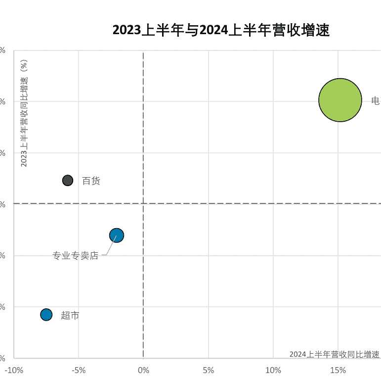

- 电商：一方面，消费者对生鲜、日用品即时配送需求旺盛。即时零售通过快递配送加速，主打性比、社交电商进一步强化线上渗透。此外，以旧新推动融合电商家居类产品销量提升，进一步推动了营收增长。尽管部分门店面临内卷和成本压力，头部企业通过差异化竞争和数字化升级，持续引领行业增长。
- 购物中心：消费结构性变化影响。可消费趋势、线上加速、成交压力、业态创新等等多重因素影响了购物中心的营收增长。同时，消费者消费比重下降（折抵购），造成百货店流量和消费压力下降。
- 超市：即时零售遭遇新兴竞争、消费习惯变迁导致传统超市客流流失。部分企业通过快速迭代和数字化转型提升效率，调整投入期。行业整体仍需在差异化竞争、高毛利领先和全渠道寻求突破。
- 专业门店：宏观经济受抑制导致流失。同质化竞争下，行业面临电商冲击，消费者更倾向于线上购买。

- 2023年上半年营收增速（百万人民币）数据来源：艾瑞、京东、美团报告
- 营收增速由负
- 零售增速下降

总体来看，主要消费品领域头部企业业绩保持韧性。相较之下，实体零售降幅明显，运营策略创新势在。

消费品零售态

| 排名 | 2024年上半年营收同比 |
| :--- | :--- |
| 1 | 休闲食品 | 21.2% |
| 2 | 白酒 | 13.0% |
| 3 | 化妆品 | 12.2% |
| 4 | 金银珠宝 | 6.8% |
| 5 | 家电 | 6.6% |
| 6 | 运动鞋服 | 6.2% |
| 7 | 饮饮 | 4.7% |
| 8 | 水产 | 4.3% |
| 9 | 休闲食品 | 3.7% |
| 10 | 调味 | 1.6% |
| 11 | 时尚服饰 | 1.5% |
| 12 | 鞋包饰 | 1.2% |
| 13 | 速食食品 | 1.0% |
| 14 | 青酒 | -1.1% |
| 15 | 农作物加工 | -5.6% |
| 16 | 畜牧养殖 | -6.9% |
| 17 | 乳制品 | -8.0% |

| 排名 | 2024年上半年营收同比 |
| :--- | :--- |
| 1 | 电商 | 15.2% |
| 2 | 专业卖店 | -2.1% |
| 3 | 百货 | -5.8% |
| 4 | 超市 | -7.5% |

细分领域驱动因素及趋势。食品饮料:
- 白酒
- 啤酒
- 软饮
- 乳制品
- 休闲食品
- 调味品
- 速食

白酒
2023年上半年与上同期营收增速
市场规模
行业趋势

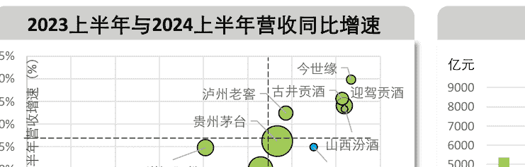
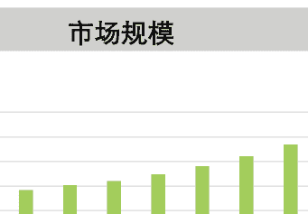

行业表现均衡、步入新周期：白酒行业增速快速增长，我国白酒行业的领军企业在发展战略的定位上出现了转变。2023年双数的快速增长是行业头部胜利，许多白酒领先品牌在渠道上做出了“稳定发展”为核心的目标。

消费升级与需求的多元化：随着白酒日益成为市场的主力，他们正在重塑白酒市场的新格局。在人群群体中培养更健康属性的白酒带来了春天。品牌和营销的宣传中，企业投入更多原材料和研发技术，已满足消费者对深层次的健康需求，同时也推动白酒品牌向多元化迈进、健康化的持续发展。

2024年上半年营收与营业利润增速
竞争格局
关键因素

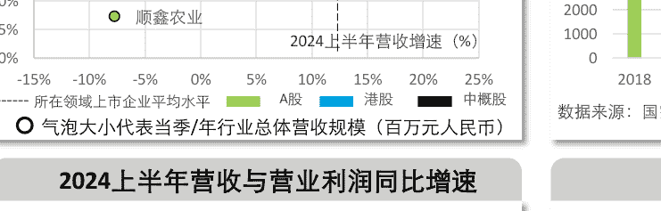

头部品牌集中化：五粮液、洋州、河滩等高端白酒占据市场，市场份额持续提升，形成了“强恒弱”格局。2023年三家企业的市场份额超过30%，且维持持续上升态势。

特定的工艺决定了酿造工艺的差异，白酒的酿造工艺不仅要传承历史的精湛，更要结合现代技术的创新，如五粮液的“循环圈”工艺、茅台的“1297”工艺”。

生产升级：白酒通过自动化生产和智能系统，实现了从原料处理到产品生产的全程智能化管理，如白酒智能能通过高自动化技术实现生产，灌装速度达到了15000小时/日，显著提高了白酒生产效率。

数字化转型：通过线上线下拓展市场影响力，利用短视频、短直播等新媒体培养年轻消费者，增强品牌影响力，“酒习消费”持续经营电商市场，河滩通过线下整合助力白酒品牌拓展新格局。

区域差异化竞争：地方酒、万池酒（今世酒、贵州酒）通过区域深耕城市和文化特色实现差异化竞争。今世酒以“情怀酿”为核心定位，打造特色酒品，成功攻占了特定的粉丝群体。

行业整合：中小企业面临生存压力，头部企业通过重塑重点市场，如贵州通过酒业等渠道整合资源。中国白酒协会的数据，从2017年到2022年，我国规模以上企业数量。

啤酒
2023年上半年与2024年上半年营收同比
市场规模
行业趋势

- 增长拐点：行业已进入存量时代，产量从2013年开始增长，近年来趋于稳定，但消费水平提升以及品牌竞争激烈，近年来消费量均值持续上升。
- 多元化需求驱动产品创新：从总体来看，消费者对品质、健康、饮、社交的需求日益增长，为了满足消费者的需求，企业纷纷拓展口味、新品拓展品质；
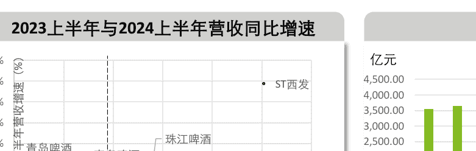

- 供给侧倒逼高端化：在整体升级的背景下，行业已从向高端化、特种化、多元化转型。
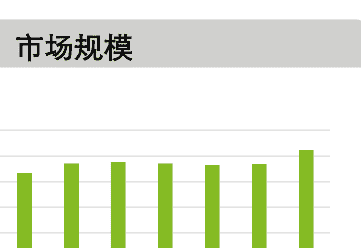

数据来源：中国酒业协会、华创

2024年上半年营收与利润同比
竞争格局
成功的因素

- 渠道全面布局：覆盖传统餐饮、零售、即时零售等渠道，满足不同的需求。靠即时平台（如外卖）实现快速渗透；
- 差异化策略加速高端化：聚焦2024年调味品行业的关键在于。例如，海天亚洲通过渠道改革和产品创新稳固了市场地位，多元化助力此款大，占据了高端市场。
- 产品创新：通过推出新产品，包括精酿、无酒精、低卡等，满足不同消费场景和健康与科技的“Super系列”。
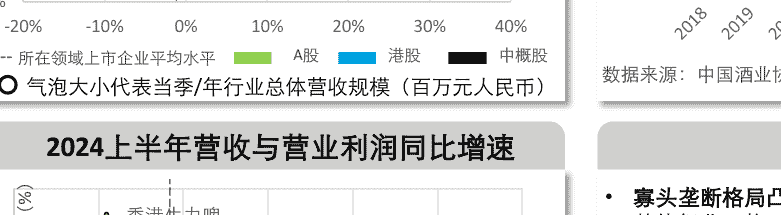

- 寡头格局：经历长久的发展积累，行业整体呈现头部聚集趋势。根据调研统计，前五家企业百威、青岛、华润、重庆及合计约80%，整个市场。
- 地区明显：主要集中在中南方，北方市场最为分散。除区域外全国范围内，前五家企业占据了80%的市场，显示出行业高度集中和头部垄断。

2023年上半年与2024年上半年营收增速
市场规模
行业趋势

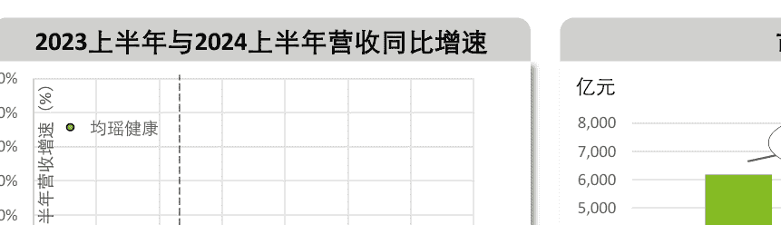
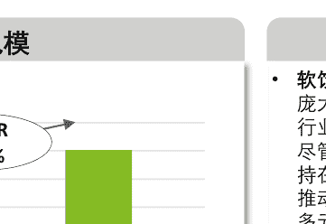

- 多元化成为：中国的饮料产业拥有巨大的市场规模在经历了一段时间的狂增长后，行业已逐步向一个平稳的新阶段迈进。到2023年，总体规模保持稳健在1769亿人民币，同时，消费者需求也日益多元化、健康化、细分化，产品呈现多元化发展趋势，营销和渠道在多元化竞争中加强。
- 追求健康成为趋势：低糖低脂快速崛起：在经济持续进步和生活水平不断提高，消费者对健康的需求不断增加。自2012年以来，销售额从16亿元增长至1588.6亿元，增长率正在加快。

2024年上半年营收与营业利润对比
竞争格局
关键因素

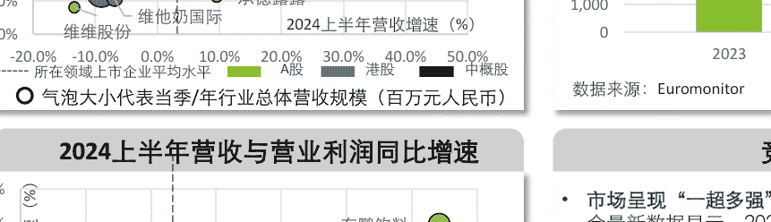

市场呈现“一多多”的格局：据中国饮料行业最新数据显示，2024年饮水占比48.5%细分份额持续稳定，但其占比为12.8%。与此同时，装瓶茶、乳制品及植物基饮料在市场中的份额，合计占比高达30.7%。

- 细分领域交叉，竞争激烈：行业内门槛降低，行业进入者增多。新品牌通过差异化和精准营销策略快速突围，通过新的发力，这些品类能够快速攻占市场；
- 实施数字化转型：通过数字化手段，企业加强供应链的连接，提升订单处理效率。例如，通过“流量+数据”精准营销，将目标细化为多个维度，从而精准地进行数据分析，高效管控各营销渠道。
- 多元化产品创新：针对消费者需求多元化、个性化和健康的趋势，企业打破单一产品结构，构建多元化布局。提出的1+6灵活品类矩阵，在健康趋势下，迎迎来品类大爆发，满足了消费者丰富需求。
- 差异化品牌营销：饮料行业竞争激烈，差异化定位成为竞争优势的关键。例如，“农夫山泉，味道好”一句话广告，通过品牌定位，吸引了更多消费者。
- 分渠道差异化运营常态：线上直销日益崛起，线下零售仍是市场的主力，但随着平台的发展，线上成为头部经营者的增长目标日益清晰。

气泡水大当季/行业整体营收规模（百人民币）

乳制品行业
市场规模
2023年上半年与2024年营收同比增速

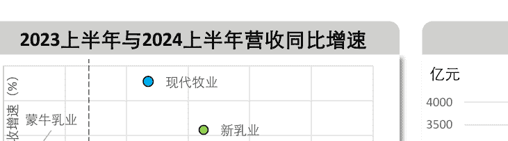

- 规模化、智能化产业升级：规模化有助于奶质量提升，我国报告期间生牛产量1,323.1万吨，增长7.2%。智能化技术的应用，如蒙莱全产业的数字化转型，提升生产效率和产品质量；
- 经济增长与消费需求迭代推动乳制品行业增长：随着中国人均收入的增长（2018年到2023年），消费者对健康的需求不断增加，购买力增强，乳制品需求的从基础向升级。显示出行业韧性，达到23.1万吨。

2024年上半年营收与利润增速
竞争格局
- 双头引领与区域分市场：市场竞争：乳制品行业呈现双头垄断的格局；伊利股份和蒙牛业市场份额均在20%以上。
- 细分市场分化：奶粉市场集中，蒙牛市场份额超过55%，而差异化竞争激烈，奶粉市场占据了约50%。

成功因素
- 全渠道多元化：将渠道转型成为关键环节。如伊利打造一个超级品牌，构建产品模式，销量持续增长。
- 严格质量管理：安全是消费者首要考虑的因素。伊利采用国际标准评价体系（AS），通过更多技术手段提升市场竞争力。

休闲食品
2023年与2024年营收增速
市场规模
行业趋势

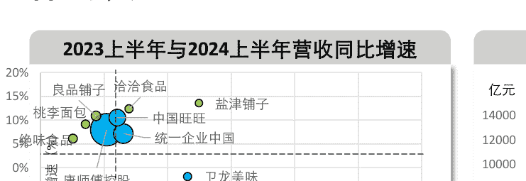

- 健康化：消费者对健康的关注持续提升，健康化将市场主流。企业通过添加健康原料（如燕麦、果、藜籽等）以及低温烘焙、真空干燥等工艺，推出健康的食品。
- 海外布局：随着国内市场竞争，2024年更多布局向东南亚、北美等地区。通过本土化开发和渠道建设，企业获得新的增长。
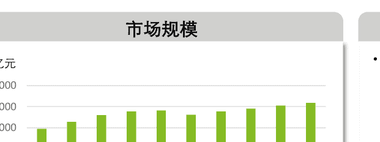

- 全渠道矩阵式：线下仍占据优势，O2O等即时零售模式日益增长。同时，消费者对多元化的需求直达，通过本土化和布局不断渗透。

- 聚焦单一产品或实施多品类：休闲食品行业的竞争正在分化，企业通过聚焦单一产品或实施多品类来提升市场竞争力。
- 市场集中度提高：随着休闲食品行业进入存量期，头部企业正通过兼并整合和全渠道布局稳固地位。休闲食品市场呈现“大、中小并存”格局，头部企业正在加速整合。
- 供应链效率提升：2024年，头部企业通过优化供应链，更好地提升成本和“性价比”比。例如，三良食品通过整合全品类，加大研发和优化供应链，提升了产品竞争力。
- 品牌策略升级：认为了“奇道”的机遇。通过重点发展线下、CVS渠道和加盟门店等，提升品牌渗透率。策略创新不仅有助于销售渠道，更提升了品牌影响力。
- 区域显著：一方面，中国休闲食品市场集中在广东、江苏、浙江等地占据市场份额，并加强整合。

数据来源：亿数据中心

调味品
2023年上半年与去年营收增速
市场规模
行业趋势

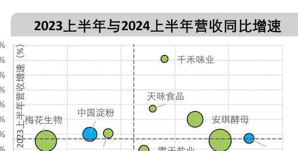
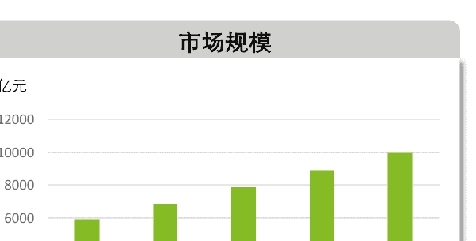

- 消费者更看重属性：近年来，消费者对健康食品的关注持续提升，这一趋势在2024年尤为明显。根据星报数据与中国联合组的报告，消费者对“无添加”、“糖/减糖”、“少盐减油”等健康标签的需求显著增加。
- 健康化趋势推动健康调味料和新品的出现：随着生活节奏的加快，消费者对健康调味品的需求日益增长。调味品行业正趋向“餐餐百餐健康调味”，将调味品以“+口味”的形式来解决，进一步加速年轻消费者的需求。
- 电商连接助力调味品消费：随着电商的发展，传统调味品通过电商平台触达更多SKU和新品，提升了市场渗透率。

2023年上半年营收与利润同比增速
竞争格局
成功要素

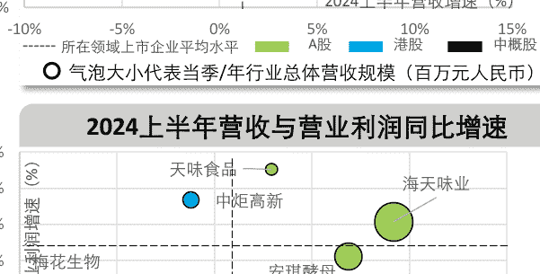
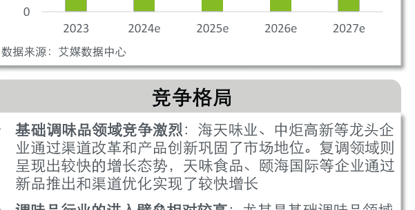

- 渠道改革与效率提升：聚焦2024年调味品行业的关键在于。例如，海天亚洲通过渠道改革和产品创新稳固了市场地位。渠道侧呈现出增长的态势，海天、中高端等企业通过新品来实现了快速增长。
- 产品驱动的深度发新：调味品领域面临产品同质化竞争压力，而海天通过多元化、创新吸引了更多客户。例如，海天通过调味品的便利性更容易满足消费者多样化需求，推动了调味品的市场份额。

# 速食

## 2023 上半年与2024 上上半年营收同比增速

## 市场规模

## 行业趋势

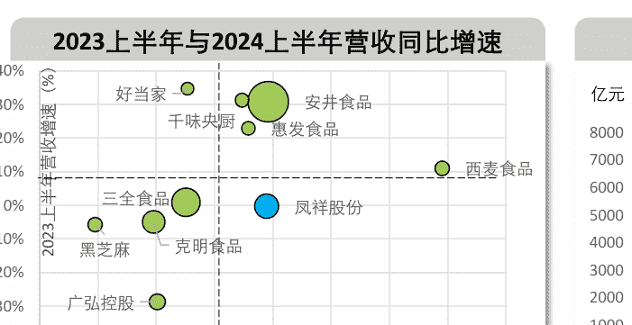

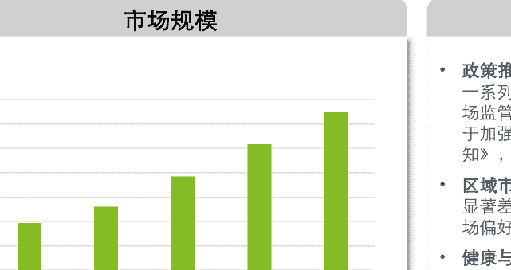

- 政策推动行业规范：2024年，国家及地方政府已出台一系列政策，推动预制行业的规范化发展。例如，市场监管总局、工业和信息化部等部门联合了了关于加强预制食品安全管理促进预制行业高质量发展的通知》，明确了预制食品的定义和要求。
- 区域差异显著：预制菜的消费习惯在不同区域存在显著差异，北方市场好面广，南方市场偏好汤菜。
- 健康营养成为消费要点：消费者对预制食品的健康、营养需求日益增长，预制菜正成为行业热点。

## 2024 上半年营收与营业利润同比增速

## 竞争格局

## 关键成功要素

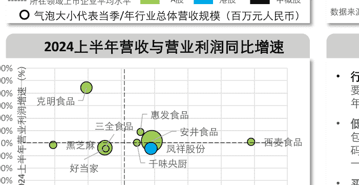

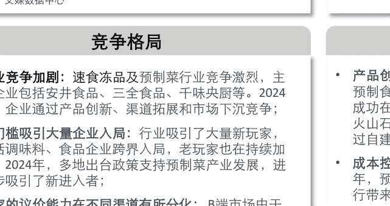

- 行业竞争加速：速食食品及预制行业竞争激烈，头部企业包括安井食品、三全食品、剑美味、狮业等。2024年，企业通过产品创新、全渠道拓展与扩大市场份额。
- 低门槛吸引大企业入局：行业已有大量玩家加入，包括食品、界达人、老家也在加入。2024年，多地政府支持预制菜产业发展，引发了新趋势。
- 议价能力在不同渠道有所不同：B端渠道主要为消费者提供便捷和营养的需求，议价能力相对较低。
- 产品创新与大品牌战略：提升竞争力：2024年，预制食品的头部企业通过产品创新和大品牌营销，在竞争激烈的预制食品市场中脱颖而出，并加强品牌形象建设。
- 核心技术突破：受益于预制技术的成熟性：2024年，预制食品的毛利率普遍提升，这有利于PI行业降低原材料成本的压力。
- 多元化与多元市场布局：2024年，预制食品头部企业通过多元化和多元市场布局，迈出了坚实的一步。例如，剑美味食品通过中小型餐饮渠道切入市场。

## 细分领域驱动因素及趋势

### 农业

- 农作物产品加工
- 畜牧养殖
- 水产品
- 宠物食品

# 农作物产品加工

## 市场规模

## 2023年上半年与2024年上半年营收同比增速

## 行业趋势

- 政策支持推动行业升级和绿色可持续发展：2024年，国家出台了一系列政策，旨在促进粮油食品行业的绿色可持续发展和产业升级。例如，“国家全合融合计划（2024-2035年）”强调了全合关键共性技术创新、小麦和面粉原料配套加工企业的集约化、标准化、规模化、优化结构。
- 环境与消费意识增强：消费者对环保和可持续发展的关注增加，推动了健康食品和绿色包装的需求。部分企业在2024年推出了环保食品工艺，进一步提升了企业的可持续发展能力。

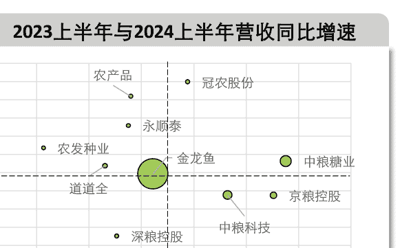

- 健康及营养需求升级：消费者对健康、安全、健康的食品需求持续增长。这一趋势在整个食品行业表现尤为明显，消费者更倾向于选择高营养成分的食品。

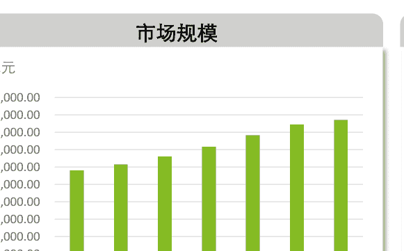

## 竞争格局

### 领先案例

- 产品创新研发领先：企业加大投入，推出了一系列健康食品，如金龙鱼通过添加乳蛋白和植物蛋白丰富口感。此外，还开发了高端油脂和调味油，成功实现了产品线的拓展和份额提升。
- 营销渠道竞争：企业通过数字化营销提升了运营效率。通过线上和社区营销，扩大销售渠道，京源通过线上平台深度布局，增强了品牌的影响力和竞争优势。
- 品牌建设与市场拓展：品牌价值和市场影响力是领先的关键。金龙鱼通过品牌覆盖全球市场，天天通过渠道拓展巩固了市场地位。

## 2024年上半年与营业利润同比增速

- 行业集中度提高：头部企业通过自建、投资等多元方式扩大基地、压低成本以取份额。
- 行业内竞争加剧：大型企业不断打价格战，中小企业面临生存压力，行业内竞争逐步推进，头部企业市场进一步提升。
- 产业链协同：头部企业加速整合上下游，例如“种植+加工+销售”链条布局降低成本。

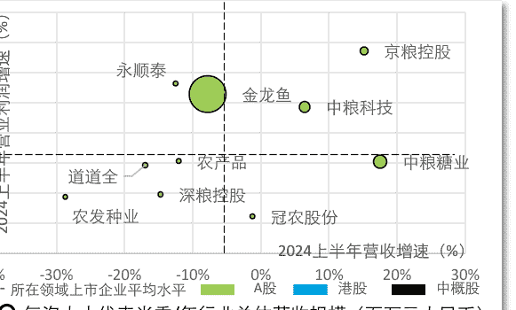

# 畜牧养殖

## 2023年与2024年上半年营收同比增速

## 市场规模

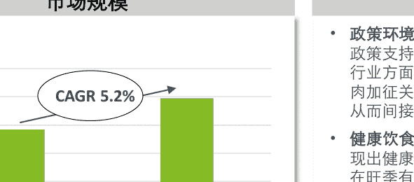

## 行业趋势

- 政策环境与行业支持：2024年，政府对农业支持力度持续，特别是在生猪养殖和饲料领域。政府通过调整政策，减少进口肉对国内市场的冲击，推动国内生猪养殖的发展。
- 健康消费与价格敏感性：2024年，消费者偏好转向健康食品与价格敏感性。猪肉在旺季有所恢复，需求弹性；肉类波动，鸡蛋活跃，这些趋势表明，消费者在选择肉来源时，既关注健康，也关注价格。

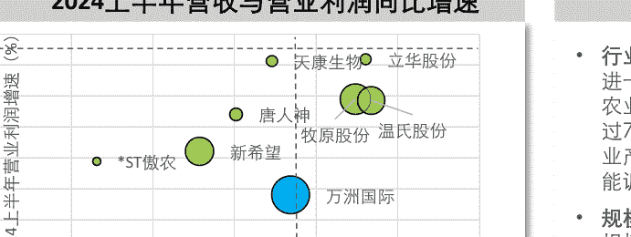

## 2024年上半年营收与利润同比增

## 竞争格局

- 行业集中度持续提升：2024年，养殖业集中度进一步提升，规模化养殖占据市场主导地位。根据数据显示，2024年全国生猪养殖规模突破70%，同比增长两个百分点。同时，产能持续，竞争激烈，面临成本回收利润调整。
- 规模化进程提升：随着养殖标准的提高，大型养殖企业通过集中采购、智能化饲料，降低了对进口原料的依赖。同时，饲料价格在2024年下，进一步增强了养殖的竞争力。

- 成本与效率提升：2024年，生猪养殖效率通过工业化管理、疾病防疫、饲料配方和种群优化等方面实现，降低了养殖成本。
- 多化布局：除了生猪养殖业务，行业头部早期布局肉食品上的布局也为业务增长提供了新的机会。

# 水产品

## 2023与2024年上半年营收同比增速

## 市场规模

## 行业趋势

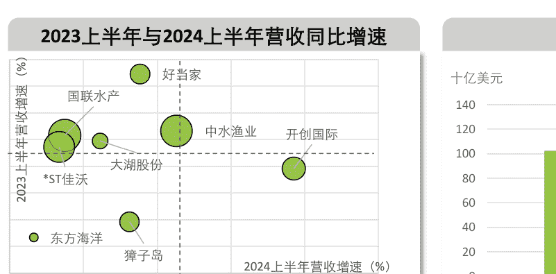

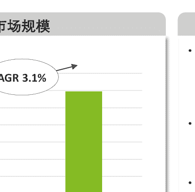

- 政策支持行业发展，推动头部企业扩张：国家对海洋经济的支持为水产产业提供了良好的政策环境。2024年，中国海洋经济统计公告显示，海洋养殖增加增长4%，水产振和深远养殖推动了水产品消费升级。
- 受青：近年来，水产品消费占比提升。消费者偏好方便和预制，如挪鱼、调味寿司等，这些产品在电商平台和直播带货中表现明显。
- 健康消费理念普及：消费者更关注水产品的健康属性、绿色选择、无污染的养殖和生态养殖模式的产品更受欢迎。

## 2023与2024年上半年营业利润同比增速

## 竞争格局

## 成功因素

- 行业内部竞争激烈：头部企业凭借技术、成本和服务等优势占据主导地位。周期性和规模化养殖趋势明显，中小养殖户逐渐退出市场，行业集中度进一步提升。
- 新进入者的挑战：水产生产需要技术、资金和规模效应。大型游公司长期积累的经验和资源，形成了较高的市场门槛。根据证券行业显示，近年来水产产业的规模化和集约趋势明显，中小企业压力巨大，新进入者的挑战较大。
- 养殖技术提升，产业规模化升级：随着水产养殖技术的进步和管理效率提升，养殖企业的规模显著提高。水产养殖从传统向现代转型，不仅降低了养殖风险，此外，养殖模式的升级，规模化养殖和小规模模式的模式进一步提升了单位面积的产量。
- 并购推动行业整合加速：头部企业通过并购和扩张进一步占据市场地位。通过整合上下游产业链，推动整合增效，实现了市场份额的持续领先。

鱼类大类大价/年养殖总体规模（百亿元人民币）

# 宠物食品

## 2023年上半年与上年营收同比增速

## 市场规模

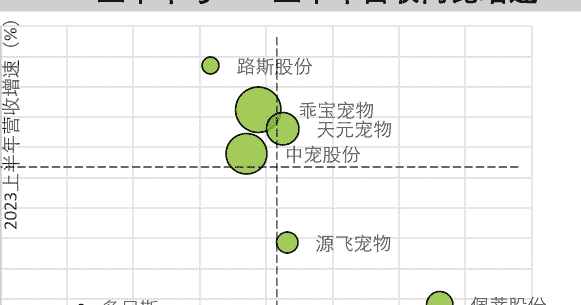

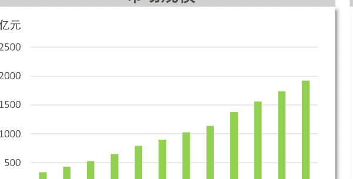

- 健康与营养需求持续提升：随着宠物食品在家庭中的地位日益增加，消费者对健康营养需求也在增加。2024年，占比高达67.5%，是宠物食品的主要部分。消费者倾向于选择高蛋白、低脂肪、无添加剂的产品。
- 出海：2024年，宠物食品出口和金额持续增长。9月数据显示，出口增长54%，出口额为12.6亿美元，同比增长4%。随着海外渠道逐渐去，宠物食品出口将强劲。
- 零食的需求增加：除了宠物食品，消费者对零食的需求也在增加。消费者倾向于选择一站式购物，如线上平台和连锁店以满足宠物的多样化需求。

## 2023上半年与上年营同比增速

## 竞争格局

- 市场格局：根据奥瑞咨询，2023年国内市场仅为31.3%，美国（76.6%）和日本（85.3%）。
- 国产替代加速：随着国产替代趋势，国内品牌市场份额持续增长。国产产品通过多元渠道满足需求。
- 竞争激烈：尤其是线上市场。2024年第一季度数据显示，龙头品牌爱玛、乖福、加特天天等平台表现强势。

- 产品化与差异化：头部企业通过产品化和高端化不断增加，满足宠物食品对品质和质量的需求。通过产品化与营销提升竞争力。
- 全球化布局：领先企业正通过全球化布局，在多个国家和地区设有工厂、销售网络，有效应对国际贸易的变化。
- 品牌影响力与营销能力：头部企业通过线上线下的全营销提升品牌影响力和渗透率。天天强势，同时借助高频社交平台进行营销。

宠物食品大类/行业平均年利（亿元人民币）

## 细分领域驱动因素及趋势

### 服装鞋

- 运动鞋
- 时尚服饰
- 鞋包饰

## 运动鞋

## 2023与2024年上半年收入比增

## 市场规模

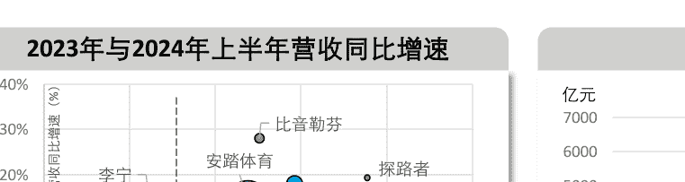

- 赛事赞助成为高效渠道：企业通过大型赛事中进行品牌展示、与消费者距离互动，通过赛事赞助提升品牌热度。23年锦马拉松赛中，李作为本次赞助商。
- 全民运动成为趋势：随着全民健身意识的增强和运动文化的普及，运动鞋从单一的运动扩展到日常穿。通过功能性设计等技术实现运动与时尚的转型，满足了消费者对款式和时尚的需求。
- 国产品崛起：政府通过“全民品牌设计”等政策，推动国内品牌的发展。海外，通过合作、合资、电商（亚马逊球店）等方式布局，扩大市场份额，通过本土化战略提升品牌影响力。

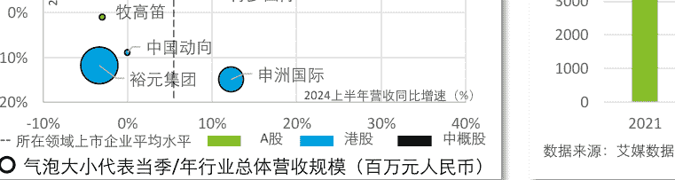

## 2024年上半年净利润与比增

## 竞争格局

- 行业内竞争的激烈加剧：头部企业在市场拓展、创新产品和品牌建设方面开展激烈竞争，企业持续通过品牌升级和市场渠道的优化，提升自身竞争力。
- 中国本土品牌快速提升：中国本土品牌如安踏、李宁、特步等表现出色，市场份额提升近10%。安踏在21上半年营收同比增长14%，李宁和特步则实现了10%以上的增长。
- 新品牌崛起：新品牌如鸿鹄（Running On）正专注专业性与市场结合的策略，迅速在国内市场中脱颖而出，凭借专业级的运动跑步阵。

## 关键发展趋势

- 加大投入：通过增加投入，引入领先技术和研发，企业能够推出具有竞争优势的产品，满足消费者对功能性、舒适性和个性化上的需求。
- 注意科技创新：运动鞋企业已设立顶尖实验室，以技术研发持续提升竞技性能。许多公司已拥有国际领先的技术和实验室，用新材料研发专业面料和鞋底材料，提升运动的功能性与性能。
- 款式转型：鞋领域进入潮流化、趋时尚化。通过推出潮流单品、渠道营销和数字化转型，新品牌迈出了多个针对分市场的布局，如街头潮流系列等，正在重构品牌格局，实现价值突破。

在城市城市市场占比/行业平均总收入（百万元人民币）
2024年上半年净利润比增（百分比）

# 金银珠宝

## 市场规模

## 行业趋势

### 2023年与2024年上半年营收同比增长

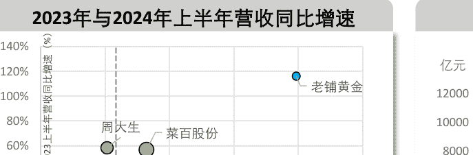
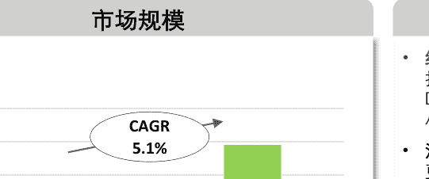

- 线上线下融合，DTC模式成为主流：线上渠道持续扩大，老凤凤与抖音合作推出AI直播。除外，DTC（直接消费者）模式成为关键，如鸿宝等通过自建小程序拓展零售渠道。
- 消费需求向个性化和文化属性转型：年轻消费者更注重产品价值。例如2025年国际珠宝展中，某热门产品单销量增长突破万，消费者对环保材料的需求引起，老金赛推出“冷珐法工艺”等金饰，市场影响力显著。
- 国际化与文化内容驱动活跃：根据中金数据显示，中国珠宝企业加速全球化，2024年珠宝出口额达1547亿美元，同比增长66.4%，黄金出口量增长200%。同时，文化内容成为品牌差异化的核心。

## 竞争格局

## 关键成功因素

### 2024年上半年营收与营业利润同比增长

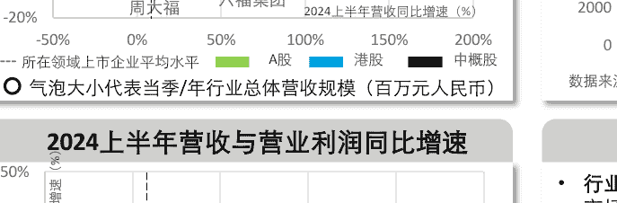

- 行业集中，头部企业占据主地：中国黄金珠宝市场集中度较高，前五家企业（如周大福、老凤凤、周生生）占据市场份额。此外，紫金、山东黄金等企业在原材料供应上具有竞争优势，行业竞争日益激烈。
- 高端化与市场分化：高端黄金珠宝市场中周大福等凭借高端系列产品领跑，并在细分领域持续增长。同时，新兴品牌通过持续增长，影响了黄金珠宝市场格局。
- 新品类与线上流量竞争激烈：互联网珠宝（如Blue Nile）通过多元化产品与营销策略抢夺市场份额，同时，品牌数字化转型加速，如周大福的“生金宝”等。
- 全渠道运营，高效控线：线上线下双线持续领先，周大福通过“智享零售”实现增长，线上线下与时间上同步，提升经营效率。此外，山东黄金凭借灵活能力制胜，如周生珠宝通过核心优势整合资源、营销与供应链，竞争激烈。
- 技术创新，驱动行业：3D打印助力珠宝行业发展，瑞信通过3D打印技术实现定制化产品周期从周短至天，黄金珠宝的定制工艺量达50万，运营效率领先行业平均。
- 品牌属性，实现差异化：中国黄金行业致力于珠宝设计与文化内容结合。如老金赛以“皇家传承”为品牌核心，中青年用户占比达70%，周大福以“发家传承”系列占据市场份额。

2025年1月26日更新，版权所有，请联系授权。

# 化妆品

## 2023与2024年上半年营收同比比

## 市场规模

## 行业趋势

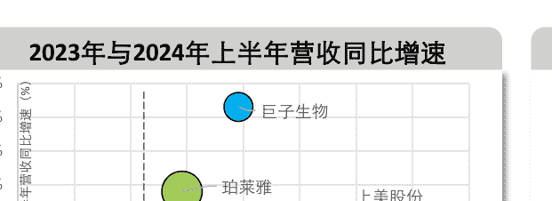
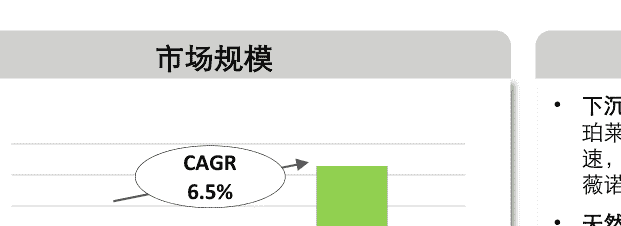

- 下沉市场与国际化双线拓展：三四线市场消费释放，雅莱美通过城商城覆盖超过200个城市，国货出海，花西进入东南亚市场，2024年海外增长80%，薇诺通过跨境电商拓展海外渠道。
- 天然与科技研发成为核心趋势：天然成分护肤市场趋势持续增长，并且生物科技被应用于护肤，华熙国际重组胶原蛋白、与医疗市场合作研发“琥珀号”产品，功能性提升护肤市场增长。
- 个性化与定制化需求：通过AI和大数据实现个性化与定制化，如资生的“Optune”系列和最新的数据驱动产品，满足消费者个性化需求，推动行业不断增长。

## 2024年上半年营收与利润同比比增

- 国际品牌主导高端市场，国际品牌雅莱茉、珀诗兰在高端市场占据绝对优势，国际品牌影响和研发能力吸引了大量消费者。本行业利润差异显著高于市场平均水平。
- 国货品牌崛起，新品牌珀莱莉、花西轩跑超：国货品牌强势崛起，2024年线上化化妆品占比超过60%，抖音、小红书成为新品牌主要宣传平台。
- 化妆护在赛道上处于优势地位：在化妆品护肤行业中，研发、技术和规模规模均衡，显示了显著的行业领先地位，原料供应在价格竞争中拥有优越优势。

## 竞争格局

- 研发能力成为竞争关键：企业通过加大研发投入，不断以技术驱动动力产品来升级产品。另，其他类功能性护肤的企业也成为大军一角，创新占比持续提升，雅莱茉与珀诗兰在实验室攻克“Pro Crystal”。
- 全链路协同，实现高效运营：数字化转型下化妆品行业正在整合与供应链优化来提升服务水平和客户口碑。通过O2O，“进店+”将新品牌上市的时间缩短至45天。

## 关键成功因素
2023年12月5日，请联系我们。

# 电器

## 2023上半年与2024上半年营收同比比

## 市场规模

## 行业趋势

- 以旧换新助力市场增长：2024年，国家台推出以旧换新政策，节能市场向一级、二级节能产品比例达15%，部分额外给节能补贴，带动了高效增长。
- 消费者需求向品质升级：消费者向智能化、健康化需求升级。远程启动、健康等功能成为核心卖点，带动了高端市场。
- 技术创新与政策适配：企业研发投入推出更多消费者的需求。例如，通过智能控、冰箱、洗衣机、干衣等。

## 竞争格局

## 关键成功因素

- 家电竞争：头部品牌（如格力、海尔、董美）占据地位，新兴品牌作为差异化竞争。
- 绿色高效与智能化引领：2024年，绿色高效和智能化成为行业发展的必然趋势。一方面，AI大模型让家居从被动向主动跨越。
- 消费者对价格敏感度高：低端市场随着以旧换新落地，消费者更倾向于购买高端、智能化的家居。
- 企业成本管理驱动：原材料波动、汇率波动和市场竞争加剧，头部企业通过优化供应链管理，提升运营效率和有效控制成本。
- 政策支持为品牌提供机遇：行业竞争日益激烈，市场也饱和，新入门槛较低。政策支持（如智能家居、健康家居）为新品牌提供了机会。

2023年12月5日生成，请联系售后。

# 家居

## 细分领域驱动因素及趋势

零售业态：
- 电商
- 超市
- 专业专卖店
- 百货和购物中心

# 电商

## 2023年与2024年上半年营收同比比

## 市场规模

- 全球化行业升级：跨境电商的全球化与行业升级已成为行业发展的动力。全球化使得企业能够突破地域，拓展国际市场，同时满足不同地区的消费需求。
- 社交电商与内容生态：社交电商通过内容分享、互动等平台发布内容驱动消费，实现UGC营销。小红书通过KOC和KOL营销，构建了强大的品牌积累。
- 技术驱动全球升级：电商利用技术实现精准推荐和效率优化，并根据用户行为定制个性化的营销策略。跨境电商通过海外直邮业务实现35%销量增长，小红书内容效率显著提升。

数据来源：国家局、艾数据中心。

## 2024年上半年营收与净利润同比比增

## 竞争格局

## 关键成功因素

- 头部巨头激烈战：淘宝、SHEIN、Temu、TikTok京东国际化布局，SHEIN通过供应链和社交电商深固海外市场，京东则在海外市场快速扩张。
- 流量增长多元化：平台合作增长、微信直达、淘宝逛直播等，动力持续增长。淘宝推出“跨平台流量计划”，补足商家外流量。
- 差异化运营维持优势：通过精选供货、精准定位、品牌化和优质服务实现差异，持续优化品类、营销策略和用户以保持竞争优势。京东通过私域聚会提升转化率，并可以开启新生态、小红书等业务增长。
- 技术驱动业务增长：企业通过AI技术驱动增长、会员分发、商品定价等显著提升运营效率。智能物流和供应链优化进一步提升了运营成本。SHEIN通过实时数据库反馈调整生产计划，实现上半年以来成为时尚。

# 超市

## 2023年与2024年上半年营收同比比

## 市场规模

## 行业趋势

- 数字化转型与全渠道：企业通过无人扫描、智能购物车等优化周转率，提升运营效率。全渠道线上占比提升至40%。
- 自有品牌与差异化：自有品牌成为核心竞争力，生鲜超市，毛利高达5%-8%。
- 社区化与即时零售：便利店占比超过30%，满足消费者需求，即时送达，超市通过团购等应对变化。

## 2024年上半年营收与净利润同比增长

## 竞争格局

## 关键成功因素

- 市场集中化：头部企业（如沃尔玛、华润）占据地位，一线城市、三四线城市及市场通过并购等方式扩大份额。
- 外超与本土竞争：外超（如沃尔玛、Costco）聚焦全球化，本土超市如京东实现差异化。
- 持续提升供应链能力：头部企业通过直营直采和物流降低成本，使其价格偏低。
- 打造品牌服务化：通过自有品牌丰富多元化，注重服务提升顾客黏性。超市如“按需服务”。
- 全渠道布局：线上线下融合，实现全渠道打通，到店、自提等购物方式，提升销售收益。

开源大模型分析/行业整体规模（百亿元）。
数据来源于国家统计局的调研、奥瑞及艾调研。

# 专业专店

## 市场规模

## 行业趋势

## 2023年与2022年上半年同比比

- 消费者对健康和环保的关注：促使企业强化相关服务，大卖推出“健康检测+药品零售”模式。此外，环保理念逐步渗透到领域，通过优质产品引导消费者购买绿色产品。
- 数字化转型：通过大数据和人工智能技术赋能门店管理，提升效率。同时，虚拟现实（VR）的应用成为主流。数字化转型不仅帮助企业实现升级，还能精准触达消费者需求，让消费者选择具有竞争性的产品。
- 分组市场与跨界创新：通过分组市场和跨界合作打造“流量主品牌”和“性活动”，同时跨界也能为品牌提供有效手段。

## 竞争格局

## 成功的关键要素

## 2024年上半年净利润同比比

- 多元化聚焦竞争，头部企业主导：
- 运动零售：滔胜（Top Sports）和宝胜国际（YY Sports）凭借强大的品牌资源（阿迪达、耐克）和渠道优势，中国领先垂直专营市场超40%的份额。
- 医药领域：大参林、宝胜国际、老百姓等头部企业通过线上线下并行经营，在重点区域形成区域优势。
- 家电零售：ST医药（广宁苏）通过垂直渠道和供应链管理，在高端连锁店中占据份额领先，2024年上半年销售占比超60%。
- 提升运营效率与成本控制：专业专店通过精准需求预测、供货、库存管理和物资物流效率提升来实现品牌转型和效能提升。通过自有门店运营体系，实现了80%的日内配送，配送效率显著。
- 打造品牌场景化营销：通过互动和场景化营销，增强品牌竞争力和客户黏性。通过数字网络展现品牌全实力，打造深入的“购物”。
- 建立会员体系与数据运营：专业通过数据驱动运营实现个性化服务、会员管理和精准营销，提升获客效率。老百姓积累了复购率。

# 百货

## 市场规模

## 2023年与2024年上半年营收比

## 行业趋势

- 消费升级：在消费升级下，高端购物中心吸引群体。与此同时，多元化体验成为主流，占比提升50%以上。
- 绿色与可持续发展：环保理念渗透到行业，绿色零售成为趋势。
- 数字化转型：通过小程序等平台实现线下联动，共享资源，提升体验和运营效率。

## 2024年上半年营收与净利润比

## 竞争格局

- 区域分化：东部沿海及二线城市趋于活跃，西部地区及四线城市竞争激烈，需求驱动城市，加强文化输出，区域化模式逐渐主流。
- 业态化：通过“一站式体验”成为主流，面积超平方米，传统百货持续增长，占比65%以上。

## 关键成功因素

- 构建全渠道能力：通过线上线下连接，实现真实无缝的体验。打造的“云店”模式，让购物在线上下，全渠道占比达45%以上。
- 持续保持吸引力：高端购物中心通过线下营销、主题活动等方式强化品牌形象，保持年租金增长，客流量超过400万人。
- 推进智能化应用：智能技术不仅提高运营效率，更为消费者带来便利、个性化的体验。辅助导购提升服务，客户满意度达90%以上。

# 联系我们

张天兵
德亚太消费品与零售主管合人
电话：+86 21 6412230
邮箱：tbzhang@deloittecn.cn

陈茂
德勤中国研究主管合人
电话：+86 21 642778
邮箱：lydchen@deloittecn.cn

董德标
德勤中国战略与客户中心合人
电话：1868993255
邮箱：debdong@deloittecn.cn

姜颖
德勤中国消费品与零售高级经理
电话：+86 21 642285
邮箱：sunjiang@deloittecn.cn

# Deloitte 德勤 因我 不同

关于我们
德勤是一家立足本土、领先的全球性专业服务机构，由德勤与中国的本土合作伙伴共同打造，服务于中国改革开放和经济建设的前沿。我们的办公室遍布33个城市，拥有超过2万名专业人士，为客户提供税务、咨询等领域一流的专业服务。

我们以诚信为本，坚持卓越、勇于创新，以卓越的专业能力、丰富的行业洞察和智慧的技术解决方案，助力各行业的客户和合作伙伴把握商机，应对挑战，实现世界一流的高质量发展目标。

德勤品牌成立于1845年，在中国境内，“德勤”自1978年起发展，“秉专业、卓越、励创新”。德勤全球成员遍布150多个国家或地区，“以因我不同，成就不再”为宗旨，为市场领先的企业为客户提升价值、创造创新的可能，为更公平、更可持续的世界开辟并前行。

德勤（Deloitte）由多家德勤有限公司及其全球成员所和它的关联机构构成网络（统称为“德勤网络”）。德勤以及每一成员所和它的关联机构均具有法律地位的实体，彼此之间不对对方承担任何法律责任。德勤网络中的任何一个成员或其关联机构的行为对德勤网络中的其他成员不产生法律责任，德勤网络并不构成德勤亚太（一家有限责任公司，境外所有独立法律责任的其中一个成员，或其与其成员的约定为德勤亚太所承担）。
