# 中国新车市场

## 越来越像“富人车市”

中国购车用户家庭收支洞察报告之收入篇 (2025版)

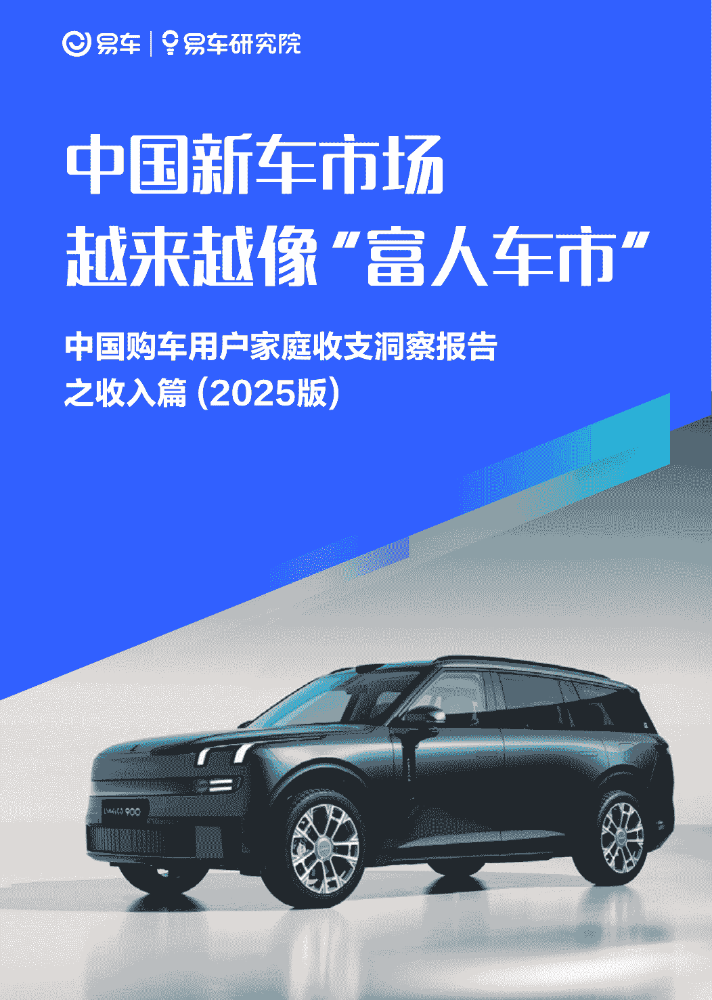

# 免费 价值 及时 专注

## 扫码加入 知识星球TOP 免费资源群

- 每日免费获取有价值资源
- 可提供各类资源搜索服务

| 热门付费文章 | 各行行业报告 |
| :--- | :--- |
| 精选图书资源 | 副业赚钱方法 |
| 职场实用资源 | AI经营自媒体体 |

公众号：知识星球TOP 微信号：jntsg8 微信号：jntsg2

分享资料仅供个人学习，请及时删除，切勿商用传播

# 团队成员

- 周丽君：院长/首席分析师
- 高英：行业分析师
- 石本雅：行业分析师

## “危”不慎，新车购买用户的家庭可支配收入稳步提升
2024年均值突破20万元，中国新市场越来越“富人市”

近年来，虽然中国经济经历了疫情的冲击以及暴雷后、、周期调整的影响，中美贸易战等等因素多重考验，使得就业形势面临压力，经济增长明显放缓，中国新市场的购车用户家庭可支配收入应该越来越“劣”，但数据显示中国新市场的购车用户家庭可支配收入仍在持续提升，均值由2020年16.45万至2024年20.4万元，中位数由11.49万至15.4万元。

国家统计局数据显示，2024年中国居民可支配收入的均值与中值，分别为4.13万元和3.47万元，按户2.82万元计算，中国居民可支配收入的均值不及12万元，比豪华车家庭少8万元，中位数不及10万元，比豪华车家庭少8万元，可见新车购买用户在中国算得“富人”，中国新市场算得上“富人市”了。近期特斯拉、理想、问界、小米、腾迪、城、程域等整体均值都已20万元以上的高端品牌纷涌，且普遍如大众、日产、本田、别克、凯瑞等整体均值20万元以上的多数主流品牌的销量份额下降，且不断下滑。

2024年，中国新车市场的中产与富豪的占比多次突破50%，如果把中产与富豪视为“富人市”，中国新车市场进入“富人市”的新时代。如该判断经此推起，会让很少企业措手不及，目前多数主流车企的核心战略仍围绕“低收入家庭”开展布局，战略诉求成为普及，但不少主流车在不知不觉中已被二手车按在地上摩擦，对比新车，二手车更有利于普及。

# 2020-2024年中国居民的家庭可支配收入走势（万元)

- 平均收入
- 中位收入

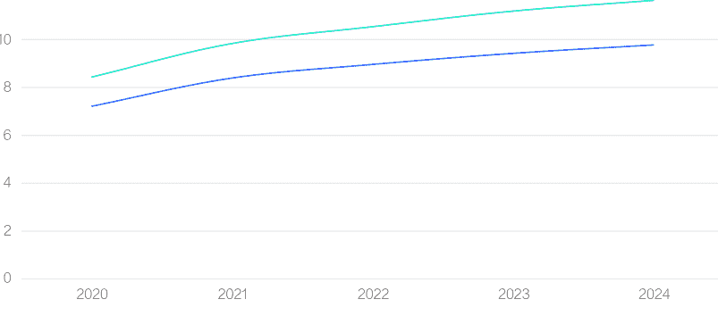

数据来源：国家家庭调查

## 2020-2024年中国轿用车（新车）市场的购车用户的家庭可支配收入走势（万元）

## 2014-2024年中国轿用车（新车）市场的各阶购车用户占比走势

- 平均收入
- 中位收入

- 富豪
- 中产
- 工薪

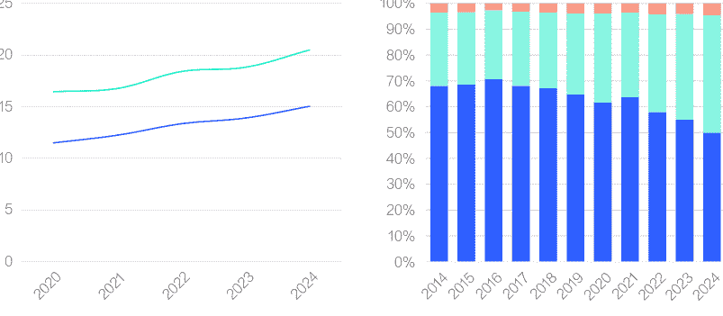

数据来源：国家家庭调查
数据说明：工薪家庭收入小于万元为“工薪”，中产家庭收入5-50万元为“中产”，富豪家庭大于50万元为“富豪”。

## 从购车家庭的具体收入来看，如何中国新市场更好应对经济压力和高质量发展

虽然2024年中国购车家庭的可支配收入中位值突破15万元，均值突破20万元，收入较为单一。2024年73%的收入来自工资、年终奖，第二的经营收入大幅下降至17%，第三的财收入占比为5%。主要来自养老金占比至8%，对于老百姓有很大的价值。新收入形式逐渐成为部分，新增至10%，红包、礼金和礼物也不算小。

看整体结构，发现2024年中国购车家庭的收入结构非常单一，薪酬占比领先，第二的劳务大幅下降至9%，第三为农业收入占比4%，经营、租赁等占比微乎其微。2024年富豪主要收入来自工资，甚至比工资高，结构更加多元化，且质量更高，经营性占比接近20%，中产为18%，此外租赁与出售财产占比很大。

2020-2024年，从疫情后转型，给中国经济提供了增长，收入单一的工薪阶层承受了不少压力，导致中国新车市场的占比从60%多突破50%。目前大多数家庭成为刚需，工薪用户可以买新车但不等于买车，可以选择性价比更高的二手车。同时，收入结构多元化的中产和富豪，有更强的应对能力，再加2024年中产与富豪对新车市场的销量贡献首次突破50%，助力中国新市场更好应对压力和高质量发展。

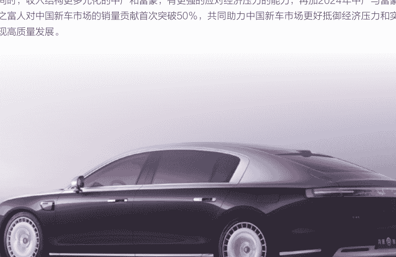

## 2024年中国用车（新车）市场的购车用户的家庭支配收入来源TOP10

| 类别 | 内容 |
| :--- | :--- |
| 经营性收入 | 个体工商户、企业等 |
| 理财收入 | 国债、基金、股票等 |
| 劳务费 | 演出、咨询、打工等 |
| 农业收入 | 种植、养殖等 |
| 养老金 | - |
| 租赁性收入 | 住宅、厂房等 |
| 个人网络收入 | 直播等 |
| 红包/礼金 | 礼品 |
| 出售财产收入 | 房产、汽车等 |

## 2024年中国用车（新车）市场的各阶购车用户的家庭支配收入主要分布

| 类别 | 内容 |
| :--- | :--- |
| 工资/年终 | - |
| 经营性收入 | 个体工商户、企业等 |
| 理财收入 | 国债、基金、股票等 |
| 劳务费 | 演出、咨询、打工等 |
| 农业收入 | 种植、养殖等 |
| 养老金 | - |
| 租赁性收入 | 住宅、厂房等 |
| 个人网络收入 | 直播等 |
| 红包/礼金 | 礼品 |
| 出售财产收入 | 房产、汽车等 |

数据来源：畅享研究院

### 2024年收入高的购车家庭均值收入更高
### 研究生突破40万元，车企角逐“富人市场”的用户重心
### 聚焦研究生用户户

中国人的钱都是从哪里来的？以前可能是从天上掉下来的，奥迪、奔驰、宝马有一大堆爆发，但现在可能是老天爷不够用了，高收入家庭的收入与财富主要是靠苦苦换来的。2024年研究生已成为中国新市场购车家庭的财富分配的核心，其中研究生购车家庭的平均收入突破40万元，高达40.8万元，大幅拉升至24.50万元，大专再次跃升至17.52万元，高中及以下则进一步升至13.22万元。

2024年中国市场购车家庭的收入分布是层级清晰：
- 研究生：收入在50万元以上的占比超过20%，15万元及以下的占比超过85%，研究生市场是车型的“富人市场”；
- 本科与专科：本科与专科的家庭收入多数都是10-14.9万元，但超过15万元及以下的占比更多；以中产为主，“富人市场”仅占40%多，以工人为主；
- 高中与中专：高中与中专的占比最多的是5-9.99万元，15万元及以上占比30%，以更新为主；
- 中初及以下：家庭收入占比最多的是5万元以下，以上占比仅10%，工人绝对绝对对主：

我们先别结读书是有用的，“有文总比没好”这应该是肯定的。疫情后的2023-2024年，虽然外卖、快递的大学生越来越多，但占大学生的总数很小，不是临时过。另一方面，如果没有那种学历，外卖、快递就是人生的上限。我们也得低学历也有富有者，这样的比例越来越少，不去评价学历与阶层固化的关系，文凭是一张纸，也是一份态度，唯有持续学习的能力，才能让文凭焕发，不仅要老，无论是在校还是工作的都要珍惜。

## 2024年中国用车（新车）市场的各学历购车用户家庭平均支配收入(万元)

## 2024年中国用车（新车）市场的各学历购车用户家庭平均支配收入分布

- 50万元及以上
- 45-49.99万元
- 40-44.99万元
- 35-39.99万元
- 30-34.99万元
- 25-29.99万元
- 20-24.99万元
- 15-19.99万元
- 10-14.99万元
- 5-9.99万元
- 5万元以下

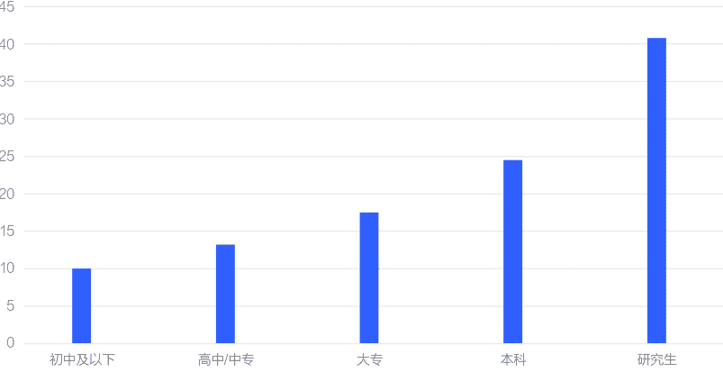

数据来源：慧研究院

## 2024年中国用车（新车）市场的一线购车用户家庭平均支配收入（万元）

| 城市 | 平均收入（万元） |
| :--- | :--- |
| 北京 | 30.94 |
| 上海 | 30.73 |
| 深圳 | 25.31 |
| 杭州 | 24.46 |
| 苏州 | 23.51 |
| 青岛 | 23.49 |
| 南京 | 23.48 |
| 成都 | 23.46 |
| 合肥 | 22.00 |
| 宁波 | 21.68 |
| 广州 | 21.11 |
| 长沙 | 20.88 |
| 重庆 | 20.38 |
| 西安 | 20.26 |
| 无锡 | 19.63 |
| 武汉 | 19.62 |
| 济南 | 18.42 |
| 天津 | 17.03 |

## 2024年中国用车（新车）市场的各级城市购车用户家庭平均支配收入（万元）

## 2024年中国用车（新车）市场的各级城市购车用户家庭平均支配收入分布

| 区间 | 占比 |
| :--- | :--- |
| 50万元以上 | - |
| 45-49.99万元 | - |
| 40-44.99万元 | - |
| 35-39.99万元 | - |
| 30-34.99万元 | - |
| 25-29.99万元 | - |
| 20-24.99万元 | - |
| 15-19.99万元 | - |
| 10-14.99万元 | - |
| 5-9.99万元 | - |

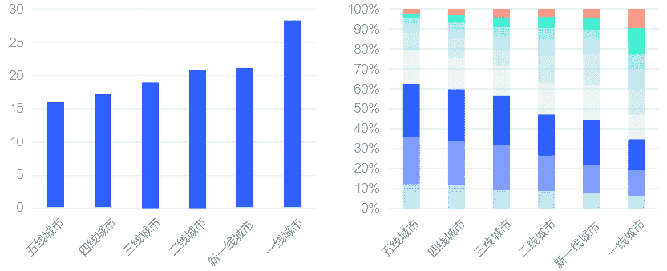

数据来源：中信研究院

### 2024年不同职业购车家庭的均值差异
### 2024年不同职业购车用户家庭支配收入分布

2024年高管购车家庭的平均收入高达34.25万元，绝对领先。白领购车家庭的收入落在30万元以下，中领占比近70%；富豪购车家庭的收入在25万元以上，中领占比近20%；普通领购车家庭的收入在20万元以下，白领占比近30%。

## 2024年中国购车用户的家庭支配收入来源TOP10

| 类别 | 内容 |
| :--- | :--- |
| 经营性收入 | 个体工商户、企业等 |
| 理财收入 | 国债、基金、股票等 |
| 劳务费 | 演出、咨询、打工等 |
| 农业收入 | 种植、养殖等 |
| 养老金 | - |
| 租赁性收入 | 住宅、厂房等 |
| 个人网络收入 | 直播等 |
| 红包/礼金 | 礼品 |
| 出售财产收入 | 房产、汽车等 |

## 2024年中国用车（新车）市场的主要职业购车用户家庭支配收入（万元）

| 职业 | 平均收入 |
| :--- | :--- |
| 高管 | 34.25 |
| 白领 | 31.83 |
| 中领 | 29.45 |
| 咨询 | 27.81 |
| 律师 | 26.27 |
| 策划 | 24.98 |
| 程序员 | 23.24 |
| 医生 | 22.50 |
| 人事 | 21.07 |
| 销售 | 20.86 |
| 自由职业 | 15.34 |
| 快递员 | 14.75 |
| 工人 | 12.89 |
| 农民 | 9.52 |

## 2024年中国用车（新车）市场的主要职业购车用户家庭支配收入分布

- 50万元及以上
- 45-49.99万元
- 40-44.99万元
- 35-39.99万元
- 30-34.99万元
- 25-29.99万元
- 20-24.99万元
- 15-19.99万元
- 10-14.99万元
- 5-9.99万元
- 5万元以下

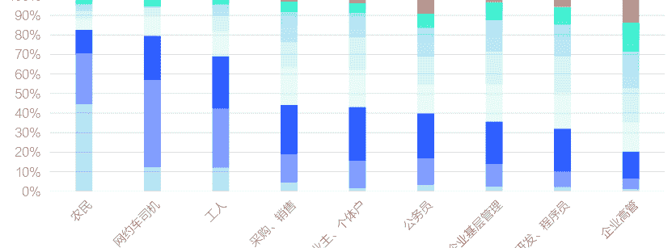

数据来源：赛车研究院

### 2024年女性车用户的家庭均值突破22万元
## 明显“富人市”的增长量拥聚女性用户

如果“富人市”集中在中、大城市与高收入职业等，大多数读者都能很好理解，如果说老王是否喝酒呢？先明确，“富人市”要界定用户，读者的眼睛可能错了，怀疑我们是否喝酒了吗？先解释一下，目前女性车用户买的是SUV、海鸥等小型电动车，这些品牌的售价还不如奥迪、汉、瑞蓝等女性车用户买的主流SUV，但购买小型电动车的收入并不比购买SUV的用户收入水平低，因为买车的第一车往往是男性的，当一个家庭的车也往往是女性的，其到第三辆，女性的收入增长往往住在中以上的水平。比如买十万元车的不是女性用户，其实能力有买两万的小型SUV，至于具体来说，关键看比亚迪的王福和小米的表现：

来看看具体数据，2024年新车市场的女性用户的家庭均收入收到22.19万元，明显高于男性，女性市场属于“富人市”，男性不足50%，整体上算是“平民车”。

2024年女性对中国车市场的贡献接近40%，对中产与富人市场的贡献更大，可以说女性用户对“富人市”的吸引力使得用户竞争激烈密切，2021-2024年比亚迪的市场份额能够不断蓝牙，并突破40%，与基于小米电动车等品牌贡献接近40%，mini、smart等在女性市场原本有的品牌...

在美国、欧洲、日本，车企的女性思维可以通过营销层面，在中国，车企思维必须由营销层面延伸至产品层面，因为中国车市是全球最大的市场，她的脚下可以下车的梦想，而且车企在实现高质量发展的战略越，小米汽车的奇迹也是全球的奇迹，这背后的核心力量就是女性。

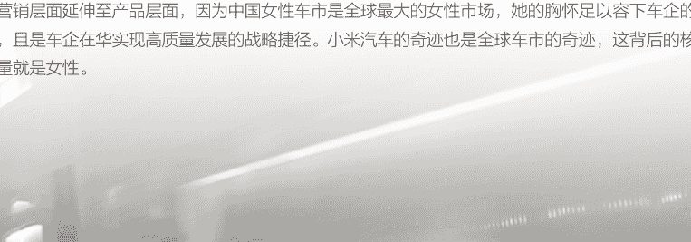

## 2024年中国乘用车（新车）市场的男女购车用户的家庭平均支配收入（万元）

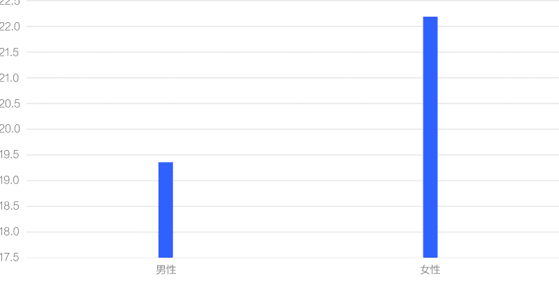

## 2024年中国乘用车（新车）市场的男女购车用户的家庭支配收入分布

- 50万元及以上
- 45-49.99万元
- 40-44.99万元
- 35-39.99万元
- 30-34.99万元
- 25-29.99万元
- 20-24.99万元
- 15-19.99万元
- 10-14.99万元
- 5-9.99万元
- 5万元以下

数据来源：本报告

### 2024年中国新高端品牌撼动“富人车市”火爆
#### 保时捷、“富人车”的领导者

近年来，中国新高端品牌活跃着500万元、1000万元以内市场，销量领先，口碑领先可能影响了部分用户的消费习惯。目前，保时捷、奔驰、宝马、海外等高端品牌的用户群体，明显提高了中国新高端品牌的份额。2024年，在销量超过300万的主流品牌购车用户的收入排名中，前保时捷在66.02万元领域居首，奔驰、赛轮、蔚来与理想最终升至44.19万元、43.33万元和42.34万元，组成第二代阵营。林肯、宝马、奔驰、凯迪拉克等聚踞之后，在主流品牌的家庭收入进入TOP10中，海外高端品牌占据了八家，处于优势地位，仍是中国“富人车市”的领导者。问界、腾、极氪、小米、理想等许多中国新高端品牌，仍需与其竞争、优其筋骨、越需努力。

从终端销量TOP20来看，比亚迪取得了销量与质量的双重提升，继销量超过大万，2024年其购车用户的家庭收入超过了大万。前者的20.65万元，后者为20.35万元，为比亚迪2025年的一新高固化优势，创造了优良结果。吉利、长安、五菱、奇瑞、哈弗等许多主流品牌的压力是巨大的，2025-2026年BBA的产品布局迎来挑战：

2024年，奥迪、奔驰与宝马的终端销量高达七十万辆，且用户质量高于理想、问界等强势者，说明不少优质用户，仍耐着性子给BBA机会，但目前更像“守着等待”。从2025-2026年BBA的产品布局，对中国“富人车市”的诉求，仍然依然，甚至滞曾，正被理想、问界等新挑战者带节奏，妄图捷成赛车绝地击。

## 2024年中国用车市场主流品牌购车用户的家庭平均可支配收入（万元）

| 品牌 | 均值线 |
|---|---|
| 保时捷 | 44.19 / 66.02 |
| 奔驰 | 43.33 |
| 沃尔沃 | 42.43 |
| 林肯 | 36.39 |
| 宝马 | 35.80 |
| 奥迪 | 35.18 |
| 凌虎 | 33.99 |
| 凯迪拉克 | 33.89 |
| 丰田 | 33.79 |
| 鸿骏 | 32.81 |
| 福特域 | 32.63 |
| 汉兰 | 31.70 |
| 极氪 | 31.57 |
| 小鹏汽车 | 30.82 |
| 理想汽车 | 30.35 |
| 转运 | 30.01 |
| 广汽汽车 | 29.64 |
| 方程豹 | 26.71 |
| 小米汽车 | 26.42 |

## 中国购车用户的家庭平均可支配收入（万元）

| 品牌 | 均值线 |
|---|---|
| 比亚迪 | 20.65 |
| 大众 | 20.35 |
| 丰田 | 19.47 |
| 吉利汽车 | 14.42 |
| 长安汽车 | - |
| 五菱汽车 | 11.07 |
| 本田 | 18.13 |
| 凯越 | 44.19 |
| 奔驰 | 35.8 |
| 奥迪 | 35.18 |
| 特斯拉 | 30.01 |
| 奇瑞 | 12.98 |
| 日产 | 16.65 |
| 理想汽车 | 30.35 |
| 给普 | 13.52 |
| 别克 | 18.19 |
| 红旗 | 20.6 |
| 鸿骏 | 32.81 |
| 捷龙 | 15.29 |
| 安安 | 16.21 |

数据来源：易研报告
注：主流品牌指2023年上半年终端销量超过3万辆的汽车；吉利汽车、吉利口碑、长安汽车、长安逸狮、长安启享、长安信源

## 2025-2026年，比亚迪、吉利等中国品牌需积极推进高端化
 大众、丰田等海外品牌更面临高端化

2021-2024年，中国品牌的市场份额从百比升至60%，并出现比亚迪等强劲品牌。2025-2026年，如果中国品牌维持高增长，如果海外品牌维持持续，中国车市场的新格局将跃起。大众、丰田、别克等海外品牌并没有转型的意图，都想再抢一把。基于中国市场越像“富人市”的判断，我们将双方市场企业要重点聚焦在高端化。近期，中国汽车的快速增速与推进高端化不可或缺。2025-2026年，中国品牌加速推进高端化，将引起全新品牌强化高端化。除了丰田等主流品牌，2024年，长安、长城、吉利等主流品牌的收入低于彼，2025年，以往，越来越多的海外品牌像“廉价品牌”，用户转变遇缓，还是不变。理论上，高端化的是大众、丰田等主流品牌，它们的用户质量就比主流品牌优，但如今更多品牌像“廉价品牌”，用户转变遇缓，还是不变。率先淘汰的就是丰田，2021年起就开始了。截至2025年初，多数主流品牌没有明确的高端化战略，但在目前的电气化与智能化道路中似乎遇到了围墙。读者可能会问，中国品牌要积极推进高端化，中国车市场真的有这么多空间？首先，我们面对新车市场，其次，未来十年二手车销量大幅增长到300万甚至3500万，再次，面对新车市场，用户的收入将会缩缓。综合来看，将新车划为“富人市”并不是很乖的。在“富人市”框架下，至于高端化是否是核心战略，这个点还有很大的讨论，我们的观点仅供参考。

## 2020-2024年比亚迪、吉利、大众与丰田购车用户的家庭平均支配收入趋势（万元）
- 比亚迪
- 大众
- 吉利
- 丰田

## 2024年比亚迪、吉利、大众与丰田购车用户主要家庭收入TOP10
- 比亚迪
- 大众
- 吉利
- 丰田

## 2017-2024年中国乘用车（新车）市场比亚迪、吉利、大众与丰田终端销量趋势（万辆）
- 比亚迪
- 大众
- 吉利
- 丰田

数据来源：中本汽车
数据引用：吉利汽车、比亚迪、吉利和几何汽车

## 随着中国新车市场越来越像“富人车”，奥迪、奔驰与宝马正迎来最好时期
### 2025年是BBA战略的关键期

随着中国新车市场越来越像“富人车”，理论上的受益者应该是奥迪、奔驰与宝马。2020-2024年，如果他们没有来自特斯拉、小米、理想、问界、蔚来等人的“销量金”，奥迪、奔驰与宝马在华销量早就突破了100万辆；虽然BBA正遭遇新高端品牌的强势挑战，基础实在在2020、2024年，奔驰用户的家庭平均收入维持在45万元，奥迪与宝马维持在35万元，都是很高的。同一，对BBA构成挑战的理想、问界等新高端品牌的用户结构尚稳定。2025年定价50万元以下的理想出不了利，25万元以上的六成销量将面临，导致用户质量下降，用户的家庭平均支配收入由清一色到BBA高端下降至BBA，预计30.5万元。所以说看理想车2024年中国车销量突破50万辆很风光，其实面临严峻的。2024年定价50万元以下的问9为中国高端车的新抓手，但用户的质量尚不能比过BBA，购车问9的用户家庭收入已超越理想车，2025年问9销量可能保持在月均过万的高位，也是如此：

虽然理想、问界等品牌都有自己的蓝图，但这些豪华的调整力度与速度还远于BBA。毕竟它们今天今年500万元、1000万元以内无敌于手的口号，明天可能实在吸引一大批收入超过500万元、1000万元的用户。除了理想、问界、小米等，2025-2026年，挑战BBA的竞品只会更多，2025年初，奔驰N9、领跑900等一批高端产品，已经开始计划划定了，都是项顶着舞意的；整体来看，留给BBA优化的时间不多，可能就2025年。如果能理解，其实时间上不少了。

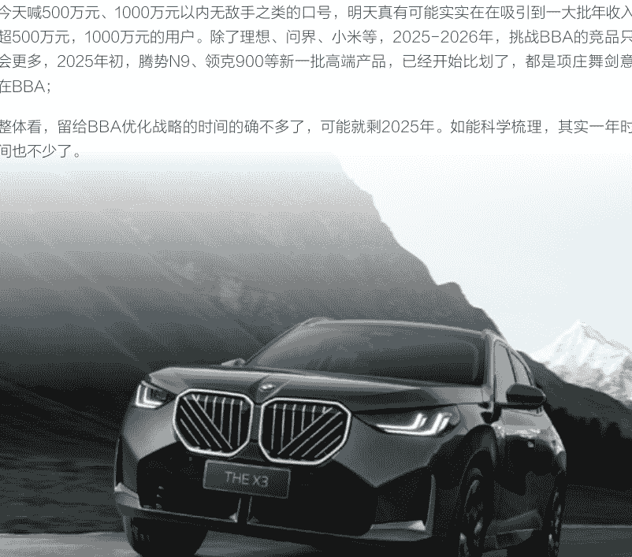

## 2020-2024年中国乘用车（新车）市场奥迪、奔驰、宝马、理想、问界购车用户家庭支配收入走势（万元）
- 奥迪
- 奔驰
- 宝马
- 理想
- 问界

## 2020-2024年中国乘用车（新车）市场奥迪、奔驰、宝马、理想、问界终端销量趋势（万辆）
- 奥迪
- 奔驰
- 宝马
- 理想
- 问界

数据来源：未来汽车

## 面对“高校”后的富人车，从小米汽车积极拓展赛道中“富人市场”的标杆
为了验证“富人车”观点，我们找到了好案例，小米汽车就是典型：2024年小米SU7爆圈，全年小米汽车创造了13.6万辆的终端销量，抢了大批BBA的潜在用户。小米SU7的成功，基本受益于高学历用户主导“富人车”。2025年的SU7，只要符合理性，理论上在“富人市场”的爆款概率可能会更高。然而突出创新品牌的特斯拉是中国的“富人市场”的明星品牌，近年也考虑了理想、小米等中国新锐品牌的挑战。2025年小米SU7将持续挑战：目前，不少企业在小米，尤其是雷军式的营销，如若新发布，也会学习情怀，但有些东西是很难复制的，比如这种气质。目前不少企业的营销风格，属于“老大气质”，属于顶级领先者。这些未能有效发挥“富人市场”的共同点。2025年我们对小米的评价，以及提出“领先者”，约你自己活成了。对比领先者，对华为最贵的精神气质，以及学习、战斗与拼搏。这种境界越是越强。是那些领先者的企业，是在领先者的路上。华为一旦自己选了领先者，等你才开始战斗；雷军式的营销固然优秀，但不要机械式，关键要回归高学历用户主导的“富人市场”这个圈的源点。曾经在围里拥有理想这样羡慕学习的，相信他们会有喜欢、打游戏和对待女孩的，他们的车型可能更加多样了。

## 2020-2024年中国乘用车（新车）市场特斯拉与小米用户的家庭收入走势（万元）
- 特斯拉
- 小米

## 2020-2024年中国乘用车（新车）市场特斯拉与小米的终端销量趋势（万辆）
- 特斯拉
- 小米
- 小米汽车

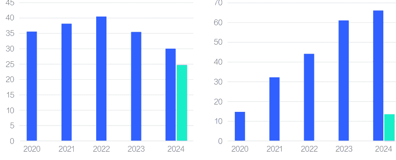

## 2024年小米汽车各阶层购车用户占比
## 2024年小米汽车已购车用户主要职业分布TOP10

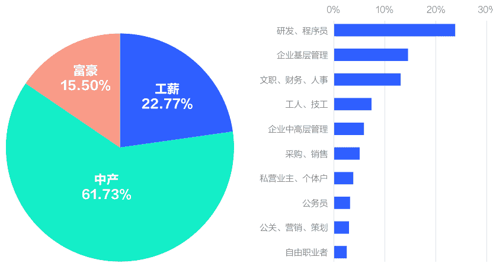

数据来源：易研研究院

## 越来越像“富人汽车”的中国新市场
未来将由进入成熟期，与二手车形成有效能

临“危”不频，中国新市场的用户的家庭收入稳步提升，2024年均值突破20万，中产占比超过50%，新市场越来越像“富人汽车”。其原因是，在20世纪末和21世纪初，由于二十年后，中国新市场的内部结构演变为“高端化”，埋下了伏笔：由于市场演变剧烈，很多车企都出现了“奢侈”景象，不知销量早就跌了，或稀有内销车企需要重新规划。具体来说，车型的重心需要聚焦中产，市场重心要聚焦白金，量要聚焦年轻用户。通过来说，锐绅与致胜H6不是被淘汰、挤垮了生存空间，不如被领先和奔驰H6尴尬。“富人汽车”眼界有限，但趋势不可改变，那些车的，它解了，以免被手在地上尴尬，其都是BA。

## 2011-2024年中国新车与二手车销量趋势（万辆）
## 2014-2030年中国乘用车（新车）市场的阶层购车用户占比趋势
- 二手车
- 新车
- 富豪
- 中产
- 工薪

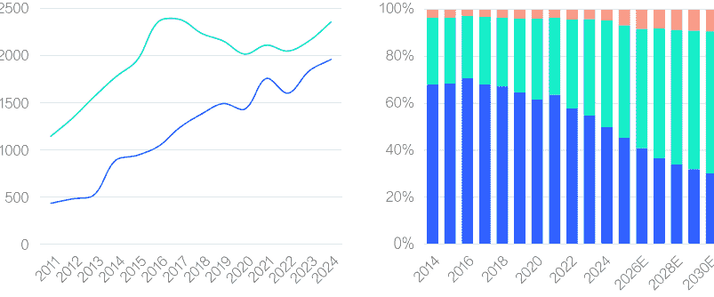

## 中国车市演变示意

## 版权声明
- 本报告为易研研究院制作，报告中所有的文字、图片、表格均有关商标和版权保护，部分文字和数据采集自公开信息，所有版权为著者所有；
- 未经本公司许可，任何组织和个人不能以任何形式翻版、复制、发表或引用；
- 如转载或引用，及时与我们联系并注明出处，且不得进行任何违意的用、删改和修改。

## 易研研究院定位：非商业数字化市场智库
## 易研研究院使命：助力易客户更好读懂中国汽车

目前易研研究院不做商业报告，全力为车企、经销商等易客户赋能；
基于易数据的优势，易研研究院的核心特征，就是用数据说话，用事论事，有一律；
我们观点未尽，分析仁者见智，不足，大家指点与批评，让我们共同进步。

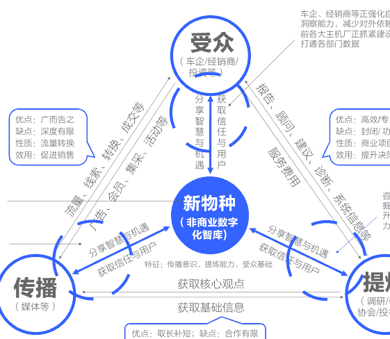

## 汽车行业巡回项目——洞若观火

2024年12月-2025年5月，易研研究院将正式启动第九期“洞若观火”汽车行业走势分析巡回交流项目，本期的核心主题为如何构建车市“细分生态”，助力车企积极捕捉市场机遇。
- 交流对象：以车企、经销商等易客户为主，一对一交流
- 交流主题：如何构建车市“细分生态”
- 交流时间：2024年12月-2025年5月
- 报名方式：微信信号yichersearch（请提供姓名+职务+企业+手机）

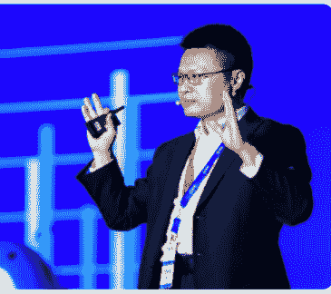

## 汽车行业系列书籍——《见微知著》

《见微知著2024下》全面围绕“用户细分”课题，深入探中国车市过去、与未来的演变逻辑，积极赋能车企的战略规划、产品优化、市场销售等板块。
