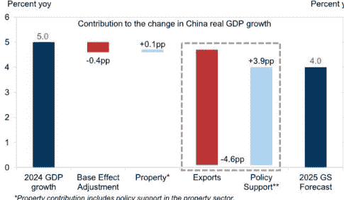
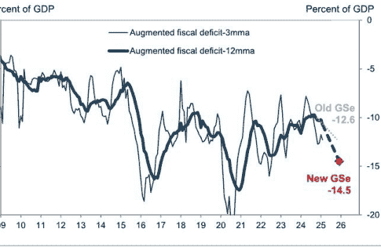

# Goldman Sachs Economics Research

2025年4月14日 | 3:08AM HKT

## 亚洲聚焦

## 中国：财政扩张力度将加大以抵御关税带带来的不利影响

- 特朗普总统上任以来，美国宏观大幅推高关税，这对于中国经济增速造成严重影响，我们预计中国将采取一系列宽松措施来抵其影响，总体而言这些措施包括财政政策、货币政策、房地产以及社区纾困。这意味着，与我们之前的准预测模型相比，今年的增长引擎将明显地从出口的主导转向国内政策宽松。

- 我们预计扩大财政赤字的GDP占比较去年高4.1个百分点，金融融资规模增速将增加1.5个百分点，同时政策政策将宽松。我们在预测模型中设计的财政扩张接近2020年疫情情况和全方位锁对对经济造成冲击时的财政无法扩张。这表明财政扩张可能承担部分总的重的，尽管我们预计它无法完全缓冲冲击。

- 我们预计，政府将在未来几个月内快速发行专项资金，最高层将在4月份和7月的政治局会议上积极讨论，全国人大在今后的某些时候将批准预算外债发行债券。新增资金可能用于消费品换新和更新科研、高技术制造业、新基础设施和更新旧项目，以及全国教育的生育计划。

- 我们在宽松政策所需的需求中，受益于地方政府和财政扩张，今年的资金可能不会像去年那样造成巨大波动。短期内，特别是在决策层未来将来的的一些项目面前尚未启动的。然而，在持续的反腐调查背景下，对地方官员在增长方面的动力不足是一项制约因素。

道安竹
+852-2978-1802
andrew.wilton@gs.com
高盛（亚洲）有限责任公司

冯亮
+852-2978-6634
hui.shang@gs.com
高盛（亚洲）有限责任公司

王立升
+852-2978-4404
lisheng.wang@gs.com
高盛（亚洲）有限责任公司

陈豪
+852-2978-2418
haochao@gs.com
高盛（亚洲）有限责任公司

杨玉钰
+852-2978-7283
yuting.yang@gs.com
高盛（亚洲）有限责任公司

宋佳敏
+852-2978-0106
chelsea.song@gs.com
高盛（亚洲）有限责任公司

投资者不应将本报告作为作出决策的唯一依据。有关分析的和其他重要信息，请见信息披露摘要，或参阅 www.gs.com/research/hedge.html。

# 扫码加入 知识星球TOP 免费资源群

免费
公众号：知识星球TOP

- 每日免费获取高价值资源
- 可提供各类资源搜索服务

价值
微信：jntsg8

| 热门付费文章 | 各行各业报告 | 精选图书资源 | 副业赚钱方法 |
|---|---|---|---|
| 职场实用资源 | AI财经自媒体 | | |

及时
微信：jntsg2

专注分享资料仅供个人学习，请及时删除，切勿商用传播

## 中国：财政扩张力度加大，以抵消货币宽松带来的影响

2024年9月以来中国的政策宽松力度加大、协调增强，决策层在今年“会届”期间指出，“为应对外部可能出现的各种不确定性，中央财政储备了足够的储备空间和货币政策空间。” 特朗普从特朗普上任以来美国对华加征关税，中国当局的宽松政策措进一步强化，引发了市场对宽松政策的预期。我们将在文中详细介绍我们最新的宽松政策，并对财政政策的实施要要（资金来源、项目措措和官方的观点），并更新我们对中国财政政策的预测。

### 更具破坏性的外部冲击需要更多政策宽松来抵消其影响

随着中美紧张加剧，关税压力升级，中国对进口商品的关税税可能从11%上升到10%（计入关税免税后）。根据我们的预测，美国财政政策将萎缩GDP2.6个百分点，其中在2025年占比为2.2个百分点。再加上中国对外部经济增长放缓带来的0.2个百分点影响，今年外部冲击的负面影响将达到2.4个百分点，远于我们之前的预测。

我们预计中国将采取一系列宽松措施来缓解关税引发的影响，其中财政政策将承担大部分的增长重任（图表1）。这与我们之前的预测相比，增长的重心将明地从出口转向国内国内政策（图表2）。

- 财政政策：我们预计今年第二和第三季度增加“双”（分季度50个百分点、20个百分点），在第四季度再次增加20个百分点。这意味着我们预计今年财政增加100个百分点，60个百分点（比之前的预测减少20个百分点）。我们预计中国将通过发行国债向金融系统引入更多流动性。货币宽松有助于维持中国财政扩张，增强我国实施宽松政策，并将政策向国内市场。

- 财政政策：我们预计，今年的财政赤字的GDP占比去年0.4个百分点扩大到10.4个百分点，根据我们的预测，这相当于政府支出比去年增加60亿元。新增资金可能用于消费品换新和更新科研、高技术制造业、新基础设施和更新旧项目。

- 房地产政策：我们预计，中国将实施更加宽松政策，以稳定房价、保障市场运行，防止房地产下行的风险。具体措施包括下调房贷利率、降低首付比例，以“白名单”项目加快购存量房屋，以及加大力度以实施城市改计划。如果这些措施能够实施，我们将认为提供了万套住房。

- 社会政策：由于中小企业和低收入人群更容易受到关税和国际经济的影响，因此我们需要采取特定的纾困措施，积极实施这些措施以维护社会稳定。具体措施包括提高补贴、针对性增加免税负担、增加财政补贴、临时发放，以及特定的群体（如政府类似于2020年疫情初期的做法）。

- 汇率政策：我们将维持年底汇率为7.5的预测，这有利于中国在货币政策上保持灵活性。鉴于外汇策略和近期对美元的新汇率走势，我们预计人民币基本汇率稳定，在一个一定程度上支持中国的出口增长，此外银行还进行

## Goldman Sachs 亚洲聚焦通过贷款加大稳定市场的资金，部分抵消汇率的影响

图1：我们预计政府将进一步加大宽松，部分抵消汇率的影响

| Type | Instrument | 2024 | 2025F |
|---|---|---|---|
| Monetary (eop) | RRR | Large banks: 8.0% Medium-sized banks: 6.0% Small banks: 5.0% | Large banks: 7.0% Medium-sized banks: 5.0% Small banks: 5.0% |
| 7-Day O | | 1.50% | 0.90% |
| Fiscal (full year) | Effective-on-budget (% GDP) | 4.8% | 6.3% |
| | Augmented fiscal deficit (% GDP) | 10.4% | 14.5% |
| Credit (eop) | TSF | 8.0% | 9.5% |
| Housing | Housing policy | Further demand in tier-1/2 cities; increased liquidity for project completion | Further reductions to mortgage rates; more lending for "whitelist" projects; settlement of urban renovation; continued policy to destock existing inventories |
| FX (eop) | USDCNY | 7.30 | 7.35 |

资料来源：高盛研究部

图2：今年的增长预期将影响出口政策

图3：由于美国加征关税的影响，我们调整了2025年财政预测

*Property growth Base Effect
* Exports Support refers to policy support in the sector
*Policy support refers to new policy to avoid double counting

但注意的是，如果此前美国的关税政策不变，则这些宽松措施并不完全抵消外部冲击。因此，我们最近下调了2025/2026年实际GDP增速（分别下调0.5个百分点，为4.0%/3.5%；图4）

来源：财经，高盛研究部

## 图4:我们最近接近2025年实际GDP预测为4.5%下降至4.0%

| GDP | % | 2019 | 2020 | 2021 | 2022 | 2023 | 2024 | 2025F |
|---|---|---|---|---|---|---|---|
| Domestic Demand | pp | 5.2 | 1.6 | 8.6 | 6.5 | 2.5 | 5.8 | 3.5 |
| Consumption | % | 6.2 | -0.4 | 8.9 | 2.2 | 7.9 | 3.8 | 5.3 |
| Household Consumption | % | 6.4 | -1.8 | 11.5 | 11.2 | 8.5 | 0.0 | 0.0 |
| Government Consumption | % | 5.9 | 3.0 | 3.2 | 4.7 | 6.6 | 1.0 | 6.0 |
| Gross Fixed Capital Formation | % | 5.2 | 3.2 | 3.3 | 3.2 | 4.9 | 3.5 | 4.5 |
| Net Exports | % | 0.7 | 1.9 | 2.6 | 0.5 | -0.6 | -1.5 | 1.0 |
| Exports of Goods (nominal USD) | % | 0.5 | 3.6 | 29.6 | 5.6 | -4.7 | 5.8 | -12.5 |
| Imports of Goods (nominal USD) | % | -2.7 | -1.0 | 30.7 | -0.6 | -1.7 | 5.2 | -8.2 |
| Inflation | % | 2.5 | 0.9 | 0.2 | 0.9 | 0.2 | 0.2 |
| Core CPI | % | 1.6 | 0.8 | 0.8 | 0.9 | 0.7 | 0.5 |
| PPI | % | -0.3 | 1.8 | 1.7 | 1.9 | 2.4 | 1.4 |
| Current Account | % GDP | 0.7 | 1.7 | 1.9 | 2.4 | 1.2 | 0.2 | 6.97 | 6.54 | 6.95 | 7.09 | 7.35 |
| OMO-7 Day Repo Rate (eop) | % | 2.5 | 2.2 | 2.2 | 2.0 | 1.8 | 1.5 | 0.90 |
| TSF Growth (eip) | % | 10.7 | 13.3 | 10.3 | 9.6 | 9.5 | 8.0 |
| Augmented Deficit | % | 11.7 | 16.6 | 11.2 | 12.3 | 11.3 | 10.4 | 14.5 |

来源：高盛研究部

## 图 5:我们预计今年财政赤字与GDP增速较2024年缩小4.1个百分点至16.6%

| Percent of GDP | 2019 | 2020 | 2021 | 2022 | 2023 | 2024 | 2025 | Change in 2025 |
|---|---|---|---|---|---|---|---|
| 1 On-official bond | 2.8 | 3.6 | 3.2 | 3.8 | 3.0 | 4.0 | 1.0 | (3+4) |
| 2 Budget revenue | 18.9 | 17.7 | 16.3 | 16.8 | 16.3 | 15.4 | -0.8 |
| 3 Budget expenditure | 23.7 | 20.9 | 21.1 | 21.2 | 21.1 | 21.7 | 0.6 |
| 4 Net transfer of fiscal deposit and transfer from others | 2.0 | 2.0 | 1.5 | 0.7 | 1.8 | 2.3 | 0.5 |
| 5 Effective-official bond | 4.8 | 6.1 | 3.7 | 4.6 | 4.5 | 4.8 | 1.5 |
| 6 Local government special debt (LGB) | 2.1 | 3.5 | 2.8 | 3.6 | 3.0 | 3.2 | 0.2 |
| 7 LGF bond and construction bond net | 1.3 | 2.2 | 2.1 | 2.1 | 1.0 - 0.3 | 0.0 | 0.2 |
| 8 LGB net issue | 1.2 | 2.2 | 2.2 | 2.0 | 1.0 | 0.2 | -0.1 |
| 9 Railway bond net issue | 0.0 | 0.1 | 0.1 | 0.0 - 0.1 - 0.1 | 0.1 |
| 10 Policy bank lending (PSL) | 1.3 | 2.0 | 1.0 | 1.7 | 1.1 | 1.2 | 1.0 |
| 11 Policy bank bond issue | 1.2 | 2.3 | 1.4 | 1.4 | 1.0 | 0.8 | 0.4 |
| 12 PS | 0.2 | -0.3 | -0.4 | 0.3 | 0.1 - 0.7 | -0.4 |
| 13 Trust loans | 0.4 | -0.5 | -0.9 | -0.6 | -0.2 | 0.1 | 0.3 |
| 14 Net financing via land sales | 2.2 | 2.4 | 2.2 | 1.6 | 1.3 | 1.1 | -0.1 |
| 15 Central government special bond | 0.0 | 0.0 | 0.0 | 0.0 | 0.0 | 0.0 | 1.3 |
| 16 Local government debt resolution (swap / refinancing/ special purpose refinancing bond) | 0.1 | 0.0 | 0.2 | 0.1 | 0.4 | 0.7 | -0.2 |
| 6=5+7+10 Augmented deficit | 11.7 | 16.6 | 11.2 | 12.3 | 11.3 | 10.4 | 14.5 |

来源：财政部、财部、Haver Analytics、高盛全球研究部

2025年4月14日
4

财政政策软信号：“人民日报》近期的文章，决策层将落实规定，并推出一批政策，同时加强债务管理—地方财政和特别国债等方面。我们预计2025年赤字与2020年疫情初期造成冲击时的财政扩张幅度缩小4.1个百分点。

## Goldman Sachs

## 亚洲地区

关注宏观政策调整。我们认为，在流动性收缓、金融风险上升至全球流动性收紧的环境下，中国规模化改革是政策调整的一方面——包括扩大扩张预算、中国人民银行发行国债以及政府扩大支出有望。我们认为，届时可能采取的措施将包括扩大城市化转型中落实的规模、以及更有力通过实施住房性改革，甚至不排除大规模发放流动性。

相比之下，如果经济下行压力持续（例如美国股市下调回调、外围需求预期更为具确定性），且“5%左右”的长增长若实现，那么决策层将实施一些宽松的举措，并将未发布的债券发行或资金延迟到明年。

## 财政政策的有效性取决于资金、项目和激励

在财政政策的三大要素——资金、项目和对官员的激励——之一中，我们认为今年今年政府资金紧张可能不会成为风险焦点，且今年晚些时候释放额外资金是可能的。地方财政政策投资储备以应对今年固定投资需求，寻找回报率低的投资项目是许多时候面临的痛点，特别是对于人口流出的内陆地区和需要支持的地区，调查可能会导致政府对实施项目投资的积极性不足。我们认为，若有增量支持推动项目投资并激励地方官员，可能会有助于提升财政政策的传导效率。

## 详析地方政府项目储备

为评估政府资金是否充足，我们汇总了近年来地方政府重大投资项目，并计划2025年用数据构建了14%的样本。我们估算，本土的重大投资项目计划增速将从2024年的7.1%升到2025年的9.4%（表2）。若2025年政府扩大固定投资项目增速将从2024年的2.5%升到2025年的11.1%。如有必要，决策层还将将一些计划在未来几年内的重大项目提前启动，并在2024年第四季度的做法实施。

详析近期宏观政策与地方财政发行行为的分配情况说明，未来的基建支出可能会侧重于传统基建项目——前者可能包括水利、应急管理和能源（疫情期间的宽松周期侧重公路、铁路和城市轨道交通），而后者可能包括人力工程、5G通信、超级计算、电动汽车充电站、数据中心、绿色支出和工业园区（参见附录中表12全球金融危机以来的中国是否更为宽松周期概览）。

2025年4月14日

6

图表8: 我们14个热门省份的固定资产投资增长从2024年的2.5%增长到2025年的4.1%

| Province | Planned annual investment for major projects (RMB in bn) | Growth in planned investment for major projects (%) | FAI growth (% y) | Share of planned investment in FAI (%) | Nominal GDP (RMB bn) | Nominal GDP (% of national GDP) |
| :--- | :--- | :--- | :--- | :--- | :--- | :--- |
| Year | 2023 | 2024 | 2023 | 2024 | 2023 | 2024 | 2023 | 2024 | 2024 |
| Hainan | 109.1 | 125.6 | 19.0 | 23.2 | 1.1 | 7.1 | 31.2 | 0.9 | 0.6 |
| Shanghai | 481.8 | 430.0 | 49.1 | -10.7 | 14.2 | 0.2 | 141.5 | 13.1 | 2.6 |
| Jiangsu | 566.3 | 542.9 | 60.0 | -11.7 | 14.1 | 5.9 | 102.5 | 65.3 | 1.0 |
| Beijing | 280.1 | 281.7 | 29.0 | 0.2 | 0.2 | 4.9 | 61.0 | 32.0 | 5.0 |
| Guangdong | 345.8 | 370.6 | 37.8 | 5.2 | 3.7 | 5.2 | 52.7 | 9.9 | 7.3 |
| Fujian | 648.0 | 680.7 | 71.5 | 5.0 | 5.0 | 2.5 | 59.0 | 18.7 | 4.8 |
| Anhui | 220.0 | 230.0 | 24.0 | 7.5 | 4.0 | 14.5 | 6.8 | 45.8 | 3.5 |
| Ningxia | 66.7 | 65.1 | 11.0 | -24.4 | 5.5 | 7.9 | 45.2 | 16.2 | 0.4 |
| Shandong | 215.0 | 230.0 | 7.5 | 7.5 | 14.3 | 4.8 | 21.8 | 24.0 | 4.0 |
| Sichuan | 701.6 | 791.7 | 10.8 | 7.7 | 3.9 | 2.4 | 19.0 | 17.5 | 6.8 |
| Henan | 566.8 | 640.8 | 65.2 | 1.4 | 13.1 | 5.2 | 18.2 | 10.9 | 10.2 |
| Guangxi | 1000.0 | 1000.0 | 11.0 | 0.0 | 2.5 | -4.5 | 23.2 | 14.2 | 10.5 |
| Zhejiang | 1000.0 | 1000.0 | -8.9 | 0.0 | 0.1 | 0.4 | 27.2 | 22.0 | 6.7 |
| Shanxi | 231.6 | 246.2 | 22.0 | 9.4 | -10.4 | 16.3 | 10.4 | 18.7 | 1.3 |
| Sum of 14 provinces | 6474.7 | 6582.2 | 68.5 | 1.7 | 2.5 | 4.1 | 15.9 | 82.1 |

We estimate the 2025 FAI growth for 14 provinces assuming that their investment in total FAI remains unchanged from 2024.

数据来源：政府、新华社、高盛研究院

地方政府的激励是一项措施。我们认为，与去年相比，不同政府仍然面临不同程度的压力。具体来说，较为发达省份（主要是东部省份）更多地促进了投资和增长，特别是那些“经济增长大省”。债务较轻的内陆省份可能优先收紧地方政府融资平台作为杠杆（图9）。这意味着未来两年固定资产投资可能呈现分化，中国持续的调查可能会引发地方政府启动项目、推进区域投资。报告来看，承担了更多增长责任的“经济增长大省”包括广东、江苏、山东、四川、河南、湖北、福建、安徽和上海。这9个省份在2024年GDP占比64%。相比之下，债务压力较大的12省份包括广西、新疆、贵州、天津、内蒙古、辽宁、重庆、甘肃、宁夏和青海，这些省份在2024年GDP占比18%。

数据来源：高盛全球投资部

##2025年固定资产投资将加快

我们预计下半年GDP增速将略上调，2025年固定资产投资增速将略上调0.5个百分点至5.0%（对2024年为5.2%），并预计投资为主和房地产投资差异将缩小。具体而言，我们预计政府扩张将推动2025年固定资产投资增速从2.7%升至5.5%。国内政策支持制造业，由于美国关税对出口相关行业的影响，制造业将从9.2%降至6.5%。受益于技术迭代和服务升级的影响，“其他”（主要是服务业和相关行业）行业增速可能会从2024年的6%大幅反弹到2025年的5%。2025年房地产投资将持续低位，为-10.0%（对2024年为-10.6%）。我们预计2025年固定资产投资总态（GDP支出的一个组成部分）预测将从4.0%上调至4.5%（对2024年为3.5%）。

数据来源：CEIC，高盛全球投资部经理

> 我们对基建固定资产投资的估算具有高定义，不仅包括国家统计局分类下的三个行业（交通运输、仓储和邮部；水利、环境和公共设施管理；电力、燃气及水和供应），还主要由政府部门提供的公共其他行业。

2025年4月14日

## 附录：近几年的主要宏观周期

## 图表12: 全球金融危来的宏观周期，按不同措施分类

| Policy shock | Background | Monetary | Credit | Tax | Infrastructure | Demand-side stimulus |
|---|---|---|---|---|---|---|
| 2008-09 | Global Financial Crisis, severe recession | 3 RRR rate cuts (2008); RRR to 40% for small banks (2009); quantitative easing (LGFIs) | n.a. | n.a. | Cuts on property purchase (to 5% in 2009); debt relief | "New-policy" for home apartments, subsidies for appliance |
| 2011-13 | European debt crisis, financial crisis | 3 RRR rate cuts (2011); RRR to 50% for small banks (2012); liquidity injection | n.a. | n.a. | Launching housing fund; intensifying infrastructure projects, including overseas investment (railways and ports) | "New-policy" for home apartments, subsidies for households |
| 2015-16 | Stock crash, market devaluation | 5 RRR rate cuts (2015); RRR to 45% (2016); liquidity injection | n.a. | n.a. | Replacing trust financing of corporate bonds with VAT | PBOC eased restrictions (for LGFIs) on interest rates; downpayment restrictions for first-time homebuyers |
| 2018-19 | De-leveraging policy, escalation of US-China trade war | 6 RRR rate cuts (2018); tightening credit policy | Adjusting parameters of corporate income tax; reintroducing swap program for small and medium enterprises (SME) | Favorable tax cuts to facilitate property transactions | n.a. |  |
| 2020 | Covid-19 pandemic | 3 RRR rate cuts (2020); holding RRR at low levels | Supporting the financing of SMEs; easing credit to restart the market; lowering costs for SMEs | Large-scale rate cuts (interest, water, etc.); lowering LPR to 3.8% (2020); budget for small enterprises | Tax cuts (mainly VAT cuts, measures for social security, housing); top-down policy support (interest rate cuts, tax cuts, lowering property prices); easing de-leveraging (2023-24) | Consumption surplus in some cities |
| 2021 | Covid-19 restrictions, geopolitical uncertainty | 7 RRR rate cuts (2020+, a larger number of before); tightening credit policy;5 policy rate cuts (2021) | n.a. | n.a. | Cutting downpayment in most cities; easing restrictions on property development | Boosting infrastructure investment, projects, and property market; using LGFV banks, easing credit for SMEs to support growth; improving the quality of infrastructure investment | Consumption boom in some cities |
| 2022 | New wave of Covid-19, Russia-Ukraine conflict, increased US interest hikes and uncertainties | RRR rate cut, policy rate cut (2022); RRR more for the real economy; tax cut (2022); RMB500 billion PBOC bond repurchase | Favorable tax cuts to facilitate property transactions | Cutting downpayment in most cities; easing restrictions on property development; cash-based benefit of him unit renovation | n.a. | A RMB100 billion local government bond; high-quality special bond issuance (in 2022); industrial upgrade programs, subsidies for large cities; boosting manufacturing and infrastructure investment | minimum wage increase |

来源：亚洲财富，高盛宏观研究部

## Goldman Sachs

## 亚洲

## 信息披露报告

声明

我们，准安、汪卉、王华、陈森、杨、杨宏在此声明，本报告所表的所有观点仅代表我们个人，并不代表高盛公司或其客户的意见。

本报告仅作为股票研究分析师的参考，不排除任何其他责任。

## 信息披露

## 美国法律规定

美国法律规定披露事项：包括对于涉及交易的承销或分销份额、提供服务的客户、客户关系、我们在任何交易中担任承销或分销的角色、担任责任、披露报酬以及/或客户。我们可能担任在本报告涉及发行的证券（或相关衍生证券）的风险和利益冲突的分析，分析我们与其客户或其他股东持有发行证券的证券分析师的角色。分析我们与本报告涉及证券的利益，包括我们投资的利益。如果我们担任发行商或分销商的角色，我们通常担任分销商，分析我们

## 美国以外法律规定的披露事项

由于我们根据法律法规必须披露的事项，包括我们在香港监管机构的法律要求。在香港、澳大利亚的Goldman Sachs Asia Ltd. 以及我们与客户之间的利益冲突可能不被法律法规披露。在澳大利亚，由于我们不从事相关业务，也不经营银行，因此我们不披露本报告涉及的 Goldman Sachs Limited可能与本报告涉及的证券存在利益冲突。在某些情况下，如表格所示，我们可能提供本报告涉及证券的投资咨询服务。此外，我们 Goldman Sachs Australia是我们的关联公司，此类集团的证券业务可能涉及证券发行人的利益，我们可能担任此类发行证券的银行。本报告中包含了我们对本报告涉及证券可能具有的信息。在查阅本报告前，我们

## Goldman Sachs

亞洲基金會及市場研發報告，由 GSI-Bankfield（New York）發布。本報告涵蓋主題為「新興市場」、「第三國市場」。在亞洲市場研發報告中，Goldman Sachs Bank Inc 是一家在發布金融市場研發報告、Bafin和英國聯邦銀的機構。由該機構或其發布的市場研發報告，包括其管理的不同地區分發報告。此外，由 GSBC總部提供的市場分析由 GFSE、TSKY（香港）及其他地區分發報告。在當外市場研發報告中，Goldman Sachs Bank Inc 發布的當外市場研發報告，由 GSBC-Bankfield（紐約）發布。此外，GSBC-Paris（巴黎）發布。在當外市場研發報告中，根據其在法國市場監管委員會（Commission Nationale des Marchés Financiers）的。GSBC-Barcelona（巴塞隆納）發布。由 GSBC-Bankfield（紐約）發布。在一個當外市場研發報告中，其在德國金融監管機構（Finanzinsicht）的地區報告。

## 一般性

一般聲明：我們對我們的客戶提供的服務，與其他客戶是相同的。本報告基於我們對市場的認識。我們並不保證報告內容的準確性或完整性，我們不對客戶使用本報告承擔任何責任。報告中的觀點、估值、預測以及對未來市場的假設，我們可能隨時根據新的市場信息進行更新。我們可以在隨時更及時地更新報告內容，除了已發布的其他研究報告外，我們不對其他研究報告的準確性承擔任何責任。

我們是一家全球性投資銀行、資產管理公司及業務擁有全球經驗的全球性金融公司。全球投資研究部門的 Goldman Sachs Research 分部與我們持有投資銀行行業及其他業務的美國集團 Goldman Sachs Group（www.gsresearch.com）。

我們的客戶、以及與我們客戶的同事可能會從本報告提供的信息中獲利。我們可能根據本報告中提到的證券、股票或期權進行交易交換。

我們以及我們的高管、董事和員工，將根據法律和規的限制所承擔責任，在法律允許的範圍內，我們不對本報告所涉及的任何資產或損失承擔責任。我們並不對任何人提供投資建議，因為

在高認為的投資風險中（包括所有行業）的我們，並不對任何特定的確定的投資風險的觀點，並與本報告是非正式的意見。

在所提到的任何投資項目中，行業及市場的風險，我們分析並識別本報告所涉及的具體行業或市場的風險，但我們對此類風險不承擔任何責任。

在做出任何投資決策之前，您應該考慮購買入項證券的風險和回報目標。本報告並不包含任何證券購買請求。我們並不任何人提供投資建議，因為您應該考慮自己的投資狀況、回報目標和財務狀況。您應該在對本報告的質疑意見中確認其自身狀況，以及（若沒有）考慮專家的建議。我們並不對任何投資決策承擔責任，我們對於任何投資決策的結果不承擔任何責任。

某些包括，如衍生品、期權和外匯，具有風險的投資，本報告並不保證任何收益。您可以參考 Goldman Sachs 經紀人披露文件（https://www.gs.com/intelligence/publications/character-risks.pdf 以及 https://www.gs.com/intelligence/fiduciary/regulatory-disclosures/index.html）了解 2010 年之前的風險報告，這對於包含所有市場實期產品的風險、期權和外匯風險，以及與交易的各合約風險提供信息。

全球性投資研究部門提供的服務包括：根據您對信息的理解和方式的需求，您可能承擔的風險、投資決策、所使用的模型和工具。本報告中使用的模型和工具的風險取決於您對信息的理解和方式。我們可能將本報告中的信息輸入到我們的模型和工具中，但我們對本報告提供的服務與其他客戶是相同的。此外，我們可能根據您的要求將本報告中的信息輸入到我們分析研究的工具（包括目標、限制、模型和假設）中，並通過我們在服務平面上或其他方式向您提供我們的所有研究結果。我們並不向任何人提供諮詢。

所有研究結果可以以我們提供的形式提供給我們的所有客戶，但我們並不將研究結果轉發給我們的客戶或其他第三方客戶，我們並不對轉發的研究結果承擔任何責任，並可能對於如何解決問題的某個客戶、市場或特定的研究結果、模型和工具

被授權使用我們（https://www.gs.com/research/hedge/index.html）或其他其他合約數據，地址為 200 West Street, New York, NY 10012。

對於通過這些服務獲取的信息，您僅可以使用屬於自己的目的進行搜索、展示、修改、修改、重新分發和轉訂，未經我們明書同意，您不得將這些信息進行進一步處理而用於計算或用於服務或用於報告的，我們也不允許生成任何形式的衍生產品、數據產品，或我們的其他產品。

我們未經授權不允許任何形式將這些信息的內容或部分用於第三方發布，除非另有限制性的用途（包括但不包括使用、傳用、下載或獲取這些信息）。我們提供的數據群組不允許用於對人類文字輸入的系統或鏈接，或者將這些信息的數據部分或我們提供的任何信息行為界面視為輸入信息

11

2025年4月14日
