# 北京大学 学习科学实验室
Lab of Learning Sciences, Peking University

## 生成式人工智能与高等教育变革：价值、影响及未来发展


尚俊杰
北京大学教育学院
学习科学实验室执行主任
基础教育研究中心副主任

## 扫码加入 知识星球TOP 免费资源群

免费
公众号:知识星球TOP

- 每日免费获取高价值资源

价值
微信信号:jntsg8

| 热门付费文章 | 各行各业报告 |
| :--- | :--- |
| 精选图书资源 | 副业赚钱方法 |
| 职场实用资源 | AI政经自媒体 |

及时
微信信号:jntsg2

关注
分享资料仅供个人学习，请及时删除，切勿商用传播


# 提 纲

- 一、引言：令人“惊艳”的人工智能
- 二、人工智能的概念和历史发展
- 三、人工智能对人类社会的影响
- 四、人工智能对教育领域的影响
- 五、人工智能在教育领域的价值
- 六、人工智能赋能科学研究
- 七、人工智能会遇到什么困难和障碍
- 八、学习科学赋能人工智能教育
- 九、未来我们怎么办


# 一、引言：令人“惊艳”的人工智能

#### 生成文本

假设我是“山河大学”校长，准备在新生开学典礼上致辞，请帮我写一个演讲稿，大约1500字。注意，听众是大学生。

提示词：假设我是“山河大学”校长，准备在新生开学典礼上致辞，请帮我写一个演讲稿，大约1500字。注意，听众是大学生。

思考中...

开启新对话
给 DeepSeek 发送消息
深度思考(R1) 联网搜索

内容由 AI 生成，请仔细甄别

#### 回答问题

提示词：
请用通俗易懂的方法给我解释一下什么是深度学习？


#### 回答问题

#### 请帮我查找一下北京大学尚杰的主要观点！

尚杰：尚杰及其团队主要观点集中在以下几个方面：

- 1. 游戏化化学：尚杰及其团队致力于基于学习科学视角的游戏化化学研究，旨在通过游戏让学习更科学、更快乐、更有效。他们开发了许多数学游戏，如“消除消费”，整合了脑科学与认知科学（三通路理论）和游戏设计相关理论。
- 2. 学习的科学研究：尚杰强调学习科学是一个涉及教育及教育学、信息科学、认知科学、生物医学等多个领域的跨学科研究领域，他提出的问题包括人是如何学习的、“如何促进有效的学习？”
- 3. 在线教育与教育技术：尚杰认为，通过“沉浸”等模式，可以实现优质的教育目标。他探索了“互联网+与教育流程重造的路径。他还关注如如何在线学习科学，以及在线教育的学习科学原理。
- 4. 教育游戏与技术领导：尚杰在教育游戏、教育技术领导与政策等领域有深深的研究和造诣。他曾担任北京大学教育学院副院长、教育技术系主任，并执行学习科学主任工作。
- 5. 终身学习与智能学习：在领域，尚杰参与的领域还包括终身学习、智能学习，这些研究有助于在线学习、企业级学习等领域的发展。


# # 阅读文章

#### 接入了互联网。
#### 可以快捷调用。
# 支持文件（最多50M），支持多种格式。

#### 文生图、图生视频


#### 文字生图片，图片生视频


#### 生成音乐

- 1. 使用文生歌
- 2. 使用输入歌，即生成曲，演出。

#### 分析图片

- 这张图片展现了一位男性在讲台后正在演讲的场景。他穿着灰色西装外套，展现一种专业而正式的形象。面容和蔼、微笑面对观众，这种自然的表情有助于他与观众建立起亲切的联系。
- 讲台上的文字“世界地球”和旁边的圆形标志，上面绘彩色的地球图案和一些中文文字，揭示了演讲的主题可能与环保、地球保护相关。这样的主题尤为重要，提醒我们要关注地球健康，共同守护我们的家园。
- 背景是一个简单的环境，墙壁上的百叶窗为整个场景增添了几分朴素与简洁。而“NO IN”的字样可能是演讲者的名字或者演讲标识，具体含义需要更多的信息才能确定。
- 整体来看，这张图片传递出一种正式而富有意义的氛围，让人对演讲的内容和演讲者的观点充满期待。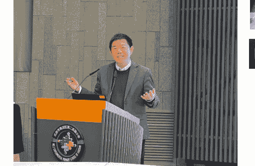

#### 这是一张胸部X光照片，请帮我分析一下是否正常？

这张图片显示了一个人的肺部和心脏。从图片上看，肺部的纹理清晰，没有明显的异常肿块或阴影，心影也没有扩大，因此初步判断这个人的肺部和心脏是正常的。然而，注意的是，这只是一张单一的X光，不能完全代表一个人的健康状况。此外，医学诊断需要综合考虑病史、症状和其他检查结果，任何关于健康问题的疑虑都应该咨询医生或其他医疗专业人士。

#### 和我想聊，缓解你的学..

最近不想上学，我觉得老师不教我。我们再来看“老师不喜欢我”这个核心信念。有什么证据能证明老师不喜欢你呢？老师的行为可能有其他解释呢？是不是你对老师的某些行为误解了呢？有啊，老师总是批评我，同样的事情，别人只说我！我才没有过这个。那之前有没有没有过老师排斥你呢？或者没有哪次老师对你的关心明显的事呢？想起来了。那我们换个角度来看，“老师总是批评我”可以转化为“老师对我的关注很多，我可以我能做得更好。我可以借此机会反思自己的行为，为之改正，同时也可以找机会和老师沟通，了解对我的具体看法和期望。我来帮你重新表达一下：虽然现在老师好！

#### 智能体和数字人

#### 机器人

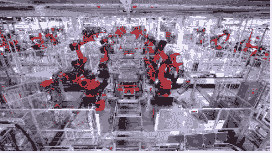

特斯拉工厂
京东亚洲一号无人仓
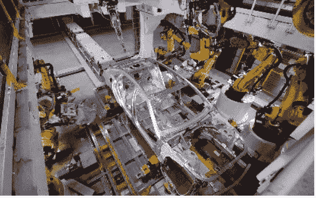(15_3.png)

上海通用工厂
老干妈

#### 未来十年对我们生活影响最大的三类机器人

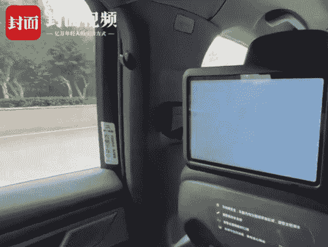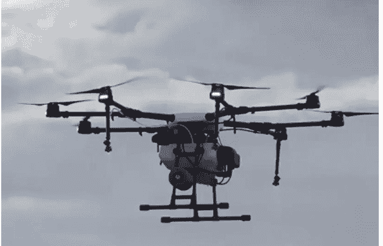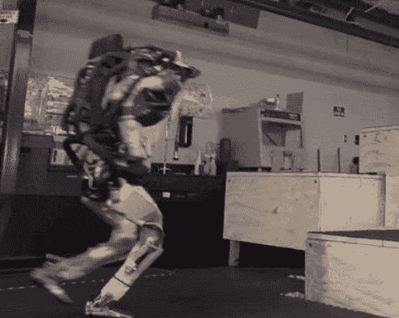

无人机
人形机器人

## 二、人工智能的概念和历史发展

### (一) 人工智能的概念

#### 人工智能的诞生

- 1950年，计算机科学之父、人工智能之父图灵提出了设想：机器真的思考吗？
- 1956年，麦卡锡、明斯基以及香农人在达特茅会议上提出了人工智能（Artificial Intelligence, 简称AI）。(img/ab52880f95785b609dfc340ced9662b7.png)

#### 人工智能智能定义

探究人类活动的机理和规律，受人脑启发的人工智能研究如何让机器去完成以往需要人类智力的工作，形成人工智能的基本理论、方法和技术，构建系统能够像人类一样思考和行动，并进一步提升智能。简单地让机器拥有像人类一样或超过人类。

#### 人工智能三大派

- 符号主义学派：这是一种基于符号表达和数学逻辑的方法。代表事件：1997年IBM的深蓝战胜国际象棋高手。(img/ab52880f95785b609dfc340ced9662b7_21_0.png)
- 联结主义学派：这是一种基于神经网络间的连接机制与学习算法。代表事件：2016年AlphaGo在围棋比赛中战胜李世。(img/ab52880f95785b609dfc340ced9662b7_21_1.png)
- 行为主义学派：这是一种基于“感知——行动”的方法。代表事件：波士顿动力推出的Atlas机器人。(img/ab52880f95785b609dfc340ced9662b7_21_2.png)

## 人工智能、机器学习和深度学习

- 人工智能是指让机器像人类一样或超过人类的智能。
- 机器学习是一种人工智能的算法或方法。
- 智能的核心是学习，机器学习脱胎信号处理领域的模式识别，尤其是图像识别问题。
- 机器学习算法主要用来发现规律、做出预测，解决的是如何从数据中发现知识。
- 深度学习是一种基于神经网络实现机器学习的算法或方法。

| 人工智能 | 机器学习 | 深度学习 |
| :--- | :--- | :--- |
| ...... | ...... | ...... |

### 深度学习：基于深度神经网络的机器学习方法

深度学习（DL, Deep Learning）是一种基于深度神经网络的机器学习方法，构成神经网络的基本单元是人工神经元，并采用了分层的网络方式和感知机算法，也被称为深度机器学习。(img/ab52880f95785b609dfc340ced9662b7_23_0.png)(img/ab52880f95785b609dfc340ced9662b7_23_1.png)

### 大模型及其相关概念

#### 大模型 (Large Model, 简称LM, 也称基础模型)
是指具有大参数和复杂计算结构的机器学习模型。这些模型通常由深度神经网络构建而成，拥有数十亿甚至千亿参数。能够处理海量数据、完成各种复杂的任务，如自然语言处理、计算机视觉、语音识别等。

#### 大语言模型 (Large Language Model, 简称LLM)
通常是具有大规模参数和计算能力的自然语言处理模型，例如OpenAI的GPT-4模型。这些模型可以通过大量的数据和参数进行训练，以生成人类相似的文本或回答自然语言的问题。

### (二) 生成式人工智能

AIGC其实是人工智能由量变引起质变的结果。(img/ab52880f95785b609dfc340ced9662b7_26_0.png)

#### ChatGPT为什么突然吸引人?

- 微软小冰 VS ChatGPT
- ELIZA VS 谷歌Siri
更真实、更准确、完整！

#### ChatGPT技术上的“独到之处”

Transformer模型的低层和中层存储了词性、句法等知识，中高层则广泛存储了抽象语义类、事实类知识；其中，模型的总参数数量高达1750亿。
- ChatGPT模型的训练分为三阶段：
- 采用带有标准答案的人工标注高质量问题初步训练；
- 标注员对模型生成的多个答案的喜好程度进行排序打分；
- 结合强化学习策略进一步训练生成高质量答案的能力。

人类大脑神经细胞约60亿

#### Transformer 模型

Transformer模型是一种基于注意力机制（attention mechanism）的深度学习模型，广泛应用于自然语言处理（NLP）任务中。它由编码器（Encoder）和解码器（Decoder）组成，通过自注意力机制来捕获输入序列中不同位置之间的关系，从而处理序列数据。(img/ab52880f95785b609dfc340ced9662b7_32_0.png)

#### GPT-4发布（2023.3.14）

#### GPT-4发布，能击败90%的人类
2023-03-15 18:36:00 来源：人工智能学家

- 在美国律师执照系统模拟中，GPT-4得分约前10%——击败了90%人类，而ChatGPT背后的GPT-3.5得分约倒数10%；
- 生物奥林匹克竞赛，GPT-3.5能达到后31%水平分位，GPT-4可达到前1%水平分位；
- GRE、SAT考试成绩中，也有大幅提升，击败了80%以上的人类答题水平，
- 医学知识自测考试准确率达75%。img/ab52880f95785b609dfc340ced9662b7_33_0.png)

#### GPT-4 Turbo (2023.11)

短短45分钟发布会，OpenAI 如何让AI圈一夜眠。(img/ab52880f95785b609dfc340ced9662b7_34_0.png)

#### Sora—人工智能文生视频大模型(2024.2.15)

- 基于简单的文本生成60s的视频
- 可以深度模拟真实世界；
- 标志着人工智能在理解真实场景并与之交互方面实现飞跃。

#### GPT-4o (2024.5.13)

- GPT-4o是OpenAI推出的全新语言模型，名称中的“o”代表Omni（全能），凸显其多功能特性。
- 多模态输入，支持文本、音频和视觉输入。
- 响应时间短：可以短至232毫秒，与人类响应时间相近。
- 具有广泛的应用潜力，包括自然语言处理、机器翻译、问答系统、聊天机器人、内容创作与辅助等多个领域。


#### OpenAI 发布新产品 (2024-12)

- D1 完整的o1;
- D2 强化微调(RFT) 技术，提升推理能力;
- D3 开放Sora;
- D4 开放长篇编程Canvas;
- D5 苹果助手;
- D6 支持屏幕共享的“视频通话";
- D7 分类整理文件和对话Projects;
- D8 开放搜索功能
- D9 通过 API推出o1，推出GPT-4omni
- D10 通过电话提供ChatGPT服务
- D11 扩大ChatGPT与桌面软件的集成服务
- D12 预告了o3和o3-mini


https://m.163.com/dy/article/JJU5JFTR05567030U.html

#### DeepSeek来来了 (2025-2)

#### 特朗普称DeepSeek给美企敲警钟

中国证券简报 2025-01-28 12:11

#### 多家科技巨头宣布接入，世界对DeepSeek的惊恐仍在持续

环网 2025-02-05 07:07 北京

【环球时报援美国、德国特约记者亚米尼亚 青树 柳梅文】春前夕，中国人工智能（AI）企业深度索（DeepSeek）发布其开源模型DeepSeek-R1，用极低的成本达到了接近美国人工智能研究中心（OpenAI）开发的GPT-o1模型的性能。短短几天后，DeepSeek便登顶区域应用市场热门榜单，涵盖了华为、微软在内的科技巨头宣布接入DeepSeek模型。美国总统特朗普首次对美国人工智能智能行业“敲警钟”。对于DeepSeek的横空出世，西方方面一方面猜测其在美国严格限制芯片输出的情况下是如何实现的，另一方面在直言这是人工智能的普斯尼奇奇时刻”。英国《卫报》称，DeepSeek并非某一家在美禁止其先进技术产品涌入中国的情况下独立创立的公司。中国国际基金和和平基金联合研究员王希希望认为“如果DeepSeek为我


上线仅20天访问2000万 数据来源：AI网站（Web）

| | DAU (万) | | | | | |
|---|---|---|---|---|---|---|
| 2,200 | | | | | | |
| 2,000 | | | | | | |
| 1,600 | | | | | | |
| 1,400 | | | 1,493 | | | |
| 1,200 | | | | | | |
| 1,000 | | | | | | |
| 800 | | | | | | |
| 600 | | | | | | |
| 400 | | | | | | |
| 200 | | | | 154 | | |
| | | | | | | 应用(APP)上线第 N 天

#### DeepSeek优势

基础能力：进入推理模型阶段

- 推理能力跃升
- 国际竞争力进入第一梯队

核心加分项：开源、低成本、国产化

- 开源：技术共享、生态共建
- 低成本：普惠企业级AI应用
- 国产化：技术自主、缩短差距

DeepSeek以“推理能力+第一梯队性能”为核心基础，叠加开源开放、超低成本、国产自主研发三大优势，不仅实现技术代际跨越，更推动AI技术普惠与国产化生态繁荣，成为全球模型赛道的要领跑者。


奢赛AI团队，2025

#### 生成模型和推理模型的区别

| 比较项 | OpenAI GPT-4o (生成模型) | OpenAI o1 (推理模型) |
|---|---|---|
| 模型定位 | 专注于通用语言处理和多模态能力，适合日常对话、生成、翻译以及图像、音频、视频等信息处理，生成、对话等等。 | 侧重于解决复杂推理和逻辑能力，擅长数学、编程和自然语言任务执行，适合高难度问题解决和专业领域应用。是在生成模型的基础上通过RL方法强化CoT能力来 |
| 推理能力 | 在日常推理任务中表现均衡，但在复杂逻辑推理（如数学题求解）上准确率较高。 | 在复杂推理任务中表现卓越，尤其擅长数学和代码等推理任务。 |
| 多模态支持 | 支持文本、图像、音频到视频输入，可处理多种模态信息。 | 当前主要支持文本输入，不包含图像处理等多模态能力。 |
| 应用场景 | 适合泛通用任务，如对话、内容生成、多模态信息处理以及多种语言翻译和交流；面向大众和商业应用。 | 适合需要高精度推理和逻辑分析的专业任务，如数学竞赛、问题解决和科学研究；在场景中有明显优势。 |
| 用户交互 | 提供流畅的实时交互，支持多种输入模式；界面友好，适合大众使用。 | 自助式思考，不需要指令，整体节奏较慢。 |
| 特点 | 普通模型是玩知识和文字的，会有幻觉。 | 推理模型不是万能的，很多时候需要增强，还是传统的生成模型好。 |

肖睿 AI团队

#### Manus来了 (2025.3)

#### Conservation of Momentum Interactive animations for middle school physics

- Basic Collision
- Elastic Collisions
- Inelastic Collisions
- Explosions
- Real-World Examples

| Real-World Applications |
|---|
| Car 1 (1500 kg): p = 7500 kg/s |
| Car 2 (1000 kg): p = -2000 kg/s |
| Total momentum = 5500 kg/s |

| Billiards | Rocket Propulsion | Ice Skaters | Car Collision |
| Animation Speed: | Play | Reset |

提示词：我一名中学老师，准备教授动量守恒。您能否创建一个一系列准确的演示，并将它们整理成一个简单的HTML？


https://mp.weixin.qq.com/s/P47F8KESPRdd0cnKh

### (三)人工智能的发展和未来

#### 人工智能的三次浪潮

- 2016 AlphaGo
- 2013以后深蓝
- 2006 深度学习的兴起
- 1990年代机器学习 / 神经网络的兴起
- 1956 人工智能提出
- 1987-1993年第二个AI冬天
- 1970-1980年代第一个AI冬天
- 1950 图灵测试
- 1966 Eliza

逻辑推理 | 专家系统 | 机器学习/深度学习

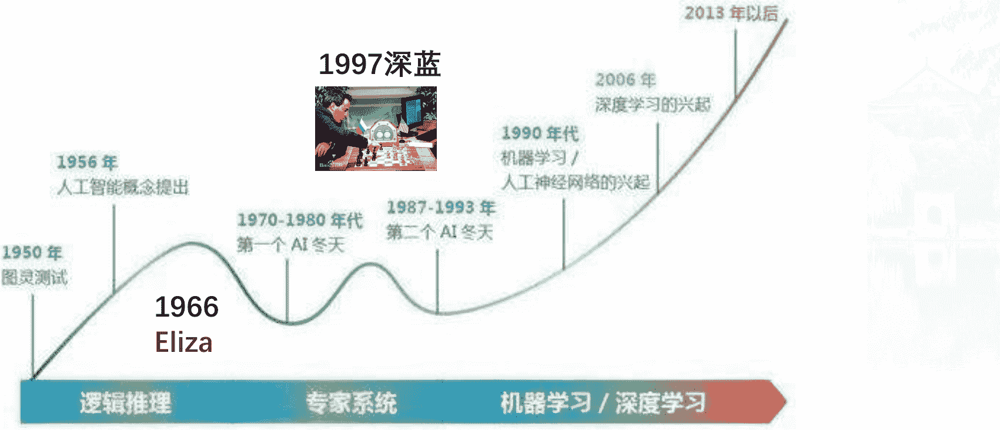

#### 天啊，人类要灭了！

天啊，人类要灭了！

天啊，人类要灭了！


骗子！

骗子！


李开复，王咏刚。《人工智能》。北京：文化出版社，2017：42。

#### 弱人工智能、强人工智能、超人工智能

#### 弱人工智能

也称为专用人工智能，指的是这类程序的智能主要体现在一个特定领域，如下棋。

#### 强人工智能

也称为通用人工智能，指的是可以胜任人类工作的智能。

#### 超人工智能

超人工智能，指的是人工智能的智能水平已经超过了人类最聪明的大脑，它几乎可以解决任何复杂的问题。

#### 人工智能未来发展

- 1958年，被誉为“计算机之父”的冯·诺伊曼在数学家乌拉姆谈论技术变化时使用了“奇点”一词。
- 美国未来学家雷蒙德·库兹韦尔提出过人工智能奇点理论，该理论预言：在2045年计算机的智能将超越人类智能。


#### OpenAI五级AGI路线图

- 第五级 组织者，可以完成组织工作的人智能
- 第四级 创新者，可协助发明创新的人智能
- 第三级 智能行动者，可以自动采取行动的系统
- 第二级 推理者，达到人类博士水平的解决问题水平
- 第一级 聊天机器人，具有对话功能的人智能

https://developer.baidu.com/article/details/3321696

# 三、人工智能对人类社会的影响？

> 人工太可怕了，人类必须马上对人工智能技术加强监管。
——马斯克

## 谷歌、苹果、微软都急了！ChatGPT会让你失业吗？

2023年02月08日 17:12 来源: 中国新闻网

中新网 网易首页 > 网易号 > 正文

## 螺特快跑被投诉，司机们饭碗难保？

2024-07-02 12:48 来源: 智选

“狂飙”破产人们承担它连谷哥

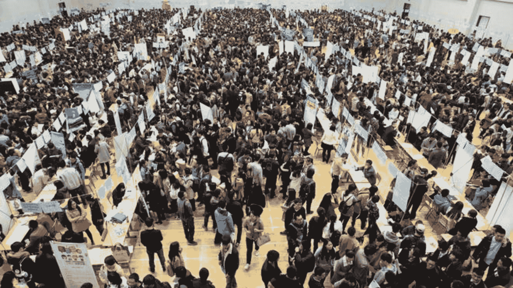

## 特斯拉工厂

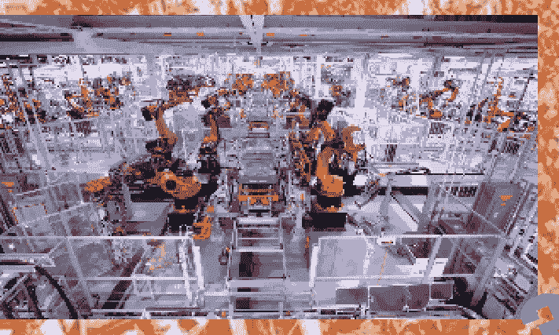


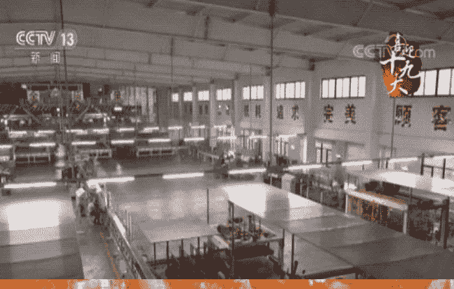

## 通用人工智能老干妈

## 第一批AI失业的人已经出现

2023-04-05 消息，随着人工智能的发展，AI绘画越来越强大。这对于行业来说，是一个提高效率和降低成本的机会，但对于工人来说，这可能意味着失业潮将到来。AI绘画带来的冲击不是一句“学会”就能解决的，它是“未来”。

上个月，外媒曾报道有一篇用AI绘画的新闻，说是当时有一位游戏设计师参加了比赛，其他人都是手画，结果选用AI工具生成图片，然后挑选出最好的。


## 蔡昉：这一次和以前不一样

与过往技术进步带来反复出现的“技术性失业”相比，人工智能对就业的影响可能不一样，未来通用人工智能(AGI)的出现对就业的冲击可能是全方位的。

建议：首先是加强中国式福利国家，其次，大幅延长义务年限，最后，消除基本公共服务方面存在的制度性障碍。

## 比尔·盖茨：计算机领域将在5内迈向下一个互联网

- 在不久的将来，任何上网的人都将由人工智能驱动的个人助手，远远超越今天的技术水平。这些代理能够帮助任何活动和生活领域。这对软件业的影响将是深远的。因为你将永远不再搜索网站，你永远不去亚马逊。
- 代理不仅将改变每个人与计算机交互的方式。还将频繁覆软件行业，带来从键盘输入命令到点击图标以来的领域最大的革命。
- 在接下来的几年里，它们将彻底改变我们的生活方式，无论线上还是线下。


## 人工智能创造美好生活？


## 奥特曼 (Altman):万物摩尔定律

- Sam Altman认为，未来五年内（文章发表于2021年，也就是2026年之前），AI将能够思考，能胜任律师和医生的岗位；未来十年内，机器人将能从事流水线工作。接下来的十年，AI和机器人将能做任何事情，甚至包括自己做出新的科学发现。
- 绝大多数商品和服务的价格将每两年下降一半。

Moore's Law for Everything
by Sam Altman · March 16, 2021

My work at OpenAI reminds me every day about the magnitude of the socioeconomic change that is coming sooner than most people believe. Software that can think and learn will do more and more of the work that people now do. Even power will shift from labor to capital. If public policy doesn't adapt accordingly, most people will end up worse off than they are.

```
https://baijiahao.baidu.com/s?id=1760403630363754519&wfr=spider&for=pc
```

# 四、人工智能对教育领域的影响

## 生成式人工智能对教育

#### 深层影响


#### 通用人工智能


#### 深层影响


#### 深层影响


#### 创新人才


#### 创新人才


#### 卓越学习

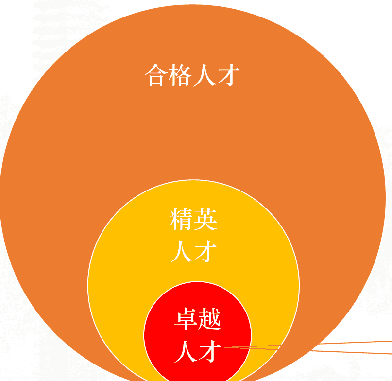


#### 深层影响


#### AI+化学

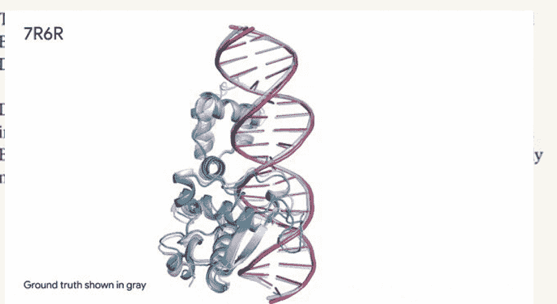

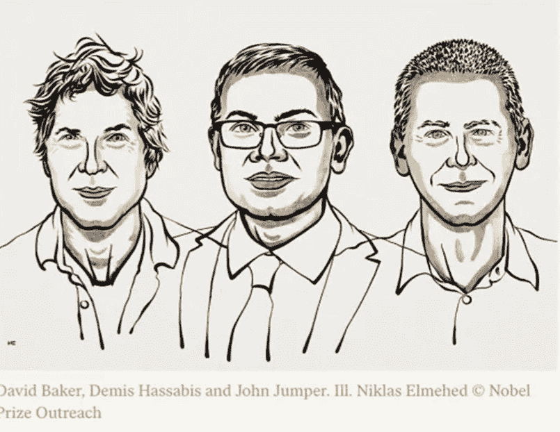

#### 科学研究的初心


# 五、人工智能在教育领域的价值

## 杨宗凯:ChatGPT对教育会产生什么影响？

- 1. 促进教学模式的转变，适应教育数字化、数字教育的转型，从传统“师—生”二元结构转向“师—生—机”三元结构。将更加加强能力为重、价值为先”。
- 2. 加速现行考核体系的转变，逐步从知识测评转向“知识+素养”测评。
- 3. 推进现有智能教育应用生态的转变，从孤立、专用的教育应用转变为连接、共享、智能的教育平台。


## 李政涛: ChatGPT带来教育五个机遇

- 第一，这是一次重构人与机器关系的机遇
- 第二，这是一次推动人类自我进化的机遇
- 第三，这是一次打破替代思维、走向共生思维的机遇
- 第四，这是一次理解人师存在价值的机遇
- 第五，这是一次促进教师能力重塑的机遇

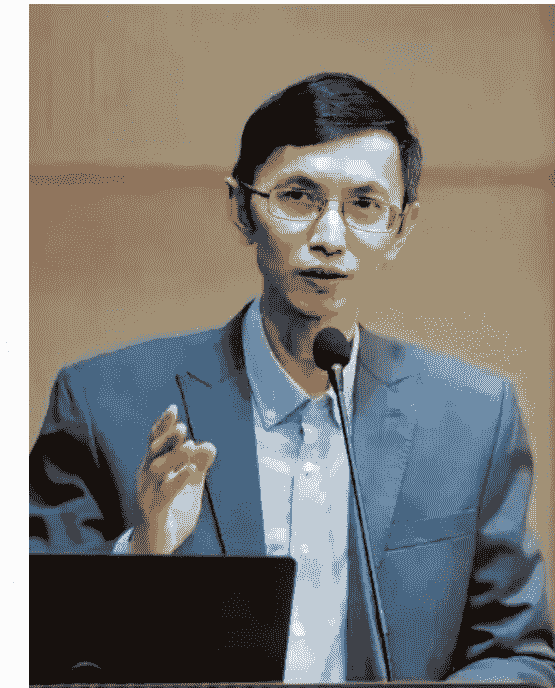

https://mp.weixin.qq.com/s/AICdP6nRIADzcMRTf6NLIQ

## 尚俊杰 等：人工智能教育应用的价值


尚俊杰等。走进学习科学——教师学习科学理论手册[M]。北京:机械工业出版社，2023

## 1. 学习走向个性化

### 布鲁姆:个性化学习的重要性

FIGURE 1. Achievement distribution for students under conventional, mastery learning, and tutorial instruction.

#### The 2 Sigma Problem: The Search for Methods of Group Instruction as Effective as One-to-One Tutoring

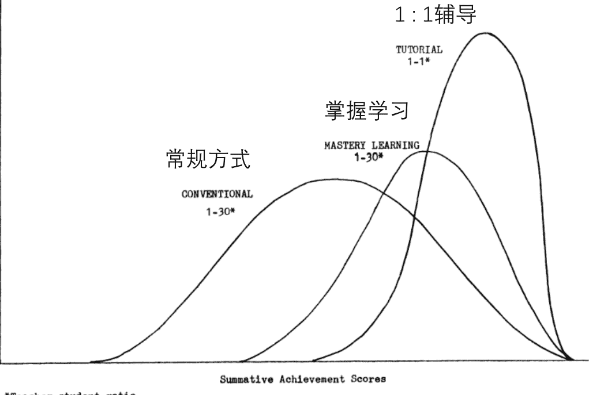

Bloom, B. S. (1984). The 2 Sigma Problem: The Search for Methods of Group Instruction as Effective as One-to-One Tutoring. Educational Researcher, 13(6), 4–16. https://doi.org/10.2307/1175554


#### 案例：学习英文单词

提示语：我是初中三年级学生，我希望你能够帮助我复习初中英文单词，每次您讲5个中文单词，不要同时给出英文，我来翻译成英文单词。如果我翻译的正确的，咱们就继续，如果我翻译的有错误，就请您帮我纠正后再继续。

当然，我很乐意帮助你复习英文单词。以下是我为你准备的5个中文单词，请将它们翻译成英文：

1. 图书
2. 音乐会
3. 字典
4. 自信的
5. 杂志

你的回答大部分是正确的，只有一个单词翻译得不准确。让我们一来看：

1. 图书 - library (正确)
2. 音乐会 - concert (你写的“music”太宽了，“音乐会”特指一场音乐表演活动，所以用更准确的翻译是“concert”)
3. 字典 - dictionary (正确)
4. 自信 - confident (正确)
5. 杂志 - magazine (你写的“publication”指的是出版或出版，范围较宽，而“杂志”特指一种期刊，所以更准确的翻译是“magazine”)

继续加油！现在，请再试一次音乐会和杂志的翻译：

2. 音乐会
3. 杂志

#### 如何才能实现个性化自适应学习？


如何促进练习成效呢？以解应用题为例，学生解答完以后，逐步反馈和分析各步步骤。——梅耶

#### 辅助回答问题

你好，我是九章模型，作为你的数字智能伙伴，我会帮你解决数学学习各方面的问题

换一换 全部助手

- 题目推荐助手：请输入一个数学题目，我们将为你生成相似...
- 数学故事助手：请输入一个数学知识点，我们将为你讲述...
- 题目翻译助手：请输入一个数学题目，我们将为你进行翻译...

小学示例
初中示例
高中示例

粉糖盒里有10包白糖、2包红粉糖，现问同学随机摸一包辣椒粉，她拿到的粉糖可能是____粉糖，也可能是____粉，其中____粉的概率较小的是。

市场调查：某地苹果价格高，购买的人较少；价格低，购买的人较多。现有数据，每苹果售价为2元，则可以购买10万个，每苹果推测为0.2元，发行量少于5000，销量受哪些因素影响？

处理方法
集合为，A={x|x-1<x<2a}，B={x|y=\frac{x-3}{\sqrt{x}}}
(1)若a=4，A∩B为____
(2)若“x=e”是B的____条件，求____条件

小明在计算除法时出错，把63除成了36。得到的答案是18余8，正确的答案应该是____是____。

已知函数f(x)=f(x+1)的关于直线x=____对称称，且由f(0)=8，f(x)=-x+ln(1-x) a=f(-____)，b=f(\frac{2^{ax}}{1-x^{2b}})，则a,b的关系为____一个整数以2除，如果有余数，最多是____。请输入内容，可以通过shift+回车

#### 个性化辅导

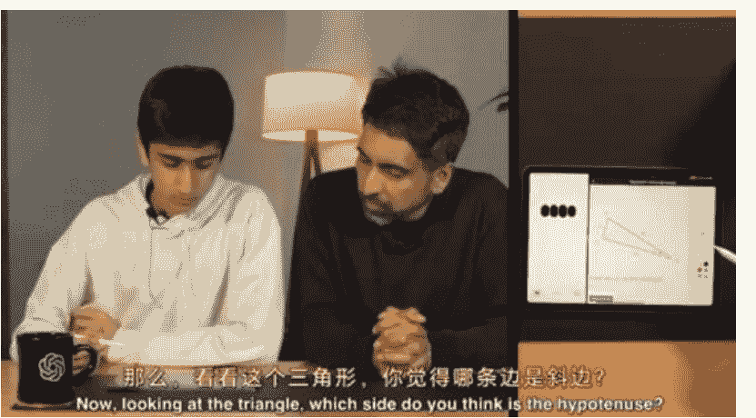

- GPT-4o是AI推出的全新语言模型，名称中的“o”代表Omni（全能），凸显其功能。
- 多模态输入，支持文本、音频和视觉。
- 响应时间：可以短至232毫秒，与人类响应相近。
- 具有广泛的应用，包括自然语言处理、机器翻译问答系统、聊天机器人、内容创作等领域。
- GPT-4o的推出，标志着人工智能领域向前迈了一步。那么，看着这个三角形，你觉得哪边是直角边？

#### 辅助实现苏拉底教学


采用“苏拉底教学法”，通过讨论、问答甚至辩论的方式来引导学生学习，实现“即时反馈”。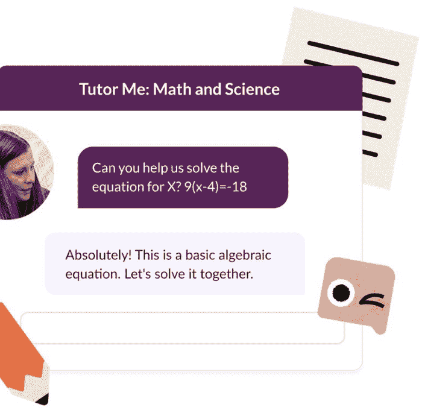

Khanmigo 利用人工智能和大数据技术，对海量学习过程进行分析，适当结合小班教学等形式，可能是迈向个性化自适应学习的“唯一选择”。

## 2. 教学迈向智能化

### 赋能教学

课前：
- 查找资源
- 教学设计
- 设计课件

课中：
- 沉浸教学
- 全员互动
- 即时评价

课后：
- 批改作业
- 数据分析
- 个别指导

#### 辅助生成动画

- 给一张历史图片，AI可以让图片动起来

#### 辅助生成教学软件

提示词：我准备用游戏化学习的方式给学生讲授顿第一定律，请帮我生成一个合适的的游戏，请用HTML格式输出。
对话：我准备用游戏化学习的方式给学生讲授顿第一定律，请帮我生成一个合适的的游戏，请用HTML格式输出

#### 辅助生成教学实验

- 算法将静态的概念图变成交互的动画，如可视化实验等，帮助学生学运动学、光学、电磁学、牛顿引力、声学和热力学等知识。
- 该研究为人机交互顶会(UIST2024)最佳论文奖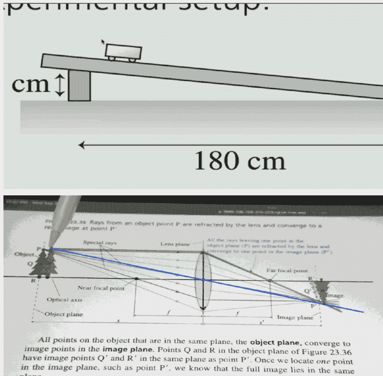

#### 辅助设计图表

#### 根据文字快速生成图表

#### 认知负荷的测量

任务绩效方法：一种直接的认知和负荷的方法，也就是通过完成学习活动活动任务的最终表现来评估其对学习者增加的认知负荷多少，有主任务和双任务，主的是双任务。
任务测量方法：学习学习者需要在短的时间内完成两个需要相同认知和资源的任务，即一个主任务（投入主要精力）和一个次要任务（投入剩余精力）。这样一来，学习者就需要将有限的认知和资源在两个任务中进行分配；然而这时就可以根据学习者在两个任务中的成就来对认知负荷大小进行合理评估。

https://Napkin.ai

#### 辅助教师生成教学设计

我是一名学院的教师，讲授生理理学课程，希望将VR和AR应用到人体系统教学中，我应该如何设计教学课程呢？
作为一名学院教师，将VR和AR技术应用于生理学课程教学中，可以为学生提供直观、生动的体验。以下是针对目标的设计：

- 利用VR技术展示人体结构及功能。通过VR眼镜，学生可以看到血流、器官、骨骼等细节，并了解它们是如何工作的。
- 利用AR技术实现实时互动，增加趣味性。AR技术可以将虚拟元素与现实场景结合，增加趣味。
- 设计多种互动教学方法，让学生积极参与。通过小组讨论、角色扮演、互动游戏等。
- 引出教学重点并引导学生理解。在教学过程中突出重点和难点，通过图表和视频等形式展示原理和作用。
- 合理安排教学时间，确保教学有效。按照以下步骤：
  (1) 课前发布资料，让学生有准备；
  (2) 课上讲解重点，引导学生对知识进行探讨；
  (3) 课后及时解答学生的疑惑。总之，通过VR和AR技术应用到课程中，可以提高教学效果和理解能力。上述设计可以让学生积极参与。

#### 辅助生成PPT

我准备制作一份介绍清明节的PPT，请我生成一个草稿

- 青团的由来
- 清明节传统
- 各地清明习俗
- 清明诗的历史渊源
- 名家笔下的景致

#### 辅助教师提问

使用讯飞星，上传一篇教学设计《古诗二首（登高）》。这是我写的一份教学设计，准备去上课，我想在课堂上提问几个问题，以培养学生的批判性思维、创造性思维等，请帮我设计几个问题？

可以，根据您提供的教学设计，这是关于登高的教学，我可以为您设计一些旨在培养批判性思维和创造性思维的问题。以下是一些建议：

1. 批判性思维问题：
- 诗人在诗中提到“日出依山”，你认为这描述的是一天什么时候？为什么？
- 诗中说“黄河入海”，但登高并不下海，诗人为什么写他？他的用意是什么？
- “欲穷上层楼”这句话给你什么启发？现实生活中没有类似的例子来说这个观点？

2. 创造性思维问题：
- 如果你来描写这首诗，你会如何描述诗人登上层楼看到的景象？
- 假设登高是一只小鸟，你如何向其他小鸟描述你看到的景色？
- 你能想象登高非常高，高到可以触摸云，那么在上面你会看到什么，感受到什么？请尽量详细描述。

这些问题不仅能引导学生思考内容，还能激发他们的想象力和创造力，同时也帮助他们从不同角度审视问题的能力，分享他们独特的见解和想法。体验更多完整功能，请使用。

#### 数字人辅助讲


真人版
数字人版

矢量智能——“智课”系统

#### 辅助讲课: Brainiac Buddy AI助教

北京大学董老师推出。基于GPT-4的AI交互程序的产物。北大数学课，启用AI助教。时间:2023-10-26 来源：这门北大数学课，学生和老师竟然都在用AI“摸鱼”？！不仅如此，老师还是主动推荐使用，方便老师掌握进度。原来，这是一位北大数学老师专门构建并落地的AI助教，不仅仅当学生的课后助理，还能当老师的贴心秘书。

哦天吧！对学生来说，学校的冗长看着没错，直线就能掌握重点，正好吃饭哪到哪里。对老师来说，一扔、一拉、一推、一搜3步就把自己的课程录录给AI助教，省去了对学生撞问答反复口舌的时间。因为用此工具，这个AI助教被北大大学选了一本教科书并签名了。


#### 人工智能会替代教师吗？


#### 人机协同打造“超级教师”

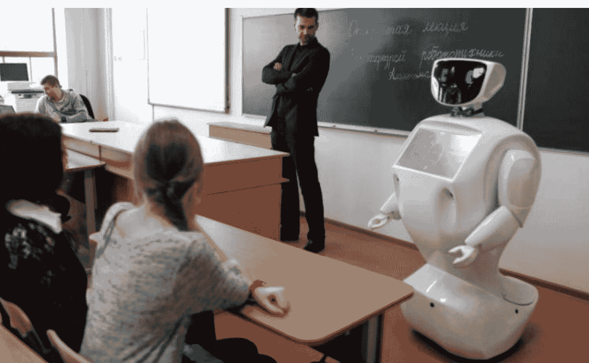

## 3. 评价进入多元化

### 人工智能支持下的评价

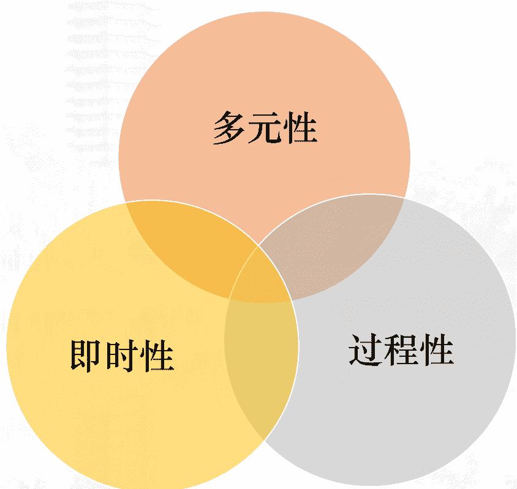

- 多元性
- 即时性
- 过程性
- 促进学习的评价

### 对表情进行分析示例

这是几个学生在上课的照片，您从他们的表情中能分析出什么东西吗？


从这张学生在上课的照片里，我们可以通过他们的表情来推测一些可能的心理状态和情感。首先，前面的女孩带微笑，看起来非常自然且愉快。她的微笑可能可能是对镜头的反应，也可能是她对学习的热爱和对课堂的享受。她的眼睛看向镜头，仿佛在与观众分享她的快乐和学习体验。这种表情表明她可能是一个开朗、自信、乐观的孩子，能够积极参与课堂活动，享受学习的乐趣。

旁边的男孩也笑着，他的笑容同样自然，双手交叉放在桌子上，表现出一种自信和放松的态度。这种姿态表明他可能是一个沉稳、懂的孩子，能够十分听懂，自信表达自己的观点。

在背景中的第三个学生虽然露出了部分身体，但也能看到她在微微微笑。这显示出整个班级可能都弥漫着一种积极的氛围，每个学生都沉浸在学习的快乐中。

综合来看，从几个学生的表情中，我们可以感受到他们对学习的热情和对课堂活动的享受。这也可能反映出教师营造了一个积极、和谐的学习氛围，让学生能够愉快地学习、交流和成长。这样的学习环境对于提高学生的学习效果和培养积极的学习的态度非常重要。

### 案例：课堂表情分析促教学评价

- 杭州第十一中学试行“智慧课堂行为管理系统”，通过教室内安装组合摄像头，捕捉学生在课堂上的表情和动作，经大数据分析计算出课堂上学生的专注度，从而促进教学改进。


### 案例：普渡大学的“课堂信号系统”

- 核心算法为“学习者成功算法”（Student success algorithm, SSA）
- 课程表现；课程努力程度；前期学习历史；学习者特征


## 4. 管理逐渐科学化

### 利用人工智能提升管理效率、促进智能决策

- 快速完成大量的事务性工作如生成通知、规章制度等。
- 辅助管理者决策，进行全方位对比分析。

### 刷脸门禁和刷脸吃饭


### 利用生成式人工智能完成事务性工作

校长决定明天上午9:00举行一次全校教师大会，讨论如何应用人工智能能帮忙写一份会议通知。

请生成一份学校安全管理规定。

ChatGPT

**学校安全管理规定**

尊敬的全体教师：

一、总则

根据学校工作安排，明天上午9:00举行全校教师大会，讨论如何应用人工智能。本次大会是学校对新信息技术教育的重视和推进，也是对全校教师素质提高的考验。具体会议事项如下：
1.1 为保障学校师生的人身和财产安全，维护学校的正常教学秩序，特制定本规定。

会议主题：如何应用人工智能会议
时间：明天上午9:00
会议地点：XX会议室
会议议程：

1.2 本规定适用于所有在本校工作、学习和生活的人员，包括学生、教师、家长和访客等。

二、安全管理体系

2.1 学校要建立全面的安全管理体系，包括制定安全政策、设立安全管理机构、明确安全管理职责等。
2.2 学校要定期进行安全检查，及时发现和消除安全隐患，确保校园安全。

三、校园出入管理

3.1 学校实行严格的校园出入管理制度，对出校的人员进行登记和管理。

### 辅助决策：南京理工自动补助

- 自动分析学生在食堂的消费数据，并根据消费情况甄别贫困生，自动充值饭卡。
- 据报道，南京理工大学通过数据分析，每月在食堂吃饭超过60顿，总消费不足420元的列为资助对象。
- 南京理工还采取直接补贴打入饭卡的方式，学生无需申请、审核。


### 辅助管理：武汉理工大学AI助理

- 建立校长-处长-院长“三级数据驾驶舱”，实现上下贯通、协同办公，学校问题提前预警、数据说话成为常态。

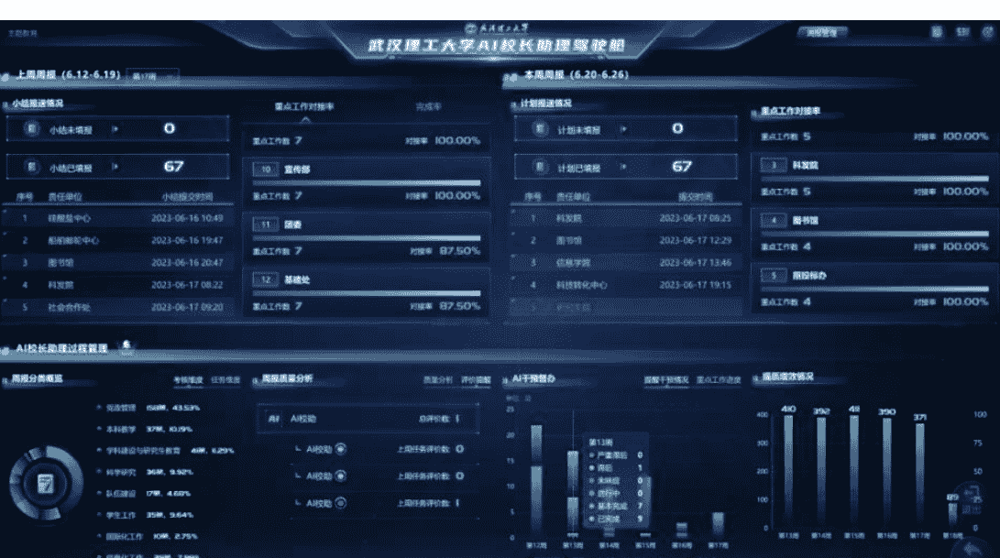

### 人工智能支持下的管理

- 看见的服务
- 看不见的管理

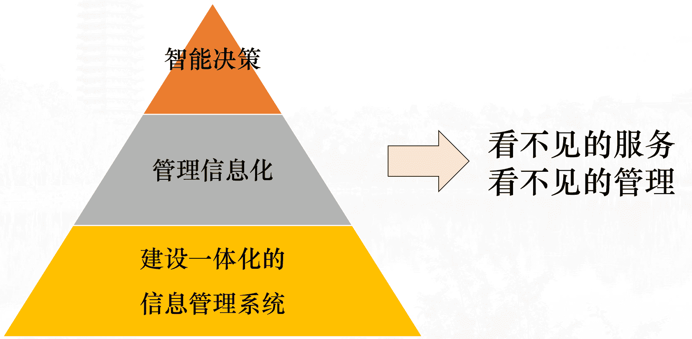

## 5. 资源趋于公平

### 怎样才能实现均衡？


### 医疗案例：利用机器人远程诊断

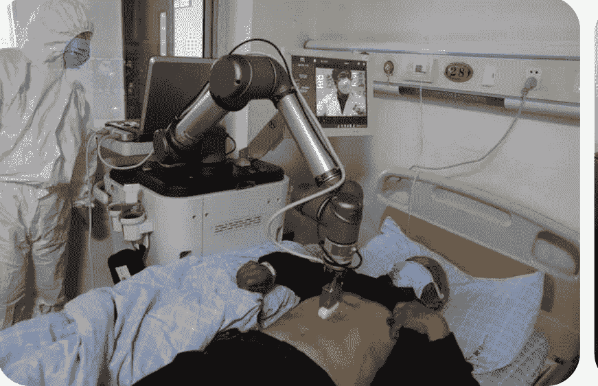

### 公平价值：未来教育可以变成这样？

小学生在写作业，旁边有一个机器人陪着他，可以帮他讲。


### 小结：生成式人工智能的三层价值

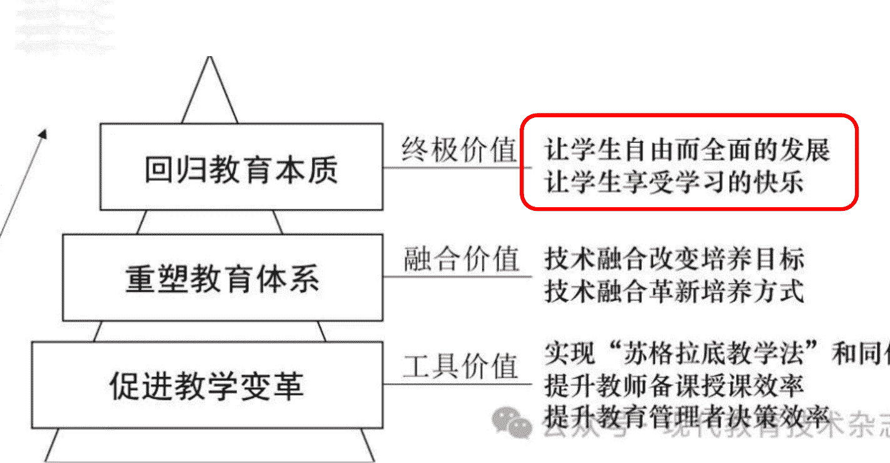

| 层次 | 价值类型 | 核心内容 |
| :--- | :--- | :--- |
| 终极价值 | 回归教育本质 | 让学生自由而全面的发展<br>让学生享受学习的快乐 |
| 逐层演进 | 融合价值 | 重塑教育体系<技术改变培养目标<br>技术变革培养方式 |
| 工具价值 | 促进教学改革 | 实现“苏格拉底教学法”和同伴学习<br>提升教师教学效率<br>提升教育管理者效率 |

张鹏、汪畅、尚俊杰。生成式人工智能与教育变革：价值与策略[J].现代教育技术，2024, 34(06):14-24。

## 六、人工智能赋能科学研究

### （一）基础应用

### 简单应用：辅助阅读文章

Trade-off or complement An exploratory study...

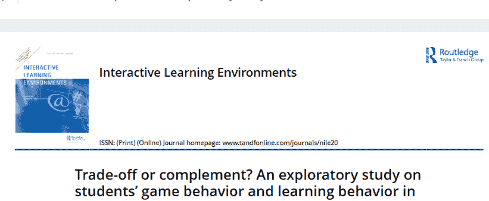

Trade-off or complement? An exploratory study on students' game behavior and learning behavior in a math spatial game

Junjie Zhang, Yuanyuan Zhang & Jieling Zeng

To cite this article: Junjie Zhang, Yuanyuan Zhang & Jieling Zeng (08 July 2024). Trade-off or complement? An exploratory study on students' game behavior and learning behavior in a math spatial game. Interactive Learning Environments. DOI: 10.1080/10489482.2024.236425

To link to this article: https://doi.org/10.1080/10489482.2024.236425

- View supplementary material
- Published online: 08 July 2024.
- Submit your article to this journal

| 总结 | 精读 | 翻译 | 脑图 |
| :--- | :--- | :--- | :--- |
| 提供即时反馈 | 提供增强动机的反馈 | 提供及时的反应 | |
| 教育游戏设计与反馈 | 教育游戏的设计与学习的策略 | 游戏的核心 | 游戏元素的互动性与学习行为的选择 |
| 游戏作为行为与学习行为的定义 | 游戏作为行为与学习行为的互动 | 研究目的 | 学生如何区分行为与学习行为之间的差异 |
| 差异的概念 | 学生在游戏中如何学习行为 | 学习行为在形式上有何差异？ | 研究设计 | 混合设计 | 北京小学四年级学生 |
| 参与者 | 参与者与数据处理 | 前期方法与数据收集 | 三阶段的实施过程 | 数据收集工具 | 教育游戏选择 |

### 单应用：辅助撰写研究设计

我一名大学英语系的教师，最近人工智能大模型非常热，我准备申请国家级课题，以此为主题写申请书。帮我想5个主题，并分别写出50字的摘要。

1. 人工智能在英语教学中的个性化学习路径设计
2. 基于人工智能的写作评分系统开发与应用
3. 人工智能辅助下的口语能力提升研究
4. AI驱动的英语听力理解方法探索
5. 人工智能与传统教学整合的效果评估

### 简单应用：辅助修改格式

张勇、汪畅、尚俊杰。生成式人工智能与教育变革：价值与策略[J].现代教育技术，2024, 34 (06): 14-24。请翻译为英文，改成APA格式。

Zhang, P., Wang, Y., & Shang, J. (2024). Generative artificial intelligence and educational transformation: Values, challenges, and strategies. Modern Educational Technology, 34(06), 14-24.

## （二）进阶应用

### 案例：心理学实验

让ChatGPT想象恐惧情境和快乐情境，观察ChatGPT在决策上的保守程度。结果表明，ChatGPT在恐惧情下表现得保守，而在快乐情境下倾向于冒险。

### 案例：教育实验

- 研究目的：生成式人工智能对人类创造力的影响，特别是对短小说创作的影响。
- 研究方法：通过在线实验(N=293)研究生成性AI创意是否被评价为更创造性、写作更出色，特别是在创造力较低中效果更为明显；
- 然而，基于生成性AI的故事相比纯人类创造的更为相似。
- 由此可见，个体创造力的提升可能随着集体的新颖性下降。这种现象类似于社会困境：借助生成性AI，个人受益更多，但整体来看，新内容的多样性却减少了。

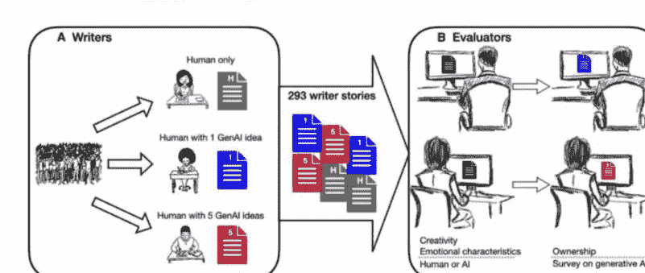

Doshi A R, Hauser O P. Generative AI enhances individual creativity but reduces the collective diversity of individual content[J]. Science Advances, 2024, 10(28):eadn65.

### 案例：模拟辩论对手

- Guo等人(2023)开发了一款论型聊天机器人Argamate,作为教学工具促进学生课堂论以提升辩证技能。

Argamate具备功能：
1. 主动提问
2. 提供正反方观点参考
3. 生成思维导图

结果表明，Argamate可以显著提高学习者的学习动机与任务兴趣，且学习效果与人类组无显著差异。


Guo, K., Zhong, Y., Li, D., & Chu, S. K. W. (2023). Effects of chatbot-assisted in-class debates on students’ argumentation skills and task motivation. Computers & Education, 203, 104862. https://doi.org/10.1016/j.compedu.2023.104862

### （三)高级应用

### 案例：模拟社会

- AgentSociety: 大规模社会模拟器
- 组成部分: LLM代理、真实社会环境与支持大规模交互的模拟引擎
- 生成了超过1万个代理的社会生活，模拟了它们之间以及代理与环境之间的500万次互动
- 推动了生成式社会科学的发展，预测和干预复态社会系统提供了一个强大的工具

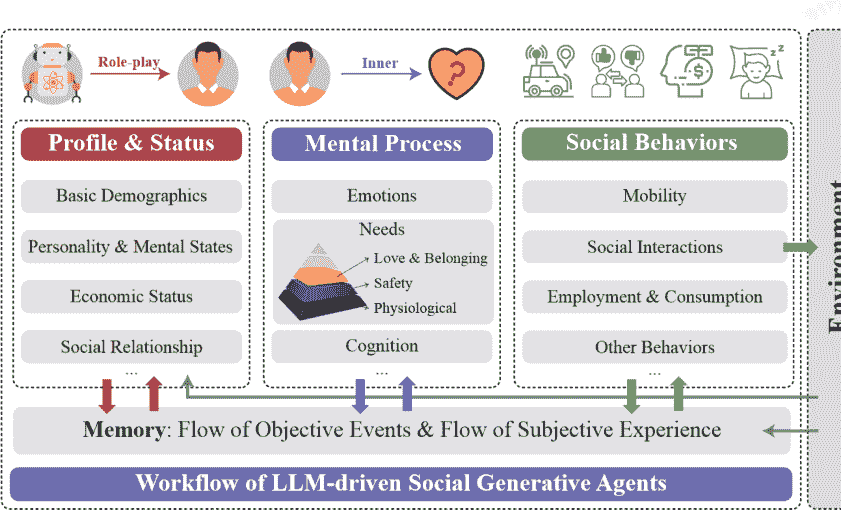

Piao J, Yan Y, Zhang J, et al. AgentSociety: Large-Scale Simulation of LLM-Driven Generative Agents Advances Understanding of Human Behaviors and Society[J]. arXiv preprint arXiv:2502.08691, 2025.

### 案例:模拟解决力学问题

- MechAgent: 力学代理
- 一组AI智能体可以通过自主协作解决力学任务，例如弹性问题。
- 多智能体团队：允许自主对话进行分工，扮演admin, planner, scientist, enginer和 critic。

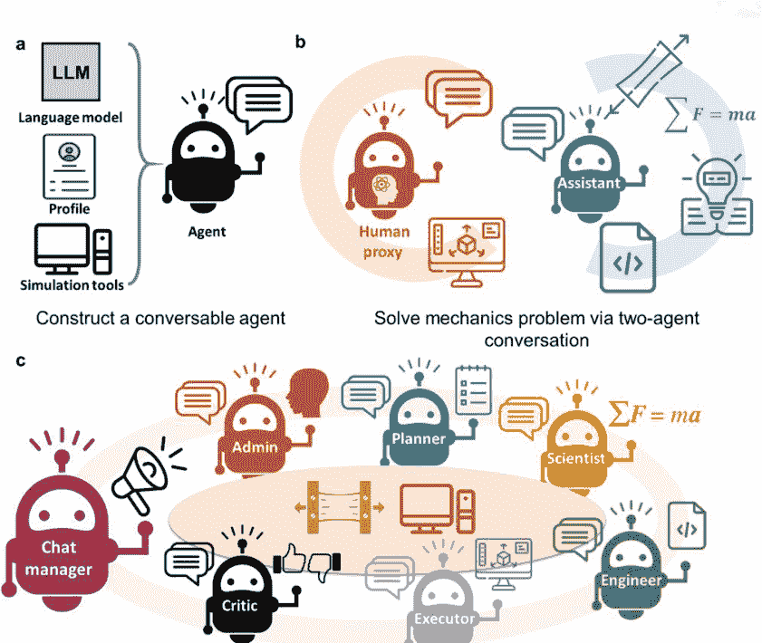

Ni B, Buehler M. J. MechAgents: Large language model multi-agent collaborations can solve mechanics problems, generate new data, and integrate knowledge[J]. Extreme Mechanics Letters, 2024, 67: 102131.

### 案例：交互式戏剧

- 全新的艺术创作类型
- 沉浸式与角色和场景互动，影响故事情节，推动叙事发展

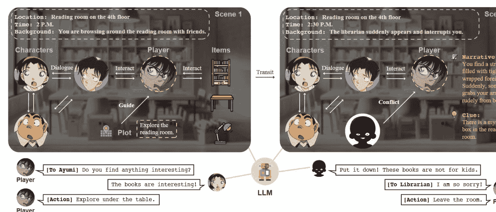


# 我们团队的研究

## 1、新快乐教育平台

NHE-GPT 新快乐教育 首页 课程学习 教育生成 分享交流


## 要闻

北大港港大青年翰学人——学习科学研究生交流活动顺利举办
北京大学生人工智能与教师发展研讨班（第1期）顺利举办

平台链接:http://www.nhegpt.cn/

## 新快乐教育平台-教案生成

学生信息

### 学情分析

学生人数

### 班级学生人数

### 相应的教学策略和方法

【学情分析】

学生水平差异

### 学生学习差异

- 首先，这是一个六年级的学生，处于基础教育阶段，简单来说，这个阶段的学生逻辑思维和抽象思维能力逐渐成熟，他们对于知识的吸收和理解能力加强，对具体事物的理解转向对抽象概念的理解。由于本次的课程内容是语文《国大典》，这正好可以触及他们的生活经验，激发他们的思考。通过这个课程，学生可以培养他们的语言表达能力，同时让他们对与环境的关系有理解。

- 一般。其次，这个班级有39名学生，为平均班的规模。

- 这意味着我们要设计出具有互动性和包含性的教学策略，确保所有学生都参与到课堂来。虽然学生规模更大，但这对我们提供了很多可能性，比如可以通过小组活动、角色扮演等方式，让学生能够积极参与到学习中，提升他们的学习能力。

###学习动力

### 学生学习动力

- 学生的知识水平，虽然有部分学生已经具备了先验的知识，但在业上的学习水平，学生之间的知识差异较小，这表明我们在教学设计计划的时候，需要更多地从零开始，对知识进行全面的介绍和建模，对于那些已经掌握了本节课程知识的学生，我们可以设计一些挑战性的任务，促进他们的深层学习。

- 一般

### 学生学习态度

- 学生的学习动力和情感态度，学生对学习内在保持主动积极的态度，学习动力增强。这是我们教学过程中的一大优势。积极的内在和消极的强度意味着他们对学习有所期许，愿意付诸努力的动力。我们应该利用这一点，激发他们的学习兴趣，培养他们自主学习的习惯，用实际行为满足他们的动力，让他们真正从学习中期待和满意。

- 较小积极

### 本科科学水平

### 学生先验知识水平

| 本节相关知识水平 | 状态 |
| :--- | :--- |
| 较好 | 了解大部分 |
| 较差 | 了解大部分 |
| | 了解大部分 |
| | 完全不了解 |


## 2. 北智平台（生成式人工智能支持下的教学平台）

### 生成式人工智能支持下的个性化教学平台

探索教育大模型与课程深度融合，开展课程创新研究与实务
以学习科学为基础，以游戏化学习为特色，以人工智能为支撑

努力构建柔、游戏化、智能化的学习环境
让学习更科学、更快、更有效

AI赋能教学，更高效的老师
为老师提供高效的教学支持，基于大模型的智能辅助，让学生更精准、更高效，老师更专注于培养学生的能力


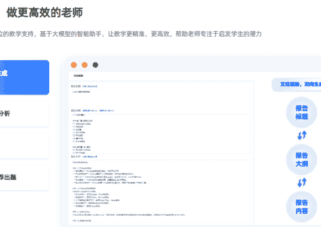

| 任务名称 | 状态 | 进度 |
| --- | --- | --- |
| 202300000007 | 进行中 | 85.0% |

学生的作业整体上是正确的，使用了python基本语法，但有几处错误，大部分错误可以通过调试执行并解决：
1. 这里的函数名写错了会导致报错，建议使用更准确的函数。
2. 同学的错误，不要遗留，建议修改。


学生学习更快，学得更好，AI让学习更
大模型的辅助学习功能无处不在。灵活适应为学生打造定制化的学习体验


任务：编写一个游戏运行其他同学的代码。代码要求：
```python
def hello_world():
```

任务：修复同学留下的“Bug”，修复后运行其他同学的代码。


自动化反馈，描述Python多个函数。

本次学习的目标：
1. 掌握了Python的基本语法，包括函数的定义和调用。
2. 掌握了循环结构，根据需要执行循环。
3. 掌握了条件分支，根据条件执行语句。
4. 掌握了调试方法，能够修复代码。
5. 能够发现代码中的错误。


北京大学教育科学实验室 & 北京大学软件工程重点实验室

基于大模型的AI工具
- 在线编译器+大模型实时问答
- 自动识别提示词(prompt)
- 整体作业分析和评价
- 自动出题
- 配套实训

### Python专项训练

从第一章开始学习
2.1 变量类型
2.2 Python数据结构
2.3 异常处理
2.4 函数定义
2.5 模块应用

当前进度：4

Python专项练习

```python
try:
    x = 1/0
except ZeroDivisionError as e:
    print('Division by zero')
```
2-3-1 当异常发生时，捕获异常并处理，让程序继续执行：

```python
if a > 0:
    print('a is positive')
elif a < 0:
    print('a is negative')
else:
    print('a is zero')
```
2-3-2 使用elif-else结构处理多个条件判断。

3 循环结构练习

循环中发生异常时，只捕获该异常并处理，循环继续执行，该如何实现？

相关章节和高频易错点精准推荐
提示：Python中for循环的常见问题，Python中while循环break和continue的使用。推荐：使用AI自动推导break和continue的逻辑

## 小结：人工智能赋能科学研究的三种类型

| 概念 | 含义 | AI的角色 | 示例 |
| --- | --- | --- | --- |
| 研究AI Research on AI | 以AI为研究对象 | 研究对象 | 研究深度学习算法、AI伦理问题、应用价值问题 |
| 用AI做研究 Research by AI | 利用AI作为工具或方法进行研究 | 工具或执行者 | 用AI分析数据、生成文献 |
| 和AI一起做研究 Research with AI | 人类与AI协作进行研究 | 合作伙伴 | 人机协同设计实验、AI提供研究建议 |

尚俊杰，人工智能赋能科学研究的三种类型[R]。北京大学学习科学实验室，2025

## 七、人工智能会遇到什么困难和障碍

### 人工智能教育应用面临的困难和障碍

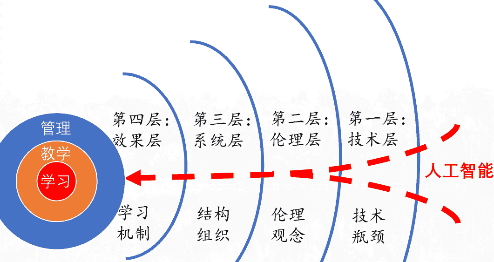

肖奢、肖海明、尚俊杰。人工智能与教育变革：前景、困难与策略[J]。中国电化教育，2020(04):75-86。

### (1) 技术层：技术瓶颈

- 人工智能第三次浪潮会不会破灭
- 在教育领域，亟待在语音识别、自动翻译、自动识别和输入公式、智能阅卷、自然语言理解等领域有质的突破。


### (2) 伦理层：伦理概念

- 人工智能机器人会对人类造成什么影响?
- 能否通过表情分析、大脑活动状态分析了解学习者的个体情况，是否存在伦理问题？

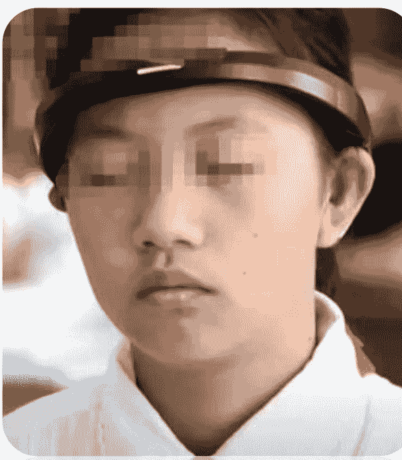

### 人们对技术的态度

布莱恩·阿瑟详细描述过这种心理，他说对所有人类来说，我们信的是自然而不是技术。但同时，我们仍然希望技术能够照顾我们的未来——这样一来，我们实际上把希望托在了一些不太的东西上了，有点讽刺。布莱恩·阿瑟.技术的本质[M]。曹东、王健译：浙江人民出版社，2018。

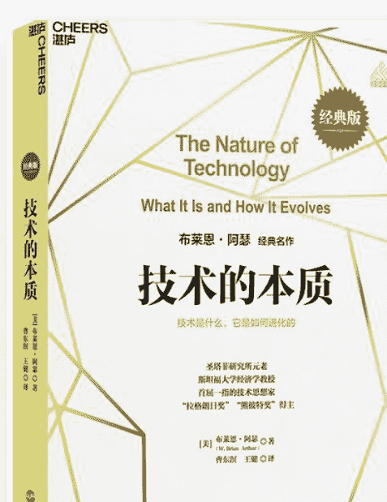

### (3) 系统层：组织结构

教育领域的变化不是单一技术的，需要整个系统的变化。马尔科·麦莱恩1953年发明以后，花了20多年才得到了广泛应用。


### (4) 效果层：学习机制

- 人究竟学习的？
- 怎样才能有效的学习？
- ChatGPT真的能提升学习成效吗?

杨浩、郑旭：非显著性差异

自1928年开始一直到现在，都有研究发现：不同的技术手段对教育与学习的结果不存在显著差异，这被称为“非显著性差异”，该现象就像一朵乌云，笼罩下信息技术与教育这一美丽而晴朗的天空。


杨浩、郑旭、朱汐。技术视角下信息技术与学校融合的若干思考[J]。中国电化教育，2015(04):1-69。

## 应对策略：人工智能应用未来的发展策略

培养个性化人才
让教师更幸福
看见的服务和服务管理提升管理效率和决策水平
人机协同打造超级教师实现个性化自适应学习

第一层：技术层
第二层：伦理层
第三层：系统层
第四层：效果层

技术瓶颈
伦理观念
结构组织
学习机制

人工智能促进教育流程再造
加强人工智能基础研究
加强教育基础研究
普及人工智能教育

> 肖谦，肖海明，肖俊杰。人工智能与教育变革：前沿、困难和策略[J]。中国电化教育，2020(04)：75-86。

## 七、学习科学赋能人工智能教育

### 学习科学

- 学习科学 (Learning Sciences) 是国际上近三十年来发展起来的关于教学的跨学科研究领域，涉及教育学、信息科学、认知科学、生物医学等许多学科。
- 简单的说：“人是如何学习的? 如何促进有效地学习？”
- 重在研究真实情境中的学习。

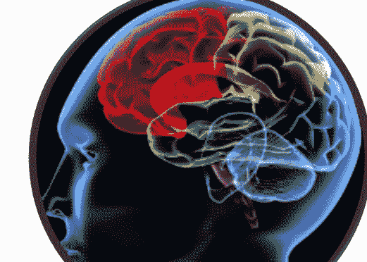

### 学习科学的研究目标

首先理解认知过程和社会化过程其次重新设计学习环境从而使学习者能够更有效和深入地进行学习

> 索耶（R·K·Sawyer)．剑桥学习科学手册[M].

### 脑、心智

### 课堂教学

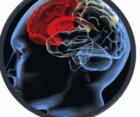


脑科学 人工智能 大数据 ......
希望在脑、心智和真实情境教学之间。

### 本科科学水平

### 学生先验知识水平

### 本节相关知识水平

### 学生学习动力

### 学生学习态度

### 学生学习差异

### 学情分析

### 班级学生人数

### 相应的教学策略和方法


# 学习分析技术研究：大数据技术应用于课堂教学

香港大学教育学院陈高伟等人在研究如何从课堂教学视频中提取话语信息，为老师呈现数据分析与可视化反馈，从而促进老师对课堂对话的反思与实践，提升课堂教学和学生学习成效。

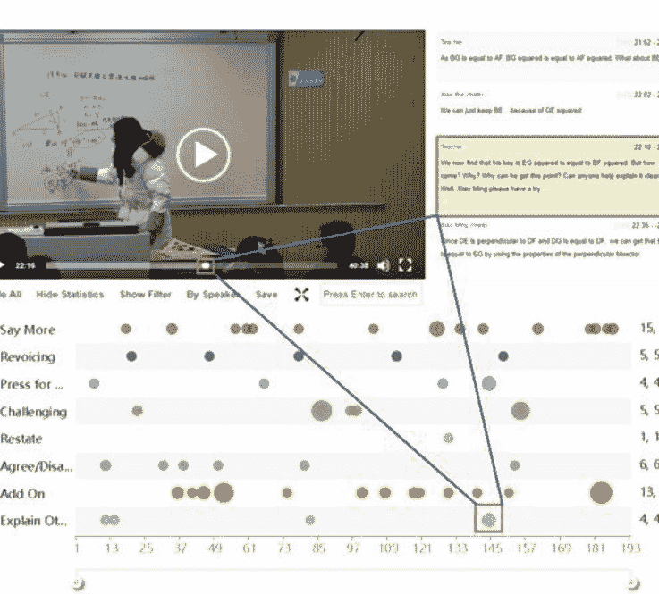

Chen, G., Chan, C. K. K., Chan, K. K. H., Clarke, S. N., & Resnick, L. B. (2020). Efficacy of video-based teacher professional development for increasing classroom discourse and student learning. Journal of the Learning Sciences, 29(4-5), 642-680.

## 一线教师如何运用学习科学？

## 课堂应用案例：空间临近原则

### 形成闪电雷暴

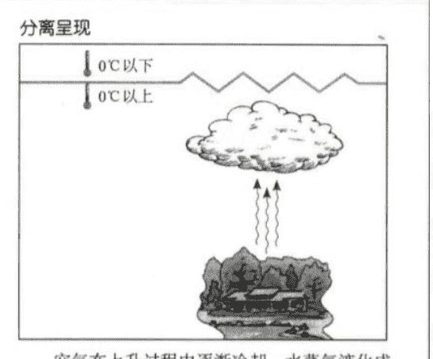
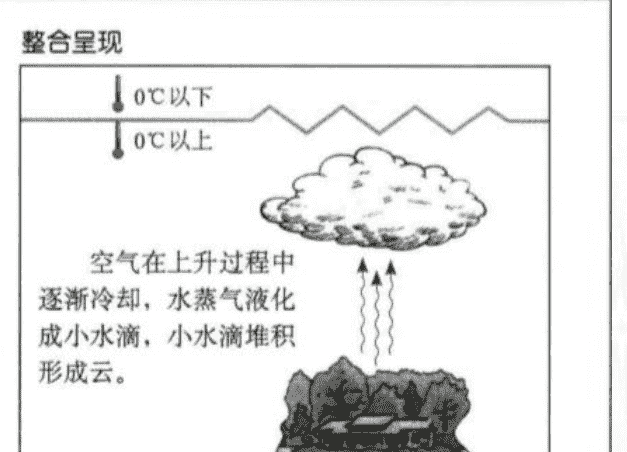

[美]理查德·E·梅耶.应用学习科学[M].盛群力，丁炬，钟丽佳.中国轻工业出版社，2016.

## 教育发展急需开展基础研究
## 基础研究可从学习科学开始

## 教育或许可以从一门主要依靠经验的学科转变为主要依靠数据的数据学科。

## 未来的学习

- 基于大数据的学习分析
- 大脑科学与学习
- 人工智能等技术增强的学习

尚俊杰, 庄绍勇, 陈高伟. 学习科学: 推动教育的深层变革[J]. 中国电化教育, 2015(1).


## 学习科学如何赋能人工智能教育？

## 学生们的作文，AI到底给了多少字评论？

作文：那一次，我真... 666 字

这是一篇学生作文，假设你是一名中文老师，请对它进行评语，写500字评论

使用：阅读助手Plus

### 作文评语

这篇文章属于《那一次，我真大胆》的作文，生动地描绘了作者在一次舞蹈比赛中的心路历程，情感真挚，叙述流畅，是一篇值得定的佳作。

文章以小舞的舞台形象引入，迅速吸引了读者的眼睛，为全文铺垫了细腻的艺术感，通过“不顾流汗水地练习动作”、“咬着苦牙，在旁坚持支持”等细节描写，展现了她起舞过程中的艰辛与挑战我的精神风貌，这些细腻的笔触，不仅增强了文章的真实感，也让人物的形象更加丰富、立体。

在比赛章节的叙述中，作者巧妙地运用了排比、比喻等修辞手法，“如舞姿轻盈、优雅地跃舞，变换形、旋转、下蹲、平转动作等一系列呈现在读者的眼中，“舞姿美如蝴蝶在荷时间内跳动”，使得舞蹈场跃跃然头上，人仿佛身临其境。同时，通过对评语的引导提问，将小作者内心的激动与执之情表现淋漓尽致。


## 要激发人工智能的价值，首先要深入开发人类的学习！

## AI时代，学生还需要学习写代码吗？

你可以使用Python编写一个简单的程序来计算从1到1000的平方。这里是代码示例：

```python
# 计算从1到1000的平方
total_sum = 0

for i in range(1, 1001):
    total_sum += i ** 2

print(f"从1到1000的平方和是: {total_sum}")
```

代码解释：

1. total_sum = 0 : 初始化一个变量用于存储平方的累加结果。
2. for i in range(1, 1001) : 使用for循环遍历1到1000的整数。
3. total_sum += i ** 2 : 在每次循环中，计算当前数字i的平方，并将其加到total_sum中。
4. print(f"从1到1000的平方和是: {total_sum}") : 最后输出计算得到的平方和。

运行结果：

运行这段程序，程序输出从1到1000的平方和：

人工智能时代，我们需要重新设计教育和学习！

## 八、未来我们怎么办

## 尚俊杰|我眼里的教育技术40年（《未来教育重塑研究》后记）

郑州初高中家长圈 2020-05-02 13:30
作者：尚俊杰 来源：俊杰在线### 我眼里的教育技术40年我是1979年上小学的，到今年恰好是40年。这40年来，正是改革开放、飞速发展的40年，我也目睹了各行业的翻覆性变化。这40年来，我几乎没有离开校门，从小学，到中学，到大学，到留校工作，一直在学校学习、生活和工作，是教育领域40年来变革的亲身经历。由于从事教育技术专业的教学工作，也有机会考察国内外很多学校、机构和企业，体会更加深刻。所以现在


## 互联网时代的媒体资源

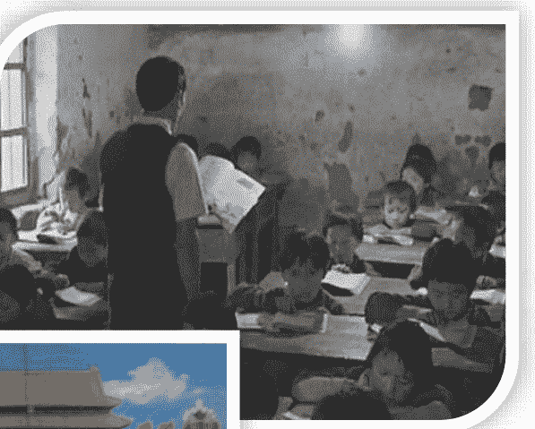
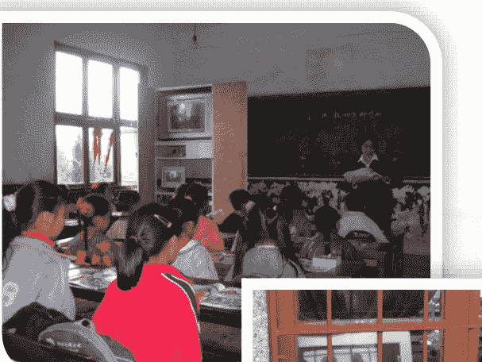


40年前的农村学校
20年前的农村学校

## 互联网时代的教学：可汗学院

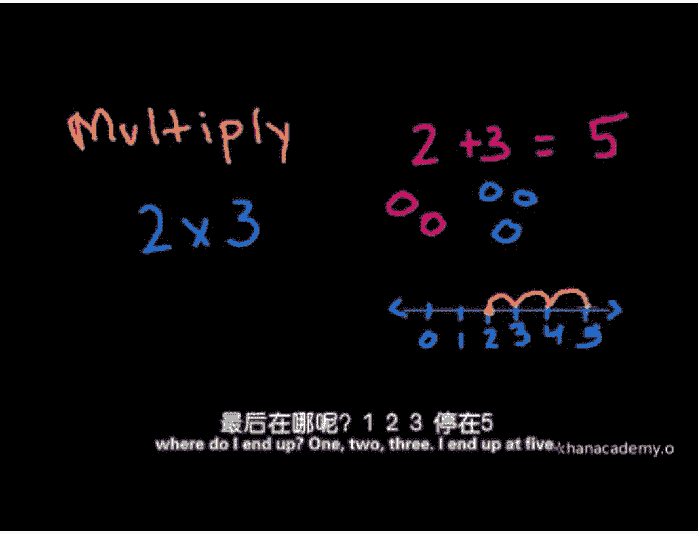


www.khanacademy.org

## 翻转课堂（Flipped Class Model）

- 传统的教学模式是老师在课堂上讲课，学生回家作业。
- 翻转课堂是让学生在家看视频，到教室来作业。


## 互联网时代的课堂

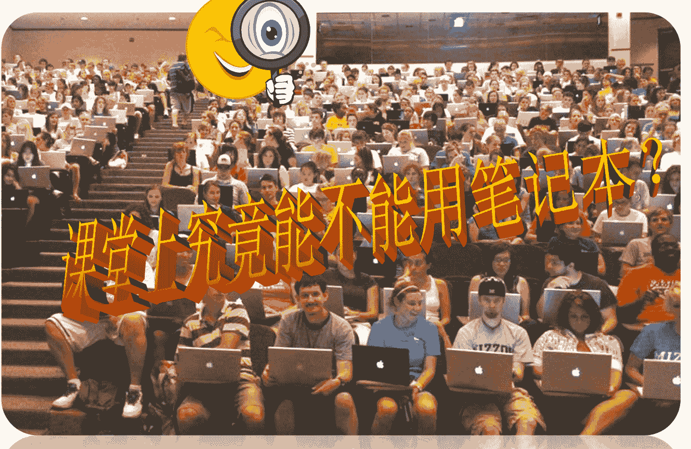

## 互联网时代的课程

## 国外名校开放课程足不出户就能上“洋”大学

来源：人民日报 2010年08月28日14:27

[导读]与哈贝教授面对讨论何正义，与鲁老师一起讨论心理、金融和哲学话题……现在。这一切不再是美国名校名师的专利了，国内学生也可以通过网络获取这些名校的优良教育资源。

这个名字，在国内一些视频网站、哈佛、斯坦福、牛津、麻省理工学院等国外名校的开放课程，受到不少国内学生的抢教，下载频率和速度，堪比大片，一些课程的点击量甚至超过了《百度知道》。还有人说，以后在家里就可以上大学了。而那些发现下载这些开放课程的用户，则称为“网”情深的“网课堂”。

看了人家的课，才知道我们老师上的哪里叫课程？我们老师上的这哪里叫大学？

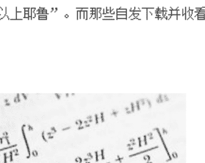

## MOOC（大规模在线开放课程，2010左右）

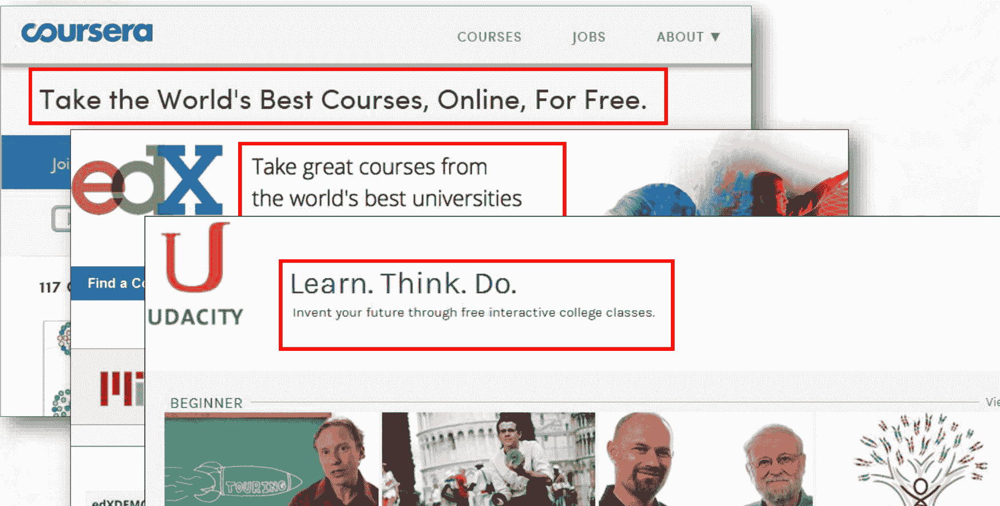

## 对于一位病人，如果有条件，他是否希望请世界上最好的医生给他看病？

## 对于一位学习者，如果有条件，他是否希望跟着世界上最好的老师学习呢？

尚俊杰，光明日报，2013年11月18日


## 谁动了我的教材？
——尚俊杰，中国教育报，2014年7月16日

## 技术时代重新思考教育

“信息技术的快速发展，已使教育的内涵不再仅仅局限于学校之中。移动学习、泛在学习等新型教育模式，使得学习的控制权逐渐从教师、管理者转移到了学习者手中，从而诞生了工业时代以标准化、教学和批量培养人才的体系。”——阿兰·柯林斯&理查德·哈尔森

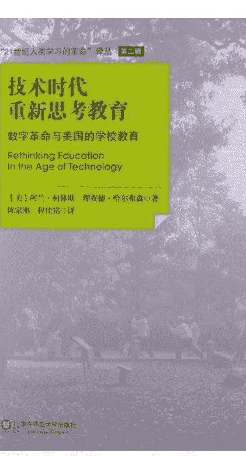

## 生成式人工智能：对教育的影响？(2023.2)

## 习近平在全国教育大会上强调：紧紧围绕立德树人任务，务实实现教育强国目标，深入实施教育数字化战略，扩大优质教育受益面，提升终身学习公共服务水平。

## 聚焦中全会怀鹏：打造人工智能教育模型

中国新闻网 2024-07-19 中新社北京7月19日电（记者 张素博）中共中央于7月19日上午举行发布会，介绍和解读二十届中全会精神。教育部党委组书记、部长怀鹏表示，大力推进智慧校园建设，打造人工智能教育模型，探索因材施教、个性化教学，更好满足群众的需求。怀鹏说，党的十八大以来，中国5个县级行政单位全部实现教育基本均衡，教育普及和水平实现历史性跨越，其中学前教育、义务教育达到了世界高收入国家平均水平。“下一步，我们将高质量发展作为各级教育的生命线，促进教育公平，深化教育综合改革，推动实现从“学校”到“学习”的根本性转变。”怀鹏表示，重点深化“四大”改革：一是在资源配置上，突出提质，加大优质资源供给；二是在教学上，突出学生为本，加强学生健康全面发展；三是在保障机制上，突出教师，建设高素质专业化教师队伍；四是在起点上，突出数字赋能，发挥智慧教育优势。

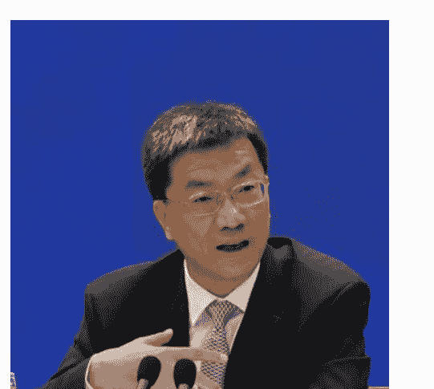

## 教育部：塑造“人工智能+”教育生态

- 育人理念革新：培养重心要从“学知识”向“强能力”转变。
- 办学路径升级：专业结构要从被动调整向主动升级转变。
- 教学模式创新：教学要从“师生交互”向“师/生/机”深度交互转变。
- 学习范式转型：学生要从“被动学习”向“自主学习”转变。
- 评价方式完善：评价要从“结果评价”向“多元评价”转变。

## 教育领域应该什么样的变革？

- 专业设置
- 课程设置
- 教学模式
- 学习方式
- 研究范式
- 管理服务

## 老师们怎么办：努力掌握相关知识技能

尚俊杰，刘誉。教师使用生成式人工智能的六步。北京大学学习实验室，2024

## 尚俊杰：关于AI的六句话

1. 假如人工智能机器人有理想，或许它们想超越甚至取代人类？
2. 不管会被取代，只要人类不想退场，就必须持续学习——为生存，为工作，更为丰富和充实自己。
3. 要学习好，就需要借助人工智能。
4. 只有人工智能还不够，必须学习科学赋能。
5. 只有科学也不行，还需要快乐。
6. 让学习更科学、更快乐、更有效，让教育更美好！
