# 百川综艺季 BAI CHICHUAN
 卡通IP形象运营方案

## 扫码加入 知识星球TOP 免费资源群 (免费)
公众号：知识星球TOP
- 每日免费获取高价值资源
- 可提供各类资源搜索服务

价值 微信：jntsg8

| 热门付费文章 | 各行各业报告 |
| :--- | :--- |
| 精选图书资源 | 副业挣钱方法 |
| 职场实用资源 | AI与自媒体 |

及时 微信：jntsg2

专注 分享资料仅供个人学习，请及时删除，切勿商用传播

## CONTENTS
- 市场分析
- 运营策略
- IP设定
- 创意呈现
- 案例分享

## Brief Recap
- 一个可以代表IP的记忆点
- 原创IP，0认知基础，没有原生的故事
- 短期有曝光，长期可变现
- 独立原生的账号运营
- 扩大IP站外的认知度
- 站外传播存在渠道壁垒

## 细数那些年爆火的IP形象：动作+性格
- 顶流女明星：互联网女儿、社交牛症
- 玲娜贝儿：抒展裙子擦嘴太豪放、不是传统淑女、社交牛症

- 冬奥会一夜爆红：傲娇卡、炫技4A、顶流打工人
- 冰墩墩：到底有多少技能、冬奥顶流养成记、全球顶流
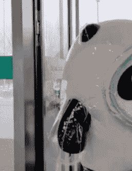

## 细数那些年爆火的IP形象：语言+性格
- 话痞反派：社交天花板、倔强威霆地惩罚你
- #当话痞威霆遇到酋天津人
- #原来威霆才是社交天花板
- #在地球球场和威霆互惩罚有多爽
- #在地球球场的威霆有多话痞

- 爱玩、爱笑、爱闹：爱吃香蕉、系列动画支撑
- #全抖音都在玩小黄人
- #余景模仿小黄人唱歌
- #洗脑神曲《Banana之歌》

## 以上皆有IP背书 1+1>2，原创IP怎么办？

### 有标签的IP
- 具有明确的音频动作识别标签。
- 有性格：语言风格鲜明有记忆点。
- 有共鸣：具有强互动且贴近生活的故事。
- 有粉丝：圈内外粉丝吸引及维护粘性。
- 有文化：属性的IP文化，贴近主张。
- 有价值：具有一定市场价值，可变现。

## 运营规划：从0到1
### ① 自媒体阵地（矩阵）
- 抖音：核心占地搭建
- B站：二次元年轻人群聚集
- 小红书：优势
- 视频号：私域流量传播

### ② IP宣言（内容发布）
- 官宣视频内容：如小红书条漫
- 产品配合：抖音站内贴、微信表情包
- 站内协作：达人助阵、视频连麦

### ③ 川宝营业（阵地运营）
- 多阵地内容、物料、直播日常更新
- 综艺匹配：正片植入、中插广告、定制短视频
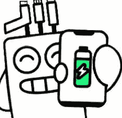

### ④ 市场曝光
- 营销事件：主动-节点、热点策划；借势-日常热点跟随
- 衍生潮玩：潮玩开发、开启预售
- 圈层展会：圈层展会入驻增大曝光（如：CJ、CP展、BW、Bilibili）
- 跨界联名：潮流、服装、快消、艺术家等

### ⑤ 商业合作
- 品牌代言：IP身份授权、指定形象使用、名称使用
- IP授权：指定形象使用、名称使用
- IP联名：定制联名款、品牌冠名、角色植入、内容植入、番外小剧场
- 专题招商
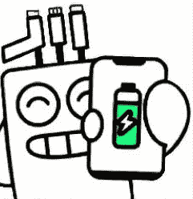

### ⑥ IP迭代
- 美术迭代：美术视觉更新
- 商业化开发：变现形式方案开发、商业模式迭代
- IP联名：定制品牌联名款
- 内容赛道迭代：内容呈现形式迭代及开发（如音乐、短剧、虚拟偶像等）

## 针对本次的需求
1. 发布第一支短视频，释放基础信息与自我介绍进行官宣。
2. 释出日常节目内容，进行固定直播（一周），测试受众对于内容的喜好点，便于于正式曝光的内容调整。
3. 重点内容持续上线，完善人设的同时增加网络曝光：
   - 专属单曲
   - 开发NFT玩法
   - 日常更新固定节目+直播带播+互动直播+节目现场直击
   - IP出圈大事件
   - 特殊节点+艺人专题策划
   - 商业曝光：
     - 真人个人身份广告，可做魔术贴膜/表情面膜植入
     - 与共享充电品牌合作

## 阶段规划
- 出道期：官宣
- 上线期：内容测试
- 曝光期：粉丝积累
- 增值期：增加变现

## 人设设定
- 姓名：川
- 别名：川宝
- 爱称：33
- 幸运数字：3
- 身份：见习记者
- 性别：无
- 性格：放弃
- 人设属性：元气满满

### 川宝自我介绍示例
大家好，这里是AKA33川宝。至于为什么要有33？这个问题很好（假装互动），因为我就是33！召唤音量高3倍，拥抱贴33回，全线slay。幸运数字是3的天选宝，记住，不是散，不是伞，是33。

### 属性详情
- 元气满满万能“砖”：唱歌、跳舞、主持、脱口秀……全能川宝都行，哪里需要哪里就！
- 话痨属性（十级冲浪王）：有效输出、热梗潮流，掌握各种当下热梗，还是造梗达人，有万能断梗式buff加持，采访绝不冷场！
- 电量永远MAX：没电就找我，喜欢一次快乐交流，和我贴贴留电量。
- 仪式感：3字卡点达人，喜欢一切和“3”有关的事物，更新时间一定要有“3”！

## 人性特点：超级贴贴追星充电宝
- 爱好式追星：放眼整个娱乐圈没有川宝不认识的艺人，只要看到就会主动贴贴，拉着艺人一起共同完成充电/治愈贴。
- 【三连拍挑战示例】：
  1. 旋转贴贴
  2. 挽手贴贴
  3. 拳拳贴贴

## 人设性特点：碎嘴子终极形态
- 地球不毁，川宝不晓！早上人未醒碎嘴输出，哪怕只是一件很小的事情在川宝这里也可以给你讲上两个小时不停，天生生活博的就是川宝吧！
- 创意短视频策划——早晚我醒了！
  - 概况：712期，每期2-5min，每日23:33准时更新。
  - 内容形式：川宝碎嘴子话对自己的一/某一件事。
  - 内容示例：
    1. 川宝拿着手机开场“一天结束了，大家”（5s-10s）
    2. 川宝走到墙边，画面变黑（5s）
    3. 川宝碎嘴回顾一天，全程用字幕呈现（60s-90s）
    4. 川宝以“大家晚安”收尾，视频结束（15s）。

## 标志性动作
结合川宝作为充电宝原型，选择“头顶”这一动作打造标志性动作，用同一动作表达不同情绪，打造专属记忆点。

## 口头禅
- “川只是……”
- “我真的会充”
- “我们的一格电”
- “给我一格电”

## 案例分享：世界清洁日（9月18日）
- 背景洞察：近年来海洋污染、全球变暖、冰垃圾等生态问题恶化，大众环保观念提高，相关节日关注度提高。川宝作为温暖、正能量的充电宝形象，为人类赋能的同时关注环境保护，引起大众关注。
- 创意阐述：根据环保爱护地球的主题，联动川宝到公园内、欢乐谷门口、环球影城等地去捡垃圾，以实际行动爱护地球。与川宝和平时的话痨属性形成反差萌，以正能量行为丰富形象，树立社区正面口碑。
- 传播示例：
  - Step 1：抖音官方账号发布川宝在不同场地垃圾混剪视频
  - Step 2：抖音娱乐KOL发布不同视角拍摄的川宝捡垃圾视频，引导网友讨论
  - Step 3:搬运至微博，微博娱乐KOL一步助推发酵
- 话题词示例：
  - #公园惊现玩偶捡垃圾
  - #当玩偶也开始捡垃圾
  - #玩偶就业新思路
  - #玩偶开辟个人副业
  - #今天是环保的川宝~

## 案例分享：9.13“充电节”和川宝一起贴贴
- 背景洞察：随着社会节奏加快，工作学习压力大，孤独人群数量庞大，孤独成为常态。充电宝作为生活必备工具，拟人化后不仅有充电功能，更可为大众带来陪伴和赋能。
- 创意阐述：根据川宝“33”爱称玩梗“913”=“就要3”谐音，和百川优充电宝身体原型，在9月13日举办“充电节”活动。借助人流量大的商场休息区，用13名川宝优为玩家提供充电和陪逛的贴心服务。

## 后期维护

- 有互动
- 引导从视频内容开始!
- 制造槽点、爆点、疑点
- 互动及时！

- 有完播
- 精简前3s把人留住
- 主要内容直奔主题
- 节奏快，时间短

- 有类比
- 视频封面 多维度类比!
- 视频音效 精致化调整
- 视频剪辑

## 投放目的-账号快速涨粉

## 投放目的-突破现有流量池

+ 1. 投放方法：
前期小金额投放，后期根据数据反馈针对性重复投放。

+2. 投放方式：
- 账号：初期对目标账号投放，后续系统智能投放。
- 时间：尽量延长。
- 金额：拆分成小额，以便随时调整投放目标。

+ 1. 流量池设置
- 级别设置：初级-顶级级共8个阶段。
- 流量加持：300+-3000w+，逐步递增。

+ 2. 投放选择：
内容接近下一流量池进行拉加投放，以强行跨越一级来获得更多流量。

## ROADMAP

| 内容 | 出道期 | 上线期 | 曝光期 |
| --- | --- | --- | --- |
| 固定节目 | 配合官宣 | 节目开播 | 8月 / 9月 |
| | 「天选之宝」 / 日常vlog | | | 「川宝七天播」日常栏目 (7*12期) |
| | | | 「川宝开播」仪式感系列小视频 |
| 直播带看 | | | 「晚安，我累了！」睡前碎碎念Vlog |
| | | | 带看抖音综艺 (每周2-3次) |
| 互动直播 | | | 现场直击&见习体验互动直播 (1*12期) |
| 节点策划 | | | 831大张伟生日 / 川宝底兜式庆生 |
| 事件策划 | | | 923秋分川川宝 助农丰收 / 913充电节：12个川宝空降商场 / 世界清洁日：川宝化身公园环保保卫士 |

## 创意呈现

### 直播

### 短视频

### 现场直击

- 直播带看抖音综艺
(开播前一周2-3次)

- 艺人/选手/嘉宾 互动直播
(开播后一周1次)

- 川宝人物出道官宣
- “川宝七天料”栏目
(开播后每日11:33更新)
[周一] 技能料一 [周二] 包袱料一
[周三] 独家料一 [周四] 有料料一
[周五] 高能料一 [周六] 彩蛋料一
[周日] 衣服料一

- 特殊节点短视频
秋分节川宝海底下与农民丰收
大张传生日海底式死亡体验

- “晚安，我碎了！”Vlog
(开播后每日23:33更新)

- 川宝后突击《高校声》
- 《乐时空》连麦PK
......

## 川宝日常行为动作规范

### 情绪表达

【思考】摸头顶线

【开心】拉着转圈

【生气】加速拿头去顶顶

【伤心】双腿双手消失，变成立方背对人

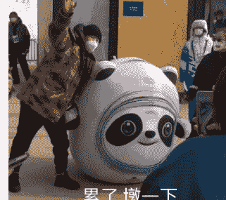

【害羞】找墙把自己埋住

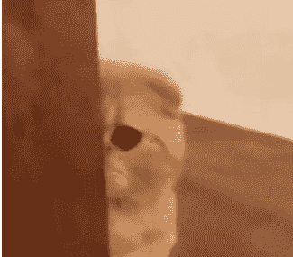

【无语】举起右手歪头倾斜

累了躺一下

### 川宝日常行为动作规范 日常交往

形式一：见面就跟人鞠，邀请邀请来他的川字电线，完成电动。
形式二：随身携带壶形充电插头和充电线，随时随地补充电量。

形式五：走路蹦蹦跳跳连飞带跑
【电量不足】走不动当场表演双腿消失术（需要拖着走）
【互动示例】联动选手或者艺人在喝水的时候问他“你不喝吗？”
川宝（可爱状态：哪个充电宝会渴水！不过川宝有自己的水壶（拿出充电套装）
响应：哪个充电宝会渴！用自己的川字电线顶，选手/艺人疑惑“怎么还生气！”
形式三：作为一个正能量充电宝，随时随地伸出手
形式四：累的时候会把头上的插头拔下来给自己立着或者枕着。热心助人，安慰哭的小友，给过的一个拥抱......伸出手

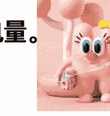
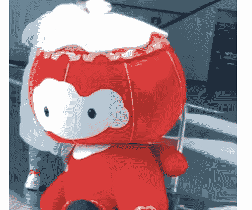
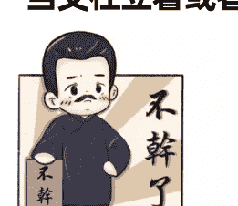

## 这样的川宝爱直播

### 直播带流程

直播时长：综艺时长+25分钟
part1 (3分钟)：川宝出场介绍
part2 (10分钟)：回顾节目往期高能片段，出发惊喜并且用各种网络进行互动，例如“笑死了”“这是可以看的呀”预留冲浪人设。
part3 (综艺时长)：回归结束后播放本期视频，正式开始录制。在录制过程中针对高光片段与粉丝互动，用表情贴在头部，通过不同的表情表达节目期的各种心情。例如：好害（激动），笑了我，笑而不语憋住（注：此处原文“害”可能应为“累”）。
part4 (5分钟)：节目结束，针对节目发表观点后
part5 (2分钟)：直播间抽奖环节。
part5 (5分钟)：和观众告别，预留下一期亮点。

### 互动直播创意

### 背景洞察

当前直播市场，用户已经不满足观看回复的简单互动模式，而在互动中追求更多多样化、趣味的展现方式，用变化、更接地气而非单纯的场景来维持观众吸引力达到精神上的共振。拟人化的玩偶成为互动直播的主角，在视觉上能够满足人类对异萌的心理需求，且互动直播的形式近距离接触，全方位展现人设，快速建立内在的情感联结，培养忠实粉丝，为后续圈粉打基础。

喜欢直播喜欢这种实时的互动。我就是川宝宝。百年没看直播间，一进直播间就在互动，保持喜欢大小主播委托。坚持九天坚持看直播坚持设计坚持跑步直播赛。很多广东人偶尔刷到直播的都是没错，但是广东人很有喜欢好直播有些怪很喜欢一个通夜直播的短视频或者有意想自己经历还很想感受到直播为什么是互动式的。

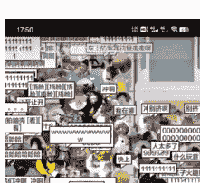

### 互动直播策划

创意阐释：深化川宝人物属性，策划互动直播节目，川宝以见习记者的身份每周一次固定开展直播活动，结合百川综艺的各类综艺的独特形式，从拍摄现场、见习成果展示、川宝整活挑战等方向开启互动直播，并在每期结尾由选手为下一期录制人员提出题目或者发起难度动作挑战来制造抓手，持续调用户好奇，多维度立体展现川宝形象，并为互动直播引流，拉新受众圈层。

### 栏目框架：

+ 1. 概况：每周一期，每期60min，每周三晚20:33开始直播。
+ 2. 栏目版块：
* 拍摄现场：川宝宝直播综艺拍摄现场，检查拍摄成果。
* 见习成果展示：以各类类综艺的独特形式作为直播主题，与观众进行直播pk。
* 川宝整活挑战：唱歌、跳舞、谈心，你画我猜，只有你想不到，没有川宝完不成的挑战。

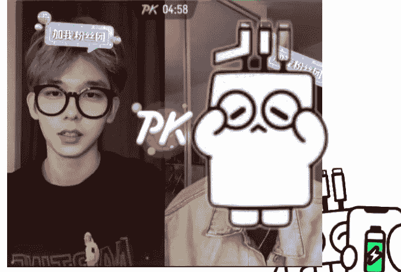

### 互动直播创意策划

+ 拍摄现场：以综艺《高校声》为例。
【创意亮点】通过直播连线《高校声》后台现场，与选手进行互动，为选手们加油。提升观众对节目的期待，并借助互动完善川宝全能、治愈等形象。
【策划亮点】通过直播中观众和选手的趣味互动，展现川宝奇怪又有趣的性格特点。
【直播流程示例】
part1：川宝开始自我介绍，说明今天的直播主题是“后台现场”，推出新节目《高校声》，向大家简单介绍。
part2：川宝连线《高校声》在直播中跟选手互动，通过游戏决定内容和奖励，胜利者可以获得川宝特别品，失败也会获得川宝玩偶安抚。
part3：直播结束时，川宝挑选选手，并由选手留下下一个问题或挑战（后续节目引发关注，川宝也可以在直播中连麦热门选手互动）。
【话题示例】
川宝带你真实直播后台，没想到充电宝还能用。

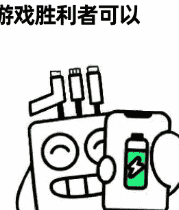

### 互动直播创意策划

+ 见习成果展示：以综艺《乐时空》为例。
【创意亮点】借助《乐时空》经典歌曲演绎作品，以此作为直播主题，在直播间通过互动pk，观众收获川宝送出的奖励，失败也有川宝俏皮鼓励，以此展现川宝作为见习记者的人属性，通过互动形式建立川宝与用户的内在情感联结，增加大众对川宝的印象。
【策划亮点】吸引大众关注。
【直播流程示例】
Part1：川宝开始直播自我介绍，说明今天直播的主题是“经典歌曲传唱”，询问直播间的观众记忆中的经典歌曲，并向大家介绍《乐时空》这档综艺及规则。
Part2：川宝开始直播麦pk，如川宝表演“如果知道”，pk接下一句。双方之间任意一方失败，此过程中预留川宝表演经典歌曲或如川宝展示属性与粉丝互动，混逛互动。
Part3：直播结束时，川宝邀请观众留下下一个问题/高难度动作，川宝表演歌曲与观众告别下播。
【语言示例】
川宝带你一起回经典、川宝闯川宝直播间、充电宝是这个样子。

### 这样的川宝爱（日常）

### 这里是川宝的家

### 墙面装饰
- 墙面元素
- 墙面颜色
- 落地灯
- 单人沙发
- 可站可坐
- 窗帘
- 贴合人设
- 小道具
- 无窗户
- 硬装元素
- 挂画
* 自画像
* 节目logo
* 综艺主视觉

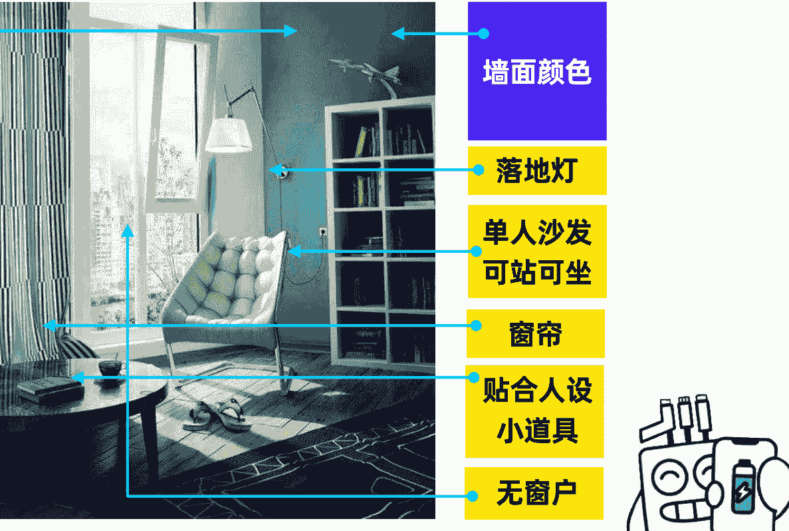

### 这样的川宝爱日常

### 官宣视频：《天选之宝》

创意闹点：为建立大众对川宝的人设认知，策划川宝背景故事作为官方抖音账号的首发视频，制造大众对川宝的了解，方便用户对川宝形成认知，为后续的运营动作奠定基础。

- 视频标题示例：天选之宝
- 视频时长参考：1-3min
- 视频内容示例：
- 镜头1：废弃工厂中所有的充电宝在黑暗角落里，唯有一个充电宝立着晒太阳。
- 镜头2：五星级酒店客人拿着充电宝称赞“幸有你有，不然我手机就要关机了”。
- 镜头3：画面从酒店内回，晴空万里的天空突然出现云雾，雷电交加，一道惊雷击立着的充电宝，瞬间烟雾弥漫。
- 镜头4：烟雾散去，画面出现川宝的见习记者证。
- 镜头5：川宝现身视频之中，和大家打招呼“大家好，我是川宝，很高和大家见面”。

### 官宣直播·川宝查房

创意阐释：
为在官宣期积累人气，积累原始粉丝，官宣当天邀请站内多名不同领域的主播，川宝将顺序与主播连线，并在连线中与主播长的领域进行PK，展现川宝全能以及制造互动，快速积累人气及粉丝。

- 主播类型：唱歌、跳舞、搞笑、猜词等。
- 直播时长：小时以上。
- 直播内容：官方邀请主播随机互动。
- 互动内容：由主播出题，川宝打擂。

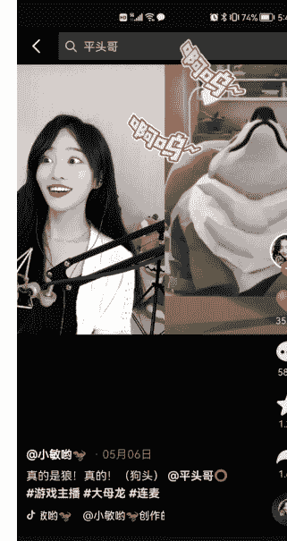
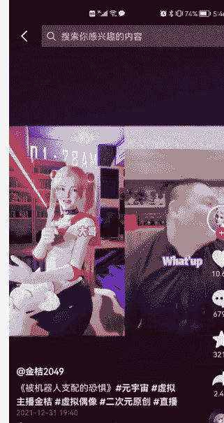

## 日常固定栏板块·《川宝七天》

创意概述：为拓展川宝IP人物属性，完善全能人设标签。策划短视频固定栏目，通过抖音的形式，从个人技能、热点挑战、工作日常、玩梗等方向视频，多维度立体体现川宝形象，并以此引流新观众。

【节目框架】
1. 节目名称：《川宝七天》
2. 概况：每周一期，每期60min，每日11:33更新。
3. 栏目规划：
- 周一：技能
- 周二：包袱
- 周三：独家
- 周四：互动
- 周五：高能
- 周六：彩蛋
- 周日：衣橱

## 日常固定栏目板块·川宝七天

- 周一：技能视频。展现川宝个人技能。内容示例：变脸，川宝用音效表情贴实时表达心情，当川宝无语时，甚至可能所有的表情变成白板。
- 周二：包梗。展现川宝跟进热点挑战视频。内容示例：川宝跟健身、转跳《爱你》舞段。
- 周三：独家。展现川宝作为见习记者，对综艺艺人花式采访的视频。内容示例：对立快问快节奏。

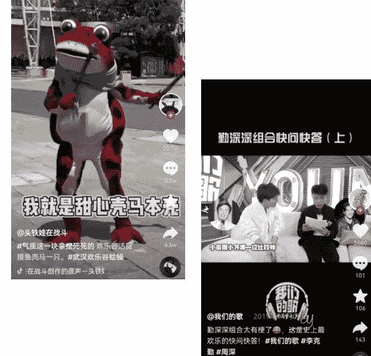

## 日常固定栏目·《川宝七天》

- 周四：有料。内容示例：
- 乐时空：第一周川宝体验798胶片一小时长，感受经典金曲魅力；第二周川宝与广场大爷妈妈共跳广场舞，为观众预留唱歌亮点。
- 老朋友：第一周川宝来到劳动人民文化宫老年人相亲，体验黄昏美好氛围；第二周联动互动川宝采访妈妈。
- 文明决：第一周川宝来到街头寻找挚友，川宝与路人组成一对，和另一对路人CP（闺蜜、情侣等）进行你画我猜单词比划游戏。
- 狂想曲：第一周川宝来到幼儿园培训班，通过观察子女代关系；第二周川宝前往有趣的浪漫餐厅情侣互动/找人拼桌，倾听不同恋爱。
- 可遥镇：川宝前往798看展览，在sketch场景中模仿表演。
- 高校酷：第一周川宝闪现大学校园，随机采访学生知道校园名人；第二周川宝挑战选曲经典老歌架，与网友互动猜歌名。

## 日常固定栏板块·《川宝七天》

- 周五：高能。展现川宝解说节目亮点预告的视频。
- 周六：彩蛋。展现川宝作为见习记者，探访节目后台，与选手嘉宾互动的花絮彩视频视频。内容示例：川宝充电时刻，为后台训练的《高校生》选手去零食饮料补给充电，环节结尾与选手进行充电抱爱五连拍。
- 周日：衣橱。展现川宝为下周的节目工作提供OOTD参考的视频。

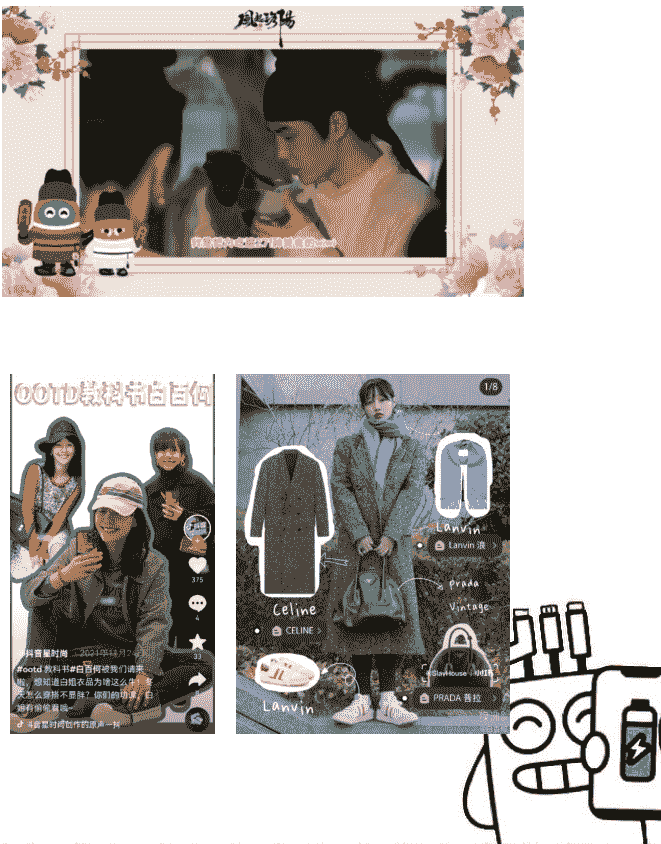

### 《川宝七天》内容示例

【周四】有料互动之《乐时空》EP2

内容框架：
1. 川宝开头自我介绍和栏目介绍。
2. 乐时空：第一周川宝体验798胶片一小时长，感受经典金曲魅力；第二周川宝与广场大爷妈妈共跳广场舞，为观众预留唱歌亮点（王源大妈）。
3. 互动互动（30s）。
4. 观众收获川宝送出的奖励（30s）。
5. 川宝俏皮作为鼓励（30s）。

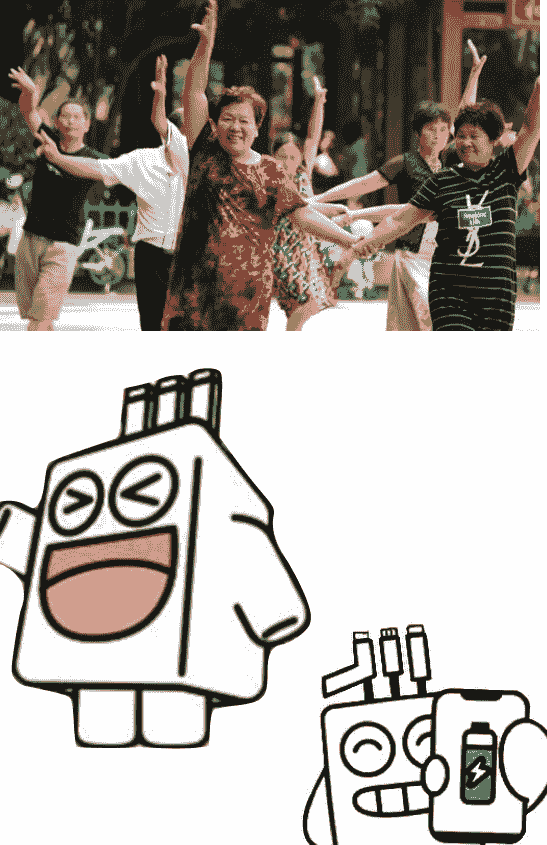

### 特殊节点策划·川宝开播

创意意释：
在官宣期积累人气，积累原始粉丝，官宣当天邀请站内多名不同领域的主播，川宝将顺序与主播连线，并在连线中与主播长的领域进行PK，展现川宝全能以及制造互动，快速感。

- 主播类型：唱歌、跳舞、搞笑、猜词等。
- 直播时长：小时以上。
- 直播内容：官方邀请主播随机互动。
- 互动内容：由主播出题，川宝打擂。

### 特殊节点策划·川宝开播

【内容示例】
- 《乐呆时空》川宝佩戴眼镜模仿艺人经典招牌动作（例如仿亦齐《心太软》MV）
- 《老朋友》川宝佩戴小花去广场和大大妈跳踩舞
- 《文明歌》川宝跳川宝版可达鸭鸭舞，左手emoji，右手答案
- 《狂想曲》川宝跳魔性性舞，反转镜坠下，然后视频180°倒转
- 《可退还》川宝做法式跳舞，emo退退！XX退退！
- 《高校声》川宝专属穿扮演服魔性骑牛庆开播

视频内容示例：
https://v.douyin.com/Y8yWuvu/
https://v.douyin.com/Y8yMm7r/

【话题示例】
#川宝开播套装
#川宝在线接单

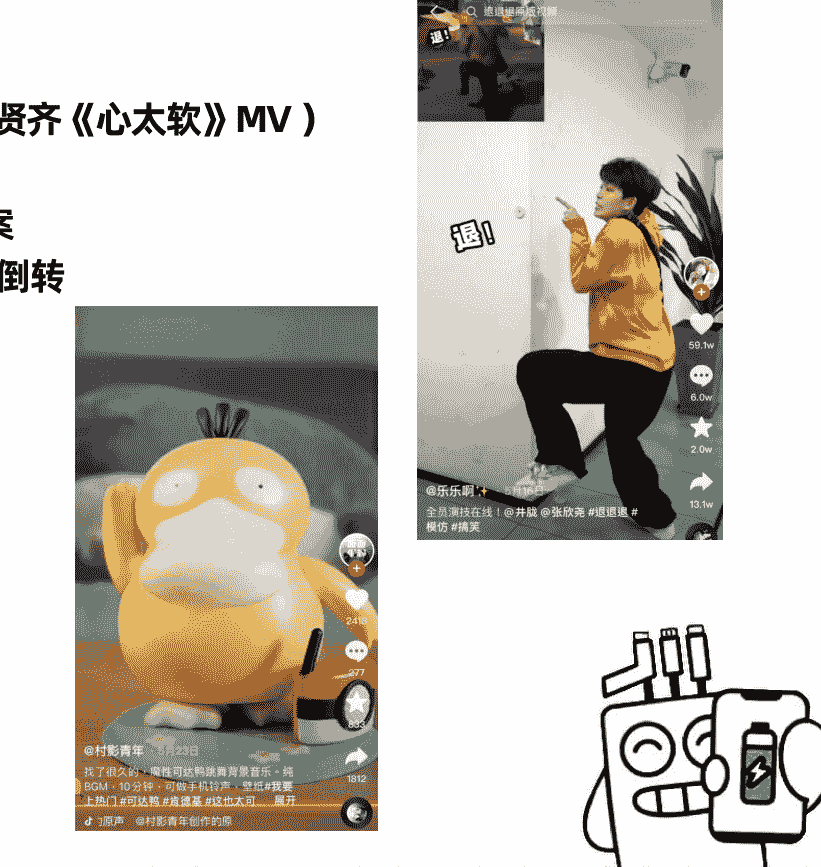

### 特殊节点策划·艺生日

【创意概述】
借助艺人生生日的节点，结合川宝社牛属性和大张伟本身的大众关注度和幽默社牛性格，以及海底捞的招牌社死生日服务，联动艺人进行海底捞式生日体验，7个川宝以海底捞服务出现在艺人休息间，为艺人庆生日，通过搞搞笑互动产生的化学反应进一步深化川宝话人设，打造出圈事件。

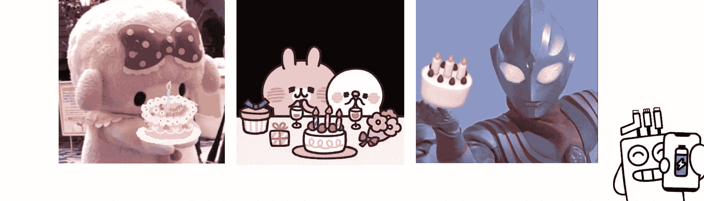

### 特殊节点策划·艺生日

【创意示例】
Step1: 在艺人生日当天，7个川宝宝进入艺人休息室，给大伟伟生日惊喜，有的负责拿灯牌、有的负责拿奶蛋糕，有的负责拿横幅，让艺人沉浸式体验海底捞社生日服务。
Step2: 抖音大博主首发生日视频。
Step3: 抖音娱乐许多KOL发布不同角度的生日视频，助推热度发酵，引导大众讨论。
Step4: 搬运至微博，微博娱乐剧类KOL进一步助推发酵。

【话术示例】
#大张伟你也有今天
#当话痛遇上柠檬

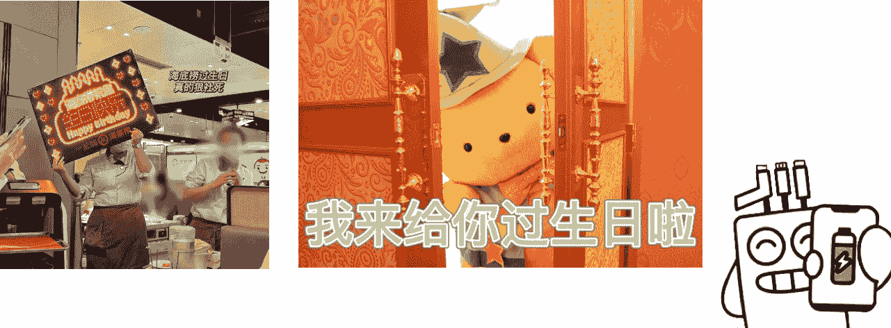

【创意阐述】

在秋分-中国农民丰收节的时间节点，结合22年疫情背景下人们长期封闭导致的户外爆发前景，联动川宝到农村中下地劳动，体验播种、收割等动作，勤奋形象与其奔放弃话疗的性格形成反差对比，带动大众下农村劳动热潮，以有趣味形式破圈传播，深化川宝鲜明立体人物形象。

勤劳川宝 在线种地

| 体验麦 | 收费标准 | 规则 |
| :--- | :--- | :--- |
| 1 小时 | 20元 | 不准带走 |

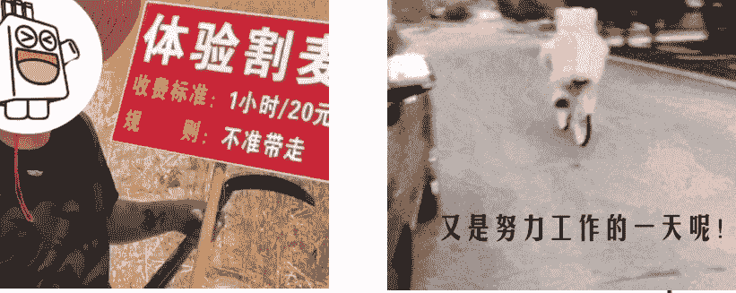

又是努力工作的一天呢!

### 特殊节点策划·秋分

【创意示例】

Step1: 在秋分时节，川宝来到农村，询问农民是否需要帮助，并下地帮助播、收割。

Step2: 抖音娱乐首发作视频。

Step3: 抖音娱乐KOL搬运发布视频，助推热度发酵，引导大众讨论。
Step4: 搬运至微博，微博娱乐KOL进一步助推发酵。

【话题示例】
#川宝的劳动作生活
#与川宝共庆丰收节
#当玩偶遇上农田

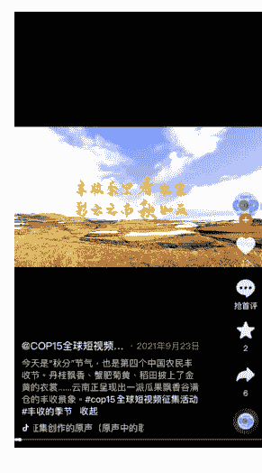
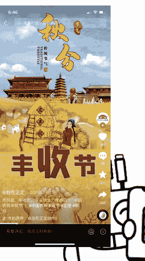

## TA是这样的川宝

## 演讲者

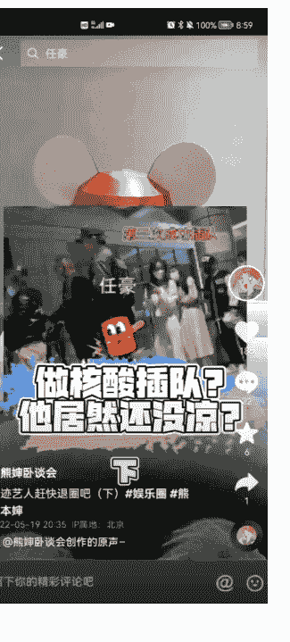
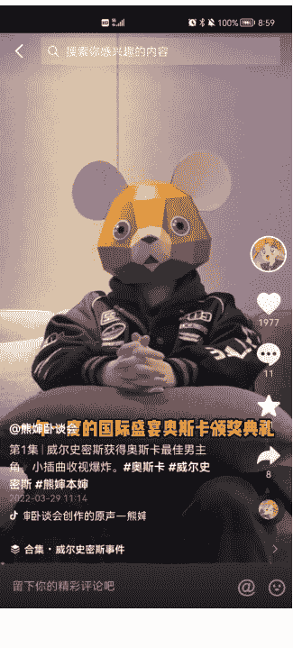
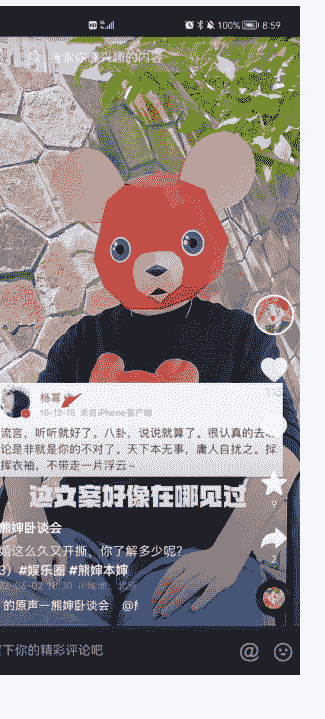

## 演讲者

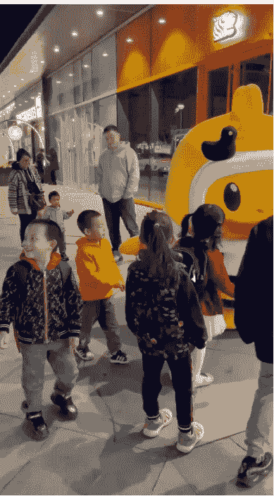
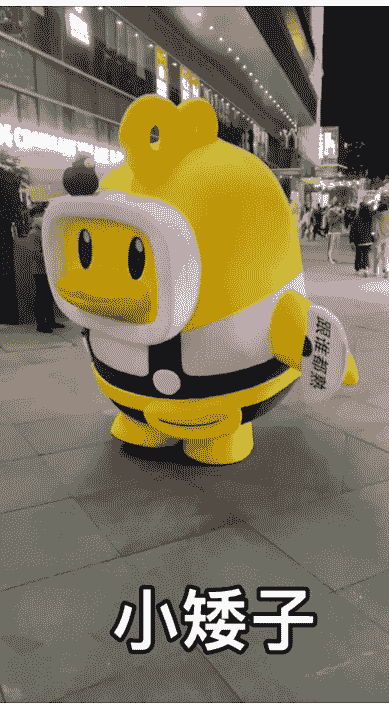
小矮子

## 扮演者

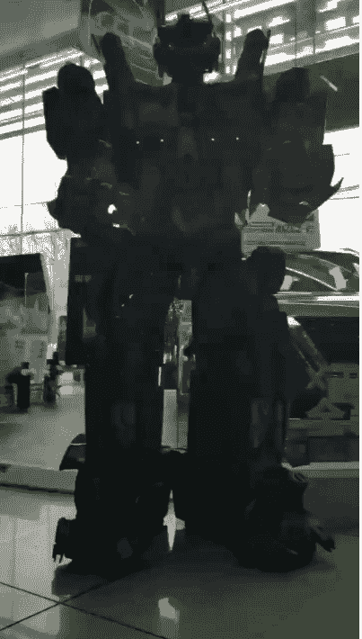

## 案例分享

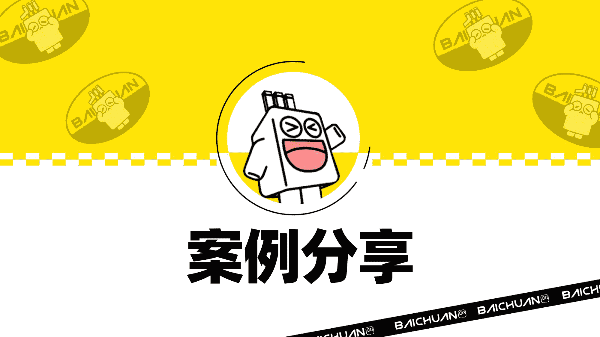

## THANKS FOR WATCHING

