# 刷医生活FINE

# 2025

# 中国家居装修行业发展研究报告

Research Report on the Development of China's Home Decoration Industry

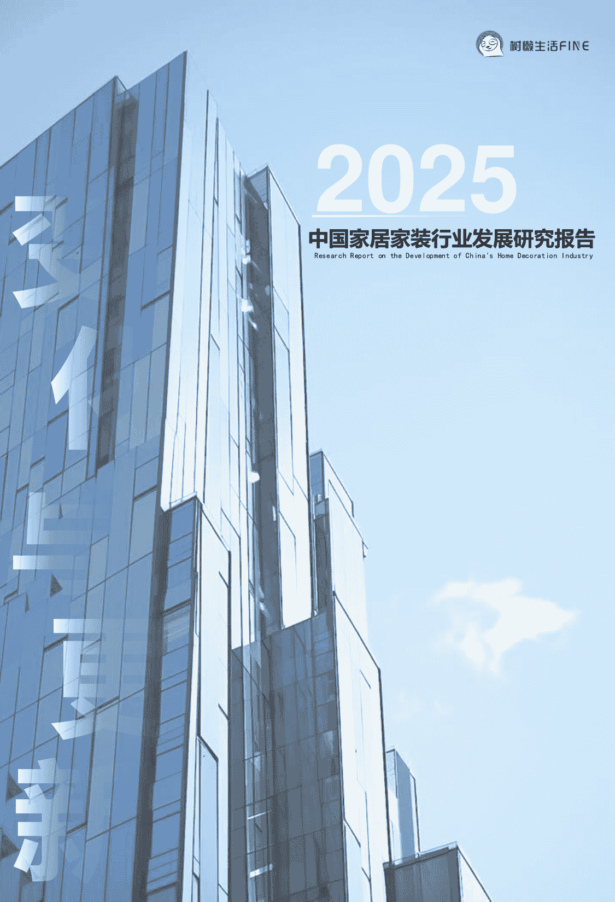

# 免费 价值 及时 专注

# 扫码加入 知识星球TOP 免费资源群

- 每日免费获取有价值资源
- 可提供各类资源搜索服务

| 热门付费文章 | 各行行业报告 |
| :--- | :--- |
| 精选图书资源 | 副业赚钱方法 |
| 职场实用资源 | AI政经自媒体 |

公众号：知识星球TOP 微信信号：jntsg8 微信信号：jntsg2

分享资料仅供个人学习，请及时删除，切勿商用传播

# 序言

致敬每一个正为美好生活而奋斗的人。

刚刚过去的2024年，波动是存在的，“难”和“变”成为每个人最直接的体感和竞争状态。持续波动的经营环境、冲击的首波、还有情绪和信心的低迷。整个行业进入了“三低一高”的新常态，即以低环境、低增长、低利润、高成本运营为主要特征的市场，行业发展和增长长度已发生本质改变——企业变革的紧迫感和氛围越来越发浓。

在形势多变的当下，波动是一种常态且无的状态。无论是波动的组织还是波动的个体，都要做好心态的心理建设，发现积极、对抗消极。应对焦虑和迷茫最好的方式还是脚踏实做实实在的事，通过更多微观的经营动作，在过程中减少错误和概率，自然就会好。

相比具有强大影响力的头部集团，它们大多数都经历过多次经济环境，国内企业也经历“变”，大多是经历过这种过程，多种因素的交织，避免完全无所失去。从我们来说，真正准备充分的企业一定能够转型。在这个过程中，成功会一瞬而就，回归取决于企业界面的表现也不容易实现。我们要允许波动的发生，宽容习惯型的回归，用更长的时间维度和眼光审视化。

波动不仅仅只有坏回，有时候是回归。今天，越来越多的企业开始强调回归并重视重要性。积极应对，对于溃败、数字面对，对于变化，这种内在的改变和觉醒，是行业进步的信号。2025年和更远的未来，我们将看到更多企业的极化。

析家居行业《变化与变革——2025年中国家居行业发展报告》如期而至。报告涵盖跨时代、战略转型、出海增量、养老经营、渠道进阶、技术领先六大专题深入研究。从定性和定量的角度，提供第三方视角的市场洞察。作为引言，我们需要新的视角，重新思考企业如何向未来转型。相信在这样的将来，很多事情和固有的格局将被重定义。

行业的下潮或许停止。在投机浮水、泡沫概念、短期的虚假繁荣的行为后，最终会让人失望，唯有凛凛消灭、走正，注意焦点，主动通过提升经营能力给组织增长和加力量，做精做专，做大做强，才能经营稳健。

感谢大家的阅读。2025年，祝大家事事顺利。

# 目录

## 1 存量时代
存量时代正在深刻影响，产业结构的未来走向

## 2 战略转型
2025家居企业战略转型将真正进入深水区

## 3 出海增量
出海成为隐形冠军战略的第二支柱

## 4 养老经济
居家养老改造成为我国养老服务体系中的重要一环

## 5 渠道进化
拓宽渠道的边界，构建更立体的渠道结构

## 6 技术领先
数字化应用领先的领先企业，它的市场优势进一步真正扩大

# 存量时代
存量时代正在深刻影响产业结构的未来走向

# 存量时代

国家统计局的数据显示，1987-2024年，中国累计销售（住宅）商品面积超过221亿平米，其中，1987-1997年，累计销售面积仅5亿平方米，1998-2024年，累计销售面积216亿平米。在这个时期，从1998年新建销售面积突破1亿平方米，到2021年的高峰时期突破14亿平米，年复合增长率为11.82%。

2022年是房地产行业的一个拐点，新建（住宅）商品销售面积达到10.3亿平米，较上一年下降26.74%。国家统计局数据显示，2022年新建（住宅）商品销售面积为8.5亿平米，同时下降14.1%。

1998-2024年新建（住宅）销售面积（亿平方米）¹

1998-2021年，新建（住宅）销售面积年复合增长率为11.82%；2022年，新建（住宅）商品销售面积达到10.3亿平米，较上一年下降26.74%，2023年进一步滑落到8.5亿平米。

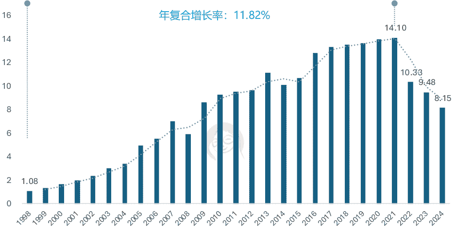

- 房地产行业从业员的数量变化：2023年，房地产行业人员数量200万，较2020年减少90万。
- 房地产开发企业数量：从2021年的105,34家到2023年的100,11家，减少523家。

1: 国家统计局数据，单位为亿平方米。

### 2005-2023年新建（住宅）销售量

从房屋数量上看，2005-2023年新建住宅共销售了17.7亿套。
从销售趋势来看，2022年出现明显的下降，预计2024年仍将持续。
具体到城市，以北京、上海、天津为例，2005-2023年分别销售新建住宅212.8万套、321.3万套、258.6万套、769.1万套。

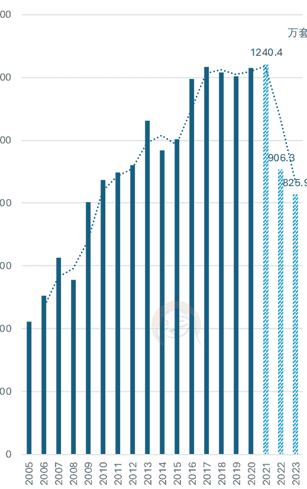

### 2005-2024年住宅新工面积（亿平方米）²

住宅新工面积从2020年的16.43亿平方米，减少到2023年的6.93亿平方米，下降幅度达58%。2024年，住宅新工面积5.37亿平方米，回到2006年的水平。

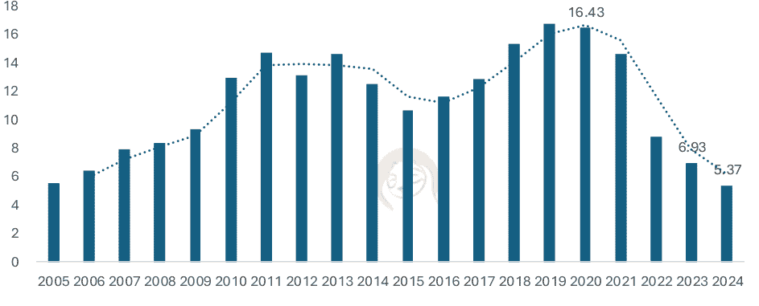
1: 国家统计局数据，单位为万套。
2: 国家统计局数据，单位为亿平方米。

### 10大城市住房建设占比

从住房建设时间的维度，销量分析发现10大城市占比超过2014年以前：北京（91.37%）、上海（92.85%）、天津（88.66%）、重庆（84.37%）、浙江（85.30%）、江苏（87.29%）、广东（89.92%）、山东（85.19%）、河南（85.69%）、四川（84.44%）。

约70%-80%的房子集中于2014-2020年，其中发展最快的时期。

| 北京 | 上海 | 天津 | 重庆 | 浙江 | 江苏 | 广东 | 山东 | 四川 |
| :--- | :--- | :--- | :--- | :--- | :--- | :--- | :--- | :--- |
| 1949年… | | | | | | | | |
| 1950-1959 | | | | | | | | |
| 1960-1969 | | | | | | | | |
| 1970-1979 | | | | | | | | |
| 1980-1989 | | | | | | | | |
| 1990-1999 | | | | | | | | |
| 2000-2009 | | | | | | | | |
| 2010-2014 | | | | | | | | |

2024年，社会消费总额指标显示，增长较快的家用电器、家具类，家居类是增速最快的。相比来看，建筑装修材料类表现并不理想同比下降2%，家具类增长3.6%。受到“以旧换新”利好政策积极影响，加之企业推出的补贴，刺激了消费者主动焕新，对家电、家居行业有一定促进作用。

房地产各个维度的增长证明，高增长的黄金时代一去不返，虽然每年有百万新增房源，但未来很难有反弹空间。目前北京、上海等超级大市已经进入存量交易为主，还有更多城市逐步进入成交为主的时代，这是不可持续的趋势。

房地产的运行牵着增长的神经，市场的景气持续。24年，政府密集推出一系列政策，例如降低贷款利率、降息，包括一线城市在内的多个城市调控限制，促进房地产跌回，提振房产预期和消费信心，促进房地产市场止跌。

基于上游地产的现状，研究认为，家居行业开始进入到一个“三低一高”的新阶段，以“低环境、低增速、低利润、高成本运营”为主，这将是存量市场的新常态。当前行业秩序仍然混乱，将经历一轮出清期。

从消费端来看，家居装修属于大可选消费，市场环境和个人（家庭）收入不及预期，“买房不入家”、“消费降级”、“严控预算”、“市场观望”、“决策周期长”、“整装爆发”成为当下消费群体的主要现状，这种现状将直接影响到企业业绩动力，甚至出现下滑趋势。

### 存量时代正在深刻影响产业结构的走向

我们将整个行业划分为装修、建材、家居三个细分行业，每个行业目前所处的发展阶段、解决的问题、未来的路线并不一样。企业需要从原有的红利时代脱出来，重塑存量时代的新增长逻辑。

### 建材企业将面临较大的冲击，转型紧迫程度 > 家居企业

对比来看，以瓷砖代表的建材品牌将会面临较大的冲击和影响，在转型的紧急程度上，建材企业远大于家居企业。核心要面对的五个变化：

变化一
- 新一代年轻群体，不会会独立建材。

变化二
- 消费低迷，市场萎缩，行业产能持续，企业增长缓慢。

变化三
- 消费者的购买决策权转移，结构性调整，家居类的经营环境结构性调整，建材类占比减少。

变化四
- 建材的零售端属性日益转变，渠道向线上化加强。

因此，对建材企业而言，当站式家装成为趋势，直接冲击的是传统的单品销售方式，建材企业需要重新思考如何应对，消费者决策权将朝着“从C端向B端转型”的方向转移。

### 存量时代，家居企业面临转型，降本提效，2025年进入深水区

对于家居行业发展态势，几个判断：

| NO 1 | NO 2 | NO 3 | NO 4 |
| :--- | :--- | :--- | :--- |
| 头部增速放缓是常态，总量在一定范围内，但是市场份额头部减少，中小企业承压。 | 线下门店数量在一定范围内，还有提升的空间，但是由于“以旧换新”的操作跟不上节奏。 | 市场是一个巨大的变革，涉及很多细分领域，未来会分化抓住细分机会。 | 转型的新周期，2025年将进入“深水区”，其本质是头部企业经历一个转型的业务等方面的调整。 |

线下门店数量增长良异，线下市场的饱和，企业的重心从“扩张”转向“优化”。

### 家装行业的2025

2024年，家装行业总体较大，个别头部企业遭遇生存危机，陆续出现倒闭，造成了损失。行业目前处于较为混乱的竞争阶段，同时，消费环境发生变化，决策周期缩短、控制预算等特点。新的环境下，小规模的企业在经营重心上有相应调整。

以XX为例，近年来，围绕居住平台，在战略层面不断升级，2023年明确“一二三”的发展，除了房屋业务之外，布局、装修、家居业务实现了第一阶段，规模突破。在024年，业务占比逐步提升。

| 家装业务在总业务的占比 |
| :--- | :--- |
| 2021 | 0.24% |
| 2022 | 8.31% |
| 2023 | 14.01% |
| 2024年1-9 | 17.17% |

■ 家装业务营收（年）
家装业务交易额来看，2024年三季度交易额117亿元，2023年同期增加了24.47%，单季度交易额和营收突破40亿元。同时，毛利率指标得到改善，2024年三季度毛利提升至31%，2023年同比增长2.1%。

1. 公开财报，单位为人民币。
2. 毛利率结果基于估算，仅供参考。

### 家装业务2022-2024前三季度 单经营数据对比（亿元）

| 分年度 | 2022年 | 2023年 | 2024年1-9 |
| :--- | :--- | :--- | :--- |
| 总交易额 | 54 | 133 | 117 |
| 年度总营收 | 50.46 | 108.5 | 106.6 |
| 年度总成本 | 35.62 | 77.05 | 73.45 |
| 年度毛利率 | 29.41% | 28.99% | 31.00% |
| 分季度 | Q1 | Q2 | Q3 | Q4 | Q1 | Q2 | Q3 | Q4 | Q1 | Q2 | Q3 |
| 交易额 | 2 | 13 | 20 | 19 | 27 | 34 | 33 | 39 | 34 | 42 | 41 |
| 营业收入 | 0.88 | 10.19 | 18.46 | 20.93 | 14.08 | 26.25 | 31.77 | 36.64 | 24.09 | 40.4 | 42.13 |
| 营业成本 | 0.67 | 7.24 | 13.04 | 14.67 | 9.77 | 18.48 | 22.52 | 26.28 | 17 |

爱空间打造的生活方式为核心的产品、信息化系统、产业三大基础设施，其目的是为了兑现客户的承诺。口播提升的过程中，伴随着产品服务供给能力的优势，以及最后公里的交付服务。

产品驱动：深刻洞察用户的生活方式，提升产品的研发竞争力。例如，2024年上半年，爱空间发布“新一代整装”，为消费者打造“更好用的家”，从显性需求到隐性需求的进阶，从关注物品到关注人的跨越，推动家居行业从“装潢时代”到“装家时代”的转变。

#### 2018
Matrix 系列 二连接三维的选择

#### 2022
Home-X 系列
颜价比对比
对接子100%友好

#### 2019
α-Next 系列多功能适应组合

#### 2020
Life 12+ 生活性隔板
源木 蓬霉 寓意安安静

#### 2023
Home整装-Y系列

#### 2024
- L7-聚焦成长型家庭打造定制的整装居住社区
- Y5-解放全一代年轻人
- X9-更全系列顶配高品质

#### 2024
爱空间新一代居住坐标系

### 让生活更好
重构家庭居住价值的五大要素

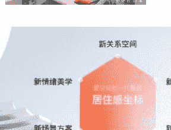

交付驱动：只有改善从业者的工作体验，才能让客户的满意度发生改变。爱空间围绕产业“钱不断、安全全、有尊严”的核心需求，提升专业水平，增强归属感和荣誉感，才能让家居行业发生切实在的改变。

### 聚焦本地，一城策

家装是本地化的生态，装修意味着从关注全局到聚焦本地化，每个城市的市场都有自己的独特。存量时代，并不意味着只是存量可以，更多是“存量和增量并重的发展模式”。

例如，2024年有17.5万的二手房交易，27万左右的新房交易，上海二房成交24.27万（上海、天津、重庆每年都有大万新房的销售数据）。部分城市仍然有大量新房成交或交付，很多存量房的房子属于较新房或是次新房，每个城市的实际情况并不一样，各地的装修公司还要根据在城市具体情况，来制定相应的经营策略，深入研究和自己的目标客户，持续实现大城市的业绩厚度。

### 北京2024年存量房市场建筑面积划分

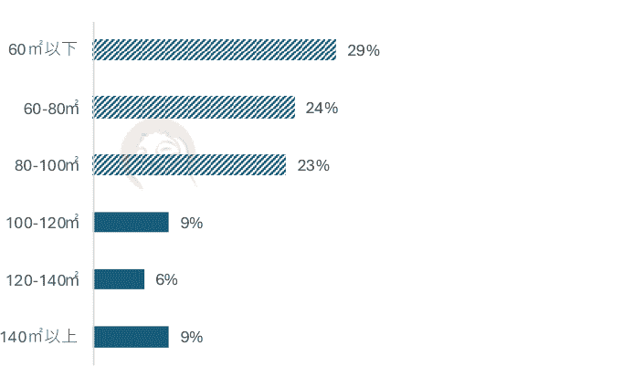

- 从房屋交易结构的角度出发，以北京为例，从图中可以看出，100平方米以下为主流面积段，占了76%的市场，其中60-80平方米占24%，60平方米以下占29%。
- 这意味着，在北京的装修需求中，如果聚焦服务60平方米以下的客群，那么你面对的是近30%的市场。这部分客群，可能隐含着“小住一套，老房新生，人居关系”的需求。从签约面积粗估算，北京每年大概有500~600亿的市场规模，最大的装修公司占比55%，市场分散。140平方米以上和60平方米以下的客群，同样需要的资源的投入和打法。因此，聚焦本地化、细分市场值得更加深入的思考，未来大有为。

### 激活存量时代市场机遇的另一个“新”解法：绿色工业定制内装

存量时代的核心在于，所有的参与者都以新的视角来审视这一不可忽视的趋势，需要切换和思维，寻找适配当前阶段的新解决方案，以应对不确定性的变化和挑战。

作为存量房时代，答案不是一种。近年来，围绕“旧改”催生了不一种的模式，社区、物业（厨卫焕新）、轻装、单空改造、集成式装修等，也吸引了不同类型的公司加入战局，物业、创业公司、家居公司、家居建材、电商平台等。

过去一年，“旧改”迎来政策红，这一政策将持续到2025年。在推动旧设备更新和消费品以旧换新方案中提到，支持家电产品以旧换新，旧房装修、厨卫等改造、家居老化改造用材料和材料，促进智能化家居消费。各地积极响应，推出家居装修“焕新”工作细则。

> 以旧换新 老化改造 环保 装配式 改善需求 家具补贴 厨卫翻新 旧房装修 轻装 回收利用 绿色家居 老化改造 15% 定制内装 一级能 智能家居 绿色化 家电补齐 20 布局优化 2025政策趋势

从企业出发，以万华生态为理想，作为家居运营，万华生态自199年以来，坚持“空间无界”的理念，持续投入研发，如今已成为家居的基础，产能从500万，未来3-5年将达到。基于存量房时代的深刻洞察，万华生态自19年开始发布绿色工业定制内装体系，将房屋拆分为顶、地、水、卫等大模块，改变传统的市场方式，现在采用集成施工，极大交付效率，像汽车一样整合家居，向行业提供绿色化、工业化的解决方案，适应存量房。在这次“家居焕新”行动中，万华生态在烟台、南京等地充分发展绿色工业定制内装，为消费者提供家居焕新的解决方案，激发了消费者的意愿。万华生态十大体系

- 工业化定制墙
- 工业化定制门
- 工业化家具收纳
- 工业化集成整体厨房
- 工业化定制吊顶

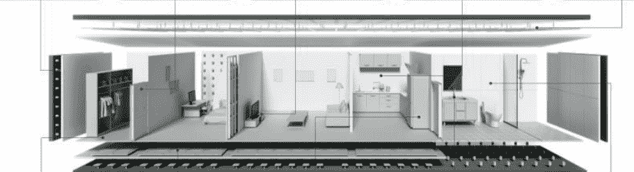

- 工业化定制地面
- 工业化集成供暖
- 工业化集成供水
- 工业化定制整体卫浴

> 存量时代，房地产的高速发展充当“火车头”的角色，自身前进的同时带动整个产业链。然而，当中国市场逐步进入存量时代的背景下，意味着轨道变了、市场变了，我们还需要寻找一个新的“火车头”来继续引领的发展。以装修业务为驱动，带动上下游产业链，包括建材、家具、电器、家纺等，会产生巨大的规模效应。——万华生态董事长 郭坤田

2025年家居战略转型将真正进入深水区

战略转型是一个巨大的课题，国内学者对此进行过研究，并从各个角度强调战略转型是企业可持续发展的关键。对于企业应该如何开展战略转型，对转型环境的识别、动态能力评估、实践过程、路径选择、影响战略转型的要素、关键要素如何相互作用、以及如何进行战略转型等一系列问题仍然存在共识，需要时间破解。

结合各项观点，战略转型的内涵可以理解为：面对经营环境不断的变化，企业原有的能力在新环境下提供足够的竞争优势，或者出现了新的能力可以带来更大的价值，通过战略转型来实现企业资源配置，重新设定目标，寻找新的发展机制。这部分讨论的范围是家居企业的战略转型，主要涵盖定制和成品企业。需要特别说明的是，由于不是学术性质，而是侧重于家居企业的战略转型。因此，在概念和定义上，我们将尽力确保准确性和一致性。

### 家居业的当前发展及战略转型的背景

#### 一：经营环境进入新常态阶段

- 行业整体进入“三低一高”阶段，即“低温环境、低速增长、低利润、高成本运营”为市场的新常态。
- 房地产住宅新建、新开、销售等数据均不同不同下降；
- 低速增长：A股家居上市公司2024年营业收入下滑的数量占比64.4%。
- 低利润：营业收入下降、原材料及成本上升，竞争利润下滑；

相较之前，2024年的经营环境进一步恶化，企业面临“集体下滑”的现状，很难与上一年的业绩打平。在这种形势下，战略转型的紧迫和危机感前所未有。2024年，大概是家居行业有史以来最危险的一年。

#### 二：企业的增长瓶颈

从经营数据来看，无论是定制行业CR9，还是成品行业CR7，各自的营收呈下降趋势。树衡预测，2024年，定制行业CR9总营收约在490亿元左右，较2023年的557亿元，同比下降12%左右，净利润40~50亿元，较2023年的57亿元，同比下降约15%左右。

2013-2024年定制家居上市企业营收总额变化曲线（亿元）³

以018年分为界限，2013-2018年定制家居CR9的总营收复合增长率为27.26%，2018-2023年期间复合增长率为10.2%，增速明显放缓。

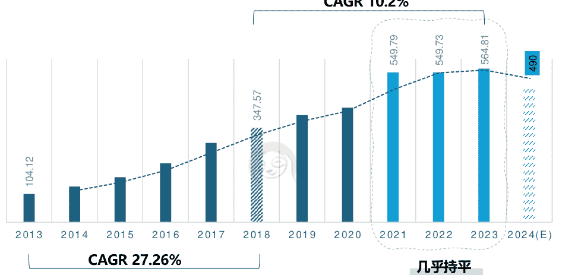

树衡预测，2024年成品家居CR7总营收约在634亿元，较2023年下滑5%左右，净利润40亿元，同比下降13%。营收下滑幅度低于定制行业，其中一个原因是成品家居大多处于亏损状态，业绩差异较大。

2018-2023年成品家居上市企业营收总额变化（亿元）

与定制企业相同，2022-2023年成品家居营收总额基本持平，部分成品家居境外收入占比较高，国内收入虽下滑，但是稳定增长。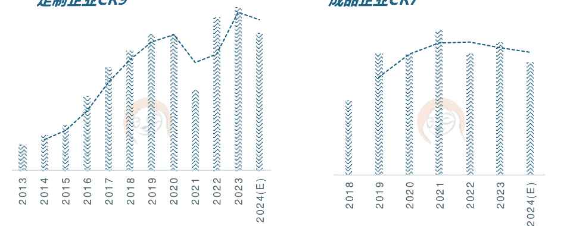

- 1: CR9指欧派、索艺、老邦、好客、顾德集团、我乐家居、欧尚等；
- 2: CR7指酷思、敏华、慕森、百合、欧华等，为方便理解，这里CR9和CR7均为相对概念。
- 3: 各家家居发现报告，单位：人民币，2024年三季度预测数据，不构成投资建议。

#### 三：内卷加剧，企业利润持续波动

与2019年相比，2024年前三季度的9家定制企业上市毛利率（中位数）从2019年的38.52%下降到34.68%，下降4个百分点；净利率（中位数）从1.56%下降到6.30%，下降5%。

同一时间维度，比较定制，成品企业的毛利率和净利率下降幅度并不大，总体看只有2%的波动。但是横向对比，企业的毛利率水平差异很大，纵向单个样本每年的经营数据很大，尤其是净利指标，甚至会出现营收几十亿元却大幅亏损的情况，非常异常。但顾家家居在经营层面是比较稳健的。

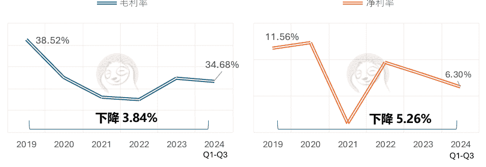

- 2: 顾家财报数据来源，研究。

### 七家成品家居上市公司的毛利率与净利率（中位数）走势图

| | 毛利率 | 净利率 |
| --- | --- | --- |
| 2019 | 39.72% | 8.62% |
| 2020 | | |
| 2021 | 2.49% | 2.27% |
| 2022 | | |
| 2023 | 37.26% | 6.35% |
| 2024 Q-1 | | |

### 四：行业整合效应不明显，但企业内部的品牌配置发生变化

近几年的经营数据反映企业经营连续延续，同时表现整合效应不明显，上市公司所占的市场份额并没有明显变化，各自的比例一直在重新配置。也就是说，更大的份额在加速整合给经营能力、品牌能力强的公司，各方面跟不上的公司份额被不断削弱和击破。

### 成品家居和定制家居上市公司2024年前三季度营收份额占比

| 其他家居 | 19% |
| 欧莱家居 | 40% |
| 老邦家 | 11% |
| 美家家居 | 5% |
| 酷思股份 | 8% |
| 妮家居 | 30% |
| 梦百合 | 13% |
| 商品宅配 | 8% |
| 索奇 | 22% |
| 豪门 | 13% |
| 软华控股 | 25% |

### 五：全品类成为企业上一个阶段的进阶

“水涨鱼，水大鱼”的增长时代已经成为过去。无论是定制行业还是成品品类，行业开始分化，个体差异很大，即使是相同类型的企业也很难胜出舒适、一致性的发展规律，因为各家公司的能力不同，驱动增长的因素存在差异较大。

当前，定制家居和成品的品牌界限趋于模糊，双方在相互融合，但是目前各自的核心业务并未整合。可以将这两类企业进行对比，但不能一概而论，各自面临的问题、收入成本、费用结构并不相同。我们在定制品类领域选取了3家企业，以2017-2024年前三季度为区间，实现增长的前提是市场判断、环境洞察、路径的选择以及能力的提升，而不是把概念当作转型的解法。

### 销售费用维度：2017-2024定制与成品对比图

从历年的销售费用来看，成品企业的销售费用大于定制企业，前者几乎是后者的两倍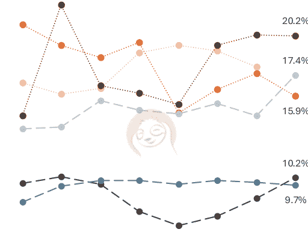

- 欧派家居
- 顾家家居
- 索菲亚
- 喜临
- 志邦家居

### 管理费用维度：2017-2024定制与成品对比图

从历年的管理费用来看，定制企业的管理费用大于成品企业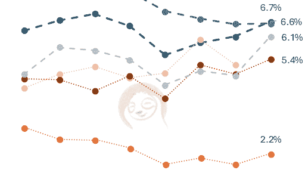

- 欧派家居
- 顾家家居
- 索菲亚
- 喜临
- 志邦家居

销售费用和管理费用的差异，反映出两类模式的差异。基于各财报数据总结。

### 家居企业推进战略转型的过程分析

战略转型是一个系统过程，包括“转型动因、转型准备、转型实施、转型成效”四大阶段。目前，大部分家居企业对于战略转型的动因有了比较清晰的认知，将抽象的动态能力转化为具体的、可操作的能力，最后还需要输出战略转型的成效。借助各种研究方法，结合企业实际情况，最终梳理战略转型的流程模型：

| 转型动因分析 | 转型准备 | 转型路径实施 | 转型成效 |
| --- | --- | --- | --- |
| 市场环境本质变化 | 扫描与洞察 | 愿景与使命 | 新的商业模式形成、业绩改善与提升 |
| 存量时代 | 方向和时机的精准把握 | 路线与目标设定 | 增长方式的转变 |
| 增速下降或增长过快 | 关键要素梳理 | 组织与人才 | 扩大市场份额 |
| 消费者需求变化 | 营造紧迫氛围、构建组织团队 | 资源配置与整合优化 | 提升行业地位 |
| | | 文化、理念、制度与政策 | |

| 企业动态能力 | |
| --- | ---
| 环境洞察能力 | 管理控制能力 |
| 学习吸收能力 | 持续创新能力 |
| 资源整合能力 | |

> 树建模认为，2024-2028年是家居企业转型周期的关键期和换挡期，意味着至少要5年的时间来评价转型是否有效。如进展顺利，届时会看到一部分企业实质性的改变，在这个过程中，一定会随着企业的频繁调整、业务波动、组织变革、逻辑转型重建、资源配置优化等一系列变化。2025年，家居战略转型将真正进入深水区。

头部家居上市公司的战略转型是近几年的焦点，这是一个长时期推进的过程。

顾家居作为家居行业的龙头企业，推进战略转型的步措不断加速，近两年来，顾家居在新的战略布局、公司治理、组织层面等各个维度进行了很多变革。在2016年上市之前，顾家居就已经开始了转型的之路，每个阶段的重点不一样。接下来，我们以顾家居为样本，研究它如何推进战略转型，寻找周期中的发展机会。同时将结合行业制度进行对比分析，反映其中的差异。

### 顾家居2016-2024年前三季度经营数据趋势变化图（亿元）

从数据来看，2016年至2023年，顾家居营收从47.5亿元增长到192.1亿元，复合年增长率21.93%，2021年之前维持高速增长，2021年至今为4年，增速明显放缓，总营收在190亿元上下波动。

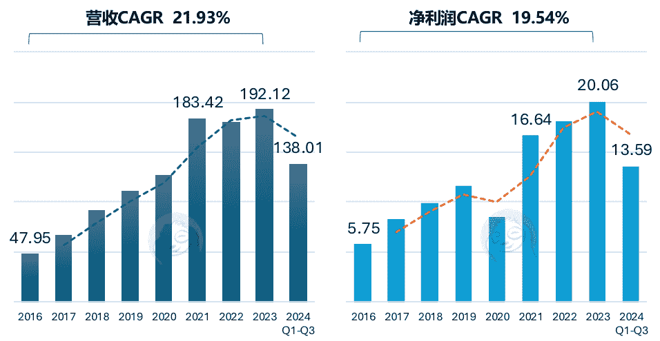

其中，境内业务109.35亿元，境外75.15亿元，由（下图）可知，境外的增速比境内增速更快。

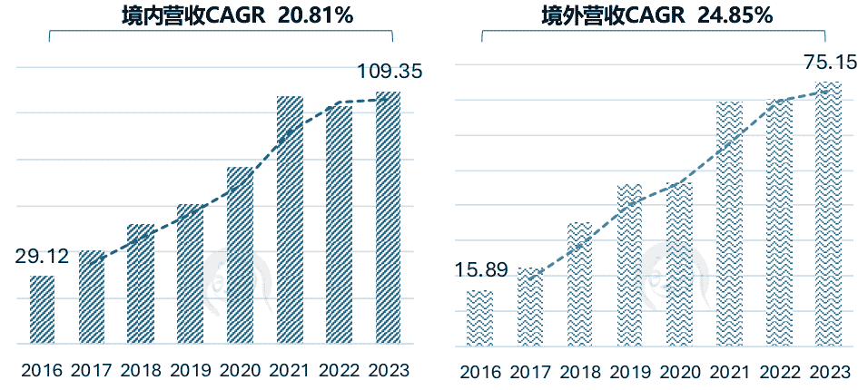

- 1：顾家居的样本分析代表行业转型研究视角，仅供参考。
- 2：各家财报披露数据，单位亿元人民币，经研究结论。

### 顾家居2016vs2023年境外收入占比变化图

下图所示，顾家境外收入占比持续扩大，较2016年境外收入占比增长5.4%。2023年境外收入75.2亿元，是A股企业境外收入排名第一的企业。

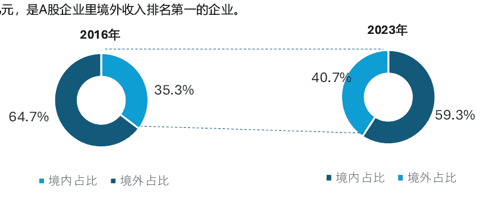

从行业结构上来看，顾家的海外业务占比已达到41%，这就意味着理解一个顾家以及它的战略转型布局，站在全球的视角角度。顾家的战略转型从2016年前后开始转型，按照每三年为一个发展周期，如今已经进入了“四”周期。

每个周期的策略重点和突破点有所差异。例如，在“三”周期，布局定制家居类，从专业家具向专业体家居制造商转型。在“二”周期，开启零售转型，构立立体渠道，投入“仓配”能力建设。

在“三”周期，在行业内优先将家居类业务调整为营销业务；2023年顾家内贸发布“一体双翼”新的业务策略；并迈出品牌出海的坚实一步。2024年是“四”周期的第一年，多品类布局成熟度进一步提升，在完成股东与治理变革之后，首次明确从“中国梯队”到“中国第一”的战略意图。每个周期都有衔接和延续，最终的目的是单品型向多品牌、多品类、全品类、全渠道的增值服务能力的零售运营商转型，这是一个层层递进的演进过程。

### 2015-2024年顾家居在不同阶段的重心转向

顾家居从单品企业转型为一体式、多品牌、全品类、全渠道的有服务能力的运营转型。

- 内线下转型
- 向外多元化/本土化的价值链一体化转型
- 定制化实现预计业绩连续突破10亿元
- 完成定制与零售化变革
- 从“中国第一梯队”到“中国第一”的战略意图：股票激励，同时打造更年轻的高管团队
- 发布八大生活方式新主张，品牌类整合，打造一体化生活方式领先优势

#### 2024
- 坚持1+N*X渠道战略，扩大规模，进驻购物中心
- 仓配：从仓储覆盖，主动覆盖
- “3+N*X”覆盖模式
- 墨西哥基地开始建设
- 组织架构大改革，将品类事业部调整为营销事业部
- 业务增长+运营管理双轮驱动
- 顾家全屋定制升级为“一体化整家”
- 发布“一体两翼，双核发展”的策略
- 构建“一体三翼”渠道领先，两层平台支撑、三个价值链快速反应的新型矩阵组织模式
- 境外：首次在境外打造属于品牌 KUKA HOME 标杆，迈自有有品牌海外的重要一步

#### 2021
- 规模过百亿
- 构建“1+N*X”的立体渠道，渠道管理数字化
- 建设“仓配”能力
- 建设越南南部基地（标准餐厨家具）

#### 2022
- 实现干线物流的管理
- 成立整装业务经营部，推出“顾家星选”，以独立的主品牌系列家居装渠道，建立主链业务道
- 建设越南基地（标准餐厨家具）

#### 2023
- 零售转型
- 从三级发展领先，开始规划定制和软件的融合，同步开始建设定制工厂

#### 2018
- 从专业制造向专业体家居转型

#### 2019
- 采用业务发展和战略双轮驱动的策略

#### 2020
- 开始布局“定制家居”

#### 2015-2017
- 行业调研，构成投资建议

### 顾家居2017-2023年产品占比及总营收变化图

总来看，2015-2024这十年，顾家居的营收实现了5倍的增长，净利润实现了4倍的增长。从数据来看，近几年行业做了很多变革和主动动作，给企业带来三个方面的变化：

维度维度：营收总量扩大，品类多元化，未来会形成以客厅、卧室、定制三大空间的矩阵（营收占比超过90%），以品牌、全渠道的打法连接。从数据来看，沙发占比逐下降，配套品类稳定在17%左右，卧室品类从13.2%增长到21.3%，定制品类从29%增长到36%。沙发作为核心品类稳健增长的同时，卧室、定制品类的增长，尤其是定制类的突破，将对行业产生积极的作用。

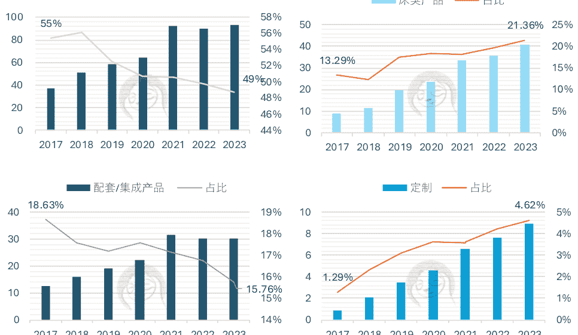

研究调研显示，2024年定制品类将实现10亿元规模。三大空间的融合程度和速度，决定一体化整合能够取得的突破，以及结构性的增长。2024年财报披露，门店迭代速度进一步提升。一个阶段，顾家在终端零售的单店效率有望提升。

### 效率提升：数字化运营降本增效

成品企业与定制企业的不同之处在于费用结构存在较大差异。整体来看，成品企业的四项费用明显高于定制企业，成品企业的销售成本普遍较高，管理费用相对要低一些，实在取得了一定成效。近年来通过数字化投入、组织调整等措施，使整个企业的费用比例有所下降，尤其是销售费用和管理费用降低。欧派家居对费用的控制在行业也是最好的，我们把两者做了一组对比：

#### 销售及四项费用对比
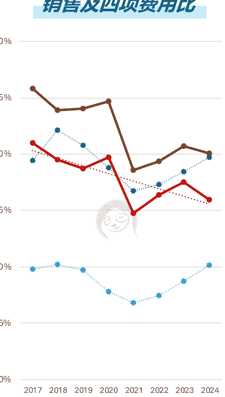

#### 管理费用对比

### 组织维度：打造年轻更有活力、精干的职业化管理团队，形成独特的运营模式

从董事会到执委会都采用了职业化管理团队，而不是家族式的模式，这一以来都是顾家在组织运营上的特色，也是公司治理的亮点。在人才的引进和选拔上，相对更加开放包容，例如，在2024年6月进行的人员任命上，执委会涌出了2位80后总裁，董事会成员有3位80后，充分体现了年轻化的特征。此外，引入了多业内及跨行业的高级管理人才，保障了人才多元化，激发了组织的活力。

- 结合过去十年的业务布局，顾家持续不断投入资源提升供给能力，建立了自己的竞争力，实际上已经成为家居行业中一个特殊的样本，以其领先境内外的体量，在行业内很难找到一个完全对标的对象。
- 行业的发展周期（2024-2028），恰好覆盖了顾家“四三”和未来“五三”战略周期，无论对行业还是对顾家自身，都关乎重要。新周期，顾家准实现从“中国第一梯”到“中国第一”的战略意图。支撑这一目标的前提，在战略转型的过程中，真正能够积累的能力转化为强大的生产力，回归常识，创造用户价值，同时在经销商转型和发展的大课题上拿出创新的应对，赋能经销商平稳过渡转型，才会让整个行业发生“质”的改变，这将下一个阶段评估转型成效的重要维度，也是最期待的。

## 出海增量

出海成为隐形冠军战略的第二支柱

### 中国家居A股上市企业2024年前三季度增长比

树研究所参考89家A-家居上市企业企业2024年前三季度财务数据，从企业最新营收数据来看，海外收入的企业在国内家具市场需求呈现下降的趋势，仍呈现向增长的态势，65家拥有海外收入的企业在2024年前三季度中营收增长高达49.2%，而无海外收入的企业仅增长1.4%。

从2024年中国家居企业年前三季度呈现的财务数据来看，海外占比超过50%的21家A股上市企业中，增速快分别是源家居+50.5%，乐歌股份+48.03%，石头科技+38.49%，亿家居+35.58%，恒林股份+35.24%。剩余24家无海外收入的企业，仅增长5%。

- 1：参考2023年海外收入占比从高到低排列，数据不含家具、工程品牌。
- 2：海外收入超过50%的依据为2023年营收占比。

2023年，65家A股上市企业营收总额为970.8亿元，占营收总额的23.89%。结合业务布局情况，2024年海外收入数量增加至67家，营收总额将增长到1060亿元，预计增长9.18%。

### 2023-2024年家居上市企业境外收入总额变化

预计2023年中国A股上市企业海外收入总额将维持1855亿元，2023年复合增长率达6.69%。

### 境外收入排名：顾家居第一，恒林股份第二

按照2023年境外收入排名，顾家居为75.15亿元首位，对比2022年增长6.84%，其次是恒林股份66.4亿元，同比增长33.6%。中国A股上市企业境外收入在10亿元以上的有27家，其中9家以销量为主，如顾家居、石头科技、佛山照明等。

### 2023年中国建材、智能家居境外收入超10亿元排名

对比2022年境外收入情况，增速最快的是源家居（48.87%）、顾家居（48.23%）、喜临（46.49%）、恒林股份（33.96%）、匠心家居（31.46%）。

- 1：2023-2024年预测值，家居上市企业境外收入统计不包括家具、工程装修以及B股企业。
- 2：下划线指含。
- 3：listed为A股家居企业，不含顾家、恒林等公司，佛山照明等其他上市公司。2022年趋势都不理想的下降：欧星、伏州、尚家居底部注释：31.5%。

### 出海四大阶段

如果用概念区分，出海业务存在“国际化”和“全球化”两种不同的状态。过去几十年家具企业出海的核心贸易方式，就是把产品卖出去，走向国际化；而如今我们谈的“全球化”则是需要企业整合全球资源配置，应对全球市场竞争，要求企业具有更高的战略视野。

在2015年后，大多数中国家具企业是走向国际市场，以制造优势走向全球化品牌代工。在之后家居企业逐渐发展成熟，开始从早期单一模式向ODM、OBM等多元模式转型击海外市场，通过资本力量进行海外品牌并购、跨地域投资建厂，包括在异国建设新零售门店。借鉴互联网时代，跨境家居电商的上市，家居出海也正式进入全新的阶段。

- 2002-2014：工厂制造供给海外：OEM, ODM
- 2015-2017：政策红利窗口期
- 2018-2022：资本海外品牌并购
- 2023-现在：出海业务成为高增长点

#### 2002-2014 工厂供给海外: OEM, ODM

第一真正的中国出口国，是中国正式成为WTO第143个成员国，当年中国贸易出口额为5096.5亿美元，2002-2004年中国对外贸易规模快速增长，年均增长高达24.9%。

中国家具及零件出口规模在2002年的51.7亿美元，迅速增长到2005年的135.04亿美元，复合增长率达到35.5%；2007年家具出口额232.68亿美元，同比增长34.95%。

2002-2014年期间，中国出口实现了规模新高，还实现了出口多样化，中国家居种类丰富，此时出口方式以OEM为主，ODM为辅。

#### 2015-2017 政策红利窗口期

海关总额和试点区域化。这一期间中国企业逐渐走向国际市场，如伊利、华为、海尔等企业，不仅局限于加工，更多是在打造自主品牌。

#### 2013-2024 中国出口额排名

（单位：万/美元）

| 出口值 | TOP1 | TOP2 | TOP3 | TOP4 | TOP5 | 时间 |
| :--- | :--- | :--- | :--- | :--- | :--- | :--- |
| 2013 | 12.71万 | 13.71万 | 自动数据 | 电力 | 钢铁 | |
| 2014 | | 设备设备 | 机械 | | | |
| 2015 | | | 自动数据 | 其他 | 杂品 | |
| 2016 | | | 机械 | 设备设备 | 输品 | |
| 2017 | | | | | | |
| 2018 | | | 自动数据 | 电力 | 通用 | 金属 |
| 2019 | | | 设备 | 机械 | 房屋 | 家具 |
| 2020 | | | | | | |
| 2021 | | | 电力 | 铁路 | 杂品 | 金属 |
| 2022 | | | 机械 | 车辆 | | | |
| 2023 | | | | | | |
| 2024 | 18.39万 | 25.45万 | | | | |

- 1：中国海关署统计数据。
- 2：中国海关总额统计，差异调整。

#### 2018-2022 资本海外品牌并购、跨境投资发展趋势

家具出口额的增长，标志着中国家居海外进入第三阶段，这五年间，资本驱动的海外扩张成为主要特征。2018年家居企业上市以来，资本海外并购成为家居快速国际化的有效途径。2018-2024年，以曲美家居、顾家为例，家居行业海外并购15起；百梦合、敏锐格、欧丽丽等家居企业在境外生产基地

### 2018-2024年中国家居及零售出口数据

2024年前11个月，家具及零售累计出口额同比增长7.5%，仍保持稳定的增长。

| 2018 | 2019 | 2020 | 2021 | 2022 | 2023 | 2024 1月-11月 |
| :--- | :--- | :--- | :--- | :--- | :--- | :--- |
| 3,865 | 3,730 | 4,039 | 4,772 | 4,639 | 4,517 | 4,326 |

### 海外并购

### 2018-2024年中国家居企业海外并购案例分析

海外并购集中在2018年左右，贸易战对中国家居出口的限制，以及家居企业上市热潮和资本市场对行业的大支持，许多家居企业在此时期制定了战略，通过海外收购进入新的目标市场。

| 时间 | 企业 | 被收购企业 | 被收购企业者 | 收购金额(美元) |
| :--- | :--- | :--- | :--- | :--- |
| 2018 | 顾家家居 | Natuzuki | 意大利家具品牌(上市公司) | 65000欧元(51%) |
| | | Lenz | 德国高端软体企业 | 4156.5欧元(99.2%) |
| | | Nick Scal | 澳大利亚零售零售 | 7727.6美元(13.6%) |
| | 喜灵博 | 嘉兰美逸韦蓝&M&D | 意大利利豪高端制造企业 | 4470万美元(5%) |
| | 大自然家居 | ALNO 家具&Westman | 德国廊线 | |

### 2023-现在 出海成为新增长点

| 境外比重80% | 境外比重50-80% | 境外比重20-50% | 境外比重0-20% | 无境外收入 |
|---|---|---|---|---|
| 8 | 4 | 4 | 25 | 23 |

### 新零售门店

除加工以及跨境电商的方式，也会有家居企业洋过海去线下零售门店。如志邦家居、顾质家、顾家乐、欧家策、索亚亚、左向家居、林氏家居等。零售门店的落位标志着零售企业从产品出品正式转向品牌出海。

- 欧家策：2024年，欧家策全球门店陆续开启，如科威特展厅、卡尔尔展厅、越南胡志明工程门店等，并且欧家也在海外新西兰和马来西亚开设多家门店。

- 林氏家居：截至2024年第四季度，林氏家居在海外有15家门店，涵盖澳洲、新西兰、日本多地、菲律宾以及大型旗舰店正在投入，并计划年内开设40-60家海外门店，重点布局东南亚，同时进入拉美和东地区。

- 志邦家居：2024年志邦家居位于东地区的科威特专卖店，截至2024年，志邦家居海外零售的线下包括新加坡、中国、泰国、菲律宾、柏镁、马尔代夫、马来西亚、印度尼西亚等十几个国家。

- 居然之家：2023年12月9日，居然在印度首买“KUKA”旗舰店开业，印度有2家门店。

- 索亚亚：2024年1月12日，索亚亚在胡志明的高端定制体验店正式开业。

- 居然之家：2024年3月30日，居然之家海外在深圳店开业，吉隆坡店正在筹备，并计划开发印尼产品线和马来西亚购物渠道，涉及当地门店也达成了初步合作。

### 未来增长空间

出海的挑战与机遇并存，多数人最关心的几个问题：

- 我们出海到哪里？
- 全球家具市场份额
- 百亿跨境电商品牌
  - 恒林股份 / 逸基股份
- 跨境电商大优势
- 海外零售商挑战
- 海外/国际物流
- 发展新增量

家居出口市场还有多少

中国已经成为出口大国，2024年中国对外出口国家及地区前四分别是美国、日本、英国。

根据Statistic数据显示，2024年全球家具市场收入将达到7662亿美元，2024年-2028年，家具市场还将保持5.02%的年增长率。

其中美国市场规模约2530亿美元，同比增长3.78%。行业了解到，过去美国人家具进口需求主要来自中国，2018年从中国出口到美国市场占比54.6%，贸易贸易使得2023年这一比例降至10%。

第二市场，2023年欧洲家具市场规模为2362亿美元。预计2023年到2027年，欧洲市场还将保持3.37%的年复合增长。欧洲市场中，排名三国的国家，分别为德国、法国和英国。中国家具出口主要集中在欧洲市场，占比几乎平稳。

中国在欧洲家具进口中最高占比高达19.8%。2021年海运上升，欧盟向转向印度、马来西亚等其他国家进口，2023年中国成为欧洲家具主要进口国，尤其在2024第一季度荷兰从中国进口量显著增长，同比增长42%成为在中国欧盟主要市场，同时和德国的中国家具进口量也增加了近30%。

日本政府2024年版《通商白皮书》显示，1406个种类一半来自中国，是美国的2.5倍。其中日本家具进口九成来自中国，其他家具进口如实，中国占比47%、木材占比45%。

英国2024年上半年家具进口额为96.2亿美元，中国是其家具主要进口国。数据显示，7月英国从中国进口的家具减少，进口额同比上涨40%至4850万件。

短期来看，虽然在中国家具市场占比有所下降，但欧盟、日本、英国等其他国家，中国的家具出口份额仍持续上升，且部分中国家具企业已经顺利开展在美、墨西哥等业务，也为产品出口至北美市场创造了有利条件。

### 2024跨境将迎来更多百亿级家居电商平台

根据根基斯沙利维数据，2018年全球家具家居电商渠道渗透率从14.7%提升至25.2%。基于中国家具家居类市场B2海外电商的规模，在2023年达到7738亿，同比增长23.2%，2018-2023年CAGR为37.4%。

在家跨境电商上市公司，2023年营业额在40亿左右，境外占比60%以上，有11家企业：逸基股份、欧致科技、恒林股份、浙江永强、得邦明、乐歌股份、建策家居、梦百合、宇谷股份、大健云。随着跨境电商的提升以及中国出口的增长，未来3-5年有望实现百亿。

11家家居企业2023年内外收入与2024年三季度对比

| 企业名称 | 2023年收入（亿元） | 2024年三季度收入（亿元） |
|---|---|---|
| 逸基股份 | 50 | 40 |
| 恒林股份 | 78.1 | 78 |
| 梦百合 | 63.4 | 61.3 |
| 欧致科技 | 57.3 | 57.3 |
| 浙江永强 | 40.2 | 39.8 |
| 得邦明 | 37.8 | 33.0 |
| 乐歌股份 | 33.0 | 26.4 |
| 建策家居 | 26.4 | 20 |
| 宇谷股份 | 10 | 8 | | |
| 大健云 | | | |

1. 逸基股份2024年在港交上市，主要为家居跨境电商，2022年销售额达7.0亿美元，2023年收入7.46亿。
2. 大健云主要为家居跨境电商平台提供海外及物流服务，2023年收入为8.65亿美元，7.32亿。
3. 如此点，逸基股份披露2024年三季度数据，大健云三季度收入为8.65亿美元，7.32亿。

首先，2024财年最有可能实现百亿的企业有逸基股份和恒林股份。逸基股份有限公司成立于2010年，发展迅速成为中国B2C市场最大的参与者之一，其销售十个品类在亚马逊网站的市场份额高达10%以上。恒林股份2024年在港交所上市，2023年营收86.5亿元。

除电商收入外，逸基物流解决方案迎来快速发展。2021年-2024年，供应商分别为157家、85家、10家，以及在美国和欧洲建立了27个海外仓储中心，总面积超过350万平方米，为多家电商公司提供物流解决方案，以上订单完成440万、610万、180万。

2021-2024年逸基股份销售收入及跨境电商增长比：2022年亚马逊单品商品及平台收入出现增长，2023年强化沃尔玛、Wayfair，2024年前三个月内，亚马逊从2021年的83.9%降至53.2%。逸基股份2024年前四个月物流解决方案总占比20.6%，为5.83亿元，2023财年占比5.4%，跨境电商的快速发展，物流解决方案业务也将快速增长。

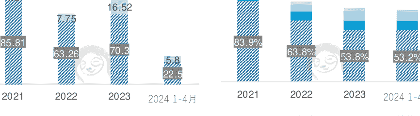

- 亚马逊商品销售
- 物流解决方案
- 亚马逊、沃尔玛、Wayfair、其他

恒林股份：主要收入来源为OEM业务，重点市场是直面IKEA，2008年建立合作关系，向迪通办公Office Depot、得利NITORI、史泰Staples等提供生产服务。2020年恒林股份开展大家家居战略，一是收购鲍士本土国内家居；二是收购永裕家居，扩大全球领先家具OEM品牌。

2017年上市后，恒林股份开始拓展ODM业务，以ODM为主，OBM为辅，逐渐品牌出海。打造自主品牌，抢占份额。恒林瑞瑞士中国家具制造FFLL Holding AG在旗下时尚Store和LO品牌，并推出其自主品牌“努哈斯NOUHAUS”，分别在越南、美国、韩国、印度、印度尼西亚设立子公司。

1. 大件家具、床、椅、衣柜和储物柜、书柜、餐桌、餐椅和五金电动螺丝以及高压清洗水龙头。
2. 欧洲市场需求旺盛。
3. 价格单位：人民币。

亚马逊等第三方电商平台在多个国家跨境运营。2024年上半年，OBM业务增速为48.6%，OBM占比比较2023年增长7.5%。

近年来恒林股份加强跨境电商的布局，建立全球供应链管理体系，布局海外，销售渠道覆盖Amazon、Walmart、TEMU、TikTok等三方三类线上平台，布局Facebook、Instagram等社交媒体，2024年上半年恒林股份跨境营收收18.66亿元，同比增长240.89%。

恒林股份2017-2023年总营收CAGR达27.63%。2024年前三季度收入为78.1亿元，同比增长24%。2019-2024年恒林股份2023年开始将业务转为ODM和OBM两种，2024年上半年效果逐步呈现，同比增长10.6%。

- 线上销售（电商）
- 业务（TOB）

跨境电商赛道潜力巨大，跨境电商平台迎来发展。2024年全年出货量达到63亿，亚马逊、沃尔玛、TikTok、SHEIN、AliExpress等在全球范围内，不仅降低了进入门槛，还减少了企业面临的风险。近年来，跨境电商平台成为快速发展的主力，用户数达到158亿。

- 亚马逊
- 沃尔玛
- TikTok
- Temu
- SHEIN
- AliExpress

- TikTok Shop
- Temu

排名第二于亚马逊的平台，预计2024年GMV达到750亿美元，2024年上半年营收为48亿元。

#### 2. 有海外仓储能力的跨境电商

跨境电商受海运费不稳定影响，海外物流优势在国际领域是非常重要的护城河。如逸基云、东方股份、欧致科技、恒林股份等，在海外多个国家建立了强大的仓储基础设施，整合资源。截至2024年9月，逸基云在海外建立了19个仓，总面积高达62万平方米。截至2024年5月， 逸基云：截至2024年9月，逸基云在海外新增4个自用仓，总面积高达622万平方米。

- 傲基股份：截至2024年4月，傲基股份通过西部美国及欧洲的主要城市建立了27个海外仓，总面积超过550万平方米。

- 欧致科技：截至2024年6月，欧致科技在海外建立了14个自用仓，总面积为397万平方米。

- 大健云：截至2024年5月，大健云全球仓储中心涵盖英国、美国、德国、加拿大、日本等42个，总面积超过1050万平方米。2024年7月，新的加州美国地区交付中心正式投入运营。

- 恒林股份：截至2024年下半年，恒林股份在美国新泽西州、加利福尼亚州等五大区域建立了配送中心，面积合计为35万平方米。

#### 3. 家具制造业产能过剩和优质工厂

国内市场家具产能严重过剩，积极拓展海外市场，通过出口贸易、跨境电商等形式，将销售客户转向海外市场，现已一定程度上缓解国内过剩的问题，还可以提高企业竞争力。

#### 4. 跨境电商以销售结构为瓶颈

告别传统经验，通过数据驱动决策，深入分析销售数据，企业可以了解市场需求，对消费者进行更精准画像分析，协助企业制定产品策略、定价策略、促销策略等，提升运营效率和盈利能力。

### 家居零售体的挑战

前面部分提到，中国家居企业出海，在国外建立新零售门店，输出品牌及服务。通过家得宝、芳灵、宜家、得利等全球家居零售品牌的案例来说，以零售店形态运营的家居公司面临的挑战包括：需要整合当地供应链、人才资源，以及对当地消费行为的了解，进行一次全新的内部重构。

| 全球店铺数 | 主营地区（营收占比） | 国际业务（占比） | 历史布局（已退出） |
|---|---|---|---|
| 家得宝 | 2234家 | 美国地区 | 加拿大/墨西哥 (8%) | 智利2家 阿根廷4家 |
| 芳灵 | 1746家 | 美国地区 (100%) | 加拿大266家 墨西哥13家 |
| 宜家 | 482家 | 瑞士/瑞典/荷兰 (82%) | 中国 (7%) 中欧 (10%) | 塞利路斯 塞尔维亚 |
| 得利 | 941家 | 日本 (85.2%) | 中国 (6.8%) 东南亚 (4.8%) |

### 海外/国际物流——新增空间

跨境电商的崛起带来了海外物流的需求。近年来中国一带一路的建设，如中欧班列、西藏藏铁路等，通过铁路为主的陆路连接和海联运，建立起中国与欧洲、东南亚等地链接，扩大了全球市场。

- 面向供应商提供相关服务，涵盖平台
- 海运
- 仓储
- 最后一送货
- 包装服务等

- GigaCloud 2P是大疆云主要业务，从国内制造向海外采购跨境产品，放在中国，由海外客户下单，自己撮合交易。
- 公司公告数据

### 适老经济

居家老化改造成为我国养老服务体系中的重要一环。

# 养老经济

### 3.1亿人

中国60岁及以上老人人口

人口老龄化是一个不可逆的趋势，也是必须应对的挑战。

2014-2024全国60岁及以上人口数据：

2024年，全国60岁及以上老人人口31,031万，占总人口的22%；65岁及以上老人人口22,023万，占总人口的15.6%。

65岁及以上老人人口抚养比达到25.67%。仍处于高速增长的阶段。

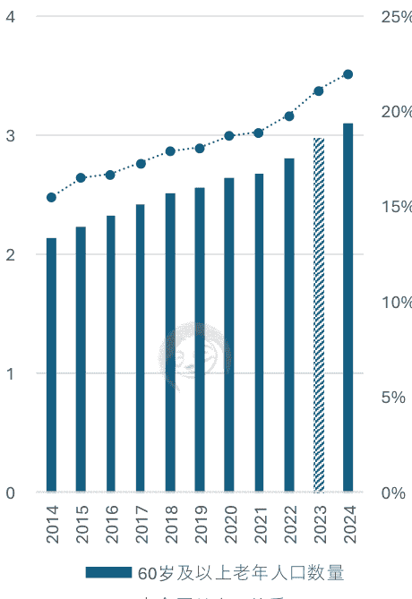

### 60岁及以上老人人口

人口老龄化是一个不可逆的趋势，也是必须应对的挑战。

2014-2024全国60岁及以上人口数据：

2024年，全国60岁及以上老人人口31,031万，占总人口的22%；65岁及以上老人人口22,023万，占总人口的15.6%。

65岁及以上老人人口抚养比达到25.67%。仍处于高速增长的阶段。

### 60岁及以上老人人口

人口老龄化是一个不可逆的趋势，也是必须应对的挑战。

### 适老经济

- 60岁及以上老人

2023年海外业务总占比25%，这一占比比上年增长至28%。

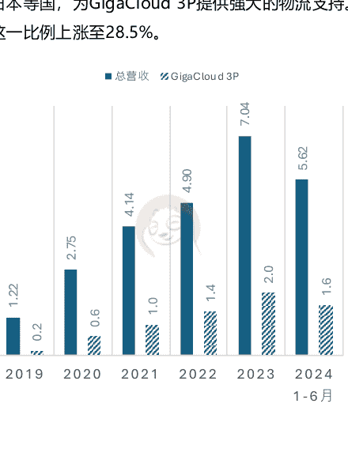

# 2021-2024年基础股份&海外解决方案收入增长（亿元）

逸基股份2024年预计为1月-4月；乐歌为2024年1-6月，前三季度为14.4亿元，同比增长47%。2023年来的海外运输业务发展快速。

当前，我们正面临老化进程与家庭小型化、城市化相交织，同时城市化的快速发展，年轻人在外求学、就业等因素影响，传统的养老模式正逐渐淘汰，老人的居家生活越来越需要支持，社会养老保障和养老服务的需求将加剧增加。

在居家养老模式的探索与实践方面，我国和发达国家的养老情况存在较大的差异，发达国家基本都是在完成工业化、城市化的条件下进入老化社会的，工业化实现了社会生产力的飞速进步，城市化造成了各类养老服务适应需求，使民众在富裕的基础上享受良好的养老服务”。

我国目前仍属于发展中国家，人均生产总值世界排名很靠后，多数老人以及家庭“未先老”，且面临世界上最大的老年人口，这在很大程度上决定了我们如何解决养老问题的思路和方法。

### 关于深化养老服务改革发展的目标

#### 2035年
养老服务网络更加健全，服务供给与需求更加协调适配。

为了实现养老服务深化改革目标，政府提出诸多方案完善养老服务，其中包括固居家养老养老的基础作用，加快适住宅改造，推进家庭化改造，支持老旧小区加装电梯，加强无障碍环境建设；加快养老科技和信息化发展，深化全国智慧养老安全风险预警和防范服务，推广智能化居家养老和智慧健康产品。

- 1: 参考资料：《国家养老为“为主”的老年住宅设计》
- 2: 中共中央 国院2024年12月30日发布关于深化养老服务改革发展的意见。

### 居家老化改造经历的三大发展阶段

老化改造的顺畅实施，离不开政府、企业、家庭等各方力的通力协作。总体上，我国老化经历了理念形成、试点探索、广泛实践三大阶段！

政府在不同阶段都发布了一些政策法规内容，持续推动居家老化改造的发展。

### 理念形成
老龄事业发展“十二五”规划中，提出要建立对口老人战略体系基本框架，制定实施养老事业中长期发展规划，一些政策文件通知、相关文件中已开始了关于“老年人家无障碍改造”的表述，初步形成了居家老化改造的意识和理念。但是这段期间，我国养老服务体系建设工作的重心放在推动养老床位建设上，例如，“十二五”期间，新增各类养老床位342万张。

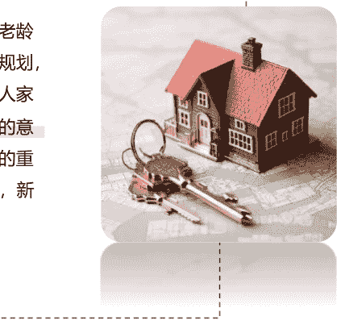
十二五规划

### 试点探索
“十三五”期间，我国养老服务体系的建设重心开始转向完善社区居家养老服务转型，全国各地多个城市陆续开展了老年人居家老化改造的试点工作，通过政府补贴、产业引导等多种方式对经济困难的老年实施老化改造。

十三五期间

- 1. 参考资料：《居家老化改造的实施路径框架与方法研究》

## 广实实践

2020年民政部等9部发布《关于加速实施老年人居家老化改造工程的指导意见》中明确提出，2020年底，推进符合条件的特殊困难老年人家庭实施居家老化改造。支持装修装饰、家服务、物业等相关领域企业主体开展老化改造业务，“十四五”规划中也提到，实施积极应对人口老龄化战略，民政部等四部门提到支持200万户特殊困难老人、失能、残疾老年人家庭实施老化改造。

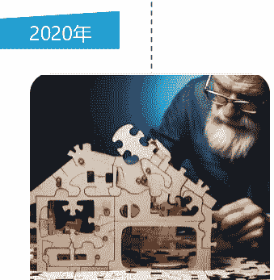

### 2020年
《商务部等13部门关于促进居家消费老化若干措施的通知》中提到，提高养老老化水平。发布养老用品产品推广目录，加速家庭产品老化改造设计标准。支持企业加大老化家居、家具、洗浴装置等家居产品研发发展；支持装修等领域经营主体拓展居家老化改造业务等。

### 3万亿
随着人口结构的不断变化和消费需求的增长，居家老化改造从最初的“理念出发”发展为“老年经济”，并逐步发展壮。据测，居家环境老化改造的市场规模达到3万亿元。

### 2024年
新一轮以旧换新行动中，鼓励各地支持开展旧房装修、厨卫等局级升级改造和养老老化改造。各地鼓励开展居家老化改造试点方案，对符合目录内居家老化改造物资和材料的60岁及以上老年人家庭，进行60%-80%的补贴（上限5000元）。主要围绕“如卫洗安全、室内步行方便、居家环境改善、智能监测、辅助器具器具”等等方面。

## 居家老化改造仍然有很多认知上的不足和误区

化的发展趋势和速度比较迫，市场潜力巨大，有较强的社会意义，但也存在很多认知上的不足和误区，例如，对老化改造缺乏深刻理解，住宅的老化设计还未受到重视，甚至缺乏基础的概念。

居家老化改造是一个多层次、多维度的需求，很多设计师对老年住宅的认知仅限于满足设计规范的要求，认为是在普通住宅的基础上除去危险装置，保证轮椅和加扶手，而忽视了老年人心理、生活习惯，缺乏对精细化的重视。

很多存量住宅在设计时并没有考虑到老年人的使用需求，尤其是比例较大的中小住宅不适宜，随着年龄的增长，必然给生活带来诸多不便。基于养老的体系，一个良好的老年住宅具有重要意义，这也要求政府、产业及各类服务力量从中发挥作用。

### 目前发展阶段：辅助产品为主，服务端开始介入
近期居家老化改造的话不断升温，服务端出现了一些公司进入居家老化改造，从不同的角度入手，或者丰富产品品类。从各大平台来看，老化包括的产品较多，应用于不同场景（例如，安全扶手、安全浴室、大件类的护理床、助攀凳等）。从服务端来看，研究机构已经了解到老年人的需求，开始将老化的概念植入样板中，但整体数量还不多，真正研发的更少，北京装修是其中的之一。

## 居家老化改造和房屋装修是一体化的，而非绝对独立

需要注意的是，讨论居家老化改造，并不是局限于“适老化”。在现实情况下，居家老化和房屋装修是一体化的，换言，彼此是融合的，而非完全独立的，不是互斥的。适老化是被需求驱动的。

- 1999年成立
- 2008年转型市场
- 2015年进军社区
- 2018年启动适老化产品的研发，探索第二增长曲线
- 2024年对房屋装修的布局

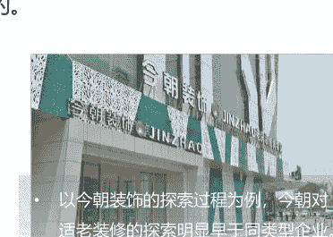
- 基地
- 社区模式
- 向外扩张
- 成立研究院

以某装饰的探索案例，适老化装修如何与其他企业竞争。夯实专业地位。
- 启动适老化产品的研发
- 强化工艺；
- 与清华大学建筑学院周现教授授课；
- 联合主编的《住宅老化设计标准》
- 自有高端定制工厂（英良木）投入

| 2008 | 2015 | 2018 | 2023 |
| :--- | :--- | :--- | :--- |
| 节点一：进入老房领域，适老化装修专业形象 | 节点二：开启社区店，拓展社区市场的价值和增长机会 | 节点三：启动适老化，探索第二增长曲线 | 节点四：联合上海相关标准 |

携手朝阳街道及社区，在北京市设立了首个适老化合作试点项目，“焕新家”。2023年，适老化、旧改引发政府层面的关注，市场进一步活跃。

### 第一增长曲线
### 第二增长曲线

适老化的研究，是建立在老房领域的能力和局部装修的社区运营。在实际服务的过程中，装修是一体化的，并不是完全分离的，尤其是针对老年人群的整体解决方案，不仅要考虑“用户”的真实需求，同时也要关注“消费者”的需求。很多时候，消费者并非最终的使用者。在老化适配落地的维度上，形成了功能区域、适老化设计9原则、关键要素等化的产品。

### 北京、上海房屋装修时间分布对比
北京和上海房屋装修完成时间在1990-2009年期间，是2000-2009这一时间段。

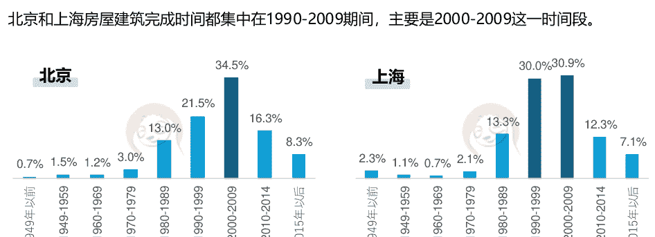

### 北京2024年存量房市场面积占比
### 2023年年末北京常住住宅面积及构成
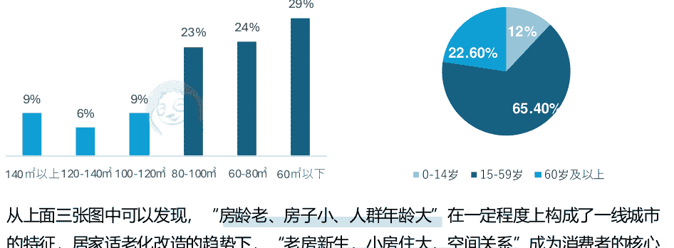

从上面三图中可以发现，“老年、年龄”在一定程度上构成了城市的特征，居住化改造成为趋势，“老房新生、小户住、空间有限”成为消费者的核心需求，这也要求服务者提升能力，最终要落实“以人为本”、更好的设计方案。企业不断加大研发，建立差异化的竞争力，成为差异化市场。总的来说，未来的发展前景良好，消费潜力巨大，但还需要经历一个漫长的探索过程，各种模式已经经过一轮又一轮的落地验证，从认知的，到辅助工具的安装，再到局部的优化与改造，以及更长久的解决方案，这是一个由轻到重、由浅入深、序序渐进的过程，增长时间长。

- 1. 适老装修设计9原则
- 2. 老装修设计关键要素：健康环保、防老化升级、降污净垢、科学适用、智能设计、远程控制。以上数据引用自：2020年《中国装修行业报告》装修研究院编制。
- 3. 中国人口数据2020。
- 4. 北京房局房屋交易数据。
北京市统计局 郭明伟

## 渠道进化

拓宽渠道的边界，构建更立体的渠道结构

近年来，增长、消费需求驱动着家居建企业进行渠道进化，其目的和意义就是打通渠道的边界，建立更稳健的渠道结构，实现增长。我们需要重新理解渠道的形态，当下爆发，每个人都在成为一个有影响力的渠道。长期以来，家居建企业经营模式是“产销分离”，大多数企业是批发的模式，工厂负责生产，并不直接承担销售职责。在增量时代，这种模式可以延续多年。此外还有部分企业选择自己转向制造。从设计、制造到销售，以及最后交付，很多环节都需要不同的角色来完成，至于企业选择哪个环节为切入点，这个章节的主题是“渠道进化”，讨论的对象是具备老化改造能力的家居建企业。

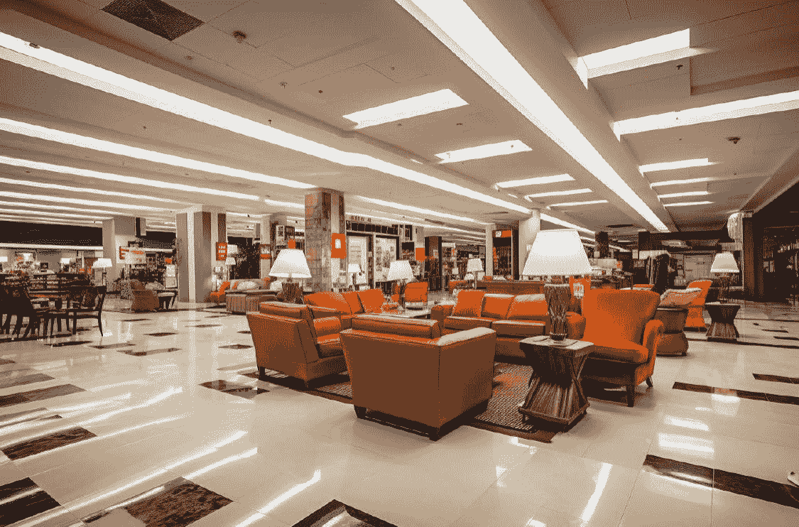

### 进化一：构建更具加性的渠道
老化的顺畅实施，离不开政府、企业、家庭等各方力的通力协作。总体上，我国老化经历了理念形成、试点探索、广泛实践三大阶段！政府在不同阶段都发布了一些政策法规内容，持续推动居家老化改造的发展。

### 理念形成
老龄事业发展“十二五”规划中，提出要建立对口老人战略体系基本框架，制定实施养老事业中长期发展规划，一些政策文件通知、相关文件中已开始了关于“老年人家无障碍改造”的表述，初步形成了居家老化改造的意识和理念。但是这段期间，我国养老服务体系建设工作的重心放在推动养老床位建设上，例如，“十二五”期间，新增各类养老床位342万张。

十二五规划

### 试点探索
“十三五”期间，我国养老服务体系的建设重心开始转向完善社区居家养老服务转型，全国各地多个城市陆续开展了老年人居家老化改造的试点工作，通过政府补贴、产业引导等多种方式对经济困难的老年实施老化改造。

十三五期间

- 1. 参考资料：《居家老化改造的实施路径框架与方法研究》

## 广实实践
2020年民政部等9部发布《关于加速实施老年人居家老化改造工程的指导意见》中明确提出，2020年底，推进符合条件的特殊困难老年人家庭实施居家老化改造。支持装修装饰、家服务、物业等相关领域企业主体开展老化改造业务，“十四五”规划中也提到，实施积极应对人口老龄化战略，民政部等四部门提到支持200万户特殊困难老人、失能、残疾老年人家庭实施老化改造。

### 2020年
《商务部等13部门关于促进居家消费老化若干措施的通知》中提到，提高养老老化水平。发布养老用品产品推广目录，加速家庭产品老化改造设计标准。支持企业加大老化家居、家具、洗浴装置等家居产品研发发展；支持装修等领域经营主体拓展居家老化改造业务等。

### 3万亿
随着人口结构的不断变化和消费需求的增长，居家老化改造从最初的“理念出发”发展为“老年经济”，并逐步发展壮。据测，居家环境老化改造的市场规模达到3万亿元。

### 2024年
新一轮以旧换新行动中，鼓励各地支持开展旧房装修、厨卫等局级升级改造和养老老化改造。各地鼓励开展居家老化改造试点方案，对符合目录内居家老化改造物资和材料的60岁及以上老年人家庭，进行60%-80%的补贴（上限5000元）。主要围绕“如卫洗安全、室内步行方便、居家环境改善、智能监测、辅助器具器具”等等方面。

## 居家老化改造仍然有很多认知上的不足和误区
化的发展趋势和速度比较迫，市场潜力巨大，有较强的社会意义，但也存在很多认知上的不足和误区，例如，对老化改造缺乏深刻理解，住宅的老化设计还未受到重视，甚至缺乏基础的概念。

居家老化改造是一个多层次、多维度的需求，很多设计师对老年住宅的认知仅限于满足设计规范的要求，认为是在普通住宅的基础上除去危险装置，保证轮椅和加扶手，而忽视了老年人心理、生活习惯，缺乏对精细化的重视。

很多存量住宅在设计时并没有考虑到老年人的使用需求，尤其是比例较大的中小住宅不适宜，随着年龄的增长，必然给生活带来诸多不便。基于养老的体系，一个良好的老年住宅具有重要意义，这也要求政府、产业及各类服务力量从中发挥作用。

### 目前发展阶段：辅助产品为主，服务端开始介入
近期居家老化改造的话不断升温，服务端出现了一些公司进入居家老化改造，从不同的角度入手，或者丰富产品品类。从各大平台来看，老化包括的产品较多，应用于不同场景（例如，安全扶手、安全浴室、大件类的护理床、助攀凳等）。从服务端来看，研究机构已经了解到老年人的需求，开始将老化的概念植入样板中，但整体数量还不多，真正研发的更少，北京装修是其中的之一。

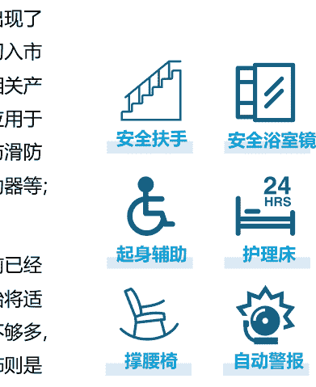

## 居家老化改造和房屋装修是一体化的，而非绝对独立
需要注意的是，讨论居家老化改造，并不是局限于“适老化”。在现实情况下，居家老化和房屋装修是一体化的，换言，彼此是融合的，而非完全独立的，不是互斥的。适老化是被需求驱动的。

- 1999年成立
- 2008年转型市场
- 2015年进军社区
- 2018年启动适老化产品的研发，探索第二增长曲线
- 2024年对房屋装修的布局

- 基地
- 社区模式
- 向外扩张
- 成立研究院

以某装饰的探索案例，适老化装修如何与其他企业竞争。夯实专业地位。
- 启动适老化产品的研发
- 强化工艺；
- 与清华大学学院周现教授授课；
- 联合主编的《住宅老化设计标准》
- 自有高端定制工厂（英良木）投入

| 2008 | 2015 | 2018 | 2023 |
| :--- | :--- | :--- | :--- |
| 节点一：进入老房领域，适老化装修专业形象 | 节点二：开启社区店，拓展社区市场的价值和增长机会 | 节点三：启动适老化，探索第二增长曲线 | 节点四：联合上海相关标准 |

携手朝阳街道及社区，在北京市设立了首个适老化合作项目，“焕新家”。2023年，适老化、旧改引发政府层面的关注，市场进一步活跃。

### 第一增长曲线
### 第二增长曲线

适老化的研究，是建立在老房领域的能力和局部装修的社区运营。在实际服务的过程中，装修是一体化的，并不是完全分离的，尤其是针对老年人群的整体解决方案，不仅要考虑“用户”的真实需求，同时也要关注“消费者”的需求。很多时候，消费者并非最终的使用者。在老化适配落地的维度上，形成了功能区域、适老化设计9原则、关键要素等化的产品。

### 北京、上海房屋装修时间分布对比
北京和上海房屋装修完成时间在1990-2009年期间，是2000-2009这一时间段。

### 北京2024年存量房市场面积占比
### 2023年年末北京常住住宅面积及构成

从上面三图中可以发现，“老年、年龄”在一定程度上构成了城市的特征，居住化改造成为趋势，“老房新生、小户住、空间有限”成为消费者的核心需求，这也要求服务者提升能力，最终要落实“以人为本”、更好的设计方案。企业不断加大研发，建立差异化的竞争力，成为差异化市场。总的来说，未来的发展前景良好，消费潜力巨大，但还需要经历一个漫长的探索过程，各种模式已经经过一轮又一轮的落地验证，从认知的，到辅助工具的安装，再到局部的优化与改造，以及更长久的解决方案，这是一个由轻到重、由浅入深、序序渐进的过程，增长时间长。

- 1. 适老装修设计9原则
- 2. 老装修设计关键要素：健康环保、防老化升级、降污净垢、科学适用、智能设计、远程控制。以上数据引用自：2020年《中国装修行业报告》装修研究院编制。
- 3. 中国人口数据2020。
- 4. 北京房局房屋交易数据。
北京市统计局 郭明伟

## 渠道进化

拓宽渠道的边界，构建更立体的渠道结构

近年来，增长、消费需求驱动着家居建企业进行渠道进化，其目的和意义就是打通渠道的边界，建立更稳健的渠道结构，实现增长。我们需要重新理解渠道的形态，当下爆发，每个人都在成为一个有影响力的渠道。长期以来，家居建企业经营模式是“产销分离”，大多数企业是批发的模式，工厂负责生产，并不直接承担销售职责。在增量时代，这种模式可以延续多年。此外还有部分企业选择自己转向制造。从设计、制造到销售，以及最后交付，很多环节都需要不同的角色来完成，至于企业选择哪个环节为切入点，这个章节的主题是“渠道进化”，讨论的对象是具备老化改造能力的家居建企业。

### 进化一：构建更具加性的渠道
老化改造的顺畅实施，离不开政府、企业、家庭等各方力的通力协作。总体上，我国老化经历了理念形成、试点探索、广泛实践三大阶段！政府在不同阶段都发布了一些政策法规内容，持续推动居家老化改造的发展。

### 2019年vs2024年 渠道占比
定制家居企业结构变化。

| 欧家居 | 索菲亚 | 志邦家居 |
| :--- | :--- | :--- |
| 2019 | 78.98% | |
| 2024年上半年 | 76.11% | |
| 2019 | 83.86% | |
| 2024年上半年 | 79.39% | |
| 2019 | 66.85% | |
| 2024年上半年 | 52.71% |

### 2023年收入来源对比
各个细分渠道来看，经销商渠道仍为家具企业主要来源。

### 2024年广告主侧重跨界运营方式
品牌更多关注新用户的获取，跨界/领域/类类的方式为流行，其次是从品牌角度出发增加市场占有率。

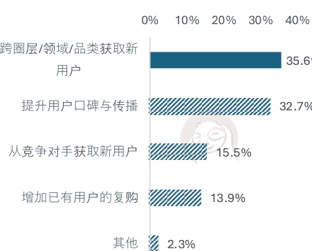

| 2008 | 2015 | 2018 | 2023 |
| :--- | :--- | :--- | :--- |
| 节点一：进入老房领域，适老化装修专业形象 | 节点二：开启社区店，拓展社区市场的价值和增长机会 | 节点三：启动适老化，探索第二增长曲线 | 节点四：联合上海相关标准 |

携手朝阳街道及社区，在北京市设立了首个适老化合作项目，“焕新家”。2023年，适老化、旧改引发政府层面的关注，市场进一步活跃。

### 第一增长曲线
### 第二增长曲线

### 进化三：预算聚焦与精细化运营
2018-2023年家居企业广告市场费用/宣传费用占比。我们找了几家家居企业的广告营销费用对比，8企业中有6家企业的2023年广告营销费用比为减少。
[/content]
[content]

### 进化二：跨界联新，沉淀品牌留量
用户心态、认知与消费行为为不断变化，外部信息处理能力增强，能够快速识别软营销，而内部需求转向复杂化，重视情感价值，特定圈层。央市场研究(CTR)表示，35.6%的广告主侧重跨界/领域/类类，家居企业在跨界合作、多品类方面已经经历转型，跨界营销是接下来企业可以考虑的课题。

品牌留量，是企业数字资产的积累，在数字化时代运用品牌关系质量通过私域运营，满足消费者对消费场景、内容形式、沟通渠道等各个环节的诉求。全渠道营销渗透是品牌资本的决定，是用户心智增长。

### 2024年广告主侧重跨界运营方式
品牌更多关注新用户的获取，跨界/领域/类类的方式为流行，其次是从品牌角度出发增加市场占有率。

### 进化三：预算聚焦与精细化运营
2018-2023年家居企业广告市场费用/宣传费用占比。我们找了几家家居企业的广告营销费用对比，8企业中有6家企业的2023年广告营销费用比为减少。

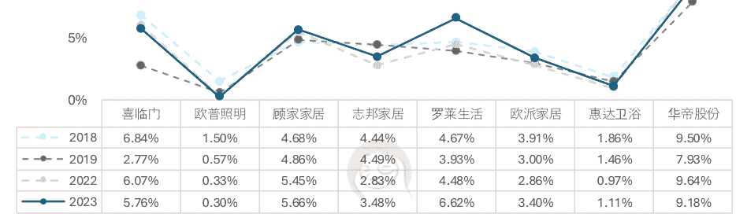

> 1. 2024中国广告主营销渠道调查报告，央市场研究(CTR)。
> 2. 公司：

### 线上（渠道）平台呈“相对集中”的特征，线下渠道呈“多元分散”的趋势

概来看，以海系、京东、多多、抖音、小红书为主要代表的线上渠道相当于“线上平台”，以红星美凯、京家之家的家居渠道则相当于“线下平台”。虽然有了抖音、小红书等新平台对家居材料的渗透，但整体来看，线上还是集中于几千平台，覆盖了绝大多数的主流消费群体，家居产品在购买决策中反复对比的使得，商家很难让消费者局到自己的流量池中，所以线上平台竞争激烈。

### 消费者获取装修理念的主流方式
线上渗透率日益提升，在25-30岁间年轻消费者，线上决策者影响增大。

相比之下，线下渠道表现越发分散的趋势，多元化的实体店铺，不再局限于家居卖家，本地化的建材店开店、装修公司、设计、导购、家具、地产物业、中等等成为探索者的新增长点，线下渠道的生态正经历一轮又一的转型。

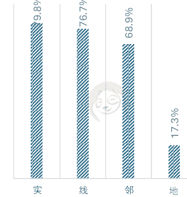

# “线上物业”向“线上创新”，本质上是利共享

虽然还有抖音、小红书等新平台对家居材料的渗透，其实上还是互联网的流量思维，停留在流量的方式里，依靠自己的用户数据，驱动商家重新分配和转化营销。如何进行行业竞争化，能否实现以及帮助商家积累口碑、打造品牌，新平台并没有中充分发挥。

目前来看，新线上平台在一定范围内拓宽了商家的销售渠道，但主要扮演的还是“线上物业”的角色，收取“线上租金”，对于行业的发展并没有太大帮助，反而让在算法的商家营销活跃成本增加，获客难度加大，而且各个平台的打法趋于同质化，集中在直播、短视频、IP内容营销等等方面，家居装修的内容增加，平台之间相互更加内卷。

在消费者价值维度的提升，家居装修的消费并没有因为新平台的存在而改变。表面，消费者可以了解到非常丰富的内容，但是这种心态往往与实际服务的落地存在差异，以装修为例，引发了许多，消费者看到博主的分享，这种营销还不够真实，误导消费者把案例“搬到家”，要求或“指导”企业安排。

- 1.微信红书发布《2024年中国装修行业发展报告》N：4170

# 线下渠道生态僵局，传统渠道被削减、多元化、分化的特征明显

线下渠道的变革，并不是家居本身没有价值，而是随着消费方式的改变，家居卖场依托线下物业的优势，只提供传统业务形态下的“场”的价值在崩解，缺乏对消费者的研究以及对产品的把握，一定程度上，家居卖场是一张晴雨表，某些类目分布和类目结构的变化代表着行业变化信号。

- 体验驱动的家居类目的面积将继续保持在一定量级，趋于稳定，家居卖场朝着更加贴合业务的方式去打造。
- 建材企业在家居卖场的面积展现出越来越少的趋势，转向投入以A类或B类为主的渠道，未来建材产品的流通方式可能不再是专卖店，而是转向“销售网点化”，以此扩大大渠道的密度，以数量换销量，对装修渠道入口的覆盖，其实就是在点化的方式销售商品。
- 未来建材商的转型是个大课题，要转向服务商，要开始去涉足服务类目，例如转型去做改店、社区区域店。

> 总结来说，在渠道足够多元的当下，家装公司、设计机构、厂商或经销商并非无边界的扩散覆盖，尤其是在资源有限的前提下，提升渠道的深耕能力，聚焦目标客户的深度运营。在行业一个低速增长的运行周期下，将会趋向于透明，中间利润会被进一步压缩，以用户需求洞察和运营效率换取合理的利润。

# 技术先机

数字化应用靠前沿的领军企业，它的市场优势进一步扩大

一流的信息化未能成就一流企业，而一流企业必须有一流的信息化。在家装服务链上，多个环节开始被科技赋能，覆盖研发、设计、制造、直至服务。对于我们关注的家居制造而言，从数字工厂走向智能制造，家居制造企业数字化、智能化是最务实的路径。

中国“十四”智能制造发展规划，提出2025年制造发展目标和2035年远景目标，实现智能制造的信心与挑战。智能制造面临的主要是经济增速缓慢，家居产业结构性、持续性低，寻求增长动力是推动智能制造良越的大背景。

老龄化趋势与制造用工变化作为观察视角，企业成本上升是不可避免的变革，企业将目光不同的焦点转向技术上，包括家居制造业转型战略的数字与投入。

### 2018-2023年中国建筑业人数（万人）

建筑业人数连续五年下降，伴随老龄化趋势，未来人才持续严峻。

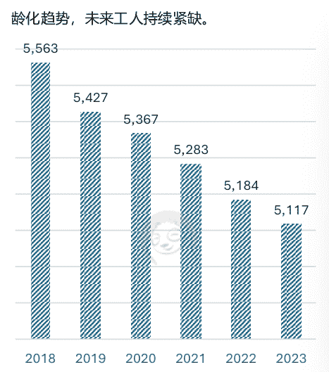

需要明确的是，对于企业，实现数字化转型并非简单的上线一个新的系统，也不是购买最先进的技术，而是在经营管理中全面把握并融合技术，帮助企业进一步降本增效。短期来看，人才和资金的双重压力成为了数字化转型的首要挑战。完成数字化转型需要企业拥有数字化、懂技术的复合型人才，而数字化周期有限的小企业而言，资金积累也为重要。

### 重塑制造，数字化引领成为核心考核

企业对数字化转型的认知也在发生变化，过去关注的是降本增效，通过衡量是否转型的成功。长期来看，数字化转型战略涵盖了企业业务流程和各个职能，除了市场和优化之外，行业及韧性成为阶段性考核点。

> 1 经济统计数据，房屋建筑、土木工程、建筑安装、建筑装饰以及其他

# 2023-2024年中国企业数字化优于领先

数据显示，开创优势并加速增长两个维度提升明显，分别增长和优化运营得持平，打造核心和人才依然是两大短板。中国企业数字化指数（0-100）

供大于求当下，家居竞争更为激烈，价格成为经营手段。家具制造企业的生产从大规模定制向区域化或柔性定制转变，头部企业通过工业4.0实施动态生产，利用信息化实现产业链链接，从产品设计、订单形成、排产生产、物流出货统一协调，不再是传统意义上的柔性生产，而是一种重构制造。

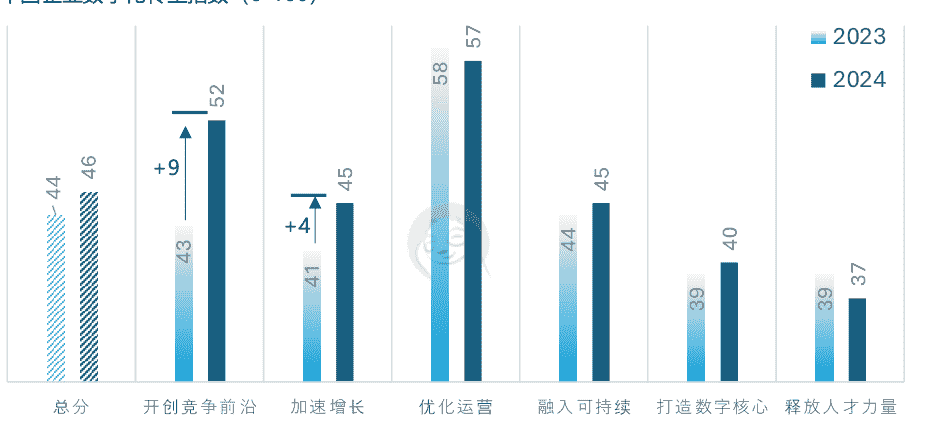

- 1 中国企业数字化转型2023v2024调研，2024年3-4月（N=45）。
- 2 美国大学。

个性化定制是家居企业的重要趋势，但如果没有高水平的信息化系统支撑，反而得偿失。尤其是定制类企业，不会停止对工厂数字化、智能化改造，技术领军企业的市场份额将进一步扩大。我们发现，在数字化早的领先企业，其营收增速是后者的几倍，甚至突破了行业瓶颈，实现了跨越式发展。

### 2017-2023年欧亚家居主营产品量对比

2021年欧亚家居增速领先，尤其是门木同比增长62.5%，软体同比增长58.7%；欧亚2021年营收增长38.68%，是增速最快的一年。

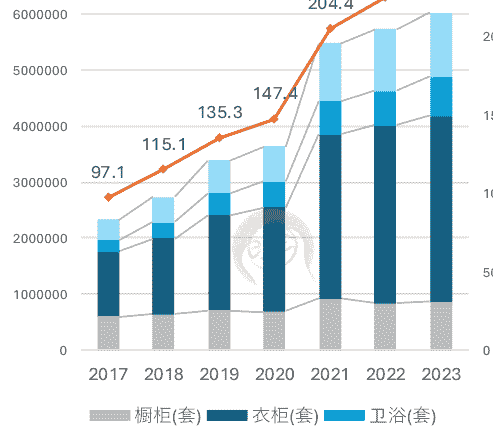

### 2017-2023年索菲亚主营产品量对比

索菲亚生产量增长集中在2021年，同年索菲亚营收同比增长24.59%。

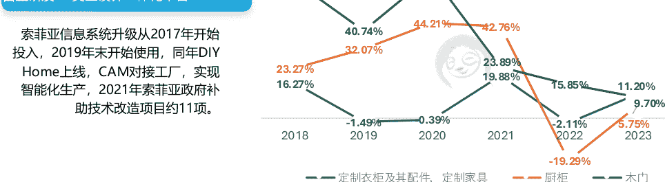

索菲亚信息系统升级从2017年开始投入，2019年开始使用，同年DIY Home、CAM对工厂对接，实现智能化改造，2021年索菲亚获政府补助技术改造共1项。

### 中小企业构建数字化增强力度、“小轻快”成效适应需求

头部企业自主研发大额资金进行数字化投入之外，中小企业数字化投入稳定提升。绝大多数中小企业借助数字化工具的意识提高，纷涌向数字化转型。对于第三方数字化软件商而言，这是一个正在爆发的蓝海。

### 生成式AI应用-AIGC

在AI时代，所有的行业都值得用AI重塑，家居装修产业中，室内设计专业是受影响最剧烈的领域之一。AIGC生图在设计环节的广泛应用让设计师、客户签单前置化，有了AI的加持，设计方案更快、更智能匹配用户需求。

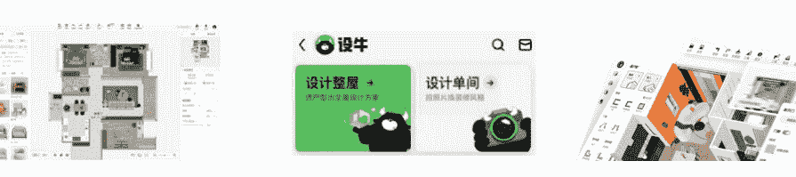

酷家乐AI装修设计平台：直渲染引擎+拓CAD驱动

贝壳“牛仕”装修设计平台：AIGC生成装修效果灵感图

居家设计家 AI agent智能智能

- 渲染速度、逼真度、通用性、智能化全面提升
- AI设计直接转3D结构化方案，通过参数化引擎和BIM模型成为数据源，对接设计、落地。
- 基于贝壳海量户数据实现生图、圈渲染得到不同风格装修效果
- 链接B和C联动提升效率和用户体验
- 用LLM大模型的AI设计助手，视觉内容生成化方案
- 将Homepage走出海外，建立全球合作协议

AI的优势是，能够精准获取用户数据，提升工作效率，但在装修里还有一个明显的弊端：AI模板情感共鸣弱，缺乏创造性，无法在实际场景中落地。另一方面，发现技术太实在，例如酷科技（AI）升级后的渲染引擎还原真实场景，已经在空间中应用，材质领先。99%的化程度是最高的，也是中小企业代表，适用使用或AI辅助，才能实现共同的目标。

### 数字化实施交付，核心价值

中国企业在关键技术上突破，主要是ERP、CRM等，其次是各个业务、流程集成，这些都是近年来数字化部署的主要成果。流程上用云计算替代人类劳动，家居企业能够快速得到红利，在空间优化的空间，仍是行业要。数字化变革深入流程，业务业务不变，是长久之道。

### 落地案例

中海地产上海豪宅项目“中海潮影”，实现在全数字化建造，并在虚拟世界落地，证明了数字化技术在设计、施工、运营环节的价值。中海旗下项目提供了数字化支撑，未来室内装修设计的数字化转型，提供数字化管理解决方案、计划、进度、成本控制等。

- 2024年1月精装修项目开盘智能家居市场规模（万套）
- 2024年1-1月，房地产精装修市场新开盘项目比去年下降22.5%；精装修配套智能家居系统项目288个，同比增长15.7%；规模15.28万套，同比增长7.7%；配置率达到30.1%，同比增长10.5%。

### 2020-2023精装修市场三大板块智能家居配置率对比
智能门锁配置稳定在70%左右，智能系统配置稳定开启。

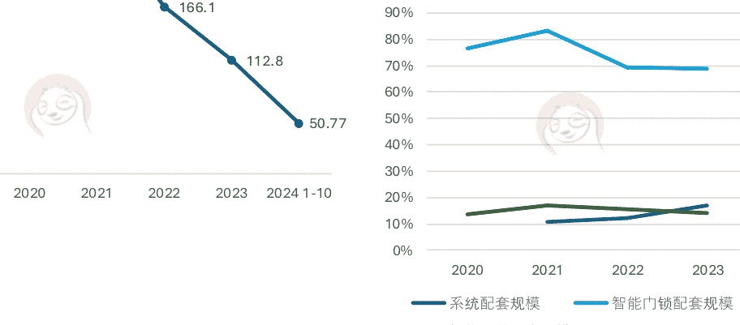

1，2：数据统计来源于奥维云联。

### 智能家居

现阶段的智能家居，不再局限于系统本身，但仍发展起来。可见，这些智能家居领域已经在机器学习、计算机视觉、自然语言处理等三个方面取得了重大进展，应用在智能家居领域，可以实现万物互联、交互控制的场景，与设备之间的交互也更加高效。在中国智能家居市场，以旧换新将在2025年实现输出，家居市场在政策拉动下再次高速增长。据国际数据中心（IDC）预测，2025年中国智能家居市场预计增长为281亿，同比增长7.8%，智能家居市场将持续增长。同时，适老、残疾人士关怀不断，带动智能家居细分领域感知照明、安防监控、健康参数预警等，智能家居细分群体将进一步拓展。从整体规模来看，相对于C端市场，智能家居的发展反而受B端影响增大，如酒店、医院、学校，包括居住相关的装修领域等。在物业精装修领域，地产市场整体有所波动，但在精装修领域，智能家居系统的配套规模依然在上升，房地产开发对智能家居系统的重视和市场需求持续增长。

- 2024-1-1月精装修项目开盘智能家居市场规模（万套）

### 除智能门锁外，智能照明市场及智能窗帘市场都处于快速增长阶段

## 2019-2024智能照明市场规模
亿元

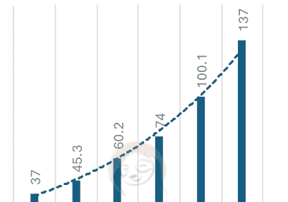

## 2019-2024智能窗帘市场规模
亿元

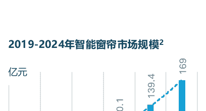

- 智能照明作为家庭中使用频率最高的电器，已经从单品升级为系统型产品，除了传统的照明，智能公司也在做具有控制系统的产品，可持续发展，应用层面从B链慢慢切换到C链。
- 智能窗帘分为前装和后市场，前装主要占比65%，后市场多元化不断覆盖，满足了年轻消费群体，智能化应用场景越来越广，再加上AI技术的引入，未来拓展到生活场景。
- 目前，比较常见的是单品，例如智能门、智能开关、智能照明、扫地机器人、智能马桶、智能眼镜等，丰富的市场，这些产品的应用带来了便利，被更多用户认可，多元化不断丰富，从居家购物到学校、办公室等。
- 智能家居的发展来，趋势明显。未来不再局限于单品，朝着全场景演进。
- 1. 数据资料，2. 智能家居

| 品牌-传统家电/家用厂商 | 智能电视 | 智能冰箱 | 智能空调 | 智能洗衣机 | 智能家居 |
|---|---|---|---|---|---|
| Haier Midea GREE | Casarte | Hisense | ROBAM | Vatti | CHANGHANG |
| 品牌-互联网领先企业 | 智能家居系统和硬件 | 物联网 | | | |
| Baidu | Tencent | Alibaba | HUAWEI | BOE | 360 | 京东 |
| 品牌-智能家居解决方案提供 | 无线智能家居系统 | 物联网平台 | 智能感知与控制 | |
| tuya | 云米 | 华为 | 阿里云 | 腾讯云 | Xiaomi HyperOS | Haier Connect |
| 智能家居硬件供应商 | 智能摄像头 | 智能扫地机器人 | 智能门锁 | 智能照明 | 智能音箱 |
| IMOU | 科技 | Coovacs | XIMI | 创新锐 | DESMAN | 凯迪仕 |
| EZVIZ | TP-LINK | Aqara | ORVIBO | OPPLE | VOC SMART LOCK |
| mi | LOCKNEN | NARWAL | 云聚 | JMGO 智能聚光 | YEELIGHT |

*因版权有限，不得以所有细节。图片仅供参考

# 建筑应用机器人

数据显示，2023年建筑施工方面的事故总量已经超过了道路运输的事故量，成为第二大事故集中发生的领域，“机器人”的需求愈发迫切。2022年，国家“十四五”建筑发展规划提出：2025年内形成建筑行业高质量发展，扩大提升建筑工业化、数字化、智能化水平，特别强调了建筑机器人的研发与应用。

2016-2024中国建筑行业专利申请量

国家鼓励建筑机器人研发，2022年专利申请量达到顶峰，技术项目主要脚架手、模具、工具或辅助设备，原有建筑的修理、拆除或其他工作。

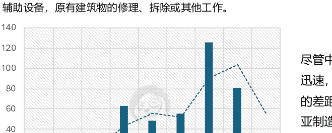

尽管在中国建筑机器人领域的发展非常迅速，与发达国家相比仍有较大的差距，如韩国、新加坡、澳大利亚制造机器人密度超过中国一倍。韩国国外施工机器人WallBot、新加坡PictoBot场景喷漆机器人和QuicaBot机器人已经在真实环境施工中，澳洲的Hadrian109型建筑机器人实现了商业化应用。美国和日本也有较多的建筑机器人公司，不断使用机器人进行作业。

- 碧桂园线下推出12个建筑机器人产品线，包括混凝土施工及维修、砖砌灰、内墙装饰等30个领域。截至2024年6月智能机器人应用项目超过900个，累计交付超过3000台，累计施工2000平方米。

> *智能地面整平机器人

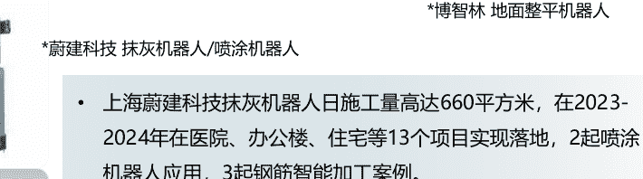

### 智能家居

建筑与全景化发展，让行业逐渐模糊化，随着越来越多的新技术涌现，如人工智能、语音识别、深度学习技术不断助力智能家居，交互技术更具想象力的空间。针对智能家居打造的HiLink生态，连接家居智能终端、移动终端、穿戴设备，智能家居等多个领域。2024年1月，小米在CES上正式推出IoT生态系统，集成智能家居，推动不同品牌、设备之间的资源共享与互联。

# 关于树懒生活Fine

树懒生活Fine，是一家专注于家居领域的研究型机构。从价值研究视角出发，长期聚焦国内外居住产产业链二级市场优标的，以房产交易、家居、装饰装修、家庭服务、新技术、新渠道、人才为主要关注点，跟企业发展动态、捕捉前沿趋势、研究企业战略转型路径，为企业提供深度原创、行业研究、消费者调研、活动策划、短视频等多元化服务，助力企业提升品牌影响力。

房产交易 | 大家居 | 装饰装修 | 家庭服务 | 新技术 | 新渠道 | 新人才

*本报告作为企业经营参考使用，并非针对任何个人或团体的个需求界定，不构成投资建议。报告所陈列的数据来自公开渠道，分析逻辑基于树懒研究团队的理解，力求客观、公正、专业。报告在发布时已尽力提供准确和资料，但不保证这些资料及后续后仍准确。

本报告版权归微信公众号“树懒生活Fine (ID：huamian224)”所有。未经许可企业、机构、个人不得以任何形式使用、复制及传播。任何有关本报告的摘要或节选都不代表报告完整观点，一切须以此版本为准。
