# 吉利汽车
能否“硬刚”比亚迪

购车决策洞察报告之能耗篇(2025版)
吉利汽车竞争力分析报告(2025版)

# 免费 价值 及时 专注

# 扫码加入 知识星球TOP 免费资源群

- 每日免费获取有价值资源
- 可提供各类资源搜索服务

| 热门付费文章 | 各行行业报告 |
| 精选图书资源 | 副业赚钱方法 |
| 职场实用资源 | AI政经自媒体 |

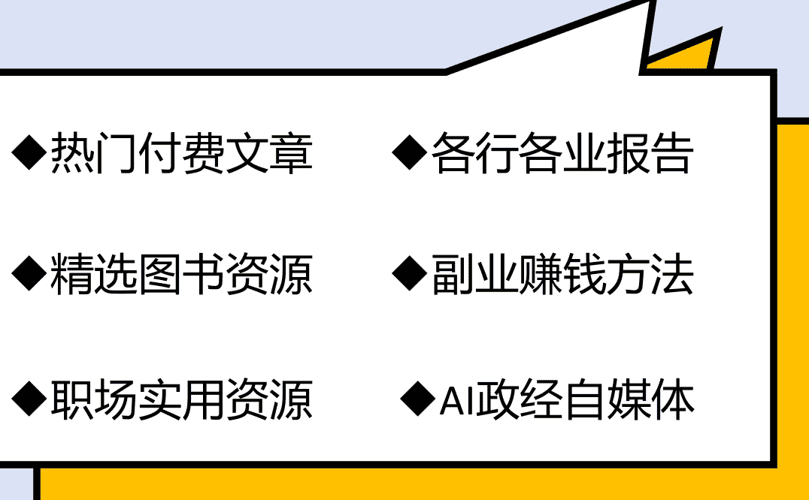

公众号: 知识星球TOP 微信号: jntsg8 微信号: jntsg2

分享资料仅供个人学习，请及时删除，切勿商用传播

# 团队成员

# 节能诉求：指用户在购车过程中对汽油、柴油、电、甲醇、氢等各类能源的转换效率与使用成本的要求

作为人类出行交通工具的汽车，每脚动一步就会消耗一定的能量。能源消耗越多，成本自然越高，为了降低使用成本，企业会努力普及节能技术，用户会根据支付能力与使用场景，选择更经济的能源产品。本报告定义的节能诉求，指用户在购车过程中对汽油、柴油、电、甲醇、氢等各类能源的转换效率与使用成本的要求；

本报告的研究数据以跨境研究院（前身为易车研究院）的线上调研为主，2024年前三季度的总样本量超过5万份，并以易大数据和购易研究院的线下调研数据为参考。

节能诉求模拟图

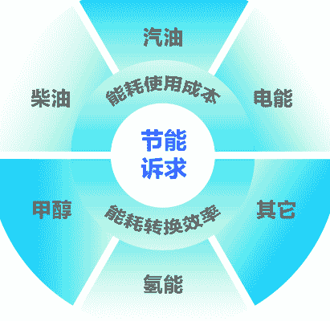

## #2024年中国汽车的效率寻求高达54.59%
助力比亚迪进入2021年强势崛起并将自己交给吉利汽车按在地上摩擦

近三十年来，中国汽车的能源长期以汽油为主，国际油价一路飙升，2023年92号汽油售价仅两元人民币，2024年飙升至七元人民币。理论上中国汽车早已催生汽车节能，长期处于供不应求的状态，但中国汽车技术的普及及力仍未能完全上述的提升；在“购买补贴1.6L车型”等相关政策的“喧哗”下，吉利强势将主导份额从1.6L降至1.5L，长城等不少汽车，早就展现出吉利、霍格瑞计划等顶层布局，在实际执行过程中无一例外打大折扣，最后让曾比亚迪成为“优围”；而比亚迪更是早报布局EV，进步与自己被击到的那点尴尬死得斑死的。

中国汽车的节能浪潮持续到2020年，汽车核心推动者为特斯拉。前者光芒不怕穿鞋，以颠覆者姿态产了Model3，定价低于传统燃油汽车的奥迪4L、奔驰和宝马3，事实加速了大城领为主的领先汽车。后者则光了MINV，原本只想“老迭代者顶级车型”的商业模式，使得三四万级的超级无定价和光亮丽的“合法准则”，快速迭代以低级制胜为主流车型。进入2021年，比亚迪迅速成为节能浪潮的领军者，秦PLUS、MPV等主流产品以强势登场，助力中国汽车的节能化。2022年优先受益的是比亚迪，全球销量超过了同期自在在全球市场上的吉利（以吉利、领克和极氪为主）。2023年比亚迪发猛已经超过了吉利集团（吉利汽车和大众沃尔）全球销量，2024年比亚迪全球销量有望突破400万，进一步实现了在国内市场与中国品牌领先地位。

- 2020-2023年，吉利汽车大品牌圈，统称“赛马”，实则各自为春秋时期，为比亚迪的锐锐提供了市场机会。
- 2024年发布了《台州宣言》，强调“中央权威”，节能性寻求高达54.59%，中国汽车中有着巨大发展空间。继2022年比亚迪全面转型为车型后，2025~2026年有望（含内）也全面转型为节能车型？

## 2024年中国乘用车市场节能诉求

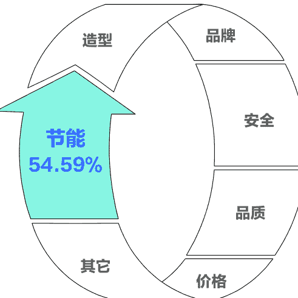

## 2024年吉利汽车与比亚迪国内新能源占比

## 2016-2024年吉利汽车、比亚迪全球销量趋势（万辆）

- 吉利汽车
- 比亚迪
- 吉利集团
- 比亚迪

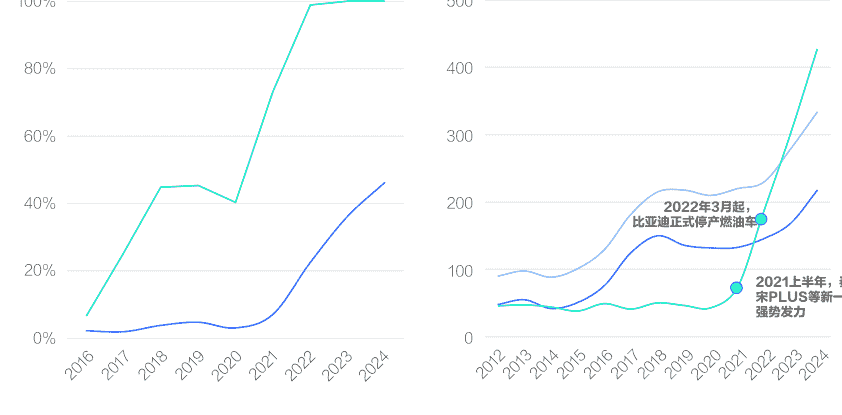

数据来源：易研

## 2023年吉利汽车：星越LHEV、银河L7/L6等多款被比亚迪击败

2023年比亚迪之所以快速起并强势压控吉利汽车，主要优于聚力最强的宋程、宋PLUS等产品；对中产与富豪需求最为强烈，2024年高达57.26%。2021年吉利主攻的燃油车高达95%以上，性能远不如PHEV等新能源产品，导致吉利汽车在竞争中快速失去“民心”，表现非常困难。在加强一年年后，于2022年5月推出了新产品LHEV，定价12.98-15.48万元，非常接近当时的PLUS，但由于时间太仓促，产品的质量等关键指标用自己合适，结果反馈增。

另售价高达23.97-25.37万元，估计定价时十六六万元的核心内核宋PLUS都有些收获……

如果2022年吉利汽车还在头上大打了一通；2023年的吉利汽车就冷静了，重心放在了控制与可能性的提升上。品牌研究院等部门，又经过一个没日没夜的加油，推出了全新的新能源产品系列，分别在2023年5月和9月，发布了全新产品银河L7和银河L6。这两款产品动力电池由三万元更换成了更优惠的铁锂，更加接近比亚迪的同级别。上市初期，两款产品都没有表现，月销量领先。感觉被刺杀的比亚迪，在2024年初推出新单价格，成功扼制了吉利汽车银河L7和银河L6的第二次反攻。2024年当，银河L7和L6的月销量维持在六七千的水平，远不如同级别产品PLUS、优越05、宋PLUS和宋Pro等月销量高达一万万辆，甚至三四万辆的水平。对于吉利积累了挑战比亚迪的经营经验，至少知道这样做应该效果了。

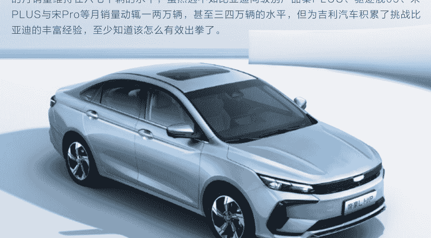

## 2024年各阶层购车用户的诉求

## 22-23吉利汽车与比亚迪主流新能源产品动力配置

| 车型 | 动力类型 | 电电池类型 | 续航(kWh) | 发动机 |
| --- | --- | --- | --- | --- |
| 22款L PHEV | PHEV | 三元锂 | 15.5 | 三菱DHT / 1.5T |
| 23款L PHEV | PHEV | 三元锂 | 41.2 | 三菱DHT / 1.5T |
| 23款银河6 | PHEV | 磷铁锂 | 91.1/19.09 | 三菱DHT / 1.5T |
| 23款银河7 | PHEV | 磷铁锂 | 91.18/37 | 三菱DHT / 1.5T |
| 23款星PLUS | PHEV | 磷铁锂 | 8.32/18.32/48/57.6 | E-CVT / 1.5L |
| 23款驱越05 | PHEV | 磷铁锂 | 8.13/18.3 | E-CVT / 1.5L |
| 23款宋PLUS | PHEV | 磷铁锂 | 12.9/18.3/26.7/31/87.04 | E-CVT / 1.5L |
| 23款星Pro | PHEV | 磷铁锂 | 12.9/18.3 | E-CVT / 1.5L |

数据来源：根据车型配置，实际为2025年1月

## 2022-2023吉利汽车与比亚迪主流产品布局

## 2022-2024年吉利汽车与比亚迪主流新能源销量趋势（万辆）

- 帝豪L PHEV
- 星辉L PHEV
- 银河6
- 银河7
- 秦PLUS
- 宋锐05
- 宋PLUS
- 宋Pro

## 2024年吉利汽车产品布局

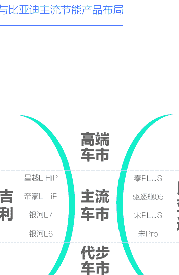

数据来源：中信

## 2023年吉利汽车无心插电

## 2024下半年银河E5和星愿领会

## 吉利型的电动汽车先锋开辟比亚迪线

当吉利汽车被比亚迪按在地上狂躁时，2023年2月，吉利汽车投放了微型车mini，售价3.9~5.9万元。上市后的月销量就突破了1万，2024年接近万，成为吉利新能源序列里最强的战士。对比特头E5，小巧的吉利拿着各种锦奔，原本策略就是帮助客户解决拥堵的问题，方便吉利继续呼吸燃油车的高利润，但吉利能够以不断的创新能源策略从小电动车切入。2024年中国用户对节能车的诉求为56.79%，小巧更是自由游，但明星高上下，亮点是：2024年8月和10月，分别推出吉利银河E5和星愿两款电动。两者一吃，不给比亚迪留“沙发”机会，如银河E5的定价直接低于核心竞品，星愿的空间、设计等也不于竞品。2024年，银河E5的月销量突破2万，快速比海豚、元PLUS。2025年，星愿还将量产高质，面对时至少有5个交代。自从长汽车战略性“小电动”市场后，代步车的领导者就成了比亚迪，且遥遥领先，小电动成了比亚迪的出口神器。2023年比亚迪的电动车获得了100万的销量，品牌销量接近三分之一，2024年超过120万，销量贡献将维持三分之一。2025年吉利汽车可能在电动领域持续挑战比亚迪，估计比亚迪的王座全部将撼

## 2023-2024年吉利汽车与比亚迪的主要代步布局

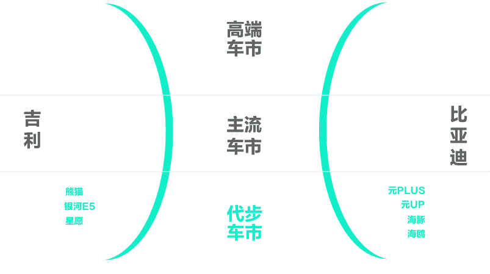

## 2022-2024年吉利汽车与比亚迪主力代步产品终端销量趋势（万辆）

## 2024年四大主流用车场景的节能诉求

- 珊瑚 - 海豚
- 望愿 - 海豹
- 银河E5 - 元UP
- 银河E8 - 元PLUS

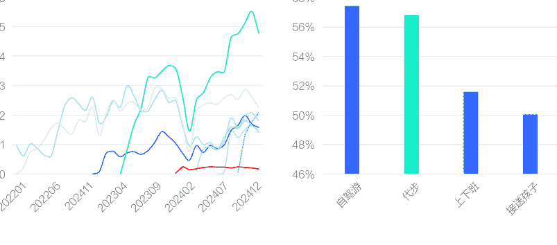

数据来源：卓易研究院

## 2025年吉利汽车将重构“刚劲”比亚迪的主力军
## 2026年吉利汽车将全面转型为节能车型

虽然吉利汽车在代步市场打开了比亚迪的一道突破口，但现在不是主流车、不是主旋，相当于比亚迪接近胜利。2024年12月6日，吉利汽车乘胜追击，投放了重磅车型SUV，售价10.38-13.68万元（限时享9.98-13.28万元）。价格优势对标探越和海豹9，空间优势对标PLUS和锐享，销量量被寄了“4”和“6”的期望。上市日（2024年12月），锐享6终结爆卖1.7万辆（吉利汽车的三个月后再会有价值），着实令人眼前一亮。锐享6、2025年吉利的新银河L6和L7将持续发力。配置配置都是全面化，越能动型的DHT换成了单块的DHT，发动机1.5T换成1.7T更经济的L5，电池换成8.6kWh和19.09kWh……还是决定胜差距的关键，吉利汽车与比亚迪越接近“同质化”。

2025年，锐享6、银河L6和银河L7将挑战比亚迪和海洋的“先锋”，还将推出六款全新擎产品，分别为尺寸SUV、中型插混车、中型插混车、中型纯电车与中型纯电SUV（已开发资料，未完定）。前三款将与比亚迪的家族（含海洋系）产品搏，后续产品将与比亚迪唐、大家（含海洋系）产品进展顺利，将吉利汽车“刚劲”比亚迪的主力攻，并加速吉利汽车一体化，不能。2024年比亚迪全球销量42万辆，王朝和海洋系贡献了400万，其中宋、大家（含海洋系）产品是比亚迪线心的重心，2024年销量280万，为比亚迪全球近三分之一。2025年初，吉利汽车有效见，逼着比亚迪出大招。

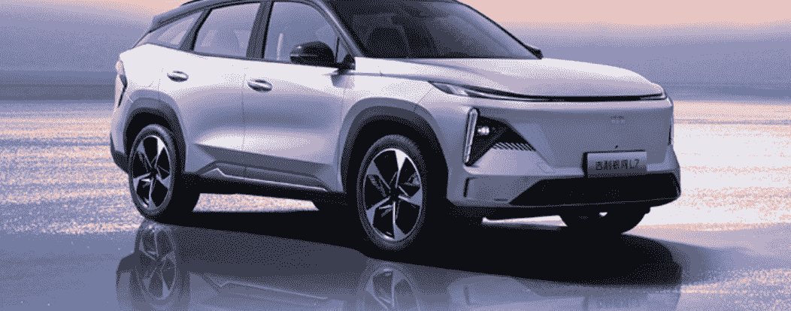

## 22-23款吉利汽车主流新能源产品动力配置
## 24-25款吉利汽车部分新能源产品动力配置

| 车型 | 能源类型 | 电电池类型 | 变速箱 | 发动机 |
| --- | --- | --- | --- | --- |
| 22款L PHEV | PHEV | 三元锂 | 15.5 | 三菱DHT / 1.5T |
| 23款银河L6 | PHEV | 磷铁锂 | 91.1/19.09 | 三菱DHT / 1.5T |
| 23款银河L7 | PHEV | 磷铁锂 | 91.18/37 | 三菱DHT / 1.5T |
| 23款星PLUS | PHEV | 三元 | 8.3/12.8/48/57.6 | E-CVT / 1.5L |
| 23款星越L5 | PHEV | 磷铁锂 | E-CVT | 1.5L |
| 23款星PLUS | PHEV | 磷铁锂 | 12.9/18.3/26.7/31/87.0 | E-CVT / 1.5L |
| 23款星Pro | PHEV | 磷铁锂 | 12.9/18.3 | E-CVT / 1.5L |
| 25款银界P7 | PHEV | 磷铁锂 | 8.5/109 | 1.5L |
| 25款豪河L6 | PHEV | 磷铁锂 | 8.5/109 | 1.5L |
| 25款豪河L7 | PHEV | 磷铁锂 | 8.5/109 | 1.5L |
| 25款星PLUS | PHEV | 磷铁锂 | 7.6/15.8/48/57.6 | E-CVT / 1.5L |
| 24款L | PHEV | 磷铁锂 | 12.9/18.3/26.7/31/87.0 | E-CVT / 1.5L |
| 25款星Pro | PHEV | 磷铁锂 | 12.9/18.3 | E-CVT / 1.5L |

数据来源：吉利车型配置表，时效为2025年1月

## 2025年吉利品牌全面硬刚比亚迪王朝和海洋的主要布局

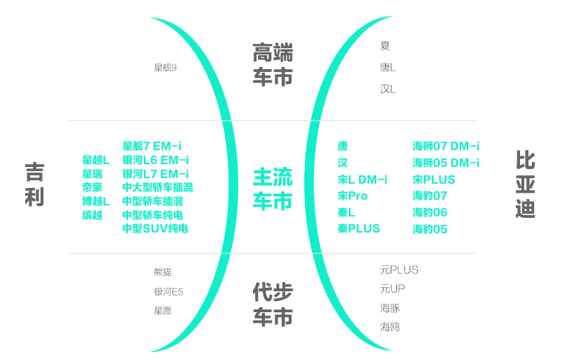

说明：根据分类整理的2025年吉利品牌（别含）数据仅供参考，吉利汽车有部分产品越级一级的习惯，如如此车型越型中型SUV

## 主打性能与价格，从主流迈向高端
## 2025年吉利汽车“硬刚”比亚迪的战略蓝图上线

聚焦价格，2021年亚市场强势爆发，并将曾经的主流吉利汽车按在地上摩擦。一年后的2022年，不服的吉利汽车发动了第二轮反攻，推出了睿LHE、星极LHE等新产品，成本、可靠性等存在一系列问题，上述上市产品几乎是“光凭”。又在2023年后，不服的吉利汽车发动了第三轮反攻，并夺回了部分份额，费力提升了可靠性，组建了全新车系，推出了新产品银河、银河L系列，虽然本土未能撼动比亚迪的统治地位，但已经比比亚迪“领先”了。又在2024年后，不服的吉利汽车发动第三轮反攻，首先是银河E5、星银等小电动，在比亚迪领域已经是绝对的主流者并一战交锋，2024强势推出全新主流产品星7“登场”了。全面突出性能，价格完全下杀亚迪同级，双击，2024年至2025年，比亚迪将怎么样？

2025年，重新起来的吉利将把第三轮大反攻推向高端，星7与银河L7与L6将成“破阵”。硬“刚”比亚迪的家族、王朝及海洋系同级别，除了旧与主流两大阵市，2025年吉利汽车还将在高端市场全面“硬刚”比亚迪；

2025年，起来的吉利的基本态度是，能上的就不通底了。

## 2025年吉利汽车与比亚迪的主流产品布局图

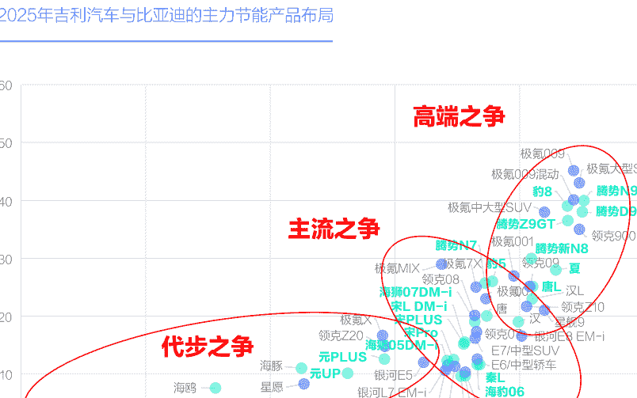

注：动力单位为马力(hp)，价格单位为万元(10k yuan)
数据来源：星车型

## 2025年吉利汽车的三轮反击
### 虽然如上，但也没有短板
品牌含量处于初期，吉利汽车占比更高，硬核领先半步

2021-2023年，吉利汽车之所以被比亚迪按在地上摩擦，核心的核心原因之一是吉利汽车搞了一堆自自己的品牌，其原名“赛马”，实际上就是误解，造成一盘散沙，被比亚迪难以追及。2024年，吉利汽车充分认识到了这一点，当9月正式发布《泰吉宣言》，核心又要加速整合、重塑“中央权威”。虽然极巩收，但两者的产品定位、品牌口碑都非常接近，能源形式依然趋同，他们都有各自的盈利红利。2025年，此者依然有需清晰的整合方案。2024年，吉利品牌确实取消了更名“硬钢”……2025年，吉利汽车不仅要“硬刚”比亚迪，也要“硬刚”比亚迪之。

燃油车价格高不下吉利汽车奔驰比亚迪，首先要明确，燃油车与新能源的技术路线毫无差异，企业不必纠结燃油车还是新能源。形式的取舍，取决于整合成本，由于中国很便宜方便，汽车车有天然优势，比亚迪的转型缓慢，很好还有了点。2024年吉利汽车的新能源占比还不及50%，2025年为了“硬刚”比亚迪，吉利汽车在国内市场将加速转型化。

在激速发展的纯电市场，吉利汽车是领先的。2024年比亚迪的方程与长城的销量已上量，但吉利汽车仍为零。2025年将推出高端系列并寻求增长，长城也将发布新豪华品牌，两者都重点打造明星产品，硬核产品将为中国品牌高端化的新突破。吉利的纯电产品可能得到2027年上市，将失去先优势，只能期待后发制人。

新产品列表接连，辛辛苦苦培育出的老一代产品纷纷被拍在沙滩上……2025年吉利汽车似乎来势汹汹，虽然“硬刚”比亚迪，但坚持的细节很多。

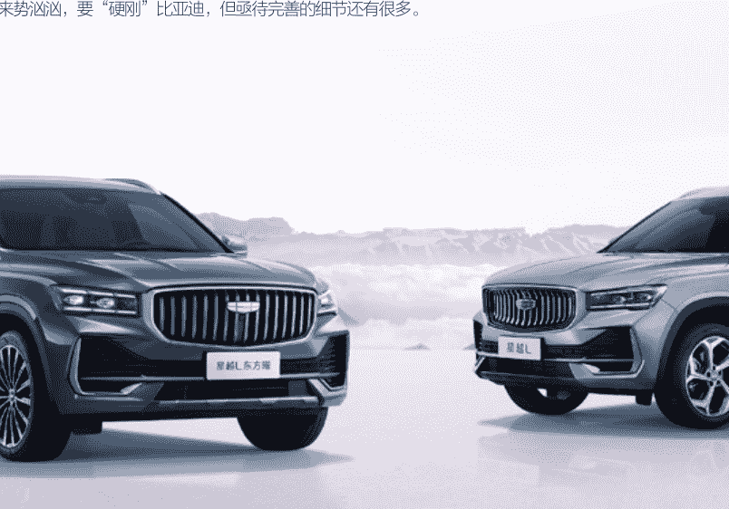

## 2024年9月吉利汽车发布《泰吉宣言》重构“中央权威”

| 吉利 | 吉利 | 银河/星银 |
| :--- | :--- | :--- |
| 吉利汽车 | 几何 | |
| | 领克 | 银河 |
| | 极氪 | 雷达 |
| | 雷达 | 景 |
| | 其它 | 领克 |
| | | 极氪 |

## 2016-2024年吉利汽车国内市场新能源占比走势2024年各能源用户的诉求
- 吉利汽车
- 比亚迪

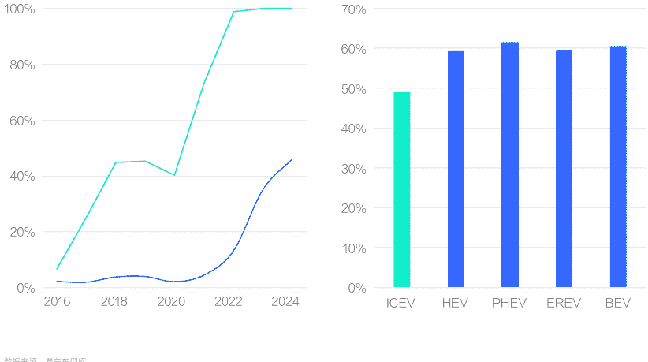

数据来源：卓研

## 比亚迪也没闲着，2024年积极奔主流2025年强势力发力，且随时发动新轮价格战

向吉利的“硬刚”吉利汽车忙“硬刚”，比亚迪迪闲着；年初比亚迪持续防击吉利汽车新款“硬刚”，全推出荣耀版、把吉利直接擂里；年初投入银河L和L6、海豹06、海豹05DM-i等一批全新新能源用车，比亚迪现在主流市场的统治地位，持续保持对吉利汽车等品的压缩；下半年将快速推出DM-5等新技术，迫使吉利汽车等新款的战术；2024年比亚迪品牌主流市场效果显著，国内销量飙升至349万，领先于大众、丰田、吉利等；比亚迪2024年积极奔主流市场发力之后，2025年比亚迪的夏、唐L、方程L8、腾胜N9、腾胜N8等全新动能全面露出。在节能技术、产品布局等层面，比亚迪仍有强大力的动权。

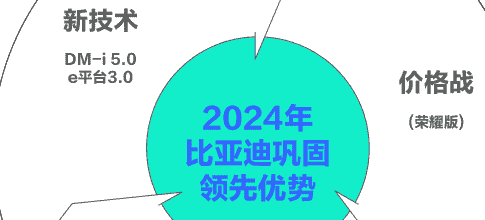

## 2024年比亚迪主要策略举措

## 2024年中国乘用车品牌终端销量TOP10(万辆)

| 比亚迪 | 349 |
| 大众 | 213 |
| 吉田 | 158 |
| 吉利 | 134 |
| 五菱 | 95 |
| 本田 | 86 |
| 长安 | 83 |
| 奇瑞 | 71 |
| 宝马 | 70 |
| 奥迪 | 66 |

## 2025年初比亚迪主力产品布局(含部分未上市车型)

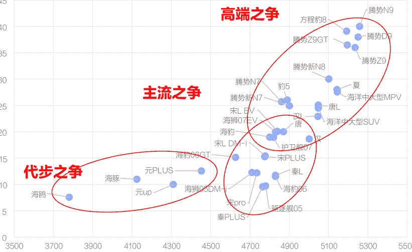

数据来源：广联研究院
数据说明：横轴为销量(万)，纵轴为畅销车型(万)

## 2024年吉利比比亚迪份额1/4
## 2025年两者的“硬刚”无疑向车市投入后检将全面催化“节能大战”

由于功能、定价等核心亮点无限接近比亚迪，再研发、销售与服务的体系能力能媲美比亚迪，2025年吉利全面“硬刚”，一定会让比亚迪份额反击。但吉利汽车的品牌、产品细分等仍需加投入，为了对等吉利汽车的竞争，比亚迪也做了积极准备，2025年全面发高攻势，短期内吉利汽车全面超越比亚迪并不难，不过两者的全面“硬刚”大概会实现1+2的效果。

2024年吉利在比亚迪的份额约四分之一，2025年即便维持目前的份额，两者全面“硬刚”衍生出的节能、价格等，也会引起中国市场的剧变。它车将应付比亚迪，还应付吉利汽车。2025年，由于比亚迪销量增长，国内市场450万，吉利汽车全球市场300万，国内市场250万，吉利与比亚迪的国家份额有望接近三分之一，两者的全面硬刚无疑向中国市场投入了一枚威力巨大的杀牌，将全面催化中国市场的“节能大战”。

请问是否还有惊喜？2024年中国品牌快速抢占中国消费重心，2024年中国品牌主导，其中以网约为主，其国内私家首位。理想、捷胜、鸿蒙、岚、魏界、等等。海外品牌仅有特斯拉。由于吉利与比亚迪份额已超过50%，随着中国市场消耗潮的持续推进，吉利汽车的潜在挑战将会增大，甚至面临冲击。聚焦能量与价格，其机改改汽车、深蓝汽车、咖电等新型竞品，中国市场将诞生新势力。与其说吉利汽车是“硬刚”比亚迪，不如“硬刚”自己。

## 2017-2024年吉利汽车/比亚迪国内市场份额趋势
- 吉利汽车
- 比亚迪
- 吉利集团
- 比亚迪

| 广汽宏 | 71.28% |
| BEIJING | 70.34% |
| 斯拉 | 64.24% |
| 特瑞斯 | 63.70% |
| 沃尔沃 | 63.57% |
| 丰田 | 61.81% |
| 理想 | 61.67% |
| 启产 | 61.36% |
| 小豹 | 60.82% |
| 凯迪 | 60.21% |
| 菱图 | 58.65% |
| 方程程 | 58.61% |
| 长星 | 57.89% |
| 雷克斯 | 57.78% |
| AITO | 57.47% |
| 五菱 | 56.65% |
| 吉利汽车 | 53.51% |

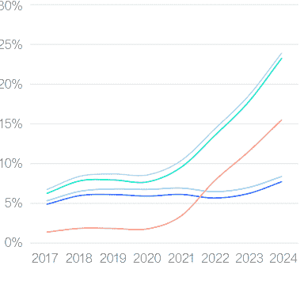
## 2025年吉利汽车与比亚迪“碰撞”的外溢效应

## 2024年吉利与比亚迪占据了中国品牌40%份额以及助力2025-2026年中国品牌全面节能

聚焦功能产品，如果说吉利汽车与比亚迪的“硬刚”是向中国汽车投入一项内核，那其中国际品牌阵营就是两线胜利：2024年吉利与比亚迪占据了中国用车大盘25%的份额，占了中国品牌40%的份额；2024年中国汽车新能源渗透率近50%，中国品牌新能源渗透率近70%……2025年中国品牌的节能与吉利与比亚迪的节奏，2025-2026年大体还能留在现在，如如此转型，大概会被加速流缓。那些小型中国品牌的积极了，因为由于汽车转型，节能能扩大用户的消费重心，可能是不为优势的：

2025，奇瑞；长安与长城等中国品牌在终端所加速节能化和高端化。奇瑞将风云A9、风T8、风T11、捷山S5、山H8、鸣G700、星纪ES增长、星途E08、捷月C-DM等一堆新车，其中许多是节能车；长安将投放沃捷06、长深S09、蓝源Q07、长安C798等产品，几乎都是节能车；且不乏高端车型；长城将投放蓝500H4i、哈弗H7H4i、莱沃MAX级扩展，坦克400/700等多种产品，几乎都是节能车，且以高端车型为主……

2026年，少数强势中国品牌不仅做了全面应对吉利汽车与比亚迪“硬刚”的准备，而且成为半路杀出的过程金图。多方只会加速中国品牌阵营的优胜劣与全面节能进程；

2025年少数强势中国品牌将全面节能型高端化攻势，理想、向界等节能形式局限于增程势力，在国内仍以燃油为主。零、蓝电等极追求节能与新品牌黑马时间，面临较大窘境。

## 2017-2024年吉利汽车与比亚迪国内市场份额新能源渗透走势
- 吉利汽车
- 比亚迪
- 吉利汽车
- 比亚迪
- 吉利集团
- 比亚迪

## 2025年吉利汽车与比亚迪全面“硬刚”的外溢模拟图

| 高端 | 比亚迪 | 长安 | 奇瑞 | 大众 |
| :--- | :--- | :--- | :--- | :--- | :--- |
| 鸿蒙09/游动 | 锐享900 | 沃尔Pro U8 汉享L | 自信系 | 埃维德12/11 | 逸达队蕴 |
| 豪享大型SUV | 星界9 | 方程五 方享 | 域700 | 深蓝509 | 途大众车 |
| 中型SUV | 锐享09 | 比亚迪D9 | 域500/400 | 星途/海狮 | |
| 锐享001 | 锐享10 | DM-i | 迪斯D9/29/SGT | 逸趣300 | 星途/海狮 |
| 锐享01 | 捷莱 | 擎莉 | 逸驰07/06 | 途蓝/山谷 | |
| 锐享03 | 腾磊 | 擎PLUS | 擎曼 | 途蓝/山谷 | 奇瑞/海涛 |
| 宏享02/宏享 | 擎PLUS | PLUS | 深蓝G18 | 奇瑞/海洋 |
| 宏享77 | 吉利 | 比亚迪 | 逸DM-i-07 | 现代 | 福特 |
| 锐享08 | 中型SUV越豪华 | 海豹07 | 长安蓝系 | 别克 |
| 锐享07 | 中型越豪华 | 海豹N7 | 长安蓝系 | 本田 |
| 星瑞 | 中型插电 | 海豹07 DM-i | 长安擎系 | 丰田 | |
| 星瑞 | 中型插电 | 海豹05 DM-i | 长安系 | 长安LUMIN | | |
| 锐享20 | 元享E5 | 好 | 元UP | 海豹 | | |
| 锐享06 | 锐享X | 海豹 | 长安擎系 | |

## 2017-2024年海外品牌在国内大盘与新能源的份额趋势
- 海外品牌占有份额
- 海外品牌占有新能源份额

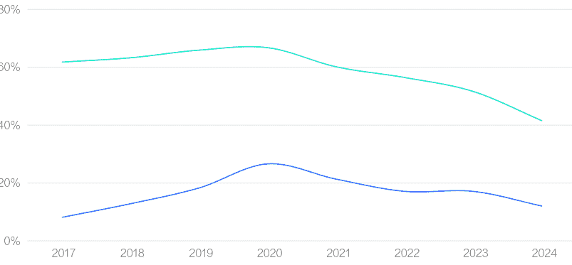

## 2025年吉利汽车与比亚迪全面“硬刚”的溢出效应模拟图

| 高端 | 比亚迪 | 长安 | 奇瑞 | 大众 |
| :--- | :--- | :--- | :--- | :--- | :--- |
| 鸿蒙09/游动 | 锐享900 | 沃尔Pro U8 汉享L | 自信系 | 埃维德12/11 | 逸达队蕴 |
| 豪享大型SUV | 星界9 | 方程五 方享 | 域700 | 深蓝509 | 途大众车 |
| 中型SUV | 锐享09 | 比亚迪D9 | 域500/400 | 星途/海狮 | |
| 锐享001 | 锐享10 | DM-i | 迪斯D9/29/SGT | 逸趣300 | 星途/海狮 |
| 锐享01 | 捷莱 | 擎莉 | 逸驰07/06 | 途蓝/山谷 | |
| 锐享03 | 腾磊 | 擎PLUS | 擎曼 | 途蓝/山谷 | 奇瑞/海涛 |
| 宏享02/宏享 | 擎PLUS | PLUS | 深蓝G18 | 奇瑞/海洋 |
| 宏享77 | 吉利 | 比亚迪 | 逸DM-i-07 | 现代 | 福特 |
| 锐享08 | 中型SUV越豪华 | 海豹07 | 长安蓝系 | 别克 | |
| 锐享07 | 中型越豪华 | 海豹N7 | 长安蓝系 | 本田 | |
| 星瑞 | 中型插电 | 海豹07 DM-i | 长安擎系 | 丰田 | |
| 星瑞 | 中型插电 | 海豹05 DM-i | 长安系 | 长安LUMIN | | |
| 锐享20 | 元享E5 | 好 | 元UP | 海豹 | | |
| 锐享06 | 锐享X | 海豹 | 长安擎系 | | |

## 2017-2024年海外品牌占国内高端车型与高端新能源型的份额走势
- 海外品牌占大盘份额
- 海外品牌占高端新能源份额
- 高端车型新能源渗透率

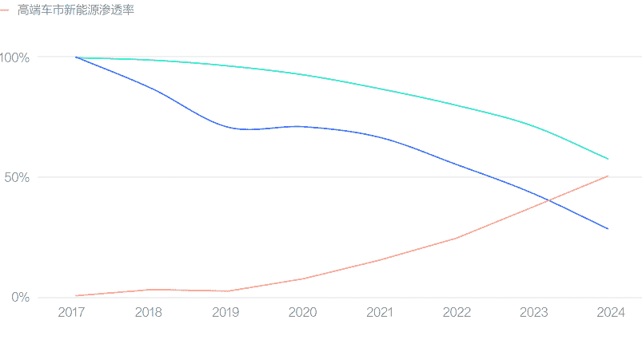

## 2025年吉利汽车与比亚迪全面“硬刚”的外溢效应模拟图

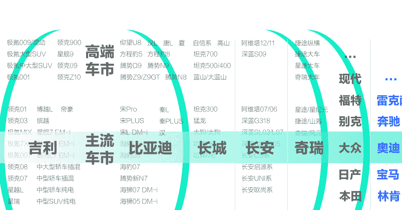

| 沃尔沃S009 | 捷越900 | 望界L8 | 帝豪 | 凌 | 自信系 高山 | 阿梅捷12/11 | 途逸凯颂 | ... |
| 捷途锐S09 | 星铂9 | 高端 | 方程五 极 | 捷锐700 | 深蓝S09 | 汉汽车 | ... |
| 探界SUV | 捷越09 | 鸿胜D9 | 腾驰N | 捷锐500/400 | ... | ... | ... |
| 锐S01 | 捷锐Z10 | 鸿胜S29GT | 鸿胜N8 | ... | ... | ... | ... |
| 凌越01 | 搏驰 | | 凌 | | 捷锐300 | 阿梅捷076 | 途逸/雅驰 | ... |
| 锐越03 | 骐 | | PLUS | 睿胜 | 深蓝G318 | 途逸凯山 | ... |
| 鸿奕MIX-EM1 | | | | | | | | ... |
| 鸿瑞L7 | 吉利 | 比亚迪 | 长安 | 奇瑞 | 大众 | ... |
| 捷越08 | 中型车型 | | | 鸿海07 | 长安启源系 | 长安UNI系 | ... |
| 锐越07 | 中型车型 | | 鸿胜N7 | | 长安启域系 | ... |

## 2025年吉利与比亚迪的全面“硬刚”
看似是场你死我活活的决斗，本质上是以能源的名义重新分夺中国市场。

2021年，节能等类助力比亚迪于强势崛起，并将曾经的自主一主吉利汽车按在地上摩擦。
2022-2023年吉利汽车竞争频繁没有放弃了豪瑞PHEV、银河L7/L6等省油车型，本想教训比亚迪，结果被教育。2023年吉利蓝鲸无心插柳扬威，2024年下半年银河、2025年吉利汽车除了在代步与主流车型之间打“硬刚”，在高端车上全面“硬刚”。可见，主流市场与吉利从代步到主流到高端，2025年吉利与比亚迪的战略蓝图然如此。

2025年吉利的第三次大反击，虽然来之不易，但也有不少短板；品牌将处于初期级，燃油车占比较高、新能源慢半拍……比亚迪也没闲着，2024年积累充足实力。2025年全面发力高端，但可以随时发动一场价格战。2024年吉利与比亚迪的国内份额近1/4，2025年“将”无于市场抢一抢筹码，全面激化“节能大战”：2024年吉利与比亚迪者的“硬刚”两人中中国品牌接近40%占比，两者的“硬刚”将重塑中国品牌阵营与助力2025年高端化，使得海外品牌与新能源的份额跃至40%、10%，吉利与比亚迪海外高端新能源品牌份额跌30%，吉利与比亚迪的全面“硬刚”与高端化，将大幅提升2025-2026年BBA销量前瞻的概率。

2025-2026年，吉利汽车与比亚迪的决战是最后的，不好好，别看他们叫，干得挺狠，但后的胜利未必是它们自己。吉利汽车与比亚迪的全面“硬刚”，看似是场你死我活活的决斗，本质上是以能源的名义重新分夺中国市场。

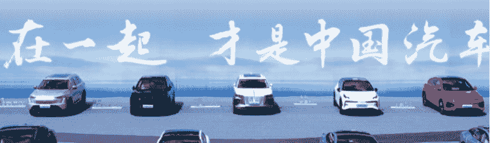

## 2017-2024年吉利汽车+比亚迪合计国内车市份额比例趋势

- 比亚迪
- 吉利汽车

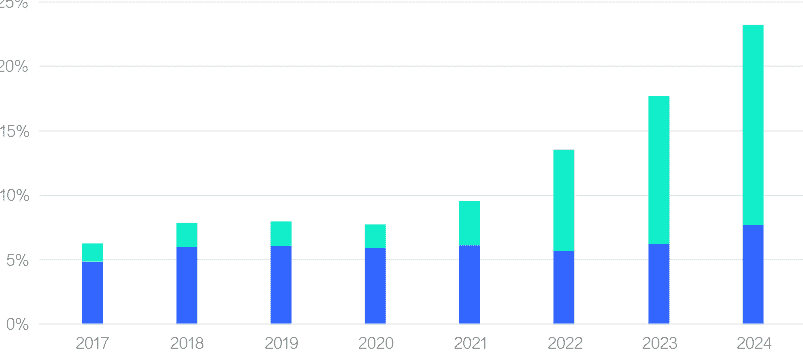

## 2016-2024年吉利汽车与比亚迪国内市场的新能源占比趋势

## 2017-2024年中国车市大盘、中国品牌、海外品牌与海外高端品牌的新能源终端占比趋势

- 比亚迪
- 吉利汽车
- 大盘
- 海外品牌
- 中国品牌
- 海外高端品牌

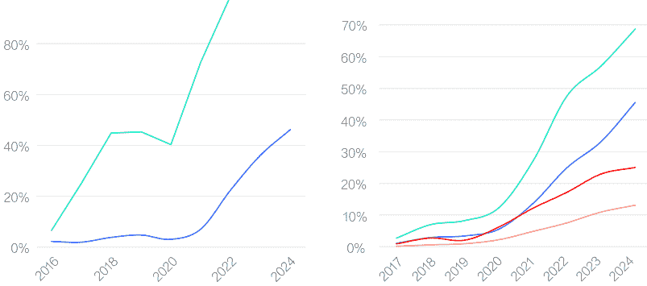

# 版权声明

- 本报告为腾易研究院制作，报告中所有的文字、图片、表格均有有关商标和著作权的法律保护，部分文字和数据来源于自公开信息，所有版权为原著者所有；
- 未经本公司许可，任何组织和个人不得以任何形式抄版、复制、发表或引用；
- 如有转载或引用，及时与我们联系并注明出处，且不得进行任何违意的用途、解释和修改。

# 腾易研究院定位：非商业数字化汽车市智库

# 腾易研究院使命：助力易车客户更好读懂中国汽车

目前腾易研究院不商业化报告，全力为车企、经销商等客户赋能；
基于易数据的优势，腾易研究院的核心特征，就是用数据说话，用事论事，有一律；
我们观点未尽对，分析行业仁见智者智见，不足之处，大家多指点与批评，让我们共同并存。

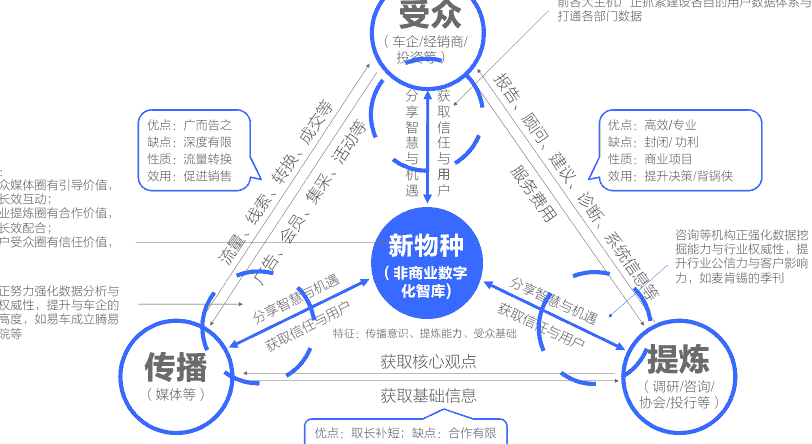

# 汽车行业巡回交流项目——洞若观火

2024年12月-2025年4月，腾易研究院将正式启动第九期“洞若观火”汽车行业走势分析巡回交流项目，本期的核心主题为如何构建城市“细分生态”，助力车企积极捕捉市场新机遇。

- 交流对象：以企、经销商等腾易耕耘的客户为主，一对一交流
- 交流主题：如何构建城市“细分生态”
- 交流时间：2024年12月-2025年4月
- 报名方式：微信信号yicheresearch（请提供姓名+职务+企业+手机）

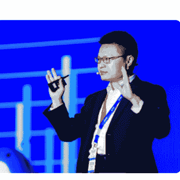

# 汽车行业系列书籍——《见微知著》

《见微知著2024下》的全面围绕“用户细分”课题，深入探城市过去、与未来的演变逻辑，积极赋车企的战略规划、产品优化、市场销售等核心板块。

# 获取方式

- 车企、经销商等腾易广大客户，可联系腾易科技服务人员索取；
- 非车企客户的读者，可联系腾易研究院（微信信号：yicheresearch）

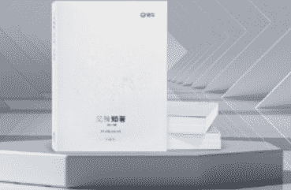

# 联系我们

石本雅 腾讯研究院 行业分析师
Mobile: 188 0118 7009
Mail: yicheresearch@yiche.com
微信: yicheresearch

# 关注我们

微信阅读号君临车市

