# 2025年消费趋势及增长策略洞察报告

流量游戏之外，品牌如何与消费者互共赢

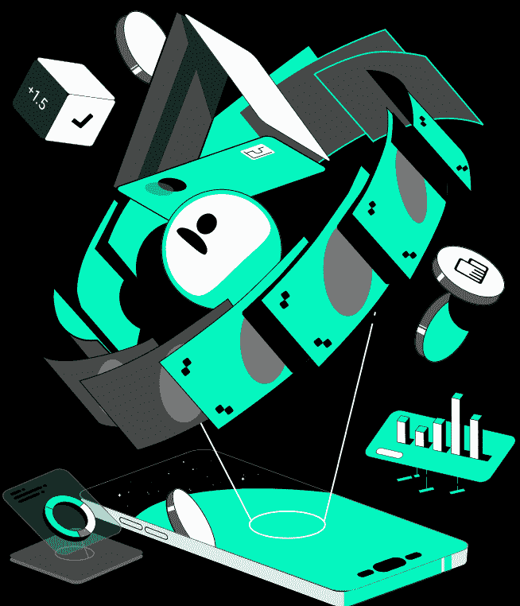

# 免费 价值 及时 专注

# 扫码加入 知识星球TOP 免费资源群

- 每日免费获取价值资源
- 可提供各类资源搜索服务

| 热门付费文章 | 各行行业报告 |
| :--- | :--- |
| 精选图书资源 | 副业赚钱方法 |
| 职场实用资源 | AI政经自媒体 |

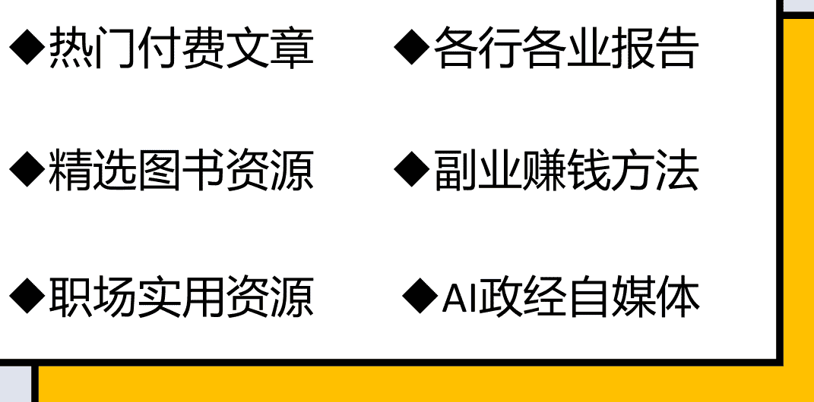

公众号:知识星球TOP 微信号:jntsg8 微信信号:jnttsg2

分享资料仅供个人学习，请及时删除，切勿商用传播

# 目录

## 前言

PART1: 消费者的钱包没有变大，但73%产生了新的消费场景
案例拆解: 东方树叶、SHININSIIN

PART2: 价格战不利于消费者体验，22.4%对质价比不满意
案例拆解: 骆驼服饰

PART3: 消费者购物决策时间缩短了一半，但86%存在退货行为
案例拆解: 山姆会员商店

PART4: 消费者更信任品牌官方和真人社交，但依然有38.3%靠达人发现新品
案例拆解: 奥利奥、一汽红旗

PART5: 没消费过的人还有不少，71.8%购买新品频率增加
案例拆解: 霸王茶姬、波司登

PART6: 消费者很愿意与品牌交朋友，但38%还不怎么成为朋友
案例拆解: 宜家、泡泡玛玛

PART7: 中国消费者对于AI的热情远超欧美，68.3%对于AI内容感兴趣
案例拆解: 九宫游戏

## 前言

今天，消费者行为的碎片化已经到了非常可怕的程度，也难怪营销人最常挂在嘴边的词就是“三秒完播率”。

这意味着什么，当代消费者越来越“无脑”了，品牌必须穷尽刺激他们的多巴胺，用最短的时间抓住消费者注意力，用最短的链路导向交易转化？

科学家参与研究的用户进行了深入访谈，才发现事实并非如此[1]:这些看似“碎片”的使用行为是相互关联的，不同应用之间形成了信息流动的通道。消费者是为了实现更丰富的体验、实现更完整的目的而去反复切换app。比如用户刷了一上午淘宝，还是会选择去小红书看评测，同时调用微信问好友，无非为了满足“选购产品”的场景。

在消费者眼中，错综复杂的品牌触点像一个星系：有主要的“恒星”（常用核心应用），也有围绕运转的“行星”（次要应用），它们之间存在引力关系（互关联），从而构成了一个完整的生态系统，共同为自己的需求服务。

消费者是出于多任务将时间切割成小块，才导致行为的碎片化，并不是完全由及时满足和新鲜刺激驱动的。换个角度来说，品牌通过营销注入市场的“兴奋剂”、榨干注意力的行为，很难让品牌和消费者长期互利：

- 消费者开始对警惕“注意力陷阱”，短期刺激难以以获得有价值的体验
- 品牌方营销狂热开始降温，卷价、卷流量看似有规模，却难积累利润

因此，在流量游戏中疲于奔命的品牌，今年也开始反思和实践：尊重消费者的真实需求，以产品和服务为底座，在消费者离散点中串联连续路径，在抓住短期流量红利的同时，凝聚长期的生态壁。

品牌要在碎片中实现统一，2025年的道路并不轻松。其中关键的挑战在于：“一打鲜”的打法已经失效，要与流量相同的预算，分散精力去做更多的事。品牌需要做到：

- 既要：顾及业务大盘，不能乱，拥有长期安全感
- 又要：挖掘业务增长的新契机，通过创新拓展边界
- 还要：沉淀品牌资产，拥有自主掌控力

那么，在这样的背景下，消费者到底发生了变化？品牌应该采取怎样的创新来解决“又要还要”难题。在本报告中，我们不仅研究了2024年消费趋势，分别对应了产品、营销、渠道，希望能帮助读者提供思路。

## 核心内容概述

### 趋势1 消费者钱包没有变大，但变得复杂了
- 73%消费者产生了新的消费场景/生活习惯
- 71.8%购买新品频率增加，满足细分需求
- 东方树叶：老品牌为何增长？
- SHININSIIN：新品牌是如何打造的？

### 趋势2 消费者期待低价，但价格战是最优解
- 22.4%消费者认为质价比是重要的因素
- 超过60%消费者认为低价品牌产品力和产品体验不符合预期
- 骆驼服饰：老字号如何在价格战中突围？

### 趋势3 消费者决策效率提高了，但效果变了
- 86%消费者有退货行为，决策时间从80分钟缩短到43分钟
- 决策准确性并未提升，决策更简单
- 山姆会员商店：是如何“消费降级”下依然突破规模的？

### 趋势4 消费者更信任官方，但靠官方的声音不够
- 38.3%消费者把品牌作为最信任的角色
- 近4成消费者通过达人发现新品牌，信任BGC和UGC
- 奥利奥：百年巨头如何在传统营销基础上增强碎片化传播？
- 一汽红旗：老牌企业如何借助策略拉近与用户的距离？

### 趋势5 没消费过的人还有不少
- 超过3成消费者发现新品
- “被动”与“主动”发现方式共存，“理性”与“感性”吸引力并重
- 品牌官方、达人、网红成为主流发现渠道，IP联动重要性凸显
- 波司登：如何借助大事件实现真实人群破圈？

### 趋势6 消费者愿意与品牌做朋友，但缺乏健康的模式
- 超6成消费者在购买前就加入会员，接近4成消费者不熟悉、甚至完全不知道会员体系的规则
- 超6成消费者乐于享受权益，5成购买新品
- 宜家：如何保持长期力，通过会员经营穿越周期
- 泡泡玛特：如何抓住市场红利，在私域增量增长？

### 趋势7 消费者对AI的内容持有积极态度
- 超3成企业将营销销售作为AI应用落地
- 中国消费者对AI的信任程度高于欧美，且对于AI生成的广告内容持有积极态度
- 在营销领域找到AI应用场景
- 九宫游戏：如何通过“游戏化”解决行业性的内容难题

## PART1 消费者的钱包没有变大，但73%产生了新的消费场景

品牌增长的原点一定是满足消费者需求的好产品，营销和流量只是放大器。整体消费市场供给大于需求，显而易见的增量赛道已经饱和了。比如尼尔森对于饮料行业的追踪显示，月销过千的新品在2021年有41个，但到了2024年上半年仅有2个[9]。

产品新的驱动力会来自哪里？

我们认为，消费者钱包的重新洗牌将产生确定性增量：人们总消费金额未必上升，但会在更多不同场景花钱。普遍意义上的消费升级可能不存在了，但消费者细分的生活场景和兴趣增多了，钱包被切成了更多块，花钱的方式变得更加复杂和多样。

实际上，消费者普遍会有“数据搜了很多”的感受——一份2024年的调研报告显示，1-3线的中产及以上人群，有63%预期比去年更多。

消费者不断产生新的兴趣和习惯，带来了新的场景。2024年新兴兴趣/习惯分布：

| 新兴兴趣/习惯 | 占比 |
| :--- | :--- |
| 运动健身 | 36.5% |
| 食食 | 35.1% |
| 旅游 | 31.0% |
| 户外 | 30.0% |
| 健康养生 | 27.9% |
| 休闲娱乐 | 26.9% |
| 美妆穿搭 | 21.1% |
| 文化艺术 | 17.3% |
| 逛街/打卡 | 15.1% |
| 音乐 | 11.0% |
| 布置家居 | 7.1% |
| 数码科技 | 5.1% |
| 养宠 | 2.8% |

数据来源：增长黑盒线上调研，N=1500

消费者在新兴趣/习惯上有较大差异，例如高收入人群（月收入>=3000）：

| 排名 | 内容 |
| :--- | :--- |
| TOP1 食食 | 烘焙、调制饮 |
| TOP1 户外活动 | 露营、骑行 |
| TOP2 美妆穿搭 | 妆容、服装搭配 |
| TOP2 健康养生 | 泡脚、八段锦 |
| TOP3 文化艺术 | 舞蹈、绘画、看展、写作 |
| TOP3 运动健身 | 跑步、瑜伽、游泳 |
| TOP4 闲暇娱乐 | 电竞、桌游、动漫 |
| TOP4 数码科技 | 无人机、VR |
| TOP5 布置家居 | 智能化改造 |
| TOP5 家庭生活 | 照顾宝宝、老人、筹备婚礼 |

二十年前，哈佛商学院教授克莱纳·克莱斯坦森在研究创新时提出了Jobs-to-done (JTBD)理论：消费者购买产品或服务不是因为他们属于某个群体或具有特征，而是因为他们在特定场景下需要完成某项“工作”。

举个例子，传统营销会说“25-35岁的年轻白领购买咖啡”，而JTBD理论会说“人们需要一个临时办公室和社交场所时，他们会雇星巴克完成这项工作”。这很好的解释了我们的调研数据：在快节奏的社会生活中，消费者的“工作”变多了，而且在不断更新。未来的竞争不再局限于品类和人群上，识别消费者关键“工作”、“分析工作”的完整过程，并提出对应的产品，成为了品牌的重要任务。

当然，这些“工作”存在时效性，消费者每年都会放弃某些兴趣和习惯，同时推出新的场景。其中逐步增长、确定性的趋势，才是最有值的。对于品牌来说，可能会优先选择提前布局，对于长期的变化积累能量，直到某一天爆发；而对于新品牌来说，更重要的是借助“爆品思维”先上牌桌，由小切口进入大市场，延长产品生命周期。

## 品牌关键词议题：如何用产品创新满足日益细分的场景和需求？

世界永远不会是平的。无论是展望长期主义，还是抓住短期红利，“套利思维”和“降维打击”依然在满足消费者新场景上发挥作用。发达国家/地区的消费趋势会在其它地方重演，通过这些借鉴可以帮助品牌提前布局，顺势而为。而其它品类功能/口味/包装的变化趋势，很有可能验证了消费者在新场景的需求。

## 东方树叶：老品牌为何在蛰伏9年后冲上百亿营收？

从10亿到百亿规模，东方树叶只用了4年时间。其用户群体从早聚焦在35岁以上的精英男性，扩展到全年龄段受众，渗透率超过80%，做出了真正意义的国民单品。

此前，东方树叶通过对标日本预判了中国无糖市场的崛起，已经在市场上蛰伏9年时间。可业务规模一直没有太大的突破，甚至在2017年后才扭亏为盈。

2019之后，公司判断消费者对于“无糖”的认知趋成熟，于是抓住机会。在大品牌投入、通过“增量计划”激励的同时，从2021年起不断推出新品来开拓市场，最终实现了销量翻倍增长。

以口味和包装作为产品创新的原点：

| 类别 | 占比 |
| :--- | :--- |
| 其它 | 20% |
| 黑龙茶 | 10% |
| 茉莉花茶 | 50% |
| 青梅茉莉茶 | 20% |

（注：此处数据根据OCR内容逻辑修正）

数据来源：增长黑盒调研，N=1500

## 产品创新驱动力

东方树叶的新品出发，还是要做大单品？品牌在碎片化营销中，并不是完全依赖数据，而是要深度调研，洞察消费者的细分场景。品牌需要做到：

- “新口味”：入门级
- “小包装”：便捷、便于携带
- “大包装”：畅饮

- 强化品牌记忆，同时培养使用习惯
- 打造差异化点

数据来源：公开资料，小红书专家访谈，增长黑盒研究

## SHEIN：年入30亿的新品牌是如何打造爆款的？

过去两年，市场都在讲lululemon成为中产的故事，它让瑜伽从小众爱好变成了大众词汇，也让产品的价值不再限于瑜伽本身。有一个与瑜伽裤相似的新品类——鲨鱼裤，正在成为年轻女性的新消费热点。它最早起源于冲浪、竞技泳池等专业运动领域，因鲨鱼皮的高科技结构及功能而得名。

2021年，SHEIN创始人敏锐地察觉了鲨鱼裤在电商平台的搜索量快速上升。2023年SHEIN全渠道营收达到了15亿元，且连续三年位鲨鱼裤品类全网TOP1，市场份额高达19%。公司还在皮肤衣等新品类拓展出了第二曲线，2024年营收再次翻倍至30亿元。

瑜伽的心智通常聚焦在运动场景，当SHEIN亲民的价格叠加了日益增长的塑形、运动、舒适、时尚、保暖等复合需求之后，目标人群自然就变多了，使用场景也增加了，市场空间立刻打开。

## 兼具时尚与舒适，解决消费者“又要又要”的增量需求

并非替代瑜伽裤，而是底层的品质升级。已经验证的经典：瑜伽裤2015年存在。消费者想要一款满足多样化需求的产品，在身材显瘦、时尚百搭的同时，穿着舒适，还不能太贵。

| | 专业瑜伽裤 | 光腿神器 | SHEIN |
| :--- | :--- | :--- | :--- |
| 舒适感 | ✅ | ❌ | ✅ |
| 时尚感 | ❌ | ❌ | ✅ |
| 安全性 | ✅ | ✅ | ✅ |
| 性价比 | ❌ | ✅ | ✅ |

数据来源：公开资料，专家访谈，增长黑盒研究整理

## 趋势
品牌要脱颖而出，必须向品牌化方向发展。除了视觉、讲品牌故事、统一视觉表达这一系列常规操作之外，品牌在视频号上的布局也有价值。品牌最早是从抖音起家，靠着口碑，由于视频号触达人群有限，视频号成了精准渠道。一方面，抖音在人群上的重复率低，增量不高，潜力巨大；另一方面，视频号的人群粘性强，效果更好。视频号的功能、玩法以及配合整个生态，品牌从爆款经营创造了巨大的可能性。作为长效经营，为品牌拓展新增量，同时延长产品生命周期。

- 朋友圈+视频号
- 会员中心小程序

数据来源：公开资料，增长黑盒整理

## 价格战
价格战不利于消费者体验。近几年CPI的变化，整体消费品的均价不断下滑。除了少数持续高端化的分类，多数消费品都陷入了“价格战”。在2021年Q1，中国城镇平均售价上涨了4%，而在接下来的几年经历了不同程度的降低。到2024年Q1，整体幅度达到了1.5%，而2024年Q3则高达5.1%。

增长黑盒的发现：2024年品牌普遍将竞争焦点放在了价格上，其重要性远超产品和品牌本身。

### CMO认为该方式是行业主要的竞争方式
| 竞争方式 | 占比 |
| :--- | :--- |
| 价格竞争（降低产品价格） | 43% |
| 产品差异化（独特且高质量的产品） | 29% |
| 品牌营销（品牌知名度，与客户互动） | 17% |
| 渠道管理（提高市场覆盖率和销售效率） | 8% |
| 客户服务（优质的售前/售中/售后服务） | 3% |

数据来源：《2024年中国市场趋势调研》

2024年，65.5%的消费者认为低价对于购物决策更重要。这背后必然是价格战带来的心智影响：在寻求低价商品的方式上，有6成消费者倾向于寻找品牌的“羊毛”，还有6成消费者会主动选择折扣更高的渠道。消费者对于折扣的倾向性，已经超过了曾经流行的“平替”。

## 65%的消费者在2024年更加看重价格；在寻求低价商品时，打折比平替更重要
“价格低”对购物决策的重要性：对比去年的变化

### 消费者获取低价商品的方式
- 寻找更多券、满减等品牌福利来“薅羊毛”60.5%
- 寻找折扣力度更高的购物渠道/平台59.9%
- 等自己品牌促销活动时再回购49.0%
- 更倾向选择那些经常打折促销的品牌47.9%
- 寻找品牌较为认知的“平替”37.7%
- 参加非官方的团购/拼单活动获得更大优惠29.7%
- 寻找完全不知名的“平替”或“山寨”17.5%

数据来源：增长红线线上用户调研，N=1500

那么问题就来了：打折促销难道不是给消费者带来实惠吗？品牌方不应该积极参与降价吗？

事实并非如此。对比23年，单纯追求低价的消费者并没有大幅增长。即使消费者抱着“一分钱一分货”的心态购买了低价商品，依然超过2成认为品质和体验不符合预期；其中“质量降低”是不符合预期的主要原因。收入越高的人群，不符合预期的占比越高。这说明消费者真正想要的是质比，而不是纯粹的低价。

## 消费者低价倾向：对比去年变化

数据来源：增长黑盒用户调研，N=500

## 低价产品的“品质/体验”是否符合预期
- 完全不符合预期2.4%
- 太太符合预期20.0%
- 比较符合预期54.6%
- 非常符合预期13.3%

## 低价商品不符合预期的比例
- 质量降低10.0%
- 山寨假货33.9%
- 规格减少32.4%
- 成分改变28.9%
- 功能阉割21.4%

数据来源：增长黑盒用户调研，N=500

品牌打折促销必然降低了毛利。想要继续赚钱，要么降低营销和销售成本，要么就在产品质量上妥协，后者更轻松。

从另一个角度来看，虽然消费者花钱更谨慎了，但“价格”并非衡量产品价值的唯一标准。行业内卷之下，打折促销带来的研发下降，反而让商家错失了增长机会。

## 消费者购买低价产品的钱在哪里
- 储蓄37.6%
- 应付生活/工作不稳定34.7%
- 其他兴趣偏好32.2%
- 个人发展、如学习27.9%
- 孩子、老人养老26.3%
- 维持基本生活17.2%
- 结婚等重大需求11.6%

## 让消费者优先回归正常的产品
| 类别 | 占比 |
| :--- | :--- |
| 功能无可替代的产品 | 55.10% |
| 品牌喜好程度高的产品 | 45.30% |
| 使用在重要或场合的产品 | 42.70% |
| 拥有更强信任感的产品 | 39.00% |
| 能提供贴心服务的产品 | 35.80% |
| 限量、稀缺、独特、奢侈的产品 | 31.40% |
| 没有什么，除非收入增加 | 21.10% |

数据来源：增长黑盒用户调研，N=500

## 品牌方关键词：怎样兼顾品牌力和产品力，为消费者提供优质性价比？薄利多销，但不能通过降价来透支品牌力，降低质量影响口碑；降本这一切不能全靠在品牌建设上，供应链和渠道的“增效”更关键，钱要花在消费者最在意的地方。

## 骆驼服饰：老货如何抓住户外潮流，在年轻人中翻红
在平价服装市场日益激烈的情况下，骆驼服饰依旧增长可见，2024年线上渠道GMV突破100亿元，同比增长超过60%，冲锋衣占据占比一半。作为一个有一个近百年历史的品牌，骆驼成功拆掉了“老头乐”的标签，在年轻人中翻红。骆驼早年聚焦类产品时，用户几乎都是30岁以上、下沉市场的男性。而今天70%是30岁以下年轻人，女性占比60%，以二线和新一线为主。

疫情后户外运动的市场兴起，骆驼积极跟随趋势，将自己深耕已久的防晒类和冲锋衣推到营销的最前线，在坚固功能的基础上，强调时尚设计。一个小品牌进入大众视野，用户对其功能和专业性的要求就会适当降低，使用场景会变得更多、更日常。骆驼正是抓住了大多数新目标用户的需求特征，在用料方面不追求专业级别，更为了追求休闲风格。但这代表骆驼一种追求低价——因为价格更低的白牌市场上更加激烈，供给远大于需求。消费者在市场教育下，逐渐在心里有了一杆尺，开始意识到低价产品根本不具备宣称的功能价值。但千元以上高端冲锋衣被归为“男人的衣”，市场的供需关系集中于成熟性。那时，年轻女性群体想要寻求高性价比的解决方案，中间价格带的骆驼就成了最佳选择。为了提升品牌力，骆驼围绕日常穿搭进行了大量内容种草，建立了目标人群的心智。

## 年轻人的第一冲锋衣：日常穿搭+专业功能
消费者需求变化：日常化、女性化，入门槛降低

### 消费者购买600元以内
| 白牌/低价品牌 | 价格带 | 商品占比 | GMV占比 |
| :--- | :--- | :--- | :--- |
| 骆驼 | <300 | 63% | 24% |
| 始驼 | 300-500 | 16% | 33% |
| 北面、凯乐石 | >1000 | 9% | 20% |

数据来源：公开资料，专家访谈，增长黑盒整理

骆驼在2020年之前主要依靠货架卖，经历了不可抗力造成的备货压力。由此，骆驼看到了直播电商的巨大潜力，并开始转型电商。大众市场的生意，要有规模优势。骆驼花了时间在抖音上重金开拓新市场，借力年轻人成为类目TOP。进入2024年后，骆驼需要进一步寻找差异化的增量，选择在视频号用高质量内容挖掘优质用户，用私域承接，实现了新人群的闭环。

## 2023-2024视频号和微信私域找到长期增量，在视频号深耕品质消费、消费力强的女性用户，公域联动生态

数据来源：行业数据、专家访谈，增长黑盒整理

## 消费者购物时间缩短了一半，但86%存在退货行为
最近，国家统计局公布了2024年中国居民时间利用报告，其中提到了跟消费行为相关的数据：越来越多的人在购物上花时间，然而每个人的时间却在减少。

### 消费者的时间花在哪里？中国居民购买商品或服务参与者日均花费时间（分钟）

2018年：21.1分钟
2024年：34.1分钟

2018年：80分钟
2024年：43分钟

数据来源：《第三次全国时间利用公报》，国家统计局

从整体趋势来看，这确实说明了线上渗透率提升的同时，充分创造了便利，节省了人们的时间。

## 28%的消费者认为决策难度更低了，仍有8%的消费者认为决策难度增加
不同品类的购物难度变化
| 总体 | 28.0% | 62.0% | 8.0% |
|---|---|---|---|
| 宠物用品 | 23.0% | 67.8% | 5.6% |
| 母婴 | 24.0% | 64.9% | 8.1% |
| 汽车 | 18.9% | 63.8% | 15.0% |
| 奢侈品 | 10.5% | 68.6% | 18.6% |
| 家电3C | 17.2% | 67.7% | 13.0% |
| 家居 | 22.5% | 64.8% | 10.4% |
| 服装 | 31.4% | 58.8% | 8.5% |
| 护肤清洁 | 33.4% | 60.4% | 4.5% |
| 美妆 | 30.4% | 58.1% | 9.5% |
| 酒水饮料 | 24.5% | 65.6% | 6.2% |
| 食品 | 38.3% | 54.2% | 6.5% |

数据来源：增长黑盒用户调研，N=500

我们的数据显示：28%的消费者认为决策难度比以前更低了，只有8%的消费者认为决策难度增加，62%保持不变。从品类来看，大部分快消品并不重决策，只有少数高客单价存在决策难度增加。

## 消费者看到商品和购买渠道一致的频率

虽然消费者与品牌触点更多、转化链路更复杂，但今天有成以上消费者发现购买处于同一赛道。这说明消费者更倾向于“所见即所得”，品牌全渠道布局也促进了决策简单化。

### 渠道一致性的现状与变化对比
| 大部分一致 | 部分一致 | 少部分一致 | 没留意过 |
| :--- | :--- | :--- | :--- |
| 8% | 28% | 13% | 60% |
| 38% | 53% | 22% | 31% |
| 9% | 17% | 46% | 27% |
| 45% | 26% | 13% | 7% |

数据来源：增长黑盒用户调研，N=1500

## 2024年购物退货频率

2024年，高达86%的消费者有过退货。除了常见的“冲动消费”和“比价”外，更重要的是“不合适”和“不满意”。

### 2024年消费者退货原因

| 商品质量不满意 | 40.5% |
| 尺寸或规格不合适 | 37.7% |
| 商品描述与实际情况不符 | 35.3% |
| 颜色或样式存在偏差 | 28.0% |
| 整体不满意，不符合需求 | 24.4% |
| 发货或物流问题 | 16.7% |
| 个人原因退货（如重复购买、买错等） | 14.9% |
| 看到了符合需求的商品 | 13.3% |
| 冲动消费，后悔了 | 11.7% |
| 商品价格变动 | 10.2% |
| 看到了更便宜的商品 | 8.7% |

数据来源：增长黑盒用户调研，N=1500

对于种草的研究中也发现了类似的情况：超过10%的消费者被种草后购物都会非常后悔，直呼上当；另外接近40%的消费者被种草后购物基本满意，但是不可避免有一定程度的后悔。

品牌在流量竞争中，试图全面占据消费者注意力，从而不断缩短购物决策的链路，以实现“品质合”的目标。这看似让消费者的决策变得更快、更容易了，但也让消费者后悔了——消费者自己可能都没有意识到，决策简单是有代价的。消费者与品牌的链接是需要时间来培养的，忽视品牌建设在购物阶段过度加速决策无异于拔苗助长。我们来看那些感觉决策困难的少数人，就会非常清楚：品牌信息的熟悉、辨别、对比都需要花费时间；查找攻略、判断信息有效性、比较特别消耗人们的精力。对于消费者真正帮助是在节省他们时间精力的同时，让他们对自己的选择“不后悔”。

## 消费者购物决策的原因
| 原因 | 占比 |
| :--- | :--- |
| 品牌选择变多了，同质化时间严重 | 54.5% |
| 产品链路太大了，需要别哪些是有价值的 | 52.5% |
| 品牌很多，不信任和熟悉，需要更多来了解信息，但都是有用的，希望多综合考虑 | 48.8% |
| 产品经常后悔，要买不放心，需要更多时间挑选 | 38.0% |
| 需要不放心，需要更多时间挑选 | 37.4% |
| 购买观念发生变化，更多追求与自我理念匹配 | 36.7% |
| 收入增加，不再盲信品牌 | 30.3% |
| 在其他品类上购买更贵的产品 | 27.9% |
| 储蓄、基金、股票等突发事件 | 34.7% |
| 孩子、老人养老 | 26.3% |
| 维持基本生活 | 17.2% |
| 结婚等重大需求 | 11.6% |

山姆全球CEO Chris Nicholas曾说过：“我们花了很多时间研究如何建立一个生态系统，让让你不再做任何决策。因为你知道自己从山姆获得了价值，然后去告诉朋友，然后他们就会加入。”[6]

毕业中产群最值钱的东西就是时间，山姆能够牢抓住他们，本质上是让购物决策省力。从这个生态系统来看，一方面是减少产品选择，只做共性需求的精品，另一方面是让会员体验到切实在的价值，在“优惠”和“服务”上做到极致。

当然，这种价值观更重要的是长期的市场教育，山姆的低毛利并不适应短期的流量打法，围绕产品做日常的高质量内容种草才是关键。山姆发现，新会员首次购物篮的金额通常大于后续多次购物，说明新会员不是因为被一款爆品吸引来的，是在办卡前已经有了理想的购物清单，来之前已经线上知道了产品并且做好初步购买决策。

由于会员购物有一定的比例是通过微信小程序完成的，也因为微信生态的人群质量较高，所以山姆也在微信生态投入了更多的营销资源，如朋友圈广告、公众号和视频运营，以实现从产品认知到转化的闭环。

## 降低消费者决策成本 提升复购并引发传播

## 减少产品的选择

| 2800款精品 | 自有品牌占比40% |
| :--- | :--- |

消费者购物的品类是比较固定的，在这个基础上减少SKU，减少选择——因为用户不愿挑剔太远，也不会比较。
- 只减少SKU，订货量增大，成本下降，售价下降，进入正向循环。
- 专注筛选和测试多个供应商新品方案，供应商在山姆平台推爆后，就会更多合作。

瑞士牛奶：销售额10亿

鲜奶：销售额5亿

## 提升会员体验
同样的高品质产品，会员享受更低的价格

| 产品 | 山姆 | 淘宝 |
| :--- | :--- | :--- |
| 戴森风扇 | 2799 | 3150 |
| 安佳新西兰进口有机牛奶 | 119 | 215 |
| 湖心源进口北海道干贝 | 358.8 | 391 |

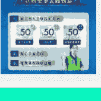

- 为会员微信管家服务，会员省力
- 提升签率、会员升级
- 会员超过千万
- 卓越会员占比超过30%
- 留存率超过50%

## 长期市场教育

## 不做直播带货 | 不投激进的效果广告

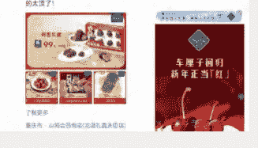

毛利空间让给消费者，而非“流失”。
并非依靠短期爆发：品牌心智=高质量购物清单，围绕社区生态，基于产品高质量培养种草。
在微信生态投入最大：可以直接将现有会员引导向交易闭环。

数据来源：公开资料、专家访谈、有效data vision，增长长期研究院整理

## PART4
消费者更信任品牌官方和熟人社交，但依然有38.3%靠达人发现新品。

在多元化的场景中推动消费者购物决策，最大的难点就是：碎片化的媒体虽然刺激了消费者的即时满足感，但品牌资产也会在碎片中迷失，消费者的信任将无处安放。

“信任是品牌的核心资产”早就成了共识。信任不仅促进了品牌心智的强化，还意味着更大的购买力和支付溢价。

益索的研究提出了一个更新的理解：信任代表品牌拥有更高的容错率。即使面临市场的周期变化或负面情绪的影响，也不会轻易遭遇口碑崩塌。

对于没有获得用户信任的品牌来说，当它的用户看到1-2条企业负面信息后，会有57%的人选择相信负面内容；而对于成功获得用户信任的品牌，这个比例仅有25%[7]

许多知名品牌能够从舆论漩涡脱身，并不是“互联网没有记忆”，而是信任它的消费者愿意给一次犯错的机会。

那么，这种信任是如何构建起来的呢？

我们发现：消费者面对不同角色为品牌或产品做“信任背书”时，态度有很大差异。人们最信任的声音还是来自品牌本身。所以在消费者看来品牌广告的档次是最高的，品牌方看来成本也是最高的；但是，要靠流量规模实现突破，还要依靠丰富的数据支撑；人类社交是更为平衡的方式，但规模波动的难度也更高。

## 信任深度与流量广度兼得

## 消费者最信的媒介角色占比

| 品牌官方 | 24.9% |
| 身边的熟人或者朋友 | 20% |
| 普通消费者 | 16% |
| 品牌的创始人/高管 | 12% |
| 传统新闻机构/电视台/杂志 | 9% |
| 非常知名的网红/达人 | 7% |
| 综艺/艺人 | 5% |
| 品牌一线人员(如导购) | 5% |
| 有名气或不太熟悉的网红/达人 | 3% |

## 消费者发现新品的方式

| 官方广告 | 39% |
| 网红/达人种草 | 38.3% |
| 熟人分享/推荐 | 34.9% |
| 实体店推荐/介绍 | 31.7% |
| 主动进行类目搜索 | 29.9% |
| 品牌联名活动 | 24.7% |
| 新品地推活动 | 19.6% |
| 品牌发布会/奥运会等 | 17.6% |
| 综艺节目口碑 | 15.9% |
| 明星代言 | 14.9% |

数据来源：公开资料、专家访谈、有效data vision，增长长期研究院整理

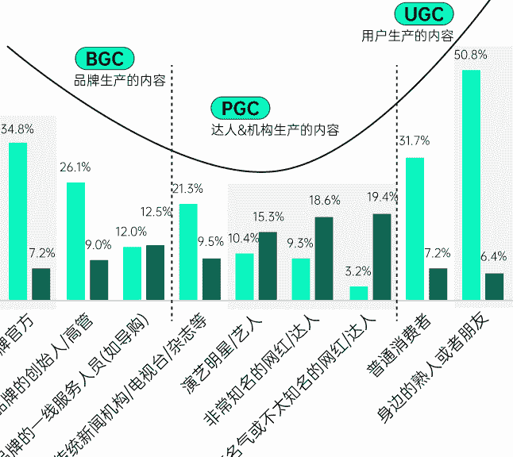

我们观察到，增长遇到挑战：如果品牌过于保守，专注传统营销，抓不住增量的机会；如果过于激进，all-in流量玩法，导致信任不足。对比去年，整个生态信任呈现“U型分布”，消费者对于BGC和UGC的越来越信任，而对于PGC的信任却下滑。

这并不是说生态本身失效了，而是竞争环境适应范围降低了。首先，优质的KOL资源是有限的，而在商业化程度下，同质化的广告被挤压。KOC一度成为热门话题，因为成本低，甚至可以在ROI上获得超额收益。知名度意味着缺失，过多的资源投入意味着追求数量而妥协质量，毕竟小流量存在极大的不确定性。

值得注意的是：
- 传统媒体依然会在消费者心中有一个分量，未来依然有用。
- “创始人IP”之所以流行，在某种程度上是抓到了流量红。
- 熟人朋友作为信任度最高的角色，未来发挥更大的价值。

## 消费者对于品牌社交的认知偏差
在熟人朋友的不同圈子里反复讨论或看到这个品牌，更能增加我的信任程度。当我看到一条品牌的宣传内容，如果点赞、评论都是熟人朋友，我对品牌的信任度会更高。看到熟人朋友使用特别好的产品时，我更容易被种草。

数据来源：增长黑盒线上投放，N=1500

## 品牌定义的：如何通过全域营销，串联心中和去中心化内容？
从营销创新的角度来看，在触达消费者的过程中BGC代表的“离心力”与PGC&UGC代表的“向心力”，二者需要达到平衡才能信任深度和流量宽度。

- 品牌需要分散的用户注意力和品牌资产向高价值的平台和渠道倾斜，无论是稳固存量还是获取新增，让消费者在被动状态下不断建立信任。
- 将统一的品牌信息和服务分散到用户的各个场景中，如同一光通过棱镜折射到不同方向，让消费者在主动状态下满足场景需求。

## 奥利奥：百年巨头如何在传统营销基础上增强碎片化传播？
在数字化时代革新自己的营销策略，是许多知名老品牌必须面对的课题，因为营销手段的滞后一定会拖慢生意增长的后腿。

奥利奥就是一个紧跟时代的优秀案例，作为百年品牌曾多次穿越周期。在经历过一段市场低迷后，2018年奥利奥进行了“以用户为中心”的改革，改变了单品+大曝光全球模式，聚焦用户的链接和互动，把“人货场”的匹配拆得更加精细。

奥利奥的“看家本”是夹心饼干，由于知名度、心智渗透、线下渠道丰富，所以是在传统营销手段满足基本曝光的基础上，采用新的营销策略做加法。而生意增长的核心动力来源于新的品类撬动了新的人群，例如针对年轻女性白领的薄脆饼干、mini奥利奥等。这类高速增长的品类，承载了整个品牌向年轻化依靠重任。因此，整个营销组合是以线上策略为主，配合传统的营销手段。这很快为奥利奥取得了成绩：到2020年，中国市场走出低谷期，成为了全球第二大市场。今天，奥利奥在规模高达数十亿的同时，每年依然保持6-9%的稳定增长。

## 创新品类拓展新人，用更丰富的营销策略组合触达消费者
2018年起改革为“以用户为中心”，聚焦单品+大曝光模式，重视消费者的链接和互动，拓展细分品类，增加影响力。

| 细分品类 | 目标人群/场景 |
| :--- | :--- |
| 零食 | 20% |
| 烘焙 | 10% |
| 饼干 | 70% |
| 年轻女性白领 | 6-12岁 |
| 妈妈 | 25-35岁 |
| 孩子 | 30-45岁 |

| 场景组合 | 占比 |
| :--- | :--- |
| 线下广告 | 20% |
| 线上广告 | 10% |
| 品牌联名 | 9% |
| 社媒种草 | 7% |
| 节日营销 | 5% |
| 电商营销 | 3% |

数据来源：公开资料、公司财报、增长黑盒整理

## 案例：奥利奥
即使品牌认知已经很强，但增长遇到挑战。2024年成功的营销案例之一《寻宝玩心》遵循了这一逻辑：
- 以用户为中心组织，积极布局线上社群。
- 持续发挥品牌内涵优势，通过线下活动拉近用户。
- 营销创新中心，通过流量整合获取增量。
- 品牌建设通过KOL+KOC+UGC组合，有效提高了用户互动。

在不到一个月的时间里，奥利奥获得了过曝光，由公域流量的新人群进一步在私域进行了沉淀和复用。
- 活动上线
- 线下广告
- 新品礼盒
- 线上小程序
- 头部达人宣发活动
- 引爆话题量
- 时尚、人文、科技类腰部达人跟进
- 解读活动、开箱礼盒
- 视频小号活跃KOC和UGC，抓住长尾声量
- 微信指数（10,000, 200,000, 300,000，百万）

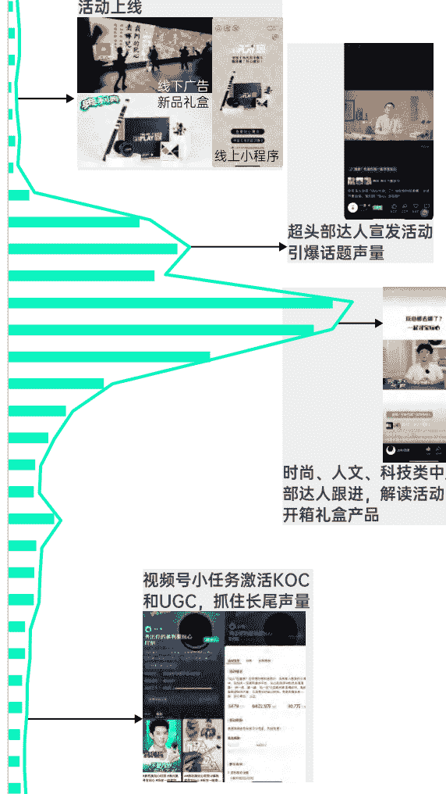

## 一汽红旗：老牌车企如何借助KOC策略拉近用户的距离？
跟随时代趋势、拥抱变化同样发生在一汽红旗身上。作为最老牌的国产汽车，红旗从1958年诞生起就带着“国家领导用车”的高端标签。但这种高冷的形象也给扩大市场规模带来了局限，到2017年红旗的销量仅有4000多辆。2018年，一汽红旗决定全面发展新能源，通过改革让红旗品牌更加大众化、亲民化。短7年时间，红旗的销量就飙升了88倍，今年也创造了44万辆新高。其中，更重要的是一汽红旗不再拘于传统的品牌曝光活动，增加了大量内容触点。在保持品牌品质性和信誉的前提下，拉近与用户的距离，跟年轻人有了更多互动。

## 用亲民路线拥抱市场变化，7年销量翻了88倍
2018年起深化改革，all in新能源。明确品牌产品线，保障基本盘同时塑造高端形象。

| 红旗新能源 | 红旗节能车 | 红旗金花葵 |
| :--- | :--- | :--- |
| 2024销量同比+43.7% | 2024销量同比+9.6% | 全系列销量突破1100台 |

营销策略打破“高冷形象”：
- 以用户为中心组织，积极布局线上社群。
- 持续发挥品牌内涵优势，通过线下活动拉近用户。
- 营销创新中心，通过流量整合获取增量。
- 品牌建设通过KOL+KOC+UGC组合，有效提高了用户互动。

数据来源：公开资料、公司财报、增长黑盒整理

2024年数据数据点：
- 2024-03-15
- 2024-03-17
- 2024-03-19
- 2024-03-21
- 2024-03-23
- 2024-03-25
- 2024-03-27
- 2024-03-29
- 2024-03-31
- 2024-04-02
- 2024-04-04
- 2024-04-06
- 2024-04-08
- 2024-04-10
- 2024-04-12

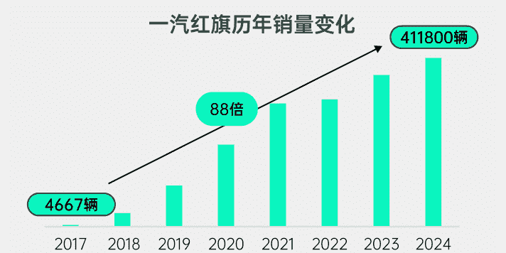

## PART5 没消费过的人还有，71.8%购买频率增加
“中国人没有坐飞机”是一个夸张的说法，但必须承认的是中国消费市场是以渗透率为为主，对比欧美、日本等发达国家，人均消费量依旧较低。依然大量消费者没有接触某些品类。我们发现，现在的消费者仍然发现新品牌和新产品，并且与购买频率之间呈现正相关。

消费者发现新品的频率为21.2%增加；在发现新品频率增加的人中，71.8%购买频率增加。

## 发现新品频率与购买新品频率的相关性
- 购买增多很多
- 购买一定增加
- 购买差不多
- 购买一定减少
- 购买减少很少

数据来源：增长黑盒线上用户调研，N=1500

发现新品增加的消费者来说，被动接收信息的触点、购物过程中的主动了解工作都增加了——这意味着消费者对于新品牌、新产品建立认知的方式更加分散了。新品能够吸引消费者的要素除了产品本身的品质，代表感性的“颜值经济”与代表理性的“客观评价”并驾齐驱——意味着新品打动消费者的方式更加多样了。

## 发现新品频率增加的原因

| | 占比 |
| :--- | :--- |
| 日常了解信息的渠道增加 | 60.4% |
| 花在购物浏览/查找/对比的时间更多 | 54.6% |
| 资讯渠道内容有更多推新 | 44.4% |
| 市场推送频率提高 | 43.0% |
| 自身购物频率增加，有更多发现机会 | 40.8% |

| 产品功能/口味符合我的需求 | 55.4% |
| 产品的外观观设计新颖，富有创意 | 49.3% |
| 产品/品牌测评评价高 | 48.0% |
| 独特的新的 | 44.8% |
| 产品使用新的 | 41.1% |
| 产品价格优惠 | 40.9% |
| 运用领先 | 37.0% |
| 品牌故事 | 31.9% |
| 理念引领 | 29.4% |
| 喜意的明星 | 21.9% |

网红达人与熟人推荐，是最主流的。也可以看到，品牌联名的排名已经超过了综艺、明星。这种方式在年轻人和高收入中尤为重要。

数据来源：增长黑盒线上用户调研，N=1500

根据群智的研究，面对市场的内卷，2023年广告主要通过削减营销费用“节流”，而2024年更多倾向“开源”的方式，不断获取流量上的增量。其中，四成广告为主需要增强品牌力以扩大目标人群寻找新增量，三成广告主则认为应当多平台投放或尝试些线下经营[3]。

因此，品牌在营销上需要积极出击，把握破圈的机会。

## 品牌方面对流量焦虑，从节流到开源的转变

## 2023年 2024年

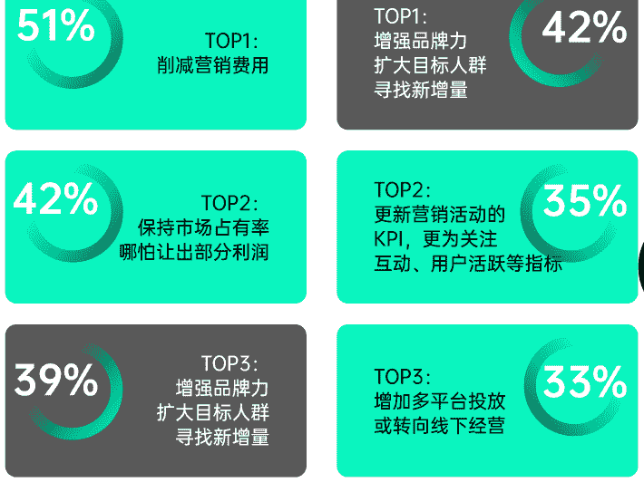

数据来源：《品牌营销趋势》，群智智库

## 品牌方关键题：怎样通过营销创新实现高效的人群破圈

品牌营销正从“共性诉求”转向“差异化诉求”的做法

- 过去的（共性诉求）：用一个统一的品牌形象和宣传方式覆盖所有消费者。就像用一把大网撒向所有人，强调的是大家都认的价值。这种方法在市场还不够细分、消费需要还比较短的时候有效
- 现在的趋势（差异化诉求）：品牌保持核心调性不变，但针对不同群体采用不同的表达方式。比如同一产品，可以让年轻人看到时尚感，让中年感受到专业性，让老年人体会可靠性。每个群体都能找到自己认的价值点，并且这种认同是被产生的。这样一来，品牌可以吸引完全不同背景的消费者群体。

## 霸王茶姬：如何通过营销加法，破圈找增长？

在经历了几年的野增长后，新茶饮两年开始扎堆刺破，所有的品牌都无法停下“卷”的脚步。

其中最引人目的焦点是霸王茶姬。其2024年零售额破了200亿，同比增长超过110%，门店突破了6000家。而坪和店效也超过了瑞幸、星巴克、喜茶等行业头部[4]。

新茶饮玩家有策略共性，就是为了给消费者新鲜感，不停地在原有的饮品里加料、水果、坚果、豆类、杂粮……海量的SKU常常让人眼花缭乱。

霸王茶姬偏偏反其而行之，从一开始就开始打原叶鲜奶，该品类在整个SK结构中终占9%以上。其中，最有名的大单品伯牙绝，一度贡献了60%的销量，至今也占比超过40%。便是周期性产品的销量份额也不会超过25%。

产品做了极致的减法，赢得了竞争的关键点就成了“营销加法”。持续在固定的产品上做创新营销，来增加品牌本身的信息承量，激发消费者对大单品的关注和购买。

在精细化的组织分工下，其营销动作可是招式齐全：集团层面包含了大型的联名、新品上新、艺术家合作、媒体投放等；公司/区域层面更灵活，比美团、饿了和抖音进行投放。

显然，霸王茶姬要的是品牌智增量，不是产品营销增量。每天在短期内卷新品不仅给品牌造成负担和压力，消费者也会认知混乱。

## 产品策略做减法，营销策略做加法

### 极简简单的单品

避开奶茶行业，靠新品营销带动销售的“内卷”

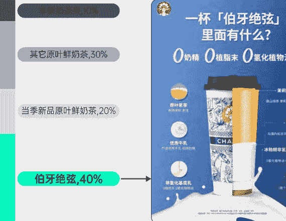

### 延展出丰富的故事和营销创意

增量落在品牌心沉淀，拉新同时激活老用户

| 门店场景体验升级和改造 | 每年10-20场全渠道营销campaign | 沉淀用户资产/持续运营 |
| --- | --- | --- |
| 视觉物料 | 新品首发 | 微信小程序 |
| 陈列 | 奥奥林克会 | 微信社群 |
| 店铺装修 | IP联名 | | |

立项后多小组协同，内部负责全案执行。

### 精细化的组织分工

高度内化的营销职能，赛马PK促进创造力

| 产品营销 | IP联名 | 娱乐明星 | 媒体投放 | 设计支持 |
| --- | --- | --- | --- | --- |
| 品牌营销团队 | | | | |

数据来源：公开资料，专家访谈，增长黑盒研究整理

新茶的市场培养了这么多年，纯粹经营已经很少了。即便是霸王茶姬，新客占比也不不到20%。

因此，霸王茶姬积极参与年轻人聚集的场景里，见缝插针式地“刷脸”，刺激老年人分享、社交，以及购买。目前霸王茶姬在营销上的创新已经形成了了自己的风格，并且能够拿到好的市场反馈。

以萌宠活动主题“天天在一起”为例，宠物就是不同人群的差异化诉求。无论年轻人养不养宠，总能找到自己的解释方式并参与其中，且这些人与霸王茶姬的用户相似只有一定差异。

对于传播内容本身，霸王茶姬也有自己的秘诀：用周边作为具化的载体，讲品牌故事时用拿周边再推一遍，从而在制造差异化的瞬时迸发大量的长尾效应。

## 挖掘年轻人可能出现的场景，用萌宠主题作为破圈的杠杆

### 洞察茶群兴趣点

萌宠话题有更多社交空间

| 宠物人群 | 年龄 | 忠诚度 | 城市 | 占比 |
| --- | --- | --- | --- | --- |
| 年轻人群 | 18-30岁 | 高 | 一线城市 | 74% |
| 不养宠 | | 高 | | |
| 霸王茶姬用户 | 20-35岁 | 高 | 一线城市 | 70% |
| 精致妈妈 | | 高 | 一线城市 | |

萌宠提供了强大的社交杠杆，满足社交需求，且人均消费力和频次更高。

|  活动类型 | 话题 | 效果 |
| --- | --- | --- |
| 8月主题活动 | 宠物友好 | 以包装周边作为支撑点 |
| IP联名活动 | 宠物友好 | 限时周边 |
| 公仔活动 | 宠物友好 | 衍生作品 |
| 线下快闪活动 | 宠物友好 | 流量 |

数据来源：公开资料，专家访谈，增长黑盒研究

## 在不同平台拓展流量

为了扩大破圈范围，霸王茶姬在众多平台上都进行了布局。除了日常深耕的小红书和抖音，增加了微信视频号+朋友圈广告，在触达人群的同时，实现了小程序入口的闭环。

| 平台 | 内容形式 | 转化路径 |
| --- | --- | --- |
| 微信视频号 | 博主种草，以陪伴为主 | 直接导向交易 |
| 朋友圈广告 | 辐射偏好人群 | 直接跳转小程序/注册会员 |
| 抖音 | 多元化内容种草，以生活、产品展示等 | 团购直接领券 |
| 小红书 | 博主内容种草，UGC“周边” | 长尾效应 |

数据来源：公开资料、抖音、小红书，增长黑盒

## 波司登：如何借助大事+快闪增强心智？

根据波司登最新发布的2024上半年财报，其营收和净利润均创历史新高，分别同比增长17.8%和23%。在“聚焦羽绒服赛道、聚焦时尚科技服饰”的策略下，波司登不仅稳住了中高端心智，还在冲锋衣、防晒服等外品类中有了快速增长。

在人们的直觉看来，羽绒服似乎是大众类，如果依靠高端化涨价驱动增长，岂不是“割韭菜”的行为？但实际上，中国穿过羽绒服的人占多数，渗透率低于发达国家。一方面消费者有其他穿衣习惯，另一方面南方的渗透率显著低于北方。让更多人的橱里挂上第一件高质量羽绒服，成为波司登破圈的机会。

## 波司登在羽绒服类上定位高端心智，持续渗透更多人群

| 国家 | 穿绒服占比 |
| --- | --- |
| 日本 | 56% |
| 美国 | 45% |
| 英国 | 35% |
| 中国 | 10% |

波司登不仅局限于羽绒服赛道抢市场：

| 维度 | 内容 |
| --- | --- |
| 跨品类人群 | 大衣、棉裤、夹克 |
| 本品类升级 | 极寒羽绒服、轻量化羽绒服、户外功能羽绒服 |
| 跨地域人群 | 北方、南方 |

数据来源：申博证券、公开资料、专家访谈，增长品牌研究

然而，波司登早期就是羽绒服行业的TOP1品牌了，进一步的重点就落到了两个方面：

1. 不固化在本品类竞争，而是放眼更大的“四季服装”类，即把耐寒、Moncler等品牌作为四季服装为目标。在消费者心中，“羽绒服品牌”和“四季服装品牌”拉到对等的水平线上，波司登要把品牌力拉到同样的水平。
2. 充分发挥线下流量的优势，制造更强的渗透力。因为中国服装市场依然有超过6成来自线下，消费者的主要触点在线。波司登品牌拥有2800+门店，它是其它羽绒服品牌完全不具备的竞争力。

因此，波司登采用“空军+陆军”联动共同打造。在传统的营销手段制造线上声量后，马上线下模式覆盖广泛的商圈。这不仅使得“高端化”有了更具象化的体验，还能更加差异化的能量，让品牌声量即时转化成果。

这些流量的人群资产，最终通过私域流量的方式沉淀了下来，从而形成了完美的生态。新用户通过微信形成了1V1的绑定关系，便于后续触达和进店回购，实现化。

## 如何构建私域会员体系，充分发掘用户资产的价值

随着消费者年龄逐渐增大，生活场景在改变，购物的需求也会多样化。品牌能够提供产品和服务来满足这些新需求，陪伴他们度过自然的成长周期，就能换来长期LTV的提升。但要通过深度运营建立用户资产的护城河，也会分为三个重要的阶段：

- 交朋友：建立强力的用户资产的“蓄水池”，并在全渠道向用户发出邀请，不断积累新会员。
- 做朋友：构建会员体系、用户分层机制，围绕生命周期提供差异化的服务。
- ：借助企业微信、社群等触点建立强连接，提升客户体验。

## 宜家：如何保持长期吸引力？

虽然宜家在中国市场的规模已经超过了百亿，但2024年出现了下滑的情况。面对穿越周期的挑战，宜家采用了“短期红利”和“长期主义”的策略。一方面，通过营销手段制造线上声量，持续激活老会员；另一方面，线下模式覆盖广泛的商圈，持续带来新流量。

宜家如今已超过千万，会员数量达到2000万以上，年销售额超过120亿。主要靠线下招募会员，门店体验是最重要的品牌触点，70-80%的线下访客产生了购买行为。

### 引导进店体验

| 线下到店 | 线下私域 | 线上公域 |
| --- | --- | --- |
| 餐饮 | 微信小程序点餐功能 | 官方账号 |
| 会员注册福利 | 微信小程序/APP会员服务中心 | 小红书KOS账号 |
| 设计服务咨询 | 企业微信1V1定制咨询 | 公众号+视频号矩阵 |
| 参与线下活动 | 促进活跃门店微信 | 朋友圈广告 |

数据来源：公开资料、专家访谈，增长研究

宜家会员体系有着成熟的运营策略，把会员“成长值”与“积分值”分开计算，将忠诚度机制灵活地融入到消费者购物旅程中。成长值提供了长期稳定的权益让用户留存且活跃；积分值则提供了短期可变的限量福利和优惠。一些会员专享商品，只能通过积分值兑换或加购，大大刺激了老会员的积分消耗。

### 基于成长值和积分值，打造完善的会员体系，长期陪伴客户“做朋友”

在用户旅程的关键节点，会将会员相关信息一步步传递给用户，而不是初次就送上一本“规则手册”。

- 灵感值可以提升会员等级。灵感值=消费（购物）+活跃行为（发帖）等等，可以享受更多的会员福利。
- 消费、签到、新手任务均可获得积分。积分除了可以直接换成现金优惠，可以在商店中兑换多种权益。

数据来源：公开资料、专家访谈，增长研究

## 消费者加入品牌产生的后续行为

| 内容 | 比例 |
| --- | --- |
| 使用品牌会员权益，积分兑换、专属客服等 | 65.9% |
| 订阅品牌消息，接收促销互动、新品推荐等信息 | 56.7% |
| 咨询品牌客服，了解产品、价格信息等 | 53.0% |
| 购买新品 | 52.4% |
| 复购品牌产品 | 42.9% |
| 将品牌推荐给其他人 | 37.2% |
| 参加品牌线上活动（如抽奖） | 33.0% |
| 参加品牌线下活动 | 16.0% |

数据来源：增长合线上用户调研，N=962

“客户留存”是一个老生谈的问题。由于不同品类之间的忠诚度差异很大，整体来看，快消品的忠诚度在过去一年里有了大幅下降。从婴儿奶粉到化妆品，品类TOP3的平均频率都下降了。那些不忠诚的用户贡献了更多增长，很多企业将“拉留”作为最重要的任务。对于重视“留存”的品牌来说，构建会员体系是一个通用的解决方案。但我们发现：在会员注册行为的消费者中，近4成不熟悉完全不知道规则，这对于提升购买率和LTV来说基本上无效。因为这些人超过6成是在购买前就注册了会员，甚至接近1成从未发生购买行为。由于品牌缺乏用户资产的运营和管理，导致新用户无法真正与品牌“做朋友”，彼此之间根本不熟悉。

64%的消费者在2024年新加入会员，但其中38%不知道或不熟悉体系。

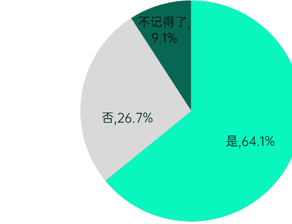
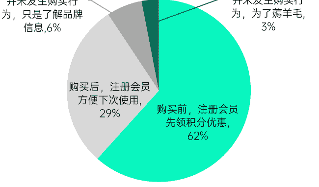
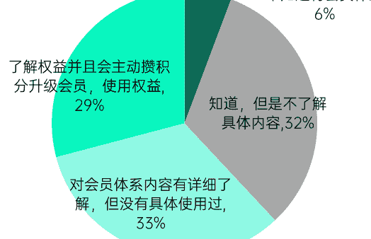

数据来源：增长黑盒线上用户调研，N=1500; N=962

早年泡泡玛特通过深刻洞察用户需求，将线下拆盲盒的惊喜感复刻到了线上，打造出“泡泡玛特抽盒机”这个微信小程序，并成为了销售占比最高的电商渠道。

今天，泡泡玛特依然在微信生态内深耕，有了线上+线下融合的私域模式：

- 在抽盒机满足盲盒的同时，还通过视频号直播销售衍生品，并通过广告进行会员拉新
- 针对送礼场景，在微信小店采用了最新的线上送功能设立企业微信客服和门店社群，进行拍卖、抽奖、优惠等活动，提升复购率
- 小程序会员数据与其他电商平台、APP打通，共享会员体系

## 基于微信生态构建功能完善的私域体系

私域营收远超其它电商渠道

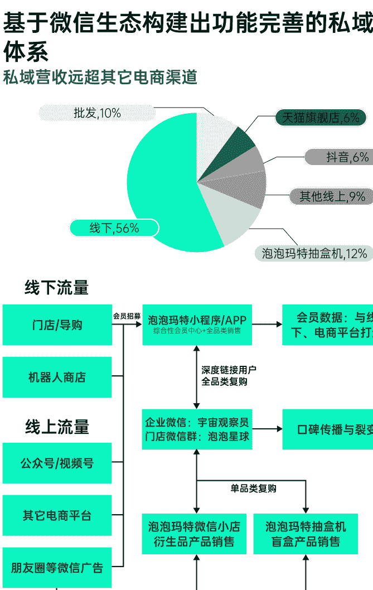

### 线下流量
- 泡泡玛特小程序/APP 会员数据：与线下、电商平台打通
- 门店/导购
- 机器人商店
- 深度链接用户 全品类购

### 线上流量
- 公众号/视频号
- 其它电商平台
- 朋友圈等微信广告
- 企业微信：宇宙观察员 门店微信群：泡泡玛特星球
- 口碑传播与裂变
- 单品复购
- 泡泡玛特微信小店 衍生品产品销售
- 泡泡玛特抽盒机 盲盒产品销售
- 直达拉新

数据来源：公开资料，专家访谈，增长黑盒整理

泡泡玛特将泡值作为综合积分，通过三种方式累计升级让享受特殊的权益，让用户更有“游乐场”的感觉。此外，泡泡玛特在确定新IP后，会通过会员数据洞察来辅助IP对应的产品形态，更好的满足用户多元化生活场景需求。

## 私域会员贡献增量的同时，反IP产品形态的研发

会员体系与用户深度链接

| 指标 | 描述 |
| :--- | :--- |
| 会员复购率大于普通用户2倍 | |
| 会员数量超过4000万 | |
| 会员人均消费大于普通用户2倍 | |
| 泡泡值作为综合积分 | 根据泡泡值升级等级 |
| 不同等级特殊福利 | 基础分：互动任务奖励 |
| | 新玩家：0泡泡值 进阶玩家：500泡泡值 头号玩家：2000泡泡值 收藏大师：8000泡泡值 |
| 购物分：消费1元得1分 | |
| 奖励分：点亮徽章领取 | |

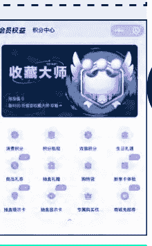

### 洞察用户偏好与需求
| 维度 | 内容 |
| :--- | :--- |
| 全全域会员数据 | 根据用户行为特征得到洞察 |
| 产品形态偏好 | 盲盒、手办、周边等 |
| 产品使用场景偏好 | 居家、办公、送礼等 |
| 情感价值偏好 | 对应不同的IP类型 |
| 开发逻辑 | 根据洞察开发IP相关产品 |
| 产品公式 | IPX 产品形态X 使用场景X 情绪价值 |
| 测试策略 | 小范围测试 |
| 细节优化 | 根据用户反馈打磨细节，材质、尺寸、颜色、图案等 |

数据来源：公开资料、专家访谈、增长黑盒研究整理

# PART7

中国消费者对于AI的热情远超欧美，68.3%对于AI广告内容感兴趣是今年最热门的话题，我们有必要再次回顾一回。

实际上，生成式AI的浪潮对于企业业务场景的影响还比较有限，全球范围内的企业都集中在营销与销售环节，尤其是营销内容的生产。在营销领域AI来降增效，已经成为所有企业管理者的共识。

## 各职能部门日常应用生成式AI情况

| 职名称 | 占比 |
| :--- | :--- |
| 市场营销与销售 | 34% |
| 产品和服务开发 | 23% |
| 信息技术 | 17% |
| 服务运营 | 16% |
| 特其它企业职能 | 16% |
| 软件工程 | 13% |
| 人力资源 | 12% |
| 风险管理 | 8% |
| 战略和企业财务 | 7% |
| 供应链/库存管理 | 6% |
| 制造 | 4% |

| 市场营销与销售 最常见的应用场景 | 占比 | 产品和服务开发 最常见的应用场景 | 占比 |
| :--- | :--- | :--- | :--- |
| 营销策略的内容支持 | 16% | 设计开发 | 10% |
| 个性化营销 | 15% | 现有文献和研究综述 | 6% |
| 销售线识别和优先排序 | 8% | 加速早期模拟/测试 | 6% |

数据来源：《The state of AI in 2024》，麦肯锡

比较有意的是，中国的市场环境似乎更适合企业展现AI在营销上的应用，因为中国消费者对AI的信任程度显著高于欧美地区。

## 消费者在不同应用场景对于AI的信任度

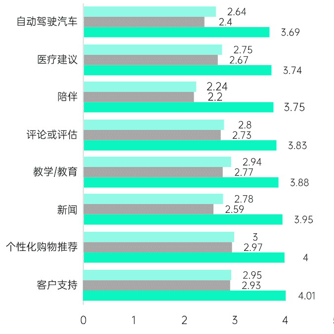

数据来源：<Gen AI Can Help Retailers Defy China's Economic Slowdown>我们的数据显示，中国消费者对于AI营销具备积极的态度，同时跨行业的渗透率也达到了较高的程度。在游戏和金融行业，积极态度最显著。

| 态度 | 描述 |
| :--- | :--- |
| 非常感兴趣 | 对AI技术感到好奇并愿意了解 |
| 有兴趣 | 对AI广告相关，我会关注 |
| 中立态度 | 只要广告有价值，无论是否由AI生成 |
| 有些不安 | 对AI生成的内容怀疑 |
| 完全不感兴趣 | 我不喜欢或不信任 |

数据来源：调研N=1800；对于AI广告定义：图片、视频等并非人工制作，而是利用AI生成的。

在各个行业，消费者主观认为很大比例的广告是AI生成的，游戏行业更为显著。

| 态度 | 占比 |
| :--- | :--- |
| 积极 | 50% |
| 有兴趣 | 30% |
| 中立 | 20% |
| 未见过 | 10% |

数据来源：调研N=1800；对于AI广告定义：图片、视频等并非人工制作，而是利用AI生成的。

因此，中国市场在AI营销中的应用非常频繁。数据显示，营销人员对于AI工具的普及率已经达到了54%，甚至有24%的电商行业每天都在使用。

品牌关键问题：如何在营销领域找到AI突破？业务上依然有很大的空间。但这并不意味着第一天就深度，先从“降本增效”开始。

## 九宫游戏：如何通过“混剪”解决行业共性问题？

既然玩家对于AI生成的营销内容态度积极，我们就来看看游戏行业的案例。九宫游戏在打造《英雄风华》这个黑马的过程中，仍然面临着整个行业的共性难题：**上线初期优质素材不足，跟不上宣发节奏，导致缺乏试错空间、无法针对人群和渠道做精细化投放，整体宣发效果并不理想。**

于是，九宫游戏决定采用AI技术生产内容，与腾讯广告深度合作。借助“混剪”功能，公司将传统人工生产的节奏提升到了分钟级，大规模模拟了海量的素材和脚本，并取得了良好的投放效果。九宫游戏发行负责人李志亮认为，腾讯广告的优势主要有三个：

- 几个小时就能上手，提示词生成内容和后期调优都很方便
- 大模型用腾讯广告的数据训练，更懂什么素材更容易爆、效果好
- 与腾讯广告投放平台直接打通，一站式生产、投放、过审、复盘

由于取得了降本增效的收益，九宫游戏目前已经有50%以上的广告会用到AI，视频广告的占比超过了20%。

## 用AI解决行业共性痛点，新游《英雄风华》冲上IOS榜首

行业竞争激烈，游戏素材消耗加快，优质内容产能不足

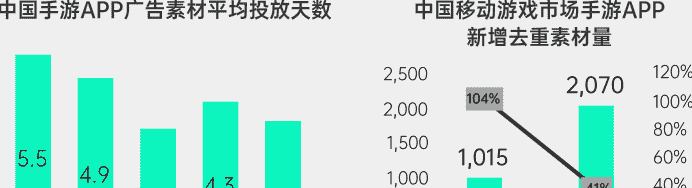

### 公司“好产品”面临“缺素材”的困难
上线初期素材跟不上宣发节奏

| 问题 | 描述 |
| :--- | :--- |
| 问题1：缺乏试错空间 | 问题2：无法针对渠道、人群做差异化 |
| 投放效果不理想 | |

### 借助AI能力高效生产优质内容
- 平面广告应用AI占比>50%
- 视频广告应用占比>20%
- 腾讯广告优混剪功能：分钟级生产视频脚本和素材
- 点击率1.5%
- 消耗+15%
- 内容成本-60%

数据来源：DataEye研究院、Fastdata极、公开资料，增长黑盒研究整理

# 结语

吉姆·柯林斯在著名著作《从优秀到卓越》中，首次提出了斯托克代尔悖论：美国海军在越南战争期间被俘，经历了长达8年的战俘生涯。活在狱中，他多次遭受拷打，但他始终坚信自己能够获释，这种乐观支撑着他度过了艰难的岁月。

在采访斯托克代尔时，柯林斯却发现了一个矛盾：在战俘营中最先崩溃的往往是那些过于乐观的人。因为这些人总是抱着“圣诞节前就能获救”的期待，但当一次希望落空后，他们的信念就会被粉碎。

相比之下，斯托克代尔则具备了坚定的信念和直面的态度，成功熬过了地狱般的8年。

通过更多商业领袖的访谈，柯林斯同样发现能够穿越周期的企业都具备相似的特征：一方面保持坚定的信念，持续投入研发、人才培养；另一方面清醒认识到当前市场环境中的挑战与机遇，灵活调整策略。

## 展望2025年，从长期主义来看

- 1. 场景化：打破品类的边界，在人群中找到新场景
- 2. 价格战转向价值战：提升供应链能力
- 3. 短线战转向全链路转化环节

## 充分挖掘用户资产：构建私域体系，提升LTV

从短期红利来看：

- 1. 差异化拉新：积极尝试新的渠道
- 2. 全域营销：多元化达人，社交传播
- 3. AI营销的降增效：借助新技术生产

最后，我们期待大家能够在2025年继续保持定力，在这个离散的时代，找到“人货场”的差异化机会，通过朋友圈、视频号、微信小程序等流量的发展。

# 附录：调研方法及样本概览

## 调查问卷样本条件及配额
| 项目 | 内容 |
| :--- | :--- |
| 样本配额 | N=1500 |
| 筛选条件 | 最近一年内购买过消费品（食品/酒水饮料/美妆/个护家清/服装配饰/家居/3C/汽车/宠物用品）中的任意一个或多个品类 |

| 年龄 | 样本量 | % |
| :--- | :--- | :--- |
| 30-29 | 296 | 20% |
| 30-39 | 423 | 28% |
| 40-49 | 366 | 24% |
| 50-59 | 415 | 28% |
| Total | 1500 | 100% |

配额设置参考CNNIC2024年9月发布的第54次中国网络发展状况报告的结构

| 性别 | 样本量 | % |
| :--- | :--- | :--- |
| 男 | 750 | 50% |
| 女 | 750 | 50% |
| Total | 1500 | 100% |

| 品类 | 样本量 | % |
| :--- | :--- | :--- |
| 食品 | ≥120 | 8% |
| 酒水饮料 | ≥120 | 8% |
| 美妆 | ≥120 | 8% |
| 个护家清 | ≥120 | 8% |
| 服装配饰 | ≥120 | 8% |
| 家居 | ≥120 | 8% |
| 家电 | ≥100 | 6.7% |
| 奢侈品 | ≥100 | 6.7% |
| 汽车 | ≥100 | 6.7% |
| 母婴 | ≥100 | 6.7% |
| 宠物用品 | ≥100 | 6.7% |
| Total | 1500 | 100% |

# 声明

及免责声明：本报告的研究发现基于增长黑盒Growthbox进行的消费者调研、行业专家访谈、公开数据分析以及案例研究。尽管我们在研究过程中秉持严谨态度，但任何研究方法都存在固有的限制。增长黑盒Growthbox仅就报告提供客观描述，无法对数据和结论的准确性、完整性及适用性做出保证。报告内容仅反映时市场状况和研究发现，不构成任何投资建议或决策依据。如有机构或个人基于报告内容做出决策，由此产生的风险和后果自行承担。增长黑盒Growthbox不对使用本报告引发的任何直接或间接损害负责。

知识产权声明：本报告由增长黑盒Growthbox编译整理。报告中的部分内容来自公开发的研究报告、新闻报道和数据资料，这些内容的知识产权归原作者或所有。除上述引用内容外，报告中的分析、评价及结论均为增长黑盒Growthbox的研究成果，受中国相关法律法规保护。未经增长黑盒Growthbox书面授权，任何组织或个人不得以任何形式或方法对报告的部分或全部内容进行商业性使用、复制、转载、摘编或创造相关衍生作品。对本声明的最终解释归增长黑盒Growthbox所有。

# 出品方

增长黑盒研究组
Designer / 阿杰、阿吉

[PAGE 87]

# 联系我们

刘方舟

增长黑盒
CEO

微信

