# 大数据驱动，60 分钟看懂小红书投放全策略

# 扫码加入 知识星球TOP 免费资源群

免费
公众号：知识星球TOP
- 每日免费获取高价值资源
- 可提供各类资源搜索服务

价值
微信：jntsg8

| 热门付费文章 | 各行各业报告 |
| :--- | :--- |
| 精选图书资源 | 副业赚钱方法 |
| 职场实用资源 | AI经营自媒体 |

及时
微信：jntsg2

专注
分享资料仅供个人学习，请及时删除，切勿商用传播

# 目录

- 1 小红书流量分布
- 2 行业分析
- 3 竞品梳理
- 4 竞品分析
- 5 红利挖掘
- 6 内容开展

# PART 1
小红书底层逻辑&流量分布

## 小红书投放底层逻辑

达人（比例配置）+内容（关键词）

## 问题

## 小红书投放什么区间达人性价比更高？

## 平台账号达人分布 金字塔结构 | 86%集中在5k-5w粉丝

86%
132925人

- 小红书5w粉以上的达人2万多人，人数较少，竞争激烈
- 5k-5w粉的达人达到13万，达人池子较大，选择空间大，具有一定的流量红利

建议：增加5k-5w达人的投放比例，充分挖掘达人流量红利

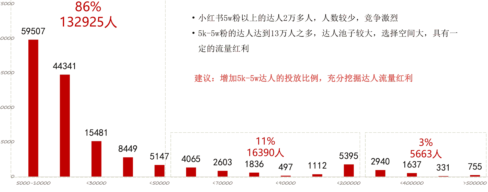

数据来源：火犀数据库，截至2月1日共收录小红书700万用户

## 平台流量分布

流量增长：底部 > 腰部 > 头部，平台给予底部 KOL & KOC 流量扶持，前 3 屏底部占比 60%

小红书发现页面内，多数推荐笔记所属的账号，量级都较小，多数是koc、腰下级。下图中，发现页面内随机抽取两个账号的层级情况显示

以“敏感肌霜”为例，在小红书搜索关键词，“综合”项下前50笔记，近6成都是达人笔记

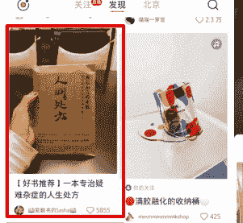
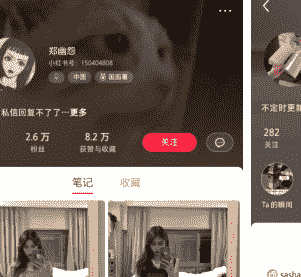
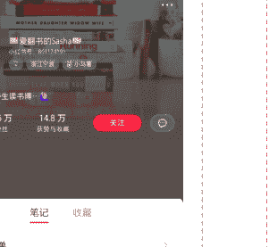
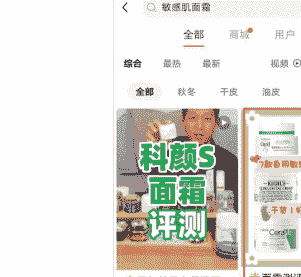
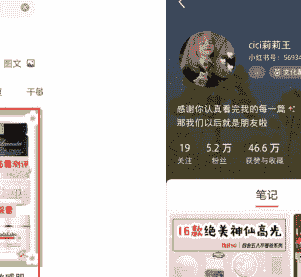
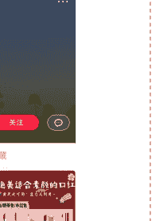
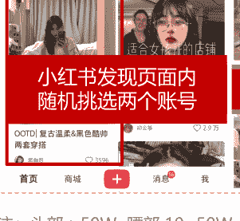
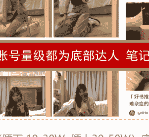
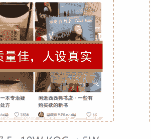

> “敏感肌霜”关键词内层级多为底部，内容较好，文质优

小红书发现页面内随机抽取两个账号
账号层级都是底部达人 质量优异，人设真实

注：头部>50 腰部10~50 (腰下30-50腰) 底部5~10 KOL KOC < 5

## 内容分析 软文笔记 > 笔记

爆文比例: 前 3 屏软文笔记占比70%

以“敏感肌霜”为例，在小红书搜索关键词，“最热”项下前50笔记，近6成的笔记为软文笔记（信息广告）

注：聚类适用于品牌合作，共约6万人，5k-5w粉的KOC通过软文笔记推广不受影响

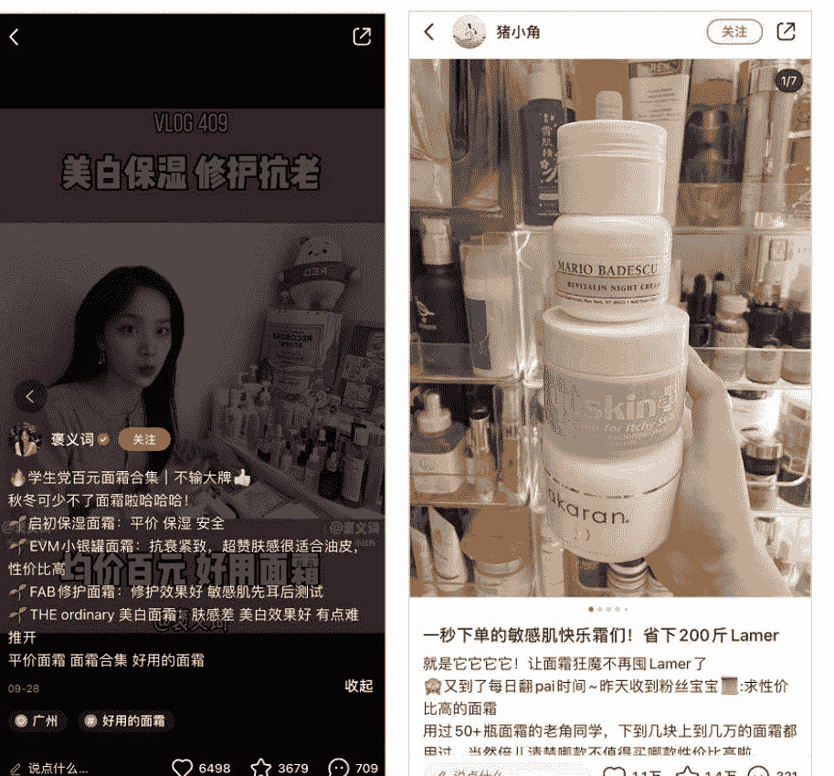

## 内容分析 视频笔记 | 图文笔记

各个行业视频笔记的平均互动约为图文笔记的两倍
**建议：**适当增加视频笔记投放比例

不同行业视频笔记与图文笔记的对比数据来源：火犀数据库，根据1月26日全53.8万篇笔记计算

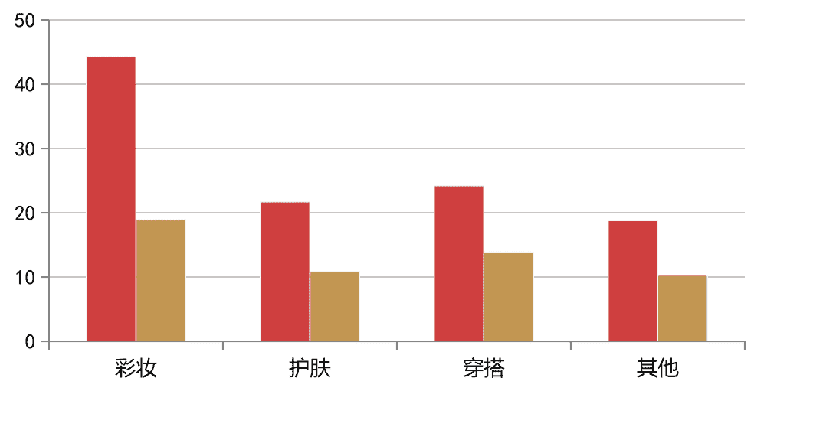

## 问题
怎么理解小红书关键词?

## 小红书流量结构

用户在浏览小红书主页被某产品种草时，往往是打开天猫下单；由于需要决策，往往会打开小红书搜索，例如小家电等搜索流量逐渐增加，目前接近50%。

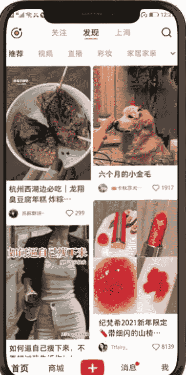
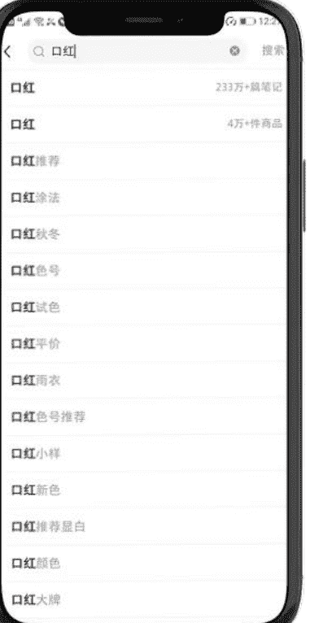

## 小红书流量的基础
小红书关键词&搜索补充

关键词是小红书后台根据笔记内容自动生成的。举个例子，如果笔记正文只有“上海房”两个字，生成的关键词为“上海资讯”。

| 笔记 | 奶粉 | 增加流量 |
| :--- | :--- | :--- |
| 137 | 9.6万 | 68.3万 |

## 小红书关键词的总量约500万

- 关键词的文本与笔记正文不相同
- 笔记中的图片，小红书后台也能自动识别为关键词关键词相当于小红书系统对笔记的语义理解

| 美食教程 | 奶 | 奶 |
| :--- | :--- | :--- |
| 亚洲 | 安全 | 玉油 |
| 奶酪 | 州 | |
| 纯美食 | | |
| 奶多芬 | 爆爆 | |

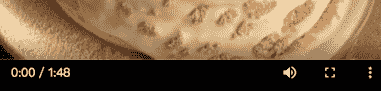

## 相关搜索
小豆乳芙奶蛋糕-无款甜系列

小豆乳芙没有生蛋，今天做了一个小豆乳芙奶蛋糕，奶油底的做法非常简单，干净滑、软糯丰富的，味道超级好吃！
食材：2个鸡蛋、230g面粉、20g糖、40g黄油、200g打发奶粉
小豆乳芙制作奶油需要65g奶油、100g牛奶

## 搜索补充
补充就是用户在搜索框中输入，搜索框下方列表联想词语。这些词语不一定是关键词，但是这些词一定来源于用户的输入，具有一定的搜索流量。


- L.A.鸡蛋玛仕味蛋糕 水果蛋糕这里推荐一个很好吃的蛋糕，绵绵卡拉蛋糕绝了。
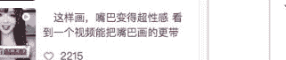

- 225 神仙乳芙奶蛋糕教程 推荐


- 39 网红鸡蛋戚芙蛋糕糖卡拉味


- 1.6万
- 214 发布2023-10-11 07:03

一起来更多吧：
```
id: 1, name: "...", value: {1}
id: 2, value: {1}
id: 3, value: {1}
id: 4, value: {0}
```

## 搜索举例说明
目前尚未收录小红书的关键词搜索热度不高。另一方面，近三个月，整体的搜索热度逐步上升。

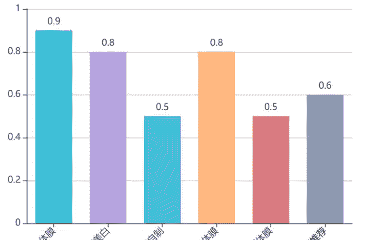

| 关键词 | 取消 |
| :--- | :--- |
| 笔记 | 3万+ |
| 美白 | |
| 自制 | |
| 采样 | |
| 推荐 | |
| 标 | |
| 测 | |
| 查 | |

## 流量的解释性分析

账号从2020年9月26日发布第一篇笔记内容都是学习类的，几乎没有经过广告投放，排除封面影响。

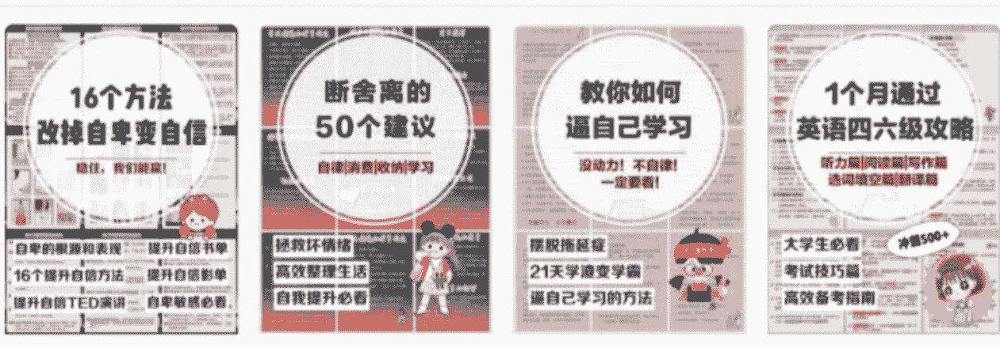

## 流量关键词示例

| 关键词 | 收藏量 | 点赞量 | 笔记量 | 转量 | 互动量 | 分数 |
| :--- | :--- | :--- | :--- | :--- | :--- | :--- |
| 粉末液 | 79017 | 23710 | 538436 | 5665 | 10762 | 0.917028 |
| 遮瑕 | 43976 | 162603 | 345351 | 3500 | 7940 | 0.876754 |
| 干粉 | 38911 | 119354 | 258952 | 3477 | 3792 | 0.900286 |
| 蜜粉控 | 46904 | 118922 | 226865 | 4259 | 6267 | 0.552068 |
| 学生党 | 20478 | 114312 | 213240 | 1874 | 1609 | 1.028842 |
| 护肤 | 53296 | 103492 | 261517 | 6254 | 3197 | 0.553654 |
| 卸底粉 | 21595 | 69861 | 145371 | 1989 | 3688 | 0.757053 |
| 油性皮 | 163598 | 98599 | 82265 | 1561 | 835 | 0.838856 |
| 润肤 | 122616 | 23610 | 59459 | 897 | 1094 | 0.133856 |
| 双效 | 7618 | 17635 | 49979 | 599 | 585 | 1.256757 |
| 适合粉 | 7428 | 13768 | 41271 | 591 | 655 | 1.179321 |
| 喷粉 | 26675 | 15824 | 34130 | 277 | 451 | 0.504521 |
| 痘肌 | 7095 | 14819 | 31889 | 368 | 526 | 1.649374 |
| 淡妆 | 13885 | 10650 | 12557 | 69 | 606 | 0.265062 |
| 卡粉 | 41842 | 10183 | 27190 | 363 | 985 | 0.204356 |
| 贵妇女孩 | 4593 | 9058 | 20506 | 285 | 375 | 1.536359 |
| 质女孩 | 31845 | 8172 | 17623 | 273 | 101 | 1.503860 |
| 白色化妆 | 22405 | 7425 | 21848 | 248 | 177 | 2.167553 |
| 小水肌 | 2176 | 7359 | 12743 | 204 | 146 | 1.392371 |
| 定妆 | 3827 | 6235 | 10188 | 450 | 371 | 2.210246 |
| 净化 | 4278 | 4561 | 1101 | 399 | 161 | 1.319911 |
| 控粉 | 1329 | 3403 | 8102 | 108 | 404 | 0.526929 |
| 散粉 | 1223 | 3358 | 7105 | 87 | 649 | 0.153856 |
| 救脸 | 1127 | 3320 | 723 | 90 | 96 | 2.204756 |
| 控油 | 3570 | 2476 | 5974 | 198 | 942 | 0.538974 |
| 哑痘 | 477 | 2383 | 8859 | 62 | 154 | 2.370691 |
| 拔膜 | 3136 | 2012 | 10690 | 190 | 776 | 1.910242 |

我们将粉末进行关联的关键词都做了罗列，同时小红书中粉末笔记都做了抓取。将关键词对应的所有笔记的测评、收藏、点赞、笔记、转发、互动数据计算。小红书的每篇文章都有人均互动量的分数指标。得到哪个关键词对于人均的影响越大，则为影响越大。通过比较关键词影响力，影响越大则对笔记互动量贡献越大，笔记获得的信息流自然曝光越大。


## 搜索关键词的解释性分析

主要分析那些指标笔记了什么搜索可以靠前，“大号”是一个例子，通过关键词很好的解释了其排名靠前的原因。这篇笔记在Olay大红瓶的搜索结果排名前三。接下来要去研究这种情况的普遍性。

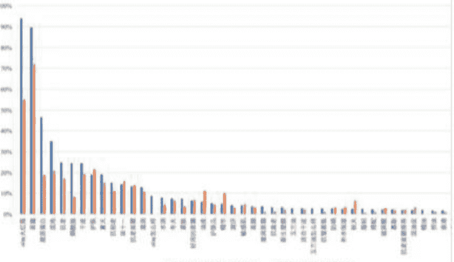

| 笔记作者 |
| :--- |
| 大大约号 |

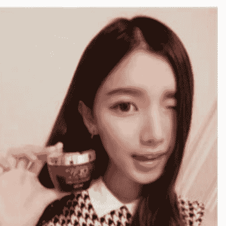

| 笔记 | 粉丝 | 赞与收藏 |
| :--- | :--- | :--- |
| 1 | 5 | 9 |

| 美妆 | 护肤 | olay红瓶 | 画霜 |
| 油皮 | 抗初老 | 地质 | 晚霜 |
| 水激 | 祛痘 | 胶蛋白 | 护肤 |
| Olay大红瓶 |

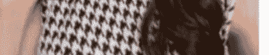

油皮女孩抗初老的本命面霜，olay大红瓶。

| 相关笔记 |
| :--- |
| 有没有一起健身的小伙伴~ |
| ❤️ 4 |
| 减肥这样，合理吗？ |


## 搜索举例说明

| 关键词 | TOP500笔记个数 | 普通笔记个数 | TOP500笔记占比 | 普通笔记占比 | 分数 |
| :--- | :--- | :--- | :--- | :--- | :--- |
| 散 | 453 | 248 | 91% | 50% | 0.526929 |
| 质 | 203 | 60 | 41% | 12% | 0.227058 |
| 控 | 164 | 55 | 33% | 11% | 0.116321 |
| 粉 | 132 | 34 | 26% | 7% | 0.175885 |
| 粉质 | 100 | 20 | 20% | 4% | 0.133333 |
| 董 | 75 | 16 | 15% | 3% | 0.097257 |
| 夏 | 110 | 47 | 22% | 3% | 0.088925 |
| 奶粉 | 93 | 33 | 18% | 7% | 0.071088 |
| 控收 | 45 | 6 | 9% | 9% | 0.068825 |
| 油 | 98 | 48 | 20% | 10% | 0.067123 |
| 巧克力粉 | 45 | 11 | 9% | 9% | 0.054629 |
| 定粉 | 43 | 11 | 9% | 9% | 0.050962 |
| 罗玛亚粉 | 25 | 3 | 5% | 5% | 0.039285 |
| 纪梵 | 54 | 26 | 11% | 5% | 0.037800 |
| 欧 | 24 | 4 | 5% | 4% | 0.036363 |
| 斯妮 | 36 | 15 | 7% | 3% | 0.023964 |
| 悦肤 | 30 | 11 | 6% | 2% | 0.022708 |
| 控力强的散粉 | 19 | 3 | 4% | 2% | 0.012726 |
| 蛋粉 | 26 | 9 | 5% | 2% | 0.022525 |
| 干粉 | 95 | 73 | 19% | 15% | 0.024809 |
| 学生党 | 31 | 14 | 6% | 3% | 0.023242 |
| 接妆粉选它 | 16 | 3 | 3% | 1% | 0.023241 |
| 不粘粉 | 36 | 20 | 7% | 4% | 0.042057 |
| 肤 | 44 | 28 | 9% | 3% | 0.019155 |
| 四宫格粉 | 16 | 4 | 3% | 1% | 0.019200 |
| 无印良品 | 16 | 4 | 3% | 1% | 0.019200 |
| 隐形毛粉 | 27 | 13 | 5% | 3% | 0.018900 |
| 控粉 | 17 | 5 | 3% | 3% | 0.016854 |
| 洁肤粉 | 16 | 5 | 3% | 3% | 0.016716 |
| 胜粉 | 44 | 30 | 9% | 6% | 0.016168 |
| 妆妆妆 | 67 | 53 | 13% | 8% | 0.015163 |
| 核心 | 41 | 31 | 8% | | |

按照同样的逻辑，我们将散粉对应的关键词词都做了罗列，但计算方法有所不同。

将TOP500的笔记和普通笔记对比了，笔记进入TOP500，肯定有普通笔记所不具备的内容。

通过TOP500拥有的关键词，在普通中没有的，计算对应的差值，相应的该关键词的流量权重越大，越越搜索流量也会越多。


## 问题

理解以上2种关键词，对我们投放有哪些帮助?

## 搜索关键词投放的意义

该算法可提升该品牌草本笔记在草词下的搜索排名和搜索占有率。笔记埋入适当的关键词将有助于提升其在特定关键词下的搜索排名，通过大数据反推搜索算法，我们可以得到若干干扰搜索关键词。以唇釉为例，如希望笔记在唇釉的搜索结果中排名靠前，则可以埋入唇釉、红口、试色、白色等关键词。

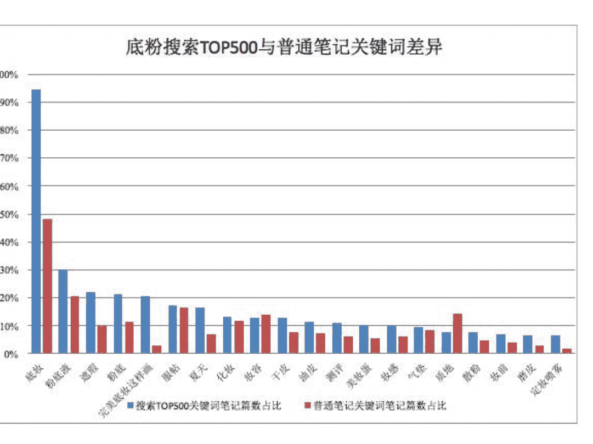

## 流量关键词投放的意义

由于每篇笔记都涉及多个关键词，我们通过多元线性回归和决策树的结合模型得到关键词的影响，笔记数量足够多，计算才能准确。

| 关键词 | 得分 |
| --- | --- |
| 粉底液 | 15 |
| 气垫 | 15 |
| 斑暇 | 15 |
| 粉底液推荐 | 15 |
| 冬天 | 15 |
| 混油 | 15 |
| 混油 | 15 |
| 氧化 | 15 |
| 雷达大槽 | 15 |
| 暖色 | 15 |
| t区油 | 14.12208 |
| 结块 | 11.69428 |
| 质地 | 11.54245 |
| 舞蹈 | 10.94919 |
| 相见的定时喷雾 | 9.83103 |
| 试色 | 9.792737 |
| 精华 | 9.297909 |
| 服帖 | 9.159379 |
| 水润 | 8.600154 |


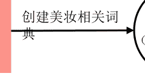
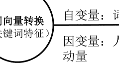

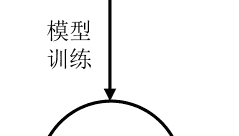
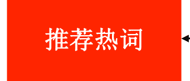

根据影响力指标对关键词进行排序。
每个关键词的影响力指标。

## # 种草投放逻辑

1. 挑选可能的种草定位，这样的关键词可能是品牌、品类词、卖点词、场景需求等。
2. 通过大数据计算不同关键词的热度指数，热度越高，说明搜索的人越少。
3. 统计每个关键词下的笔记种草数，种草数量越多，行业竞争越激烈。
4. 用搜索热度除以种草笔记数即可得到种草红利，搜索越多且笔记少，种草红利越高。

例如，图中祛痘搜索热度高达9，但是祛痘笔记每月达6万篇，竞争非常激烈，种草红利很低；相比之下，泛肌搜索热度也较高，对应的笔记量较少，因此具有较高的种草红利。

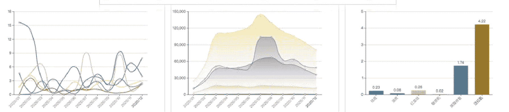

关键词搜索热度趋势。
笔记数量数量趋势。
种草红利指数。

## 问题

如何将关键词+达人用于品牌小红书投放中？

## # PART 2

品牌在小红书环境大盘分析。

## # 小红书平台关键词 熬夜面膜搜索热度逐步上升

- 熬夜面膜不是小红书的关键词，在小红书搜索熬夜面膜，搜索结果是同时包含熬夜和面膜这两个关键词的笔记。
- 涂抹面膜是小红书的关键词，涂抹面膜和面膜涂抹不是，根据搜索推荐和分析的情况，涂抹面膜的热度最高。

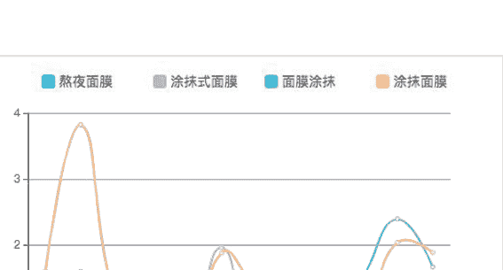
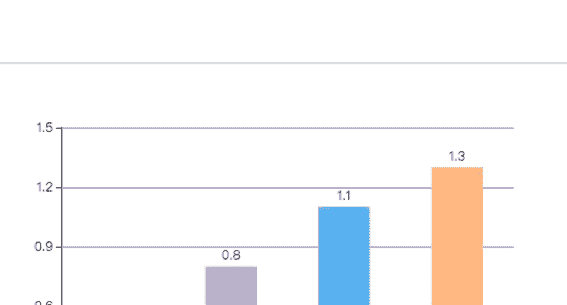

## # 小红书平台关键词 熬夜面膜 种类量少，品牌分散

- 下图搜索“熬夜面膜”时，各品牌的占比情况。可以发现，各品牌的占比都很小小，很分散，没有很突出的品牌。
- 熬夜面膜的搜索结果中，包含“熬夜面膜”的笔记一共153条，剩下的笔记分别是熬夜和面膜两个词，说明小红书夜面膜笔记量很少。
- 熬夜面膜的搜索结果中，涂抹面膜占比232篇，约占1/4。

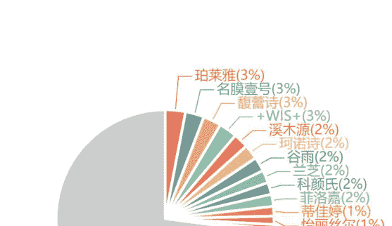

| 品牌 | 占比 |
| --- | --- |
| 珀莱雅 | 3% |
| 名牌 | 3% |
| 雅肤 | 3% |
| 其他 | 3% |
| 兰奈 | 3% |
| 珂珂 | 2% |
| 薇 | 2% |
| 莱芙 | 2% |
| 珀佳 | 1% |
| 蔻华 | 1% |
| 莱雅 | 1% |
| Dermalogica | 1% |
| 其他 | 2% |

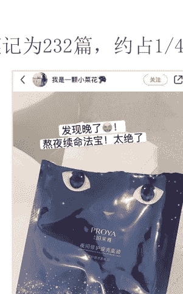
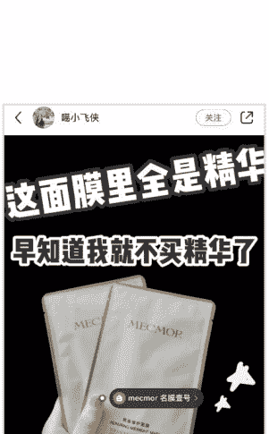
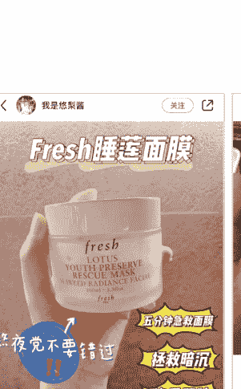
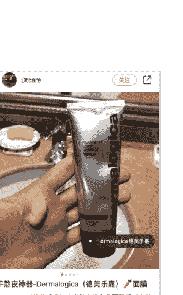

## # 小红书平台品牌占比 涂抹面膜 以集测评为主

- 下图为搜索“涂抹面膜”时，各品牌的占比情况。可以发现，各品牌的占比平均，其中占比最高的是馥诗，其次是菲洛嘉和科氏。
- 涂抹面膜的搜索结果里，合集和测评占比很高，超过50%。

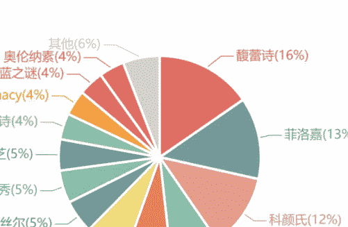
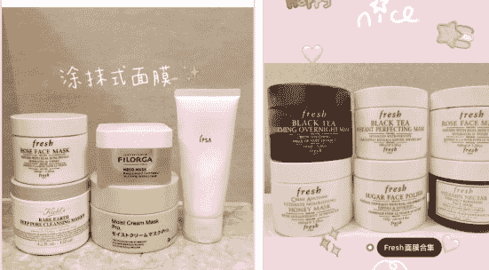
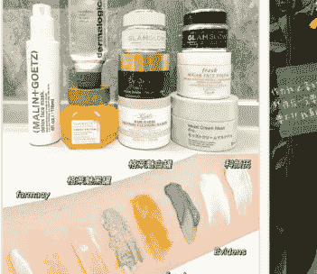
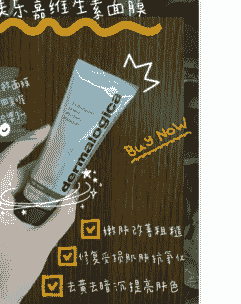

平价购买的涂抹面膜使用体验分享：
- 我专属过的涂抹面膜来推荐。
- 分享几款最近买的涂抹面膜真实感受：
- 测评单：这款真的好用了！最好：
- Fresh馥诗贵源面膜（黑罐）3.3⭐ 123
- 测评单：1.7⭐ 764

分享几款好用的涂抹面膜，不雷测评：
- 最近尝试了不同品牌的涂抹面膜，肤质状况明显改善，另外可以尝试的，这款肤质一般的推荐是馥诗。

涂抹面膜功效测评（一）不雷好物：
- 最近都在问有没有好用的涂抹面膜，作为油性肌女孩，我闭眼入这些，用完之后皮肤状态变很多，我真的觉得
- 测评单：1.2⭐ 178

## 总结 行业SOV分析&竞品账号分析

通过对种草词（或者品类词和场景词）的搜索结果进行分析，可以得到行业中的主要分布。品牌可以选择主要的竞品，进一步分析竞品的投放节奏、投放分布、投放周期和投放预算，结合品牌的投放目标，最终梳理出完整的投放计划。

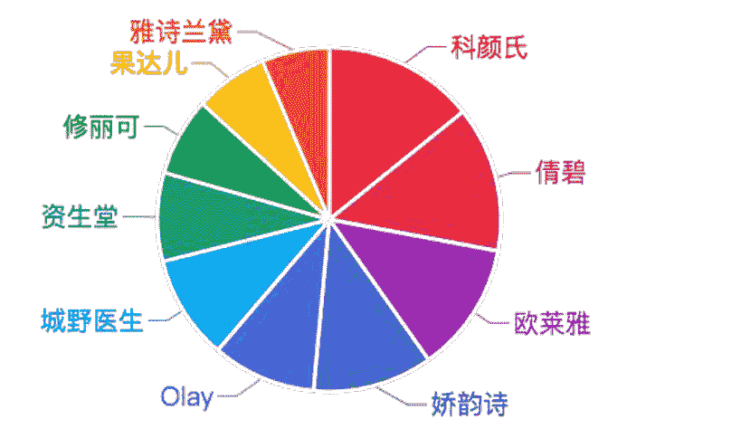
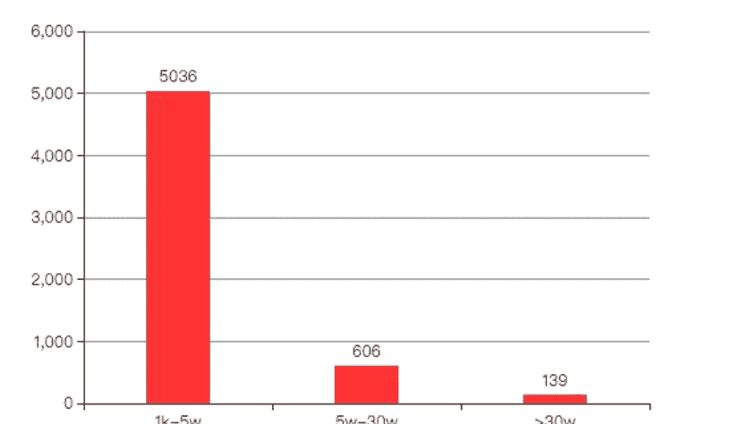

美白搜索词下主要品牌分布情况。兰蔻小黑瓶投放达人分布情况。

# PART 3

竞品广度梳理（以体膜为例）

## # 小红书面膜行业分析

## 蜜品牌投放效果最佳

| 产品 | 思妍丽柔拿面膜 | 蜜茉莉烟熏磨砂面膜 | LUSH/洗护 摩哥望果身体修护霜 | BODANE/破琥蓝面膜 | 施芙兰 面膜 |
| --- | --- | --- | --- | --- | --- |
| 笔记数量 | 237 | 702 | 49 | 139 | 50 |
| 涉及达人 | 211 | 552 | 46 | 127 | 43 |
| 爆文数量 | 5 | 29 | 2 | 2 | O |
| 爆文率 | 2% | 4.1% | 4.1% | 1.4% | 0.00% |
| 主打卖点 | 全补水清洁保湿 | 亮白去角质清洁孔痘 | 滋润补水保湿 | 美白 | |

- 蜜品牌在小红书主推的是两个产品，一个是面膜（笔记92篇），一个是面膜。在面膜类中，它的笔记数和爆文率都是最高的，KOC的比例为1:8。
- LUSH身体修护并不是面膜的主推品，相关笔记仅有49篇。
- BODANE/破琥蓝面膜与KOC的比例为1:18（KOC的占比非常高）。
- 施芙兰面膜属于自制面膜（野玫瑰）。
- 数据时间：2020年1月1日-2021年2月1日。

## # 蜜内容分析 蜜是行业内核心

关键词出现频率：美白、身体、熬夜。
关键词维度：
功效：美白、防晒、角质。
产品：身体乳。
话题：美白。
筛选关键词：美白、身体、敏感。

- 蜜内容核心在于美白，其他功效占少，例如角质为1/6，清透为1/10，滋润为1/20。运营关键词，即用户关注的关键词是非常接近的，说明目前很多笔记具有。

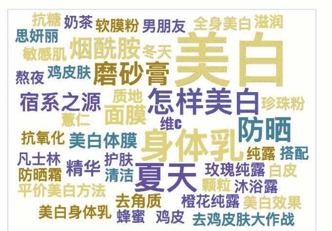

蜜行业核心云。
蜜行业核心词。

# PART 4

竞品深度分析n以某香水为例

## # 蜜笔记总览

| 笔记篇数 | 涉及达人 | 图文笔记数 | 视频笔记数 |
| --- | --- | --- | --- |
| 29 | 68 | 90 | |
| KOC平均互动 | KOL平均互动 | 爆文数 | 爆文率 |
| 27 | 48 | 6 | |

- 蜜的视频笔记占比低于正常投放水平（正常投放中视频占比约为10%），但低于大盘视频占比（大盘视频占比约为25%）。
- 蜜的KOC&KOL的平均互动低于平均投放水平，爆文数量为，爆文率为低于投放水平。
- 蜜有130篇笔记的互动量不超过（其中3篇笔记已删除），结合互动量的趋势，可以发现该品牌被平台流严重。

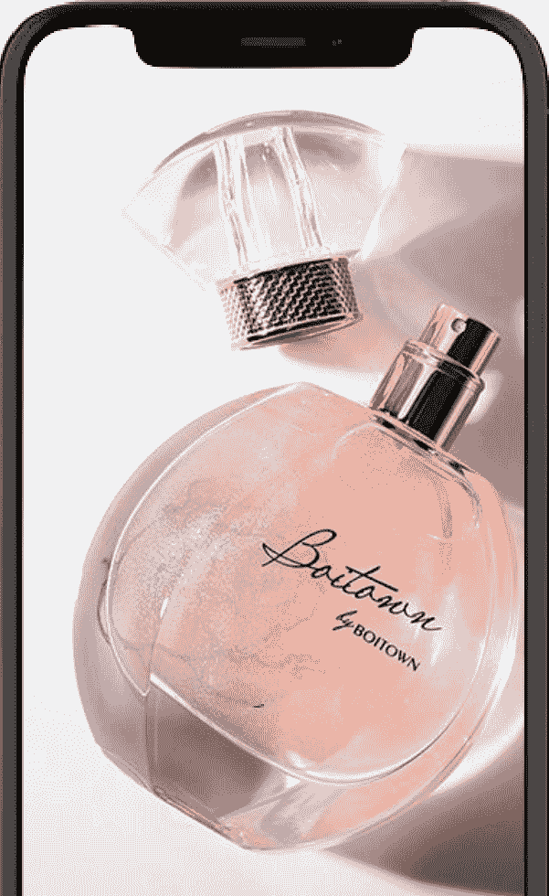

## 投放趋势&效果分析

- 在近一年内，蜜的投放趋势波动，但每月都保持着一定的投放量，月笔记量维持在100-300之间；它的笔记数量存在两个峰值，分别在3月份和11月份，并且月笔记数量超过了篇。
- 从互动量角度来看，5月份达到了最高。主要原因是因为一位头部KOL发布了一篇香水合集，获得了96万互动量。除了这篇爆文之后，5月份的总互动量仅为万。
- 在11月份，虽然增加了投放力度，但笔记互动量却没有明显的增加，产出了4篇爆文，其中三是联合其他品牌的粉丝笔记。有20位KOL笔记互动量超过，平台限流情况严重。

蜜每月投放开销占26%。

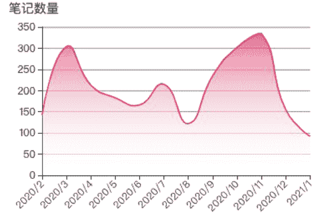
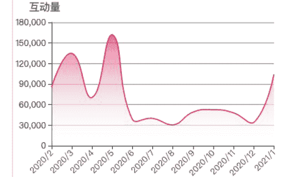
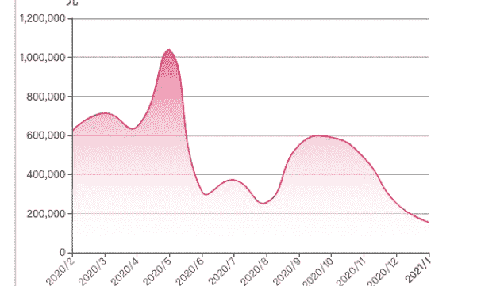

*数据时间：2020年2月1日-2021年1月31日

## 蜜 达人表现不佳

- KOL与KOC的比例为1：8，KOLs的占比合理小红书正常投放比例（1:6~1:9）。
- 从达人互动来看，KOC的赞赏评分分布，其中1w-5w粉丝间的KOC表现较好，平均互动达到3%高于平均水平。
- Top 5达人粉丝均为头部达人（大于5w粉丝），且有5篇笔记为粉丝合集笔记。其互动量表现优，除了豆豆_Babe的笔记互动量较高，其余达人的表现都一般，笔记互动量在。

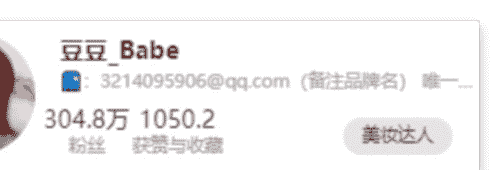
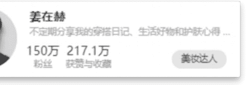
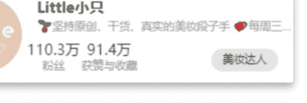
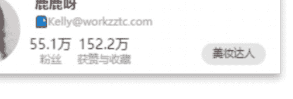

| 达人数量 | 互动量 |
| --- | --- |
| 0-1w | 103 |
| 1w-3w | 595 |
| 3w-5w | 226 |
| 5w-10w | |

| 粉丝量 | 互动量 |
| --- | --- |
| 0-1w | 951 |
| 1w-3w | 393 |
| 3w-5w | 217 |
| 5w-10w | 938 |

投放达人。
笔记互动量。
*数据时间：2020年1月2日-2022年1月31日

## 内容发布量和达人配比

近90天行业平均种草篇，要占行业发布量的%，建议每日笔记量在篇左右。
近90天发布达人共有位，其中大于1000粉丝的达人共位，这些达人中粉丝分布如下图所示。如，建议KOL少量，重点放在KOC区间，KOL与KOC的投放比例为1:

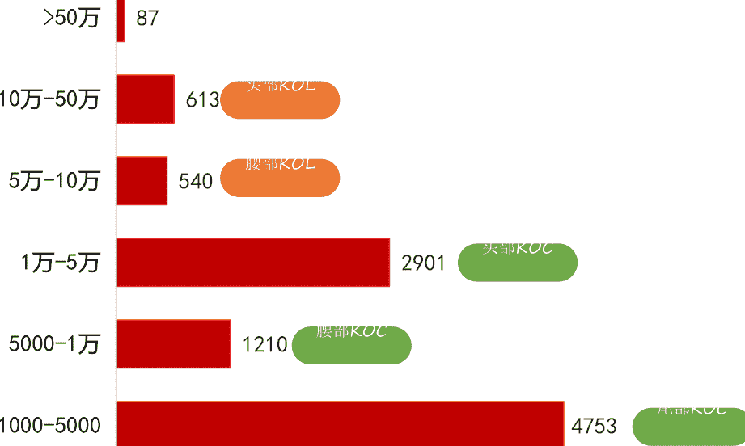

## 问题

已知达人配比，达人类型及内容配比如何选择?

## 穿搭达人投放效果最好

- 投放的KOC中，护肤类达人占主地位，占到%妆和美食探店类达人。
- 投放的KOL中，护肤类达人有所减少，穿搭达人占比增，这是因为小红书穿搭类账号粉丝量较大，并且粉丝量不断增长，护肤类达人越来越少。
- 从投放的效果来看，穿搭达人获得的互动最好。建议减少护肤类达人的选择，增加穿搭类达人的选择。

单位粉丝互动量=单篇笔记的互动量/达人粉丝数 这个指标反映了达人获得互动的能力。


KOC领域分布。
KOL领域分布。
不同领域达人的平均粉丝互动量。
*数据时间：2020年2月1日-2021年1月31日。

## 关键香料多

关键词出现频率：美白、身体、熬夜。
关键词维度：
功效：美白、防晒、角质。
产品：身体乳。
话题：美白。
筛选关键词：美白、身体、敏感。

- 蜜内容核心在于美白，其他功效占少，例如角质为1/6，清透为1/10，滋润为1/20。运营关键词，即用户关注的关键词是非常接近的，说明目前很多笔记具有。


蜜行业核心云。
蜜行业核心词。

## 个人护理类投放效果最好

- 的内容比较集中，主要是香水类笔记，占到了...次是美妆合集与个人护理类笔记。
- 获取互动效果最好的组合：个人护理达人-美妆合集 > 护肤达人-家居装饰笔记 > 彩妆达人-香水笔记。
其中展览演出攻略是因为有一个相关的展览，产生了相关笔记。
建议：彩妆达人写香水类笔记更为合适。


达人-笔记类型散点图，面积越大笔记越多，颜色越深越容易获得互动。
投放笔记类型分布。
*数据时间：2020年2月1日-2021年1月31日。

## 南瓜水 达人圈程度高，笔记类型集中

- 所的达人中，护肤类达人占比，个人护理、家用电器类达人占比排名很高，出圈情况一般。
- 在投放的笔记中，主要基本都是护肤类笔记，非常垂直，内容多样性不足，内容的接近于相似时也容易引发限流。


达人擅长分布。
笔记形式。
*数据时间：2020年1月1日—2020年12月31日。


## 粉丝评论分析 穿搭达人投放效果最好

- 冰香梨的笔记关键词中香料提及及很多，而从粉丝评论来看，对于香料几乎没有任何回应，所以香料不应作为香水的投放重点
- 粉丝在评论中主要还是讨论香水的颜值和味道


*数据时间：2020年2月1日-2021年2月2日

## HFP乳糖酸水+原液笔记关键词主要围绕产品及其功效

关键词出现频率：

原液 > homefacialpro > 精华 > 痘痘 > 祛痘 > 收缩毛孔 > 去黑头 > 护肤 > 闭口 > 刷肤

| 关键词 | 出现次数 | 关键词 | 出现次数 |
| --- | --- | --- | --- |
| 原液 | 1492 | 夏天 | 168 |
| homefacialpro | 1407 | 化胶水 | 151 |
| 精华 | 508 | 测评 | 150 |
| 痘痘 | 496 | 肤 | 149 |
| 祛痘 | 479 | 护肤品 | 148 |
| 收缩毛孔 | 435 | 化妆棉 | 142 |
| 黑头 | 415 | strided | 132 |
| 护肤 | 415 | 痘印 | 123 |
| 闭口 | 344 | 凝胶 | 111 |
| 刷酸 | 298 | 去闭口 | 109 |
| 敏感肌 | 239 | 面霜 | 108 |
| 清脸 | 210 | homefacialpro怎么做 | 107 |
| 晒肌 | 199 | 洁面 | 106 |
| 面膜 | 194 | 防晒 | 100 |
| 毛孔粗 | 185 | 缩毛孔 | 100 |
| 水杨酸 | 180 | 科颜肤 | 97 |
| 优理氏 | 180 | 痘肌 | 95 |
| 果酸 | 177 | 夜护 | 93 |
| 质地 | 177 | 去黑头方法 | 92 |
| 防晒 | 248 | 贵南大学 | 92 |


*数据时间：2020年1月1日—2020年1月23日

## HFP乳糖酸水+原液卖点分析

- 敏感肌、水杨酸、祛痘等词在笔记中出现次数较多，同时在评论中多次出现，产品主打词在笔记中出现频率很高，在用户评论中也非常频繁，说明其种草效率较高

| 学会 | 油性皮肤 | 收缩毛孔 |
| --- | --- | --- |
| 泛敏 | 控油痘 | 水杨酸 |
| 质地 | 祛痘 | 毛粗大 |
| 过敏 | 敏感肌 | 清洁 |
| WOW | 草莓 | 莱聚 |
| 长痘 | 嫩华 | 金盏花 |
| 控脂肌 | 婴儿 | 莱白 |
| 用完 | 学后 | 流动性 |
| 男生 | 脸 | 祛痘 |
| 干燥 | 火箭 | 灶肌 |
| 心动 | 水果 | 十一一 |
| 气泡 | 痘印 | 蓝蓝 |
| 王一博 | 效果 | 敏感 |
| 鼻子 | 油田 | 匣子 |
| 好用 | 毛孔 | 科颜氏肤 |
| 产品 | 祛痘 | 肤皮 |
| 修敏可 | 原液 | 夏天 |
| 清面膜 | 美颜桃花 | 爆乳肌 |
| 闭口 | 多少钱 | 低廉价 |
| 粉刺 | 角质层 | 价格 |
| 避坑 | 宝藏 | 情人节 |
| 晚期 | 干性皮肤 | 直间 |
| 晚夜 | 棒的欧莱雅 | 脑颊 |
| 避草 | 宝藏 | |


用户评论云图

用户评论聚类图

*数据时间：2020年1月1日—2020年1月31日

# PART 5

### 红利挖掘以某美白饮为例


## 美白饮小红书定位筛选 卖点梳理

通过天猫产品详情、产品说明书以及对于小红书美白妆行业的分析，我们梳理得到产品的基本卖点，再将卖点转化为小红书关键词或者搜索补齐词，进一步进行种草红利的分析

产品卖点
美白饮
天生黑
...

小红书关键词、补齐词
美白妆、美白饮品、天生黑、天生黑怎么美白、天生黑美白


## 定位筛选 种红利计算

- 候选词为美白妆、美白饮品、天然黑、天然黑怎么美白、天然黑美白
- 天生黑、天然黑怎么美白、天然黑美白并非小红书关键词，但是搜索输入天然生的时候，就会自动补齐为这三个词，说明这三个词用户搜索较多
- 但是这些词的投放笔记数量较少，所有草红利都非常高
- 建议：以美白饮品主打，天生黑美白作为埋关键词


*数据时间：2020年1月1日—2020年12月31日

## 总结

确定草关键词
通过数据计算不同关键词的热度，热度越高，说明搜索的人越多将得到的关键词热度除以关键词投放篇数，得到每个关键词种利


上唇釉、美白、烘焙三个关键词的搜索热度趋势，可以看到热度较高，说明搜索的人越多，其中唇釉4月搜索低，5月之后持续上涨；烘焙期间搜索下降，均与背景相关

# PART 6

### 内容开展以某体膜为例

### 内容执行以具体为例

通过对竞品和行业的研究，结合品牌的需求，梳理出主要的内容方向以及内容分布。

### 穿搭分享出行攻略

例如：穿搭分享；好物种草：产品测评分为二类


同时，每个内容还会衍生出不同的切入角度，最终得到内容的方案

### 冬季穿搭旅行穿装、婴儿穿装、滑雪装备


### 产品测评好物种草好物分享集合分享促销活动冬季内测评专业性能测评

## 体膜内容策略### 优质关键词

- 功能：美白、提亮、清洁、保湿
- 成分：番瓜提取物、高岭石、甘油
- 适合肤质：所有肌肤
- 美白体膜身体美白
- 清洁保湿
- 皮肤透亮
- 美容院
- 烟酰胺
- 清洁护肤
- 清洁补水

### 种草场景

- 怎样美白
- 全身美白方法
- 我的护肤日常
- 品牌怎么样通过大数据计算，两周更新一次

## 内容规划 护肤美白

切入角度：美白方法、平价美白、对比美白、秋冬美白、牛奶肌美白、黑黄皮美白展现形式：文案中提及产品名，突出产品功效：祛黄提亮、美白去黄、抗初老


护肤画教我的美白大法！真不是漂白的！才3蛋！白到亲妈都不认识！行走的小灯泡！白到天天被朋友怕！都是用了漂白剂了！秋季真的是养成肤肌的好时机！分享我的自律报告：答应我一定错过秋冬养肤的时间！

## 美白方法
## 平价美白
## 对比美白
## 秋冬美白、牛奶肌养成

## 内容规划 体膜合集测评

切入角度：磨砂膏测评、美白合集、浴室合集等展现形式：结合平台热词，与大牌或爆品进行测评，利用锚定效应，提高品牌价值感


## 内容规划 好物分享

切入角度：洗护好物、SPA好物、冬日好物等


### 洗护好物SPA好物冬日好物

# PART 7 达人匹配与筛选

### 执行流程KOC

1. 从8000万达人库中筛选活跃达人，即一段时间内发布一定数量
2. 计算达人各项指标，见右表
3. 采用半监督的方式进行权重分配，最后得到达人列表

| 特征 | 分类 |
| --- | --- |
| 粉丝量 | 达人基础指标 |
| 笔记量 | 互动量 |
| 平均互动量 | 粉丝增长率 |
| 笔记增长率 | 成长性指标 |
| 爆文率 | 爆文指标 |
| 笔记集中度 | 相似度 |

| 粉丝相似度 | 粉丝成分 |

## 评论筛选

标准：粉丝量大于0，笔记量大于50篇，平均评论长度大于20字，最终选出700多名作者

| user id | comment | count | percent |
| --- | --- | --- | --- |
| 1 Se60d9b80900001000575 | 44.0 | 42 | 0.95455454545455 |
| 2 57b859y97e7f86b8751d | 42.0 | 13 | 0.952380523809523 |
| 3 Se506be9c00000100429d | 21.0 | 20 | 0.93104382715821 |
| 4 5f0b8bc6a8b0000010157f | 27.0 | 27 | 0.87142582715821 |
| 5 Se7b1599a8b0000010517 | 35.0 | 35 | 0.87142582715821 |
| 6 Se6bd0d3919000010768 | 14.0 | 14 | 0.833333333333333 |
| 7 7c9999d2000016018319 | 12.0 | 12 | 0.833333333333333 |
| 8 5d8a4436c4fe2d00001678 | 12.0 | 12 | 0.833333333333333 |
| 9 Se0000000000001000247 | 11.0 | 11 | 0.818181818181818 |
| 10 Sdbb4c46167a2333333333 | 11.0 | 11 | 0.818181818181818 |
| 11 Se3c9f88490000010710e52e | 9.0 | 9 | 0.818181818181818 |
| 12 Sad79f951a1e827106e3b13d7 | 11.0 | 11 | 0.818181818181818 |

## 含水量分析

含水量：通过评论种子，通过PageRank算法计算达人互评占比作为水量

| user id | comment | shujian count | percent |
| --- | --- | --- | --- |
| 1 Se60d9b80900001000575 | 44.0 | 42 | 0.95455454545455 |
| 2 57b859y97e7f86b8751d | 42.0 | 13 | 0.952380523809523 |
| 3 Se506be9c00000100429d | 21.0 | 20 | 0.93104382715821 |
| 4 5f0b8bc6a8b0000010157f | 27.0 | 27 | 0.87142582715821 |
| 5 Se7b1599a8b0000010517 | 35.0 | 35 | 0.87142582715821 |
| 6 Se6bd0d3919000010768 | 14.0 | 14 | 0.833333333333333 |
| 7 7c9999d2000016018319 | 12.0 | 12 | 0.833333333333333 |
| 8 5d8a4436c4fe2d00001678 | 12.0 | 12 | 0.833333333333333 |
| 9 Se0000000000001000247 | 11.0 | 11 | 0.818181818181818 |
| 10 Sdbb4c46167a2333333333 | 11.0 | 11 | 0.818181818181818 |
| 11 Se3c9f88490000010710e52e | 9.0 | 9 | 0.818181818181818 |
| 12 Sad79f951a1e827106e3b13d7 | 11.0 | 11 | 0.818181818181818 |


## 执行流程 大数据监测迭代，持续优化内容策略

- 笔记发布趋势


daily tracking: 建立数据反馈体系

- 互动情况趋势

weekly report: 每周小结和优化建议


| 工作内容 | 分类执行名称 |
| --- | --- |
| 内容简历和达人名单 | 确定brief、提交达人名单、确认达人名单、确认达人档稿、产品发货、达人接收产品（分批）、达人操作接单（分批）、达人修改意见（分批）、达人考核反馈（分批）、达人完成验收（分批） |
| 内容发布 | 达人接发布、评论维护 |

## 大数据种草的流程总结（策略）


行业种草分析报告


竞品种草分析报告


品牌种草分析报告和迭代优化建议


品牌种草数据追踪

- 行业增长趋势分析
- 行业笔记笔量占比分析
- 行业互动量占比分析
- 行业主要品牌占比分析
- 主要品牌热度分析

- 竞品投放节节奏分析
- 竞品投放达人分析
- 竞品投放预算分析
- 竞品内容方向分析
- 竞品卖点分析

- 品牌投放效果分析
- 品牌卖点分析
- 品牌种草关键词建议
- 种草笔记类型分析
- 种草笔记形式建议

- 笔记互动趋势追踪
- 笔记异常状态追踪
- 笔记评论追踪
- 笔记评论含水量分析

## 大数据种草的流程总结（执行）


精准选词 投放策略

内容形式 策划

大数据精准选人

投放及结果 数据化管理

可持续性 优化

通过大数据对产品相关关键词进行分析，得到优质的流量关键词和搜索关键词，同时，可以根据小红书关键词的搜索热度，制定小红书投放方案

通过用户群体分析、痛点分析、产品分析以及竞品分析，梳理得到内容方向和形式，形成完整的内容策划

通过达人指标，针对不同品牌需求，运用 brief选人、相似选人、小红书搜索选人等选出优质达人

对搜索投放笔记进行每日追踪，生成周报，即时反馈投放效果，让投放策略的调整更灵活

对投放产生互动行为点分析，为进一步投放提供强有力的技术支持
