# 扫码加入 知识星球TOP免费资源群

免费
公众号:知识星球TOP

- 每日免费获取高价值资源
- 可提供各类资源搜索服务

价值及时

微信信号:jntsg8

| 热门付费文章 | 各行各业报告 |
|---|---|
| 精选图书资源 | 副业赚钱方法 |
| 职场实用资源 | AI财经自媒体 |

专注专注

微信信号:jntsg2

分享资料仅供个人学习，请及时删除，切勿商用传播

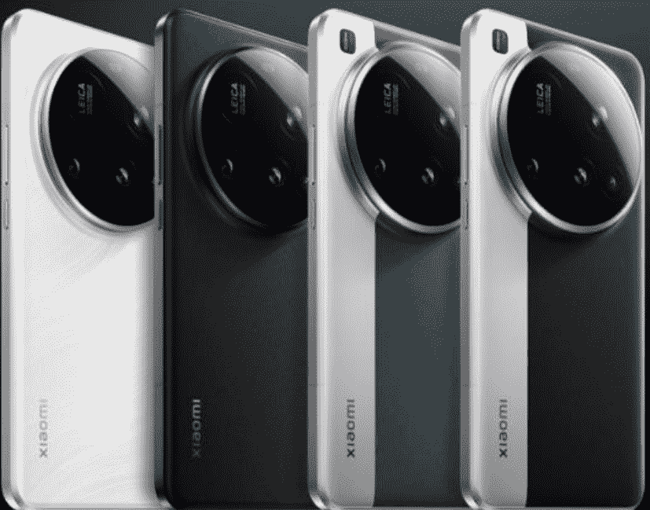

## 3200nits 超级阳光屏

## 超低功耗
2K屏、1.5K屏低功耗

## 专业原色显示
多设备跨屏同色

25% APL 面积，无内容限制
支持阳光下动态色彩映射
为户外专业创作打造

2.8V 超低电压屏幕驱动技术
全定制制屏供电芯片
驱动晶体管定制化设计

CIE-170:2015 超色准显示
UltraHDR 照片、Dolby Vision 视频
小米生态屏幕色彩跨屏一致

## 小米龙晶玻璃 2.0
耐性性能提升

## 16X

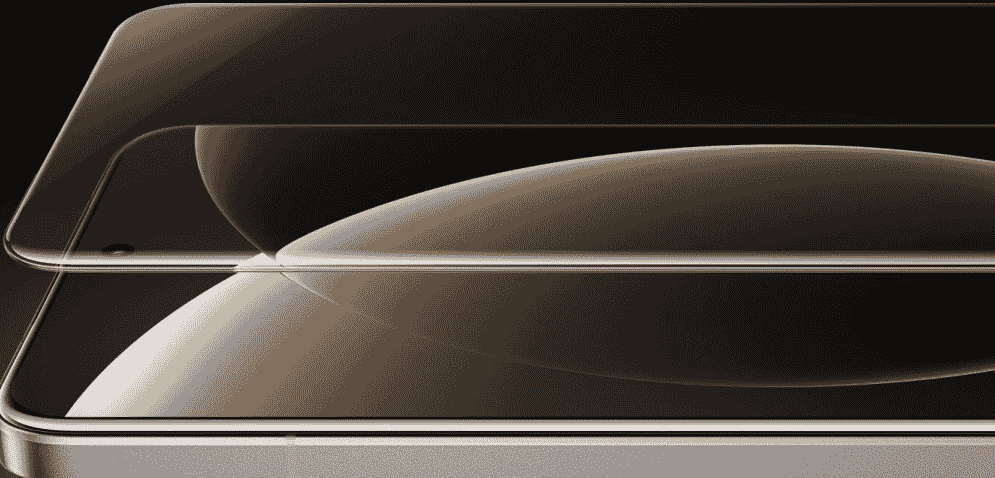

## 超声波指纹

亮屏解锁快25%，息屏解锁快50%
黄金指纹位置体验更佳
夜晚不失灵，湿手手指秒解锁

## 高通年度最强芯

### 骁龙8至尊版

第二代台电 3nm 制程，晶体管密度提升 60%
第二代 Oryon 架构，最高频率 4.32GHz，性能提升 45%
第二代 Adreno 8 系 GPU，独立显存容量 +300%，性能提升 44%
80 TOPs AI 算力，综合算力超越所有苹果移动 SoC

- LPDDR5X UFS 4.1 USB 3.2 Gen2

实测对比 iPhone 16 Pro Max

## 边充电边导航
叠加微信语音小窗

平均温度低 3.7°C
Xiaomi 15 Ultra
# 39.3°C

iPhone 16 Pro Max
# 43°C

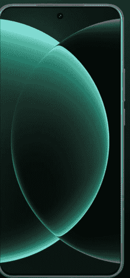
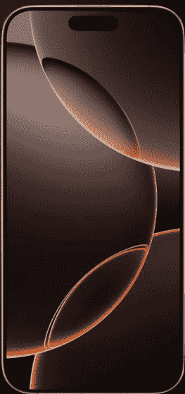

实测对比 iPhone 16 Pro Max

## 大型 RPG 动作游戏

## 2K 分辨率

平均功耗低 25%
平均温度低 6.6°C

Xiaomi 15 Ultra
59.6 fps, 40.6°C

iPhone 16 Pro Max
58.9 fps, 47.2°C

实测对比 iPhone 16 Pro Max

## 人像模式
连拍 150 张拍摄速度快 61s
平均温度低 7.4°C
Xiaomi 15 Ultra
35.2°C, 57s

iPhone 16 Pro Max
42.6°C, 118s

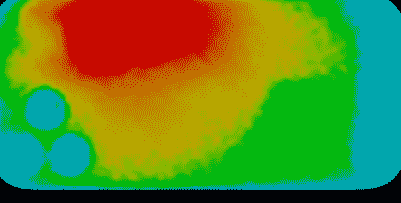

小米金沙电池

## 超高含硅量
碳材料沉积工艺，表面处理
硅基体预留孔，抑制膨胀

## 信号增强
中高频天线 T1+T1S+T1S 三芯设计
自研信号增强系统
多通路模块智能调节
+48% 中高频（蜂窝/Wi-Fi/蓝牙）
+37% 中高频（Wi-Fi/蓝牙）
+20% 中高频（蜂窝/Wi-Fi/蓝牙）

AI 信号增强
弱信号场景大幅降低
-51% 游戏延迟
-79% 直播卡顿率

## 全球出行
无缝畅联
优质覆盖全球国家/地区
200+ 覆盖全球频段
500+ 覆盖全球运营商

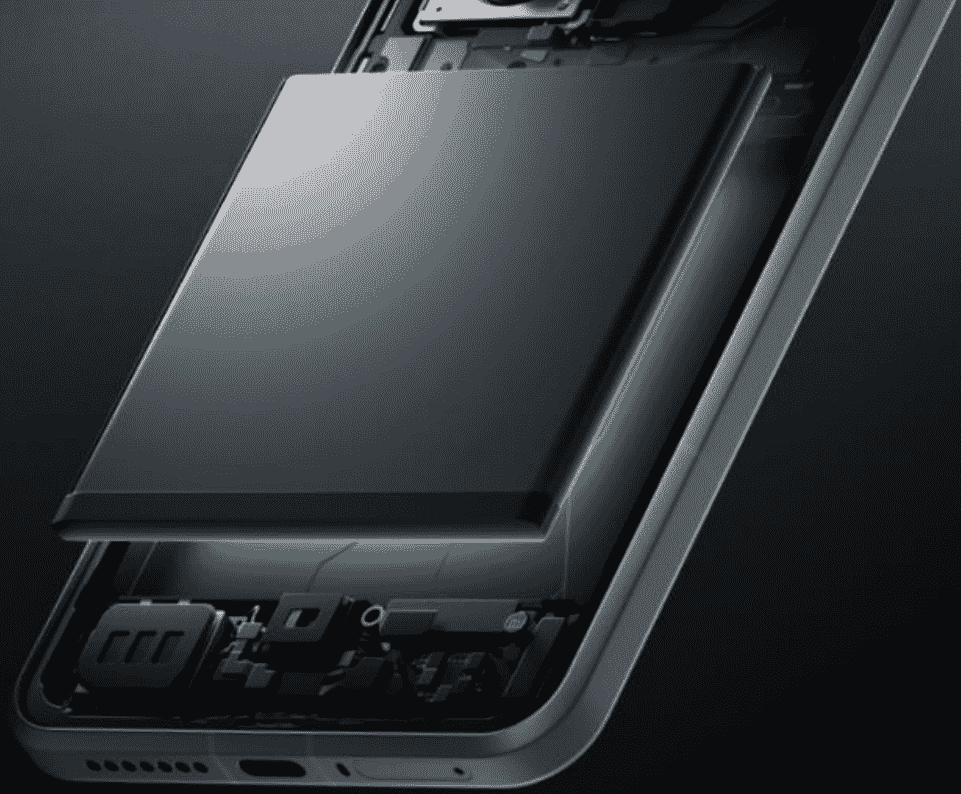
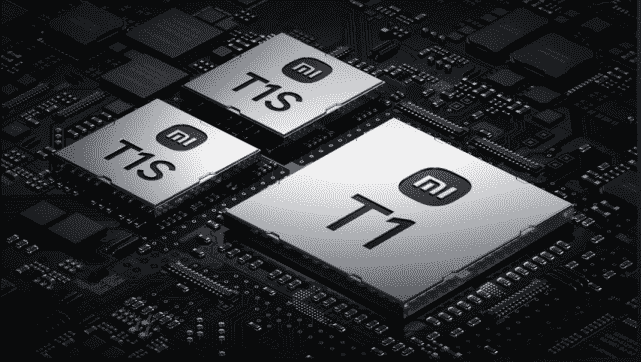

Xiaomi 15 Ultra

## 全系搭载卫星通信
全球首发手机直连卫星功能
Xiaomi × 荣耀合作

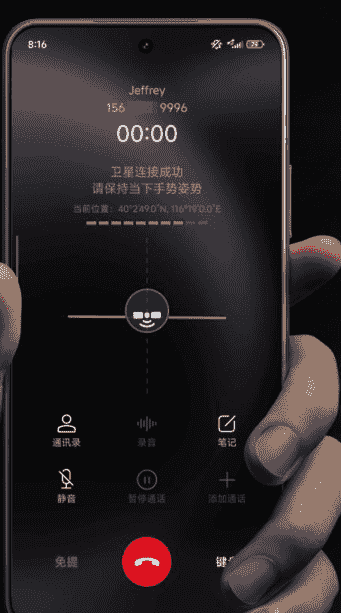

Xiaomi 15 Ultra

## 双卫星版
北斗卫星通信（中国移动）
卫星通信（中国电信）
卫星通信（中国移动）- Wait, the text says:
- 北斗卫星通信 (中国移动)
- 卫星通信 (中国电信)
- 卫星通信 (中国移动 - implied)

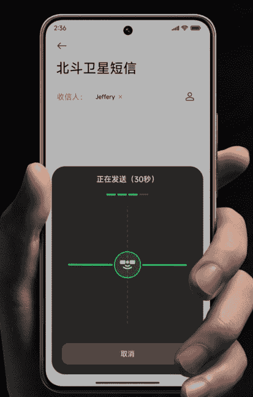

## 7km 挑战行业最远无网能力
半径 7km 内，完全无网也能至 7 层楼信号

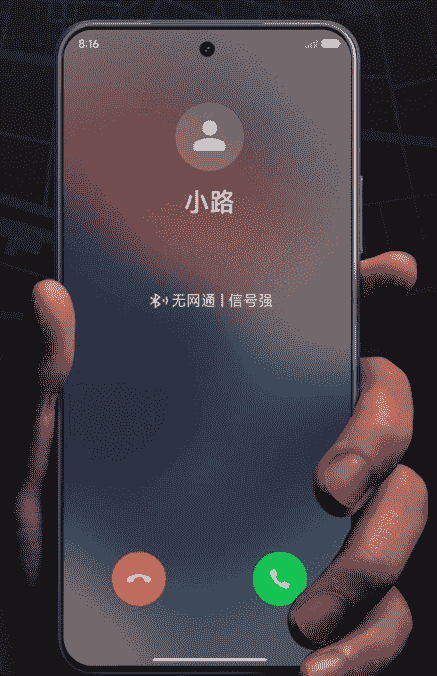

Xiaomi 15 Ultra

## 承袭徕卡光学
打造极致小型化品质
实现“端到端”光学高保真
开启移动影像百年

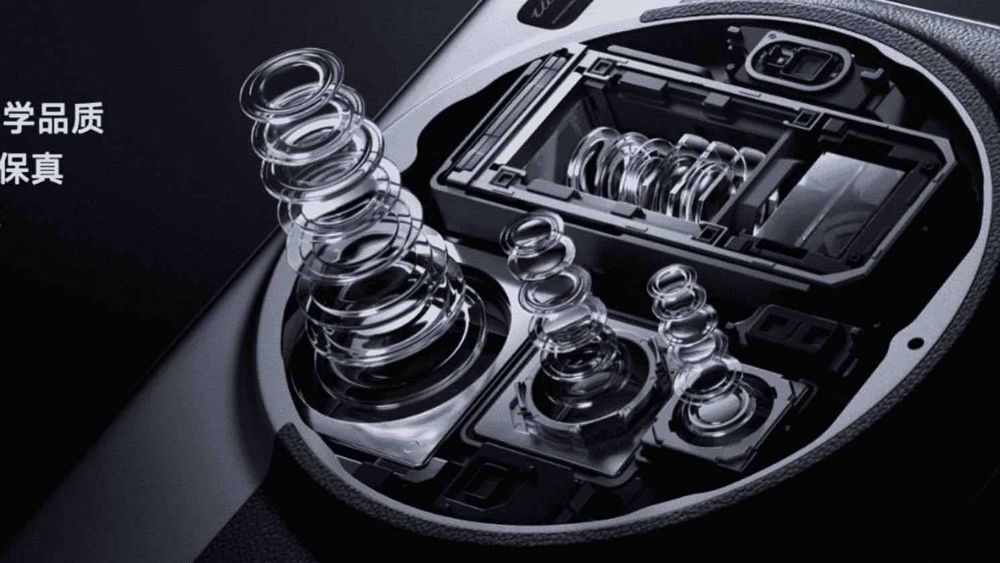

## 徕卡超纯光学系统
UltraPure

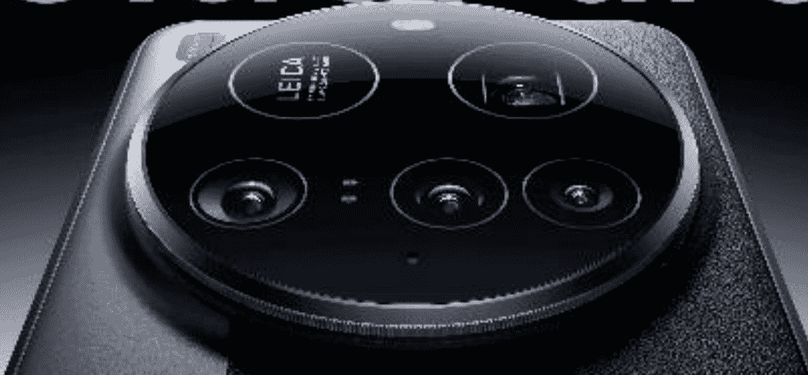

新一代 1" 主摄
新一代 2亿超长焦

## 移动影像的「全画幅」
一英寸大底
3.2µm 超像素 | Octa-PD
22nm 先进制程 | 14EV 电影级动态范围

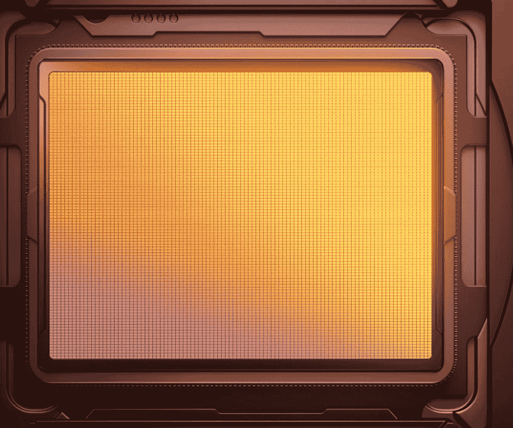

## 主摄级超大底
主摄：1/1.3"
超长焦：1/1.4"
超长焦：1/3.06"

Xiaomi 15 Ultra
iPhone 16 Pro Max

## Xiaomi AISP 2.0
Portrait LM 2.0
第二代小米人像大模型平台
大师人像再升级

Xiaomi 15 Ultra
iPhone 16 Pro Max
画质更清晰

Xiaomi 15 Ultra
iPhone 16 Pro Max
肤色更自然 光影更立体

作品《火壶》
大年初一四川逛街，作者邀家人一起逛公园，拍到了正好遇上的火壶表演。

## 笑姐
喜欢拍照的徕卡像素阿姨
2024年小米徕卡影像大赛 单围购买获得者

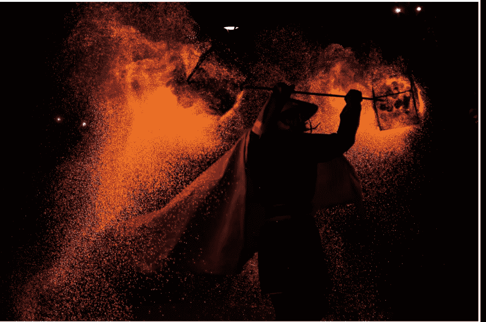

作品《爷爷龙凤》
作者在夜晚的时候遇到了长得像爷爷、奶奶，搂着一对龙凤，觉得恰巧的，马上拿起手机拍了下来。

## 笑姐
2024年小米徕卡影像大赛单项获得者

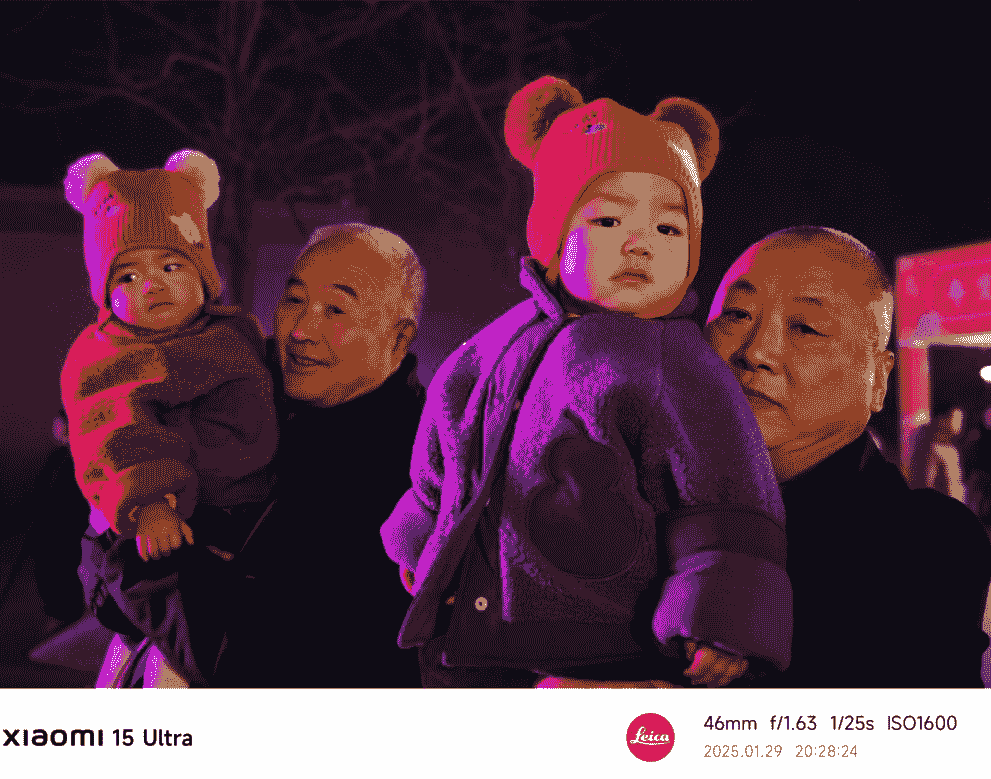

作品《奶奶的阳台》
奶奶就在阳台放了椅子，之前爷爷坐在那里晒太阳，爷爷之后，奶奶坐在那里。我对阳台有一种特别的情绪，每次走到门口，望进去就能看到这个角落，奶奶坐在那里，就会有一种真实感。

产品经理
2024年小米徕卡经典获奖者

## 奥斯卡奖颁机构「美国学院」
打造电影级专业系统
提供高质量色彩处理，确保不同设备平台保持一致。DaVinci Resolve、Adobe Premiere 等主流后期软件。

Xiaomi 15 Ultra
## 专业影像
徕金灰

## 自定义拨轮
快速调节相机、视频、ISO、白平衡等默认设置

## 滤镜
自定义功能，为创作更多可能性

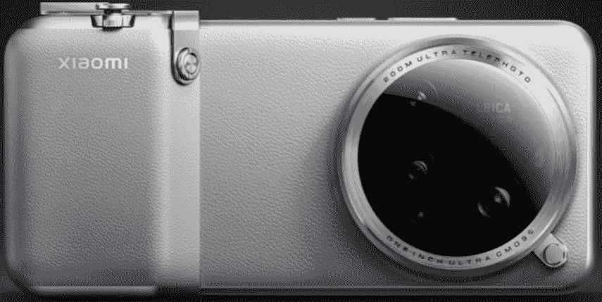

## 全面对标苹果
产品对标，体验全面超越
服务对标，更便捷更安心
生态兼容，设备无缝互联

Xiaomi 15 Ultra

## 无需预约售后维修更方便

## 疾速维修
99% 三天完成维修

## MiCare
2 年多次意外修
1V1专属客服，一站式解决
会员每月一次免费贴膜
95% 当天完修，99% 三天维修
专属高端徕卡、保 IP68 服务
2 年多次意外修+1 年延保
涵盖屏幕、后置摄像头、电池盖

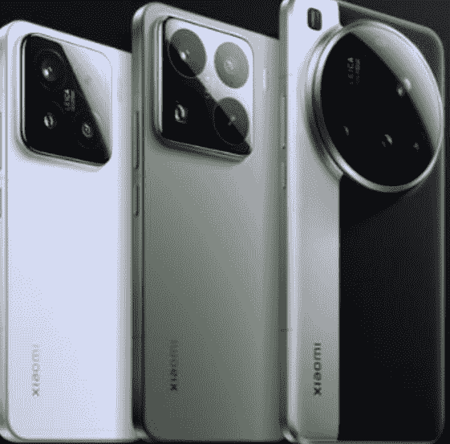

## 超级文档
支持 100+ 文件格式

## 妙享桌面 2.0
跨生态镜像控制

## 妙享桌面 2.0
支持文件拖拽互传

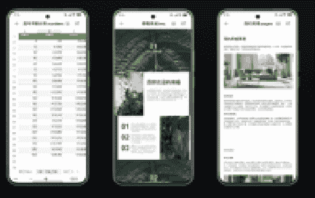
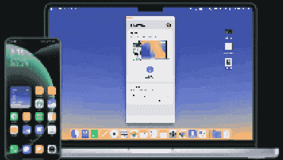
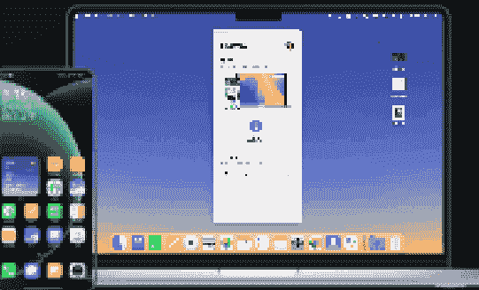

## 焕新极简相机
胶片质感瞬间
极简桌面化
专业模式纯净取景
视频快速剪辑

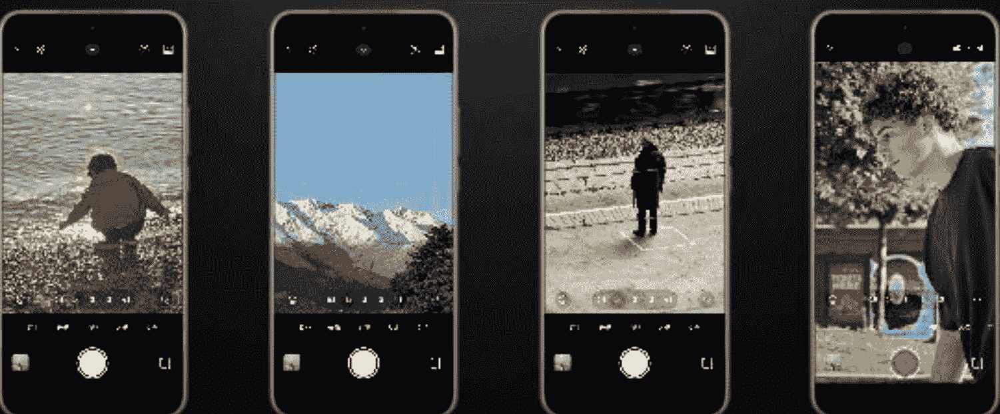

## 焕新极简相机发版计划

### 第一批升级机型
5月中旬-6月中旬灰度推送
- Xiaomi 15 系列
- Xiaomi 14 系列
- Xiaomi MIX Fold 4
- Xiaomi MIX Flip
- REDMI K80 系列
- REDMI K70 系列
- REDMI Note 14 系列
- REDMI Turbo 4

### 第二批升级机型
6月中旬-7月下旬灰度推送
- Xiaomi 13 系列
- Xiaomi 12S 系列
- Xiaomi MIX Fold 3
- Xiaomi Civi 4 Pro
- REDMI K60 系列
- REDMI Note 13 系列
- REDMI Turbo 3

## 首批全系搭载

## 英特尔®第2代酷睿™Ultra处理器

## AIPC 年度旗舰 CPU

- 升级 3D 性能架构，多核性能 +29.5%
- 全新 Intel® Arc™ 核显 XMX AI 引擎，平台 AI 能力 +150%
- 全新 3nm CPU 工艺制程，平台效 +21%

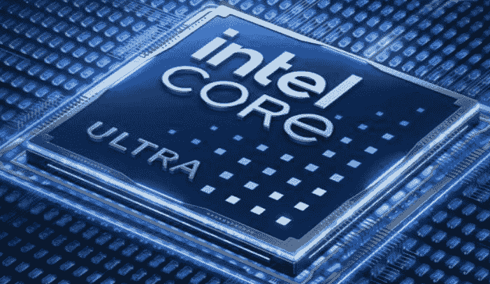

## 领先 AI 算力

## 96 TOPS

## 本地运行 80 亿参数大模型性能提升 204%

REDMI Book Pro 16 2025
REDMI Book Pro 16 2024

## 本地文生图性能 提升 124%

REDMI Book Pro 16 2025
REDMI Book Pro 16 2024

## 8400MT/s LPDDR5X 超高旗舰内存

- 写入速度 +16.9%
- 读取速度 +13.8%

## 双风扇 三热管 大面积 跃新材质

- 整机散热系数 +34%
- 超薄散热鳍片面积 +13%
- 亚金属鳍导热系数 +63%

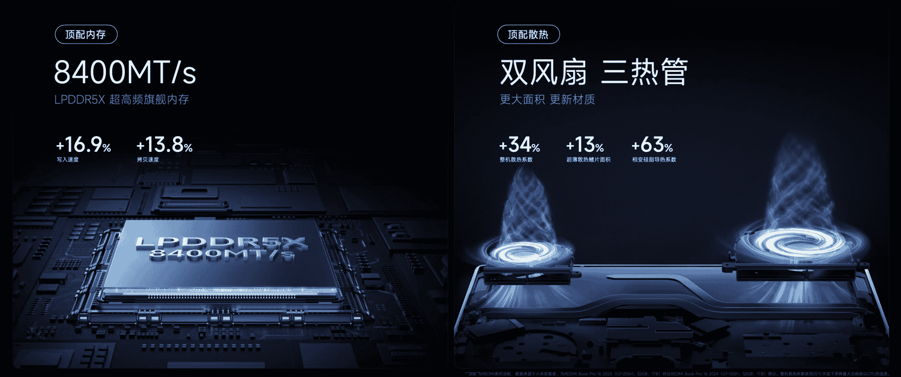

## 专业创作实力 3A大作高帧畅玩

《达芬奇》12.4GB ProRes 视频渲染输出
- 23 秒（REDMI Book Pro 16 2025）
- 29 秒（REDMI Book Pro 16 2024）

《黑神话：悟空》Benchmark 测试
- 72 FPS（REDMI Book Pro 16 2025）
- 65 FPS（REDMI Book Pro 16 2024）

## 同档更强续航

## 99Wh 民航可携带最大电池容量

| 机型 | 电池 | 充电 |
| :--- | :--- | :--- |
| REDMI Book Pro 16 2025 | 99Wh | +140W GaN |
| 友商 Pro 16 GT 2025 | 84Wh | +100W GaN |
| 友商 Book 16+ 2024 | 85Wh | +140W |

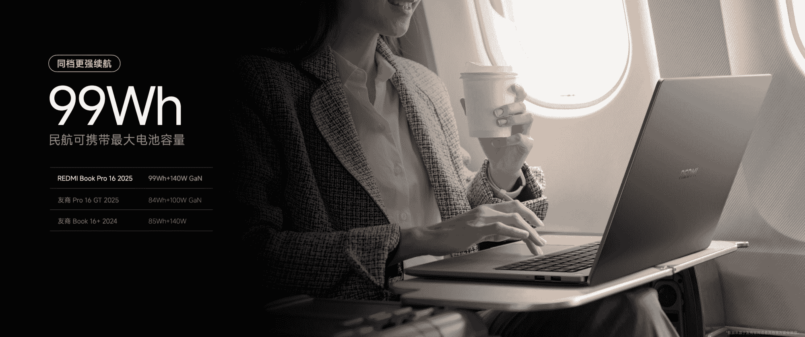

## 同格更强护眼屏

## 16”LCD 专业护眼大屏

- 3.1K 分辨率
- 165Hz 超高刷新率
- 小米青山护眼
- 500nits 全域亮度
- 多屏同色 色彩色准度 ΔE < 1
- DC调光
- S++ 通过莱茵认证 护眼效果良好
- 100% P3 色域
- Dolby VISION
- 硬件级低蓝光 硬件 TUVIA 认证
- 无频闪 硬件 TUVIA 认证

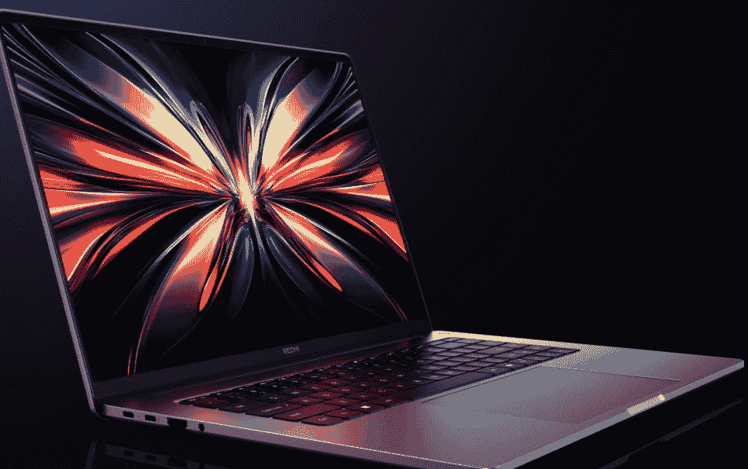

## 15.9mm

- 友商 Pro 16 GT 2025 15.9mm
- 友商 Book 16+ 2024 16.9mm
- 友商 Book Pro 16 2024 17.9mm

## AI 全景生态系统与应用

## 首次搭载 小米 AIPC 引擎

集团 AI 实力与先进生态赋能，带来专业 AIPC 办公体验。

- 小米 AIPC 引擎（小米澎湃 AI、云端大模型）
- AI 硬件调优（Xiaomi HyperAI）
- Xiaomi HyperConnect
- AI 调度 / AI 感知 / AI 办公 / AI 创作
- AI 跨端智联 / 全新性能模式 / AI 屏幕亮度调节
- AI 文档处理 / AI 截图 / AI 文生图 / 澎湃智联
- AI 隐私加密 / Windows + 第2代酷睿底层 AI 算力
- 硬件调优 / AI 辅助办公
- AI 视频搜索快速亮定位 

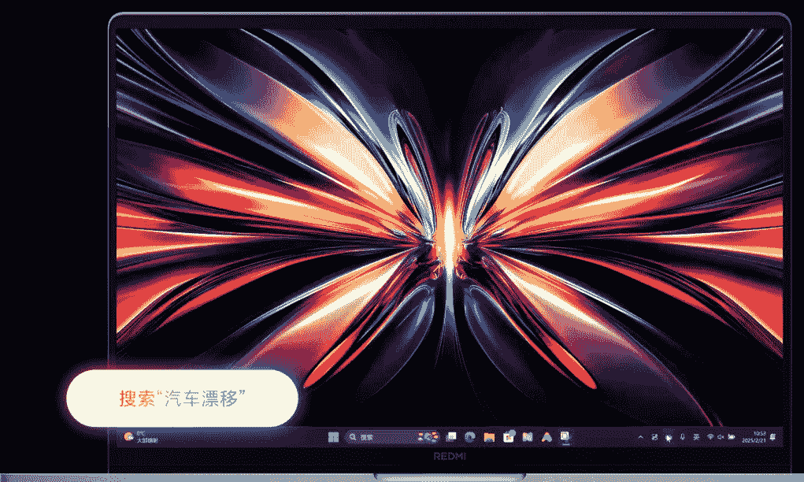
根据2023年3月下旬发布的手机，实际效果为准。

## AI 算力调度新增自研侧模型

## AI 视频搜索 AI 文档处理分秒级

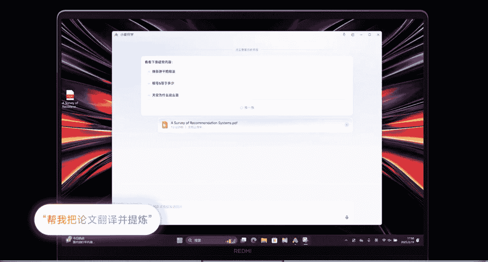

## AI 算力调度新增自研侧模型

## AI 视频搜索 AI 文档处理AI助手智能办公多问多答

## 硬件调优 AI 算力调度新增自研侧模型

## AI 视频搜索 AI 文档处理AI辅助智能办公互协同

## 小米首发跨苹果生态互传支持 MacBook, iPad

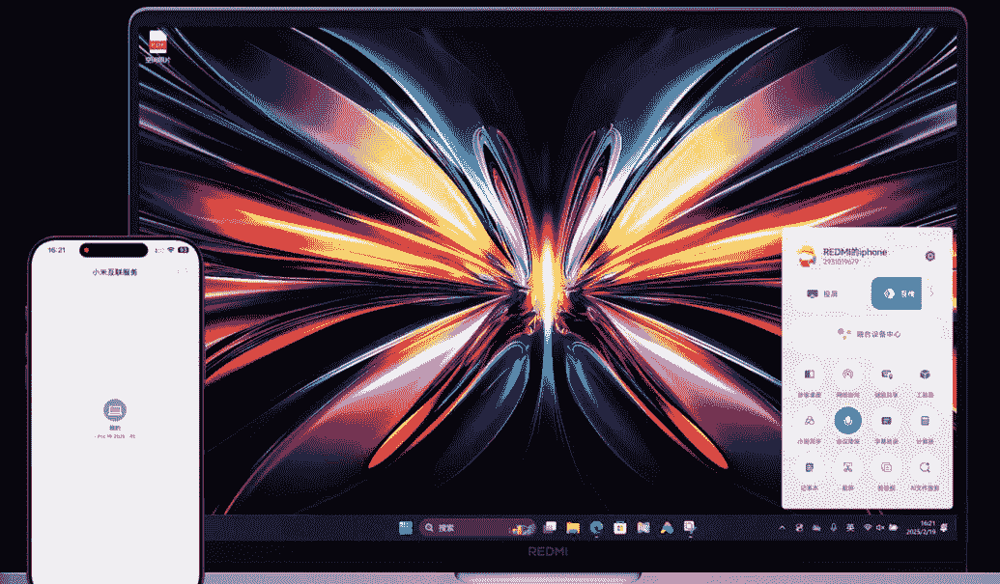

## REDMI Book Pro 14 2025 专业办公高效

- 70W 性能释放
- 第2代酷睿处理器 / LPDDR5X 8400MT/s 内存
- 风扇散热高效
- 3A大作高帧运行

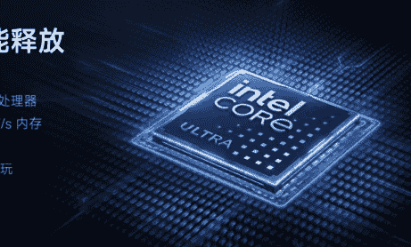

## 轻薄长续航

- 80Wh 超大电池 / 100W 超快充电
- 13h超长续航释放
- 约15.9mm，约1.45kg

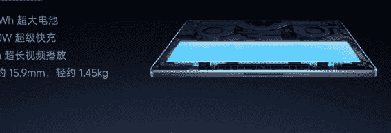
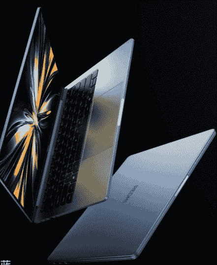

## 超清LCD护屏

- 2.8K | 120Hz | 500nits
- 100% sRGB 色域 | 全域DC调
- 杜比视界 | HDR 400 小米青山护

## 领先 AIPC 体验

- AI 算力调优 / 全新性能模式
- AI 文生 / AI 屏幕亮度调节 / AI 文档处理
- AI截图直达苹果设备互传

Xiaomi HyperOS Connect 晴空蓝

## REDMI Book Pro 16 2025 现已正式开售

- ¥5199 国标起售价，优惠到手价 ¥4699（Ultra5-225H / 32GB / 1TB）
- ¥5999 国标起售价，优惠到手价 ¥5499（Ultra7-255H / 32GB / 1TB）
* Ultra5-225H / 32GB / 1TB 优惠起售价为¥4699，Ultra7-255H / 32GB / 1TB 优惠起售价为¥5499

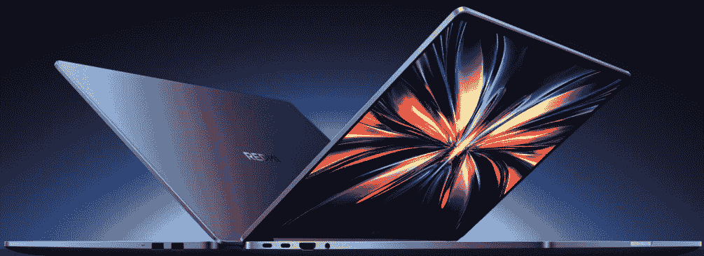

## REDMI Book Pro 14 2025 现已正式开售

| 配置 | 优惠起价 | 优惠到手价 |
| :--- | :--- | :--- |
| Ultra5-225H / 16GB / 1TB | ¥5699 | ¥4559 |
| Ultra5-225H / 32GB / 1TB | ¥5999 | ¥4799 |
| Ultra7-255H / 32GB / 1TB | ¥6999 | ¥5599 |

* Ultra5-225H / 16GB / 1TB 优惠到手价为¥4599，Ultra5-225H / 32GB / 1TB 优惠到手价为¥5999，Ultra7-255H / 32GB / 1TB 优惠到手价为¥6999。

雪白 钛光

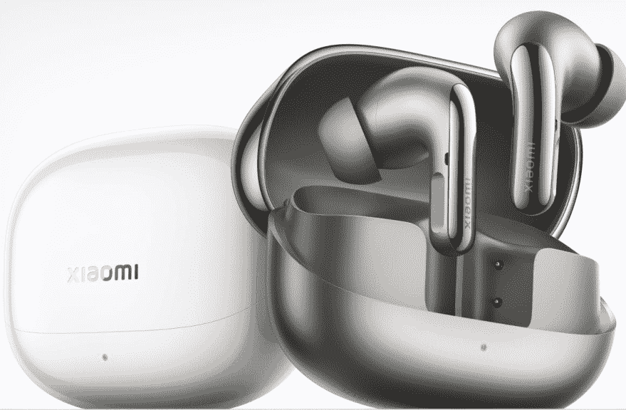

## 小米首发 双功放单单元声学系统

- 高音清晰透亮，中音真实，低音深沉
- Xiaomi Buds 5 Pro / AirPods Pro 2 / 友商Enco X3 / FreeBuds 4
- 三单元 / 单单元 / 双单元 / 双 DAC / 平面膜 / 11mm 双磁圈单元/压电陶瓷

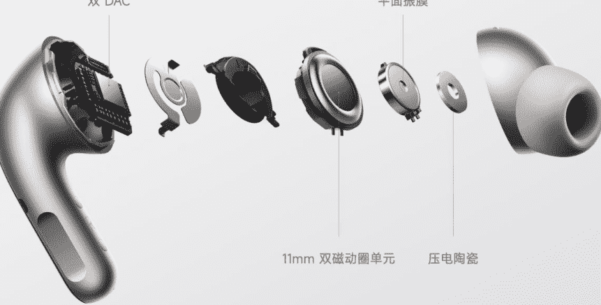

## 同轴三单元设计大幅减少声音失真

- 三单元线性振动，确保听感纯净
- 平面膜 11mm 双磁圈单元/压电陶瓷

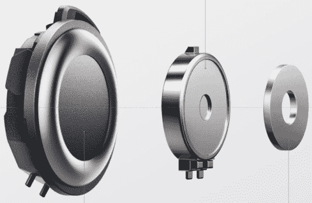

## 全链路无损音频 高通aptX Lossless编码

- 48kHz/24bit 高品质音乐
- 哈曼联合调音，耳朵大师团队新增“哈曼大师”音效
- Xiaomi Buds 5 Pro 2.1Mbps 最高传输速度
- 7.2Mbps 最高传输速度对比 AirPods Pro 2

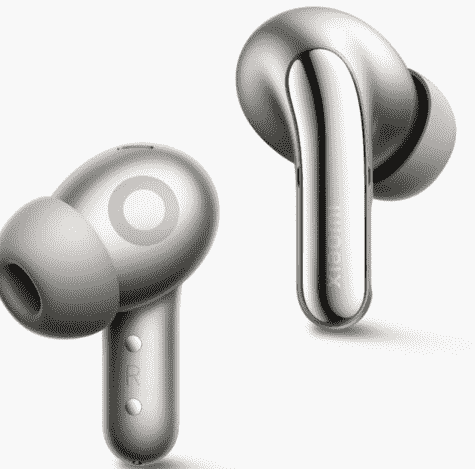
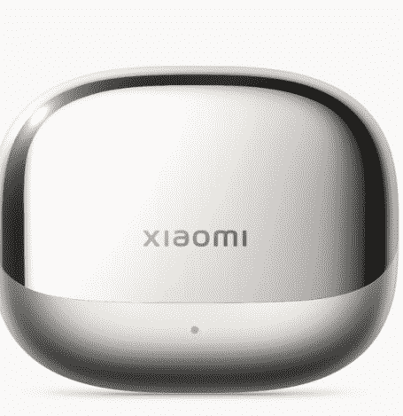
HARMAN AudioEFX (此处OCR可能有误，应为HARMAN AudioEFX 中国计量科学研究院认证

## 小米最强超宽频深度降噪

- 无级调节、多场景守护听觉
- 55dB 降噪深度
- 5kHz 超宽频覆盖

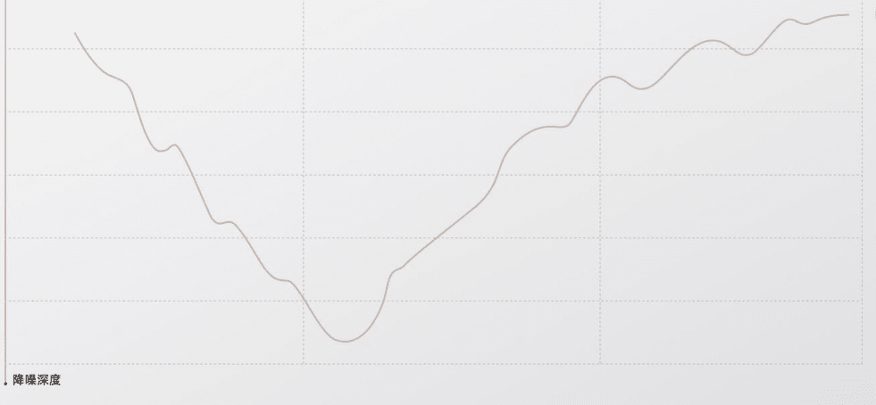
* 数据源于小米实验室，由于环境不同，测试方法可能因设备而异，实物仅供参考。

## AI 智能应用

### 独立录音 2.0 盖录音 | 实时录音转写 | 智能摘要

### 面对面翻译
双向翻译，沟通无碍

### 同声传译
跨国会议、学术讲座，轻松畅听

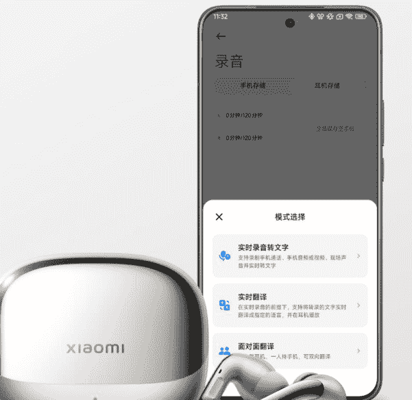

## 母带级无损音质 96kHz/24bit 超高品质无损音乐

- 4.2Mbps 最高传输速率（Xiaomi Buds 5 Pro Wi-Fi）
- 2.1Mbps 超高清无损音质
- Enco X3：1.4Mbps CD级无损音质
- AirPods Pro 2：1Mbps 高清音质 / 320Kbps 标准音质

## 首款小米蓝牙耳机 体积不变，续航更强

- 21% 电池容量提升
- 10小时耳机超长续航

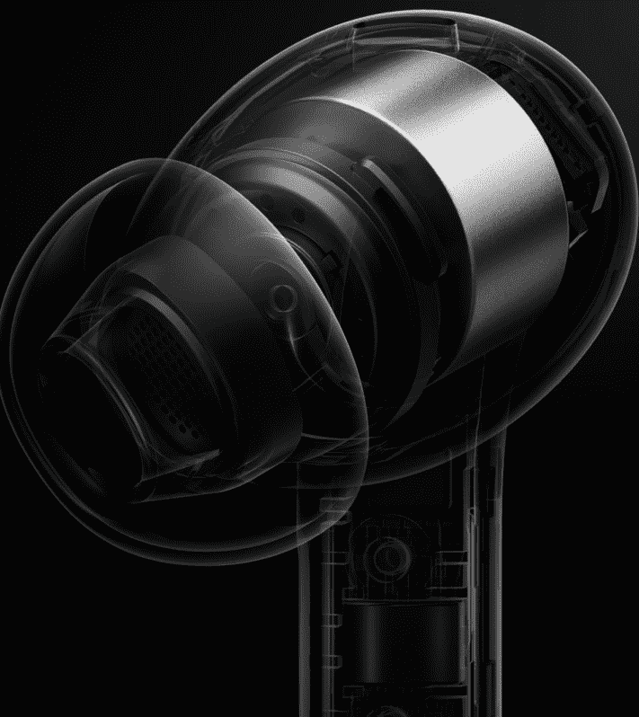

## Xiaomi Buds 5 Pro (Wi-Fi版)

- ¥1299建议零售价
- 小米首发双功放蓝牙单单元声学系统
- 小米最强55dB 超宽频降噪
- 独立录音2.0 / 实时录音转写 / 智能摘要 / 智能盖录音
- 高通aptX Lossless 全链路无损音频 / 2.1Mbps 最高传输速率
- 100dB环境超清通话
- 面对面翻译 / 同声传译 / 蓝牙无阻自在聆听
- 哈曼联合调音耳朵大师团队
- 独立空间音频，球形声场环境
- 8h/40h 长续航
- 旗舰龙S7 Gen芯片平台 / 高清音频认证
- Xiaomi HyperOS 小澎湃 / 苹果生态友好
- IP54 雪白 钛金

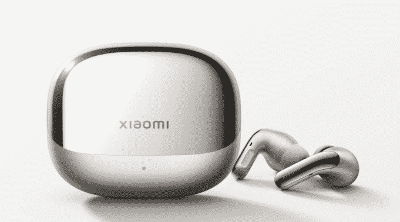
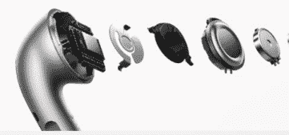
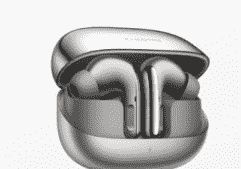

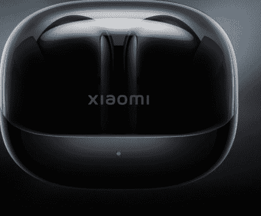

## Xiaomi Buds 5 Pro 哈曼联合调音

- ¥1499建议售价
- 小米首发双功放单单元声学系统（此处误）
- 小米最强55dB超宽频深度降噪
- 5kHz超宽频覆盖
- 全链路无损音频 4.2Mbps最高传输速度
- Hi-Res Audio 蓝牙解码
- 苹果生态友好 Apple Music 无损

## MiCare 意外保障

- 价值353元免费送
- 2年意外保障
- 1年延保（在标准保修基础上延长1年保修）
- 2年丢失无忧（可享一次5折购买原装耳机）
- 3月14日前在小米App激活，等待7日后再次生效

## 超级小爱「远程备车」

- 一句话状态查询、出行准备
- 空调、车窗、方向盘、座椅、闪灯、哨兵模式
- 中控锁、前备箱、后备箱、续航、车内温度

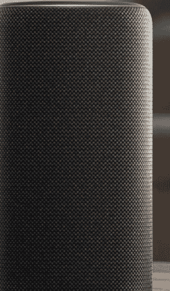

## Xiaomi 智能音箱 Pro 新代「超级小爱」智能音箱

- ¥299优惠起价（¥254国补手价）
- ¥399 优惠起价

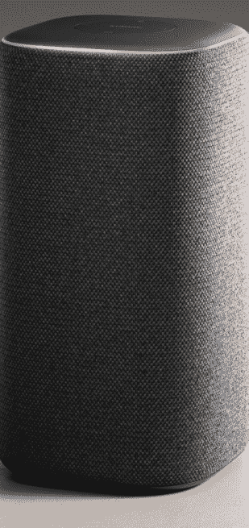
*优惠手价时间为2025-02-27 20:00:00至2025-03-27 23:59:59。

## 双变频除湿技术

- 除湿高效、低温不结露、超低功耗更省电
- 双重配合、噪音超低
- 直流变频电机
- 专利 C 型风扇设计（热交换器）
- 双转子变频压缩机

*专利热交换器：中国新型专利，专利号：ZL 20201056549A
*低温不结露：除湿模式下，环境温度低于10℃时，效果受影响，DC不适用。产品参数仅供参考，详以说明书为准。

## 米家智能变频除湿机 30L

- 双变频除湿技术
- 四种操控模式（支持小米智联）
- 直流变频电机 / 专利 C 型风扇设计（热交换器）
- 双转子变频压缩机
- 科技美学设计 / 30L落地大量
- 52%除湿提升 / 38%静音 / 77%全天省电
- 每天可直饮水

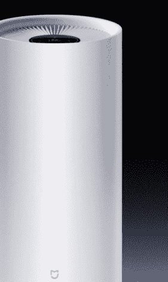
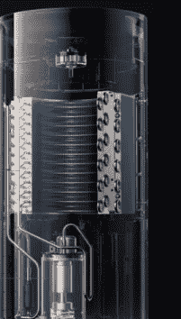

## 米家智能变频除湿机 30L

- ¥1999优惠起价（¥1699优惠到手价）
- 10分钟还原干爽
- 噪音低至30.4dB

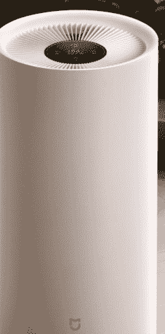

## 冷藏、冷冻2套制冷系统

- 双独立蒸发器，双循环风道，保鲜更持久
- 0串味（物理杜绝）
- <1°C精准控温
- -30°C深冷瞬冻

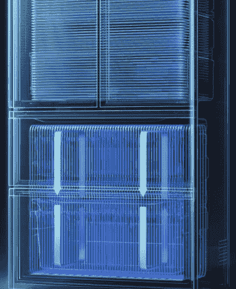

## 抽屉最大行程 40cm

- 丝滑抽拉，全开倒扇不费力，大件随意开启
- 三段式滑轨，缓冲顾稳定设计，重物大件拿取稳
- 50kg 超承重，精密滑轨，30mm 超薄设计，可持久 3 年承载，2 倍抽拉

## 米家冰箱 Pro
## 双系统 法式平嵌508L
¥4499 ¥3599

## 米家洗衣机 Pro 蓝氧洗
## 蓝氧护衣洗
电解水产生多种活性分子
利用氧化还原源细菌、钙离子类污渍

### 3D冷水洗
少色彩，不易变色

### 低温除菌
健康更护衣

### 精华速洗
耗时45% | 节水 33% | 节电 40%

### 双路智能投放
一键投放能用一个月

### 清除特殊污渍
### 白衣久洗不易发黄
### 降低串色风险
### 高温蒸汽除菌
99.999%* 99.999%* 100% 除菌 | 除螨

### 无残留护理
祛渍火锅味、异味

## 581mm 大筒径
双动力热泵混动系统
大件烘干的透
压缩机、冷凝器、蒸发器，辅助 PTC 加热模块
双动力高效干干，一次可烘干 3 套床上四件套

## 省时、省电、省心

### 3G 精判脱水
衣物含水量下降 10%

### 预热烘干
衣物烘干时间减少 10%

### 一键清洗烘
自动匹配优烘干模式

## 洗烘时间减少46分钟

## 米家洗烘套装Pro
10kg+10kg
蓝氧洗 热泵烘
¥6499 优享手价
¥5199 国补制手价低 优享手价 ¥6499

## 中央空调
## 空调品类的制高点

## 技术密度高
高精度中控系统、复杂管路设计
复杂环境气流组织合理
温湿度、过滤、净化等复合空气管理

## 品控等级严苛
制冷热效能、大空间制冷热能力
大功率压缩机效率
超长使用期的可靠性

## 服务安装复杂
前装勘测、合理选型
多次超长安装流程
维修与保养

## 米家空调最强
补气增焓双缸压缩机

## 米家空调最强
三排蒸发器

## 米家空调最强
三排冷凝器

## 米家空调最强
6匹 APF 5.0
超一级能效
比国家一级能效高15%
省电约28%

## 米家空调最强
智能感送风
根据家庭用户习惯定制风

## 行业创新智能选型
3D 模拟全屋风
选型更方便
内置2800款户型，一键上传选型
精准气流组织，快速推荐方案

## 覆盖各类户型，按需选择

## 一站式上门安装，全流程专业省心
## 全流程保障
标准化安装 | 精准视觉识别 | 智能调试

## 15项服务全包
免人工安装 | 免上门检测 | 免调试费 | 免设备费等

## VIP 服务群
售后严谨 | 售后主管 | 技术专家监理 | 2小时服务群

全承诺：免人工费、免上门费、免材料费、免加急费（如需咨询热线：400-888-8888）。专业技术支持、质量保障、延保服务、售后响应，为您解决空调安装后顾忧。“服务标准”：报价、承诺、上门调试、材料、工费、质量、服务等。“2小时服务”工作时间周一至周六 9:00-18:00（节假日除外），如无法联系请联系在线客服。

## 米家中央空调Pro
国补到手价
| 配置 | 价格 |
| --- | --- |
| 九台内机 | ¥27999 |
| 六台内机 | ¥22999 |
| 五台内机 | ¥17999 |
| 三台内机 | ¥55999.2 |
| 七台内机 | ¥24999 |
| 六台内机 | ¥19999 |
| 四台内机 | ¥15999 |
| 八台内机 | ¥39999.2 |

选配：3D 出风面板免费送（¥999每台，3月27日至3月29日限24小时）
健康滤网：¥399只

## 小米大家电持续大规模投入

## 2024年累计交付量超过248,000 台
累计交付超过135,000 台

## “年度之车”
2024年中国安全认证（车内乘客、车外行人安全4项G+）
2024年中国十佳奖（结构、交互、安全）
2024年中国十佳奖（耐久性测试）
小米SU7 Max是过程中故障最少、故障最微、甚至目前为止最好之一

## 充电网络
接入102万根公用桩，覆盖365个城市，覆盖88.1%高速服务

## XIAOMI SU7 Ultra
## XIAOMI SU7 Ultra
下一站见赛道级电池

## XIAOMI SU7 Ultra
自信驾驭强大52.99万元

## 少量现车
2月28日10:00支付40000元定金支付即锁单
小订用户今晚22:00优先购买

## SU7车主增换购
送50000积分价值5000元

## 限时改配
今晚22点 - 3月24日24点前SU7锁单用户可限改配SU7 Ultra

## XIAOMI SU7 Ultra
是“心有猛虎、细嗅蔷薇”的强大且优雅，是充满自信、开天辟地的实力与成就。

## XIAOMI SU7 Ultra
过去的已经过去，今天的才是今天。一个全新的时代已经开启。
xiaOMI SU7 Ultra

## 扫码加入知识星球免费资源群
公众号: 知识星球
免费
- 每日免费获取高价值资源
- 可提供各类搜索服务

| 热门付费文章 | 各行各业报告 |
| 精选图书资源 | 副业赚钱方法 |
| 职场实用资源 | AI政经自媒体 |

微信号: jntsg8 / jntsg2

专注
分享资料仅供个人学习，请及时删除，切勿商用传播
