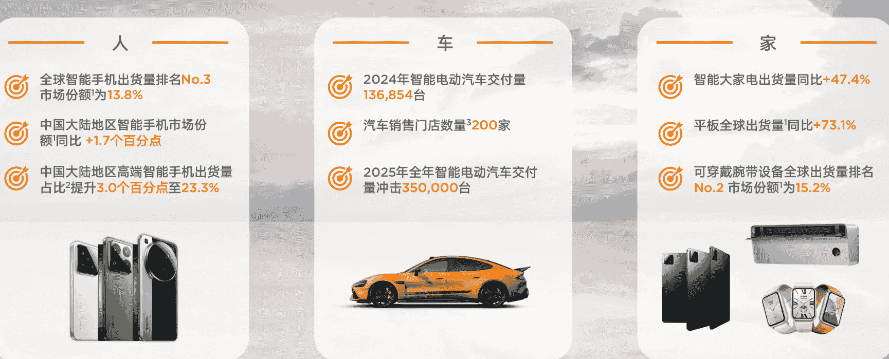
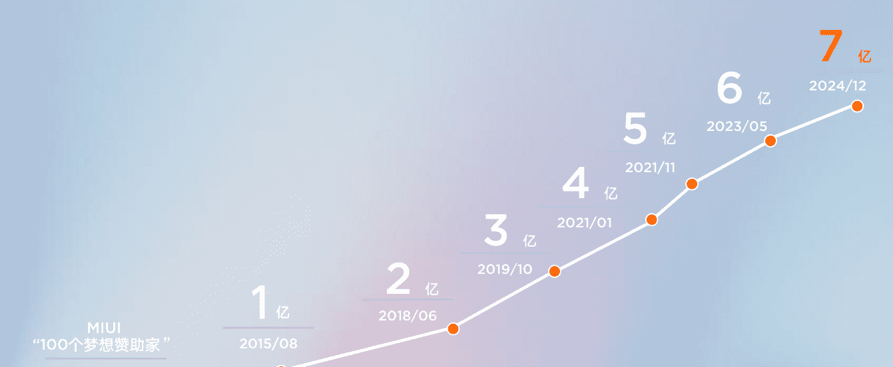
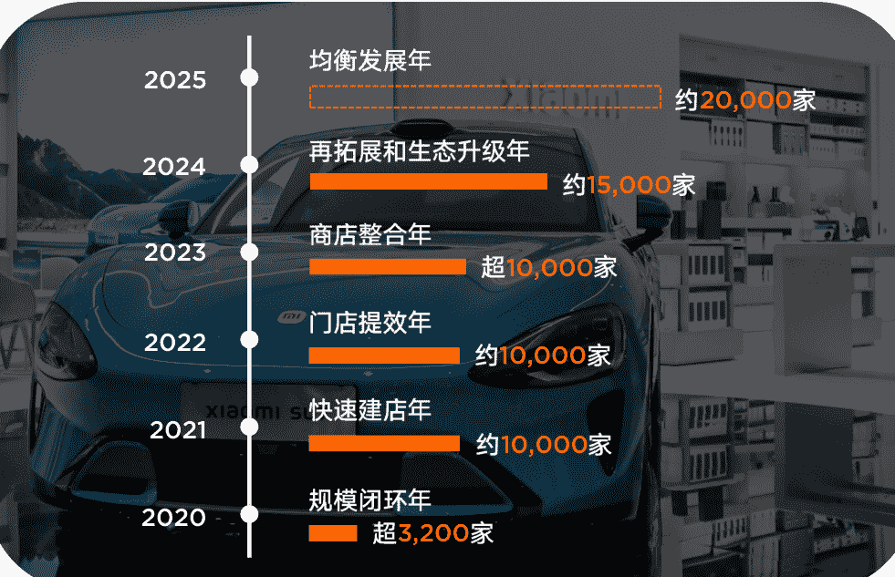
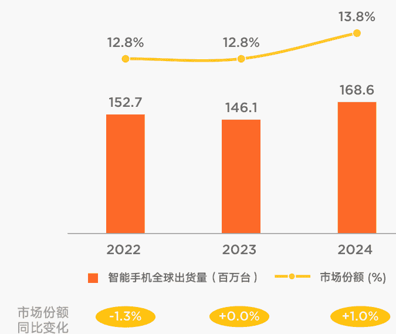
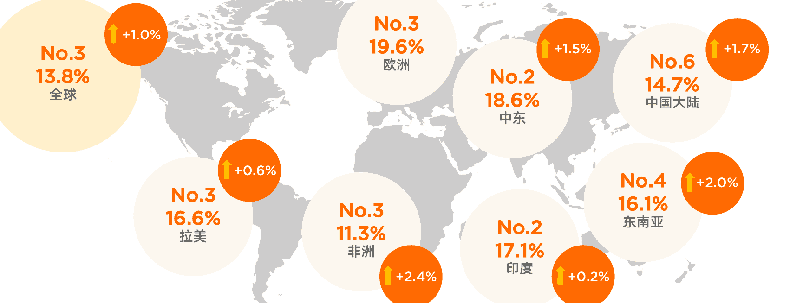
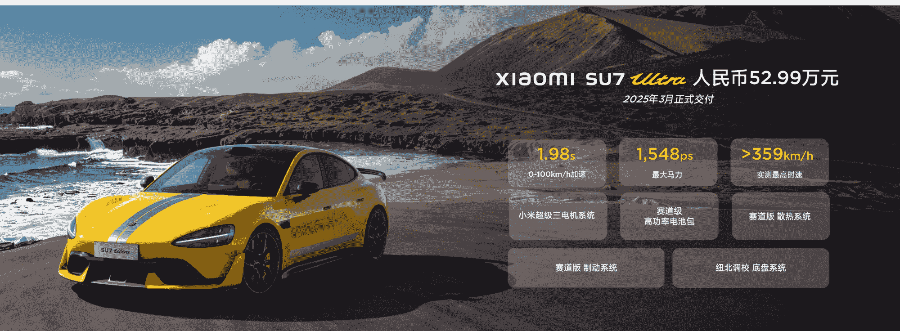
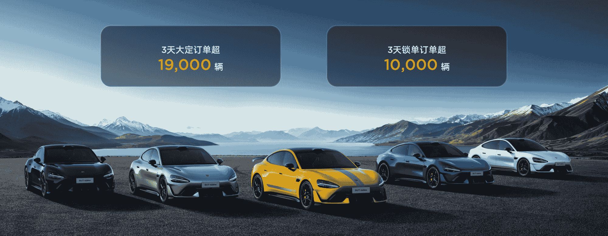
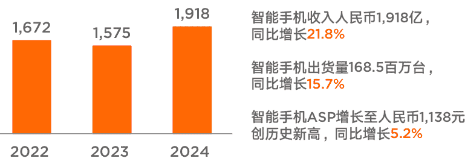
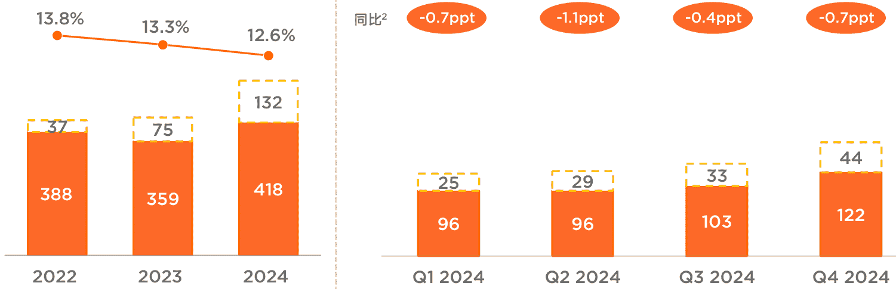
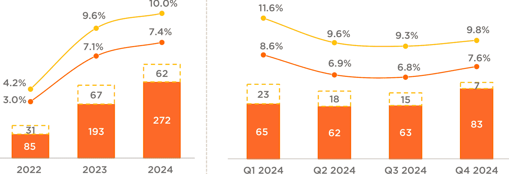

# 小米集团

2024年第四季度和全年业绩

# 扫码加入 知识星球TOP 免费资源群

公众号:知识星球TOP

免费

- 每日免费获取高价值资源
- 可提供各类资源搜索服务

微信:jntsg8

价值

| 热门付费文章 | 各行各业报告 |
| --- | --- |
| 精选图书资源 | 副业赚钱方法 |
| 职场实用资源 | AI搜索工具 |

微信:jntsg8

专注 资料仅供个人学习，请勿删除。通过阅读本演示，阁下视为已阅读并同意以下限制，不要传播。

# 重要提示

通过阅读本演示，阁下视为已阅读并同意以下限制：
本演示中的任何部分由小米公司（“公司”）与其子公司合称（“集团”）为有关融资提供但不构成任何合同或承诺或投资依据。任何人对本演示包含的任何意见的客观性、完整性、准确性或正确性作出保证。公司或集团的任何人士、关联方或顾问均应对本演示包含的任何信息引发的损失承担责任。本演示截至其发行日有效，阁下应当关注后续对本演示的任何修改、修订。本次演示中的信息包括一些前瞻性的陈述。这些陈述通常使用“将”、“计划”、“预期”等词汇来描述。前瞻性陈述具有风险和不确定性，其涉及事项在未来发生取决于多种因素。阁下应依赖这些前瞻性陈述来预测或避免未来的结果。本演示及其内容不符合任何证券要约的注册，未根据美国1933年《证券法》或其他相关证券法律进行注册，亦未符合上述法律的豁免条款。本演示及其包含的信息不被直接或间接带入美国、加拿大、日本、香港、中华人民共和国以外的其他法律管辖地区发行，但符合证券法律的行为可能构成对美国或其它法律的违反。任何购买、出售、认购或转让任何未符合上述要求的证券，对本演示包含的回应不负责。通过阅读本演示，阁下及阁下代表的任何人士符合（美国1933年《证券法》第144A条定义的“合格买方”，或在境外并非美国人士（如美国《证券法》第5类规则502条定义的“合格买方”；根据（香港证券条例第57章）及该等条例下未规定阁下为界定的专业投资者。

## 2024年整体财务亮点

## 总收入
人民币3,659亿对比+35.0%

## 利润
- 手机 x IoT: 21.2%
- 智能手机: 12.6%
- IoT与生活消费产品: 20.3%
- 互联网服务: 76.6%
- 智能电动汽车等创新业务: 18.5%

智能电动汽车等创新业务：人民币328亿，毛利率20.9%

互联网服务：人民币341亿

IoT与生活消费产品：人民币1,041亿

智能手机：人民币1,918亿

调整后净利润：人民币272亿对比+41.3%

手机 x IoT：人民币3,332亿

- 智能电动汽车等创新业务调整净亏损：人民币62亿

1 包含智能手机、IoT与生活消费产品、互联网服务以及其他相关业务
2 调整后净利润加回调整期间的摊销或费用,(i)以股权为基础的薪酬,(ii)投资性价值变动净值,(iii)购买所得无形资产费用,(iv)投资者的负债价值变动,及(v)非国际报告准则调整对所得税的影响
3 不含智能电动汽车等创新业务的股权薪酬费用9亿元和其他一次性收益

# 人车家生态战略引领2024年各项业务实现优异表现

- 全球智能手机出货量排名No.3市场份额为13.8%
- 中国大陆地区智能手机市场份额同比+1.7百分点
- 中国大陆地区高端手机出货量占比提升3.0个百分点至23.3%
- 2024年智能电动汽车交付量16,854台
- 汽车门店数量320家
- 2025年智能电动汽车交付冲击350,000台
- 出货量同比+47.4%
- 平板出货量同比+73.1%
- 可穿戴设备全球出货量排名No.2份额为15.2%

1 根据Canys数据，按2024年出货量计算。可穿戴设备包括手环、小米和智能手表
2 根据第三方数据，按2024年销售量计算。中国大陆地区高端手机为零售价人民币3000元以上的型号
3 截至2024年12月

# 全球活跃用户数突破7亿

注：在2024年12月，包含智能手机和平板

# 2021年至2025年研发投入预计超1,000亿元

# 2024年研发成就CAGR:27.0%

| 年份 | 研发费用（亿元） |
| --- | --- |
| 2020 | 241 |
| 2021 | 191 |
| 2022 | 160 |
| 2023 | 132 |
| 2024 | 93 |
| 2025 | - |

# AI赋能

# OS x AI

# 信息化 x AI

- 手机:识别、跨应用
- 平板:写作、会议
- 智能手表:手势操作
- 车:智能驾驶、泊舱
- 家:智能搜索、空调
 智能音箱:AI大模型问答
- 产品研发:集成供应链、设计
- 销售和服务:新零售、智能客服、营销策略
- 集团运营:人力、财务、法务

- 小澎湃OS 2

超级小米AI核心技术：视觉模型、声学模型、多模态模型、机器学习、知识图谱、AI平台基建、AI框架基建

# 拓展门店

2025年计划拓展小米之家500+大店
均衡发展：约400家
再拓展和生态升级：约15,000家
商店整合：超10,000家
门店提升：约10,000家
快速建店：约10,000家
规模闭环：超3,200家
未来五年新增境外小米之家：约10,000家

注：中国大陆地区小米之家数量

# 智能手机

## 连续18个季度全球智能手机出货量前三

| 手机厂商 | 2024年出货量 (百万台) | 2024年市场份额 | 出货量同比变化 |
| --- | --- | --- | --- |
| 苹果 | 225.9 | 18.5% | -1.4% |
| 三星 | 222.9 | 18.2% | -1.1% |
| 小米 | 168.6 | 13.8% | 15.4% |
| 传音 | 106.7 | 8.7% | 15.3% |
| OPPO | 103.6 | 8.5% | 2.8% |
| 其他 | 395.6 | 32.3% | 13.7% |
| 总计 | 1,223.2 | 100.0% | 7.1% |

资料来源：根据Canalys数据，按出货量计算

## 全球所有主要市场保持领先地位

2024年智能手机出货量排名及市场份额
↑市场份额同比变化

- 全球：No.3 13.8% (+1.0%)
- 欧洲：No.3 19.6% (+1.5%)
- 中东：No.2 18.6%
- 中国大陆：No.6 14.7% (+1.7%)
- 拉美：No.3 16.6% (+0.6%)
- 非洲：No.3 11.3%
- 东南亚：No.4 16.1% (+2.0%)
- 印度：No.2 17.1% (+2.4%)

在全球56个市场名前三，在69个市场名前五

资料来源：根据Canys数据，按出货量计算

## 中国大陆地区市场份额连续4个季度增长

| 手机厂商 | 2024年出货量(百万台) | 2024年市场份额 | 出货量同比变化 |
| --- | --- | --- | --- |
| vivo | 49.3 | 17.3% | 10.8% |
| 华为 | 46.0 | 16.2% | 37.4% |
| 苹果 | 42.9 | 15.1% | -17.3% |
| OPPO | 42.7 | 15.0% | -2.7% |
| 荣耀 | 42.2 | 14.8% | -3.2% |
| 小米 | 41.9 | 14.7% | 17.8% |
| 其他 | 39.7 | 6.9% | 0.0% |
| 总计 | 284.6 | 100.0% | 4.5% |

## 中国大陆地区手机排名

| 月份 | 1 | 2 | 3 | 4 | 5 | 6 | 7 | 8 | 9 | 10 | 11 | 12 |
| --- | --- | --- | --- | --- | --- | --- | --- | --- | --- | --- | --- | --- |
| No.1 | | | | | | | | | | | | |
| No.2 | | | | | | | | | | | | |
| No.3 | | | | | | | | | | | | |
| No.4 | | | | | | | | | | | | |
| No.5 | | | | | | | | | | | | |

中国大陆地区销量（百万台）
市场份额 (%)

15.3% 15.9% 16.0% 16.8% 3.2% 3.9% 4.4% 5.0%

2024年9月
2024年10月
2024年11月
2024年12月
2025年1月

## 稳步推进手机高端化

中国大陆地区高端智能手机占整体手机销量比例
中国大陆地区高端智能手机份额

注：根据第三方数据，按中国大陆地区销售手机为零售价人民币3000元以上的机型

## Xiaomi 15 Ultra: 巅峰影像旗舰

2025年2月和3月相继在中国大陆和海外市场推出
徕卡一英寸主摄
徕卡超大光学系统
徕卡二亿长焦
第二代小米人像模型 Xiaomi AISP 2.0
电影级视频Xiaomi 15 Ultra摄影套装

# IoT与生活消费产品

## 全球领先的消费级AI平台

连接设备数¹百万
拥有5个及以上连接至小米AI平台的设备数¹百万

米家¹百万
小爱同学¹百万

¹不包括智能手机、平板和笔记本电脑

# 智能大家强劲增长的一年

2024年，空调出货量超680万台，同比增长50%+创历史新高
2024年，冰箱出货量超270万台，同比增长30%+创历史新高

米家中央空调Pro
零售价：最高30,999元 2025年2月在中国大陆陆续推出
全屋智能空气管理
超级能效¹
支持小米澎智联

2024年，洗衣机出货量超190万台，同比增长45%+创历史新高

## 小米 SU7 Ultra: 2025年2月正式发布

## Xiaomi SU7 Ultra 人民币52.99万元

2025年3月正式交付

| 1.98s | 1,548ps | >359km/h |
| :--- | :--- | :--- |
| 0-100km/h加速 | 爆发马力 | 实测最高速度 |
| 小米超级三电机系统 | 赛道版 | 赛道版 散热系统 |
| | 高功率电池包 | 赛道版 制动系统 |
| | 赛道调调 底盘系统 | | | |

## 小米 SU7 Ultra: 首销大超预期

- 3天大定订单超 19,000 辆
- 3天锁单订单超 10,000 辆

## 小米SU7预计2025年年中正式上市

# ESG

## 2024年ESG工作获得国内外机构认可

### ESG榜样企业

### EcoVadis 金牌评级

### 中国ESG榜样企业

2024年评分取得80分的历史最好成绩，位于全球前2%分位

中央广播电视总台举办《第二届“ESG榜样”盛典》，连续第二年蝉联金牌勋章

# 持续回社会

### 科技创新
小米创新联合基金累计资助超1.6亿元

### 人才培养
小米奖助学金项目已覆盖50所高校，累计资助1.2万高校学生
小米青年学者项目已覆盖30所高校，累计资助青年学者10799名

### 扶危济贫
已覆盖了全国26个省份，累计捐赠超过1.6亿元

# 财务亮点

## 2024年总收入创历史新高
单季度首次超千亿收入

| 收入（人民币亿元） | 2023 | 2024 | Q1 2024 | Q2 2024 | Q3 2024 | Q4 2024 |
| :--- | :--- | :--- | :--- | :--- | :--- | :--- |
| 智能手机 | 301 | 341 | | 64 | 97 | | 167 |
| 互联网服务 | 1,575 | 1,918 | | 825 | 828 | | 923 |
| 智能电动汽车等创新业务 | 801 | | 755 | | | | |

- 手机 x IoT™
- 智能电动汽车等创新业务

| 同比% | +27.0% | +32.0% | +30.5% | +48.8% |
| :--- | :--- | :--- | :--- | :--- |
| 同比% (不含汽车2) | +22.5% | +16.8% | +26.1% | |

¹包含智能手机、IoT与生活消费产品、互联网服务及其他相关业务
2 不含智能电动汽车等创新业务

## 2024年分业务收入构成

### 智能手机收入（人民币亿元）
### IoT与生活消费产品收入（人民币亿元）

智能手机收入918亿元，同比增长21.8%
智能手机出货量68.5万台，同比增长15.7%
智能手机ASP1138，创历史新，同比增长5.2%

IoT与生活消费收入1041亿元，创历史新，同比增长30.0%

互联网服务收入（人民币亿元）
智能电动汽车等业务收入（人民币亿元）

互联网服务收入83亿元，创历史新，同比增长13.3%
广告收入247亿元，同比增长20.5%
境外收入110亿元，占互联网服务收入的32.2%

智能电动汽车等业务收入328亿元

## 毛利率均历史新

### 整体毛利率（%）
### 手机毛利率（%）
### IoT与生活消费产品毛利率（%）
### 互联网服务毛利率（%）
### 智能电动汽车等业务毛利率（%）

| 毛利率 (%) | 2022 | 2023 | 2024 |
| :--- | :--- | :--- | :--- |
| 整体 | 17.0% | 21.2% | 20.9% |
| 手机 | 17.0% | 21.2% | 18.5% |
| IoT与生活消费 | 17.0% | 21.2% | 18.5% |
| 互联网服务 | 9.0% | 14.6% | 12.6% |
| 智能电动汽车等 | | | |

¹包含智能手机、IoT与生活消费产品、互联网服务及相关业务

## 核心费用率持续下降

整体费用（人民币亿元）

手机、IoT与生活消费、互联网服务费用同比变化

## 2024年经调整净利润同比增长41.3%

经调整净利润（人民币亿元）

| 经调整净利润（人民币亿元） | 2022 | 2023 | 2024 | Q1 2024 | Q2 2024 | Q3 2024 | Q4 2024 |
| :--- | :--- | :--- | :--- | :--- | :--- | :--- | :--- |
| 31 | 193 | 272 | 65 | 63 | 63 | 83 |
| 同比% | | | | +100.8% | +20.1% | +4.4% | +69.4% |

IR@xiaomi.com
https://ir.mi.com/

