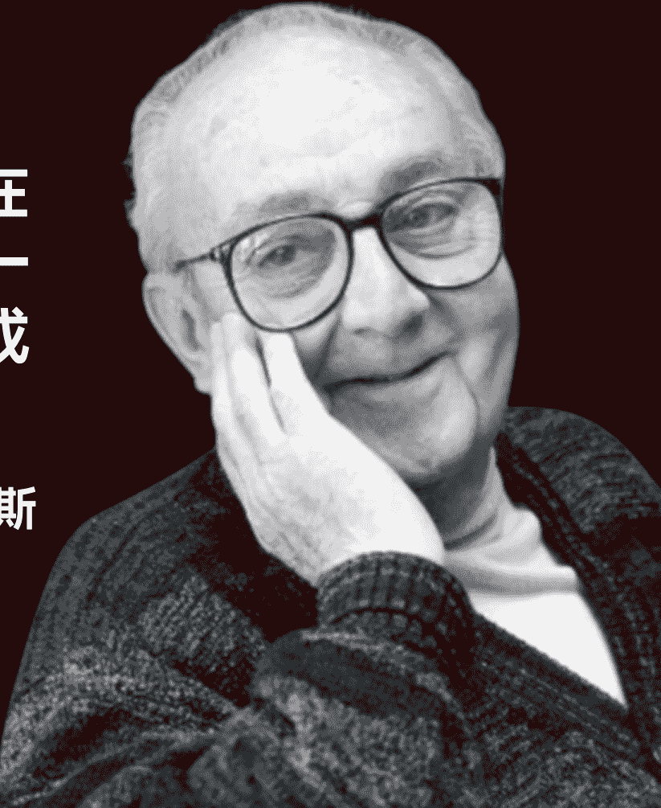
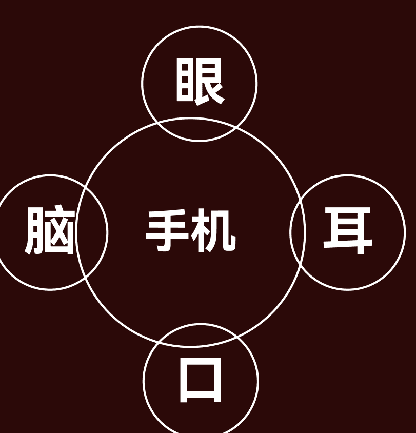
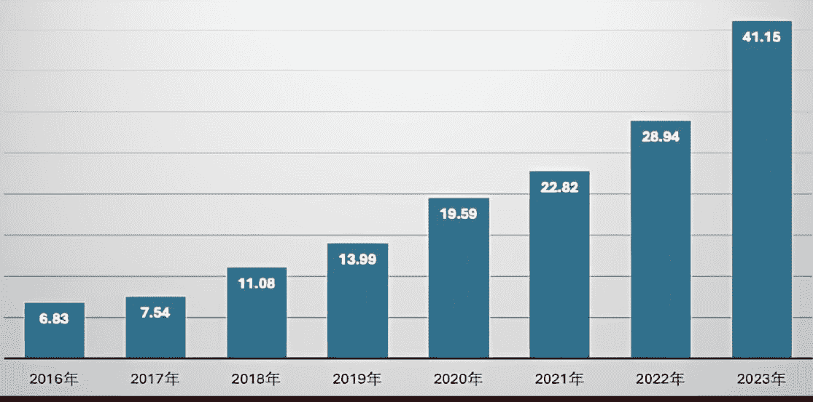
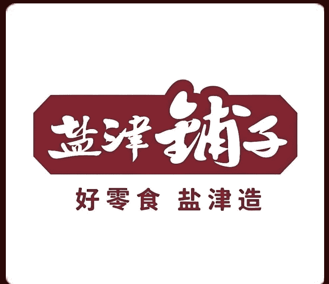
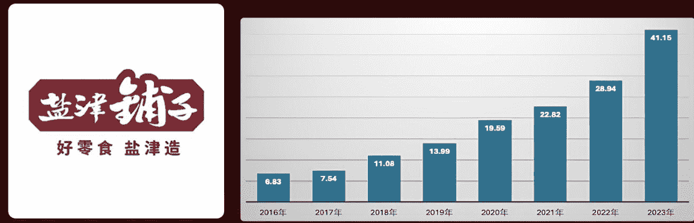
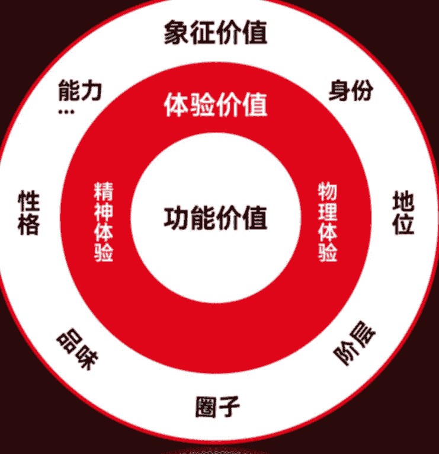

[content]

# EMBRACING CHANGE
## 营销的变与不变

演讲人：小马宋

# 扫码加入 知识星球TOP 免费资源群

免费
公众号: 知识星球TOP

- 每日免费获取高价值资源
- 可提供各类资源搜索服务

价值
微信信号: jntsg8

| 热门付费文章 | 各行各业报告 |
|---|---|---|
| 精选图书资源 | 副业赚钱方法 |
| 职场实用资源 | AI财经自媒体 |

及时
微信信号: jntsg2

专注
分享资料仅供个人学习，请及时删除，切勿商用传播

# 34% - 50%

EMBRACING CHANGE

> 这是我职业生涯中，见过的最大的环境转变。
——橡树资本联合创始人霍华德·马克

### 为什么今天的营销案例
好像没有一套固定的解题思路呢？

### 因为在变化的时代
不存在确定的解决方案

### 营销，因客户而变
EMBRACING CHANGE

# 所有的模型都是错的，它们只是在特定的尺度上成立。假如只用一个模型观察世界，就会让真理成为公式的雏性品。
——统计学家乔治·博克斯

### 每一个客户都是独特的
它们有各自的成功法门

# 京东撤销合并集团品牌部门后的讨论是传统品牌从业人员对互联网品牌的误解

# 互联网公司的发展是以产品运营为基础的，传统消费品牌的做法在这个行业是失效的

### 搜狗输入法的故事

# 上市第一年，市场占有率3%

# 第二年，遇到番茄花园市场占有率第一

### 营销，因技术而变
EMBRACING CHANGE

### 今天，如果有问题，我们去问谁？

### 有问题，XXX

### 百度，知乎，AI
EMBRACING CHANGE

### “因为答案变了”

### “媒介即信息”

### “技术是人的延伸”
——麦克卢汉

### 因为广告时间有限，人的记忆能力有限
广告口号就需要口语化、浓缩信息、不断重复

### 电视、广播、平面时代，广告口号是最重要的传播要素之一

### 为什么那些耳熟能详的口号基本都诞生在2010年之前

### 媒体分散了，不用记忆了

### 过去帮助我们记忆并传播广告的4个器官

### 今天帮助我们记忆并传播广告的5个器官

### 技术再次延伸了人的能力
有了智能手机和5G存储，带来了100倍的提升。过去的广告经验受到根本的挑战。

### 营销，因购买逻辑而变

### 十年前，宝适、惠氏......
### 十年前，还有细分品牌
### 十年前，有很多细分品牌，Babycare也是其中
### 专注一个品类的，大多做的营收100多亿

### 经营，因时而变
EMBRACING CHANGE

### 餐饮大单品的时代谢幕了

### 太二酸菜鱼、陶德砂锅、青花烤鱼、喜家虾仁、米村拌饭、胖哥肉蟹煲、四季宜椰子鸡、汤源汁锅、西少爷肉夹、费大厨辣椒炒肉......

### 大单品的成功与品类定位的关系：相关性与因果性

### 一个品类一个品牌！亨氏、雅马哈、本田、雀巢、美的......

### 要不要多品类，从来不是一个“品牌”的问题，而是关于经营的问题。

### 问题的本质不在于“做品牌是不是聚焦”，而在于“我们做有没有优势”。

# 餐饮行业的经营是有特殊性的，它有固定的场所，没办法搬走，快消品就不是。

# 过去做大单品，是因为这么做能形成优势；今天做大单品，也是因为这么做能形成优势。本质的问题是进店率和翻台率，不仅要扩品类，还要扩场景、扩时段（冬天的奶茶店、夏天的坚果店、中午的烤肉店、下午的咖啡店）。
EMBRACING CHANGE

### 我们做餐饮，一定要记住房租是用24小时计算的。

# 是不是什么都可以做？绝对不是！没那么容易！

### 我们要不要多品类，取决于我们这么做是不是优势。

# 比亚迪为什么是中国最大的口罩生产商？因为它的电池制造经验（无纺布、熔喷布的精密加工）可以直接应用于口罩材料生产。

- 商超时代：散装零食、专柜陈列
- 电商时代：组织调整、快速适应
- 折扣时代：提前布局、吃到红利
- 新环境下：品牌零食、细分品类

## 企业经营与营销视角的转换
我们的目标是经营一家企业，而不是创建一个品牌。

### 企业经营的核心原则：建立优势，保持优势，发挥优势

### 营销中不变的是什么
EMBRACING CHANGE

### 价值
EMBRACING CHANGE

# 营销是创造、传播、交付和交换对顾客、客户、合作伙伴以及整个社会有价值的产品的一系列活动、制度和过程。
——美国营销协会

## 小马宋品牌：产品价值罗盘

EMBRACING CHANGE

### 创造价值、传播价值、传递价值

### 黄种人，白种人其实祖先都是黑人

# 没有别的原因，只是因为进化

### 面对变化，只能进化
EMBRACING CHANGE

### 面对噪音，只抓核心
EMBRACING CHANGE

### 在商业实战的复杂变化中找到核心本质，才是战略营销的关键能力。
——小马宋

### 小马宋十周年再见

### 小马宋读书群
商业观点与行业经验

EMBRACING CHANGE

### THANKS!
小马宋 XIAOMASONG
战略营销咨询
[/content]
