# 客从远方来：如何构建巴中旅游新格局
关于广雾山-诺水河世界地质公园品牌运营策划汇报

### 知识星球TOP
- 每日获取高价值资源
- 分享资料仅供学习、传播

## 序
- 借天地，遇见自然
- 借历史，提升格局
- 借文化，重塑文旅

以旅游产业现状为基础，以持久文化资源为吸引，以城市为枢纽，以交通为廊道，形成要素集聚、品牌化、海陆联动、内外共生的巴中发展新格局。

## 红色巴中
巴中是全国大区红色遗迹众多，全市有红色文物382处，其中：
- 全国重点保护单位66处
- 省级革命文物保护单位20处
- 市级革命文物保护单位11处
- 县级革命文物保护单位110处

2018年入围全国文明城市；2018年社会治理示范市。

## 人文巴中
巴中悠久的历史，深厚的文化和历代英杰留下了许多人文遗迹。繁生先民用勤劳和智慧，积累了古朴深厚的特色巴文化。其中四项被列为省级非遗。

## 秀丽巴中
联合国教科文组织执行局批准广雾山-诺水河地质公园成为我国第三十个世界地质公园。今天的巴中，必将成为更多人的诗和远方！创造一个更好的“诗和远方”，是品牌打造的终极目的。通之路，启程之初，必先树标杆！

## 定位 POSITIONING
### 品牌定位：贤文立德 好客巴中
贤文立德，意指唐文化和贵文化对地的深远影响，强调文旅精髓。好客巴中，用历史的传承广迎天下的大气情怀。

品牌定位呈现的不仅是思想和理念，更是城市的发展态度。立意明确后，需要更多的信息到达，将城市热情的态度、丰富的文化底蕴、秀美的锦绣山河一一呈现。聚人气、超体验，强记忆、易传播。

IP为旗，手段为器，人无我有，大众，汇聚巴中。

## 口号 SLOGAN
贤文立德 好客巴中
千年历史人文风物、近代红色文化印迹、世界级秀美山川奇景、热情待客之道。新巴中文旅态度，最好的诗和远方。

## 思路 TRAIN OF THOUGHT
文化为魂，视觉创新，点、线、面推广全覆盖。
- 文化植入 | 视觉设计 | 线上推广 | 落地活动

## 文化为魂
文旅不可分割，文化为旅游创造灵魂。探索古今，发现未来，澎湃精神。弘扬民族文化，打造巴文旅新面貌。用在地文化精髓，塑造“客从远方来”品牌。

## 当地三大文化 THE THREE MAJOR CULTURAL
### 巴文化
中国古代巴族共同创造的全部物质、精神文化及其社会结构。从鄂豫向西实行战略转移，建立了第二大区。

### 红色文化
巴中是全国第二大区，红色遗迹众多。

### 贤文化
关于李贤与巴中的故事。李贤是唐朝皇室，武则天之子。他自幼聪慧，作为“初唐四杰”之一的太子，期间得到唐高宗称赞。后因政治原因被贬到巴州，武则天猜忌后令其自尽，终年二十九岁。李贤被贬巴州后，不顾体弱多病，四处奔走，寻访民情；在城南金榜寺设坛，劝农精耕细作；在曾口县山上发愤读书，又在天平山筑茅庐栖身，旷野山泉度日，日夜苦读群书，以备后为社稷效力。李贤在巴州时期为当时的巴州带来了全新的文化，从人文到艺术再到礼仪，打开了整个盛唐文化的大门。

## 贤文化三大核心
### 核心一：人文文化
李贤在巴州时期曾将书籍运到当地，教当地人读书识字，并在巴州写下传千古的诗词《黄台引》。思路：在设计中融入唐诗、文字等元素，回归中国文化传统，向古典文明寻求创新的源泉。

### 核心二：艺术唐三彩
李贤作为太子，艺术审美超出常，他的穿着和思想潜移默化影响着当时的巴州，把唐朝盛的瓷器文化带到了巴州。思路：在设计中提取唐三彩最具代表性的三色：黄、褐、绿，给精致的现代生活赋予梦幻大唐的神秘色彩。

### 核心三：礼仪插画
李贤爱民如子，四处奔走寻找民情；他的贤良、忍让等品格也是贤文化重要的一部分。思路：在设计中融入唐代礼仪插画，以中华礼仪精神集中表达贤文化最核心的部分。

## 视觉设计
文创产品是文化成果的体现，是创意的根源。通过鲜明的视觉符号，激发文化活力。

## 吉祥物设计 MASCOT DESIGN
### 创作思路一：以“李贤”原型为设计
将人物造型卡通化，更具亲和力。服装为唐代官袍，颜色为唐三彩褐色。腰带设计中加入红叶元素与景区特色融合。借助景区的名气，利用生动的形象展现心中的热情与风土，从神态到肢体充分结合品牌。

### 创作思路二：以“景区景观”为设计
加入唐代文化和视觉元素。整体形象端庄优雅，服装为唐代色彩，颜色为唐三彩绿色。姿态为宫廷迎宾，表达真挚的友谊，体现巴人的豪迈气质。

## 展厅 EXHIBITION HALL
展厅设计是展示的一种，是以综合物、人、场等要素的最佳空间为手段，以传达特定信息为目的。以“唐代建筑+景区色彩”为设计思路，如木雕、唐釉、溶洞、红叶等元素，以情景展示的方式增加互动感和体验感。在功能区域设置LED屏、展板；在产品陈列区以品类进行划分。

## 文创 WEN GEN
文创产品顾名义是文化创意产品，是指依靠创意人的智慧、技能和天赋，借助现代科技手段对文化资源、文化用品进行创造与提升，通过知识产权的开发和运用，产高附加值产品。

## 文创产品设计 CULTURAL AND CREATIVE PRODUCT DESIGN
松嵘柏情而得、繁樱摘以筵、正死肝蝶、凄静无寒萧、远去寻苦丛、宁是故……

### 第一套 THE FIRST SET
以“吉祥物”为设计思路，开发系列文创品，涵盖生活用品、饰品及办公用品等类别，大大加深了人们的印象。

### 设计阐述
- **钥匙扣**：采用合金材质，身上有“客从远方来”字样，具有传统特色。
- **帆布包**：采用棉布材质，具有时尚趋势，携带方便环保。
- **琉璃笔**：采用古代脱蜡法烧制，加入琉璃母胎，笔架为唐代木雕。
- **圆扇**：扇作菱形，扇面有镂花片及刺绣装饰，扇柄为竹制，工艺精湛。
- **马克杯**：杯身为标准圆柱形，一侧带有把手，材质为纯瓷。
- **书签**：方寸之间，含有知识与智慧，灵感挥洒，包含无限诗画意，采用木质表面纹理，外观独特。
- **圆珠笔**：采用水性，兼有钢笔和油性特点，书写流畅，线条均匀。
- **竹扇**：造型优美，构造精制，与竹文化、佛教文化密切关系。采用竹编材质，整体为叶叶造型，手工定制镂空。

### 第二套 THE SECOND SET
以“唐代工艺”为设计思路。唐代工艺美术表现出舒博大的气势、精巧圆婉的装饰意蕴和丰富的形态特征。在设计和制作上具有造型精致、色彩绚丽、纹饰活跃、品种多样的风格特点，也是我国历史阶段工艺美术发展的重要转折时期。

## 农产品包装
AGRICULTURAL PRODUCTS

以文创产品包装的思路，将本地特色产品进行包装输出。
增加产品趣味性和记忆点，提升购买欲望。

## 农产品包装设计
PACKAGING DESIGN OF AGRICULTURAL PRODUCTS

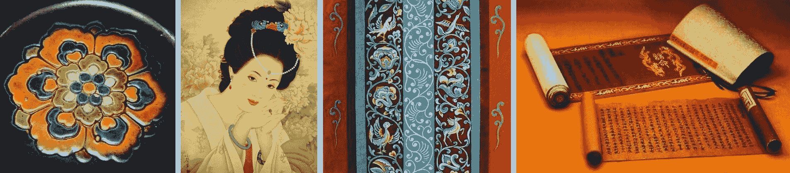

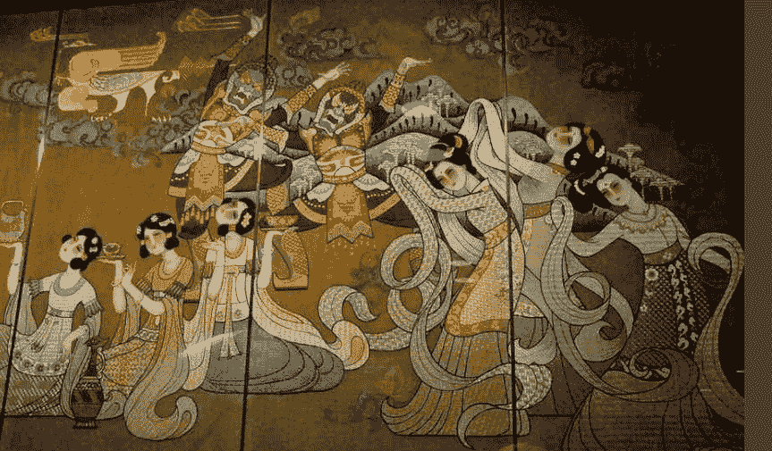

### 第一套

以“贤文化大融合”的方式为设计思路，在设计中出现整个唐代的文化，主体花纹的设计，我们采用了最具唐代风格的宝相纹，打破传统图案的呈现方式，用国际化的语言重新解构、创新，在体现大唐的雍容气象的同时，更显现代审美趣。

### 设计阐述 Designed in this paper

### 【单品包装设计】

字体采用了毛笔字体，复古风格浓厚，彰显传统文化意义。意在表达形式采用单色表现插画表现形式，加入不同的图形，来展示产品，设计色彩鲜艳，让品牌更加活泼有趣。

浓重的唐文化特色，淡雅的画面设计+大面积的留白，整体包装清新、自然，具有极强设计感。

采用透明外密封，杯盖为木质，带有“客从远来”的 LOGO印章，精选天然楠竹的设计可以防尘。

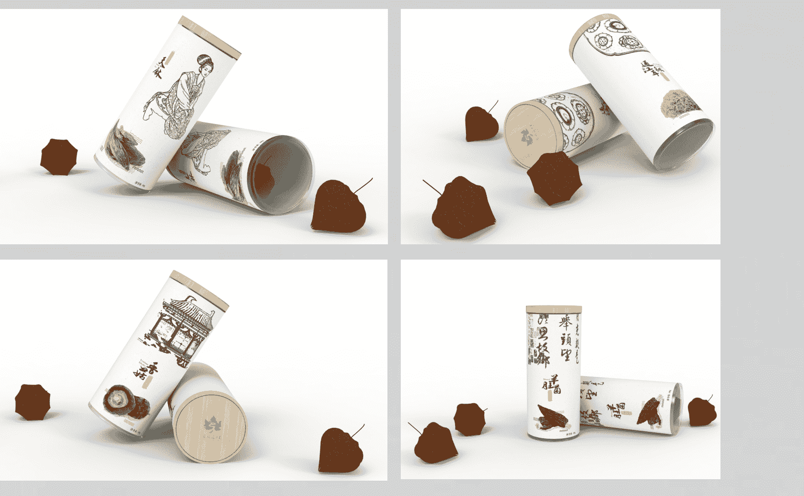

### 设计阐述 Designed in this paper

### 【礼品包装盒设计】

分为单品礼盒（两个装）、小礼盒（三个装）、大礼盒（六个装）、伴手礼盒（九个装）。
包装功能性强、格调感十足，视觉冲击力强。颜色采用唐三色中的绿，体现在形式与功能的极致结合，主张人性化设计和追求平和和含蓄的设计风格。
在包装盒上运用代表幸福寓意的吉祥图案纹，并且追求造型形式上的完整性、对称性，表达了人们对美好生活的追求和祈望。
采用自然材料，触觉亲近，寓意深远。

### 单品礼盒：唐酌·寻味巴雾

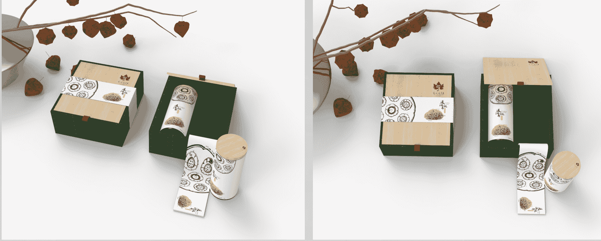

### 小礼盒：唐韵·锦绣巴雾

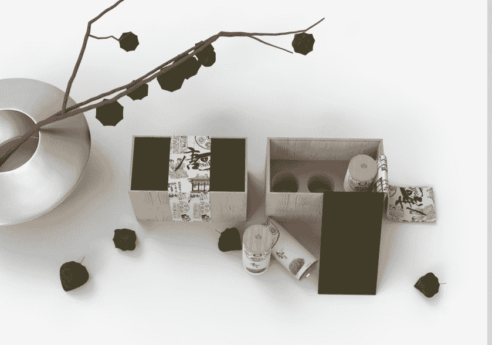

### 大礼盒：唐韵·祥和巴雾

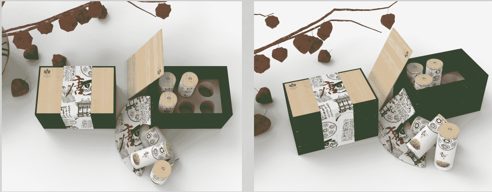

### 伴手礼盒：唐韵·盛世巴雾

### 第二套

同样以“贤文化大融合”的方式为设计思路，但与第一一套的风格上又有变化，在色彩的应用上更大胆突出。明确的色彩能够给人以强烈的视觉冲击，在字体上采用极简的排版方式，给给人一种简洁、形象、高雅的效果。

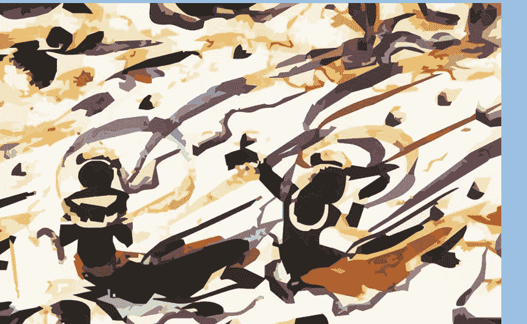

### 设计阐述 Designed in this paper

### 【单词设计】

包装的色彩灵感来源于森林和大地的原色，线条运用流物的韵律，彰显自然的随和、包容、广大。还原自然的同时，结合城市涂鸦、喷溅色彩的创意原色，将传统与现代的精髓淋漓尽致的展现。

材质选用亚麻布、麻绳等，鲜艳的纯色和唐代诗词结合，是外观极具质感与设计感。

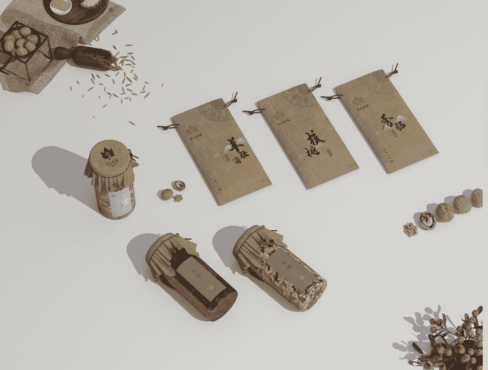

### 设计阐述 Designed in this paper

### 【礼品设计】

分为单品装、小礼盒（三个装）、大礼盒（六个装）、伴手礼盒（九个装）。
注重细节设计，字体采用无饰线条，结合食品的天然色彩，光泽处理，使包装传达一种珍贵性，给人感觉高档独特。
采用丰富的亚麻质布，这是一种原始的原料，在历史上以强度、吸收力而著名。这种材料为产品提供了完美的空间。金属、淡银等材质，精致的外包装，体现稀有和文化和意境感。

- 小礼盒：光雾·三宝
- 大礼盒：光雾·六味
- 伴手礼盒：光雾·御

## 线上推广

以互联网+模式全面开展在地化文化，并以事件营销制造热点，全方位传播巴中旅新文化。

### 线上网站设计 Official website design

从功能上强化，如增加VR互动、标识地图、交通线路、景区查询、语音讲解、产品购物等一系列人性化的服务。

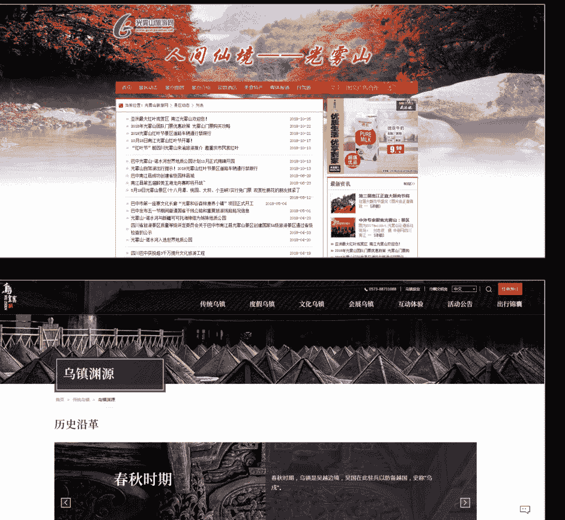

### 线上公众号设计 Official account design

在现有官方号的基础上优化，整体设计以贤山文化为框架，在排版上可参考“企业公众号”。从功能上强化，如增加地图定位、一键拨号、客服在线、视频直播、每日新闻及动态互动、游戏及抽奖等。

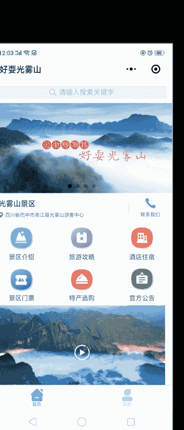
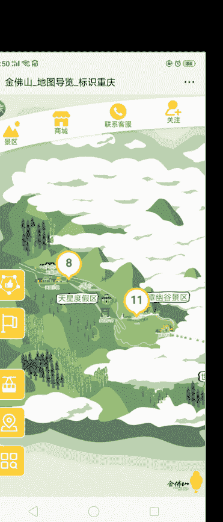

## 线上：品牌传播+推广 Brand communication + promotion

### H5线上游

发起“光雾山-诺水河”H5线上活动，让网友在网络上游览当地不同景区、不同年代的旅游。活动规则：选择景区、选择旅游时间，上传自拍获取旅游照，分享旅游，也可邀请好友一同游。

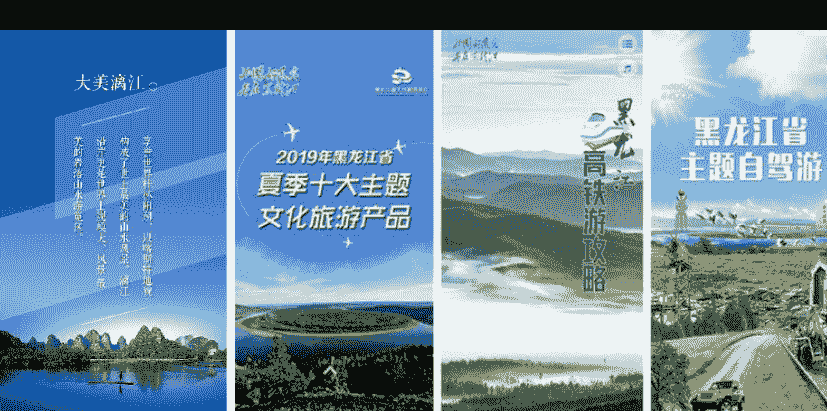
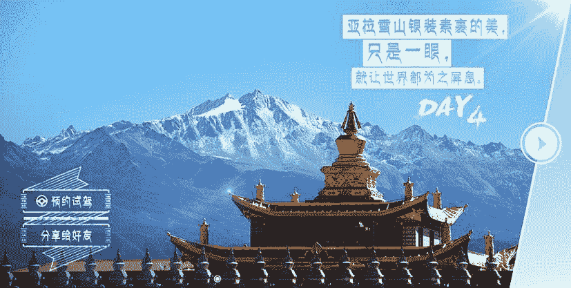

### 网红直播

以“网红效益”的直播方式，让知名主播在线拍摄并宣传短视频，主播与粉丝互动，每个主播的背后都有千上万的粉丝，带来人气聚集，形成良好的广告转化效果。实时问答等环节为大众进行深入解读，使“光雾山-诺水”得到大量曝光。

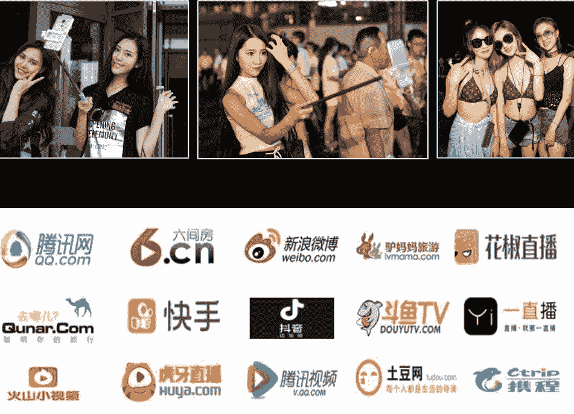

## 落地活动

属于这里的旅游基因基因以“四季”为活动主线，结合景点，塑造巴中旅游新形象，打造差异化精品旅游。打造产业发展、民族文化传承、旅游攻略路线等形式的落地活动，以此带动人流，助力发展，推动持续。

## 线下：落地活动 THE GROUND ACTIVITY

对光雾山-诺水河四个季节不同的玩法进行路线规划，铺设全年传播推广，打造特色旅游活动，增加曝光度，从而推动其影响力。

### 春游

以杜鹃为主线，“人间四月天，光雾看杜鹃”，推荐赏花攻略，规划最佳赏花游乐购物路线。

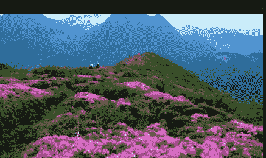

### 夏游

以洛洞为主线，夏天若有十分美，光雾山至少占七分。推荐洛洞攻略，主打凉爽避暑的特色。

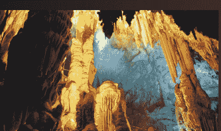

### 秋游

以红叶为主线，放眼望去不断不断的红叶，推荐红叶攻略，打造年度秋季凉爽康养胜地。

### 冬游

以雪山为主线，推荐雪山攻略，冬天这里一片诗如画的世外桃源，也被誉为“天堂”。

## 线下：落地活动 THE GROUND ACTIVITY

### 春游活动推荐

从景区步道丈量风景，引导一种全新的旅行方式，深度结合自然与文化意义，让游客体验自然与艳，成为光中唐代文化的浪漫之旅。

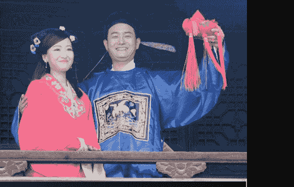

### 夏游活动推荐

亲子研学特色研学实践，深度探险，让孩子们加深与自然和文化的感情，孩子们学习自然，保护环境。举办露天音乐会，露天电影院，现场精彩节目，带上家人随星空，感受静谧夜晚，围着篝火，搭上露营帐篷，回归淳朴生活，让清凉与游客相伴，点燃夏日狂欢激情。现场还有趣味西瓜大赛、冰桶挑战赛等。

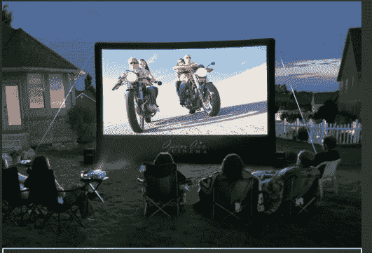
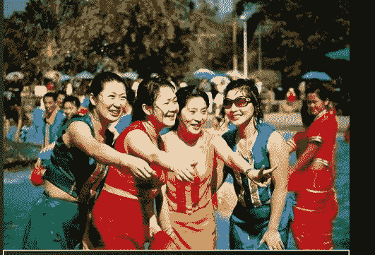

## 线下：落地活动 THE GROUND ACTIVITY

### 秋游活动推荐

民俗风情文化市，以展会的形式，包括农产品、文创商品等。借助客源媒体在当地的影响力，进行深度精准宣传。邀请30位川渝两地的媒体人到当地采样，让游客对光雾山-诺水有更深刻的认识。

| 第十七届光雾山-诺水河 |
| :--- |
| 红叶节开幕 |
| 客源地媒体行 |
| 美食文化节 |

| 农场采活动 |

农场采样活动，营养师讲解。用当地食材为游客带来一场精彩纷呈的饕盛，举办厨艺大赛，让美食和旅游融合发展，更多多元、内涵丰富，让游客感受当地的美食。

## 线下：落地活动 THE GROUND ACTIVITY

### 冬游活动推荐

冰雪嘉年华：雪地寻宝、滑雪障碍赛、雪合战斗游戏、冰车速滑、大小三轮冰车竞技赛、冰上滑河等比赛。为休闲项目和冬季娱乐文化融为一体，为游客提供冬季欢乐的极致去处。

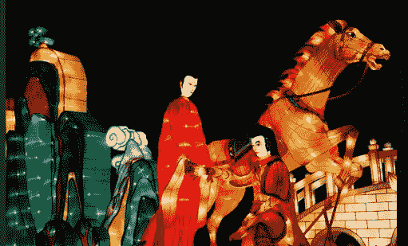

> “ 红火中国年 ” 新春系列活动

新年特别活动 “光影新年” 5D 灯光表演。贤文化迎春灯会，以贤文化为主，声光电变幻奇妙。

寻觅

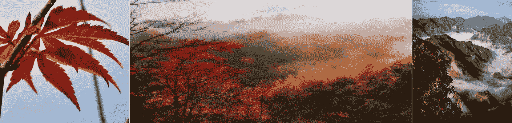

# THANK YOU FOR WATCHING
