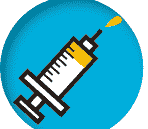
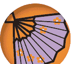
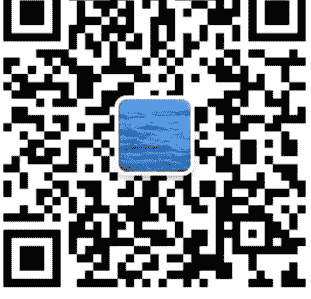
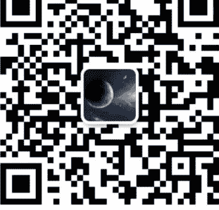
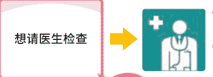
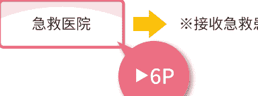
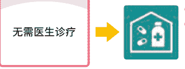
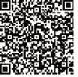
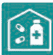
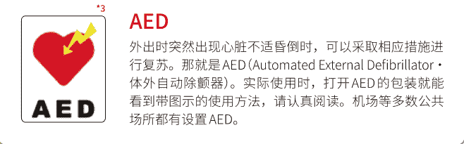

# 您的日本之旅更加安心
身体不适时的应急指南

监修／近藤太郎（京都医师会副会长）
石井正三（日本医师会常任理事）
金敏（日本医师会常任理事）

## 医疗机构使用指南

## 免费 价值 及时 专注

## 扫码加入 知识星球TOP 免费资源群

- 每日免费获取价值资源
- 可提供各类资源搜索服务

| 热门付费文章 | 各行行业报告 |
| :--- | :--- |
| 精选图书资源 | 副业赚钱方法 |
| 职场实用资源 | AI政经自媒体 |

公众号:知识星球TOP 微信公众号:jntsg8 微信信号:jntsg2

分享资料仅供个人学习，请及时删除，切勿商用传播

我们希望访日游客在日本期间能够保持健康舒适。但是难免遇到意外之外的疾病或者受伤。这份指南可以在发生意外、接受日本医疗服务时为您提供帮助。出门的时候请把它放在随身的背包里，以备不时之需。

## 目录

- 日本医疗机构的种类……3
- 想请医生检查……4
- 医疗机构的就诊指南以及注意事项……5
- 急救医院就诊指南……6
- 提前写下，添一份安心 医疗相关的个人信息……7
- 说明症状、病情时使用的手指卡片……8
- 安心·安全建议……10

## 日本医疗机构的种类

由于使用时段、紧急程度、严重程度各有差异，因此选择的医疗机构也有所不同。

- 在诊疗时间内可以去诊所·综合医院
- 其他时段可以选择夜间诊疗窗口（各个地区有所不同）
- 关于可接收外国人的医疗机构，请参照第4页的列表。

※接急救患者。365天、24小时应对

- 附近的药房（药店）
- 尽量向药剂师咨询。※夜间购药如药剂师不在，则无法购买。

## 想请医生检查

前往医疗机构的方式 医疗信息网站（提供英文版本）：「可接受外国游客医疗列表」
http://www.nto.go.jp/eng/emergency/my_guide.html

- 酒店前台或柜台：说明症状，请工作人员介绍医疗机构
- Tourist Information：向工作人员介绍医疗机构
- 海外旅游保险：如有购买保险，请联系保险公司咨询详情

## 「医疗信息」

厚生劳动省各道县医疗功能提供
http://www.mhlw.go.jp/english/policy/health-care/info/hospitals.html
※可以通过访问各道县网站。

| 主要症状 | 诊疗科目 |
| :--- | :--- |
| 发烧、喉痛、咳嗽、流鼻涕 | 内科 |
| 头疼 | 内科、神经外科 |
| 胸痛 | 心血管内科、呼吸内科 |
| 腹部 | 内科、消化内科、外科 |
| 吐血、便血 | 内科、消化内科 |
| 腹泻 | 内科、消化内科 |
| 受伤、割伤 | 外科、整形外科 |
| 骨折、关节痛 | 整形外科 |
| 烧伤、烫伤 | 皮肤科、整形外科、外科 |
| 湿疹、麻疹 | 皮肤科 |
| 晕眩、耳鸣 | 耳鼻喉科、神经内科 |
| 耳或鼻子 | 耳鼻喉科 |
| 儿童疾病 | 小儿科 |
| 牙痛 | 牙科 |
| 排尿困难、血尿、排尿疼痛 | 泌尿科 |
| 怀孕中(腹痛、出血、破水) | 产科·妇科 |
| 宝宝状况 | |
| 紧急情况 | 急救科 |
| 不知道挂哪个科室 | 综合诊科 |

## 医疗机构的就诊指南以及注意事项

### 院内从挂号到付款的流程

**挂号**
每个国家/地区的医疗系统各相同。事先了解可避免不麻烦。挂号的时候，请先咨询诊疗需要收取的大概费用。※仅限提供外语医疗机构。

**填写病历**
※1 请认真听取诊疗结果说明。

**接受医生的诊疗与处理，领取处方**
※2 此处所有款项为目前为止诊疗的费用。只有大型医院才能使用信用卡支付。诊所通用现金支付。如已购买带现金医疗服务的境外保险，无需支付。（注）现金医疗服务的条件不同，根据保险项目有所不同，请先与保险公司确认详情。

**付款**
※2

**到药房出示处方购买药物**
※3 药品费用需要单独在药房支付。部分医疗机构采用院内制剂处方。

## 急救医院就诊指南

### 急护车119电话

需要救护车的时候，请把以下文字给周围的日本人看，他们帮忙叫救护车。

# 急救车を呼んでください。
（请帮忙叫救护车。）

遇上交通事故或者紧急情况时可以帮忙运送伤者/患者到医院。

**救护车抵达之后的流程**

| 救护车抵达 | 将病患运送至医院 | 治疗 | 付款 | 出院 |
| :--- | :--- | :--- | :--- | :--- |
| | | | | 住院 |

> 注意事项
接收病人的医院不由病人自己决定。部分情况下可能会直接跳过诊疗阶段直接开展治疗，因此务必在第7页中填入必要的信息。

### AED

外出时突然出现不适昏倒时，可以采取措施进行复苏。那就是AED (Automated External Defibrillator)。实际使用时，打开包装的使用方法。许多场所都有设置AED。

## 写下、添一份安心 医疗相关的个人信息

| 氏名 | 性别 |
| :--- | :--- |
| | 男性 ／ 女性 |
| 出生年月日 | 年龄 |
| 现在治疗中の疾患（有/无） |
| 现在服用中の药（有/无） |
| 妊娠している・していない |
| 既往症 |
| アレルギー（食物／动物／其他）
| 具体的に書いてください
| 通常は何語を使いますか？
| 信仰宗教はありますか？

## 症状·症状说明のための手指示卡

这个表格的使用方法：用手指指相应的症状以及程度。

- 头が痛い（头痛）
- かなり辛い（非常难受）
（此处省略）
- 耳が痛い（耳痛）
- 聞えない（听不见）
- 耳鳴り（耳鸣）
- 熱がある（发烧）
- 口の中が痛い（口腔痛）
- 舌が痛い（舌痛）
- 味がわからない（尝不出味道）
- めまいする（眩晕）
- 歯が痛い（牙痛）
- 歯茎が痛い（牙龈痛）
- 腹が痛い（腹痛）
- 胃が痛い（胃痛）
- 下痢（腹泻）
- 首が回らない（脖子不动）
- 首が痛い（脖痛）
- 腰が腫れている（腰肿）
- 目が痛い（眼痛）
- 見えない・見えにくい（看不清）
- 目のかゆみ（眼睛痒）
- 腰が痛い（腰痛）
- 下肢にしびれがある（下肢麻痹）
- 喉が痛い（喉痛）
- 声が出ない（发不出声音）
- たん（咳痰）
- せきが出る（咳嗽）
- 膝が痛い（膝痛）
- 曲げられない（无法弯曲）
- 歩けない（无法行走）

## 症状的程度显示

- 我慢できる（可以忍）
- かなり辛い（非常难受）
- 鼻が出る（流水）
- 鼻血（鼻血）
- くしゃみ（打喷嚏）
- 息苦しい（呼吸困难）
- ゼーゼーする（有鸣声）
- 息切れる（气喘）
- 胸が痛い（胸痛）
- 動悸する（心悸）
- 脈が乱れる（脉搏）
- 不正出血（异常出血）
- 腹が痛い（腹部痛）
- かぶれた（起皮）
- 発疹（发疹）
- かゆみがひどい（严重痒）
- じんまし（等）
- 泣続けている（一直哭）
- 吐いた（呕吐）
- 熱がある（发热）
- 元気がない（没有精神）
- お腹が痛い（腹部）
- お腹が張る（腹胀）
- 腰から水が出た（破水）
- 赤ちゃんになる（怀孕）
- 血尿（血尿）
- 排尿困難（排尿困难）
- 頻尿（频繁）
- 排尿時に痛みがある（排尿时疼痛）
- ケガをした（受伤）
- 交通事故（交通事故）
- ころんだ（跌倒）
- あたった（受伤）
- 切った（割伤）
- 刺された（扎伤）
- やけど（烧伤/烫伤）
- 虫に刺された（蚊咬）

## 安心·安全建议

灾害时有用的网站（只提供英文版本）●Android ●iPhone

「Safety tips」以英语预测地震报日本国内国内地震警报以及海报警信息推送型应用程序。具备面向访日外国人以及日本在住外外国人的多项功能，在灾害时可以发挥作用。

- 下载URL
Android https://play.google.com/store/apps/details?id=jp.rcsc.safetyTips.android
iPhone https://itunes.apple.com/jp/app/safety-tips/id85835174?mt=8

## 关于“紧急地震警报”

在地震多发的日本，日本气象局会在地震发生剧烈摇晃发出“紧急地震警报”。这是日本独自研发的对策，可在地震发生之后立即预测可能发生剧烈晃的地区烈度，并尽可能迅速通过电视、收音机、手机等通知可能的居民。听到紧急地震警报的时候，请不要慌张；先保护好自身。另外，如果遇到困难，请到派出所寻求帮助。
