# 日本营商环境报告 2024

## 免费 价值 及时 专注

## 扫码加入 知识星球TOP 免费资源群

- 每日免费获取价值资源
- 可提供各类资源搜索服务

| 热门付费文章 | 各行行业报告 |
| :--- | :--- |
| 精选图书资源 | 副业赚钱方法 |
| 职场实用资源 | AI经营自媒体体 |

账号：知识星球TOP 微信：jntsg8 微信号：jntsg2

分享资料仅供个人学习，请及时删除，切勿商用传播

本报告所含信息仅供参考，任何内容均不构成财务、法律、商业、投资建议、投资咨询意见或其他意见。中国贸促会产业促进部对本报告所含信息的时效性及完整性不作任何明确或隐含的保证，亦不对因使用该信息而获得的结果承担任何法律责任。

# 《日本营商环境报告 2024》
编委会

主任: 杨晓军
副主任: 谢睿哲
编委: 张军 刘晓静 张红红 张阳 刘敏娇

# 编写组

组长: 赵薛
副组长: 赵力进
成员: 李明哲 杨文静 周晋竹 李媛 张玉静 李佳悦 何宗武 薛宜昂 秦娜媛 汪钰佑

# 目录
CONTENTS

前言

# 第一章 中日经贸合作现状

## 一、中日经贸合作好发展
-（一）中日双边贸易额缩幅缩小
-（二）中国对日本直接投资上升

## 二、中日经贸合作机遇增多
-（一）领导人晤会中日合作确定发展方向
-（二）中日工商界密切往拉紧经贸合作纽带
-（三）RCEP全面实施不断深化中日经贸合作
-（四）交流对话推动绿色发展领域务合作
-（五）两国合作不断加深并呈现更多亮点

# 第二章 总体评价

## 一、日本宏观经济走势需密切关注
-（一）国内生产总值增速缓慢
-（二）通胀指数水平提升
-（三）外出口表现旺盛
-（四）外直接投资下滑

## 二、企业对日本营商环境评价较好
-（一）近六成企业认为日本营商环境较好
-（二）三成企业认为日本营商环境有改善

# 第三章 总体问题

## 一、“安全化”趋势加剧阻常规经营往来
-（一）近半数企业感受到经济问题“泛安全化”导致
-（二）近四成企业投资经营受“经济安全”负面影响
-（三）以维护供应链安全为由提高市场准入壁垒

## 二、贸易救济措施频繁针对中国产品
-（一）越八数量在征反倾销税 针对中国产品
-（二）针对下游电池材料加强贸易救济措施

## 三、当地市场环境变化企业在日发展
-（一）日本宏观经济环境转好仍不明明
-（二）外资企业较为实际受优优惠政策
-（三）四成中资企业在日面临困难
-（四）中资企业日益面临社会环境恶化

## 四、公共服务效率优化与完善
-（一）公共服务效率问题阻碍经营
-（二）行政审批规范问题未改善

# 第四章 总体建议

## 一、不断稳固中日贸易合作
-（一）落实要共促进贸易合作
-（二）推动 RCEP 框架下产业合作

### 二、拆垒贸易保护主义主义举措
-（一）审慎使用贸易救济措施
-（二）合理调整出口管制

## 三、坚持开放政策
-（一）开放经济问题“安全化”做法
-（二）制定公正透明的外资审查规则
-（三）消除部分行业隐性壁垒

## 四、营造公平竞争环境
-（一）逐步减少对产业环节的补贴
-（二）保障外资企业参与公共采购

## 五、提升服务水平
-（一）有效简化行政手续
-（二）提高行政执法透明度
-（三）听取外资企业合理建议
-（四）出台更多优惠政策

# 第五章 市场准入

## 一、最新发展
-（一）扩大外资投资事前审查
-（二）修改核心行业清单
-（三）将出口产品列为反倾销对象
-（四）对电池材料等产品采取措施措施

## 二、问题分析
-（一）约六成企业认为不合理
-（二）外国投资者申报数量增
-（三）信息服务领域显著提高

## 三、我们建议
-（一）合理设定外资适用范围
-（二）力求缩短外资审查时间
-（三）公平公正开展审查
-（四）减少对对应合作
-（五）合理使用贸易救济措施

# 第六章 公共采购

## 一、最新发展
-（一）实施基础设施供应商审查
-（二）提高初创和中小企业份额
-（三）建设面向云服务的采购平台

## 二、问题分析
-（一）RCEP 政府采购领域立法
-（二）四成企业认为提升门槛
-（三）信息服务受供应商影响较大
-（四）透明度有待提升

## 三、我们建议
-（一）支持中国政府政府采购
-（二）明确基础设施供应商标准
-（三）公平开展审查
-（四）提升采购流程和规范性
-（五）实施 RCEP 规则

# 第七章 数字经济

## 一、最新发展
-（一）修订《个人信息保护法》
-（二）通过《智能特定软件竞争法》
-（三）全球战略促进信息安全传输
-（四）发布《金融创新战略2024》推动技术创新
-（五）修订《隐私信息保护系统指南》

## 二、问题分析
-（一）养成企业认为数字经济环境仍有空间
-（二）四成企业认为数字领域逐步接近
-（三）超六成企业认为半导体补贴市场公平

## 三、我们建议
-（一）宽松数字经济外资限制
-（二）避免不合理使用半导体行业政策
-（三）重视数字企业在生态中的赋能作用
-（四）推动中日重点领域对接合作
-（五）降低企业数据和隐私合规难度及成本

# 第八章 金融税收

## 一、最新发展
-（一）结转负利率政策并两次加息
-（二）创造金融资产运营区
-（三）实施特区税优惠及改革措施
-（四）公开发日本气候型债券
-（五）推出战略物资相关税收减免优惠

## 二、问题分析
-（一）六成企业对日本金融环境评价一般
-（二）银行等金融行业壁垒依然较高
-（三）近九成企业认为收一般

## 三、我们建议
-（一）加强双方金融监管部门沟通
-（二）减少不需要的外资银行检查
-（三）出台更多面向外资企业税优惠
-（四）降低日本清算系统门槛
-（五）提升日本清算系统服务水平

# 第九章 绿色经济

## 一、最新发展
-（一）出台《绿色转型推进战略》
-（二）发布新版《氢能基本战略》
-（三）绿色创新基金持续保障低碳发展
-（四）接受海外符合条件的信用
-（五）推出《气候转型债券框架》

## 二、问题分析
-（一）绿色经济市场整体环境仍改善空间
-（二）四成企业认为较为能参与绿色产业
-（三）四成企业认为绿色产品将容易增加

## 三、我们建议
-（一）持续加强中日绿色经济合作
-（二）合理推行绿色转型优惠策略
-（三）确保对外企业共享优惠政策
-（四）绿色创新基金兼顾引导企业

## 十章 出口管制

## 一、最新发展
-（一）对多国实体多物项出口管制措施
-（二）外国最终用户清单新增四实体
-（三）新增项引导领域出口管制措施
-（四）建立技术管理的对抗措施

## 二、问题分析
-（一）近企业反映受出口管制负面影响
-（二）四成企业认为许可证申请较为困难
-（三）扩大出口管制范围

## 三、我们建议
-（一）确保出口管制制度公开、合理化
-（二）推动出口管制标准化、规范化
-（三）为企业提供有效申诉渠道
-（四）充分发挥出口管制作用
-（五）吸收对出口措施合理建议

附录一 研究过程综述
附录二 在日经营状况
附录三 中国贸促会简介
鸣谢

# 前言

中国和日本是重要的邻国。面对百年局势剧烈波动，保持中日关系健康稳定，对于地区和世界具有重要意义。2024年以来，中日双方层级交流日益活跃，在对话中达成系列共识，为中日深化合作注入动力。两国和平共处、世代友好、互利合作、共同发展之路，符合两国人民根本利益。希望日本同方向而行，恪守中日四个政治文件的原则和共识，全面推进两国战略互信关系，致力于构建符合新时代要求的建设性的、稳定的中日关系。

自2023年7月以来，中日双边贸易下降幅度缩小，中国一直是日本最大贸易伙伴。截至2023年末，中国对日本直接投资存量达577亿美元，在发达体直接投资量排名第9，在所有国家或地区排名第8。中国贸促会产业促进委员会开展了《日本营商环境报告2024》，全面分析通过实地调查、线上座谈、调研、问卷调查等多种方式对企业进行。其中，58.9%的受访企业对日本营商环境评价较高，与2023调查相比提高6个百分点。另外，31.2%的受访企业认为日本营商环境改善，与2023调查相比提高9个百分点。调查显示，大部分受访企业对日本营商环境评价较好，日本是其全球布局的重要站，营商环境对其具有吸引力。

尽量中国企业对日本营商环境评价较好，但2024年以来面临四方面应对，企业生产面临增大影响。

## 二、“安全化”继续加强阻碍企业正常经营

经济政策与管控措施向“安全化”倾向日益显著。日本政府针对“特定物资”、供应链、关键基础设施，不断收紧外国投资审查；在《外汇及贸易法》框架下，针对中国实体实施多个出口管制措施。每年更新的“最终用户清单”截至2023年累计数量已逾700个，其中包括中国实体超100个。调查显示，46.8%的受访企业为2024年日益“安全化”问题加重。

## 三、贸易救济措施频繁针对中国产品

日本是多边贸易体系的支持者，近年来贸易保护主义抬头，针对中国产品所开展的贸易救济措施数量较高。2023年以来，日本各类反销措施针对的全部都是中国产品。日本政府针对中国二氧化碳，作出延长征收5年的决定，同时对其用于汽炉的石墨启动反销调查。贸易救济措施的滥用用发展带来不确定性。

## 四、市场性壁垒对外资企业带来多重挑战

日本市场的渗透性壁垒正对外资企业市场进入和正常经营。日本独特的企业文化和经营环境使得外资企业难以进入市场。本国消费者对本土品牌有强烈偏好，一定程度对市场渗透形成了障碍。此外，外资在日本的市场运营中遭遇复杂的协会限制，加之企业代理以日语沟通为主，无形中增加了外资企业的运营成本。

## 五、日本公共服务特殊化的完善

受访企业普遍反映，日本各项公共服务效率尚有限，便利性仍不足，2024年并未得到改善，使企业在日本市场正常运营面临一定阻碍。具体各项行政审批透明度有待提高，分批审批规定缺乏明确性；反馈机制不健全，审批人员能力参差不齐，企业难以获得及时、有效的反馈。企业日常运营事务频繁，无法“一站式”处理各项流程、效率时间长，人力成本增加。

针对日本商环境存在的问题，在中国企业提出了五个方面的建议，希望日本方面能够认真对待中国企业诉求：

一是不断稳固中日经良好。落实两国领导达成的重要意义，顺应双方经济期待，共同维护供应链畅通，积极推动RCEP框架下产业合作，促进数字经济、绿色经济、医疗康养等领域。

二是拆除贸易保护主义措施。加强以世组织为核心的多边贸易体制，合理采取贸易救济措施，重新审视并减少对华出口管制。

三是坚持开放政策方向。放弃“泛安全化”做法，正常合作，制定公正透明的外资审查规则，消除部分行业隐性壁垒。

四是营造公平竞争环境。逐步减少对产业环节的补贴，保障外资企业参与公共采购。

五是提升服务水平。全面推进涉手续，提高行政审批透明度，听取外资企业合理建议，出台更多优惠政策。

# 第一章 中日经贸合作现状

## 一、中日经贸合作好发展

2023年，日本是中国第五大贸易伙伴，中国是日本第二大出口来源。2024年以来，中日双边贸易仍呈下降趋势，但与去年同期降幅缩小。海关总数据显示，2024年至1月，中日双边贸易额为2798.3亿美元，同比下降3.5%；其中，中国对日本出口1394.8亿美元，中国对日本进口1403.5亿美元。

（二）中国对日直接投资上升

日本是中国对外投资的主要经济体之一，也是中国设立境外企业排名靠前的国家。

## 二、中日经合作增多

（一）领导人会晤为中日合作明确方向

中日互为重要邻国和合作伙伴，双方保持互动，在对话中达成系列共识，为深化日合作注入动力。

2024年10月1日，日本自民党总裁选举选举日本102任首相。同日，中国国家主席习近平致电石破茂，祝贺其当选日本首相。习近平指出，中国和日本是一个邻邦。

2024年10月11日上午，石破茂在日本国内获得整体支持。当天，石破茂在日本众议院选举和参议院的选举中胜出，当选日本103任首相。

2024年11月15日，中国国家主席在马来西亚参加亚洲合作会领导人非正式会议期间会见了日本首相。习近平强调，中国的发展是世界的机遇，对日本周边地区如此。日中经济效益和产业链深度交融，双方坚持合作共赢，维护全球贸易和产业链稳定畅通。石破表示，日中经济合作潜力巨大，不要称“破断链”，希望双方能加强人文交往，推动能源、绿色发展、医疗养老等领域合作取得更多成果，更好惠及两国。

2024年10月10日，中国国务院总理李强在东京会见了日本首相。两国对彼此是重要机遇，而不是冲突。中一方面要进一步发挥比较优势，另一方面在科技创新、数字经济、绿色发展等领域增加合作增长点，用好出口管制对话，共同维护产业链稳定畅通和全球自由贸易。石破指出，当前正朝着推进两国战略互信、努力构建建设、稳定的双边关系方向前进。

图1-3：2023中国对日直接投资情况
数据来源：商务部。

# 表 1-1: 2021 年以来中日绿色发展领域的部分活动

| 序号 | 时间 | 主主办 | 活动名称 |
| :--- | :--- | :--- | :--- |
| 1 | 2024年11月9日 | 中国发展和改革委员会、中国商务部、日本经济界、中日经济协会 | 第七次中日节能环保综合论坛 |
| 2 | 2024年9月19日 | 中国发展和改革委员会、日本经济界 | 第三次中日减碳模拟政策对话 |
| 3 | 2023年11月14日 | 中日友好环境保护中心、日本环境卫生中心 | 中日合作绿色低碳技术供对接交流 |
| 4 | 2023年2月11日 | 中国发展和改革委员会、中国商务部、日本经济界、中日经济协会 | 第六次中日节能环保综合论坛 |
| 5 | 2021年12月26日 | 中国发展和改革委员会、中国商务部、日本经济界、中日经济协会 | 第五次中日节能环保综合论坛 |
| 6 | 2021年7月29日 | 中国机电出口委员会、日本贸易振兴机构、中日经济协会 | 中日促进绿色低碳第三方市场研讨会 |

资料来源:中国贸促会研究院根据活动情况整理。

## （五）两国地方合作不断深化并呈现更多亮点

民间友好和地方交流是中日交往的重要基石，为双方经贸合作提供更多切入点和落脚点。

中日民间友好交流不断发展，友好城市间合作取得更多成果。截至2023年11月，中日正式友好交流数量已达到263对，友好交流城市超过100对。2024年是上海市与日本大阪市结友好城市50周年。作为两国经济中心城市和重要港口城市，两市结为友好城市以来，在经济、文化、体育、城市基建等广泛领域开展了良好交流，有力促进了两地产业合作发展。上海市与大阪市作为举办过世界博览会的城市，将以2025年日本大阪世博会为契机，继续推进在科技创新等领域合作。

- 1 资料来源：人民日报，http://japan.people.com.cn/n1/2023/1108/c35421-40113732.html。
- 2 资料来源：中国驻大阪总领事馆，http://osaka.china-consulate.gov.cn/xwdt/t202402407/t202402407_11242358.html。

## 第二章

## 总体评价

## 一、日本宏观经济趋势需密切关注

### （一）国内生产总值增速放缓

2024第一、第二和第三季度，日本经济季节调整的实际 GDP 环比增长率分别为-0.6%、0.5%、0.2%，年化率分别为-2.4%、2.2%、0.9%。与去年相比，一、二季度下降，第三季度提升¹（如图 2-1 所示）。

国际货币基金组织（IMF）在2024年10月《全球经济展望》中预计，2024年和2025年日本经济增长速度为0.3%、1.9%，2023年日本实际GDP增长率相比下降，低于IMF对发达经济体的预期。与7月的预测相比，IMF将日本2024年经济增长预测下调0.4个百分点²。

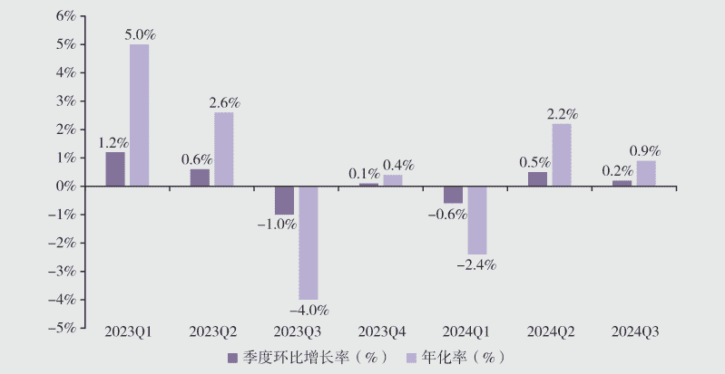

图2-1：2023年第一季度至2024年第三季度日本经济季节调整的实际 GDP 季度环比增长率和年化率

资料来源：日本内阁府。https://www.esri.go.jp/jp/sna/data/list/sokuhou/files/qqe243/pdf/jikei_1.pdf。

资料来源：国际货币基金组织，2024年10月《世界经济展望》，https://www.imf.org/en/Publications/WEO/Issues/2024/10/22/world-economic-outlook-october-2024。

### （二）通胀水平不断提升

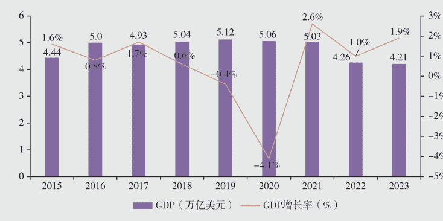

图 2-2: 2015—2023 年日本国内生产总值及增长率

资料来源：世界银行。

2024 年以来，日本通货膨胀水平持续提升（如图 2-3 所示）。2024 年10 月，月消费消费者指数（Consumer Price Index, CPI）为 109.5，同比增长 2.3%；季节性调整后，环比上升 0.4%。剔除新鲜食品的日本核心 CPI 为 108.8，同比上升 2.3%。

食品价格上涨为推动 CPI 上涨的主要因素之一。其中，谷物价格涨幅显著，同比上涨 13.5%，包括糯米在内的米价格同比上涨 60.3%。新鲜水果价格上涨 6.6%。与此同时，旅游业复苏，服务业价格全面上涨。

图 2-3: 2024 年至 10 月日本消费者指数

资料来源：日本统计局，https://www.stat.go.jp/stat/sokuhou/tsuki/index.html。

资料来源：日本统计局。

### （三）外贸表现亮优

2023年，日本进出口额为711.1 万亿元，同比下降2.6%。其中，出口额为100.9 万亿元，同比提高2.8%；进口额为10.2 万亿元，同比下降7.3%。2023年，美元对日元平均汇率为140.17，与去年跌7.2%，促进日本出口水平提升。

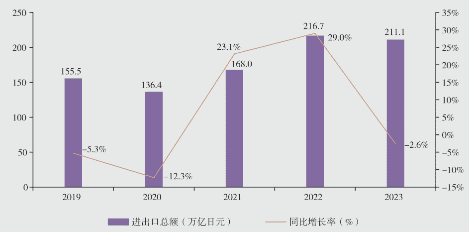

图2-4：2019—2023年日本对外贸易情况

数据来源：日本海关。

2023年，日本出口增速较快的有用车（出口额同比增长36.6%）、配件（42.7%）和机械（16.2%）；进口增速较快的有汽车（进口额同比增长26.1%）、零部件（35.4%）、电气仪器（14.6%）等。日本五大贸易国别地区为中国（贸易额占比20%）、美国（15.1%）、欧盟（10.3%）、澳洲（5.4%）、中国台湾（5.2%）。

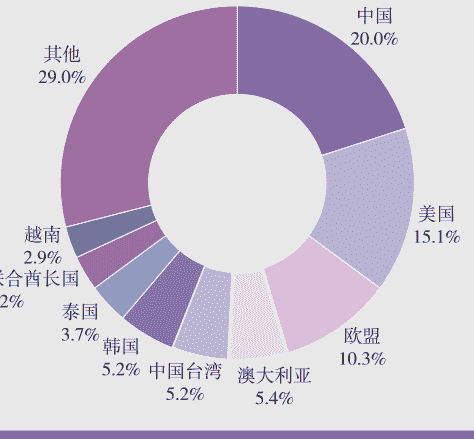

图2-5：2023年日本主要贸易国别地区

数据来源：日本海关。

### （四）外国投资下滑

日本财务数据显示，2023 年日本吸收外国投资流量约为3.01 万亿美元，同比下降33%（如图 2-6所示）。截至2023 年末，日本吸收外国投资存量为31.72 万亿美元。

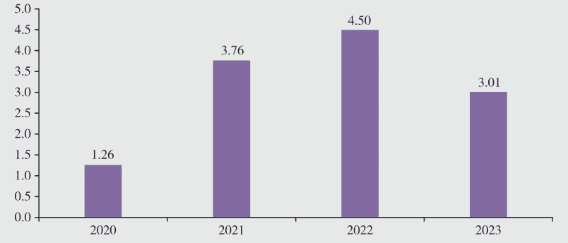

图2-6：2020—2023年日本吸收外国投资流量（单位：万亿美元）

数据来源：日本财务省。

- 1 资料来源：日本财务省，https://www.mof.go.jp/policy/international_policy/reference/balance_of_payments/bp.htm。

其中，制造业外资存量为1.49 万亿美元，占比36.2%；农业、矿业及服务业等非制造业外资存量为20.23 万亿美元，占比63.8%。日本外国投资五大来源地为美国（投资存量为8.66 万亿美元，占比27.3%）、新加坡（3.95 万亿美元，12.5%）、法国（3.13 万亿美元，9.9%）、中国香港岛（2.56 万亿美元，8.1%）、英国（2.32 万亿美元，7.3%）（如图2-7 所示）。

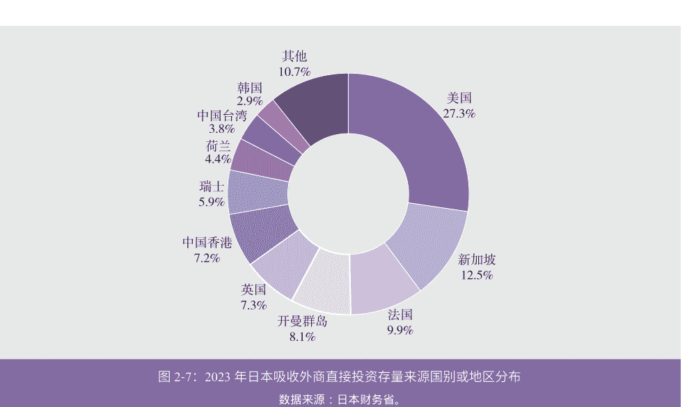

## 二、企业对日本营商环境评价较好

### （一）近六成企业认为日本营商环境较好

受访企业普遍反映，日本社会与经济环境稳定，商业法律法规相对完善。调查显示，58.9%的受访企业认为日本营商环境较好，与2023年调查相比提高6个百分点；38.1%的受访企业评价为一般，与2023年调查基本持平；仅3%的企业对日本营商环境评价为较差（如图2-8所示）。

### （二）三成企业认为日本营商环境有改善

自2023年4月起日本政府决定放宽疫情防控措施¹，日本经济活动不断恢复，跨人员交往频繁，在日本中资企业对日本营商环境预期更为乐观。调查显示，31.2%的受访企业认为日本营商环境改善，与2023年调查相比提升9.6个百分点；51.5%的受访企业认为2024年以来日本整体营商环境无变化，与2023年调查相比提升19.4个百分点；17.3%的受访企业认为恶化（如图2–9所示）。

图 2-8：企业对 2024 年日本营商环境的总体评价

数据来源：中国贸促会研究院。

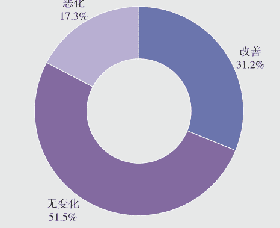

图 2-9：企业认为 2024 年日本营商环境变化情况

数据来源：中国贸促会研究院。

¹资料来源：日本厚生劳动省，https://www.mhlw.go.jp/st/corona5rui.html。

在中国企业认为，日本营商环境突出的问题分别是市场准入壁垒较高、税收社保等投资成本、主流媒体“涉华”负面信息影响企业经营、政府采购排他性较，企业持述观点的比例分别为34.6%、34.6%、24.2%、20.8%（如图2-10所示）。

| 项目 | 比例 |
| :--- | :--- |
| 市场准入壁垒较高 | 34.6% |
| 税收社保等投资成本 | 34.6% |
| 主流媒体“涉华”负面信息影响企业经营 | 24.2% |
| 政府采购排他性较 | 20.8% |
| 出口管制与当地供应链 | 17.3% |
| 外资企业在当地提供服务 | 10.4% |
| 中方办理工作证件难 | 9.9% |
| 外资企业执法不公平 | 9.9% |
| 政府执法裁量权较大 | 3.5% |

图2-10：企业认为日本营商环境存在的具体问题

数据来源：中国研究院。

## 第三章

## 一、总体问题

### （一）“安全化”趋势加剧

2022年5月18日，日本《安全保障推进法》正式公布，在两年内分阶段实施。该法围绕四大领域制定具体措施，包括限制对其他国家的依赖、实现重要基础设施的稳定运行、强化重要技术的研究开发以及建立专利公开制度。目前，日本基于《安全保障推进法》（以下简称“安保”）的相关政策逐步实施，调查显示，46.8%的企业认为与2023年相比日本安全化加剧，39.8%的企业认为没有变化，13.4%的企业表示未感知此。

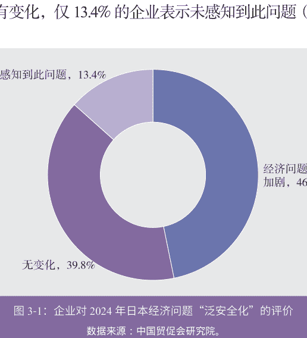

### （二）近四成企业受“安保”负面影响

日本将特定重要物资定义为国民生活所需物资及材料，通过发布清单进行限制。2024年6月，日本政府扩大外资审查范围，将半导体设备、先进电子元件、发动机等特定重要物资相关行业升级为“核心行业”，实施更为严格的外资准入审查。调查显示，36.8%的受访企业认为《安全保障推进法》及其指导方针、实施细则带来了面影响（如图3-2所示）。

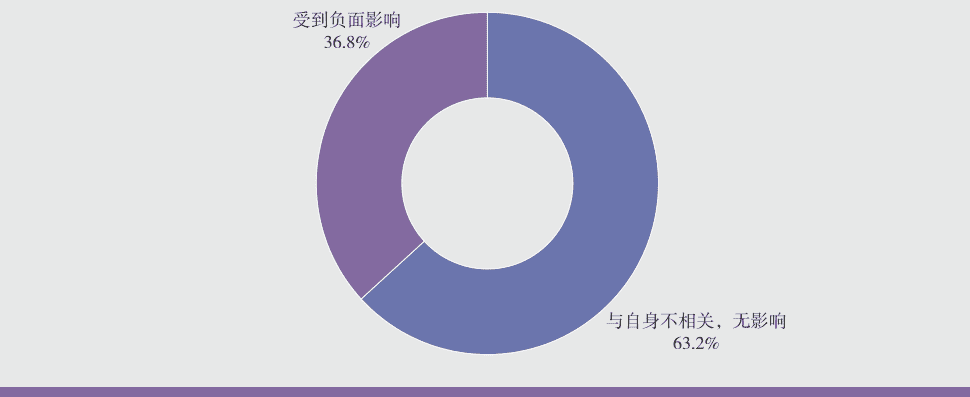

图3–2：企业受《安全保障推进法》及其实施细则的影响

数据来源：中国。

### （三）维护供应链安全提高市场准入

2024年2月，日本政府将尖端零部件（包括电容器、高频滤波器、矿物、永磁体、机床及工业机器人、航空零部件、半导体、电池、天然气、船舶和先进电子零部件）添加为特定重要物资。截至2024年7月，日本政府指定了12类重要物资。日本政府为每一类特定重要物资制定管理规定，主要包括：（1）通过认定认证的生产制造提供资金支持及优惠贷款，申请的企业需制定涵盖“促进供应链多元化、储备物资、替代物资”内的“确保供应”行动计划，并定期向有关部门报告实施情况；（2）NOD、JOGEC等立法允许政府给予企业补助。日本政府对2023年安排了9172亿日元预算。

- 1 NOTE: NED是日本新能源产业综合开发，是日本最大的公共管理组织之一，致力于动力、环保以及产业技术。其主要目标是通过创新技术来应对资源环境问题，并推动新型产业的发展，助力实现碳中和；JOGEC是日本国与能源保障机构，负责日本的石油、天然气和金属原料的稳定供应，并实施有关的污染控制和资源开发。

2024年7月9日，日本经济产业者发布《2024年国际白皮书》，指出构建公平且可持续的全球市场，将与“志同道合”的国家G7国家和其他欧洲国家就重要物资进行讨论，构建“透明、有弹性且可持续”的供应链。

调查显示，72.7%的受访企业认为日本《安全保障措施》及其细则将增加外资企业合规成本，54.5%的受访企业认为该措施将增加外资企业参与特定供应链的难度，18.2%的企业认为提高外资企业在日投资的难度（如图3-3所示）。

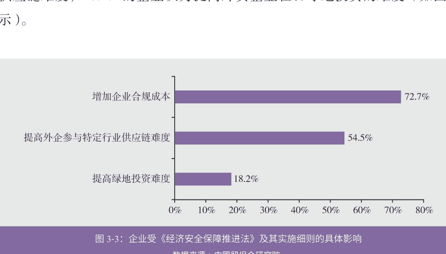

## 二、滥用贸易救济针对中国产品

### （一）在反倾销针对中国产品

近年来，日本相关产业的生产格局已发生根本变化，部分产品的国内产能向外转移，继续对特定商品实施反倾销，不符合日本市场需求。但日本全面评估市场结构性变化，延续原有反倾销措施，既不符合产业发展实际，也可能影响供应链整体效率。

2024年10月，日本对征收反倾销的对象产品共6项，其中中国产品有5项，占比80%。在5项被征税产品中，有3项适用反倾销税征收时间长达10年（见表3-1）。

- 1 资料来源：日本经济产业者；https://www.meti.go.jp/english/press/2024/0709_001.html。

# 表 3-1：截至 2024 年 9 月日本对原产自中国产品的反倾销情况

| 序号 | 产品名称 | HS编码 | 征税期间 | 适用率 |
| :--- | :--- | :--- | :--- | :--- |
| 1 | 磷酸 | 2819 | 2023年 | 37.2% |
| 2 | 乙醚 | 2907 | 2023年 | 26.5% |
| 3 | 聚苯 | 2910 | 2023年 | 31.7% |
| 4 | 氧 | 2916 | 2023年 | 33.0% |
| 5 | 氢 | 2811 | 2023年 | 20.8% |

*(注：此处表格内容根据OCR推断语义还原，原文中存在部分识别缺失，已按逻辑补全)*

## (四)中资企业在日面临用工困难

在调查中，中资企业反映了在获得人力资源方面存在困难。调查显示，40.3%的受访企业反映在日雇佣当地员工存在困难。具体包括：用人成本较高（70.1%的受访企业反映）、当地员工难以适应中资企业文化（39.8%）、提供薪酬竞争力不足（30.3%）、精通外语员工较少（29.9%）。

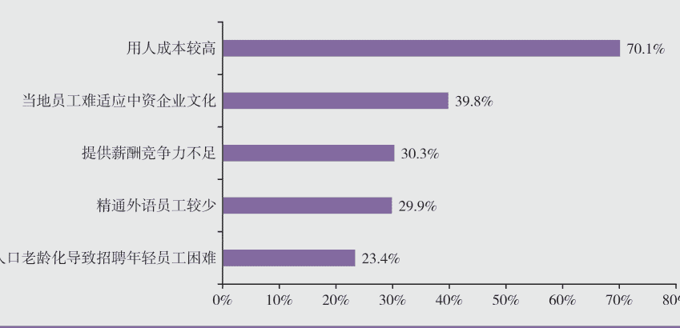

图 3-5: 企业在日雇佣当地员工的具体困难
数据来源：中国经营企业协会。

日本贸易振兴机构2023年在日外资企业调查显示，28.2%的受访外资企业反映日本在保障高级管理和技术人才方面的经营环境恶化，33.2%的受访企业反映日本在确保普通人才方面的经营环境恶化，全部受访外资企业中，2023年招募计划的不足。企业遇到困难：国际化人才少、招聘信息技术人才难、薪酬水平难以与配置规模上涨、雇用普通当地员工困难。近期，日本劳动年龄人口持续减少。2024年11月日本总务省的数据显示，截至2024年6月1日，15~64岁劳动年龄人口为7377.1万人，与2023年6月相比减少0.32%。

## (四)中资企业面临舆论与环境变化

近年来，日本国内对华舆论报道增加，部分日本媒体发挥炒作涉华热点问题的作用。调查显示，69.3%的受访企业反映在媒体以及出版物上经常看到“涉华”负面信息。

- 1 资料来源：日本贸易振兴机构，https://www.jetro.go.jp/en_images_/releases/2024/fee04b83b66c3d420403.pdf
- 2 资料来源：日本总务省，https://www.stat.go.jp/data/jinsui/pdf/20411.pdf

日本商务环境报告 2024

未关注“涉华”负面信息 30.7%

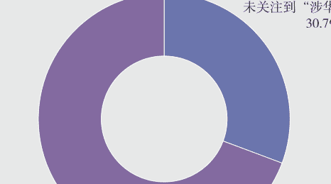

图 3-6: 企业反映在日在媒体推送“涉华”负面信息的情况
数据来源：中国贸贸会研究院。

2024年1月，日本内阁发布的“关于外交的舆论调查”结果显示，选择对中国“无亲近感”的比例从2023年2月调查的81.8%提升至86.7%，达到1978年调查启动以来的最高水平（如图3-7所示）。

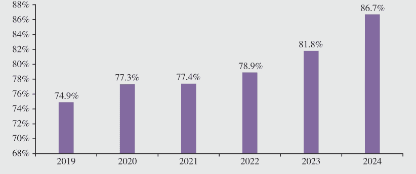

图 3-7：2019—2024年日本内阁“关于外交的舆论调查”选择对中国“无亲近感”的占比
数据来源：日本内阁。

## 四、公共服务效率优化与完善

### （一）公共服务效率体系问题阻碍经营

日本市场监管体系严格，但行政审批等办事流程繁复且效率普遍偏低，制约了企业在日本经营发展。调查显示，高达66.7%的受访企业表示日本审批许可事项办理效率较低。受访企业反映，部分行政部门缺乏明确的审批时限规定，人员不足导致执法效率低下，严重影响其在正常经营计划。

| 审批许可等效率较低 | 比例 |
|---|---|---|
| 执法过程透明度低 | 66.7% |
| 各部门间自由推责现象情况说明 | 17.3% |
| 执法机构自由裁量权过大 | 16.9% |
| 对外资存在视性执法 | 16.9% |

图3-8：企业对日本在公共服务方面存在问题的评价
数据来源：中国贸贸会研究院。

2024年，受访企业对日本公共服务环境的评价如下：调查显示，56.7%的受访企业认为公共服务环境良好，同比增加7个百分点；39.8%的企业评价一般，同比下降7个百分点；5%的企业评价较差，同比上升7个百分点。

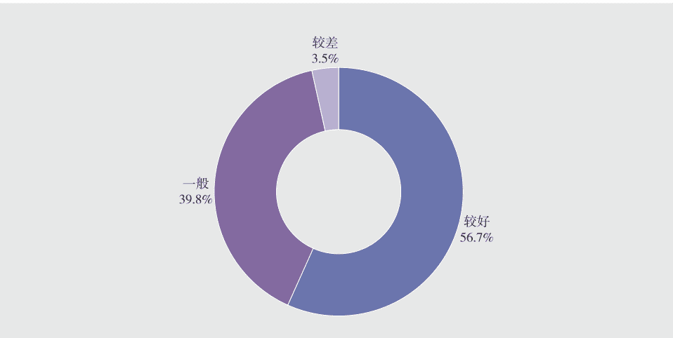

图3-9：企业对日本公共服务环境的整体评价
数据来源：中国贸贸会研究院。

### （二）行政审批规范问题未改善

调查显示，2024年行政审批过程中面临审批流程标准化不足、主管部门自由裁量权大等困难。日本审批流程尚未实现电子化，反馈机制不健全，人员不足导致在行政审批期间，无法向企业提供及时、有效的反馈。对此，74%的受访企业反映2024年行政审批规范问题并未得到改善。

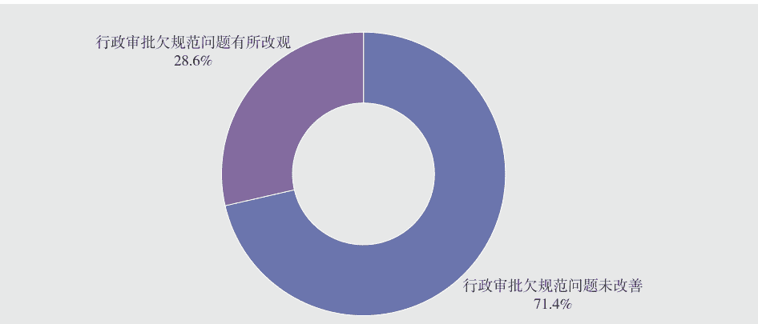

图3-10：企业对日本行政审批规范变化的评价
数据来源：中国贸贸会研究院。

# 第四章 总体建议

## 一、不断稳固中日合作

### （一）落实重要共识
两国领导达成的重要共识，不断巩固互信，共同维护供应链稳定，促进数字经济、绿色经济、医疗等领域便利人员交流。

### （二）推动RCEP框架下合作
深化区域合作，高质量实施RCEP，发挥RCEP框架下合作常态化作用，实现优势互补。

## 二、摒弃贸易保护主义

### （一）审慎使用贸易救济措施
支持并加强以世贸组织为核心的多边贸易体制，遵守世贸组织规则，秉持审慎态度，减少使用贸易救济措施以事实为基础，综合考虑产业发展周期、市场态势等因素，避免将贸易救济工具政治化。

### （二）调整出口管制措施
缩减对华高技术产品的管制清单，更好地平衡安全与发展需求，避免管制范围。提高出口管制政策的透明度和预期性，及时发布政策解读和操作指南，让中国企业能够更好地进行合规管理。

## 三、坚持开放方向

### （一）放弃将经济问题“泛安全化”
坚持市场经济原则，尊重市场规律，妥善管控。在对华经贸问题上避免意识形态对抗，聚焦利益共赢，摒弃“零和博弈”思维。

### （二）制定公正透明的外资审查规则
为日本企业制定公正透明的外资审查规则，制定合理的外资审查清单，缩短外资审查期限，减少政府自由裁量空间。

### （三）消除隐性壁垒
营造更加透明的市场准入环境，采取切实实施措施，消除金融、医疗等重点领域对外资企业的隐性壁垒。加强行政程序的透明度，明确各类许可和审批的具体标准，避免由自由权过大导致对外资企业的差别对待。

## 四、营造公平竞争市场环境

### （一）逐步减少对生产环节的补贴
严格遵守补贴规则，减少对本土半导体、电池等行业在厂房建设及生产环节的补贴，避免过度干预市场，消除市场扭曲，维护全球供应链稳定发展。

### （二）保障外资企业参与公共采购
在公共采购过程中对内外企业一视同仁，确保中资企业公平参与市场竞争。对禁止参与公共采购项目的原因，给予明确解释说明。

## 五、提升服务外资企业水平

### （一）有效简化行政手续
重视日本长期存在的公共服务效率低下问题，有效推进涉企行政手续的简化改革，推行“承诺制”和“容受理”，提高公共服务效率，降低企业制度性成本。

### （二）提高行政审批的透明度
进一步提高行政审批的透明度，明确各项审批的操作标准和审核要点。针对金融领域许可证发放、药品注册、新技术等领域，部分审批标准和流程较为模糊、自由裁量空间较大的问题，应建立统一的行政审批标准数据库，详细公示审批条件、所需材料、办理流程和时限要求。

### （三）取消外资企业合理限制
建立常态化的外资企业政策沟通机制，更加积极地听取并采纳外资企业的合理建议。完善反馈机制，设立受理部门（办公室），及时回应和解决外资企业在经营中遇到的不合理限制，切实保障外资企业合法权益。

### （四）出出更多外资优惠政策
针对外资企业出台新轮优惠政策，提升投资吸引力。实施区域差异化优惠，加大创新支持力度，优化税收政策，促进外资与本土深度融合。

# 第五章 市场准入

### 最新发展

### （一）扩大外商投资审查的核心行业

2024年6月16日，日本财务省、经济产业省和国土交通省就《外汇及对外贸易法》（简称《外汇法》）修正案进行公众咨询。8月16日，日本财务省公布《外汇法》修正案，于9月15日施行。此次修订增加了外商投资审查的“核心行业”领域：1）与经济安全法确定的行业，包含半导体制造、先进电子元件、机床零部件及船用发动机；2）日本政府认为与国家安全有关的行业，包含电缆制造和多功能设备。外国投资者在收购“核心行业”股份时，需向相关主管部门申报并接受审查。《外汇法》修正案指出，日本政府对可能削弱国家安全的领域采取更为严格的审查措施。

表 5-1：《外汇法》新增外商投资审查核心行业状况

| 行业 | 新增核心行业 | 行业状况 |
|---|---|---|
| 与“特定物资”相关的行业 | 半导体制造 | 半导体机械、设备、材料等的制造 |
| | 先进电子元件制造 | 陶瓷容器及先进电子元件制造 |
| | 机床零部件制造 | 滚床、线性轴和机床等零部件制造 |
| | 船用发动机制造 | 柴油发动机及民用发动机制造 |
| | 电缆制造 | 石英纤和光束制造 |
| 与“国家安全”相关的行业 | 多功能设备制造 | 具有发送、接收等多种功能的机器和设备制造

数据来源：中国贸会内部整理。

- 1 资料来源：日本财务省，https://www.mof.go.jp/english/policy/international/fdi/News_and_Communications/20240619.html。
- 2 注：日本限制外商投资行业分为核心和非核心。其中，核心行业被定义为可能影响国家安全的行业，需经过更严格的审查，且面向金融、主权基金等投资者的“事前申报”。
- 3 资料来源：日本财务省，https://www.mof.go.jp/english/policy/international/gaitame/release/20240817.html

### （二）修改核心行业领域的日本上市公司清单

2024年8月16日，日本财务省第六次修订《根据外汇法对直接投资等事前申报的上市公司清单》，自9月15日起适用。根据《外汇法》确定的限制外资行业，清单按照公司章程、年报、问答等信息将日本上市公司划为：核心行业、非核心行业以及非限制行业三种类型，清单随限制外资行业范围而变化，为外国投资者提供申报参考。本次修订由于《外汇法》将“保障安全”相关行业纳入审查范围，重新界定了核心行业的日本上市公司名单。

截至2024年10月，清单中共有日本上市公司4032家，其中非核心行业上市1047家，占比26%；核心行业上市950家，占比23.6%。与上一次修订（2023年4月）相比，核心行业上市企业增加了6.7%。

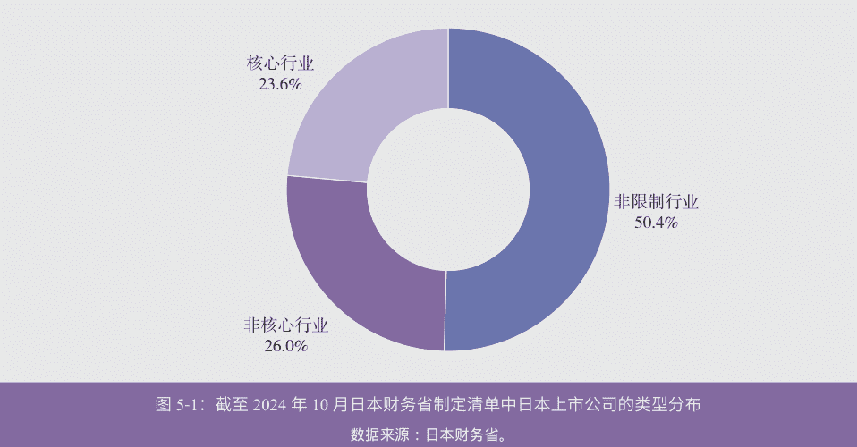

### （三）拟将回出口产品列为反倾税对象

2024年10月，日本政府表示决定将经由第三国的“回出口”和通过加工变化的产品列为反倾税的对象。依据现行制度，日本仅基于原产地规则采取贸易救济措施，即对低于原产地价格的产品征收倾税。

- 1 资料来源：日本财务省，见 https://www.mof.go.jp/jp/international_policy/gaitame/kawaso/press_release/20240910.html。
- 2 注：通过等第三国进行转口贸易。

新制度实施后，日本通过简单调整和认定，针对具有“避嫌”行为的产品（如将原料和零部件转移至第三国加工或小幅改变成分和规格的产品）征收反倾税。日本经济新闻报道，该措施或针对中国生产的钢铁产品。日本钢铁巨头——日本制铁公司提出，日本行业团体敦促日本政府对中国采取反倾税措施。

### （四）对中国电极材料等采取反倾税措施

2024年3月1日，日本政府新实施反倾措施。2024年日本国内发布命令，对中国产电解二氧化钛反倾税征收期延长5年。2024年2月26日，华源素、东海碳素株式会社向财务大臣提交申请，要求对中国石墨极（HS编码：85451）征收反倾税。2024年4月24日，日本财务省和经济产业省启动调查。7月7日，中国石墨极供应商、生产者和进口商等相关方进行调查。日本政府指出将在一年内完成调查，并对中国电解二氧化钛征收反倾税。日本政府于2024年9月29日决定对中国电解二氧化钛征收反倾税，税率定为34.3%~46.5%。2023年1月，日本洋事有限公司、东海碳素等请求延长对中国电解二氧化钛反倾税的征收期。2023年3月，日本财务省、经济产业省成立调查组。根据审查结果，调查提出损害发生对国内产业造成损害。

- 1 资料来源：日本经济新闻，https://www.nikkei.com/politics/economy/56803-2024-05-10-3。
- 2 资料来源：日本经济新闻，https://www.nikkei.com/article/DGXZQG1A831807A9C0000/
- 3 资料来源：日本四季报，https://shihiko.toyekai.net/news/0/81880/.
- 4 注：用于制造电极材料的生产。
- 5 资料来源：日本经济产业省，https://www.meti.go.jp/external_economy/trade_control/trade-remedy/investigation/EDM/2024-0226_seirei.pdf。
- 6 注：圆柱形主要用于电弧炉中的电极。
- 7 资料来源：日本经济产业省，https://www.meti.go.jp/external_economy/trade_control/trade_remedy/investigation/kouenikyokudo/index.html。

## 二、问题分析

### （一）约六成企业认为日本外资审查不合理

日本政府将“特定重要行业”以及“保障供应链安全”相关行业纳入事前申报的核心行业后，外资审查范围进一步扩大，审查更加严格。调查显示，61.5%的受访企业反映日本投资存在限制行业范围不断增加的问题，58.4%的受访企业认为需要审查的行业、行为定义模糊，30.3%的企业反映在审查过程中遭受歧性待遇（如图5-2所示）。

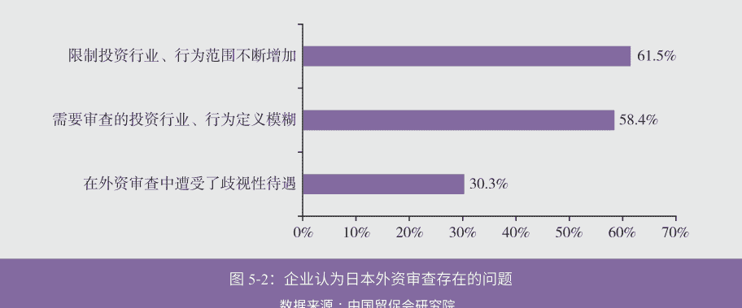

### （二）外国投资者事前申报数量不断增多

日本财务省最新数据显示，2023年外商投资事前申报的数量为2871个，同比增加18.3%（如图5-3所示）。其中，取得日本股份引发的事前申报数量为1387个，是主要适用申报的行为类型；因特定行为的事前申报数量1266个，是事前申报行为中增长快的一类，增幅41.9%。从投资者来源来看，做出事前申报的外国投资者10大国家或地区包括美国、开岛、新加坡、香港、韩国、英国、中国台湾、荷兰、中国。

- 1 2019年11月29日，日本修订《外汇法》，将“外国投资者及其客户担任董事会成员或审计师”“外国投资者向股东大会提议更改或终止公司行为”两种类型确认为事前申报行为。
- 2 数据来源：日本财务省，https://www.mof.go.jp/policy/international/gaitame/kawaso/release/20240626.pdf。

### （三）信息服务相关市场准入提高

日本财务省最新数据显示，2023年依据《外汇法》进行事前申报的相关投资行业中，网络安全相关行业的事前申报数量最多，占申报总数的57.4%（如图5-4所示）。

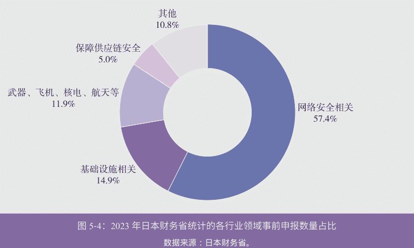

调查显示，66.7%的信息传输/软件和信息技术服务企业认为2024年日本市场准入壁垒提高，显著高于受访企业的平均水平。

## 三、我们建议

### （一）放弃将经济问题“泛安全化”

坚持市场经济原则，尊重市场规律，妥善管控。在对华经贸问题上避免意识形态对抗，聚焦利益共赢，摒弃“零和博弈”思维。

### （二）制定公正透明的外资审查规则

为日本企业制定公正透明的外资审查规则，制定合理的外资审查清单，缩短外资审查期限，减少政府自由裁量空间。

### （三）消除隐性壁垒

营造更加透明的市场准入环境，采取切实实施措施，消除金融、医疗等重点领域对外资企业的隐性壁垒。加强行政程序的透明度，明确各类许可和审批的具体标准，避免由自由权过大导致对外资企业的差别对待。

该制度由日本法律、内阁政令、省令组成。《经济安全保障推进措施》纳入审查范围的14个基础设施领域；内阁发布公告列细分领域；各省令确定关键领域的重要社会设施运营标准；各大臣指定并公布具体运营名称。截至2023年9月4日，日本政府指定社会设施运营企业共213家，包括电力、燃气、供水、铁路、航空、电信和机场等多种领域的企业及机构。制度发展阶段及出台法案详见表 6-1。

# 第六章 公共采购

表 6-1：《经济安全保障推进措施》重要基础设施管理制度发展概况

| 序号 | 日期 | 概况 |
| --- | --- | --- |
| 1 | 2023年9月28日 | 日本内阁发布《防止损害行为以确保社会设施稳定提供的指导方针》 |
| 2 | 2023年9月8日 | 日本内阁宣布确定重要社会设施运营标准，各省发布省令确定重要社会设施运营和指定标准 |
| 3 | 2023年11月11日 | 重要基础设施领域、重要社会设施运营者的指定标准、特定要设备等法规开始实施 |
| 4 | 2023年11月16日 | 关于完善申请、申报事项、竞程序等省令公布；日本政府指定了210家重要社会设施运营商 |
| 5 | 2023年11月17日 | 重要维护管理、申报事项等相关省令开始实施 |
| 6 | 2024年5月17日 | 重要基础设施管理制度实施，运营商开始适用申报和申议 |

资料来源：中国贸会研究院部根据日本内阁公开资料。

### （二）初创和中小企业公共采购

2023年11月2日，日本内阁发布《彻底应对通货压力等综合对策》，为了促进中小企业参与公共采购，将采取以下措施：(1)增加与参与J-Startup 计划的高新技术企业签订自营合同的数量；(2)赋予参与J-Startup计划的初创企业参与投标等级，扩大可参与范围；(3)向初创企业提供参与公共采购的优惠待遇。

- 1 资料来源：日本内阁，《确保重要基础设施稳定提供的制度体系》，https://www.cao.go.jp/keizaian/annhos_shishoun/info/index.html
- 2 资料来源：日本内阁《被确定的重要社会设施运营指南》，https://www.cao.go.jp/keizaian/annhos_shishoun/infhoun/dojyo_gov.pdf
- 3 注：J-Startup 计划于2023年10月6日公布，由日本企业、日本贸易振兴机构（JETRO）和新能源产业技术开发机构（NEDO）共同举办。为具有潜力的初创企业提供一系列支持。在入选的企业中日本政府及相关专家推荐，截至2023年4月共有50家企业入选。来源：日本政府，https://www.meti.go.jp/press/2023/04/203006.html
- 4 注：自营企业通过公开招标程序，由公机构选择并与特定供应商签订的采购合同。
- 5 注：日本企业参与公共采购时规定规模为A级或B级，为优秀的企业等可参与目标项目的金额。
- 6 资料来源：日本内阁，《彻底应对通货压力等综合对策》，https://www.cao.go.jp/keizaian/taisaku/20231102_taiseaku.pdf

2024年4月9日，日本内阁通过了《2024年基于公共需求的中小企业国家合同基本方针》，提出要增加政府和公共机构采购中小企业产品和服务份额，要求全公共采购面向中小企业和微型企业的合同占比达到61%，面向成立不满10年中小企业的合同比率达到3%以上（如图6-2所示）。2024年6月21日，日本内阁推出《制度改革改革实施计划》，再次强调要对公共采购倾斜支持中小企业发展新技术和提供新服务，提高包括创业企业在内的中小企业获得订单的机会。日本也鼓励政府通过公共采购支持创业企业。2024年1月，日本经济产业在“地区未来来投资促进中小企业基本指导方针”中提出，地方政府增加对初创企业的公共采购。

| | | 2022 | 2023 | 2024 |
|---|---|---|---|---|
| 70% | | | | |
| 60% | | 61.0% | | |
| 50% | | 49.8% | | 53557 |
| 40% | | | | |
| 30% | | 47405 | | |
| 20% | | | | |
| 10% | | | | |
| 0% | | | | |
| | 采购金额（亿日元） | | | |
| | 采购金额占比（%） | | | |

图6-2：2022—2024年日本公共采购面向中小和微型企业采购目标金额及占比

资料来源：日本经济产业省，《2024年基于公共需求的中小企业国家合同基本方针》。

### （三）建设面向云服务的中小企业采购

为降低初创公司参与公共采购门槛，推动跨部门数字化服务，日本政府将建设“数字市场”（Digital Marketplace, DMP）。2024年6月，

- 1 注：中小企业定义为：“制造业规模亿元以下或员工少300人、批发行业规模亿元以下或员工少100人、零售规模5000万元以下或员工少50人、服务业投资在5000万元以下或员工少20人”。
- 2 注：日本政策定义为：“服务业企业”。
- 3 资料来源：日本经济产业省，《2024年基于公共需求的中小企业国家合同方针》，https://www.meti.go.jp/press/2024/0402_01
- 4 资料来源：日本内阁，《制度改革计划》，https://www.cao.go.jp/seiji-kaikaku/kaikaku/publication/240626/01.pdf
- 5 资料来源：日本经济产业省，中小企业支持政策，https://www.meti.go.jp/policy/sme_chika/miraisushiteiki/honkai-202401.pdf

日本内阁正式批准《实现数字社会的优先计划》，将构建“数字市场”作为公共采购的一部分，旨在促进中央与地方政府快速采购、便利化等数字服务。日本数字字厅负责DMP，于2023年10月推出测试版，面向企业和公共机构注册。官方网站于2024年半年正式开放。使用 DMP 采购的流程：供应商与数字字厅注册后，可在网站搜索相关信息。公共机构通过网站搜索、比较结果作为采购依据。DMP运行如图6-3所示。

## 二、问题分析

### （一）未就RCEP政府采购领域进行立法

在签署RCEP之后，截至2024年10月，日本尚未对相关法律进行大幅修改，预计会将RCEP政策纳入实践。

- 1 注：软件即服务（Software as a Service, SaaS）是一种将软件部署在云服务器上，通过互联网向用户提供服务的模式。用户通过订阅的方式，按需付费，无需购买、安装和维护硬件。
- 2 资料来源：日本数字字厅，https://www.digital.go.jp/policies/priority-policy-program/

日本采购环境报告2024。2022年1月日起，区域伙伴关系正式对日本在内的10个签署国生效。RCEP涵盖政府采购承诺义务，其中政府采购章节涉及透明度义务、合作领域等。采购透明度义务是本章节的核心内容，适用于政府采购涉及的法律和程序（见表6-2）。

表 6-2：RCEP政府采购章节的主要内容

| 领域 | RCEP采购义务 |
| --- | --- |
| | (1) 公开政府采购相关法律法规，尽可能公开政府采购程序和招标信息；(2) 尽量努力通过电子化提供上述信息，并不断更新；(3) 各缔方应在第16项的文件中证明政府采购法律、规则和招标信息发布的纸质或电子获取方式；(4) 各缔方要使用上述信息以英文方式获取。 |
| | (1) 尽可能就缔方的法律、程序以及其中任何事项交换信息；(2) 向缔方提供援助、技术支持，能力使其与其诉保持相关信息；(3) 在可能的情况下，缔方之间分享中小企业在政府采购中的最佳实践；(4) 在可能的情况下，缔方之间共享与电子采购系统的相关信息。 |

资料来源：国际法律比较研究中心（ICLG）网站，《区域伙伴关系协议》。

### （二）海外企业资质审查采购门槛

调查显示，45.9%的受访企业认为日本《经济安全保障推进法》实施将提升海外企业参与日本公共采购的门槛，存在差距；33.3%的受访企业认为基于日本建立的基础设施供应商资格审查制度存在，29.0%的企业认为该法实施后日本公共采购流程更紧张、效率更低，25.1%的企业认为该法将提高供应商合作成本（如图6-4所示）。调查了解到，由于政府公布的供应商资格审查标准，审查过程裁量权大的可能性较高，对外国供应商参与日本基础设施领域公共采购产生负面影响。

资料来源：国际法律比较研究（ICLG）网站，https://iclg.com/practice-areas/public-procurement-laws-and-regulations/japan。

### 提高公共采购隐门槛

| 影响因素 | 比例 |
| :--- | --- |
| 供应商资格审查存在歧视 | 45.9% |
| 公共采购流程更紧张、效率更低 | 29.0% |
| 提高供应商合规成本 | 25.1% |

图6-4：企业认为《经济安全保障推进法》实施对日本公共采购的影响

### （三）信息服务企业受资格审查影响

| 影响因素 | 比例 |
| --- | --- |
| 供应商资格审查存在歧视 | 65.2% |
| 公共采购流程更紧张、效率更低 | 65.2% |
| 提高供应商合规成本 | 34.8% |

资料来源：国际法律比较研究院。

### （四）政府采购规则透明度待提升

日本是世界贸易组织《政府采购协定》(Government Procurement Agreement, GPA）的缔约，旨在消除对外国货物、服务的歧视，增加政府采购透明度。调查显示，19.9%的企业认为政府采购规则不够透明（如图6-6所示）。

## 三、建议

### （一）加入政府采购协议

建议日本政府加入世界贸易组织《政府采购协议》，向各国谈判议程，加强政府采购领域合作提供更多机会。

### （二）明确基础设施审查标准

建议日本政府完善基础设施供应商资格审查制度，明确审查标准，避免任意扩大基础设施运营商及其维护范围。

### （三）公正开展供应商资格审查

建议日本政府公正开展基础设施领域供应商资格审查，缩短审查时间，确保过程透明，保障外国企业参与公共采购。

### （四）提升采购透明度和规范性

建议日本政府不断提升公共采购数字化水平，加快信息发布与实施，提高招标流程的透明度和效率。

### （五）实施RCEP规则

建议日本政府加快落实RCEP章节有关规定，推动RCEP框架下政府采购规则向精细化、更高水平发展。

# 第七章 数字经济

### 最新发展

### （一）修订（个人信息保护法）

《个人信息保护法》（Act on the Protection of Personal Information, APPI）是日本个人信息保护制度的基石，该法配套令、方针、指南等共同规范个人处理活动。《个人信息保护法》适用于经营业务的个人、法人或机构，且具有境外效力。该法第17条规定，境外信息处理者在向日本境内企业或个人提供商品或服务过程中，收集、处理日本境内数据，同样受个人信息保护法约束。为强化个人信息保护，日本《个人信息保护法》自2023年颁布以来，遵循“三一改”多次修订，法律条文增加至185条，有六大核心修订点：(1)禁止行为立法；(2)统一个人信息监管机构；(3)要求政府建立“个人信息档案”；(4)明确信息处理规则；(5)细化医疗、学术研究等领域信息处理规则；(6)区分不同主体性质，处罚措施更为严厉（见表7-1）。

| 序号 | 修订重点 | 修订内容 |
| --- | --- | --- |
| 1 | 禁止行为立法 | 新修订的APPI涵盖了原有的个人信息保护相关法律，包括《个人信息保护法》和《独立个人信息保护法》，及地方公共团体颁布的个人信息保护条例。 |
| 2 | 统一个人信息监管机构 | 原管理机构分散，包括个人信息保护委员会和地方公共团体。新修订的APPI赋予个人信息保护委员会的法律地位和权威性，将个人信息保护委员会为唯一的个人信息监管机构。 |
| 3 | 要求政府建立“个人信息档案” | (1)行政机关负责对将持有的个人信息编制为“个人信息档案”并发布，说明信息名称、个人信息使用的数据、主体团体、个人信息收集方法、敏感信息内容等。(2)要求个人信息档案记载可能影响业务事务执行，只需留记录部分 |

- 1 注：个人信息数据库由个人数据构成，数据包括个人信息、个人相关信息、匿名信息等。
- 2 资料来源：日本个人信息保护委员会，https://www.ppc.go.jp/english/
- 3 注：《个人信息保护法》在法律施行期间、法律施行后，政府每三年就应对对个人信息保护相关的国际动态，以及涉及信息技术的发展和与个人信息使用的新产业进行审查；在此基础上的考虑法律的实施，在必要时进行修订。

| 序号 | 修订后 | 修订内容 |
| --- | --- | --- |
| 4 | 明确匿名处理规则 | (1)个人信息处理者在匿名加工时，严格按照“不可识别为特定个人”标准进行加工；(2)在匿名化后，需采取措施防止信息处理过程中标识或符号泄露；(3)若个人信息处理者将匿名信息提供给第三方时，应当具体的方式；(4)个人信息处理者应当与其任何信息比对。 |
| 5 | 细化医学、学术研究等特殊领域信息规则 | (1)个人信息处理者在匿名化时，原则上与相同规定，不得另有规定；(2)匿名化处理时，不再适用豁免情形。 |
| 6 | 处罚措施 | (1)行政处罚，若行政机关处理个人信息的行为不正或向他人提供，不符合规定之处，处以一年以下罚款（第76条）；(2)处责对象，包括法人、组织（等）及其直接负责人，在经营过程中提供或使用个人信息的，将被处以以下罚款（第79条）。 |

### 数据统计

### （二）手机软件竞争促进法

2024年6月12日，日本众议院通过了《手机软件竞争促进法》。该法旨在为手机市场营造公平环境，通过激活各类主体创新能力与动力，消费者可以选择并享受更多创新同时确保安全。《手机软件促进法》定义为“手机中使用特殊软件（如操作系统）、应用程序、搜索引擎等”。针对特定软件，日本公平竞争委员会（Japan Fair Trade Commission）。

- 1 注：匿名标识通过删除或替换个人信息的某些部分，无法任何方式识别特定个人，且无法恢复信息。
- 2 资料来源：日本公平竞争委员会，https://www.jftc.go.jp/pdf/240612en.pdf。

表 7-2: 日本《手机软件竞争促进法》主要内容

| 序号 | 条款 | 具体内容 |
| --- | --- | --- |
| 1 | 要求监管的供应商 | 为“特定供应商”。“特定供应商”不得阻止第三方供应商提供的应用程序商店，除非为安全、隐私、保护青少年等正当理由。 |
| 2 | 禁止竞争行为的措施 | 为决定市场的竞争问题，JFTC将确保市场达到标准的竞争者，为“特定供应商”。“特定供应商”不得阻止第三方供应商提供的应用程序商店，除非为安全、隐私、保护青少年等正当理由。(1)不得阻止第三方供应商提供的应用程序商店；(2)不得允许用户使用第三方计费系统（可能）；(3)应允许用户设置默认设备，并提供灵活的筛选等；(4)不得在检索上无理由服务于手机格式具有竞争性的优待；(5)不得获得任何自有应用程序；(6)不得阻止应用程序使用与第三方供应商相同的操作系统控制的功能（可能）。 |
| 3 | 确保监管有效性 | (1)要求“特定供应商”提交报告；(2)确保利益相关者能够提交信息；(3)提供能够和维护能够进行；(4)要求JFTC进行调查，发布禁止令、支付罚金（相关营业额的20%）。 |

### （三）全球跨境促进信息安全传输

2024年3月27日，日本《个人信息保护委员会宣布全球趋势》发布。该倡议旨在促进跨境个人信息的安全流动，推动“数据自由流动”（Data Flow with Trust, DFTT），支持企业选择符合自身需求的跨境传输方案，并制定全球标准。其主要措施包括：加强与“志同网络”国家的合作，发展企业认证系统、提升全球标准合同的交互性、参与多边和区域框架下的合作；传播信息以满足国际企业需求、加强国际标准的基础建设。

个人信息保护委员会宣布全球趋势主要措施

| 序号 | 目标 | 具体措施 |
| --- | --- | --- |
| 1 | 增强信息国际环境 | (1)逐步发展国际互认。具体包括：与日本等同水平的个人信息保护制度的国家和地区达成互认系统，以便进行个人数据传输；根据《信息保护法》实施，尽早与美国、英国等国家达成相互互认；(2)促进个人数据流动体系，将促进全球跨境隐私规则的扩展应用；(3)引入标准合同条款，在全球范围内实现标准合同条款的交互性，并与具有共同利益的国家和地区达成基础合同条款的研究会；(4)应对个人信息保护风险，继续与有关政府无限制访问和数据本地化讨论，并努力在策略结果影响国际标准制定中，加强组织组织的《政府访问私有部门中的个人数据》能够用于非营责任。 |

| 序号 | 目标 | 具体措施 |
| :--- | :--- | :--- |
| 2 | 加强和建立与相关的关系 | 家和地区的国际合作关系，包括执法合作 |
| 3 | 传输信息以满足国内企业需求 | | |
| 4 | 加强对国际事务理解的官员技能 | 安排基础，从我国事务的官员技能 | | |

(1) 加强亚洲和区域集中的合作关系；
(2) 加强和构建跨边疆和区域合作关系。参考 2023 年 10 月签订的日本和英国人的个人信息保护承诺，致力于推动与“志同道合”的国家签署的个人信息保护合作。
(3) 扩大向国际开展的企业信息传输，这是有关个人信息保护的外国法律问题。

制定政策，以应对技术创新和面对挑战等问题；
(1) 加强国际事务参与制度基础建设；
(2) 培训能够参与国际事务的官员。

资料来源：中国宪政院根据日本个人信息保护委员会公开资料整理。

## (四) 发布《创新战略2024》推动 AI 技术创新

2024 年 6 月 4 日，日本政府发布《创新战略2024》。从战略高度推动 AI 技术研发，强调开放 AI 前沿领域，并加强基础研究、应用研究与试验研发的协同。

该策略指出，在日本人口不足日益严峻的背景下，依靠 AI 和机器人技术实现灵活和调节劳动力供给是当务之急，以预防和应对灾害也是关键课题。该策略强调要加快 AI 和机器人技术的实际应用，制定并确保 AI 使用安全的规则，通过国际合作，推动 AI 的创新和安全。

《创新战略2024》针对人工智能领域提出三大强化措施：(1) 实施关键技术综合战略，以促进 AI 技术的全面发展；(2) 加强全球协作，共同推动 AI 技术新发现与应用；(3) 提升 AI 竞争力并确保其安全，确保技术领先的同时兼顾社会安全与治理。

## 日本成立“人工智能安全研究所”

2024 年 2 月 1 日，日本政府成立“人工智能安全研究所”。该研究所由日本内阁府内秘书书、警察厅、数字厅、总务省等部门，并与日本行政法人信息处理推进机构 (IPA) 合作，致力于建立人工智能安全评估的标准和方法。主要职责包括开展安全评估和标准制定，并与其他国家的人工智能安全研究所建立合作。研究通过人工智能控制的生物制造物和化学武器的可能性，检查安全漏洞，并探讨人工智能控制的社交账号可能带来的风险。

- 1 资料来源：日本内阁，https://www.gao.go.jp/cst/foutsousryaku/2024.html

## （五）修订《隐私标准信息保护管理指南》

2023 年 9 月，日本信息经济社会推进协会发布了日本工业标准《个人信息保护管理——要求事项》（JIS Q 15001:2023），适用于所有类型和规模的企业或组织。

该标准对企业或组织建立、实施、维护和改进个人信息保护管理进行规定。

2023 年 12 月 25 日，日本信息经济社会推进协会在该标准的基础上，发布修订版《隐私标准信息保护管理指南》。指南指出，企业或组织可根据相关要求采取个人信息保护措施，建立管理体系；符合标准的企业或组织，审核后可获得隐私标准。隐私标准可以在经营中使用，以证明其个人信息保护水平。

该指南自 2024 年 10 月 1 日实施，日本信息经济社会推进协会负责接收并审核修订申请，¹

表 7-4：《隐私标准信息保护管理指南》修订内容

| 序号 | 修订方面 | 修订内容 |
| :--- | :--- | :--- |
| 1 | 个人信息保护系统 | 新增“对于所使用的假名化处理，匿名处理信息和个人相关信息，如果提供给第三方的系统则计为个人信息，应将其确定为个人信息保护管理系统的适用范围。” |
| 2 | 个人信息保护计划 | 新增“对管理个人信息数据的要求，此类数据需要频繁更新，数据需访问。” |
| 3 | 个人信息风险评估标准 | 新增“隐私标准中权利者的权益”以及“防止个人信息泄露、丢失、失毁、误错，采取措施，防止未经授权的传输、未经使用，以及防止泄露请求。” |
| 4 | 个人信息风险管理 | 新增“通过跟踪和关注个人信息风险，加强对潜在危险的解决，在短期或中期内应对。” |
| 5 | 变更个人信息管理体系 | 新增“企业或组织在变更个人信息管理体系时，要制定计划。” |
| 6 | 紧急事项应对 | 新增“针对发生事故的相关信息和要求，建立‘应急机制’。负责人、个人信息保护委员会，以及其利益者时告知。” |
| 7 | 文档的内容 | 新增“关于第三方的来说，与提供者相关的要求，信息应当涵盖的相关信息、对紧急事项的监控、评估和记录，可能发生的错误。” |
| 8 | 获取敏感信息 | 新增“应明确使用提供者的个人信息（包括提供者的数据），此外，当个人信息中含有敏感性、或与社会相关的信息时，应采取相同的保护措施。” |
| 9 | 向第三方提供信息 | 新增“排除该信息是否为个人信息保护措施，以及该指标符合（1）OECD 指南中的业务；（2）其他对权利可能产生损害的影响。” |

¹数据来源：日本经济社会推进协会，https://privacy.mark.jp/guideline/pmishin2023.pdf。

| 序号 | 修订方面 | 修订内容 |
| :--- | :--- | :--- |
| 10 | 明确对第三方提供信息的限制 | 对第三方提供个人信息，需提前获得本人同意、明确主体名称、地址等。 |
| 11 | 匿名化后的数据销毁 | 新增“匿名处理后的数据销毁，允许将姓名替换为 ID，以及将姓名替换为随机 ID 等。” |
| 12 | 外部供应商 | 新增“若企业或组织使用外部服务，应在事先了解、评估服务内容的基础上，对外部服务供应商进行选择。” |

资料来源：中国研究院根据日本经济推进协会官网整理。

## 二、问题分析

### （一）九成企业认为数字环境有改善空间

调查显示，80.1% 的受访企业认为日本经济环境一般，9.9% 的受访企业认为日本经济环境差，仅 10.0% 的受访企业认为日本经济环境良好（如图 7-1 所示）。

图7-1：企业对日本经济环境的总体评价
数据来源：研究院

### （二）四成企业认为数字领域外资审查逐步收紧

日本修订《外汇法》，将半导体设备等相关产业纳入外资审查的核心范围。要求居民在对日本“核心行业”进行投资（收购上市公司 1%以上的投票权，或收购非上市公司股份），须向相关部门提交申请，接受严格的外资审查。对于可能威胁到国家安全或经济利益的购买等行为，也需事先申请。日本明显增加了数字领域的外资审查。调查显示，43.3% 的企业观察到日本在数字领域的外资审查正逐步收紧（如图 7-2 所示）。

日本经营环境报告2024

图7-2：企业认为日本经济环境审查主要问题
数据来源：研究院

从企业性质来看，中外资企业和国有企业对数字领域外资审查趋严的感受更强烈，占比分别为 66.7% 和 55.7%（如图 7-3 所示）。

图7-3：不同性质企业认为日本数字领域外资审查收紧的比例
数据来源：研究院

### 六六成企业认为半导体补贴影响市场公平竞争

为促进日本半导体产业发展，日本政府不断推出对半导体供应链的财政支持措施，向部分半导体生产企业提供巨额补贴，在一定程度上影响市场公平竞争和供应链畅通。

调查显示，63.6% 的受访企业认为日本政府加大对半导体行业的补贴影响公平竞争；29.9% 的企业认为日本半导体行业补贴对其无实质性影响（如图 7-4 所示）。

## 三、我们建议

### （一）放宽数字经济领域外资审查限制

建议日本政府放宽数字经济领域外资审查措施，将不涉及国家安全的领域从审查范围内移除，为营造透明预期的市场环境。

### （二）避免合理使用半导体补贴

建议日本政府制定和实施半导体补贴政策，建立严格的监管和评价体系，确保补贴精准投放，避免滥用补贴。

### （三）重视外资在数字生态中的赋能作用

建议日本政府从整体生态视角出发，对数字体系进行优化，高度重视外资在这一过程中发挥的积极作用。

### （四）推动数字领域对话

建议日本方在数字领域加强合作，加强数据流动、保护和人工智能等领域的对话。

### （五）降低企业隐私合规及成本

建议日本政府设定企业的隐私合规义务，积极优化并完善流程，降低企业的难度。

# 第八章 金融税收

## 一、最新发展

### （一）结束负利率并再次调整

2024 年 3 月 19 日，日本银行发布《货币政策转向》公告，将无担保隔夜借利率（短期利率）从 -0.1% 提高至 0% 范围内，提高了 10 个基点；同时决定退出收益率控制。自此，日本银行正式结束了2016 年 2 月以来的负利率政策。配合此次调整，日本银行仍保持对日本国债的购买，逐步在一年内停止股票和债券。

2024 年 7 月 1 日，日本银行发布《变更市场操作指南》公告，将短期利率提高 15 个基点，并将基础利率调整为 0.5%；决定 2024 年 7 月开始逐步减少每月购买规模，缩减至约 3 万亿。

2016 年 1 月 29 日，日本银行发布公告，为实现通胀的目标，决定实施负利率的定量和宽松政策，即金融机构活跃期存款适用 -0.1% 的利率。为减轻负利率政策对金融部门的影响，日本银行于 2016 年 9 月 21 日决定，实施收益率控制（Yield Curve Control, YCC）。YCC 是日本银行推出的非传统货币工具，通过直接调整 10 年期日本国债收益率，保证国债收益率曲线呈现趋势。

日本银行统计数据显示，自 2024 年 1 月以来，日本无担保隔夜借利率逐步上升。2024 年 3 月，利率由负转正，2024 年 8 月又大幅提升（如图 8-1 所示）。

- 1 资料来源：日本银行，https://www.boj.or.jp/en/mop/mddec/mpr/2024/kt2403a.pdf.
- 2 资料来源：日本银行，https://www.boj.or.jp/en/mop/mddec/mpr/2024/kt2470a.pdf.
- 3 资料来源：日本银行，https://www.stat-search.boj.or.jp/cgi-bin/fameci27?$name=_n00_en&listSelection=FM02.

### （二）创设四个金融资产运用特区

为了吸引海外金融投资力度，日本政府于 2024 年 6 月 4 日召开国家战略筹划会议，提出创设“金融资产运用特区”，目标是聚集国内外金融、资产经营者，将北海道指定为国家战略特区，并赋予东京、大阪、福冈三个国家战略特区及北海道四个区域“金融资产运用特区”功能。

同时，日本金融厅提出实现金融资产运用特区的具体方案（见表 8-1），并确定了国家和地方两个层面的特区吸引优惠政策。在国家层面：(1) 鼓励国内外金融投资者聚集，将允许外国金融投资手续的规定由东京扩大至三个区域；(2) 面向海外投资者设立新的签证类型；(3) 促进金融投资者对地方新兴产业的资本支持，包括宽放对银行转型领域的投资限制、宽放对银行集团公司投资首次机会的限制。宽放对专业风险基金的投资限制。

在地方层面：(1) 提升地方自治体的英语服务，设立一站式英语服务窗口；如减免地方税、设立补助金等；(2) 对国内金融、资产经营企业给予地方财政的支持；(3) 举办策划金融投资者与被投资对象的对接交流活动！

> 1 来源：日本银行，https://www.fsa.go.jp/news/newsr5/sonotera/20240604.html

表 8-1：四个金融资产运营的发展目标

| 序号 | 特区范围 | 主要发展目标 |
| :--- | :--- | :--- |
| 1 | 北海道、札幌市 | (1) 绿色转型相关资金、人才等，成为绿色资产的供给链，培育具有绿色技术的创业公司。 |
| 2 | 东京都 | 进一步优化环境，作为金融中心，吸引国内外的可持续运营。 |
| 3 | 大阪府、大阪市 | 在吸引海外投资的同时，促进国内创新。 |
| 4 | 福冈市、九州 | 培育福冈、九州等创业公司。 |

资料来源：研究院根据相关文件整理。

2024 年 6 月 26 日，日本出台《关于指定国家特区域政令》，正式将“宫城县、熊本县、长崎县、北海道”指定为国家特区。

### （三）特区税收优惠及措施

2024 年 4 月 1 日，日本修订《国家特区基本针》，将特区内的医疗、物联网领域经营者的投资及税收优惠，包括：(1) 特区内进行投资可享受加速折旧或税免，期限延长到 2026 年 3 月；(2) 特区内满 5 年、满足条件的医疗、物联网领域等经营者，所得税减免率由 20% 至 30%。

表 8-2：国家特区税收优惠状况

| 对象 | 可扣除比例 |
| :--- | :--- |
| 加速折旧：机械设备、开发器具及设备、建筑物附属设备 | 45% |
| 税收免抵：机械设备、开发器具及设备、建筑物附属设备 | 14%、7% |

资料来源：研究院根据相关文件整理。

- 1. 资料来源：日本金融厅，https://www.fsa.go.jp/newsr5/nota/package_news_overview.pdf.
- 2. 资料来源：日本内阁府，https://www.chisou.go.jp/hojiiki/kokusentoku/ketteir06021.html.
- 3. 资料来源：日本内阁府，https://www.chisou.go.jp/hojiiki/kokusentoku/ketteir06329.html。

日本政府通过国家特区实施系列制度改革，促进营环境优化。截至 2024 年 6 月 26 日，日本将 16 地区指定为国家特区，实施了超过 400 个改革项目，项目分别由私人企业、社会团体、地方政府以及研究所、大学等公共机构实施（如表 8-3所示）。例如，大阪专项：完善基础、关于接收创业人才的入境管理及难民认定、建设大阪世会相关建筑物，分别由大阪府、大阪市和房屋工业株式会社实施。

表 8-3：2024 年 6 月 26 日日本国家特区概况

| 区域名称 | 改革事项数量 | 通过审核的项目数量 |
| :--- | :--- | :--- |
| 1 | 东京地区 | 162 |
| 2 | 西关地区 | 57 |
| 3 | 新潟市 | 12 | 23 |
| 4 | 京京市 | 10 | 26 |
| 5 | 福冈市、九州 | 28 | 94 |
| 6 | 冈山市 | 10 | 13 |
| 7 | 仙台市 | | 9 |
| 8 | 仙台市 | 19 | 23 |
| 9 | 爱知市 | 27 | 35 |
| 10 | 广岛县今市 | 13 | 20 |
| 11 | 筑波市 | 7 | 9 |
| 12 | 大阪府、大阪市 | 3 | 3 |
| 13 | 加贺市、宇野市、吉中央町 | 4 | 4 |
| 14 | 宫城县、熊本县 | | |
| 15 | 福岛县、长崎县 | | |
| 16 | 北海道 | | |

资料来源：日本国际研究院根据日本内阁公开资料整理。

## （四）亚洲发行日本气候转型型债券

2023 年 11 月 27 日，日本政府正式出台《气候变化债券框架》，提出日本将发。

- 1. 资料来源：日本内阁府，https://www.chisou.go.jp/tiiki/kokousutoko/kokkasasennyakutoko.html.
- 2. 资料来源：日本内阁府，https://www.chisou.go.jp/tiiki/kokousutoko/pdf/jigyou_all.pdf.
- 3. 资料来源：日本内阁府，https://www.chisou.go.jp/tiiki/kokousutoko/shite。

创舍公司的合格股票期权¹价值上限由 1200 万美元提升至 3600 万美元；（4）引入“平台税收”。对于每纳缴税周期与外国供应交易金额超过 50 亿元的数字平台运营商消费税²。

## 二、问题分析

（一）超六成企业对日本金融环境评价一般

日本央行结束负利率政策后，日本市场短期利率不断提升，导致外资企业面临融资成本上行等不确定性因素。调查显示，61.9%的受访企业对日本金融环境评价为一般，与 2023 年调查相比提高 2.5 百点；20.8%的受访企业评价较好，与 2023 年调查相比下降了 4.5 百点（如图 8-2 所示）。

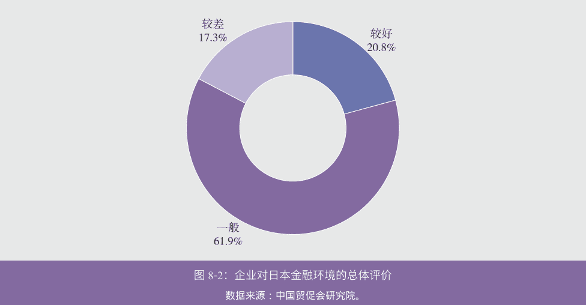

图 8-2：企业对日本金融环境的总体评价
数据来源：中国贸会研究院。

受访企业在金融领域遇到的问题主要是融资问题。调查显示，38.1%的受访企业在日中企业反映日本金融市场的信贷条件严苛，31.2%的受访企业认为跨跨境企业困难较大，27.7%的受访企业表示在资本市场直接融资困难，17.3%的企业认为融资成本高（如图 8-3 所示）。

> ¹ 注：根据股票期权的处理方式，股票期权为合格、不合格股票期权。行合格股票期权则按资本利税征收税率低于普通所得税率；不合格股票期权收益被视为适用所得税。
² 来源材料：日本财务省，*https://www.mof.go.jp/english/policy/tax/tax_reform/2024/06keyhighlights.pdf*。

### 信贷条件严苛

| | |
|---|---|
| 信贷条件严苛 | 38.1% |
| 跨国融资难度大 | 31.2% |
| 在资本市场直接融资困难 | 27.7% |
| 融资成本高 | 17.3% |
| 融资渠道少 | 13.9% |

图 8-3:企业对日本金融环境存在主要问题的评价
数据来源:中国贸资会研究院。

### （二）银行等金融行业稳健性较高

日本金融体系较为成熟，本土大型银行数量较多，企业间经营联系紧密，行业协力量较大，外资金融机构面临竞争壁垒较高。特别是在日本市场利率提高的背景下，外银行在融资方面与日本本土银行竞争加剧，经营成本显著提升。

此外，外银行在日本开展本地化业务需加入日本本土日本元结算系统，但该系统加入费用极高，获取分服务还需要单独许可及付费，极大增加外银行运营难度和成本。

### （三）九成企业认为税收环境一般

调查显示，86.1%的受访企业认为日本的税收环境一般，10.4%的受访企业为较好，3.5%的受访企业为较差（如图 8-4 所示）。

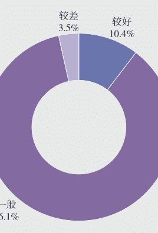

图 8-4:企业对日本税收环境的总体评价
数据来源:中国贸资会研究院。

税率提高、税收负担是在日受访企业反映日本税收环境存在的主要问题。调查显示，51.5%的受访企业反映税率提高增加成本，48.5%的受访企业反映税收负重（如图 8-5 所示）。

| 项目 | 百比 |
|---|---|
| 税率提高增加企业成本 | 51.5% |
| 税收负重 | 48.5% |
| 税收征对中小型企业较为 | 17.3% |
| 税收自由度由裁量权决定 | 10.4% |

图 8-5：企业对日本税收环境存在主要问题的评价
数据来源：中国贸资会研究院。

日本财务省最新数据显示，2021年日本税收及社保费用占收入的比重为34.4%，在OECD成员国中排名第2位。2021年，企业所得占总收入的比重为6.2%，同期美国、英国、法国、瑞典分别为2%、3.8%、3.7%、4.9%（如图 8-6 所示）。

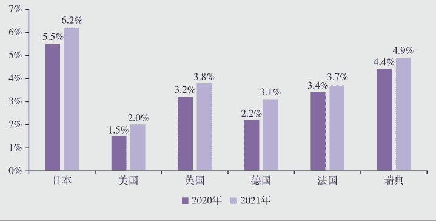

资料来源：日本财务省，https://www.mof.go.jp/english/policy/tax/tax_reform/summary/index.htm。

## 三、建议

### （一）加强对话

建议日本监管部门与外国供应部门加强交流，发挥对话作用，应对资本市场挑战，促进金融服务投资与贸易合作。

### （二）减少不必要的检查

建议日本不同监管部门间加强协调，设置对外资机构合理的检查机制，避免频繁检查，促进金融机构可持续发展。

### （三）推出更多税收优惠

建议日本政府制定更多针对企业的税收政策，提升企业申请的便利程度，减轻企业在当地经营的负担，优化税收环境。

### （四）降低碳清算门槛

建议日本相关行业参照国际通行系统，将碳清算费用降至合理标准，增强外银行开展清算业务。

### （五）提升碳清算服务水平

建议日本主管部门及相关服务方为用户提供优质服务，解决外银行使用困难，更好完善系统的功能。

# 第九章 绿色经济

## 一、最新发展

### （一）出台《绿色转型策略》

日本希望以绿色转型为契机，同时实现脱碳、能源稳定供给和经济增长。为此，2023年2月，日本政府提出了《绿色转型基本方针》。同年5月，日本政府根据基本方针实施了《绿色转型》。

表 9-1：日本《绿色转型》主要内容
| 序号 | 主要内容 |
|---|---|
| 1 | 由政府制定并实施转型战略，全面推动绿色转型 |
| 2 | 发行转型债券，以支持绿色投资 |
| 3 | 引入“增长导向型定价体系” |
| 4 | 设立专门负责绿色转型的机制，其包括：为私营企业提供担保财政支持，征收相关排放税（石化企业的承担者），执行排放交易制度（向特定企业分配配额）等 |
| 5 | 根据绿色转型的实施情况及国内对策，对相关政策进行审核和修订 |

2023年7月，日本批准《促进向低碳增长经济结构型的策略》（简称《绿色转型》）包括两条：（1）确保能源稳定供给下，推进绿色转型；（2）实现“增长导向型定价”（见表9-2）。

表 9-2：《促进向低碳增长经济结构型的策略》主要内容
| 序号 | 具体内容 |
|---|---|
| 1 | 在确保能源稳定供给下，推进绿色转型：（1）加强节能措施，对化工、水利、车辆、汽车等领域实施“非石化能源转型”；（2）提高再生能源利用率，使可再生能源的占比到2030年达到36%~38%的目标，加强电力系统建设，完善直流输电系统，改善相关基础设施；（3）建立可靠高效的供给网络，关注天然气与传统燃料的价格差异，引起相应的支持。 |
| 2 | 实现“增长导向型定价体系”：（1）为支持绿色转型，未来可能发行2万亿元的气候债券；（2）通过“增长导向型定价体系”，鼓励企业的绿色转型。为高排放企业引入交易机制，对高能耗原料收取排放税，为低排放企业发放配额；（3）成立“绿色转型机制”，为企业的绿色投资提供担保等金融支持。 |

资料：日本经济产业研究所，https://www.meti.go.jp/english/press/2023/1222_0.html

2023年12月，日本政府进一步发布了《分领域的投资战略》，对16个重点领域提出了未来的转型方向和投资促进政策。16个重点领域中，除了与能源相关的行业之外，还包括碳排放量且居民生活密切相关的领域，包括：钢铁、化学、纸浆、水泥、汽车、电池、飞机、可持续航空燃料、船舶、生活消费类、能源循环、半导体、氢、新型可再生能源、核能、碳捕获与封存。

### （二）发布新《绿色基本战略》

日本将氢能视为能源转型与强化安全的重要战略，持续促进技术研发与产业进步。2017年，日本政府率先发布《绿色基本战略》，明确构建“碳社会”的宏伟蓝图。2023年，日本政府正式推出新《绿色基本战略》（简称《新战略》），将需求转向国际市场，发力从产业链建设为实现稳定、廉价和低碳供应。《新战略》主要目标包括：(1）确保供给，日本已规定到2040年供应量3000万吨、2050年2000万吨；（2）降低成本，日本将致力于到2030年和2050年供应量立方米（约15万吨）；（3）向低碳转型，设定了碳强度目标，即从原料生产碳强度低于8千吨。

表 9-3：新《绿色基本战略》主要行动
| 序号 | 主要内容 |
|---|---|
| 1 | 氢能供应方面，到2030年日本公司（包括材料供应）在境外安装电解槽，加强国际合作 |

| 序号 | 主要方向 |
|---|---|
| 1 | (1）燃料电池（交通、电联等部门）扩大用车电池动力，提高效率；到2040年氢气纯度达到99%的目标；（2）燃料和储运的研发和应用，推广氢气、氨气、甲烷等技术，以及合成燃料制备工艺；（3）针对燃料消耗量30%以上的主要行业进行拓展，包括钢铁（炼铁）、电力、化工（石油）、水泥、汽车行业，制定面向化石燃料绿色转型的目标，鼓励使用氢能替代；（4）利用城市市政设施建设，启动一项计划，在15年内完成基础设施，建设3个大规模氢能中心，未来10年在规模需求的地区建设5个中等规模氢能中心，并在港口形成氢能枢纽 |
| 2 | 促进氢能利用与地方政府合作：利用区域资源发展氢能生产、储运和多功能利用，建立基础设施，构建区域氢能集群，加强地方和信息共享，鼓励地方政府支持，推进区域试点 |
| 3 | 推进创新技术发展：（1）在材料方面，开发高效、低成本电解水技术、氢化甲烷技术、热分解制氢高温技术，以及各种催化应用；（2）在膜方面，开发高效氢气转化技术、储能电池、低成本氨气体、氢质膜等技术；（3）在应用方面，开发高效、低成本膜质燃料电池，以及碳氧化物生产技术、合成燃料等 |
| 6 | 国际合作：逐步推进氢能国际化，以技术方为主的贸易便利，参与氢能部长级会议、国际氢能合作伙伴会议、清洁能源部长会议、创新使命等方面的活动 |
| 7 | 促进公众接受 |

在中碳和绿色增长战略引导下，日本政府设立了规模2万亿美元的“绿色创新基金”，用于支撑、交通、工业及建筑等关键领域绿色转型相关的技术创新。截至2024年8月底，日本已成功启动了20项为期十年的重大研发项目，包括下一代锂电池、低成本浮海上风电等多个前瞻方向：

2024年，NEDO先行启动“炼铁技术的氢应用”“低成本漂浮式海上风力发电”“下一代航空器开发”“下一代船舶开发”等新开发项目。

> 1 资料来源：日本产业经济者，https://www.meti.go.jp/policy/energy_environment/global_warming/gifund/index.html。

### 表 9-4：绿色基金实施情况

| 序号 | 项目主题 | 资助预算(亿美元) | 具体项目 |
|---|---|---|---|
| 1 | 低成本海水海上发电 | 1235 | (1)一代风电技术开发 (2)漂浮式基础、低成本技术开发 (3)海上风力相关电气系统开发 (4)海上风力运行维护提升开发 (5)浮式海上发电基础设施开发 (6)浮式海上电力项目 |
| 2 | 下一代太阳能电池 | 648 | (1)一代太阳能电池开发 (2)下一代太阳能电池实用化项目 (3)下一代太阳能示范项目 |
| 3 | 大规模再生能源供给 | 1500 | (1)基础设施建设 (2)电力相关设备 |
| 4 | 电解制氢 | 708.3 | (1)水电装置的大型化 (2)水电装置效率 |
| 5 | 炼铁链的应用 | 499 | (1)利用矿炉的高效还原技术 (2)铁矿的直接还原技术 |
| 6 | 燃料供给的构建 | (1)低碳氢开发 (2)氢气发电的高能化 (3)功能性化学品开发 (4)化学品制造 |
| 7 | 利用CO2等塑料材料 | 1435 | (1)膜材料产量 (2)可持续航空燃料（SAF）制造 (3)合成氨制造 |
| 8 | 利用CO2燃料制造 | 152.8 | (4)非农作物来源的清洁油 |
| 9 | 利用CO2混凝土制造 | 567.8 | (1)CO2与固化混凝土 (2)固化混凝土管理与定量评估 (3)制造过程中的CO2回收与验证 (4)碳酸钙技术 |
| 10 | 分离回收技术 | 382.3 | (1)火力电设备的大规模分离回收 (2)废气等规模分离回收 (3)标准基础设施建设 |
| 11 | 废弃物与资源循环 | 445 | (1)CO2作为原料的废物烧炼 (2)高效处理设施 (3)新型技术的转化 |
| 12 | 下一代电电池 | 1510 | 一代电电池及下一电机的开发 |
| 13 | 电动车等功能化 | 420 | (1)自动驾驶域控基础软件 (2)自动驾驶传感系统 (3)电动车辆底盘构建 |

续表

| 序号 | 项目主题 | 资助预算(亿元) | 项目项目 |
|---|---|---|---|
| 14 | 智慧出行行业会议 | 130 | 面向智慧出行的汽车燃料与电池运行及综合能源管理系统 |
| 15 | 数字基础设施构建 | 1901.2 | (一）一代功率半导体器件制造技术 (二）一代功率半导体通用材料开发 (三）下一代数据中心开发 (四）物联网传感器开发 |
| 16 | 数据库开发 | 516.8 | (一）氢能飞机核心技术 (二）航空主要部件的复合结构与轻量化 (三）燃料电池推进系统及核心技术 (四）电力电子、热与汽车管理系统及电气化提升 |
| 17 | 下一代燃料开发 | 350 | (一）氢燃料的开发 (二）LNG燃料的甲烷提纯 |
| 18 | 农业农林业碳减排与吸收 | | (一）高功能生物物的供应与利用技术 (二）土壤碳固结构的向侧面减排技术 (三）减减建筑建设技术 |
| 19 | 微生物技术/碳原料推进循环 | 1767 | (一）添加有机废物的微生物改质甲烷技术 (二）利用CO2作为原料生产物质的微生物开发与获得 (三）利用CO2作为原料生产物质的微生物碳捕捉技术与验证 |
| 20 | 热加工过程脱碳 | 325.1 | (一）碳中和工业的基础减碳技术开发 (二）金属制品的无氧燃烧技术突破 (三）金属材料的氢能工业工艺技术突破 (四）降低引起电设备及高效化技术突破 |

资料来源：中国贸会国际研究院报告日本碳中和产业建设开发会议资料。

（四）海外符合条件的碳信用

2023年2月10日，日本内阁通过了《实现碳转型的基本方针》，明确日本2030年温室气体排放目标和2050年碳中和目标的实施路径。2023年4月，日本政府正式启动碳排放交易体系（Green Transformation Policy: Emissions Trading, GX-ETS）第一阶段工作。GX-ETS-2023年碳碳碳碳碳碳碳碳碳碳碳碳碳碳。

| 序号 | 领域 | 细分类别 |
| :--- | :--- | :--- |
| 3 | 低碳和脱碳能源 | 核能利用、建立电力和天然气市场实现碳中和 |
| 4 | 清洁交通 | 运输领域绿色转型、基础设施 |
| 5 | 循环经济的产品、生产技术和工艺 | 重制造（原料的循环）、促进氢气和氮气的引入、碳循环与收集与存储 |
| 6 | 环境可持续管理、土地利用和循环经济 | 食品、农业、林业和渔业、资源循环 |

资料来源：中国贸促会研究院根据日本经济产业官方网站公开资料整理。

## 日本绿色环境报告 2024

## 二、问题分析

### （一）绿色经济市场发展整体环境改善空间

日本绿色经济市场发展水平总体较高，产业体系较为完善、技术优势明显，但该市场长期以本土企业为主，面向外资企业的认证许可等准入门槛较高，开放水平相对较低。调查显示，49.8%的中外资企业反映日本绿色经济环境一般，有待改善；10.4%的企业反映日本绿色经济环境较差，亟待改善；39.8%的企业反映日本绿色经济环境较好（如图99-1所示）。

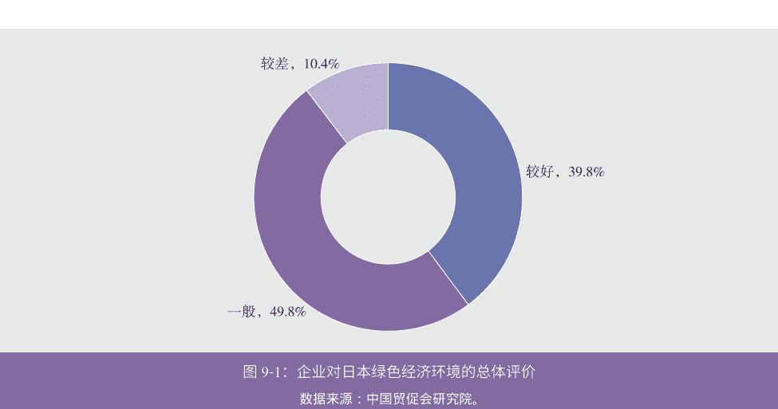

数据来源：中国贸促会研究院。

### （二）外资企业认为难以公平参与与绿色产业

日本出台多项绿色经济战略和优惠政策促进绿色经济发展，但是受企业普遍反映其具有排外性，自身在竞争中处于劣势。调查显示，66.7%的受访企业表示，日本绿色经济相关产业外，外企业难以公平参与（如图 9-2）。

| 绿色经济相关产业外 | 对光伏、新能源汽车等绿色产品贸易壁垒 | 外企业难以公平享受绿色优惠政策 | 绿色产业金融服务不足 | 绿色产业侧创对中国企业歧视 |
| :--- | :--- | :--- | :--- | :--- |
| 66.7% | 40.3% | 26.4% | 13.0% | 10.0% |

图 9-2: 企业认为日本绿色经济环境存在的主要问题
数据来源：中国贸促会研究院。

### （三）外资企业认为绿色产品贸易壁垒增加

2024年，日本对中国产品电池材料采取反销措施。此外，日本制定“特定重要物资”稳定供给政策，要求其生产销售电池、矿产产品等绿色产业重要物资企业配合供应链调查。调查显示，42.9%的受访企业认为日本增加对光伏、新能源等绿色产品贸易壁垒，抬高企业合成成本（如图 9-3）。

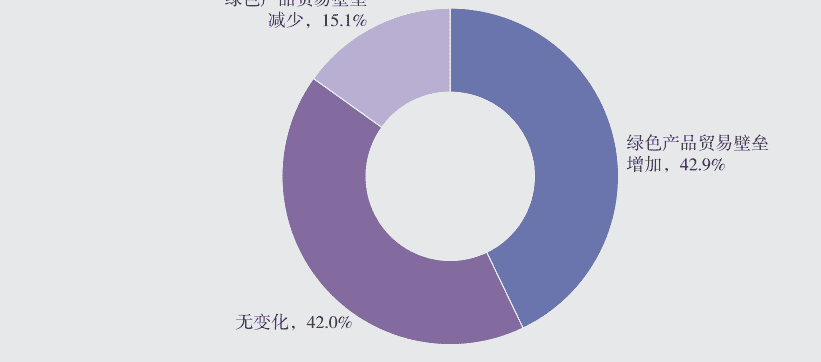

图 9-3: 企业对日本绿色产品贸易壁垒的评价
数据来源：中国贸促会研究院。

## 三、我们建议

### （一）持续加强中日绿色经济合作

建议日本继续加强与中国绿色经济领域的合作与协调，利用好中日节能环保理念及碳减排政策对策合作交流平台，进一步深化务实合作，共同应对全球气候挑战。

### （二）合理推行绿色转型推进策略

建议日本公平、公正、合理推行绿色转型推进策略，制定实施细则积极采纳外资企业诉求，避免出台不合理政策增加经营成本。

### （三）确保外资企业共享优惠政策

建议日本实施绿色转型优惠政策视同仁，公平公正对待外资企业，确保外资企业能够在政策落实过程中公平享受优惠。

### （四）绿色创新基金兼外资企业

建议日本政府重视外资企业在日本绿色经济发展领域的重要作用，为外资企业获取日本绿色创新基金等服务提供支持。

# 第十章 出口管制

## 一、最新发展

### （一）对多国实体实施日本出口管制措施

2024年6月21日，日本内阁通过“对俄罗斯相关实体与个人实施采取资产冻结等措施”。同日，日本外务省在《外法》框架下对多个国家的实体采取冻结、禁止特定产品出口措施。上述实体包括14个日本外务省指定的俄罗斯实体以及其他国家的10个实体。其中俄罗斯实体占比58.3%，中国实体占比16.7%，香港实体占比12.5%（如10-1）。

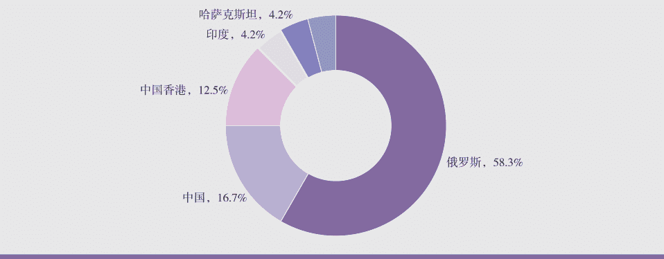

10-1: 2024年6月21日适用禁止出口措施的国家地区
数据来源：日本外务省。

| 序号 | 企业名称 | 所在地 |
| :--- | :--- | :--- |
| 1 | 阿尔贸易有限公司 (Alpha Trading Limited) | 中国香港 |
| 2 | 亚链接有限公司 (Asia Pacific Links Ltd.) | 中国香港 |
| 3 | Tordan Industry Limited | 中国香港 |
| 4 | 广州奥赛科技有限公司 (Guangzhou Ausay Technology Co., Ltd.) | 中国广州 |
| 5 | 深圳力高创新有限公司 (Shenzhen High Innovation Co., Ltd.) | 中国深圳 |
| 6 | 深圳广贸易有限公司 (Shenzhen Bigu Trading Co., Ltd.) | 中国深圳 |
| 7 | 深圳市亿路科技有限公司 (Yilu Electronics Ltd.) | 中国深圳 |

来源：日本外务省整理。资料来源：日本外务省，https://www.mofa.go.jp/erp/cee/uae/page_00001.html。

同日，日本内阁作出《修改出口管制令法令》，规定中国、印度和哈萨坦实体实施出口措施自7月日起。禁止出口的产品为《出口管制令》附表2以外的所有产品；禁止出口的技术包括《外汇令》附列表1至15项以及日本产业大臣确认的技术。

### （二）最终用户清单新增

近年来，日本政府每年更新“最终用户清单”。2023年12月6日，日本经济省再次修订最终用户清单，新增4家外国实体，其中中国实体占比16.7%。修订自12月1日起施行。截至2023年12月，日本“最终用户清单”共有15个国家地区的70个外国实体，其中包含10个中国实体，占比14.3%；香港和台湾分别为1.1%、0.6%（图10-2）。

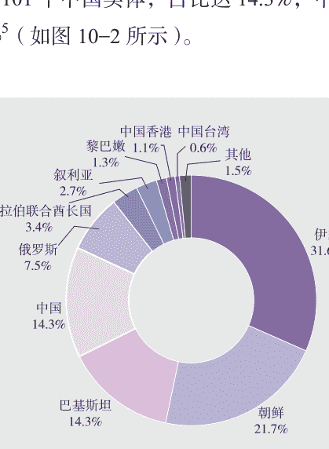

图10-2: 日本最终用户清单实体的国家或地区
数据来源：日本财务省。

1. 来源：日本经济省，https://www.meti.go.jp/press/2024/06/202406210001-20240621001.html
2. 注：基于日本出口控制全面管制制度，日本对中国实体出口任何货物或技术（书籍、材料以外），均需获得日本经济省的许可。
3. 数据来源：日本安全保障贸易局，https://www.cistec.org/jp/export/express/2306123/23061206.html
4. 来源：日本经济省，https://www.meti.go.jp/press/2023/12/20231206001-20231206001.html
5. 来源：日本经济省，https://www.meti.go.jp/policy/trade/20231206-3.pdf。

### （三）新增半导体领域技术出口管制措施

2024年7月8日，日本经济省宣布《根据出口贸易管制令附一和外汇令附表的规定修改部分货物或技术的省令》，正式将5项半导体和量子计算机相关产品及技术纳入出口管制清单。同时，该令修订了23项半导体制造设备的技术参数。该令于2024年9月8日施行。具体新增的出口管制产品及技术见表10-2。

表 10-2: 2024年7月日本新增出口管制产品及技术
| 序号 | 项目 | 对应贸易管制项 |
| :--- | :--- | :--- |
| 1 | 异构型化合物矿物半导体电路 | 第6第1号货物，第19条第1项第2项、第5号技术 |
| 2 | 扫描电子显微镜（用于半导体、电路的图像扫描） | 第6第17号货物，第19条第1项第2项、55号技术 |
| 3 | 量子计算机 | 第7第6号货物，第20条第1项第3项、第4号技术 |
| 4 | 生成多层GDS数据的程序（上述显微镜相关技术） | 第19条第7项 |
| 5 | 设计和制造集成电路等技术 | 第19条第7项 |

### （四）建立实施技术转控的许可措施

针对未纳入出口管制清单的技术，日本政府拟定基于《外汇法》的技术管理许可措施。2024年4月24日，日本经济省宣布出口管制政策报告，指出传统出口管制已经到了转折点，正在探索“清单制”以外的技术。报告表示日本应该就以下四点：
1. 出口管制中“清单制”的补充方法，解决产品和技术军事可能性的问题；
2. 利用《外汇法》框架下的机制对接；
3. 探索国际合作，实现灵活出口管制。

1. 来源：日本安全保障事务局，https://www.cistec.org/jp/policy/seminar/2024kaise/2024kaise_setumi.html
2. 来源：日本经济省，https://www.meti.go.jp/policy/trade/afaw-9.html
3. 来源：日本经济省，https://www.meti.go.jp/policy/trade/afaw/document/20240708.pdf
4. 日本经济省内出口管制工作委员会自2023年1月起召开。

### （五）基于利益考虑的简化与优化管制制度

2024年9月6日，日本经济省对《关于修改贸易交易的条例》启动征询，日期为10月5日。草案提到，对于转让时可能出现军事用途的技术，为加强安全保障，将在《外汇法》框架下建立针对事前报告和官方审查。该规定要求经营主体在签署技术转让合同前，向日本经济省进行事前报告。报告后，双方进行官方审查，判断潜在风险、讨论转让方案。原则上在30天内进行。日本经济省认为无法消除技术泄露风险，将要求经营主体申请出口许可证。若未进行事前报告，有关部门将根据《外汇法》提出指导。

| 经营主体 | 日本经济省 | 主管部门 |
| :--- | :--- | :--- |
| 技术转让计划 | | |
| | 事前申报：经营主体签署契约的义务 | 主管部门 |
| | 官方审查：如果不符合相关技术要求，明确不许可，原则上30日之内发出通知 | 贸易管理部门 |
| 技术转让合同 | 要求经营主体申请出口许可证 | 贸易管理 |
| 技术转让实施 | | |

图10-3：日本技术转让的官方审查运行概况
资料来源：日本经济省根据日本经济省公开资料绘制。

1. 来源：日本经济省，https://www.meti.go.jp/english/press/2024/0424_004.html。
2. 来源：日本电子政府，https://public-comment.e-go.jp/pcm/detail?CLASSNAME=PCMSTDETAIL&Mode=0&id=59521401。

在草案中，日本经济省将10项技术作为技术转让管理的对象（见表10-3）。提出的制度正式实施后，将通过与产业界的对话和调查分析，适时追加需要管理的。

表 10-3：日本经济省确定的技术转让管理范围的10项技术
| 序号 | 目标技术 |
| :--- | :--- |
| 1 | 多层陶瓷电容器(MLCC)的设计、制造技术 |
| 2 | 表面声波(SAW)或体滤波器(BAW)的设计、制造技术 |
| 3 | 电抑制的设计、制造技术 |
| 4 | 介质膜的设计、制造技术 |
| 5 | 铁氧颗粒的设计、制造技术 |
| 6 | 碳纤维的设计、制造技术 |
| 7 | 碳化纤维的设计、制造技术 |
| 8 | 光学（电子领域）、高光抗蚀（印刷领域）、光电材料的设计、制造技术 |
| 9 | 非金属结构材料的设计、制造技术 |
| 10 | 扫描电子显镜(SEM)和透射电子显镜(TEM)的设计、制造技术 |

资料来源：中国经营研究院根据草案整理。

## 二、问题分析

### （一）外资企业受出口管制影响

调查显示，受日本出口管制措施影响，58%的受访企业反映减少了与日本相关的贸易，36.8%反映成本提升，29.2%反映出口管制范围扩大，15.6%反映将暂停与日本贸易（如图10-4）。

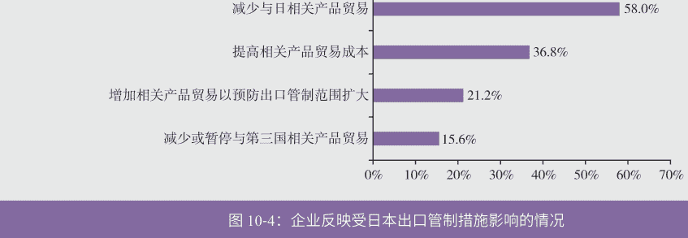

来源：日本电子政府，https://public-comment.e-go.jp/pcm/download?seqNo=000279。

2023年日本出口管制实施后，日本海关数据显示对华半导体出口额下降13%，但同比增加了19%。在出口管制范围扩大、前景不确定的背景下，外资企业提前备货。

### （二）外资企业认为出口许可证申请困难

调查显示，受访企业中42.2%认为申请难度大（如图10-5）。部分受访企业反映，在出口许可证申请与发放过程中，日本审批周期过长，频繁质询，这种不确定性导致交易流程难以，可能选择终止。

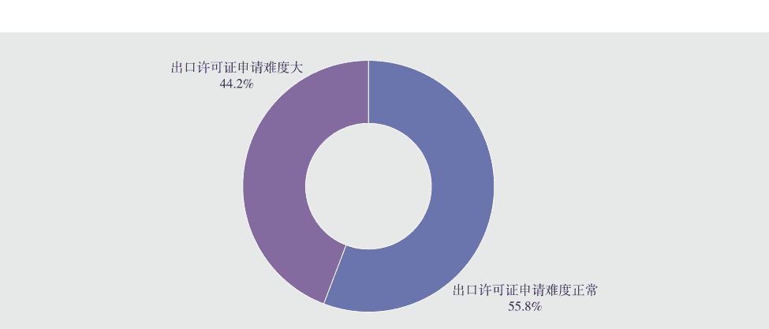

图10-5：企业对日本许可证申请难度的评价
数据来源：中国贸促会研究院。

### （三）官方审查幅度扩大出口管制范围

日本政府不断加强出口管制，不仅通过发布省令在出口管制清单中新增半导体和量子计算机相关技术，还对清单外的技术建立技术转让管理的审查机制，由日本经济省确定需要审查的技术。

来源：海关，https://www.customs.go.jp/toukei/shinbun/trade/gaiyo2023.pdf。

## 三、我们的建议

### （一）确保出口管制制度开放、透明、非歧视

建议日本政府遵循公平、合理、非歧视的多边贸易规则，谨慎使用出口管制拓展物品和实体范围。

### （二）推动出口管制标准化、规范化

建议日本出口主管部门持续完善出口管制实施细则，确保出口许可证申请程序透明，为出口企业提供稳定预期。

### （三）为企业提供有效申诉渠道

建议日本有关部门完善出口管制领域的行政救济制度，为受制裁的外国企业提供有效申诉途径，为申请许可证有困难的企业提供法律支持。

### （四）充分发挥中日对话作用

建议日本方与中国保持密切沟通，积极解答双方关注问题，探讨解决出口管理的潜在挑战，提高措施执行透明度，为正常贸易提供良好条件。

### （五）吸收业界对出口管制措施的建议

建议日本相关部门在新出口管制物资前，广泛征求国内外商的意见，积极吸收相关建议，确保管制范围合理，减少对产业界的负面影响。

## 附录一 研究过程综述

## 一、研究方法

2024年，中国贸促会研究院启动了《日本营商环境报告2024》调研，为充分了解、反映在日本企业诉求，课题组综合采取问卷调查、企业调研、政策分析等多种方法。

### （一）问卷调查

课题组通过国内外多种渠道发放问卷，回收共231份有效问卷，调研样本数量超过中国在当地设立的数量。问卷共计55题，涉及企业基本情况、企业在日本经营情况、日本总体营商环境评价、公共服务环境评价、市场准入环境、出口管制政策评价、公共采购环境评价、跨境人员流动及人力资源评价、绿色经济环境评价、数字经济环境评价等领域。发放对象为在日本经营企业的高级管理人员。在问卷调查过程中，课题组独立完成问卷设计、数据整理与分析等环节。

### （二）企业调研

课题组通过实地走访、线上座谈、通话访谈等形式调研在日本经营企业，为更全面了解在日本经营情况，课题组还走访了律师事务所、会计师事务所等第三方中介机构。

### （三）政策分析

课题组系统梳理、总结了近年来日本制定的营商环境相关政策法规及出的举措，涉及外资审查、贸易救济措施、公共采购、数字经济、金融税收、绿色经济、出口管制等多个领域，深入分析日本营商环境的最新动态。

# 附录二

# 在日本中资企业经营状况

日本营商环境报告 2024

## 一、企业在日本经营状况

超半数企业预计在日本业务实现盈利。调查显示，55%的受访企业预期2024 年在旧经营盈利，与2023 年调查相比下降1.6个百分点；34.6%预期盈亏平衡，同比提升6.3个百分点；10.4%预期亏损，同比下降4.7个百分点。

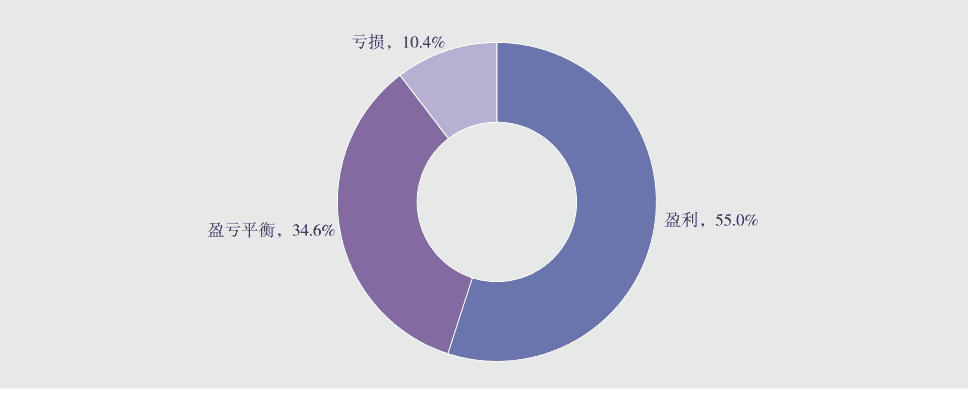

调查显示，分别38.1%、41.6%、31.2%的受访企业在日本市场份额、营业收入和营业利润实现增长。与2023 年调查结果相比，市场份额增长的企业比例增加7个百分点，营业利润增长的比例下降8.4个百分点。

| | 增长 | 持平 | 下降 |
| --- | --- | --- | --- |
| 营业利润 | 31.2% | 55.4% | 13.4% |
| 营业收入 | 41.6% | 51.5% | 6.9% |
| 市场份额 | 38.1% | 51.5% | 10.4% |

## 二、企业在日本经营计划

六成企业计划增加对日本投资。调查显示，60.2%的受访企业计划扩大在日业务，36.8%将保持现有规模，仅3%表示将缩减在日业务。

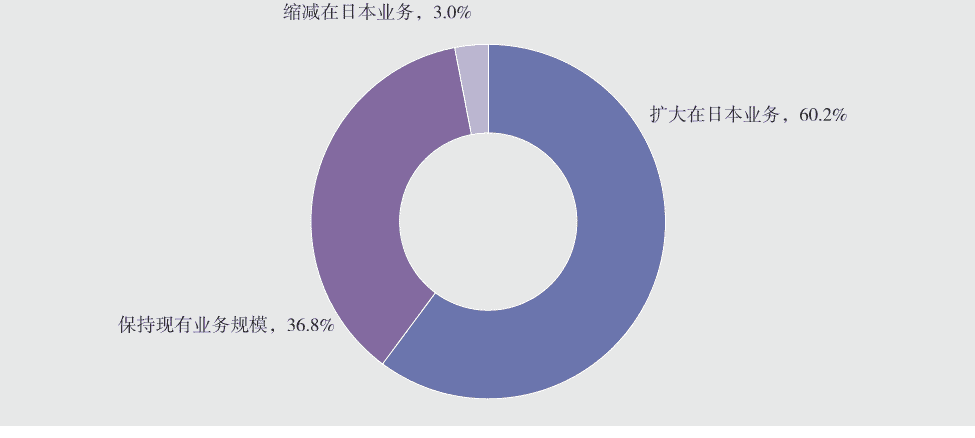

调查显示，33.3%的受访企业计划与日本企业加强供应链合作，60.2%预计合作情况不变，6.5%预计合作将减弱。

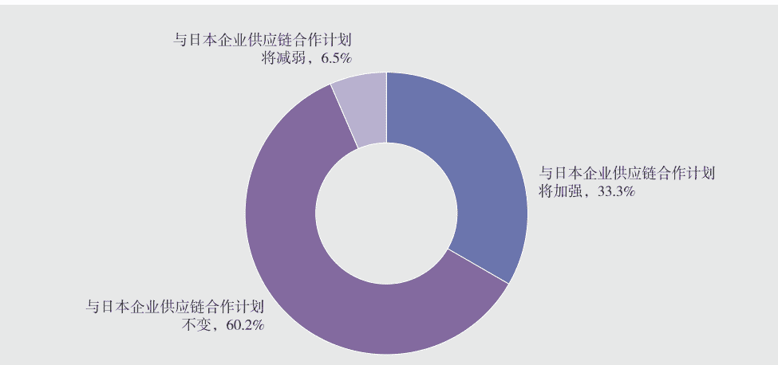

# 附录三

# 中国贸促会简介

日本营商环境报告 2024

中国国际贸易促进委员会（简称：中国贸促会）成立于1952年，是全国性对外贸易促进机构。

中国贸促会的主要职责是：落实国家重大贸易战略，促进对外贸易、双向投资和经济技术合作；推进与对外机构机制化合作；接待境外高层级经贸代表团，组织中国贸易代表出访；负责中国参加国际展览会和世界博览会事务；举办和组织企业参加展览会、论坛、讨讨会及有关国际会议；在外贸领域力商，参与贸易政策法规、对外谈判和国际贸易规则制定；开展法律顾问、商事调解、海事仲裁等工作，签发和出口商品原产地证书、对外贸易有关文件和证单，提供专利申请、商标注册、诉讼权属等产权服务；组织产业和企业应对贸易摩擦；提供经贸信息、经营培训等服务。

中国贸促会将与各有关国际组织、各国地区贸易投资促进机构、商会组织和工商企业界建立广泛多种形式的交流合作，加大对企业服务的力度，为推动多边贸易关系发展，促进世界经济繁荣，为各国人民做出积极贡献。

**中国贸促会网址：** https://www.ccpit.org/

**中国贸促会地址：** 北京市西城区复兴门外大街1号

**中国贸促会电话：** 010-8807500

# 鸣谢

《日本商贸环境报告2024》由中国贸促会促进部统筹编制，中国贸促会研究院组织编写。虽然我们力求完善，但由于时间仓促、水平有限、疏漏所难免，请各界批评指。

在编写本报告过程中，中国贸促会驻日本代表处、在日本企业协会、西日本中国企业联合会、山东省贸促会、浙江省贸促会、广东省贸促会、天津市贸促会、辽宁省贸促会、江苏省贸促会、青岛市贸促会、义马市场发展研究院、青岛诸城阳区中韩协同发展促进中心等机构对企业调研调查执行给予了大力支持与帮助，对此我们表示衷心的感谢。此外，我们在编写过程中参阅了中国外交部、商务部、海关总署等中国政府部门，日本产业省、财务省、总务省、外务省、厚生劳动省、数字厅、金融厅等日本政府部门，以及世界银行、国际货币基金组织、经济与发展组织等国际公开信息，对此我们表示衷心的感谢。
