# 智能机器人产业研究报告2025

# 扫码加入 知识星球TOP 免费资源群

免费

- 每日免费获取高价值资源
- 提供各类资源搜索服务

公众号:知识星球TOP

价值

| 热门付费文章 | 各行各业报告 |
| :--- | :--- |
| 精选图书资源 | 副业赚钱方法 |
| 职场实用资源 | AI政经自媒体 |

微信信号:jntsg8

及时

微信信号:jntsg2

专注

分享资料仅供个人学习，请及时删除，切勿商用传播

# CONTENTS

01 | 智能机器人产业发展背景
02 | 智能机器人产业发展现状
03 | 智能机器人发展趋势

## 第一章：## 智能机器人产业发展背景

### 定义及分类：从机械化、单一化向高度智能化、从智能化迈进

智能机器人历经十年技术应用探索，仍在持续发展

- 我国发布的国家标准《机器人分类》（GB/T 39405-2020）将机器人定义为：具有两个或以上可编程的实体，以及一定程度的自主能力，能够在其环境中各种方式执行任务的执行机构。以此为基础，极光月影研究院将机器人定义为：加入智能能力，能够实现自主感知、交互、决策、执行等的操作机器人。

| 工业机器人 | 智能与消费类机器人 | 多领域智能机器人 | 人形机器人 |
| :--- | :--- | :--- | :--- |
| 工业机器人 | 个人/家用服务机器人 | | |
| | 公共服务机器人 | | |
| | 特种机器人 | | |
| | 其他领域机器人 | | |
| | 垂直关节型机器人 | | |
| | 平形关节型机器人 | | |
| | 直角关节型机器人 | | |
| | 并联机器人 | | |
| | 其他机械结构型机器人 | | |

1959年，戴尔与美国著名艺术家乔·伯格拉克制造出第一台工业机器人。1970年，斯坦福大学研究所制造出第一个能够理解人类环境的智能机器人。1997年，在IBM的Deep Blue深蓝国际象棋赛中击胜，被认为是人工智能历史上第一个里程碑。1998年由索尼开发出AIBO，这是首个用于娱乐的大型消费机器人。

2002年iRobot首次发布第一款扫地机器人Roomba空吸尘器。2003年，主机探测器精神号机器人Quest。2005年，人形实验室发布了iUBERTO，是世界上第一个具有人形的机器人。2007年，由汤曼发布了RobicsAlpha。2008年，哈萨Universal Robots发布首款商用协作机器人（Cobot）。

2016年，波士顿动力机器人发布了人形机器人Atlas和四足机器人Spot。2021年，AlphaGo赵世棋在上海，展示了人工智能强大的学习和推理能力。2017年，由DeepMind开发的AlphaZero击败围棋冠军，成为又一个获得世界围冠军的国际象棋冠军。特拉斯发布Optimus，标志着人形机器人产业的发展开启。

资料与数据来源：公开资料、极光研究研究院

### 社会驱动：人口老龄化加速、蓝领工作人力缺口、高科技平民化共同驱动机器人渗透

- 根据国家统计局最新数据与联合国有关老龄化的划分标准显示，我国人口增长减弱，老龄化人口占比高，我国已全面步入中老龄化社会且老化仍在加速。蓝领群体规模庞大，劳动力仍较大缺口。对于蓝领工作，蓝领存在很多重要、危险的工作场景，年轻人进入蓝领工作岗位的意愿较低。这需要机器人进行岗位的替代、协作、补充。
- 目前AI平民化已成为趋势，人工智能在国民生产生活中，民众对人工智能的接受也逐渐上升。

### 2015年-2024年中国人工智能数据 2023年-2025年智能AI应用数据趋势

建筑、蓝领工作环境危险、任务繁重、人工与肉体压力大、认可度低。许多危险性作业者靠苦的工程师已经面临招工的困局。

蓝领群体的平均年龄继续增加，40岁以上蓝领劳动占比超过50%，年轻群体进入蓝领工作岗位的意愿较低。

技能劳动者的求人系数超过1.5，高级技工的求人系数接近到2以上，蓝领高级技工的缺口达到了千万级。

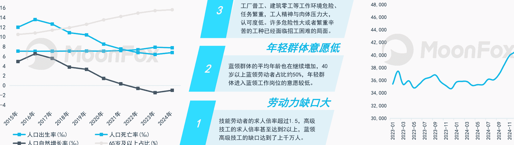

资料与数据来源：国家统计局，《蓝领群体就业研究报告》，人口数据

### 政策驱动：从国家战略到地方政策支持产业发展

| 2023年1月1日 | 工业和信息化部、教育部等部部门 | 2023年9月14日 | 工业和信息化部 | 2023年11月3日 | 工业和信息化部 | 2024年6月24日 | 国家政策 |
| :--- | :--- | :--- | :--- | :--- | :--- | :--- | :--- |
| 政策 | 发布时间 | 单位 | 产值 | 应用场景 | | | |
| 人机+应用场景 | 北京市人民政府 | 2023年6月16日 | 关于北京市机器人一体化行动计划（2023-2025） | 2025年人形机器人市场达到1000亿元 | 打造万级人形机器人具有领先水平 | |
| 上海市智能机器人质量发展计划 | 上海市商务局 | 2023年10月19日 | 关于上海市智能机器人质量发展计划 | 2025年人形机器人规模达到1000亿元 | 打造万级人形机器人 | 人形机器人 | |
| 广东省人形机器人产业性创新集群发展 | 广东省政府等部门 | 2024年2月24日 | 广东省人形机器人性创新集群发展（2023-2025） | 2025年产业产值达1000亿元，核心技术突破 | 打造消费级机器人应用场景，培育50个以上标杆 | | |
| 江苏省机器人创新发展计划 | 江苏省工业信息化等部门 | 2024年4月17日 | 江苏省机器人创新发展计划 | 2025年机器人产值突破2000亿元，核心技术突破 | 培育50个以上龙头企业 | 人形机器人规模达50万台 | |
| 浙江省人形机器人创新发展方案 | 浙江省发展改革委员会办公室 | 2024年9月5日 | 浙江省人形机器人创新发展方案（2024-2027年） | 2027年人形机器人产值达2000亿元，核心技术突破 | 在关键技术领域实现自主控，打造30个以上重点应用场景 | | |
| 重庆支持机器人创新发展专项 | 重庆市工业等部门 | 2024年12月15日 | 重庆支持机器人创新发展专项 | | 打造10批以上“专精特新”企业 | 鼓励机器人应用于医疗、教育、家政、养老、康养等相关领域 | |

数据与来源：开源分析

### 技术驱动：关键硬件实现国产化，大模型爆发低成本，共同促进落地通用场景

### 激光雷达

激光雷达随着智能驾驶系统的规模化落地，已大幅下降。据国联数据，2024年以来ADAS系统的激光雷达幅度下降5.6%至30%。

### 数据收集与预处理

在智能机器人开发中，模型从摄像头、传感器等设备采集的图像、数据、语音信号等数据，将原始数据转化为模型训练的高质量数据，极大提升处理效率与质量。

### 模型训练循环

模型可实现多任务学习，让智能机器人同时学习多种任务。借助迁移学习，在一个任务中学会的良好模型可迁移到其他相似任务，如快速适应新任务，减少训练时间和数据需求。

### 算法优化

大模型为智能机器人找到行为策略。在复杂的环境中，机器人通过通路交互获得反馈，大模型利用正负反馈不断调整策略。模型针对对抗训练，让机器人生成各种场景数据，判别器对齐，使智能机器人模型在任何环境下都能稳定运行。

### 落地应用

大模型强大的自然语言处理能力，智能机器人能理解各类语言指令，实现流畅对话。在物流、医疗等场景下，模型可整合多方面信息，辅助机器人完成复杂任务。

### 3D视觉感知

集成高性能计算设备、第三方相关配件提升性能，3D机器人视觉与感知深度学习，使检测更敏捷化。

### 六维力传感器

六维力传感器的生产及高精度的制造工艺和复杂的机器人配置，成本不高。国内企业正在进行技术攻关实现国产化，其中机器人成功研发六维力传感器。

### 自主算法

| 引导与定位算法 | 群体控制 | 自适应轨迹规划法 |
| :--- | :--- | :--- |

资料与数据来源：开源社区

### 产业环境驱动：中国智能机器人产业呈现稳健增长态，从产业企业发展情况和专利情况看强发展潜力

- 中国智能机器人产业呈现稳健增长的态势：从中国智能机器人企业数量上，2024年较2020年翻一番，较2023年增长19%；从中国智能机器人企业资金，2023年2024年呈现稳健增长态势，其中人形机器人增长最为突出。
- 截至2024年7月，我国持有的机器人相关专利数量超过9万项，占全球3%。对于人形机器人赛道，中国较于发达国家时间晚，但有效专利数量全球第一，中国机器人在人形机器人上突出。

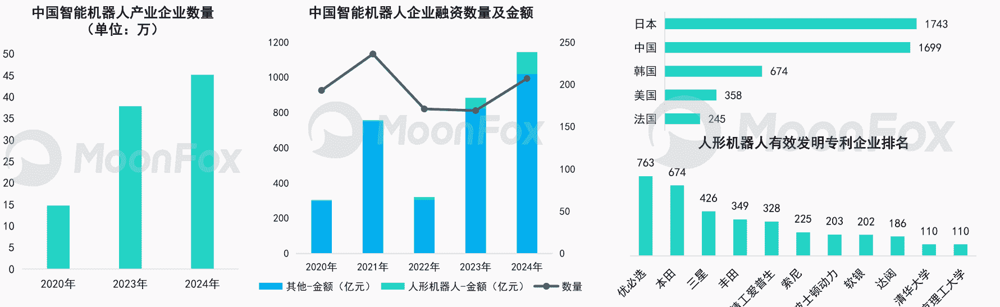

资料与数据来源：市场监测，大数据中心，人民研究院；数据：截至2023年5月

根据IFR的数据，从工业机器人安装量来看，中国占全球总量的30%。本土制造商数据来看，近两年份额大幅增长，制造数量居二，但较第一下降。商业机器人制造数量逐步上升。

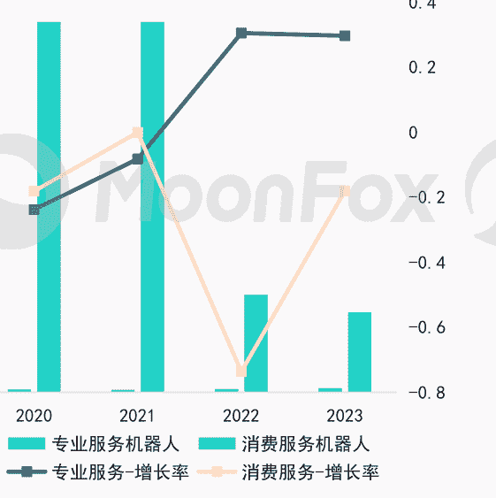

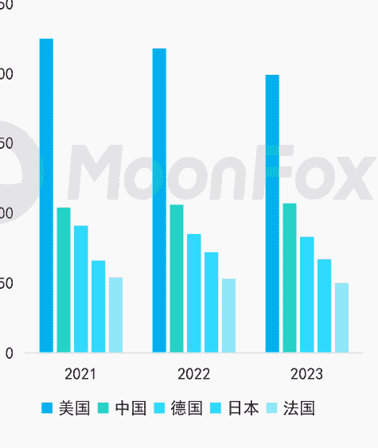

资料与数据来源：IFR

## 第二章：## 智能机器人产业现状

### 产业圈：上游包含核心部件及系统、机器人本体、模型及下游，无论零部件到机器人本体还是落地应用，逐渐转向海外局面。品牌技术脱颖而出，带领机器人行业从国外转向国产化；商业机器人实现国产化；医疗机器人提升性能、探索场景，新玩家加入；人形机器人领域涌现。

### 核心部件及系统

| 传感器 | 力传感器 | 触摸传感器 | 多传感器 |
| :--- | :--- | :--- | :--- |
| 感知系统：比中其、华睿能、海德机器人、奥普特、凌文科技 | 柯德力、东华测、中科电、凌远股份、鸣奎斯特、宇洛科技 | 纽瑞特尔、莎斯能、三三机器人、开源纳米科技和深技科技 | 发科、ABB、安川电机、KUKA、卡纳、卡川机器人、新贺机器人、森友电机、马鞍、新格机器人、上景科技、广州润、大速机器人 |
| 雷达 | 编码器 | 机械臂 | 工业机器人 |
| | 思源科技、领赛机器人、捷泰科技、北光、智博腾、北天旭、人形机器人、星河云、光科电、达石、力拓机械 | 灵子重德、光华电机、汇比特、汇电、鸣志电机、汇川技术 | 发科、KUKA、ABB、安川电机、杭州机器人、新格机器人、造迅机器人、通用机器人 | 格塑、上华机械、移动机器人、海德机器人、未来机器人、舵机机器人 |
| 驱动 | 移动机器人 | 人形机器人 | 服务机器人 |
| | 绿的逸、鸿源、捷服机器人、鸣志电机、传电技术、拓邦股份、中川、中川、大大力、奥士特电机 | 格九、赛博、优合能、华动机器人、新格机器人、华泰机器人、人形机器人、赛瑞机器人 | 众机器人、特斯特尔、哈拓、优仕机器人、乐擎、博力机器人、智元机器人、小巧机器人 |
| 控制 | | | 医疗机器人 |
| | 奥斯驰、新格机器人、华泰科技、英威、拓讯、广州汇、汉关、汉国技、海得控制 | | | 芬达睿、精博、微创润、思哲、智博、微创润、智力机器人、天航、安锐机械、威高谱、捷瑞、邦、拓直齐 |
| 终端执行器 | | | 大模型 |
| | 优胜机器人、奥士州机器人 | | | 科星、华石石、聚智能、库星、普速机器人、天航、安锐机械、威高谱 |
| 大脑 | | | | 旷速浩、安川、特斯特、霍比莱、比特科技、地球科技、星辰科技、芯机器人、DROID、OPEN-EM、聚机器人、ROBOTIM、AgBot World |
| | | | | 星星纪元、V型模型、HuggingFace和人工智能、谷歌、GPT模型和ChatGPT |

### 上游：传感器、执行器

- 从机器人的制造本质上看，“感官”涉及部位及总体数量。电机、减速器、丝杠、编码器等对于机器人的自由度和动作精准度有影响。各类传感器与执行器内的组件是重要支撑。

### 特斯拉Optimus Gen2 物料清单（按件）

### 视传感器

人形机器人需要两个视觉传感器，2022年国产化率已76%。

### 减速器

人形机器人需要两个谐波减速器，2023年国产化率高达37%。行星减速器占比为5%。

### 触觉传感器

人形机器人需要两个触觉传感器，2022年国产化率为32.5%。

### 编码器

人形机器人需要一个编码器，2023年国产化率高达54%。每个关节需要两个编码器，每个线性关节需要一个编码器。

### 力传感器

每台机器人需要26个力传感器，2023年力传感器国产率高达39.6%。

### 丝杠

人形机器人需要4-12根丝杠，2024年人形丝杠国产率高达16%，行星丝杠国产率高达80%。

### 压力传感器

每个关节需要至少1个压力传感器，2024年每台机器人需要40个压力传感器，躯干、腿部等部位需要灵活。

### 位置传感器

每个关节需要2个位置传感器，线性关节需要至少1个位置传感器，人形机器人需要至少1个位置传感器。

- 传感器
- 电机
- 丝杠
- 减速器
- 编码器
- FSD芯片
- 摄像头
- 轴承
- 电池
- 其他

资料与数据来源：特斯拉、高工机器人报告、MIR智库报告

### 中游：大模型与机器人结合提供感知交互能力

- 机器人的技术创新主要要在人形机器人关键技术突破，其中人形机器人上的重要任务在于基于人工智能模型的人形机器人“大脑”与控制人形机器人运动的“小脑”。大模型作为最火的人工智能概念，推动了人形机器人大脑的发展，帮助人形机器人具有感知、交互与决策能力；对于控制系统的接入。

### 感知交互与决策

多模态大模型增强机器人交互，实现对人类意图的理解，对复杂环境的认知，助力形成决策：
- 大模型可以直接对环境输出结构化内部逻辑、通过提示词输出控制逻辑、任务分发等指令
- 利用多模态大模型对环境进行建模，实现具智能对空间信息的理解

- 机器人能够从数据中学习决策与规划策略，基础模型为机器人决策与规划引入了丰富的先知识。

### 控制

| 需求级 | 理解需求 | 分解需求 | “我渴了，需要水” |
| :--- | :--- | :--- | :--- |
| 任务级 | 完成任务 | 分解任务 | 引导至水杯、抓取水杯、引导至用户 |
| 规划级 | 运动规划 | 路径规划 | 选取运动规划、引导路径 |
| 动作级 | 生成终端执行器坐标/关节位置 | 完成具体动作 | |
| 基元级 | 控制率 | 轨迹插值和轨迹调试 | 决定运动轨迹与控制策略 |
| 伺服级 | 生成伺服信号 | 计算位置误差 | 驱动伺服电机 |

大模型在控制上的助力主要集中于大模型处理环境语义的指示，输出顺序，动作序列是一系列关节角度或末端执行器的位置与抓爪数据，这些列表将直接应用于人形机器人的运动。

资料与数据来源：《基于大模型的具智能综述>

## 产业链发展现状

### 下游：工业、商业服务持续提高渗透率，家庭陪伴与医疗场景技术持续创新成为最具潜力场景

- 从工业场景来看，2021年中国工业机器人密度为32万/人，按照目标2025年达到500万/人；目前，工业机器人主要用于搬运环节（超过50%）、焊接与清洁环节，主要领先领域集中在电子、汽车等重工业领域。因此，提高机器人在轻工业等环节的渗透率是未来的主要课题。
- 全球商业机器人的出货量充足，运输物流市场是智能机器人最多的商业场景，而服务、农业机器人的出货实现了翻倍的的。医疗机器人更是突破性的增长，逐步占据市场。未来，受需求与技术影响，医疗、服务业中的家庭陪伴将成为商业机器人开拓新蓝。

| 中国各行业工业机器人安装（单位：万台） | 全球各行业商业机器人安装（单位：万台） | 一级分类 | 二级分类 | 痛点 |
| :--- | :--- | :--- | :--- | :--- |
| | | 工业机器人 | 搬运机器人 | 搬运后的装卸、室内外搬运的衔接 |
| | | 焊接机器人 | 非行业搬运需求、多种焊接工艺临时切换 |
| | | 清洁机器人 | 多场景不需深度清洗、群体协同、开放场景 |
| | | 商业机器人 | 运输物流机器人 | 动态路径优化、与人交互、集群调度等 |
| | | | 服务机器人 | 开放场景、碎片化与机器人化、自主决策 |
| | | | 农业机器人 | 群体协同、精准作业、不同形态移动与导航 |
| | | | 医疗机器人 | 专业化场景下与可靠性 |
| | | | 康复机器人 | 人机交互与融合、稳定性与可靠性 |

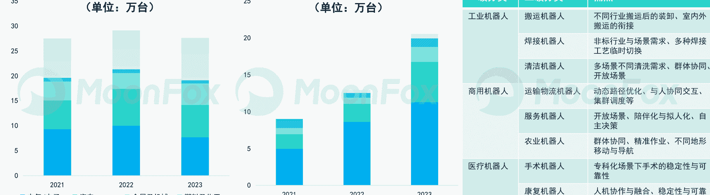

### 各场景应用成熟度：工商农农业等生产场景渗透率较高，医疗、教育、防护、危险作业等场景受技术与伦理影响渗透率较低

- 生产活动中，制造、仓储等场景技术成熟度高、时间敏感具有较高应用渗透率；酒店、餐饮等封闭的商业场景的机器人应用广泛，但因市场规模大，覆盖率有限。农林牧渔业等开放场景、多样地形在技术实现与落地上应用度较高，渗透率较低。

- 针对探测救援、采矿、建筑等危险作业场景，智能机器人的用户需求程度较高，但其技术实现仍处于开发中。对于养老、医疗等劳动力稀缺的精细化、人性化工作场景，人形机器人等新兴技术正在逐步落地。

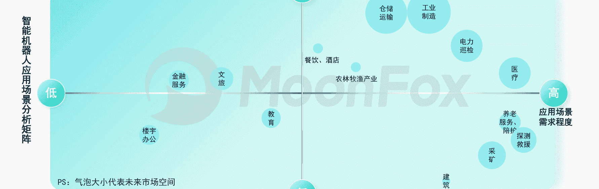

PS: 气泡大小代表未来市场空间

资料与数据来源：月狐研究院整理

### 工业：从汽车与3C电子走向全环节领域，从单点智能到设备互联

- 中国工业机器人市场相对真空，从“四大族”垄断发展到如今国产品牌异出其嵘，国产化突破45%的局面，目前埃斯顿、汇川科技等本土品牌领先为全球厂家提供全环节、个性化的解决方案。同时，工业机器人企业利用行业优势积极研发工业机器人，人形机器人企业也将逐步落地工业场景探索群体智能的实现。

### 工业机器人竞争格局

亚科、埃斯顿、汇川科技、爱生、卡卡、ABB、安川电机

埃斯顿拥有丰富的中大型机器人系列产品，适用于汽车制造中的冲压、焊接、装配等；埃斯顿拥有深型人形机器人

### 多功能型机器人

### SCARA机器人
- 6轴行业通用机器人，负载从MIH、小型、中到大负载，范围在720MM-3300MM，负载从7KG-30KG。
- 4轴装配机器人，负载从400MM-1000MM，负载从3KG-20KG。

### UNO机器人
- 6轴协作机器人，应用包含光纤焊接、码垛点等，范围从620MM-3100MM，负载从8KG-20KG。

### 协作机器人
- 6轴协作机器人，应用包含复运、码胶点点等，范围从600MM-1800MM，负载从3KG-20KG。
- 单臂机器人5kg；步行速度3km/h；全关节大自由

羡特、新新达、台谷、塔丰、卡库、雅马、川川、不置、三菱、史霍尔尔

灵晨、天机、广州数控、中华机器人、南京瑞、景智能、铁川机器人、凯尔萨

### 折叠机器人

### 焊垛机器人

### 冲压机器人

### 焊接机器人

### 高防护机器人
- 6轴监控自动化机器人，范围在2200MM-2860MM，负载从4KG-150KG。
- 4轴焊接装垛，关节范围在2000MM-3100MM，负载从6KG-80KG。
- 冲压下压力机器人，分为1200、能力15KG的机器人和3200、能力150KG的机器人。
- 6轴焊接机器人，关节范围在1400MM-4030MM，负载从8KG-15KG。
- 6轴铸造、耐喷、关节机器人范围在1810MM-2650MM，负载从30KG-170KG。

资料与数据来源：MIR行业观察、CRIA、埃斯顿机器人

### 商业服务：多元化应用场景带来的丰富需求，商业服务成为

### 自主清洗机器人
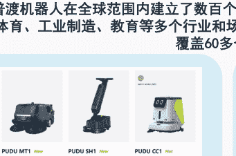

服务机器人在全球范围内建立了数百个服务平台，产品已应用于餐饮、零售、酒店、图书馆、娱乐体育、工业制造、教育等多个行业，市场总需求超过数万台（含申请中）16000个，覆盖60多个国家和600多个城市。

### 餐饮配送机器人
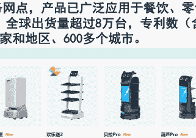

市场成熟度较高，市场上的应用方案主要聚焦于教育机器人、清洁机器人、智能机器人、海底星空、人形机器人、云端视觉机器人等。

市场场景为公共与家用场景，市场成熟度较高，应用主要集中于高精度机器人、智能者、潜能融合、石头、的机器人等。

集配送、洗碗、吸尘、占位多功能于一体，一台机器人轻松从容各类清洁需求

#### 成熟场景
- 教育引导机器人
- 酒店配送机器人：覆盖酒店、饭店室内外场景，配备配送、托盘、显示屏等多种硬件配备的解决方案，集成定位、自动回充、安全运行等功能。

#### 新兴
- 商业协作机器人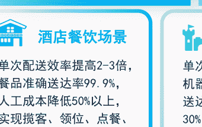
- 清洁机器人：酒店清洁机器人
- 休闲场景机器人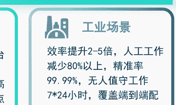

应用于教育、文娱、营销等领域，仍在持续持续中。目前已有领先解决方案的企业存在人形机器人、聚聚机器人、海底宝宝、农业机器人、矿料搬运机器人等。

目前应用较少，主要为桌面机器人与外骨机器人，应用场景主要有逗玩机器人、文旅仿生等在探索中。较为领先的行业为安卓机器人、青科技、协作机器人、工业客服机器人企业等。

单次配送效率提升2-3倍，人工成本降低50%，迎客接待、顾客位点、清洁、全环节覆盖。

数据来源：聚源机器人

### 家庭服务、养老服务及特殊场景：四足、人形人的落地爆发

随着人工智能技术的持续，人形机器人作为具智能的优质载体在持续进化。在有效数量上，中国已突出；在应用上，主要参与者为宇树科技、擎机器人、优必等，拥有专利的新兴机器人以及具备良好能力的人形机器人领域领先。

| 企业 | 产品 | 场景 |
| :--- | :--- | :--- |
| 优必 | Walker S, Walker X | 群体智能、多态感知、交互 |
| 小米 | CyberOne | 3维空间、感知 |
| 宇树科技 | Unitree G1 | 拟人行走、远足交互 |
| 擎机器人 | 聚犀 X1、远征 A1/A2 | 全景感知、多视角交互 |
| 小米 | PX5、“铁文” | 拟人行走、不同地形行走 |
| 北京宇创中心 | 天工机器人 KUAO、ROBAN、AELOS | 快速连接、避障 |
| 广聚集团 | GoMaST | 变形、自主避障 |
| 宇树科技 | AlienGo/B1/B2 | 消费、工业、巡检 |
| 云幻科技 | 聚犀 X20/X30、聚犀3 | 消费、运维 |
| 耐智能 | BabyAlpha A2、BabyAlpha Dev | 消费、行业级落地 |

宇树科技是一家全球知名的机器人，专注于消费、销售。重视自主研发和创新，自研电机、减速器、控制器、激光雷达等核心部件和高性能及运动控制能力，在足式人形机器人达到全球领先。标配360°激光雷达，感知系统，超强关节动力、GPT模型，单臂自由：5，手关节自由：4m/s，运动性能>5m/s

数据来源：宇树科技

### 医疗场景：精细化手术机器人与康复机器人

根据MedRobot统计，2016年至2023年，已有56个手术机器人，中国手术机器人销量达13台以上，以脊柱机器人、骨科机器人为主。康复机器人主要分为上康复、下康复、头部康复发展较为火热。

| 类型 | 销量 | 主要企业 | 功能 |
| :--- | :--- | :--- | :--- |
| 手术机器人 | 157 | 达奇、精锋、微创、优智、韦明 | 超越、牵引、切割、缝合等多种功能 |
| 骨科机器人 | 94 | 微创领、宇谷、史莱、斐能、华瑞、捷邦、柳叶 | 3D规划、精准控制、追踪及精准重建 |
| 口腔机器人 | 29 | 雅宁、慧健、瑞博 | 可视化辅助手术、精准定位 |
| 神经外科机器人 | 20 | 杰柏德、华臻精械 | 脑颅重建、高精度定位 |
| 血管接入机器人 | 8 | 微创RONE | 触觉感知、多领域协同、介入手术 |
| 自然路径机器人 | 4 | 雅康健 | 三维重建、辅助路径规划 |
| 穿刺机器人 | 1 | 康健 | 主动/被动/教学训练、康复评估 |

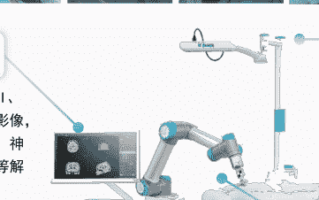

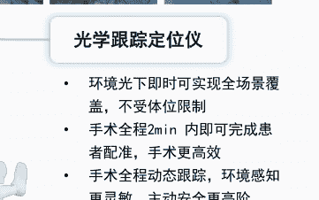

华臻神经手术机器人是我首批获批MPA和FDA认证的神经外科手术机器人，主要用于脑出血、肿瘤、脑畸形等脑疾病的精准治疗

- 自动融合与CT、MRI、PET、DTI和BOLD影像、建模构建、功能区、神经通路、脑底层重建、基于三维模型规划、自动跟踪安全性、预设多种模式、满足不同功能需求

- 环境外可实现全场景覆盖，不受体位限制
- 手术机器人内即可完成复杂手术，技术要求更高
- 手术路径更加精准、环境感知更准确、手术安全性更高
- 手术机器人得到实时

- 自自由度康复、大臂>1000mm、旋转关节误差反馈、实现实时定位、精度<5mm
- 可挂接多种微手术机器人、实现DBS、SEE、神经康复训练

资料与数据来源：MedRobot、华臻

## 03 第三章：智能机器人发展趋势

## 技术趋势：大模型、数字孪生、群体智能等共创智能发展新章

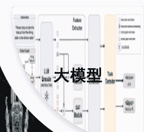

### 大模型
大模型为人形机器人提供“大脑”功能，感知外界环境、视觉化进行思考处理任务需求，同时利用大模型自动生成训练机器人的数据集以此理解机器人嵌入式数据。未来，智能模型的落地应用应以支持机器人大脑、提高数据质量、机器人多场景训练成为重要发展方向，同时，大模型助力机器人人形精细的运动控制系统称为研究的主要方向。

### 数字孪生
人形机器人的维护成本较高，未形成规模化使用导致人形机器人在多样化应用场景的经验与数据积累有限。人形机器人结合数字孪生场景，可在不同的环境中进行相同环境的数据采集。目前，数字孪生模型的精细度、准确度与数据的准确性等有所提高。

### 群体智能
群体智能是实现机器人在工业、商业服务等重要规模化应用的关键。软件架构的优化是推进群体智能发展的动力。
