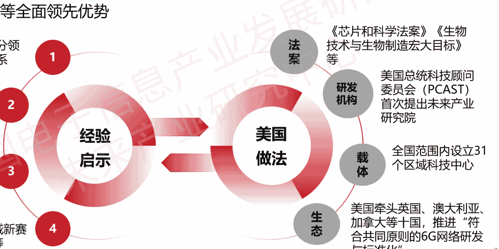
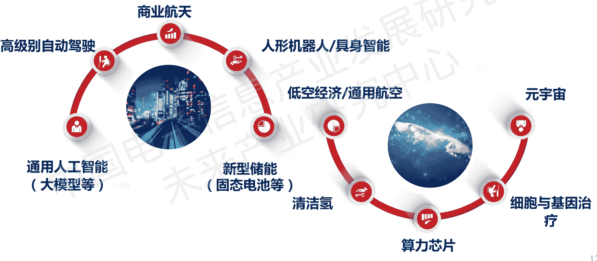
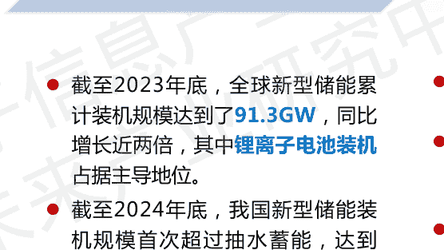
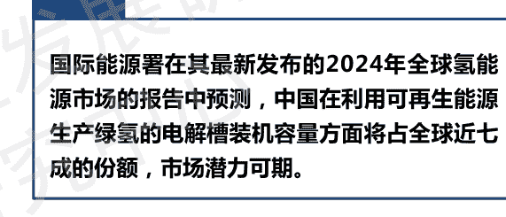
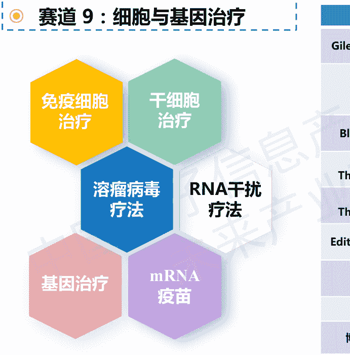

# 中关村论坛 未来产业创新发展论坛
## 2025 ZGC FORUM

# 未来产业新赛道研究报告

中国电子信息产业发展研究院
未来产业研究中心

# 扫码加入 知识星球TOP 免费资源群

公众号:知识星球TOP

- 每日免费获取高价值资源
- 可提供各类资源搜索服务

免费

价值

微信:jntsg8

| 热门付费文章 | 各行各业报告 |
|---|--|
| 精选图书资源 | 副业赚钱方法 |
| 职场实用资源 | AI政经自媒体 |

及时

微信:jntsg2

专注

分享资料仅供个人学习，请及时删除，切勿商用传播

# 未来产业新赛道发展背景

## 一、未来产业新赛道发展背景

### 未来产业赛道竞争面临的形势

- 引领型国家通过全方位体制创新，打造先进制造、人工智能、量子科技、新一代通信等全面领先优势
- 健全总体及细分领域法律法规体系
- 建立新型未来产业研发机构
- 加大前沿技术创新载体建设
- 建立新领域新赛道生态圈等
- 《芯片和科学法》《生物技术与生物制造大目标》等
- 美国总统科技顾问委员会（PCAST）首次提出未来产业研究院
- 全国范围内设立31个区域技术中心
- 美国牵英国、澳洲、加拿大等十国，推进“符合共同原创原则的6G网络研发与标准化”

# 未来产业新赛道发展背景

### 未来产业新赛道发展意义

- 麦肯锡：2030年人工智能有望为全球经济贡献6万亿美元，约当前GDP总量的8%。
- DVR：2023年—2030年机器人市场规模将超过1%。
- 美国：重点布局量子信息、人工智能等领域，打造领先优势
- 欧盟：《欧洲工业战略》
- 日本：《能源基本战略》
- 韩国：《国家战略》
- 中国经济发展正处于新旧动能转换的关键时期，国家和地方发布未来政策，各省加快布局未来产业。

## 二、领域国内外未来赛道布局

### 2.1 国外未来赛道布局

- 量子科技：量子密钥、量子模拟、随机生成、量子密码学、优化
- 人工智能：脑智能、沉浸式交互、安全
- 先进制造与通信：区块链技术、新一代无线网络、6G
- 量子科技：量子通信、量子仿真、量子平台
- 人工智能：小数据、下一代计算、计算机
- 先进制造：特殊处理器、自适应形态、3D打印、自动驾驶
- 核能与储能：氢能、电力、系统
- 人工智能：负责任的人工智能、数据处理
- 生物技术：智能生物、生物工程、精密医学
- 人工智能：新一代人工智能、基础研究、认知科学、机器学习
- 量子科技：量子域网、量子传感器
- 先进半导体：新型存储、先进封装、显示技术

### 2.2 国内未来赛道布局

| 政策文件名称 | 重点布局领域 | 重要举措 |
|---|---|---|
| 《中华人民共和国经济和社会发展十四五规划和2035年远景纲要》 | 类脑智能、量子信息、基因技术、未来网络、深空技术 | 1. 组织实施计划；2. 在科学资源聚集地、产业集群厚的地区，加强前沿技术攻关、交叉融合和量子技术供给；3. 实施产业跨界整合，打造应用场景 |
| 《关于推动未来产业发展的实施意见》 | 未来制造：智能制造、生物制造、纳米制造、循环制造 | 工业和信息化等七部门聚焦制造业“主赛场”、前瞻布局未来产业 |
| 未来信息：6G、卫星互联网、量子信息、量子/光计算、脑科学等 | | |
| 未来材料：先进基础材料（有色金属、无机金属等）、关键功能材料（高性能材料等）、前沿新材料（二维、智能仿生等） | | |
| 未来能源：氢能、生物能源、新型能 | | |
| 未来空间：深空/深海/深海高强度装备、深海无人平台、极地探测作业装备 | | |
| 未来健康：细胞与基因、合成生物、种子、新型医疗服务、高端器械和健康用品 | | |

### 2.3 我国重点省未来产业布局

#### 北京市重点发展方向
| 发展方向 | 发展领域 |
|---|---|
| 未来信息 | 通用人工智能、元宇宙、量子信息等 |
| 未来健康 | 基因技术、脑科学与脑机接口等 |
| 未来制造 | 类人机器人、智慧出行等 |
| 未来能源 | 氢能、新型储能等 |
| 未来材料 | 石墨烯材料、超导材料等 |
| 未来空间 | 商业航天、卫星网络等 |

### 2.4 知名研究机构热门报告

| 知名研究机构 | 相关报告 | 聚焦赛道 |
|---|---|---|
| 中国工程院 | 《中国制造业发展路线图(2023)》 | 智能制造、微纳制造、生物制造、原子级制造、人形机器人、先进装备、轨道交通装备、加工工艺 |
| 长城战略咨询公司 | 《中国新产业报告（2024）》 | |
| 腾讯研究院 | 《未来产业指数报告（2023）》 | |
| 上海中创研究院 | 《未来产业十大趋势》 | |
| 国家信息研究中心 | 《未来产业十大展望（2024）》 | |
| 麦肯锡全球研究院 | 《全球未来产业发展指数》 | |
| ICV | | |

### 2.5 构建未来产业重点目录

| 序号 | 细分赛道 | 序号 | 重点方向 | 细分赛道 |
|---|---|---|---|---|
| 1 | 原子制造 | 36 | 未来材料 | 先进金属材料 |
| 2 | 生物制造 | 37 | | 进光学材料 |
| 3 | 微纳制造 | 38 | | 进非金属材料 |
| 4 | 循环制造 | 39 | | 无机材料 |
| 5 | 增材制造(3D打印) | 40 | | 高性能复合材料 |
| 6 | 柔性材料 | 41 | | 土特材料 |
| 7 | 激光制造 | 42 | | 先进半导体材料 |
| 8 | 超限材料 | 43 | | 新型显示材料 |
| 9 | 机器人 | 44 | | 未来用材料 |
| 10 | 绿色生态材料 | 45 | | 新一代医学材料 |
| 11 | 未来产业 | 46 | | 智能信息材料 |
| 12 | 新一代工业机器人 | 47 | | 超材料 |
| 13 | 关键零部件制造 | 48 | | 超导材料 |
| 14 | 先进交通设备 | 49 | | 石墨材料 |
| 15 | 工业软件 | 50 | | 纳米材料 |
| 16 | 先进航空材料 | 51 | | 生物材料 |
| 17 | 智能仪器和检测设备 | 52 | | 先进能源(可控变等) |
| 18 | 人形机器人/类机器人 | 53 | | 太阳能(光伏等) |
| 19 | 工业机器人 | 54 | | 风电(海上风电等) |
| 20 | 群聚机器人 | 55 | | 燃料 |
| 21 | 特种机器人 | 56 | | 海能 |
| 22 | 通用人工智能(大模型) | 57 | | 新能源(离子电池) |
| 23 | 算力平台 | 58 | | 氢能与储运 |
| 24 | 先进制造 | 59 | | 高级智能网联 |
| 25 | AI芯片 | 60 | | 先进智能网联 |
| 26 | 量子计算 | 61 | | 低空经济 |
| 27 | 量子信息 | 62 | | 商业航天 |
| 28 | 高级制造 | 63 | | 深空探测与开发 |
| 29 | 未来信息 | 64 | | 地质资源探测 |
| 30 | 新一代移动通信(6G) | 65 | | 深洋资源开发 |
| 31 | 下一代互联网(Web3.0) | 66 | | 基因与基础科学 |
| 32 | 区块链 | 67 | | 脑机接口 |
| 33 | 智能语音 | 68 | | 合成生物(有机种等) |
| 34 | 三代半导体 | 69 | | 新型医药 |
| 35 | 第四代半导体 | 70 | | 碳中 |
| | | 71 | 未来能源 | 先进能源 |
| | | 72 | | 智能复(智慧养老机器人等) |
| | | 73 | | 新型医药(支持性医疗) |
| | | 74 | | 先进农业材料 |
| | | 75 | | 高效聚合物 |
| | | 76 | | 高效新能源 |

# 聚焦2025年未来产业十大赛道

## 三、聚焦2025年未来产业十大赛道

赛迪未来产业研究中心：2025年未来产业十大重点赛道
- 商业航天
- 高级别自动驾驶
- 人形机器人/具身智能
- 低空经济/通用航空
- 元宇宙
- 通用人工智能（大模型等）
- 新型储能（固态电池等）
- 清洁氢
- 细胞与基因治疗
- 算力芯片

### 赛道 1：通用人工智能（大模型等）

| 公司 | 国家 | 代表性模型 | 市场地位 |
|---|---|---|---|
| OpenAI | 美国 | GPT系列模型、ChatGPT | 全球领先的大模型研发机构，其系列模型引领AGI发展潮流 |
| Anthropic | 美国 | Claude系列模型 | 专注AG安全与伦理问题，致力于开发更安全的AI技术 |
| Meta | 美国 | LLaMA系列模型 | 提供高效的大模型工具，聚焦多态生成 |
| Hugging Face | 美国 | 开源平台 | 引领开源模型，提供多种语言模型的训练工具 |
| 百度 | 中国 | 文心模型、文心一言 | 中国领先的AI公司，在语言处理领域表现突出 |
| 阿里巴巴 | 中国 | 通义千问 | 中国领先的企业，在业务场景中深度应用 |
| 深度求索 | 中国 | DeepSeek-R1 | 专注开发先进模型 |

发布《关于人工智能发展的若干意见》，持续拓展人工智能边界，到2025年达到万亿元，规模将超过万亿元。拥有相关创新主体居全国首位。

### 赛道 2：高级别驾驶

| 公司 | 主要进展 |
|---|---|
| 特斯拉 | 采用纯视觉方案、Autopilot，累计测试里程数亿；车型不断迭代 |
| Waymo | 累计测试里程4300万英，安全领先 |
| 小马智行 | 累计测试里程900万，在中国多个城市开展测试 |
| 图注 | 累计测试里程5700万，获得订单万台 |自动驾驶 |

### 赛道 3：商业航天

| 公司 | 主要业务 | 代表性技术/产品 |
|---|---|---|
| SpaceX | 火箭发动机、航天船与卫星 | 运载火箭猛猎鹰、Starlink |
| Blue Origin | 火箭发动机、火箭和航天器 | 亚轨道火箭New Shepard、火箭（Glenn） |
| Ariane-space | 火箭生产、经营及发射 | 发射火箭阿里5号 |
| 长光卫星 | 从卫星制造、运营和遥感服务于一体 | 全球最大的亚洲航天星座——哈林星 |
| 银河航天 | 致力于通信链、核心单机、卫星平台 | 低轨宽带星座“小蜘蛛网” |
| 蓝瀚航天 | 致力于使用液氧甲烷作为推进燃料的大型运载火箭 | 火载火箭朱雀号、朱二号 |
| 银研究院 | 世界上第一座为特定目的的商业航天机场 | 提供太空旅游服务

维珍在2023年6月29日完成了首次太空飞行，成为商业太空旅行的新里程碑。下一步将关注其超高速航天器进行亚轨道飞行。

北京建设成为全球影响力的商业航天创新发展高地
- 政策先行：北京市加速航天发展行动方案（2024-2028年）。
- 布局清晰：“南拓北星”产业布局初步形成。
- 成果丰硕：“北京三号”、“女号”、“天启”等。

### 赛道 4：人形机器人/具智能

| 公司 | 产品类型及功能 | 应用场景 |
|---|---|---|
| 特斯拉 | Optimus:基础灵活机器人；弹跳；周围环境感知；简单关节抓取任务；力量控制；双手部分组装任务，物体分类 | 商业领域接待；特殊环境下的数据搬送；特斯拉机器人 |
| Figure AI | Figure 02:连续工作20小时以上；执行高精度任务；能够适配多种工作环境和更长工作时间 | 目前主要在工业领域，汽车装配行业进行实施和应用 |
| 波士顿动力 | Atlas:各种人形机器人；行走；跳跃；越障碍；空翻转；舞蹈；搬运货物 | 室外和室内建筑内；执行复并在任务；演示机器人跳舞 |
| 优必 | Walker:灵活行走；适应地形；手机操控；全能性；安全交互；U-SLAM头部导航；人/物体/场景识别；多模态交互；智能机器人 | Walker-一代：家庭服务、接待、鲍威尔强调主任务；科技展馆、商演活动等 |
| 小米 | CyberOne:模拟人的各项动作；识别身份、表情；手势语义和语言理解 | 家庭机器人、业务应用；技术展示 |

## 三、聚焦2025年未来产业十大赛道

### 赛道 5：新型储能（固态电池等）

### 全球广泛部署，技术各有所长

### 市场规模稳步提升，新增装机量历史新高

### 锂离子电池为主流、多种技术发展的行业格局

- 截至2023年底，全球新型储能装机规模达到了91.3GW，同比增长近两倍，其中锂离子电池储能占据主导地位。
- **日本**：掌握了膜材料、催化剂等核心原材料和关键设备，在飞轮储能、压缩空气储能、液流电池方面具备一定优势。
- 截至2024年，我国新型储能机械首次超过抽水储能，达到78.3GW，功率和能量规模分别占比126.5%、147.5%。
- **中国**：锂离子储能、液流电池方面处于世界领先水平。
- 锂离子电池储能成为市场占比最大的储能技术，达到55.2%。
- 液流电池、压缩空气、钠离子电池、超级电容、铅电池等长寿命、长循环技术有望快速突破和应用。

# 聚焦2025年未来产业十大赛道

### 赛道 6：低空经济/通用航空

低空经济主要包括航空器和地面设施的制造、飞行运营保障服务及各类应用场景等相关产业。

低空经济是以低空域为依托，低空飞行活动为重心，以各种有人驾驶和无人驾驶飞行器、低空飞行网等技术为的新型生产力，以载人、货载以及其他作业等多种场景低空飞行活动为牵，辐射带动航空基础设施、低空飞行器制造、飞行运营服务和低空飞行保障等相关领域的融合发展的综合型经济形态。

以自动化、智能化、无人化为主要特征的电动垂直起飞飞行器（eVTOL）、无人机成为低空经济的主要技术方向。

### 全球主要国家和地区加速推进空经济产业发展

- **美国**：通过前瞻性的规划和基础设施建设，在低空经济领域取得了先发优势。
- **欧洲**：通过制定统一标准以及各国特色化发展模式，共同推动了低空经济的多元化和持续发展。
- **日本**：通过航空制造业战略转型和区域聚集，积极引领低空经济增长。
- **巴西**：通过市场导向和差异化竞争，重点拓展通用航空支线市场。

### 我国低空经济处于产业跃迁关键期，低空基础设施和服务保障体系快速完善，产业生态进一步完善

我国低空经济发展环境持续向好，政策环境持续优化，多部委及各省积极出台相关市场政策百余项。

低空应用场景将持续拓展，“低空+物流”、“低空+农业”、“低空+巡检”、“低空+文旅”等多种终端应用场景将持续释放新型消费潜力。

## 三、聚焦2025年未来产业十大赛道

### 赛道 7：清洁氢

### 技术路线明确

- 国际能源署IEA定义清洁氢为：以再生能源为动力通过电解生产的氢气（绿色氢），以及以天然气为原料，结合碳捕集与封存（CCS），通过甲烷气化生产氢气（蓝色氢）。
- 碱性电解（ALK）、质子交换膜（PEM）、固体氧化电解（SOEC）和阴离子交换膜（AEM）四种技术路线。

国际能源署在最新发布的2024年全球氢能市场的报告中预测，中国在利用再生能源生产绿氢的电解槽机容量方面将占全球近七成的份额，市场潜力巨大。

### 重点产品

目前，碱性电解制氢在我们绿氢项目中占据主流地位，电解制氢核心单元—碱性电解槽是关键产品，2023年，市场上碱性电解槽的出货量占95%以上，2022年发布碱性电解槽新企业共有19家，预计到2030年增加到27家，未来电解槽还将占据主导地位。

- 燃料电池系统、燃料电池堆、电极板、催化剂、质子交换膜、空气、液态氢等细分领域竞争较高。
- 彭博基金（BNEF）数据显示，到2030年，美国、欧洲和中国将占清洁氢生产的80%市场。

## 三、聚焦2025年未来产业十大赛道

### 赛道 8：算力芯片

人工智能的效率和灵活性，包括GPU、TPU、NPU、ASIC、FPGA等架构。GPU（图形处理器）经历了多次迭代，包括A100、H100、B200在性能、适配性方面显著提升。

全球算力芯片市场步入高速增长期。据Allied Market Research预测，2024-2030年全球AI芯片年均增长率达20.4%，增长十倍以上。

## 三、聚焦2025年未来产业十大赛道

### 赛道 9：细胞与基因

| 公司 | 主要进展 |
| :--- | :--- |
| Gilead Sciences | 通过收购Kite获得了CAR-T细胞疗法，这是第一个批准的细胞疗法，用于某些癌症 |
| Novartis | 开发并拥有CAR-T细胞疗法，用于白血病和淋巴瘤和其他血液疾病 |
| Bluebird bio | 专注于基因疗法的研发，用于治疗遗传性疾病 |
| Spark Therapeutics | 专注于基因疗法，尤其在遗传性疾病方面取得了显著进展，已被控股 |
| CRISPR Therapeutics | 致力于CRISPR/Cas9基因编辑技术，用于治疗遗传性肿瘤 |
| Editas Medicine | 专注于CRISPR基因编辑技术，尤其是在遗传性视网膜疾病的应用 |
| 华大基因 | 在基因测序技术和细胞培养领域拥有先进技术 |
| 北科生物 | 专业从事细胞扩增技术，为细胞治疗提供支持 |
| 博雅干细胞 | 在干细胞储存和分化技术方面具有领先优势，专注于细胞治疗的研究与应用 |

## 三、聚焦2025年未来产业十大赛道

### 赛道 10：元宇宙

| 公司 | 主要业务领域 | 代表性产品/技术 |
| :--- | :--- | :--- |
| Meta | VR/AR硬件, 元宇宙平台 | Quest系列VR头显, Horizon Worlds平台 |
| Microsoft | 混合现实, 协作平台 | HoloLens, Mesh for Teams |
| NVIDIA | GPU, AI计算平台 | NVIDIA Omniverse |
| Roblox | 游戏平台, 虚拟经济 | |
| Unity | 3D引擎 | |
| 字节跳动 | 社交平台, VR硬件 | Pico VR头显, 朝夕 |
| 百度 | AI平台, 元宇宙社交 | 希壤、文心一言 |
| 网易 | 游戏, 内容创作 | 伏羲引擎, 网易元宇宙 |
| PICO | VR硬件 | PICO 4系列VR头显 |

美国硅谷作为全球科技创新的中心，在元宇宙领域领先地位：

- 硅谷聚集了Meta、Apple、Google等科技巨头。
- 优势在于：强大的技术创新能力+完善的风险投资生态+人才聚集+产学深度融合。

北京市高度重视元宇宙产业发展，成为引领中国元宇宙技术创新和应用的核心区域：

- 先发布《北京市促进数字产业创新发展行动计划（2022-2025年）》、《北京市中心元宇宙创新发展行动计划（2022-2024年）》、《关于推动北京互联网3.0产业创新发展的工作方案（2023-2025年）》。
- 北京已聚集了一批元宇宙领域的领先企业和科研机构，如百度、字节跳动、XREAL、小米。

# 未来产业 发展建议

## 四、未来产业新赛道发展建议

联动政府和市场，分类制定落实举措、打破行业体制机制壁垒。

### 政策建议

统筹战略性和绿色、可持续发展，全面提升我国未来产业全球价值地位：

- 面向短期和长期布局，加速重点技术、产品、企业、生态一体化推进
- 深化中央和地方协作，因地制宜发展未来产业
- 强化供给需求协同，推动资源高效对接和深度融合
- 加强国家顶层设计和行业系统规划
- 探索未来产业技术发现机制
- 加强前沿领域机制改革创新
- 布局“十五五”时期未来产业发展，逐步建立未来产业发展的中国路径
- 强化中央企业在未来产业发展中的主军作用，统筹未来产业区域布局，深化地方联动推动未来产业高质量发展
- 提升产业绿色发展水平
- 加快未来产业安全发展
- 深化前沿领域国际合作
- 供给：持续完善未来产业政策工具箱，需求：加大场景、企业、产品及服务等支持

