# 正餐饮消费决策链研究
报告2025

## 免费 价值 及时 专注

## 扫码加入 知识星球TOP 免费资源群

- 每日免费获取有价值资源
- 可提供各类资源搜索服务

| 热门付费文章 | 各行业报告 |
| :--- | :--- |
| 精选图书资源 | 副业赚钱方法 |
| 职场实用资源 | AI政经自媒体 |

公众号: 知识星球TOP 微信号: jntsg8 微信号: jntsg2

分享资料仅供个人学习，请及时删除，切勿商用传播

## 研究背景

产品的设计和定价、品牌的传播和运营，均离不开对消费者的洞察。而餐饮消费决策通常在决策前，这意味着第一战场并非门店和商圈，而是消费者的心智、线上平台、以及口碑。理清消费决策链则有助于识别品牌竞争的主战场，诊断品牌在不同战场的表现和优劣，从而设计出更符合消费者习惯的整体方案

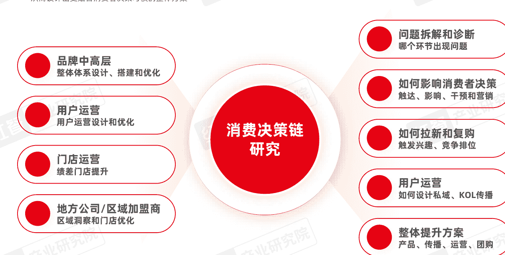

## 问题拆解和诊断

哪个环节出现问题？

### 品牌中高层
整体体系设计、搭建和优化

### 如何影响消费者决策
触达、影响、干预和营销

### 用户运营
用户运营设计和优化

### 如何拉新和复购
引发兴趣、竞争排

### 门店运营
差异化门店提升

### 用户运营
如何设计私域、KOL传播

### 地方公司/区域加盟商
区域洞察和门店优化

### 整体提升方案
产品、传播、运营、团购

资料来源：红餐产业研究院

## 摘要

本报告在红餐调研的基础上，综合红餐研究院的桌面、大数据、餐饮专家意见等，采用红餐决策模型对正餐群体进行调研，对消费者餐饮决策路径、影响因素等等方面进行深入分析，全面洞察消费者完整决策过程，旨在为国内餐饮行业、上游供应链以及相关从业者提供参考

本文部分内容如下：

- 消费者决策路径有三大关键节点，一是需要触发消费者内心的选拔赛，二是需要触发消费者做的预决赛，三是在现场的时候消费者做的终决策。基于这三点，餐饮企业的关键动作作用于三大战场：选拔战场、预决战场和终决策战场。

- 选拔战场：消费者超过7成的最终决策源自自选拔，因此选拔竞争的重要性至关重要。正消费者的选拔平均9.1%的品牌，因此能否将消费者选拔成为本品牌的关键。选拔战场涉及品牌广告、口碑和认同，品牌能否进入选拔圈。基于此，提升品牌广告曝光率和曝光效果提升品牌认知度，通过私域运营和留住核心客户，通过传播者突破口碑，能够提升品牌进入选拔规模。

- 预决战场：需求触发，86.9%的消费者在预决阶段设定目标品牌，由于此战场的干预决定了消费者是否选择。预决阶段的主战场是社交媒体、大众口碑、小红书、抖音等线上平台，此次主要是推广。其关键在于提升平台曝光率和曝光效果，在决策决实在消费者前，并用营销的触发因素（如券）提升被选中的概率。

- 终决策战场：约10%的消费者会在现场转换战场，一方面是品牌口碑吸引等优质因素的影响，本阶段的关键在于避免消费者流失，吸引更多消费者流入，一方面在消费者就餐、停车、卫生环境问题，另一方面在停车场、停车、卫生的问题，通过增加额外元素（如券）以吸引更多消费者消费。

案例：“2024年餐饮区域商圈新研究项目”，品牌C在大战场上处于劣势，缺乏拉动能力，老客复购频率高，客户频繁流失等问题。在选拔战场，品牌C应推出特色策划，并作为内容节点，增加品牌广告；同时增强私域流量，打造KOL矩阵，利用良好的消费体验优势传播，提升拉动能力；在预决战场，通过增加特价策略的团，并增加平台广告，提高曝光，提升老客回归机制；在终决策战场，改善卫生环境、完善品牌口碑，减少流失，通过增加特色和特价策略，吸引流入。

## 目录

01 消费决策链体系：三大战场决定餐饮企业的成败
02 备选战场：品牌广告、消费体验和口碑是进入消费者备选集的关键
03 预决策战场：86.9%的消费者在预决策阶段决定目标餐厅，线上平台是主战场
04 终决策战场：约10%的消费者会临转换餐厅，现场因素会改变最终结果

## 消费决策链研究体系：三大战场决定餐饮企业的成败

## 餐饮消费决策路径与三大战场

红餐研究院理解了餐饮消费决策模型，认为消费者决策路径有三大关键节点，一是需求触发前消费者心中的备选，二是需求触发后消费者的预决策，三是在现场消费的终决。

基于三大三点，餐饮企业的关键动作发生于三大战场：备选决策战场、预决策战场和终决战场。

## 消费决策路径

### 需求产生
实际体验的好坏决定了决策是在备选中，还是被剔除。

### 备选决策
实际消费体验。

### 预决策

### 终决决策
根据现场因素出现调整、最终门店。

### 扩展决策
增加消费信息，仅在备选内。

### 扩展信息
主动消费信息、增加对已品牌的了解。

### 流入
吸引其他消费者进入。

### 流出

## 三大战场

### 备选战场
在需求触发前，消费者心中已有的品牌，这是品牌广告、口碑共同作用的结果，进入备选的品牌拥有优势。

### 预决策战场
需求触发后，消费者在预决策时收集扩展信息，这是品牌提醒、打入心智，并且消费者选择的关键。

### 终决策战场
到现场后，消费者往往受到现场因素的影响选择，减少流出，现在要素上设计。

数据来源：红餐研究院

## 红餐OPF模型:从消费者导向落地策略

通过消费者决策路径，评估餐饮企业在三大战场上的相对表现，并采用方法识别餐饮企业的优势和问题，帮助餐饮企业在三大战场进行优化，在竞争中取胜。

## 三大战场OPF模型

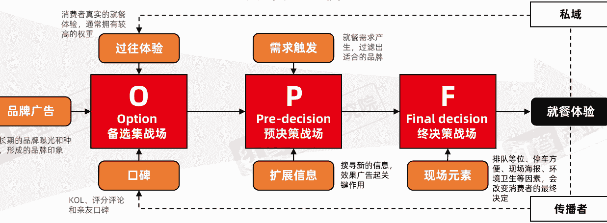

| 战场 | 定义/核心要素 |
| :--- | :--- |
| Option (备选) | 真实的体验，长期的品牌曝光和种草，形成的品牌印象 |
| Pre-decision (预决) | 需求触发产生新的信息，关键作用 |
| Final decision (终决) | 现场元素排队等、停车、环境、卫生等，改变消费者的最终决定，KOL、评分评论 |

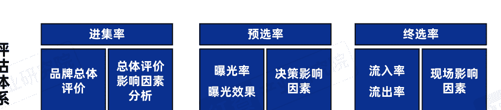

评估体系：总体评价、曝光效果、现场影响因素、流入率、流出率。资料来源：红餐研究院

## 本次报告重点分析亲友聚会场景下的正餐消费

需求场景分为四大类型：
- 商务宴请下，消费的主要大型私房菜和异国料理
- 亲友聚会场景下，更多是火锅、烧烤、烤鱼等类
- 悦己场景下，更多消费饮品、小吃、休闲零食等
- 日常饱腹下，更多的是快餐和团餐

本次报告选取亲友聚会场景下的正餐消费进行分析，分析消费者决策路径，并以某品牌区域项目为例，从餐饮品牌的角度分析如何评估和优化

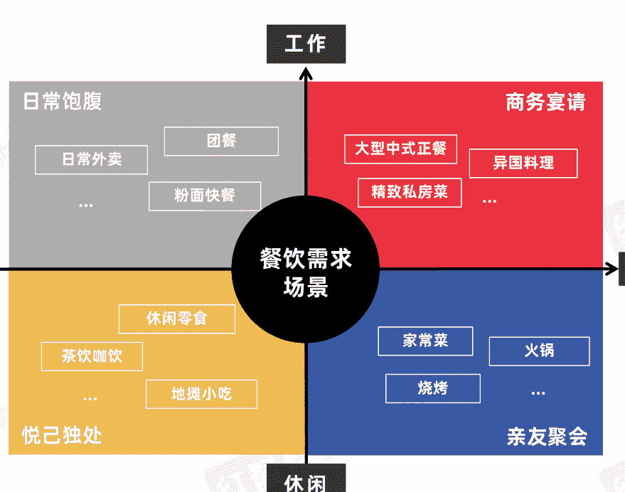

资料来源：红餐研究院

## “2024全国正餐消费者调研”调研介绍

- 为了研究消费者决策路径的实际情况，红餐研究院组织了“2024全国正餐消费者调研”，对全国1,085名餐饮消费者进行了定量问卷调研
- 样本条件：过去3个月内有亲友小聚在外就餐（包含正餐/异国料理/火锅/烧烤/烤鱼等品类）的消费者，且是餐饮决策者
- 执行方式：线上定量调研

## 样本性别分布
## 样本年龄分布
## 样本职业分布

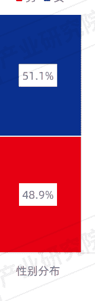
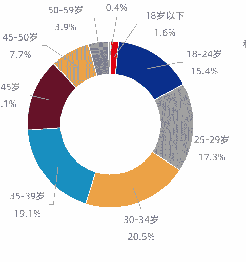
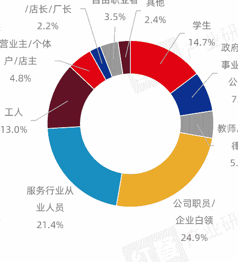

| 性别 | 占比 |
| :--- | :--- |
| 男 | 51.1% |
| 女 | 48.9% |

| 年龄 | 占比 |
| :--- | :--- |
| 60岁及以上 | 0.4% |
| 50-59岁 | 3.9% |
| 45-50岁 | 7.7% |
| 40-45岁 | 14.1% |
| 35-39岁 | 19.1% |
| 30-34岁 | 20.5% |
| 25-29岁 | 17.3% |
| 18-24岁 | 15.4% |

| 职业 | 占比 |
| :--- | :--- |
| 企业管理人员/经理/厂长 | 2.2% |
| 私营主/个体户主 | 4.8% |
| 工人 | 13.0% |
| 服务行业从业人员 | 21.4% |
| 自由职业者 | 3.5% |
| 其他 | 2.4% |
| 学生 | 14.7% |
| 政府机关/事业单位/公务员 | 7.8% |
| 教师/医生 | 3.5% |
| 公司职员/白领 | 24.9% |

资料来源：红餐研究院“2024全国消费者调研”，数据统计截至2024年1月

## 三大战场重要性占比 7:1

不同消费场景下三大战场重要性不同：
- 亲友小聚场景，备选战场重要性占比重大，最重要（约71%）。
- 预决战场重要性排序第二（约20%）。
- 终决策战场比例不高（约7%），但如果现场因素不好，消费者也会转向其他品牌。

## 三大战场重要性占比 7:1

| 战场 | 重要性占比 |
| :--- | :--- |
| 备选战场 | 71% |
| 预决战场 | 20% |
| 终决策战场 | 7% |

资料来源：红餐研究院“2024全国消费者调研”，数据统计截至2024年1月

## 02 备选战场：品牌广告、消费体验和口碑是进入消费者备选集的关键

### 第一步
- 需求触发前，消费者心中的备选，备选集是餐饮竞争的第一步。
- 备选集中的品牌，备选战场往往是品牌广告和口碑共同作用的结果。

### 口播与品牌广告
- 口播也是影响是否进入备选的关键，口播通常取决于KOL的传播、平台上的评分和评论，以及老的推荐。
- 品牌广告是影响备选集的因素之一，通过品牌广告、全天候潜移影响，在消费者留下深刻印象。

### 消费体验与营销
- 需求触发前，消费者心中的备选，备选集中的品牌往往是决策优先考虑的。
- 通常分为两类：“体验类”是体验过评价较高的品牌，“营销类”是未体验过想尝试的品牌。
- 消费体验直接决定品牌留在备选还是被剔出，消费体验包括服务、环境、价格等一系列表现的结果。

### 人群差异
不同人的消费偏向差异巨大，备选个数与品牌之间存在差异。

## 人群差异：亲友聚会场景下餐饮消费者分为三类主要人群，其中探索者占比较

根据消费者的背景画像和餐饮偏好，采用聚类分析对全体消费者进行分组，总来说，餐饮消费者主要成分为三大群体：

- **探索者 (37.2%)**：喜欢聚会、探店、尝试各种美食，愿意为美食花费；消费力强，重视口味和环境，中年已有小孩居多。
- **照顾者 (20.5%)**：消费力最强的群体，对于食物、口味、环境等都很看，重视和照顾他人需求，强调不错。
- **守护者 (6.9%)**：较少聚会，不愿意花时间尝试新店和新品，对品牌和菜品忠诚度高，购买频率高，重视口味，注重体验，人口分布与整体类似。

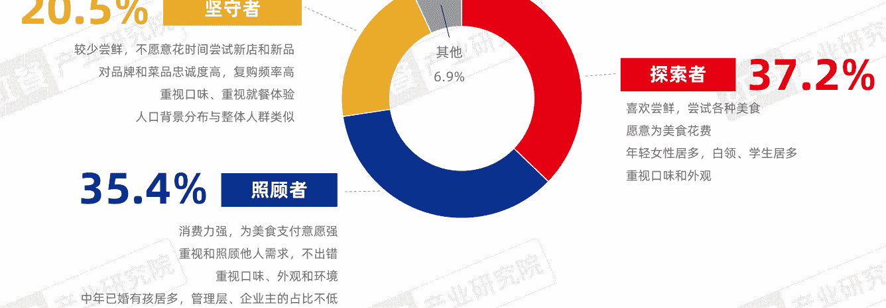

资料来源：红餐研究院“2024年正餐餐饮调研”，数据统计时间截至2024年12月。

## 三大人人群差异：探索者>照顾者>坚守者

不同人群的种类偏好存在差异：
- 探索者最爱火锅和西式餐。
- 照顾者主要选择中式正餐和西式正餐。
- 守护者喜欢中式正餐，其他种类占比相对不高。

### 正餐消费者差异意愿表

| 类别 | 探索者 | 照顾者 | 守护者 |
| :--- | :--- | :--- | :--- |
| 特别喜欢 | 28.8% | 52.2% | 22.5% |
| 比较喜欢 | 33.8% | 41.3% | 40.6% |
| 偶尔聚餐 | 23.5% | 6.5% | 30.3% |
| 很少聚餐 | 13.9% | - | 6.6% |

### 消费偏好占比表

| 种类 | 探索者 | 照顾者 | 守护者 |
| :--- | :--- | :--- | :--- |
| 中式正餐 | 67.7% | 65.0% | 78.4% |
| 火锅 | 62.1% | 71.1% | 52.6% |
| 西式正餐 | 45.6% | 55.4% | 46.8% |
| 日本料理 | 37.3% | 48.0% | 38.8% |
| 烧烤 | 33.8% | 42.8% | 26.7% |

资料来源：红餐研究院“2024年全国消费者偏好”，数据统计截至2024年12月

## 备选集：消费者心中平均为9.1个品牌，探索者远高于群体

- 需求触发前，消费者心中平均为9.1个品牌，但不同群体的备选数差异较大。
- **探索者**：动力较高，高达16.7个品牌。
- **照顾者**：高达12.1个品牌。
- **守护者**：最少，只有4.7个品牌。

### 全国餐饮消费者整体备选数分布

| 数量 | 探索者 | 照顾者 | 守护者 |
| :--- | :--- | :--- | :--- |
| 1-3个 | 10.0% | 37.2% | 5.7% |
| 4-6个 | 21.7% | 6.2% | 26.5% |
| 7-9个 | 23.7% | 15.7% | 34.2% |
| 10-12个 | 21.1% | 35.4% | 15.1% |
| 13-15个 | 14.5% | 25.5% | 12.3% |
| 16-18个 | 7.4% | 13.1% | 6.2% |
| 19个以上 | 1.6% | 4.1% | 0 |

## 体验清单与尝鲜清单平均品牌数

- 体验清单：探索者5.3个，照顾者5.4个，守护者4.2个。
- 尝鲜清单：探索者3.8个，照顾者6.7个，守护者2.8个。

资料来源：红餐产业研究院“2024年全国餐饮消费者调研”，数据统计时间截至2024年12月

## 案例：品牌CF三大指标总体表现

以“2024年品牌CF商城诊断研究项目”为案例，经调研诊断，品牌CF在某区域商圈的三指标总体表现较弱，除流入率等以外，其他指标均差主要品牌均值，有较大的提升空间。

## 品牌CF三大指标总体表现

- 品牌CF在备选集中的消费者，优质品牌CF的比重
- 所有决策阶段产品转换的消费者中，最终现场转向品牌CF的消费者比重

| 指标名称 | 品牌CF数据 | 各品牌平均 |
| :--- | :--- | :--- |
| 品牌CF流入率 | 4.8% | 11.6% |
| 品牌CF进优率 | 13.2% | 4.8% |
| 品牌CF总优选率 | 1.8% | 16.8% |
| 品牌CF终优选率 | 1.7% | 2.9% |
| 品牌CF集团外优选率 | 0.6% | 0.9% |
| 品牌CF流出率 | 10.9% | 10.3% |

- 商城消费者中，品牌CF在备选内的人数比重
- 商城消费者中，优质品牌CF的比重
- 优质选择了品牌CF的消费者中，最终现场不选择品牌CF的消费者权重
- 品牌CF不在备选集中的消费者，优质品牌CF的比重

数据来源：红豆产业研究院“2024年品牌CF区域商城诊断研究项目”，数据经过匿名处理。

## 案例：品牌CF的进优率处于后位，认知度低是一一方面的原因

- 进优率，即在消费者群体中备选的比例，进优率越高，越表示品牌在备选赛场中表现越优秀，能够争夺更多的消费者心智。进优率主要取决于产品认可度和品牌露出总体评价，前者取决于品牌曝光频率和曝光效果，后者取决于口碑和实际消费体验。
- 从品牌CF的案例来说，品牌CF目前处于进优率落后的位置，即在备选赛场中落于后位，认知度低是主要原因之一。

## 某品牌圈主要竞争品牌进优率

进优率：在市场消费者中，该品牌进入进优率消费者的人数比例。

| 品牌 | 进优率 |
| :--- | :--- |
| HDL | 35.4% |
| SYL | 27.0% |
| DDD | 25.8% |
| XBYMC | 23.6% |
| CCHG | 20.6% |
| JT | 19.8% |
| XLL | 19.0% |
| XLLTT | 16.0% |
| YK | 15.6% |
| LCCT | 15.2% |
| ZGY | 14.2% |
| NHG | 14.0% |
| SSL | 13.8% |
| TESCY | 13.2% |
| CF | 13.0% |
| CQDZ | 11.2% |
| SK | 9.0% |
| CLDX | 8.8% |
| WXX | 7.0% |

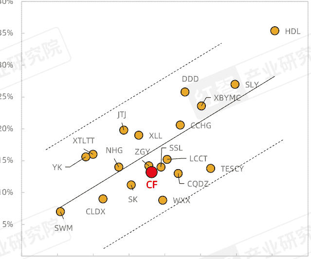

数据来源：红豆产业研究院“2024年品牌CF进优率诊断项目”，数据经过脱敏处理。

## 案例：品牌CF总体评价中偏准，在品牌广告方面有所待加强

品牌CF在备选赛场表现一般，其品牌总体评价低于平均水平，与头部品牌之间存在差距，表明品牌CF在消费者心中排位并不靠前。

从影响因素分析来看，品牌CF在消费体验和口碑方面较好，但品牌传播方面较弱，品牌在当地知名度不太高，消费者能够足够的留存，但不能有效地吸引更多消费者，拉新能力偏弱。

## 心智影响因素重要性及品牌CF表现

品牌传播待加强，品牌CF在媒体方面较弱，当地知名度不高，没有有效引流顾客。

数据来源：红豆产业研究院“2024年品牌CF区域渗透项目”，数据经过脱敏处理。

## 案例：品牌CF需要加强消费者种草，创造备选的机会

- 基于特色菜的种草内容输出，增加矩阵曝光和私域运营，能够有效扩大品牌CF知名度，从而创造更多备选机会。
- 特色菜在传播中非常重要，目前品牌CF虽然多样，但缺乏特色菜，导致消费者对品牌印象不深，在传播方面没有。
- 目前品牌CF的种草内容较少，后续以特色菜和优惠折扣作为主体，增加消费者记忆。
- 提升品牌运营能力，积极参与平台团购，获得更多曝光。

数据来源：红豆产业研究院“2024年品牌CF商城诊断报告”。

## 03 预决策战场：86.9%的消费者在预决策阶段决定餐厅，线上是主战场

## 触发因素：场景需求和品牌动作都能触发需求

餐饮需求主要分成两类：一类是消费者自身朋友聚/节日/约会等场景产生，朋友推荐也有影响；二是品牌动作产生需求，线下的新店开业/新品上市以及线上的种类和折扣也能触发需求。总来说，消费者场景需求触发因素更为重要。

## 多场景需求触发率

| 场景 | 占比 |
| :--- | :--- |
| 朋友聚 | 85.7% |
| 家里玩 | 68.2% |
| 节日需要 | 63.3% |
| 朋友推荐 | 47.8% |
| 约会 | 35.6% |
| 附近有新店开张 | 57.0% |
| 在平台上看到团购、促销活动 | 55.5% |
| 熟悉的餐厅推出新品 | 50.9% |
| 在平台上刷到美食内容 | 48.8% |
| 路过门店，产生联想 | 42.2% |
| 品牌的公众号/社群活动 | 27.5% |

## 品牌动作也能触发需求

主要是两类：一是品牌事件触发，如新店开张、推出新品、店面装修和海报投放引起兴趣；二是平台运营的种草内容和优惠折扣引起消费者兴趣。

数据来源：红豆产业研究院“2024年全国正餐消费者研究”，统计截至2024年12月。

## 决策方式：做扩展决策的消费者居多，但人群差异较大

- 需要触发后，做扩展决策的消费者居多，即愿意花时间搜增量信息再做综合决策，但不同人群差异较大。
- 探索者搜寻更多品牌的倾向较高，超过7成，他们会希望抓住机会营销；酷者侧重品牌是否满足全员多样性需求，不希望出错，因此探索者会进行品牌、评价等方面的对比再决策；坚守者往往在备选内选择，很少做扩展决策。

## 全国餐饮消费者正餐扩展决策类型

| 类型 | 探索者 | 酷者 | 坚守者 |
| :--- | :--- | :--- | :--- |
| 聚焦内决策 | 45.2% | 28.7% | 35.8% |
| 扩展决策 | 54.8% | 71.3% | 64.2% |
*(注：部分数据根据OCR推断已进行逻辑对齐)*

数据来源：红豆产业研究院“2024年全国餐饮决策报告”。

## 信息搜索渠道：美团、大众点评、小红书是最重要的渠道

信息搜索渠道是决策主战场，应对不同人群：探索者看小红书/大众点评；酷者关注团购、评价和环境；坚守者关注团购/折扣。

## 正餐消费者主要信息搜索渠道

| 渠道 | 探索者 | 酷者 | 坚守者 |
| :--- | :--- | :--- | :--- |
| 菜品、口味多样 | 63.7% | 68.7% | 80.3% |
| 特色菜 | 66.0% | 64.3% | 53.5% |
| 菜系和口味类型 | 66.2% | 77.8% | 57.9% |
| 味道好/上瘾 | 64.0% | 53.8% | 35.0% |
| 是否有儿童座椅 | 36.8% | 62.2% | 40.3% |
| 环境 | 44.1% | 83.2% | 16.4% |
| 服务 | 48.8% | 48.1% | 40.6% |
| 方便停车 | 46.6% | 34.1% | 58.0% |
| 性价比 | 45.3% | 54.7% | 20.7% |
| 优惠/折扣优惠 | 43.4% | 37.7% | 13.1% |
| 品牌知名度 | 42.0% | 20.5% | 40.8% |
| 平台评分和评价 | 55.5% | 29.7% | 25.7% |
| 朋友推荐 | 52.0% | 7.8% | 31.4% |

数据来源：红豆产业研究院“2024年全国正餐消费者调研”，统计截至2024年12月。

## 决策影响因素：菜品相关因素是首要因素

决策影响因素分为四类：菜品相关、环境服务、价格相关、知名度与口碑相关。其中菜品相关因素是关键，但人群看重差异较大，比如关注停车、酷者关注优惠，以及三类群体对菜的态度显然不同。

## 消费者决策影响因素

| 因素 | 探索者 | 酷者 | 坚守者 |
| :--- | :--- | :--- | :--- |
| 菜品、口味多样 | 63.7% | 68.7% | 80.3% |
| 特色菜 | 66.0% | 64.3% | 53.5% |
| 菜系和口味类型 | 66.2% | 77.8% | 57.9% |
| 味道好/上瘾 | 64.0% | 53.8% | 35.0% |
| 是否有儿童座椅 | 36.8% | 62.2% | 40.3% |
| 环境 | 44.1% | 83.2% | 16.4% |
| 服务 | 48.8% | 48.1% | 40.6% |
| 方便停车 | 46.6% | 34.1% | 58.0% |
| 性价比 | 45.3% | 54.7% | 20.7% |
| 优惠/折扣优惠 | 43.4% | 37.7% | 13.1% |
| 品牌知名度 | 42.0% | 20.5% | 40.8% |
| 平台评分和评价 | 55.5% | 29.7% | 25.7% |
| 朋友推荐 | 52.0% | 7.8% | 31.4% |

- 菜品特色最重要：特色菜是吸引探索者最重要的因素，对于“认多广”的探索者来说，与众不同最有吸引；其次是菜品和口味类型。
- 特色/口味是关键：酷者注重口味，往往餐厅拥有一道口味让其留下深刻的主菜，甚至有一定的属性，即“所有人都有适合的菜吃”，非常重视，餐即每过一段时间就想吃。
- 关注停车方便。
- 关注折扣优惠。
- 知名度不重要，仅用来避坑。
- 关注知名度与评价是为了不跌大坑，错才不远。

数据来源：红豆产业研究院“2024年全国正餐消费者决策调研”，统计截至2022年12月。

## 对照顾者来说，儿童餐可以减少很多烦恼

- 大人群体中，只有照顾者关注儿童餐，因为他们更多带小孩一同用餐。
- 儿童餐对于照顾者来说，是适合孩子的保底选项，并且通常孩子也喜欢，很多餐厅往往用免费或低价的儿童餐来引流，对照顾者来说，儿童餐通常是必须的选项。
- 但目前儿童餐普遍“低配”，即食材料品质一般，烹饪方法简单，并不营养均衡，并且口味也一般，整体仍需提升。

## 照顾者如何看待儿童餐

| 维度 | 占比 | 维度 | 占比 |
| :--- | :--- | :--- | :--- |
| 有适合孩子口味的东西 | 76.7% | 免费、低价 | 53.5% |
| 味道上不适合孩子 | 9.9% | 仪式感 | 64.1% |
| 只有仪式感 | 待补 | 普遍低配 | 待补 |

数据来源：红豆产业研究院“2024年全国正餐决策调研”，统计截至2024年12月。

## 绝大部分消费者在预决策阶段决定餐厅

- 定餐厅：86.9%的消费者在预决策阶段就已经决定了餐厅，基本上是从备选集中扩展搜索中决定了一家，意味着门店之外。
- 定地点：13.1%的消费者选择现场决策，事前只决定到商圈，对于这类消费者，现场至关重要。

## 案例：品牌CF的业内与外品牌优选排名均后，表明在预决策战场处于劣势

品牌优选落后，表明即使品牌一直留在备选中，也很难在决策时被选择。提升优选率，关键在于消费者扩张时要有曝光，提醒消费者品牌的存在，另一方面曝光有效，能够刺激消费者选择品牌。

## 某圈主要品牌业内与外品牌优选

| 品牌 | 业内优选率 | 外品牌优选率 |
| :--- | :--- | :--- |
| SLY | 22.4% | 3.0% |
| XYBMC | 19.5% | |
| XLTLL | | 2.5% |
| HDL | 15.5% | |
| LCCT | 15.2% | |
| CCHG | 14.3% | |
| SSL | 14.0% | |
| ZGY | 12.5% | |
| SK | 12.0% | |
| DDD | 11.3% | 1.5% |
| NHG | 10.4% | |
| TESCY | 10.2% | |
| CF | 9.9% | 1.0% |
| XLL | 9.2% | |
| SWM | 8.4% | |
| JT | 7.1% | |
| YK | 6.3% | |
| CLDX | 5.0% | |

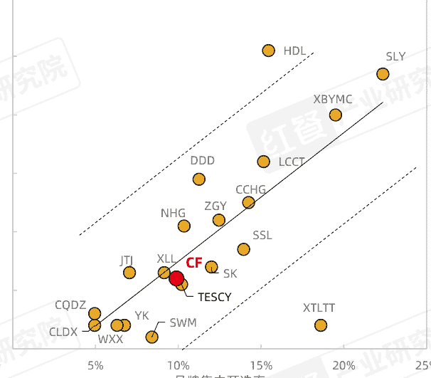

## 案例：品牌CF在菜品品质、口味以及团购折扣方面处于优势，可以用照顾者和坚守者进行消费

品牌CF在消费者考虑因素的优势是菜品品质、口味、停车方便以及团购折扣，其次关注评价价格，这些条件下，比较适合照顾者、坚守者的需求，前者关注菜品品质、口味以及停车需求，后者关注菜品品质、口味和团购折扣，品牌CF可以从这两个群体出发。

## 品牌CF在预决策影响因素中的表现

| 菜品 | | |
| --- | --- | --- |
| 品质 | 82.5% | |
| | 特色菜 | 40.3% | |
| | 菜和口味类型 | 56.9% | |
| | 味道好/上餐 | 62.3% | |
| | 儿童餐 | 5.1% | |

| 探索者 | |
| --- | --- |
| 菜品特色吸引力不足 | |
| 菜和口味偏大众 | |

| 照顾者 | |
| --- | --- |
| 菜品好 | |
| 口味好 | |
| 菜品不多 | |
| 缺少儿童餐 | |

| 坚守者 | |
| --- | --- |
| 菜品好 | |
| 口味好 | |

| 环境与服务 | | |
| --- | --- | --- |
| | 环境 | 50.4% | |
| | 服务 | 46.6% | |
| | 停车费贵 | 78.3% | |
| 价格 | 性价比 | 47.2% | |

| 照顾者 | |
| --- | --- |
| 停车非常方便 | |

| 坚守者 | |
| --- | --- |
| 团购/折扣优惠 | |
| 团购/折扣优惠 | |

| 知名与美誉度 | | |
| --- | --- | --- |
| | 品牌知名度 | 42.2% | |
| | 平台评分和口碑 | 56.7% | |
| | 亲友推荐 | 64.4% | |

| 照顾者 | |
| --- | --- |
| 评价价格 | |

| 坚守者 | |
| --- | --- |
| 评价价格 | |

资料来源：红筹产业研究院“2024年品牌CF区域商城趋势调研研究报告”，数据经过脱敏处理。

## 案例：在预决战场，品牌CF提升平台曝光度和曝光效率的关键

品牌CF目前在主流平台上的主要的输出是团购，依靠自然流量为主，内容输出不多，曝光频率不高，因此在预决战场中处于劣势。可以通过增加内容输出、增加付费流量，并且配合口碑“品牌品质”、“停车方便”等优势，以及增设团购套餐，在拉动更多新客的同时触发更多的老客复购。

## 品牌CF如何在预决战场提升竞争力

### 增加曝光度
增加美团、大众点评、小红书、抖音等主流平台曝光度。

### 提升曝光效率
结合消费者人群关注的核心因素，传递内容强调自己在这方面的优势。

### 控制ROI增加平台内容输出和广告投放
目前品牌CF在主流平台上的主要是团购，依靠自然流量，内容输出不多，曝光频率不高。
建议：（1）增加主流平台内容输出，频率提高；（2）与招探达人合作，增加矩阵曝光；（3）增加平台广告投放（4）整个过程实时监控。

- **照顾者**：品牌品质，停车方便。输出内容中重点传播“新品鲜”、“停车方便”等优势项目，这也是CF与竞品相比最大的优势。此外，推出特色菜、儿童餐等照顾者比较关注的菜品。
- **探索者**：增加团购投放，满足多样化需求。
- **坚守者**：选择CF的核心原因是口碑和折扣优惠，但团购丰富不够，可以用来增加团购型，以满足更多的坚守者的复购需求。

## 拉动新客+提升复购
来源：红薯产业研究院“2024年品牌CF区域团购分析项目报告”，数据已经脱敏处理。

## 04 终决策战场：约10%的消费者会临场转换餐厅，现场因素会改变最终结果

## 近10%的消费者会临场转换餐厅，现场因素会改变最终结果

最终决策是消费者决策的重要环节，显示86.9%的消费者在预决赛时就已经选定餐厅，但其中约10%的消费者在现场时会由于现场的各种因素而选择换餐厅，因此对于餐饮品牌来说，门店选址也是竞争消费者的关键环节。

不同人群的现场换餐厅的可能性存在差异，其中探索者转换的可能性相对较高，容易受其他现场因素的吸引而流失；而照顾者则不同，他们的预决赛考虑充分，一般不会现场转换，除非现场排队时间太长不适合老人小孩等；坚守者是最不愿意换餐厅的人群，他们往往会坚持原来的选择。

## 正餐消费者临场转换餐厅情况

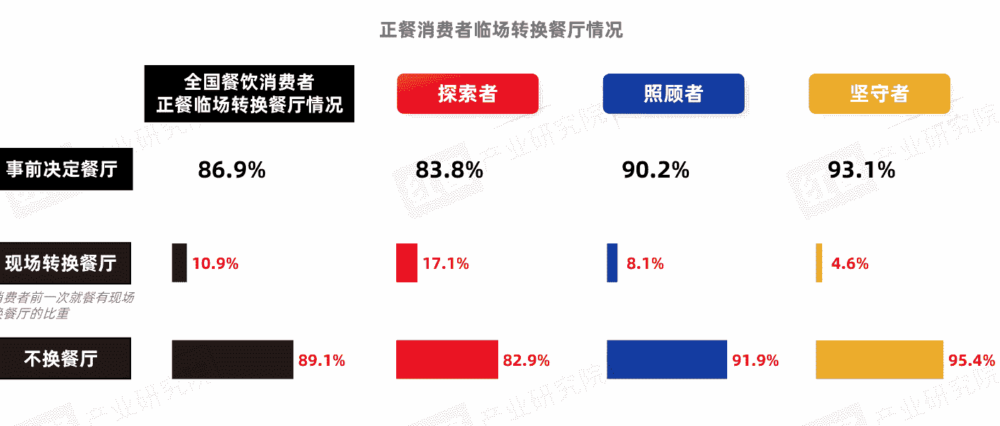

资料来源：红餐产业研究院“2024年全国正餐消费者决策调研”，数据统计时间截至2024年12月。

## 终决策战场决定因素：没位置、停车问题、门店卫生是消费者切换的主因

消费者在现场切换门店的原因，主要是没位置要排队等、停车问题以及卫生问题，而品质的核心点在于主打菜、特价菜和优惠。

## 正餐消费者现场转换餐饮考虑因素

- 探索者
- 照顾者
- 坚守者

| 因素 | 占比 |
| --- | --- |
| 菜单不优惠 | 34.0% |
| 现场多元 | 主打菜/特色菜 |
| 海报不优惠 | 52.6% |
| 无特价 | 46.0% |
| 环境与装修一般 | 44.2% |
| 环境与服务（卫生状况欠佳） | 68.8% |
| 停车不便 | 53.7% |
| 位置、排队 | 67.4% |
| 竞争情况（菜单优惠） | 40.9% |
| 主打菜/特色菜海报不优惠 | 53.4% |
| 特价菜海报 | 57.1% |
| 环境与装修 | 50.6% |
| 无需排队 | 47.2% |
| 优惠/优惠 | 51.4% |

> **探索者**：不介意等位、不介意停车问题，看重卫生环境。
> **照顾者**：几乎不等位、一旦有排队就转换，方便餐、卫生很重要，对环境装修重视程度高。
> **坚守者**：适合的菜和特价菜比较重要。

菜单、主打菜、特色海报是竞品吸引的关键点。特价菜海报、团购/优惠是竞品吸引的关键点。主打菜/特色菜海报、特价菜海报是竞品吸引点。

数据来源：红餐产业研究院“2024年全国正餐消费者决策因素”，统计时间截至2024年12月。
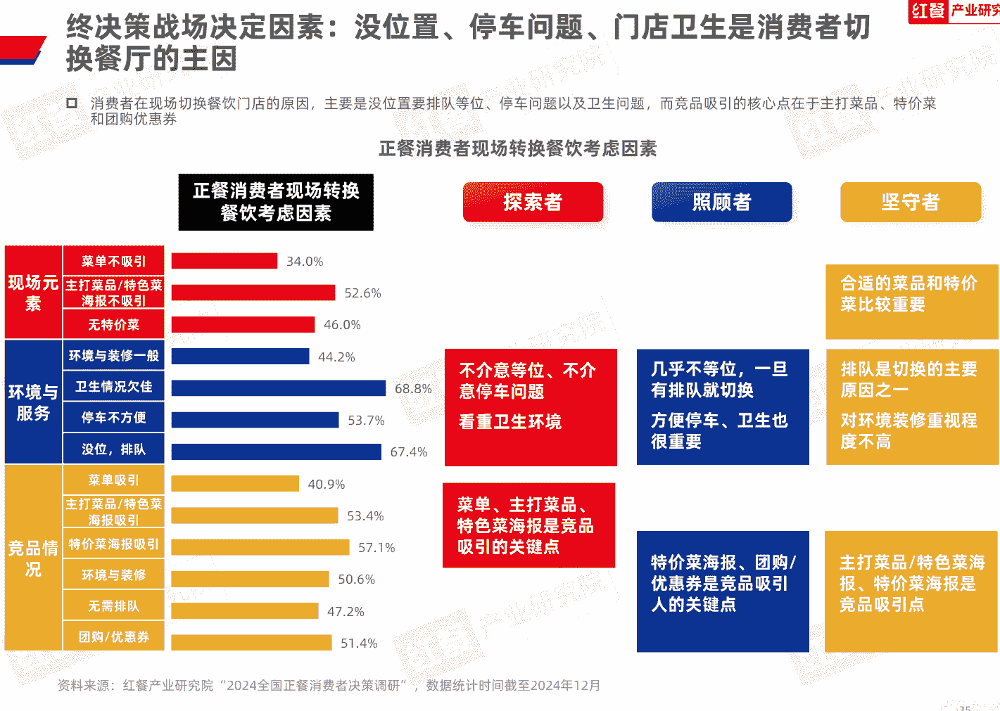

## 案例：品牌CF的流出率较高，主要是照顾者流出多

品牌CF属于中等，流入的客户以坚守者为主，流出的客户以照顾者为主，探索者在品牌群体中占比不高。

## 某商圈正餐品牌流入率与流出率

**流入率**：所有品牌转换的消费者，最终选择品牌的占比。
**流出率**：选择该品牌的消费者，最终选择其他品牌的占比。

| 品牌 | 流入率 | 流出率 |
| --- | --- | --- |
| HDL | -5.4% | 4.8% |
| CCHG | -5.8% | 4.1% |
| SSL | -6.8% | 5.4% |
| DDD | -7.9% | 4.7% |
| XBYMC | -8.3% | 3.9% |
| NHG | -8.4% | 6.3% |
| ZGY | -8.9% | 6.7% |
| CLDX | -10.0% | 5.5% |
| LCCT | -10.6% | 7.2% |
| XTLLT | -10.9% | 4.8% |
| CF | -11.0% | 4.0% |
| XLL | -11.3% | 2.1% |
| YK | -11.7% | 1.9% |
| CQDZ | -11.9% | 1.8% |
| TESCY | -12.2% | 3.4% |
| JTJ | -13.3% | 7.9% |
| SLY | -14.2% | 1.6% |
| SK | -14.2% | 5.3% |
| SWM | -14.3% | 2.8% |

**品牌流入客户构成**
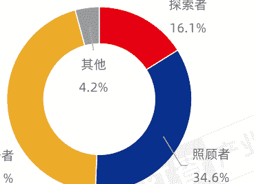

**品牌流出客户构成**
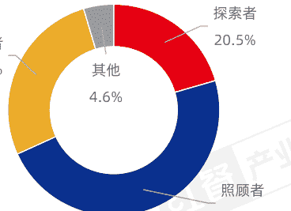

数据来源：红餐产业研究院“2024年品牌CF商圈趋势”，数据经过脱敏处理。

## 案例：品牌CF增加优惠以吸引流量，减少流出

优惠是消费者看重但目前品牌表现不佳的地方，需要增加优惠，并且卫生状况和排队是消费者流出的主因，品牌要重点改善卫生状况，其次是改善排队流程。

## 考虑因素重要性表现

| 权重 | 照顾者 | 坚守者 |
| --- | --- | --- |
| 80% | | |
| 70% | 菜吸引 | 团购/优惠 |
| 60% | | 无特价菜 |
| 50% | 环境与装修 | 团购/优惠、排队 |
| 40% | | 无特价菜 |
| 30% | 环境与装修 | 卫生、排队 |
| 20% | 无需排队 | 菜单吸引 |
| 10% | 主打菜/特色 | 方便、停车 |
| | | 考虑因素重要性 |

资料来源：红餐产业研究院“2024年品牌CF区域调研”，数据经过脱敏。

## 总结：品牌CF三大战场计划

### 核心优劣势
| 优势 | 劣势 |
| --- | --- |
| 食品品质良好 | 缺乏特色菜 |
| 口味不错 | 知名度不高 |
| 停车方便 | 流量少 |

### 备选战场
| 优势 | 劣势 |
| --- | --- |
| 食品品质 | 评价不错 |
| 口味不错 | 种类少 |
| 停车方便 | 曝光效果 |

### 决策战场
| 优势 | 劣势 |
| --- | --- |
| 食品品质 | 流入率低 |
| 口味不错 | 缺少特色菜 |
| 停车方便 | 儿童餐 |

### 终结战场
| 优势 | 劣势 |
| --- | --- |
| 流入率中 | 现场不足 |
| 坚守者加入 | 流量等 |
| 高流出率 | 卫生一般、排队 |

### 提升计划
- **备选战场**：结合品牌品质、口味优势，持续内容输出增加基数。
- **提升流量**：推出特色菜和优惠，通过私域和流量增加新品。
- **决策战场**：结合新的特色菜和优惠，增加餐饮套餐，增加投入、提升曝光。
- **终结战场**：及时拦截、优化流程改善门店卫生状况，增加订单数量满足更多需求，提升转化率，减少流量。

资料来源：红餐产业研究院“2024年品牌CF区域渗透研究报告”，数据经过脱敏处理。

## 三大战场OPF模型适用于多种研究场景

- **Option**：备选战场
- **Pre-decision**：预决战场
- **Final decision**：终决战场

### 消费者洞察
品类消费者决策路径研究，洞察消费者决策路径上的习惯、成因，识别关键节点。针对OPF三大战场，基于消费者决策路径的洞察给出整体提升建议。

### 区域战场优化
针对区域消费者特征和区域市场特征进行分析，洞察消费者的需求、偏好、决策链路特点，输出具有区域特色的优化方案。

### 差异门店提升
针对差异门店在商圈进行调研，快速识别差异门店三大战场的问题，输出针对性的行业价值提升方向。

### 用户运营研究
通过洞察用户运营关键节点上的消费者行为、习惯、偏好影响因素，特别是关注私域和传播者的影响、口碑的维护和运营方面的洞察，输出品牌在用户运营层面的优化方向。

数据来源：红餐研究院

## 关于我们
红餐产业研究院属于红餐网，国内专注于餐饮行业发展的研究机构。红餐产业研究院聚集了产业数据、专业团队、专家智库、产业核心媒体等资源，秉持专业、严谨、客观的原则，为餐饮...红餐产业研究院的研究成果包括行业报告、案例研究、专业榜单等形态。其中，每年发布的年度《中国餐饮发展报告》、《餐饮行业“红宴奖”榜单和产业“红牛奖”榜，及各类深度报告，在业内产生巨大影响力。

## 红餐大数据
“红餐大数据”小程序，收超过32,000个餐饮品牌、2,000余餐饮产业上下，致力于为用户提供大数据查询和分析服务，旨在通过全方位、精细的数据呈现，为餐饮从业者、投资者、意向创业者提供决策参考。

## 报告说明

1. **数据来源说明**：红餐大数据，源于餐饮门店开店长期的监测，并结合大小样本算法的数据挖掘和统计分析；2）面研究，基于餐饮行业有公开渠道的数据搜；3）行业调研，面向餐饮行业的创业者、高级管理者和资深从业者进行访谈获取信息；4）红餐调研，针对餐饮消费者或餐饮从业者的定量调研；5）其他合法收集的数据。以上均系相关法律法规，使用用户合法授权采集数据，同时。
2. **数据周期**：报告整体时间段：2024年6月—2024年12月。
3. **数据指标及样本总量**：具体请参考后页。
4. **免责声明**：红餐提供的数据信息基于样本数据抽样、小样本调研、数据模型预测及其他研究方法估算得出。由于统计分析领域中的任何数据来源和技术方法均存在假设，红餐也不外。红餐依据上述方法分析得出的数据信息仅供参考，红餐对上述信息的准确性、完整性、适用性和非性任何保证。任何机构或个人或基于上述方法所采集的行为造成的法律后果均由红餐无，由此引发的争议和法律责任由本人承担。
5. **版权声明**：本报告为红餐制作。报告中所有的文字、图片、表格均受相关的商标和著作权的法律保护，部分内容来源于自公开信息，所有权为原作者所有。未经本公司书面许可，任何组织和个人均不得以任何形式复制或传递。未经授权使用本报告的相关行为都将违反《中华人民共和国著作法》和其他法律法规的规定。

## 感谢观看

研究报告合作请联系 薇薇199 6625 2467（微信同号）

扫描二维码添加好友
