# 《人工智能生成合成内容标识办法》

《GB 45438-2025 网络安全技术 人工智能生成合成内容标识方法》

《网络安全标准实践指南-人工智能生成合成内容标识 服务提供者编码规范》

《生成式人工智能服务管理暂行办法》

国家互联网信息办公室 | 工业和信息化部 | 公安部 | 国家广播电视总局

# 扫码加入 知识星球TOP 免费资源群

免费

公众号:知识星球TOP

- 每日免费获取高价值资源
- 可提供各类资源搜索服务

价值

微信号:jnts8

| 热门付费文章 | 各行各业报告 | 副业赚钱方法 |
| :--- | :--- | :--- |
| 精选图书资源 | 职场实用资源 | AI政经自媒体 |

及时

微信号:jnts2

专注

分享资料仅供个人学习，请及时删除，切勿商用传播

# 技术规则与技术标准有机组合, 提出人工智能标识管理的中国方案

# 《人工智能生成合成内容标识办法》

2025年3月7日，国家互联网信息办公室、工业和信息化部、公安部、国家广播电视总局发布《人工智能生成合成内容标识办法》（以下简称《标标识办法》），自2025年9月1日起施行。

# 《网络安全技术人工智能生成合成内容标识方法》

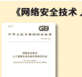

该强制性标准由中央网络安全和信息化委员会办公办公室归口，委托全国网络安全标准化技术委员会执行，于2025年9月1日实施。

# 《网络安全标准指南-人工智能生成合成内容标识服务提供者深度合成规则》

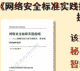

该指南由国家网络安全标准化技术委员会秘书处组织制定并发布，指导其开展人工智能生成合成内容的元素溯源标识工作。

# 《生成式人工智能管理办法办法》

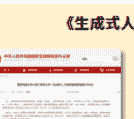

该办法于2023年5月23日第12次国家互联网信息办公室会议通过，并经国家发展改革委员会、教育部、科学技术部、工业和信息化部、公安部、国家广播电视总局同意，自2023年8月15日起施行。

强制国标
实践指南
管理办法
扩展解读

1. 图解四部门《人工智能生成合成内容标识办法》
2. 图解《GB 45438-2025 网络安全技术 人工智能生成合成内容标识方法》
3. 图解《网络安全标准实践指南——人工智能生成合成内容标识服务提供者编码规则》
4. 图解网信办《生成式人工智能服务管理暂行办法》

## 《办法》将人工智能标识产业实践经验升华为有约束力的治理范式

2025年3月7日，国家互联网信息办公室、工业和信息化部、公安部、国家广播电视总局联合印发《人工智能合成内容标识办法》，自2025年9月1日起施行。

### 关于印发《人工智能生成合成内容标识办法》的通知

国家互联网信息办公室（2025）2号

各省（直辖市）网信息管理办公室、工信厅、公安厅、广电信息化局：

根据发展需要，由国家互联网信息办公室、工业和信息化部、公安部、国家广播电视总局制定了《人工智能生成合成内容标识办法》（简称《办法》），旨在促进人工智能健康发展，规范人工智能合成内容标识，保护公民、法人和其他其他组织合法权益，维护社会公共利益。由国家互联网信息办公室、工业和信息化部、公安部、国家广播电视总局负责组织实施《办法》的有关工作。

通知贵你们，认真贯彻并落实执行。

### 《办法》意义

《办法》旨在促进人工智能健康发展，规范人工智能合成内容标识，保护公民、法人和其他其他组织合法权益，维护社会公共利益。

网络安全法 互联网信息服务合成内容管理规定 互联网信息服务推荐算法管理规定 生成式人工智能服务管理暂行办法

2017年6月1日起施行 2023年1月10日起施行 2022年3月1日起施行 2023年8月15日起施行

### 《人工智能生成合成内容标识办法》2025年9月1日起施行

# 《标识办法》出背景

### 聚焦人工智能“生成式内容标识”关键点

作为规范性文件，发挥内容标识提醒和监督溯源的作用，推动人工智能有序发展。

### 人工智能安全问题引发关注

近年来，人工智能快速发展，为合成文本、图片、音乐、视频等信息提供了便利工具，在促进经济的同时，虚假信息、深度伪造、恶意输出等问题出现，加剧了安全问题的动态性。联合国2024年《人工智能治理报告》将损害信息完整性列为风险。

### 生成式内容标识已成为国际例

- 无论是在欧盟《人工智能法》、《澳大利亚政府的临时应对，还是美国《生成式人工智能安全法案》、《加拿大人工智能法案》、《英国人工智能（监管）法案》等，均对标识提出了义务。
- 在我国，《互联网信息服务深度合成规定》、《生成式人工智能服务管理办法》明确相关规定，对数字水印、加密数据等标识技术的具体要求存在差异，但在执行中增强了人工智能治理的能力。

《标识办法》聚焦“生成式内容标识”关键点，通过标识提醒用户辨别虚假信息，明确服务主体的义务，规范内容制作、创作、设计等场景落地，降低平台成本，提升安全性，防范滥用人工智能带来的危害，推动人工智能能够有序发展。

# 《标识办法》制定的总体思路

### 细化已有规定

《互联网信息服务算法推荐规定》、《互联网信息服务深度合成规定》、《生成式人工智能服务管理暂行办法》中提出了标识有关要求，《标识办法》作为规范性文件，进一步细化标识的具体规范。

### 解决关键问题

《标识办法》重点解决“哪些是生成的”、“谁生成的”、“从哪里生成的”等问题，推动由生成到传播的全流程安全管理，打造可信的人工智能技术。

### 统筹发展和安全

人工智能发展需要针对文中添加数字水印，仍是技术点可能增加成本，提升落地实施的操作性、执行性，创新提出文本、音频、文件元数据等标识。

### 管理要求与技术标准一体化

为推动《办法》落地实施，强制性国家标准《网络安全技术人工智能合成内容标识方法》同步发布，更好地指导相关主体规范标识活动。

# 《办法》与强制性国标《网络安全技术人工智能合成内容标识方法》的关系

《标识方法》是《办法》的配套强制性国标。二者是从规则到技术标准的有机组合，兼具灵活性和约束力，符合全球治理通用方法，提出人工智能治理中国方案，为全球治理规则形成和我国协助提供：

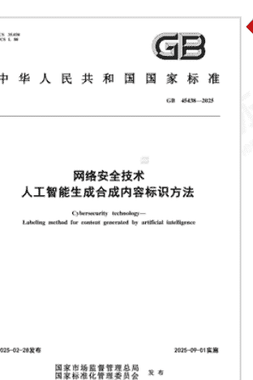

### 立法层面

《标识办法》主要在立法层面提出管理要求，明确合成内容传播各主体的责任义务，为人工智能创新发展提供具体实施操作。

### 实施层面

《网络安全技术人工智能合成内容标识方法》以强制性国家标准形式制定实施，主要提出强制执行部分的标识方式和操作方法，两者同步推进，于2025年9月1日同步实施，以便更好地指导相关主体开展工作。

## 施行日期

《办法》与强制性国标施行日期均为2025年9月1日。考虑到企业需要时间充分理解相关规定和标准规范，坚持循序渐进的原则，针对性开展标识能力建设和功能研发，基于技术实施的复杂程度、试点试行的经验，设定《办法》和配套强制性国家标准6个月左右的施行过渡期。

# 我国人工智能治理建设中的重要一步

体系性 技术性 贯贯性 精细化

作为内容治理体系的有机组成部分，《办法》和《标识标准》是我国人工智能治理建设中的重要一步，既与《中华人民共和国网络安全法》一体相承，又与互联网信息服务推荐管理规定》《生成式人工智能服务管理办法》等有效衔接，构建的人工智能治理要求具有体系性、技术性、协同性、贯贯、精细化等特点，在明确治理标准和落地实施方面，具备可操作性和基础。

### 体系性、技术性：治理与法治彼此运行，探索双标识机制

治理与法治彼此的内在、协同、进在人工智能治理中尤为明显。《标识办法》援的《互联网信息服务合成管理规定》涵盖人工智能的基本数据类型，并明确各类内容的可标识性。《标识标准》显示标识与标识式标识的合成、综合运用，通过技术检测识人工智能生成内容成为合成内容，并在一定程度上具有主体行为性的初步治理效率。

### 协同、贯贯性：多部门监管协同协调，多制度衔接资源整合

在人工智能标识执法过程中，需协调相关主管部门管理职责，明确标识执法行为法律界定，强化标识治理与执法执法、安全评估等程序的衔接。《标识办法》规定，服务提供者在行政备案、安全评估等等应当按照本办法提供相关材料，由网信、电信、广电等相关主管部门职责，行政规定。

### 全过程、精细化：产业生态治理，法律落实主体

《标识办法》和《标识标准》从内容提供者这一视角切入，进一步明确人工智能治理体系中的作用、定位、行为模式及影响程度。精准分为合成内容提供者、内容传播者这两大主体，明确标识义务。此外，《办法》体现在内容创作中，对当前发展的人工智能。

# 《标识办法》和《标识标准》的制度意义

### 从制度构建角度
### 从规范治理角度
### 从技术治理角度

《标识办法》和《标识标准》的制度过程，本质上是将产业实践经验积累为具有约束力的治理。人工智能治理体系遵循“规则+技术”双驱动，涵盖从内容生产到数据传播的全链条。依托“法治确认-标准转化”机制，我国建立起从技术向法律的之路。《标识办法》侧重责任链闭环，《标识标准》聚焦“技术锚点”建设，针对关键要素建立可靠性的实施。为了保障人类健康和财产安全、国家安全以及生态安全，满足管理基本的要求，制定强制性国家标准。《

办法》和《标识标准》不仅及时响应AI输出，还将标识化为不同区域的显式的、隐式的技术要求，符合人工智能治理本土化的思路，既灵活运用规则鼓励行业先行探索，同时针对痛点、难点靶向施策，其产生的影响辐射全球治理的理念。这一体系建设也人在机融合技术跨越发展中，人类对真实与虚构进行判别，从而形成决策的基础需求。

# 《人工智能生成合成内容标识办法》结构

# 《人工智能生成合成内容标识办法》

###部分 总则
1. 目的依据
2. 适用范围
3. 重要定义

### 第二部分 标识形式
4. 显式标识
5. 隐式标识

### 第三部分 责任义务
6. 规范传播活动的措施
10. 主动声明及违法行为
7. 平台服务核验要求
11. 他法遵循
8. 规范服务协议内容
12. 标识信息共享

### 第四部分 附则
14. 施行日期
9. 日志留存
13. 监管机构职责

# 衔接上位法，明确适用范围及重要定义

### 总则

### 适用范围

符合《互联网信息服务算法推荐规定》、《互联网信息服务深度合成规定》、《生成式人工智能服务管理暂行办法》规定情形的网络信息服务提供者（以下简称“服务提供者”）开展人工智能生成内容活动，适用本办法。

### 标识形式

### 重要定义

- **人工智能合成内容**：指利用人工智能技术生成、合成的文本、图片、音频、视频、虚拟场景等信息。人工智能生成内容标识包括显式标识和隐式标识。
- **显式标识**：指在生成合成内容或者交互界面中添加文字、声音、图形等方式呈现并可以被用户明显感知到的标识。

### 责任义务

- **隐式标识**：指采取技术措施在生成合成内容数据中添加的不易被用户明显感知到的标识。

> 解读：《互联网信息服务深度合成规定》第二条明确“法律、行政法规另有规定的，依照其规定》、《生成式人工智能服务管理办法》第二条再次明确“国家对利用生成式人工智能服务从事出版、影视制作、文创活动等活动另有规定的，从其规定”。《标识办法》同样依照适用条款另有规定的，从其规定，开展特定活动对内容标识规定的。

### 附则

# 文本、音频、图片、视频、虚拟场景等生成合成内容添加显式标识

| 1.总则 | 服务提供者提供的合成服务属于《互联网信息服务深度合成规定》第十七条第一款情形的，应当按照下列要求对生成合成内容添加显式标识： | 《互联网信息服务深度合成规定》第十七条（一）智能对话、智能写作 |
| :--- | :--- | :--- |
| 2.标识形式 | 在生成合成内容或者交互界面中添加文字、声音、图形等方式呈现并可以被用户明显感知到的标识。 | |
| 3.责任义务 | 在视频内容或者交互界面中添加文字、声音、图形等方式呈现并可以被用户明显感知到的标识。 | |
| 4.附则 | 在视频内容或者交互界面中添加文字、声音、图形等方式呈现并可以被用户明显感知到的标识。 | |
| 1.总则 | 在在生成合成内容或者交互界面中添加文字、声音、图形等方式呈现并可以被用户明显感知到的标识。 | |
| 2.标识形式 | 在在生成合成内容或者交互界面中添加文字、声音、图形等方式呈现并可以被用户明显感知到的标识。 | |
| 3.责任义务 | 在在生成合成内容或者交互界面中添加文字、声音、图形等方式呈现并可以被用户明显感知到的标识。 | |
| 4.附则 | 在在生成合成内容或者交互界面中添加文字、声音、图形等方式呈现并可以被用户明显感知到的标识。 | |

*(注：由于OCR表格部分存在大量重复和混乱，已根据语义逻辑进行比对和清理)*

## 多部门监管统筹协调，明确施行日期

1. 总则
2. 标识形式
3. 责任义务
4. 罚则

## 监管主体责任

## 施行日期

- 违反本办法规定的，由网信、电信、公安和广电电视等有关主管部门依据职责职责，按照有关法律、行政法规、部门规章的规定予以处理。
- 本办法自2025年9月1日起施行。

1. 图解四部门《人工智能生成合成内容标识办法》
2. 图解《GB 45438-2025 网络安全技术 人工智能生成合成内容标识方法》
3. 图解《网络安全标准实践指南——人工智能生成合成内容标识 服务提供者编码规则》
4. 图解网信办《生成式人工智能服务管理暂行办法》

## GB 45438-2025是《人工智能生成合成内容标识办法》的强制性国标

本标准是配套《人工智能生成合成内容标识办法》的强制性国家标准，对防范人工智能生成合成内容引发安全风险、提升人工智能安全水平起到规范作用，促进人工智能行业安全发展。

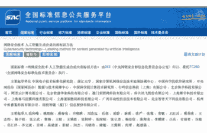

- 本文件规定了人工智能生成合成内容标识方法。
- 本文件适用于合成服务提供者和内容传播提供者开展人工智能生成合成内容标识活动。

下列文件中提及的规范性引用用构成文件必不可少的。其中，注册期的引用仅限日期对应的版本适用于本文件；不注册期的引用用，其最新版本（包括技术修改单）适用于本文件。

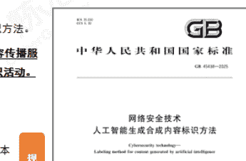

- GB18030—2022 信息编码 中文字符

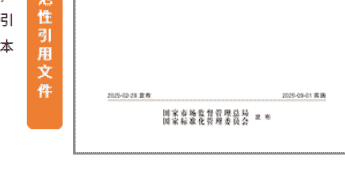

## 明确八大术语定义

3. 术语和定义

### 人工智能生成合成内容
contentgeneratedbyartificialintelligence

### 人工智能生成合成内容标识
labelofcontentgeneratedbyartificialintelligence

4. 概述

利用人工智能生成技术、合成的文本、图片、音频、视频、虚拟场景等等信息。

表明某个内容是人工智能生成合成内容（3.1）的信息。
注：标识可包含合成内容服务提供者和内容服务提供者等信息。

5. 显式标识

### 显式标识
explicitlabel

### 隐式标识
implicitlabel

在人工智能生成合成内容或交互界面中添加的，以文字、声音、图形等方式呈现并可供用户明显感知的标识。

采取技术措施在人工智能生成合成内容数据中添加的，不易被用户明显感知的标识。

6. 隐式标识

附录 A

### 文件元数据
filemetadata

### 文件元数据隐式标识
filemetadataainplicitlabel

按照特定编码嵌入到文件描述中的描述性，用于记录文件来源、属性、用途、版权等信息。

在人工智能生成合成内容元数据中添加的隐式标识。

附录 B

附录 C

附录 D

### 人工智能生成内容服务提供者
artificialintelligencecontentgenerationserviceprovider

### 网络信息内容传播服务提供者
internetinformationcontentpropagationserviceprovide

利用人工智能技术（包括通过提供可编程接口等方式）向公众提供合成文本、内容、音频、视频、虚拟场景等服务的组织或个人。

提供网络信息内容传播服务的网络信息服务提供者。

附录 E

附录 F

## 人工智能合成内容标识包含显式标识和隐式标识两种方式

- 3. 术语和定义
- 4. 概述
- 5. 显式标识
- 6. 隐式标识
- 附录 A
- 附录 B

人工智能合成内容标识

标识方式见附录 A

### 显式标识

显式标识指在人工智能合成内容内容或交互界面中添加的，以文字、声音、图形等方式呈现并可被用户明显感知的标识，其主要用途是向公众提示内容由人工智能合成的。

### 隐式标识

隐式标识指采取技术措施在人工智能合成内容文件数据中添加的，不易被用户明显感知的标识，其主要用途是记录生成合成内容相关信息。

按照标识对象

按照标识位置

### 内容显式标识

### 交互界面显式标识

内容显式标识可进一步分为文本、图片、声音、视频、视场等标识。

交互场景边界显式标识可进一步分为在内的显式标识。

### 文件元数据隐式标识

### 内容显式标识

（例如在合成内容中嵌入的水印）

显式标识的典型应用见附录 B

### 附录 A 标识方式

- 3. 术语和定义
- 4. 概述
- 5. 显式标识
- 6. 隐式标识
- 附录 A
- 附录 B
- 附录 C
- 附录 D
- 附录 E
- 附录 F

### 显式标识

显式标识包括内容标识、交互界面标识，如图 A 所示。

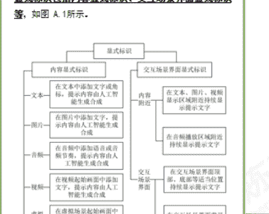

### 隐式标识

隐式标识包括文件元数据标识、内嵌标识，如图 A 所示。
内容标识是在人工智能生成内容数据中添加的数字水印等，在图 2 所示，不要提及。

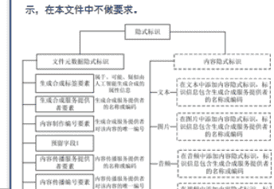

## 附录 B 显式标识典型应用场景

### 显式标识典型应用

显式标识典型应用包括以下服务，可能导致公众混淆或者误认的：

| 3. 术语和定义 | 4. 描述 | 5. 显式标识 | 6. 隐式标识 |
| :--- | :--- | :--- | :--- |
| a. 对话、写作等模拟自然人的生成或者编辑服务 | b. 合成人声、仿声等语音生成或者显著改变身份特征的服务 | | |
| c. 人脸生成、人脸替换等人物图像、视频生成或者显著改变身份特征的服务 | | | |
| d. 人脸操控、姿态操控等人物图像、视频生成或者显著改变身份特征的服务 | | | |
| e. 沉浸式模拟真实场景等生成或者编辑服务 | | | |
| f. 文生图片等等图片生成服务 | | | |
| g. 音乐创作等音频内容生成服务 | | | |
| h. 文生视频、图生视频等视频内容生成服务 | | | |
| i. 其他具有生成或者显著改变信息的功能的服务 | | | |

## 文本、图片内容显示标识

3. 术语和定义
4. 概述
5. 显式标识
6. 隐式标识
附录 A
附录 B
附录 C
附录 D
附录 E
附录 F

### 文本、内容显示标识

**① 文本内容显示标识**

文本内容显示标识方法如下：
a) 文本内容标识应采用文字或角形形式。
b) 标识形式的文本内容标识同时包含以下要素：
1) 人工智能要素：包含“人工智能”或“AI”，表明使用人工智能技术；注：“AI”是人工智能（Artificial Intelligence）的缩写。
2) 生成合成要素：包含“生成”和/或“合成”，表明内容制作方式为生成或合成。
c) 角形形式的文本内容标识应包含“AI”。
d) 文本内容显示标识位于以下或多个位置：
1) 文本的起始位置；
2) 文本的末尾位置；
3) 文本的中间适当位置。
e) 文本内容显示标识使用的字体和颜色应清晰可见。
文本内容标识示例见附录 C 的 C 1。

**② 图片内容显示标识**

图片内容显示标识方法如下：
a) 图片内容显示标识采用采用提示。
b) 图片内容显示标识同时包含以下要素：
1) 人工智能要素：包含“人工智能”或“AI”，表明使用人工智能技术；
2) 生成合成要素：包含“生成”和/或“合成”，表明内容制作方式为生成或合成。
c) 图片内容显示标识位于图片的边缘。
d) 图片内容显示标识使用的字体应清晰可见。
e) 图片内容显示标识的文字高度不低于图片短边长度的 5%。
注：非矩形图片的最近边可完全将图片包含在内部的矩形的最短边。
图片内容标识示例见 C 2。

## 音频、视频内容标识标识

| 3. 术语和定义 |
| 4. 概述 |
| 5. 显示标识 |
| 6. 隐藏标识 |
| 附录 A |
| 附录 B |
| 附录 C |
| 附录 D |
| 附录 E |
| 附录 F |

### 音频内容标识标识

音频内容标识标识方法如下：
a) 音频内容标识应采用音频标识或音频节奏标识。
b) 语音标识应包含以下要素：
1) 人工智能标识：包含“人工智能”或“AI”，表明人工智能技术；
2) 生成合成类：包含“生成”和/或“合成”，表明人工制作方式为生成和/合成；
c) 节奏标识要为“短长”“短短”的节奏。
1：“超短”节奏为“AI”的节奏标识。
d) 音频内容标识应位于以下一个或多个位置：
1) 音频的起始位置；
2) 音频的末尾位置；
3) 音频的中间位置。
2：起始的起始位于合成内容的音频开始之前。
3：在助手、客户端、导航等高交互场景中，音频的起始位置和末尾位置。
e) 语音标识使用适当。
4：通常在20字/分。
g) 节奏标识清晰。
h 音频内容标识示例 C。

### 视频内容标识

视频内容标识方法如下：
a) 视频内容标识采用文字提示。
b) 视频内容标识同时包含以下要素：
1) 人工智能标识：包含“人工智能”或“AI”，表明人工智能技术；
2) 生成合成类：包含“生成”和/或“合成”，表明人工制作方式为生成和合成；
c) 视频内容标识位于画面、末尾和中间适当位置。
d) 视频内容标识位于画面的侧边。
e) 视频内容标识使用的字体清晰可见。
f) 视频内容标识的文字长度不低于画面长度的5%。
g) 在正常播放下，视频内容标识持续不少于秒。
h 视频内容标识示例 C。

## 虚拟场景、交互界面显示

3. 术语和定义
4. 概述
5. 显示标识
6. 隐匿标识
附录 A
附录 B
附录 C
附录 D
附录 E

### 5 虚拟场景标识

虚拟场景显示标识方法如下：
a) 虚拟场景显示标识采用文字提示。
b) 标识同时包含以下要素：
1) 人工智能要素：包含“人工智能”或“AI”，表明人工智能技术；
2) 生成合成要素：包含“生成”和/或“合成”，表明内容制作方式为生成或/合成。
c) 虚拟场景显示标识位于虚拟场景起始画面，位于虚拟场景过程中的适当位置。
d) 虚拟场景显示标识位于画面的边缘。
e) 虚拟场景显示标识使用的字体清晰可见。高度低于屏幕长度的5%。

### 6 交互界面显示标识

交互界面显示标识方法如下：
a) 交互界面显示标识采用文字提示。
b) 交互界面显示标识同时包含以下要素：
1) 人工智能要素：包含“人工智能”或“AI”，表明人工智能技术；
2) 生成合成要素：包含“生成”和/或“合成”，表明内容制作方式为生成或/合成。
1) 在内接近边界处提示文字：
2) 在交互界面顶端、底部、悬浮等适当位置持续文字：
d) 交互界面显示标识使用的字体和颜色清晰可见。
交互界面标识示例附录 D。

## 文件元数据、内容隐式标识

3. 术语和定义
4. 概述
5. 显式标识
6. 隐式标识
附录 A
附录 B
附录 C
附录 D
附录 E
附录 F

### ① 文件元数据隐式标识

文件元数据隐式标识方法如下：
a) 隐式标识包含以下要素：
1) 生成合成标签：内容的生成合成属性信息；
2) 生成合成提供者要素：生成合成服务提供者的名称或编码；
3) 内容制作编号要素：生成合成服务提供者对内容的唯一编号；
4) 内容传输服务者要素：内容传输服务提供者的名称或编码；
5) 内容传输编号要素：内容传输服务者对内容的唯一编号；
b) 文件元数据隐式标识格式符合附录 E。
c) 人工智能生成合成的内容文件中，仅保留一份文件元数据隐式标识。
文件元数据隐式标识参见录 F。

### ② 内容隐式标识

内容隐式标识允许数字水印等形式。

## 附录 C：内容显示标识 - 文本内容显示标识

| 术语和定义 | 类别 | 文本内容显示标识 |
| :--- | :--- | :--- |
| 4. 概述 | 形式 | |
| 5. 显示标识 | 位置 | 使用“AI生成”提示文字，位于文本起始位置的内容显示标识例 C.1. | 使用“AI生成”提示文字，位于文本末尾位置的内容显示标识例 C.2. | 使用“AI”提示角，位于文本起始位置的内容显示标识例 C.3. | 使用“AI”提示角，位于文本末尾位置的内容显示标识例 C.4. |
| 6. 描述式标识 | | | |
| 附录 A | 示例图 | | |
| 附录 B | | | |
| 附录 C | | | |
| 附录 D | | | |
| 附录 E | | | |
| 附录 F | | | |

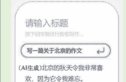

## 附录 B 显式标识典型应用场景

| 3. 术语和定义 | 4. 描述 | 5. 显式标识 | 6. 隐式标识 |
| :--- | :--- | :--- | :--- |
| a. 对话、写作等模拟自然人的生成或者编辑服务 | | | |
| b. 合成人声、仿声等语音生成或者显著改变身份特征的服务 | | | |
| c. 人脸生成、人脸替换等人物图像、视频生成或者显著改变身份特征的服务 | | | |
| d. 人脸操控、姿态操控等人物图像、视频生成或者显著改变身份特征的服务 | | | |
| e. 沉浸式模拟真实场景等生成或者编辑服务 | | | |
| f. 文生图片等等图片生成服务 | | | |
| g. 音乐创作等音频内容生成服务 | | | |
| h. 文生视频、图生视频等视频内容生成服务 | | | |
| i. 其他具有生成或者显著改变信息的功能的服务 | | | |

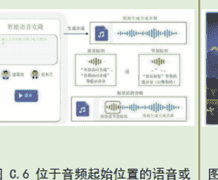

## 附录 D 交互界面标识示例

## 附录 E 文件元数据标识格式

## 附录 F 文件元数据隐式标识示例

## 附录E：文件元数据隐藏标识格式

### 3. 术语和定义

文件元数据隐藏标识格式要求如下

### 4. 概述

- f) 预留字段1由ReservedCode1表示，取值为value4，要求如下：
  1) 可存储于用于生成合成服务提供者自主开展安全防护，保护内容、标识完整性的信息；
  2) 类型应为字符串。

注2：生成合成服务提供者使用预留字段1进行文件元数据隐藏标识安全防护的示例附录F的F.4。

- g) 内容传播服务提供者要素由ContentPropagator表示，取值为value5，应包含以下要求：
  1) 存储内容传播服务提供者的名称或编码；
  2) 类型为字符串。

### 5. 显式标识

- h) 内容传播服务提供者要素由PropagateID1表示，取值为value6，应包含以下要求：
  1) 存储内容传播服务提供者对内容的唯一标识；
  2) 类型为字符串。
- i) 预留字段2由ReservedCode2表示，取值为value7，要求如下：
  1) 可存储于用于内容传播服务提供者自主开展安全防护，保护内容、标识完整性的信息；
  2) 类型应为字符串。

### 6. 隐式标识

- j) c)中各要素的值主要由GB18030—2022中码为0x21、0x23~0x5B、0x5D~0x7E的字符以及"的所有单字节字符，“"为义字符，用于表示”。

附录 A 附录 B 附录 C 附录 D 附录 E 附录 F

## 附录F:文件元数据隐式标识示例

| | 类别 | 图片元数据隐式标识示例 | 音频文件元数据隐式标识示例 | 视频文件元数据隐式标识示例 | 使用数字签名的安全防护示例 |
|---|---|---|---|---|---|
| 3. 术语和定义 | | | | | |
| 4. 概述 | | | | | |
| 5. 显示标识 | | | | | |
| 6. 隐式标识 | | 属于人工智能生成合成的图片元数据隐式标识示例见图 F.1中的“AIGC”部分。 | 可能为人工智能生成合成的音频文件元数据隐式标识示例见图 F.2中的“AIGC”部分。 | 认为是人工智能生成合成的视频文件元数据隐式标识示例见图 F.3中的“AIGC”部分。 | 生成云服务提供者使用数字算法对文件元数据信息进行数字签名，并将结果存储在预留字段1中的标识如下所示 |
| 附录 A | | | | | |
| 附录 B | | | | | |
| 附录 C | | | | | |
| 附录 D | | | | | |
| 附录 E | | | | | |
| 附录 F | | | | | |
| | 示例图 | 图 F.1 图片元数据隐式标识示例 | 图 F.2 音频文件元数据隐式标识示例 | 图 F.3 视频文件元数据隐式标识示例 | |

1. 图解四部门《人工智能生成合成内容标识办法》
2. 图解《GB 45438-2025 网络安全技术 人工智能生成合成内容标识方法》
3. 图解《网络安全标准实践指南-人工智能生成合成内容标识 服务提供者编码规则》
4. 图解网信办《生成式人工智能服务管理暂行办法》

## 《实践指南》指导开展人工智能合成内容的元数据隐藏标识工作

《网络安全标准实践指南》（以下简称《实践指南》）是全国网络安全标准化技术委员会（以下简称“网安标委”）秘书处组织和发布的标准相关技术文件，旨在围绕网络安全法律法规、标准、网络安全热点和事件等课题，宣传网络安全相关标准及知识，提供标准化实践指引。

根据《人工智能生成合成内容办法》和强制性国家标准《网络安全技术人工智能生成合成内容标识方法》的要求，本指南为人工智能合成内容标识服务提供者和内容传输提供者编码规则，指导其开展人工智能内容的元数据隐藏标识工作。

《人工智能生成合成内容办法》《网络安全技术人工智能生成合成内容标识方法》《网络安全标准实践指南——人工智能合成内容标识服务提供者编码规则

## 人工智能生成合成内容标识服务提供者编码规则适用范围

- 1. 范围
- 2. 术语定义：实践指南给出了人工智能合成内容标识服务提供者和内容传播提供者的编码结构和编码规则。本指南适用于人工智能合成内容的元数据隐藏标识。
- 3. 编码结构
- 4. 编码规则

## 《实践指南》中涉及术语定义

- 1. 范围
- 2. 术语定义：生成合成服务提供者内容传播提供者
- 3. 编码结构
- 4. 编码规则：利用人工智能技术（包括编程接口等方式）向公众提供文本、图片、音频、视频等内容的组织、个人。

## 服务者编码的编码结构

服务提供者编码由二十七位的阿拉伯数字或大字母组成，包括第1位~第2位标识定义，第3位~第22位主体标识，第23位~第27位扩展码三个部分。

- 1. 范围
- 2. 术语定义
- 3. 编码结构
- 4. 编码规则

表 1 编码构成

| 编码序号 | 1 | 2 | 3 | 4 | ... | 21 | 22 | 23 | 24 | 25 | 26 | 27 |
|---|---|---|---|---|---|---|---|---|---|---|---|
| 编码 | x | x | x | x | x | x | x | x | x | x | x |
| 说明 | 标识格式码2位 | | | | 主体标识20位 | | | | | | 扩展码5位 |

## 服务者的编码规则

| 范围 | 编码序号 | 编码 | 编码规则 |
|---|---|---|---|
| 1. | 1 | 0 | 对于采用本指南编制的编码，标识格式固定为阿拉伯数字“00”。 |
| 2. 术语定义 | 2 | 0 | 主体类型分为组织和个人类。主体类型为组织赋值为“1”，主体类型为个人的赋值为“2”。 |
| 3. 编码结构 | 3 | 1 | 组织主体采用社会信用编码与其编码定时，赋值为阿拉伯数字“1”。 个人主体采用公民身份号码与其编码定时，赋值为阿拉伯数字“1”。 采用通信线路号码与其编码定时，赋值为阿拉伯数字“2” 采用护照号码与其编码定时，赋值为阿拉伯数字“3” 采用网号与其编码定时，赋值为阿拉伯数字“4”。 |
| 4. 赋码规则 | 4 | 2 | 组织主体采用社会信用代码编码。 个人主体采用公民身份号码，或移动通信线路号码，或护照号码，或网号： a）采用公民身份号码编码时，主体编码为18位公民身份； b）采用移动通信线路号码编码时，主体编码为11位通信线路号码的组合和7位“0”的组合； c）采用护照号码编码时，主体编码为9位护照号码与9位“0”的组合； d）采用网号编码时，主体编码为10位网号与8位“0”的组合。 |
| 5. | 5 | 3 | 服务提供者不可编写服务扩展码。此时，服务扩展码填写阿拉伯数字“00000”。 第23位，记录服务类型，服务类型为生成合成类，赋值为阿拉伯数字“1”，服务类型为电信业务，赋值为阿拉伯数字“2”。 第24位至第27位，记录码，由服务提供者编写。 |
| | 22 | 4 | |
| | 23 | 5 | |
| | ... | ... | |
| | 27 | 6 | |

- 1. 范围：0 1 2 3 4 5 6 7 8 9 0 1 2 3 4 5 6 7 8
- 2. 术语定义
- 3. 编码结构

| 主体类型 | 值 |
|---|---|
| 组织 | 1 |
| 个人 | 2 |
| 组织绑定方式 | 1 |
| 个人绑定方式 | 2 |
| 组织绑定方式 | 3 |
| 个人绑定方式 | 4 |
| 服务类型 | 1 |
| 服务类型 | 2 |

- 4. 赋码规则

| 主体类型 | 服务扩展码 | 服务者编码 |
|---|---|---|
| 统一信用代码 | 00 | 91350100M100Y43 |
| 公民身份号码 | 00 | 11010519123102X |
| 移动通信终端号码 | 00 | 1223334440000 |
| 护照号码 | 00 | EF126089200000 |
| 网号 | 00 | 123456789A0000 |

| 主体类型 | 服务扩展码 | 服务者编码 |
|---|---|---|
| 公民身份号码 | 00 | 00211105149123102X0832 |
| 移动通信终端号码 | 00 | 002212233344440000020832 |
| 护照号码 | 00 | 0023EF1260892000000000 |
| 个人使用号码 | 00 | 0024123456789A000000000 |

1. 图解四部门《人工智能生成合成内容标识办法》
2. 图解《GB 45438-2025 网络安全技术 人工智能生成合成内容标识方法》
3. 图解《网络安全标准实践指南——人工智能合成内容标识服务提供者编码规则》
4. 图解网信办《生成式人工智能服务管理暂行办法》

## 新法将促进生成人工智能健康发展和规范应用

2023年7月，国家网信办联合国家发展委、教育部、科技部、工业和信息化部、公安部、广电总局《生成式人工智能服务管理办法》（以下简称《办法》），自2023年8月15日起施行。国家互联网信息办公室有关负责人表示，出《办法》旨在促进生成人工智能健康发展和规范应用，维护国家安全和社会公共利益，保护个人和其他组织的合法权益。

## 国家网信办等七部门联合发布《生成式人工智能服务管理办法》

2023年07月13日 15:00

近日，国家网信办联合国家发展委、教育部、科技部、工业和信息化部、公安部、广电总局发布《生成式人工智能服务管理办法》（以下简称《办法》），自2023年8月15日起施行。该办法明确了生成式人工智能服务的权利和义务，旨在促进人工智能健康发展。过去，生成式人工智能技术的发展为人类带来了便利，但也带来了挑战。个人和组织面临风险，如何在利用生成式人工智能技术的同时，确保安全可控，促进人工智能健康发展，也是当前亟待解决的问题。《办法》对个人和组织提出了明确规定，要求采取有效措施防止生成式人工智能过程中产生歧视、不公平等问题；明确了应当承担相应的管理措施和处置含有有害信息等违法行为。国家网信办相关发言表示，生成式人工智能的健康发展需要政府、企业、社会等多方参与，共同促进人工智能健康发展，让生成式人工智能技术向良好的轨道发展。

## 生成式人工智能服务管理暂行法整体架构

### 一、总体原则
### 二、技术发展与治理
### 三、服务规范
- 1. 目的和依据
- 2. 适用范围、关键定义
- 3. 坚持创新和法治相结合的原则
- 4. 法律法规
- 5. 领域
- 6. 基础创新
- 7. 依法处理
- 8. 数据标注
- 9. 履行安全义务
- 10. 未成年人防沉
- 11. 依法保护个人
- 12. 对生成内容进行标识
- 13. 稳定
- 14. 发现违法内容并明确权责划分、责任主体
- 15. 建立健全投诉举报机制
- 16. 各部门职责
- 17. 按规定开展安全评估
- 18. 不合法合规
- 19. 依法配合监督检查
- 20. 境外向内提供
- 21. 违法处理

### 四、监管检查与法律责任
### 五、附录

- 1. **完善监管框架**，依据《网络安全法》、《数据安全法》、《个人信息保护法》、《科学技术进步》四大法律，参照细化《互联网信息服务算法推荐规定》、《互联网信息服务管理办法》等制度。
- 2. **明确提供者的责任和义务**：《办法》贯彻落实《个人信息保护法》，强化个人信息保护义务。
- **开展安全评估**：《办法》要求提供具有舆论性或社会能力的生成式人工智能服务的，应当按国家有关规定开展安全评估。
- **拟定适用范围，明确关键定义**，鼓励行业开展基础技术自主创新、国际合作
  - 产出不得侵害他人肖像、姓名、名誉、隐私和个人信息权益
  - 训练数据收集活动涉及个人信息的，应当取得个人同意或者符合合法性、行政法规规定的特定情形
  - 涉及个人信息的，依法承担个人信息处理责任，履行个人信息保护义务。
  - 参与生成式人工智能服务安全评估和监督检查的相关机构和人对过程中涉及的国家秘密、商业秘密、个人隐私和个人信息应当予以保护，不得泄露或者非法向他人提供。
- **丰富管理措施**：通过履行网络信息安全义务、成年人防沉、依法保护个人信息、对生成内容进行标识、建立健全举报机制等手段，增强生成式人工智能合性、合规性和理性

## 第一条：《办法》制定的目的和依据是什么？

构建完善的生成式人工智能分类监管体系，促进生成式人工智能健康发展和规范应用。

参考依据：《生成式人工智能服务管理办法》

## 第二、三条：《办法》适用范围是什么？体现什么样的基本原则？

### 什么样的组织和个人适用《办法》？

利用生成式人工智能技术向国内公众提供生成文本、图片、音频、视频等内容的服务，适用本办法。国家对利用生成式人工智能从事新闻出版、影视制作、文艺创作等活动另有规定的、从其规定。

### 什么样的基本原则？

坚持发展和安全并重、促进创新和法治相结合的原则，采取有效措施鼓励生成式人工智能分类分监管。

### 什么是生成式人工智能技术？

生成式人工智能是指具有文本、图片、音频、视频等内容生成能力的模型及相关技术

## 第五、六条：在技术发展过程中，需要鼓励和推动的方向有哪些？

| 创新维度 | 类别 | 内容 |
| :--- | :--- | :--- |
| 鼓励创新 | 创新应用 | 鼓励生成式人工智能技术在各行业、各领域的创新应用，生成积极健康、向上良的优质内容，探索优化应用场景，构建应用生态体系 |
| | 机构合作 | 支持行业组织、企业、教育和科研机构、公共化机构、有关专业机构等在生成式人工智能技术创新、数据资源建设、转化应用、风险防范等方面开展协作 |
| | 基础创新 | 鼓励生成式人工智能算法、框架、芯片及配套软件平台等基础技术的自主主创、平等互利开展国际交流与合作、参与生成式人工智能相关国际规则制定 |
| 推动共享 | 平台建设 | 推进生成式人工智能基础设施和公共训练数据资源平台建设 |
| | 算力共享 | 促进算力资源协同共享，提升算力资源利用效能 |
| | 资源开放 | 推进公共数据分类分级有序开放，扩展高质量的公共训练数据资源 |

安全可信：鼓励采用安全可信的芯片、软件、工具、算力和数据资源

## 第七条 依法开展预训练、优化训练等训练数据处理活动需满足哪些要求?

生成式人工智能服务提供者（以下称提供者）应当依法开展预训练、优化训练等训练数据处理活动，遵守以下规定：

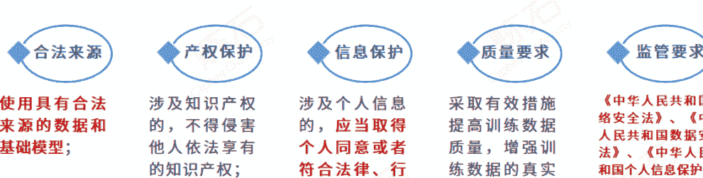

- 合法来源：使用具有合法来源的数据和基础模型；
- 产权保护：涉及知识产权的，不得侵害他人依法享有的知识产权；
- 信息保护：涉及个人信息的，应当取得个人同意或者符合法律、行政法规规定的其他情形；
- 质量要求：采取有效措施提高训练数据质量，增强训练数据的真实性、准确性、客观性、多样性；
- 监管要求：《《中华人民共和国网络安全法》、《中华人民共和国数据安全法》、《中华人民共和国个人信息保护法》等法律、行政法规的其他有关规定和有关主管部门的相关监管要求。

## 第八条：技术研发过程中进行数据标注的，需满足哪些具体要求？

在生成式人工智能技术研发过程中进行数据标注的，需满足以下要求：

| 01 规则制定 | 02 质量评估 | 03 人员培训 |
| :--- | :--- | :--- |
| 提供者应当制定符合本办法要求的清晰、具体、可操作的标注规则； | 开展数据标注质量评估、抽样检验标注内容的准确性等； | 对标注人员进行必要培训，提升其法治意识，监督指导标注人员规范开展标注工作。 |

> 对应《互联网信息服务算法管理规定》
> 第十六条 算法推荐服务提供者应当以显著方式告知其提供算法推荐服务的情况，并以适当方式公示推荐服务的基本原理、意图和主要运行机制等。

> 对应《互联网信息服务深度合成管理规定》
> 第十条 深度合成服务提供者应当加强深度合成内容管理，采取技术或人工方式对深度合成使用者的输入数据和合成结果进行审核。深度合成服务提供者应当建立用于识别违法和不良信息的特征，完善标注标准、规则和程序，记录并保存相关网络日志。深度合成服务提供者发现违法或不良信息的，应当采取处置措施，保存有关记录，及时向互联网部门和有关主管部门报告；对相关深度合成服务使用者违法法规的应当依规警示、限制功能、暂停服务、关闭账号等处置措施。

## 第九条：应当依法承担哪些网络信息内容生产者责任？

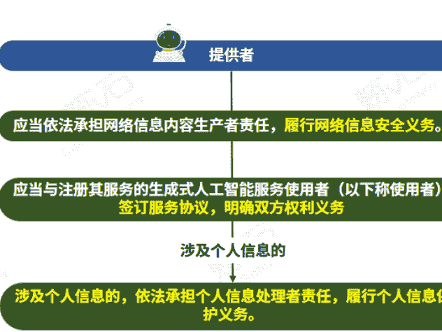

应当依法承担网络信息内容生产者责任，履行网络信息安全义务。

应当与其注册服务的生成式人工智能服务使用者（以下称使用者）签订单服务协议，明确双方权利义务。

- 涉及个人信息的，依法承担个人信息处理者责任，履行个人信息保护义务。

## 第十条：未成年人过分依赖或沉迷相关服务是否提前防范？

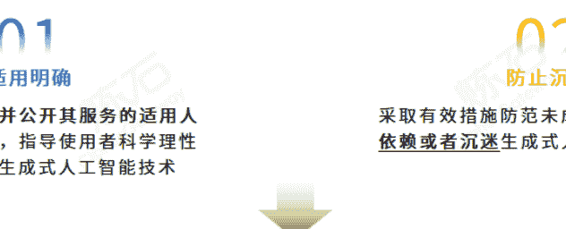

- 01 明确
- 02 防止沉迷

- 适用明确：提供者应当明确公开其服务的适用人群、场域、用途、指导使用者科学性认识和依法使用生成式人工智能技术。
- 采取有效措施防范未成年人用户过分依赖或者沉迷生成式人工智能服务。

> 对应《互联网信息服务算法推荐管理规定》
> 第八条 算法推荐服务提供者应当定期审核、评估、验证算法机制治理、模型、数据和应用结果等，不得设置诱导用户沉迷、过度消费等违反法律法规或者违背伦理道德的算法模型。

## 十一条：提供者如何对使用者的输入信息和使用记录承担哪些保护义务？

提供者对使用者的输入信息和使用记录应当依法履行保护义务。

> 对应《互联网信息服务算法推荐管理规定》
> 七条 算法推荐服务者应当落实算法安全主体责任，建立健全算法机制管理、审核、科技审查、用户注册、信息发布审核、数据安全和个人信息保护、反电信网络诈骗、安全评估监控、安全事故应急处置管理规定和技术措施，并公开算法推荐服务基本规则、配备与算法推荐服务规模和技术支持。

- 不得收集非必要信息：参与算法推荐服务安全评估和监督检查的相关机构和人员在职责中知晓的个人隐私、个人信息应当予以保密，非法向他人提供。
- 对应《互联网信息服务算法推荐管理规定》
- 七条 深度合成服务者应当落实信息主体责任，建立健全用户注册、算法机制审核、科技审查、信息发布审核、数据安全和个人信息保护、反电信网络诈骗、安全评估监控、安全事故应急处置管理制度，并采取可控的技术措施。
- 非法向他人提供使用者的输入信息和使用记录：提供者应当及时受理和处理用户关于删除、更正、补充删除请求。
- 第十四条 深度合成服务者应当加强管理，采取必要措施确保数据安全；训练包含个人信息的，应当遵守个人信息保护的规定。

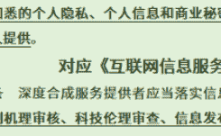

## 第十二条：需要对哪些生成的内容进行标识？

依据《互联网信息服务深度合成管理规定》

第七条 深度合成服务者应对深度合成生成可能引起误解、歧导或损害他人权益的内容显著标识：
- （三）人脸生成、人脸替换、人脸接替、拟态操纵等图像、深度合成改变身份特征的；
- （四）虚构或拟真实生成或深度合成语音内容的；
- （五）其他具有深度合成或者改变身份信息功能的；

对图片、视频等生成内容：深度合成服务提供者前述规定之外的深度合成服务的，应当提供显著标识功能，并在深度合成服务使用者处进行显著标识。

第八条 任何组织和个人不得采用技术手段删除、隐藏、破坏本规定第十六条和第七条规定的深度合成标识。

## 十三条：提供者如何保障用户正常使用

提供者应当在其服务过程中，提供安全、稳定、持续的服务，保障用户正常使用。

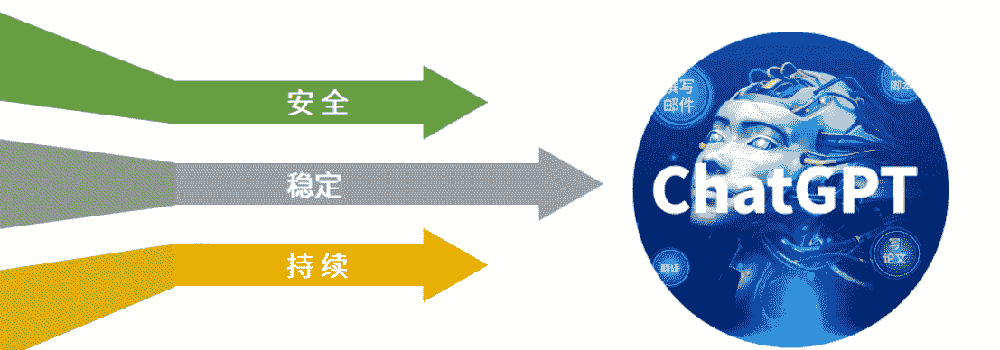

## 十四条：提供者发现违法的内容怎么处理？

提供者发现违法内容的，应当及时采取停止生成、停止传输、消除等处置措施，采取模型优化训练等措施进行整改，并向有关主管部门报告。

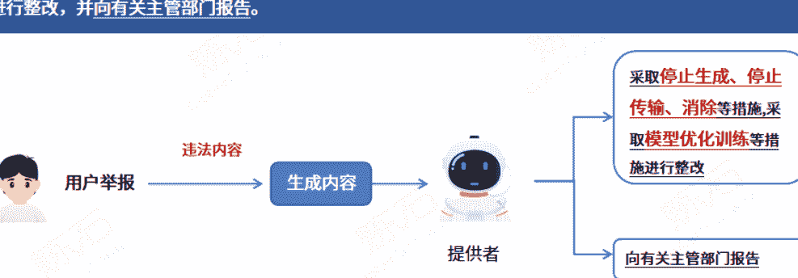

## 第十五、十八条：提供者发现使用者利用相关服务从事违法活动怎么办?

提供者发现使用者利用生成式人工智能服务从事违法活动的，应当依法依约采取警示、限制功能、暂停或者终止向其提供服务等处置措施，保存有关记录，并向有关主管部门报告。

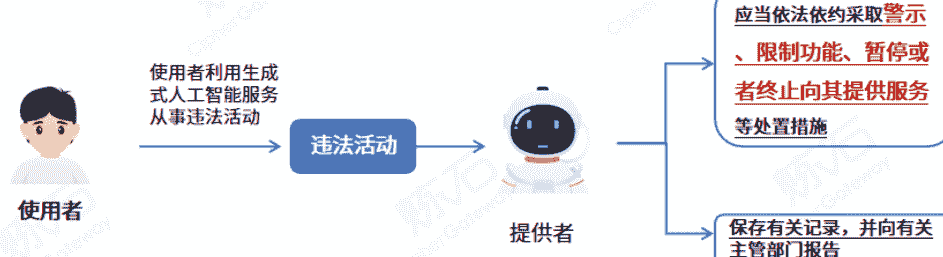

注：使用者发现生成式人工智能服务不符合法律、行政法规和本办法规定的，有权向有关主管部门投诉、举报。

提供者应当建立健全投诉、举报机制

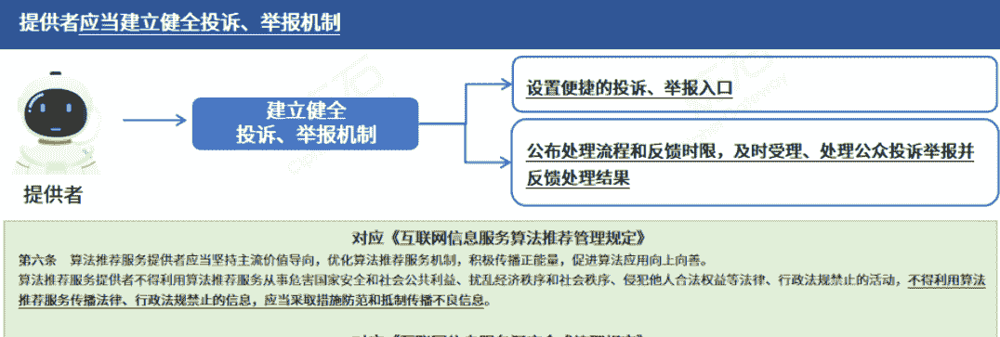

### 建立健全投诉、举报机制
- 提供者：
- 设置便捷的投诉、举报入口
- 公布处理流程和反馈机制，及时受理、处理投诉举报并反馈处理结果

> 对应《互联网信息服务算法推荐规定》
> 第六条 算法推荐服务提供者应当持主流价值导向，优化算法推荐服务，积极传递正能量，算法推荐服务者不得利用算法推荐服务从事危害安全和公共利益、损害经济和社会秩序、侵犯他人权益等法律法规禁止的行为，应当采取措施防范和抑制不良信息。

> 对应《互联网信息服务深度合成管理规定》
> 第六条 任何组织和个人不得利用深度合成服务制作、复制、传播违法、行政法规禁止的信息，损害国家形象、损害经济和社会秩序、侵犯他人权益等法律法规禁止的。深度合成服务提供者和使用者不得利用深度合成服务制作、复制、传播违法信息的，应当依法设置便捷的用户申请和举报入口，公布处理流程和反馈，及时受理、处理和反馈。

## 第十六条：各部门职责？

| 职责主体 | 具体职责 |
| :--- | :--- |
| 网信、发展、科技、工业和信息化、公安、广播电视、出版等部门 | 依据各自职责加强对生成式人工智能服务的管理，针对生成式人工智能技术特点在有关行业领域的应用，制定相应的监管规则或者指引。 |
| 国家信部门、电信、公安、市场监管等部门 | 依据各自职责负责算法推荐服务的监管工作。国家信部门负责统筹全国深度合成服务的治理和相关监管工作。国务院电信、公安、市场监管等部门依据各自职责负责深度合成服务的监管工作。 |

> 对应《互联网信息服务算法推荐规定》
> 第三条 国家信部门负责统筹全国算法推荐服务的治理和相关监管工作。国务院电信、公安、市场监管等部门依据各自职责负责监管工作。

## 第十七条：需要安全评估的具体情形和评估事项？

提供具有舆论性或者煽动能力的生成式服务的，应当按照有关规定开展安全评估。

### 需要安全评估的情形
- （一）具有舆论性或者煽动能力的服务上线，或者服务功能增加的确定与服务相应的安全管理负责人、信息审核人员或者注册机构的情况；
- （二）使用新技术应用，使信息的传播性、技术方式、基础资源配置发生重大变化，导致具有舆论性或者煽动能力发生变化的；
- （三）用户规模增加，导致信息的舆论性或者煽动能力发生变化的；
- （四）违法含有有害信息传播，极易难以防控网络安全的；
- （五）涉及个人信息保护以及涉及防范违法信息传播、操作、活动可能引发法律风险的；
- （六）建立举报、受理、调查、公布、通报等机制，并及时处理与有关投诉和报告的情况；
- （七）地级及以上网信部门或者公安机关通知需要进行安全评估的其他情形；
- （八）建立为公安机关、国家安全机关依法维护国家安全和打击违法犯罪技术、数据支持和协助工作的机制；

### 安全事项
（此处对应原文中的具体事项描述）

安全评估：依据国家网信办和公安部联合发布的《具有舆论性或者煽动能力的互联网信息服务评估规定》，向国家网信部门申报安全评估

## 第十八条：算法备案如何落地?

按照《互联网服务算法推荐管理规定》履行算法备案和变更、注销备案手续

| 算法备案主体 | 制度要求 | 算法备案要素 | 处置 |
| :--- | :--- | :--- | :--- |
| 具有意见属性或社会活动能力的算法推荐服务提供者应当在算法上线之日起五个工作日内向算法主管部门备案算法名称、功能、形式、应用场景、类型等信息。 | 算法备案信息，公开算法信息、运行机制、算法备案手续。 | | 具有意见属性或社会活动能力的算法推荐服务未履行规定第二、第三条及时履行备案措施的，由国家、自治区主管部门责予备案；发现违法情节，及时更新信息，处一万元以上十以下处罚。 |

## 安全需求：“风险与合规” 共同驱动数据安全建设

## 内在需求：数据风险如何影响产生安全处理

## 外部合规：“五法一章”过程与结果合规

数据安全产业发展阶段性（先发展再治理，后来治理）、行业特性（经济学）外部环境带来法律法规变化，造成我国数据防护与合规新需求。

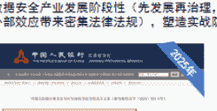
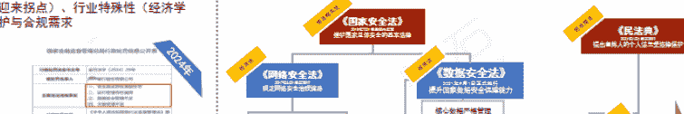

江苏某地方商业银行违反网络安全与数据安全管理规定整改警告，并罚款114.5万元。

某国有股份银行违反数据安全管理等问题被网监局罚款160万元。

上海市商协会办市市场监管局、市执法局联合约谈某大型集团及三家企业。

浙江某科技公司为浙江市政府开发违信信息管理系统，私自泄露数据，造成严重数据泄露，罚款100万元。

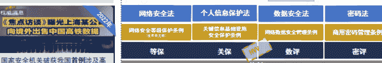

南昌某高校30万条个人信息在境外互联网上公开售卖，南昌县公安局罚款50万元。

## 落地痛点：安全建设从网络到数据，安全和业务耦合难以改进

### 以数据为中心的安全

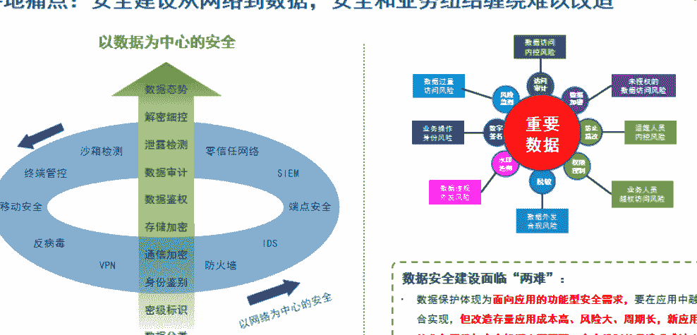

## 数据安全建设面临“两难”：

- 数据保护体现为面向应用的功能型安全需求，要在应用中融合实现，改造现有应用成本高、风险大、周期长，新增业务的开发与安全防护也不匹配，安全机制是滞后或缺失的。
- 数据保护不落实，则合规风险越来越大，因数据泄露导致的业务风险快速累积。

数据安全成为当前建设重点

## 产品体系：免改造平台灵活交付多重安全能力，易部署易扩展

### 国密合规产品
一站式国密套件交付

### 实战防护产品
密码安全·一体化·事前·事中·事后防护

### 数据流通安全产品
基于流量技术的跨域数据管控

### 天开设密·免改造密码机

### CASB数据安全平台（全子+软件+服务）
- 阶段加密
- 主体身份客户标签
- 细粒度访问控制
- 文件加密
- 数据发现检测级响应
- 加密管理系统
- 数据发现视图、数据分类治理
- 数据安全包务
- 跨域业务加密级响应
- 跨域业务加密审计流控
- 密许可证工具箱
- 密密服务包
- 跨域业务加密专用SDK
- 信贷数据传输加密完整性合规
- 信息接入身份鉴别加密合规

### 天开设·数据安全网关
- 密访问件
- 服务密码机
- 密访问卡
- 动态数据
- 静态数据
- 静态数据审计流控
- 跨域数据外域
- 跨域数据管控平台

## 免改造交付安全能力的技术底座

- 类似Java、C/C++、NET等的免改造插件模块
- 基础主流应用框架、数据库的免改造SDK插件
- 基础MySQL、SQL Server、Mongo等的免改造代理插件

## 敏捷部署：旁路平台结合主路控制面，免改造应用落地保护

公开、提供传输、加工、使用、存储、收集。

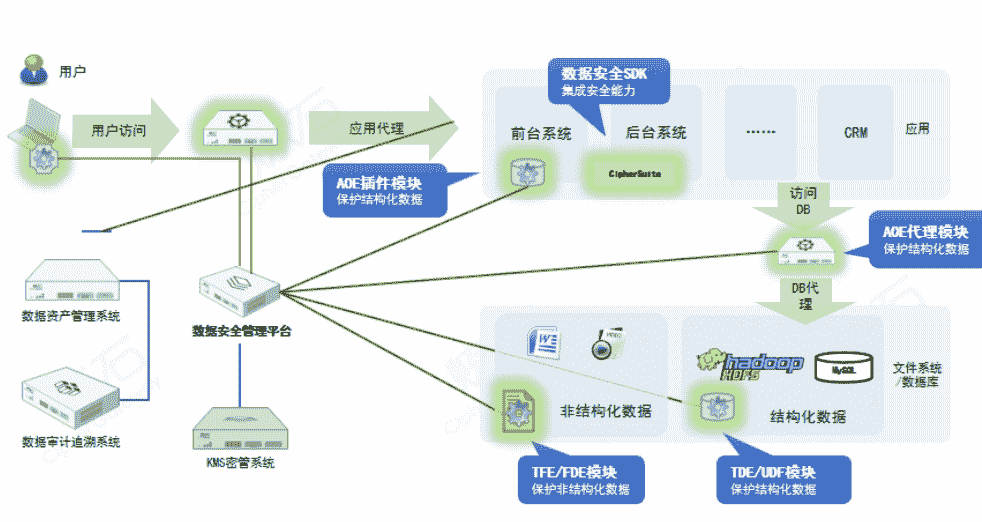

用户、用户访问、应用代理、数据安全SDK 集成安全能力、前台系统、后台系统、CRM、应用。

- AOE插件模块 保护结构化数据（访问DB）
- AOE代理模块 保护结构化数据（DB代理）
- 数据资产管理系统
- 数据安全管理平台
- 非结构化数据、结构化数据
- 文件系统/数据库
- 数据审计追踪系统
- KMS密钥管理系统
- TFE/FDE模块 保护非结构化数据
- TDE/UDF模块 保护结构化数据

## 场景一：存储加密、使用解密/脱敏

### 结构化数据
### 非结构化数据

支持ABAC的访问控制策略，实现用户与字段级文档脱敏。

- 主体角色
- 属性、字段
- 细粒度访问控制
- 明文、密文
- TFE文件安全锁
- 应用层1、应用层2、应用层3
- 应用服务层
- 数据库（授权可读写）
- 读取密文、解密处理
- 用户明文、只有密文
- TFE安全锁、ADE组件、ADE代理
- 数据、数据安全平台、内核
- 密文、磁盘存储密文
- 动态脱敏、服务侧存储加密
- 密钥管理系统
- 不影响人员使用（示例：应用端看到脱敏后的数据、示例：应用看到密文、示例：DBA工具看到脱敏后的数据等）

## 一站式支持多种路线，结合场景交付最优

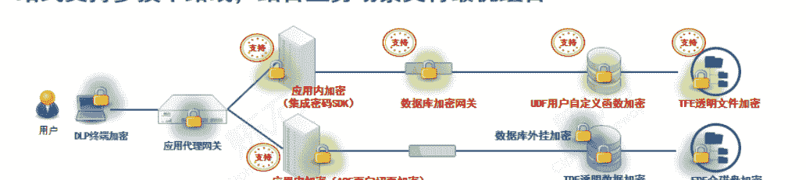

DLP终端、应用代理网关、应用内加密（集成SDK）、数据加密网关等组合组合。

| 加密技术 | 部署位置 | 加密密度 | 性能 | 实施成本 | 可靠性 |
| :--- | :--- | :--- | :--- | :--- | :--- |
| DLP终端 | 终端 | 文件 | 中 | 影响 | 高 | 中 |
| 应用代理网关 | 应用代理网关 | 终端-应用服务器之间 | 字段/字段 | 中 | 支持 | 影响 | 高 | 低 |
| 应用内加密（集成SDK） | 应用服务器 | 字段/文件 | 高 | 支持 | 影响 | 高 |
| 应用内加密（ADE面向面加密） | 应用服务器 | 字段 | 高 | 支持 | 影响 | 低 | 高 |
| 数据加密网关 | 应用服务器-数据库之间 | 字段 | 中 | 支持 | 影响 | 中 |
| 数据外挂加密 | 数据库 | 字段 | 低 | 影响 | 中 |
| TDE透明数据加密 | 数据库 | 字段/空间 | 高 | 不支持 | 不影响 | 低 | 中 |
| UDF用户函数加密 | 数据库 | 字段 | | 不支持 | 不影响 | 中 |
| TFE透明文件加密 | 文件系统 | 文件 | 中 | 不支持 | 不影响 | 低 | 中 |
| FDE全磁盘加密 | 文件系统 | 磁盘/分区 | 中 | 不支持 | 不影响 | 高 | 中 |

## 产品价值：将安全能力投送到真实的数据处理中， 识别与控制，实现安全与业务有机融合

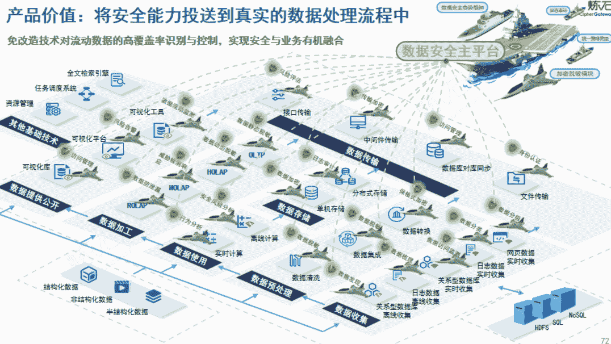

## 国密合规场景

### 一站式密改敏捷交付

#### 测评要点解析
- 基础业务：影响范围大，改造程度大
- 由于加密应用层：包含高风险项，改造需要由用户执行，无法实现
- 由于加密支持层：改造需要主要由用户执行，IDC管理方、云服务商等被拦截的每个信息系统

#### 测评规则
- 依据：GB/T 39786-2021《信息安全技术 信息密码应用基础要求》
- 通过率：60分以上，无高风险
- 测评规则：打分制，满分100，共4项检测项，包含8个方面
- 典型类型：无合规的密码设备、无管理制度
- 测评周期：重要密码与信息系统（关键、三级、政务等）每年至少一次

#### 高风险项，一项列出
- 实体未通过密码技术进行身份识别（网络和通信；无加密措施）
- 未采用密码技术在执行过程中对数据的加密
- 未采用密码技术建立的安全传输通道（无加密措施），如SSLVPN
- 未采用密码技术保证存储中的数据的完整性
- 未采用密码技术保证传输中的数据完整性
- 未采用密码技术保证存储中的机密性
- 未采用加密技术提供数据采集和数据接收端（法律责任项）
- 未建立密码管理制度
- 未建立控制密码的解决方案、实施方案和应急处置方案，未通过评审
- 未采用加密技术对所有外部连接到内部的设备进行加密（第四级）

## 密码合规要点（以密码实现应用三级系统为例）

| 物理和环境 | 身份识别 | 日志记录 | 审计控制 | 密码业务服务 | 密码产品认证 | 分值 |
| :--- | :--- | :--- | :--- | :--- | :--- | :--- |
| 网络和通信 | 身份识别 | 数据完整性和机密性 | 访问信息的完整性 | 设备认证 | 密码业务服务 | 密码产品认证 | 20分 |
| 设备和计算 | 身份识别 | 加密算法 | 访问控制的完整性 | 日志真实性 | 密码业务服务 | 密码产品认证 | 10分 |
| 应用和数据 | 身份识别 | 存储和传输的完整性 | 不可否赖性 | 密码业务服务 | 密码产品认证 | 30分 |
| 管理制度 | 管理人员管理 | 密钥管理 | 运行记录 | 应急处置 | 密码维护 | 介质制度 | |
| 人员管理 | 角色 | 职责 | 审计记录 | 培训与考核 | 保密协议 | 30分 |
| 建设 | 应用方案 | 实施方案 | 应急处置 | 及时响应 | | |

## 70分密套装

| 测评单元 | 备注 | 评分 | 得分 | 风险 |
| :--- | :--- | :--- | :--- | :--- |
| 环境 | 基础测试 | 4.17 | 0 | 风险 |
| 安全性 | 电子证书存储可靠性 | 2.92 | 0 | |
| 硬件 | 数据库存储可靠性 | 2.92 | 0 | |
| 认证 | 口令认证 | 5.88 | 0 | |
| 网络通信 | 经过过程中数据的机密性 | 4.12 | 0 | |
| 网络边界控制 | 遵循安全策略 | 5.88 | 0 | |
| 过滤 | 系统级访问控制 | 4.12 | 0 | |
| 设备和计算 | 关键信息源可靠性 | 2.08 | 0 | |
| 关键数据 | 日志完整性 | 2.08 | 0 | |
| 日志记录 | 需要配置的可靠性 | 1.46 | 0 | |
| 配置 | 需要执行的完整性 | 1.46 | 0 | |
| 身份认证 | 身份认证 | 4.05 | 0 | |
| 访问控制 | 完整性 | 2.84 | 0 | |
| 关键数据 | 身份可靠性 | 2.84 | 0 | |
| 应用和数据 | 数据传输完整性 | 4.05 | 0 | |
| 存储可靠性 | 4.05 | 0 | |
| 加密传输可靠性 | 4.05 | 0 | |
| 加密存储可靠性 | 4.05 | 0 | |
| 不可否认 | 4.05 | 0 | 仅限法律责任 |
| 安全管理 | 专业管理制度性 | 得分按80%计算 | 30 | 24 | |
| **合计** | | 100 | 78.49 | |

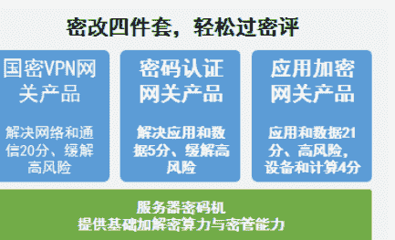

国密VPN网关产品：解决网络通过20分、缓解高风险。密码认证网关产品：解决应用和数据5分、提高高风险。应用加密网关产品：应用和数据21分、高风险、设备和计算4分。服务端加密机：提供基础加密能力与密钥管理能力。

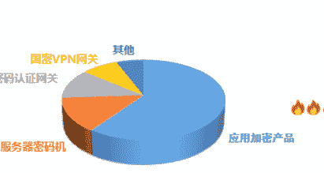

国密VPN网关、认证网关、服务端加密机、应用加密产品。
> 参考测评委员会《商用密码应用安全性能量化规则（2023版）》

## 高性能PCT专利保护的高速国密实现，不影响业务效率

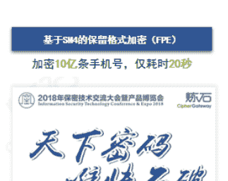

> 炼石独有PCT专利打破Intel垄断

单颗CPU上SM4解密：突破140Gbps！相当于每秒可加密3GB大小的高清电影。
移动端SM4解密：突破1.7Gbps！相当于每秒可加密200MB大小的高清图片。

# 下一代服务平台打造关键能力

下一代密码服务平台基于改造创新技术，实现密码能力从密码层支撑到真正应用层的跨越，有效解决“密评密改”推广及之后的落地难题，是顺应数字化发展趋势的，基于创新密码安全技术构建的综合服务平台。

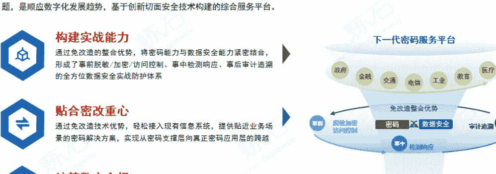

## 构建集成能力

通过免改造的整合优势，将密码能力与数据安全能力紧密结合，形成了事前脱敏/加密/访问控制、事中检测响应、事后审计溯源的全方位数据安全实战防护体系

## 贴合业务轻量

通过免改造技术优势，轻松接入现有系统，提供贴近业务场景的密码解决方案，实现从密码支撑向真正应用层的跨越

## 统筹安全合规

满足密评、关保、等保、数评等合规要求，数据安全法条例推动的数据加密合规要求，工作秘密防护等数据安全合规融合

## 数据可见：结合法规要求，落地数据分类分级

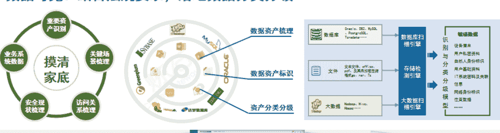

## 事前防护：最小化敏感数据访问范围

易于实施的“主体到人”支持与应用身份管理打通

- 存储 使用 加工 传输 提取

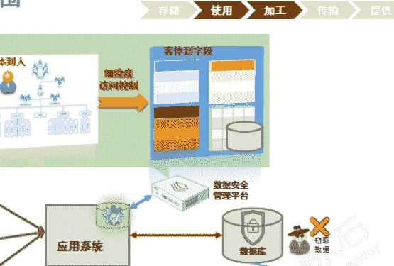

| 姓名 | 张莉 |
| --- | --- |
| 身份证号 | 62108733567356125 |
| 手机号 | 13900334901 |
| 行程 | Pvg pak png |

| 姓名 | 张磊 |
| --- | --- |
| 身份证号 | 6210004048405048X |
| 手机号 | 13234540661 |
| 行程 | pro-xxx-xxx |

| 姓名 | 张磊 |
| --- | --- |
| 身份证号 | 8495008448405048X |
| 手机号 | 13234540661 |
| 行程 | 3a7v0wGPDR22Abv |

- 可适配应用自带身份标识或统一IAM系统，实现用户身份的动态授权
- 可支持ABAC基于属性的访问控制等粒度授权

## 事中检测响应：业务人员风险操作的识别处置

- 存储 使用 加工 传输 拷贝

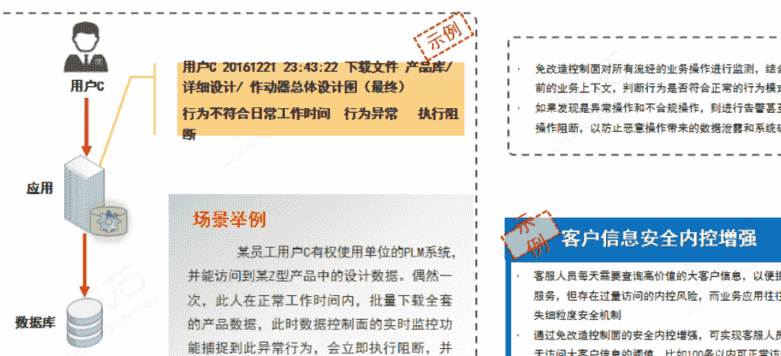

## 示例

用户C 20161221 23:43:22 下载文件 产品库/详细设计/动器总体设计图（最终） 行为不符合日常工作时间 行为异常 执行阻断

## 场景举例

某某用户C有权访问单位的PLM系统，能够访问到Z型产品中的设计数据。偶然一次，此人在正常工作时间内，批量下载全套的产品数据，此时数据控制界面的实时监控功能捕获到此异常行为，立即执行阻断，并将该事件进行记录和报警。

## 客户信息安全内控增强

客服人员每天需要查询高价值的客户信息，以便提供服务，但存在过量访问的内控风险，业务上往往失敏安全风险。通过流量控制的安全内控增强，可实现客服每天访问客户信息的阈值，比如100条以内可以正常访问，超过100条会触发告警，超过200条会触发阻断（通过流程审批后才能访问）

## 事后审计：可追踪到人的访问审计追溯

### 记录所有访问敏感数据的行为
包括账号、时间、IP、会、操作、对象、耗时、结果等内容，形成包含终端用户身份的SQL日志。用户可以通过日志查询数据的访问情况，在事故发生后精准溯源

| 操作时间 | 操作者 | 行为 | 操作对象 | 操作ID | 操作对象名称 | 操作对象所属者 | 状态 | 是否包含 | 登录类型 | 附件属性 | 客户端IP | 客户端Agent |
|---|---|---|---|---|---|---|---|---|---|---|---|---|
| 2018-02-01 16:13:25 | 下载 | 查询 | | 01_3 | 01_3 | None | 是 | 是 | | 279568 | 172.16.10.96 | MEQC/QCP... |
| 2018-02-01 16:13:26 | 下载 | 查询 | | 01_2 | 01_2 | None | 是 | 是 | | 215008 | 172.16.10.96 | MEQC/Ap... |
| 2018-02-01 16:13:25 | 下载 | 查询 | | 01_3 | 01_3 | None | 是 | 是 | | 95760 | 172.16.10.96 | MEQC/G... |
| 2018-02-01 16:13:24 | 下载 | 查询 | | 01_13 | 01_13 | None | 是 | 是 | | | | | MEQC/ertfGoyY |
| 2018-02-01 16:13:24 | 下载 | 查询 | | | | | | | | | 76039 | | |
| 2018-02-01 16:13:24 | 下载 | 查询 | | 04_4 | 04_4 | None | 是 | 是 | | 160344 | 172.16.10.96 | MEQC/B... |

## 实战防护：安全一体化，打造数据保护

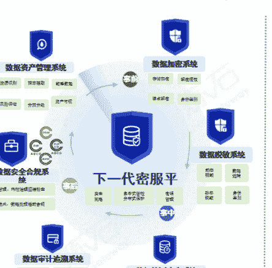

向用户建立安全准则：只有符合权限的用户才能访问数据，结合业务环境风险检测，识别高风险报警。运营侧重数据边界：从后台拦截解密明文信息。

## 技术演进：下一代密码服务平台是演进，而非替代

| 合规性演进 | 密码法 | 密法 | 网络安全保护 | 关键基础设施安全保护 | 商用密码条例 | 网络安全管理措施 | 保密 | 信息 | 密码 | 审计 |
|---|---|---|---|---|---|---|---|---|---|
| | 网络安全法 | 密码法 | 数据安全法 | 个人信息保护 | | | | | |
| 业务应用系统 | 数据收集 | 数据处理 | 数据传输 | 数据存储 | 数据使用 | 数据加工 | 数据公开 | 其他基础设施 | |
|---|---|---|---|---|---|---|---|---|---|
| 业务应用 | 关系型数据库/文件/采集 | 数据清洗 | 数据提取与同步 | 数据库存储 | 实时计算 | ROLAP / HOLAP / MOLAP / OLTP | 可视化 / 可视化平台 / 可视化平台 | 任务调度系统 |
| | 日志采集/采集 | 数据集成 | 中间件/文件传输 | 单机存储 / 分布式存储 | 统计计算 | | / 可视化工具 | 全文索引 |
| | 数据库检索实时采集 | 数据转换 | | | | | | | |

| 数据安全能力 | 事前 | 事中 | 事后 |
|---|---|---|---|
| | 数据资产目录 | 字段加密 | 业务边界检测 | 威胁响应 | 数据留留 |
| | 数据识别分类 | 文件加密 | API安全防护 | 内容/接口防护 | 数据库/文件访问审计 |
| | 自动化分类治理 | 数据脱敏 | 数据流量检测 | 攻击溯源 | 数据泄漏 |
| | 标识标记 | 可信数据格式 | | 数据水印 |

| 基础密码能力 | 适用密码服务 | 支撑密码服务 | 密钥管理 |
|---|---|---|---|
| | 加密服务 | 数字证书服务 | 对称密钥管理 |
| | 随机数服务 | 电子签章服务 | 非对称密钥管理 |
| | 数字封装服务 | 身份认证服务 | 标识密钥管理 |
| | 签名算法服务 | 安全通信服务 | |

| 密码资源池化 | 设备管理 | 资源调度 | 资源调度 | 弹性扩容 | 灾难恢复 | 资源监控 |
|---|---|---|---|---|---|---|
| 密码卡 | 密码机 | 云密码机 | 密钥管理服务器 | 协同签名密码服务器 | 网络 | 服务器 | 数据库 |

## 无缝升级：支持已密密码设备，敏捷免改造数据安全

下一代密码服务平台（NGSCP）通过统一密码资源、构建安全防护体系、深度契合要求、云原生架构与智能化服务，实现了密码能力从基础设施层到应用层的跨越。它不仅提升了信息系统的安全水平，还为政企用户提供了高效、安全、合规的密码服务，助力数字化时代的全面安全防护

## 统一一管密码资源
无缝升级免改造数据

## 构建数据安全实战防护
防护体系

## 深度契合要求
合规要求

## 云原生架构与智能化
密码服务

- 统一一管与调度：对用户拥有的密码设备和系统进行统一管理和调度，消除“数据泄露”问题，实现密码资源的集中化
- 无缝升级免改造：通过内改造技术对接现有系统，无需对业务系统进行大规模改造，实现密码能力的提升
- 弹性扩展资源池化：将硬件资源池化，适应大数据和业务变化，确保无缝升级的适应性，无缝升级的灵活性和可靠性
- 事前防护：通过数据加密、访问控制，确保数据在存储和传输过程中的完整性
- 事中检测：实时监控数据行为，快速检测异常并防止数据泄露或篡改
- 事后审计：提供完整的审计日志和追踪，确保操作透明、满足合规要求
- 密评等合规：支持应用评价（密评）、关键基础设施保护（关保）
- 数据安全法：满足《网络安全法》、《数据安全法》和《个人信息保护法》的合规要求，确保数据符合法律要求
- 工作防护：针对工作场景提供专项防护，确保敏感信息安全
- 云原生支持：采用云原生架构，适应业务需求，提升系统的弹性和可靠性
- 智能化：通过自动化实现密钥的生成和更新，减少人工干预，提升管理效率
- 自适应策略：根据实时动态调整策略，确保链路应对不确定威胁

## 数据流通场景
基于TEE技术的跨域管控

## 外发痛点：数据“可见不可控”

数据成为企业可以交易的商品，但在共享后依然存在“数据失控”问题困扰数据提供方：
- 数据的接收方对数据进行滥用？
- 对方再次将数据发给第三方？
- 这些数据在接收方的有效期内如何控制？

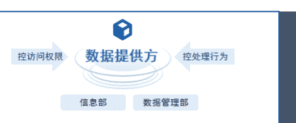

## 跨域数据：基于TEE技术，落地数据“可见不可”

数据成为企业间可以交易的商品，但交易后存有“数据失控”问题困扰数据提供方：
- 数据的接收方对数据进行滥用？
- 对方再次将数据发给第三方？
- 这些数据在接收方的有效期如何控制？

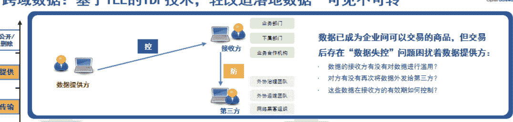
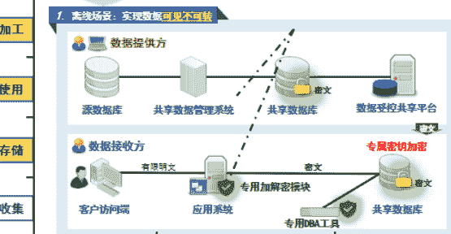
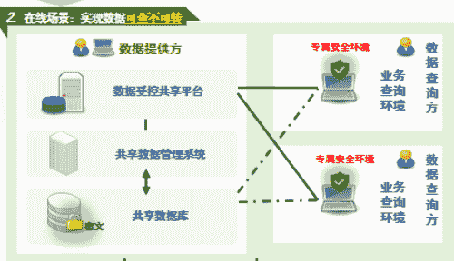

## 跨域管控：部署模式不改变原有数据共享流程

| 基础数据 | 个人信息 | 生产数据 | 数据中台 | 业务支撑 |
|---|---|---|---|---|
| 基础数据库 | 基础数据库 | 共享数据库 | 集中数据库 | 业务数据库 |

数据中台-共享数据管理系统

来自内部的数据共享请求

外部的数据共享请求

数据中台发送数据给受控平台

## 跨域数据管控平台

离线场景：实现数据可见不可控 | 在线场景：实现数据可用不可控

| 关键技术 | 数据脱敏加密技术 | 受控数据共享专用线路加密技术 | 访问控制技术 | 数据水印防溯追踪技术 |
|---|---|---|---|---|

| 用户层 | 数据生产方 | 数据使用方 | 数据控制方 | 业务服务方 |
|---|---|---|---|---|
| 安全层 | 数据加密 | 访问控制 | 权限管理 | 数字水印 | 数据分类/脱敏 | 数据审计 |
| 应用层 | 数据采集 | 数据服务 | 数据权限 | 流量审计 | 交换通道 | 日志记录 |
| 支撑层 | TEE可执行环境 | 同级加密加 | 数据安全管理 | 交换合约管理 | |
| 基础层 | CA业务 | 身份管理 | 链路管理 | 区块链 | 交换通道 |

数据汇聚及加密下发

| 监管单位 | 专用于加密模块 | 子公司 | 专用于加密模块 | 专用环境 | 专用 |
|---|---|---|---|---|---|
| 应用系统可执行环境 | 专用DBA工具 | 数据使用 | 专用DBA工具 | 数据使用 | |

## 案例-政府：某省高并发数据保护

项目背景介绍
客户行业：政府
项目名称：某省高并发数据保护
项目需求：针对数据列表进行加密保护，在实现数据安全的同时，考虑到业务部门对于商用数据的考核要求。该方案已通过集团密评，获得集团大力支持。

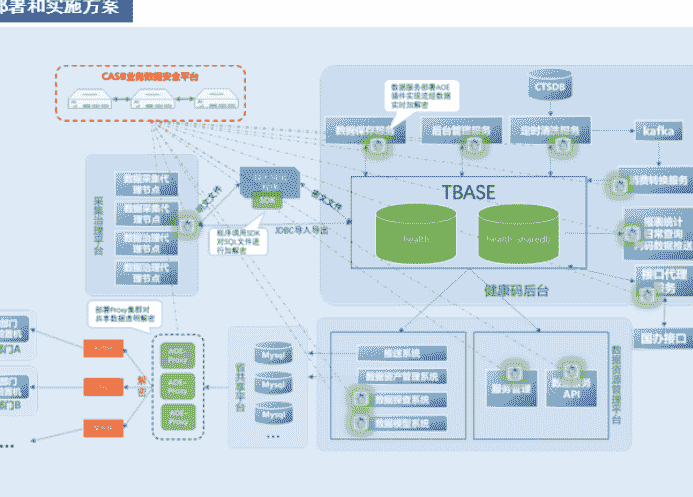

## 案例-金融：某银行数据保护

项目背景介绍
客户行业：银行
项目名称：某制造系统数据安全保护项目
项目需求：
- 工业数据保护：生产过程中涉及的控制信息、工况状态、工艺参数等数据保护
- 研发数据保护：企业研发生产系统中涉及的研发计划、开发测试等数据保护

建设内容：
- 数据加密与访问控制：对制造现场数据进行加密存储，确保数据在传输和存储过程中的机密性。
- 重要设备和系统包括BAS系统、PCS系统、MES系统实施细粒度访问控制，防止未授权的访问。
- 数据审计：对所有工业重要要素访问活动进行实时监控和记录，确保数据的完整性和安全性。实施日志审计机制，对数据访问日志进行收集、分析和存储，定期进行安全审计，检查安全策略的执行情况，发现异常并对异常行为及时报警，以便快速响应和处理。

## 案例-运营商：某移动BOSS数据保护

项目背景介绍
客户行业：运营商
项目名称：BOSS个人信息保护
项目需求：针对数据列表进行加密，影响范围所有访问数据的业务，涉及三方改造（改造范围）：集团全网客户中心、省内CRM/BOSS/经营系统等。

解决方案：
- BOSS系统：1、应用安装AOE插件，应用写入数据实时加密，读取数据实时解；2、历史数据可通过AOE客户端进行全量加密。
- 集团：在省侧的数据采集程序集成SDK，调用SDK接口，实现数据采集解密。
- 经分：BOSS侧导出的加密文件解密明文文件，按照原逻辑解密明文文件，把数据写入vertica数据库和TD数据库。

项目部署方案

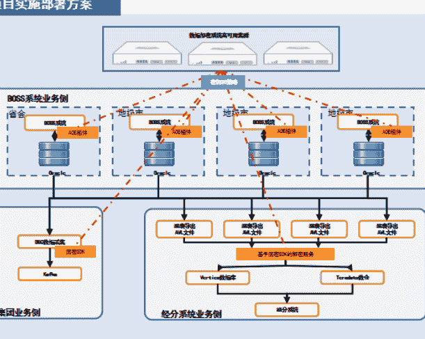

## 案例-工业应用：“某某钢铁企业”工业数据保护

项目背景介绍
客户行业：钢铁制造
项目名称：工业制造系统数据保护项目
项目需求：
- 工业数据保护：生产过程中涉及的控制信息、工况状态、工艺参数等数据保护
- 研发数据保护：企业研发生产系统中涉及的研发计划、开发测试等数据保护

建设内容：
- 数据加密与访问控制：对制造现场数据进行加密存储，确保数据在传输和存储过程中的机密性。
- 重要设备和系统包括BAS系统、PCS系统、MES系统实施细粒度访问控制，防止未授权的访问。
- 数据审计：对所有工业重要要素访问活动进行实时监控和记录，确保数据的完整性和安全性。实施日志审计机制，对数据访问日志进行收集、分析和存储，定期进行安全审计，检查安全策略的执行情况，发现异常并对异常行为及时报警，以便快速响应和处理。

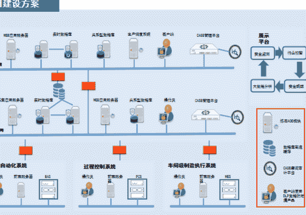

## 案例-商业敏感数据应用：某知名酒店集团数据保护

## 项目背景介绍

## 项目建设方案

客户行业：旅游

项目名称：某知名酒店集团数据保护项目

项目需求：
酒店集团内部信息系统，内含大量个人信息及重要业务数据，对于集团来说，这些数据是宝贵的数据资产，要确保这些数据不被非法窃取、泄露和利用，因此，需结合相关法规政策，亟需采用加密技术对系统中敏感数据进行加密保护。

炼石提供CAEAS业务数据加密平台（包含数据安全插件（AOE插件）、数据安全管理平台、密钥管理系统），为集团快速敏捷且有效的数据安全保护方案，实现“分布式加密、集中管控”。

在酒店内应用系统的服务节点分层部署AOE插件，旁路部署数据安全管理平台和密钥管理系统。数据安全管理平台作为插件执行一行一加密和解密策略；密钥管理系统负责统一管理所需的密钥，实现敏感数据全生命周期的管理，保障敏感密钥的安全备份与恢复，从而实现集中的加密管理平台的建设，实现应用系统敏感数据的分布式加密/解密，安全策略的集中管控。

项目实施困难：

- 集团前期采用了加密机签，需要在应用系统中集成加密的客户端SDK，严重影响了业务系统的运行效率；
- 业务系统纵横交叉，数据存储分散，解密需要可靠、可视化的集中管控；
- 涉及敏感信息的信息系统：信息系统分布于虚拟化、容器、实体机等环境中；涉及数据种类多样，如关系型数据库Oracle、MySQL及非关系型数据库MongoDB。保护的数据量达到极限，需要同时对业务实时数据及已有数据进行加密保护；
- 部分业务具有很强的实时性，面临延迟和高并发的挑战，要将加速功能对业务操作的影响控制在不超过10%。

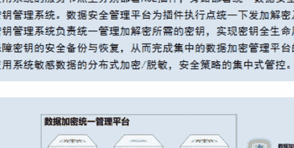

## 案例-医药制造应用：某药企业商业秘密数据保护

## 项目背景介绍

## 项目建设方案

客户行业：医药制造
项目名称：创新药研数据安全保护项目

项目需求：

- 制药行业合规的要求：药企的信息化和数据可靠性的关系
- 国际制药行业领先企业的ALCOA数据可靠性管理策略
- GMP合规：国际药品生产质量管理规范
- GSP合规：药品经营质量管理规范

- 创新药研的安全需求：实验数据、分析数据的线上流转保护
创新药研的数据安全保障

- 一体化工厂高效效率提升的安全需求：工业4.0大数据支持的计划营销销售经营信息数据安全、药品溯源保障
打破数据孤岛，加强数据流转：数据的流动转移的安全保障
跨领域协同联动：IT--OT，边界模糊情况下数据安全保障

1. KMS系统
2. 密文管理模块
3. 策略管理模块
4. 加解密组件
5. 加解密SDK
6. 应急恢复设备
7. 数据库密文维护工具

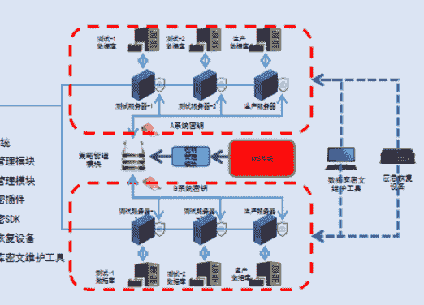

## 公司定位：炼石就是数据安全

炼石是以“免改造”为特色的数据安全产品厂商，国家级专精特新“小巨人”，自研灵活投送多重安全能力的免改造平台，帮企业客户打造领先数据安全保护体系，敏捷交付数据合规。

## 落地数据实战防护

## 保障数据监管合规

## 免改造数据安全主平台

| 2015 | 2016 | 2017 | 2018 | 2019 | 2020 | 2021 | 2022 | 2023 | 2024 | 2025 |
| :--- | :--- | :--- | :--- | :--- | :--- | :--- | :--- | :--- | :--- | :--- |
| 公司成立 | 应用融合 | Pre-A轮 | 免改造 | 免改造 | A轮 | 数据安全 | A+轮 | 数据安全 | 全域 | 下一代 |
| 天安投资 | 数据安全 | 国科毅和投资 | 数据安全 | 数据保护平台 | 讯讯投资 | 主平台 | 领航新锐投资 | 产品+服务 | 数据保护 | 密客平台 |

## 炼石免改造数据安全

www.ciphergateway.com

010-88459460

sales@ciphergateway.com

