# 2024
美国新晋独角兽报告

# 目录

- 核心观察与汇总 ................................................ 3
- AI类初创企业 ................................................. 12
- ToB/SaaS类初创企业 ....................................... 29
- ToC应用初创企业 ................................................ 37
- 硬科技类初创企业 ................................................ 42
- 其它领域 ................................................. 49

# 扫码加入 知识星球TOP 免费资源群

免费

公众号: 知识星球TOP

- 每日免费获取高价值资源
- 可提供各类资源搜索服务

价值

微信号: jntsg8

| 热门付费文章 | 各行各业报告 |
| 精选图书资源 | 副业赚钱方法 |
| 职场实用资源 | AI财经自媒体 |

及时

微信号: jntsg2

专注

分享资料仅供个人学习，请及时删除，切勿商用传播

# 核心观察：

AI 成为绝对主角，多元场景落地探索效果显著：AI 独角兽数量占比接近40%，其估值和成长速度远超平均水平企业级 AI 产品和 ToC 应用为最大细分赛道，AI 商业化探索已初获成果。

连续创业者担当主力，技术派打造高估值：超过 50%的创始人有过创业经历，而由技术专才创立的公司聚焦于大模型、具身智能等革命性 AI 技术，深受资本市场青睐。

小天才创始人成长迅速，95 后 90 后引领 AI 应用浪潮：共有 17 家新晋独角兽由 90 后创始人创建，其中包含 4 位 95 后和 2 位 00 后。他们平均用 4 年就打造出 10 亿美元估值的公司，并在应用领域不断推出惊艳世界的产品。

团队背景多元，移民半数独角兽：金融/投资背景的创始人占比达 31%，军队/政府背景达 10%。半数独角兽由非美国出的移民创立，另有 33%由移民后创建，其中包含 5 名华裔创业者。

# 美国新增独角兽数量回升

美国新增 67 家独角兽

占全球新增独角兽公司 48%

较2023年美国新增独角兽数量上涨 68%

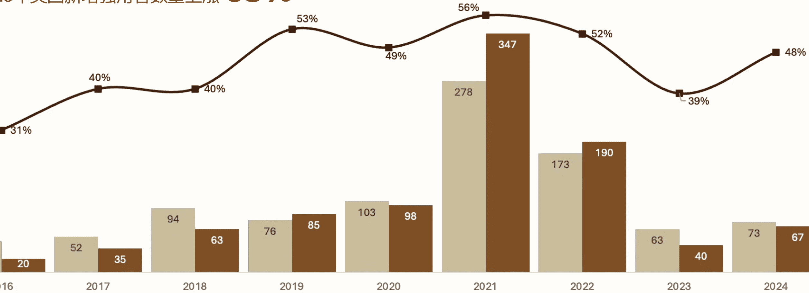

非美国独角兽 美国独角兽 全球独角兽占比 (%)

# # 90后创始人齐露头角，聚焦AI领域创业

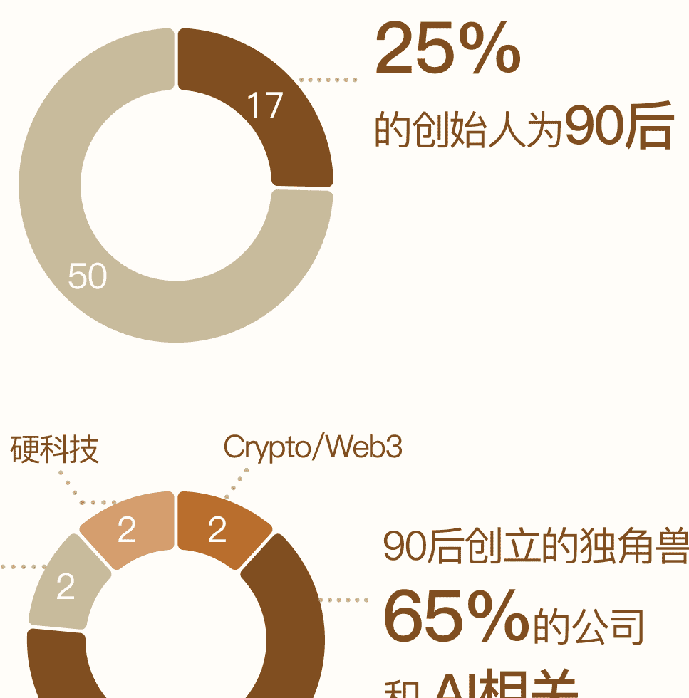

| Anysphere | Magic | Cognition | Codeium |
| --- | --- | --- | --- |
| Michael Truell | Eric Steinberger | Scott Wu | Varun Mohan |
|  |  |  |  |
| 2000 | 2000 | 1997 | 1996 |
| 本科毕业于MIT 曾在Two Sigma, Google, Octant实习 | 本科从剑桥退学 任任深度学习研究员 | 本科毕业于哈佛大学 奥林匹克金牌主 Codeforces奇师创立Lunchclub | 本科毕业于MIT 曾在Niro自动驾驶基础技术术负责人 |
| AI代码编辑器 Cursor | 1亿Tokens大模型 LTM-2~mini | AI程序员 Devin | AI自动编程软件 Windsurf |
| 26 | 15 | 20 | 13 |

硬科技 Crypto/Web3

90后创立的独角兽中 65%的公司和AI相关

4家AI编程助手公司均由95/00后后创立......

### EvenUp

Rami Karabibar

1991年生

人物背景：曾任Bain & Company 咨询顾问，MBA就于哈佛商学院

公司业务：人工智能法律公司，利用先进的AI 技术和Plai 平台，帮助律师进行案件的线索工作，主要聚焦在个人伤害索赔领域。

AI-To/SaaS

### Cyera

Yotam Segev

1992年生

人物背景：曾任以色列军事情报网陆部主管，本科毕业于以色列大学

公司业务：数据安全服务商，旨在在构建最智能的数据安全平台，使企业能够安全地使用数据。

AI-To/SaaS

### EliseAI

Minna Song

1995年生

人物背景：曾Influencers Required 联络，并在Microsoft实习，本科毕业于MIT

公司业务：房地产对话式平台通过多语言AI助手帮助企业降低运营成本、提升效率和优化产租户体验。

AI-To/SaaS

## Harvey

Winston Weinberg

1995年生

人物背景：南加大学法学士，曾在国际事务所OMelvery & Myers公司工作

公司业务：AI法律技术服务商，律师可以通过简单的指令/编辑法律文件并管理相关诉讼，操作界面直观、快速上手。

AI-To/SaaS

### Perplexity

Aravind Srinivas

1994年生

人物背景：曾任OpenAI研究科学家，在Google、DeepMind等公司工作，博士毕业于加州大学伯克利分校

公司业务：AI对话式搜索引擎提供商，基于领先的大型语言模型和API发的对话搜索引擎。

AI-To应用

### Speak

Conner Zwick

1994年生

人物背景：曾于19岁从哈佛大学创立学生语言学习应用Flashcards、全球5000万用户，后被Chegg收购

公司业务：AI驱动的语言学习平台，提供个性化的口训练和实时反馈，帮助用户提升口语流利度。

AI-To

### ElevenLabs

Mati Staniszewski

1995年生

人物背景：曾任Palantir Technologies部门策略师，BlackRock人员，本科毕业于哥伦理工学院

公司业务：AI软件研发，帮助企业生成高质量、自然流畅的语音内容。

AI-To

### Octane

Jason Guss

1990年生

人物背景：曾任Capital One顾问、并在Amsterdam Partners进行股权分析，本科毕业于耶鲁大学

公司业务：信贷服务商，为用户提供自动贷款、资质预审等服务。

ToC

### Flex

Shragie Lichtenstein

1994年生

人物背景：曾任Point7投资人、Boundless Reality联合创始人，本科毕业于亥华大学

公司业务：数据安全，为房屋管理员和租户提供租金支付解决方案。

ToC

### Story Protocol

Seung Joon Lee

1990年生

人物背景：现全球最大的Hashed风险合伙人、曾是Kakao Entertainment联合创始人CEO，本科毕业于天津大学

公司业务：基础设施平台，通过区块链解决知识产权（IP）相关问题。

Web3

### Humanity

Terence Kwok

1992年生

人物背景：曾是香港第一独角兽Tink Labs在酒店迎客，本科毕业于芝加哥大学

公司业务：推出用于智能手机的隐私保护脸识别。

Crypto/Web3

### Fervo Energy

Tim Lammer

1990年生

人物背景：曾任HP工程师、Biota Technology咨询顾问、MBA毕业于斯坦丹大学

公司业务：开发地热项目，通过地热设计、储层能源管理，满足企业对清洁能源的需求。

Crypto/Web3

### Nimble

Simon Calouche

1992年生

人物背景：曾任执行任务（从工厂、仓库到消费者市场）

公司业务：开发AI驱动的智能机器人，处理数百种产品。

## 北美新晋独角兽中的90后

### 美国独角兽创始人

- 51%连续创业者；31%金融创业者；25%年轻创业者；22%技术人才；10%军队/政府背景。
- 新晋独角兽画像

- 技术型创业者的初创最拿到首轮融资。
- 技术跨界创始人案例：

| 公司高管 | 金融背景创业者 | 年轻创业者 | 军队/政府背景 | 技术 |
|| | | | | |
| 2.04 | 1.51 | 1.88 | 1.71 | 1.96 |
| 2.45 | 2.24 | 1.64 | 1.86 | 1.99 |

斯坦福大学计算机系教授及主任，曾是Twitter董事会成员兼首席；AI领域最快独角兽记录李谦World Labs联创CEO。

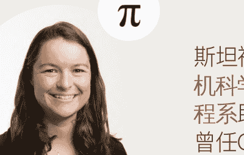

斯坦福大学计算机系和电气系教授，美国科学家研究员，本科于MIT，毕业于加州伯克利分校丰富的多元背景

1/3金融/投资/咨询背景，如......

33%出生的移民

18%为华人

### May Habib
Writer联创兼CEO

曾任留姆兄弟分析师、Mubadala（阿布扎比第二大主权基金）总裁

### Nicholas Flanders
Twelve联创兼CEO

曾为戈肯担任顾问，还会创建求职社区

45%为国外移民

10%曾在军队或政府任职，如......

其中27%的创始人来自中东国家

17%的创始人来自印度

### Liran Z
WEKA联创CEO

曾任以色列国防软件工程师

### Dino Mavrook
Saronic联创CEO

曾任美国海军军长

### Kyle Lawson
Huntress联创兼CEO

曾任美国信息保障经理及国民卫队战斗员

## 行业分布

美国各行业独角兽平均成长年限（年）

12%的独角兽为硬科技公司，低于中国

42%为AI公司，平均估值达20.5亿美元，与硬科技公司持平

19%为ToB/SaaS公司，聚焦垂类与网络安全企业

#### 美国新晋ToB/SaaS类独角兽

##### 美国独角兽行业分布和平均估值（单位：亿美元）

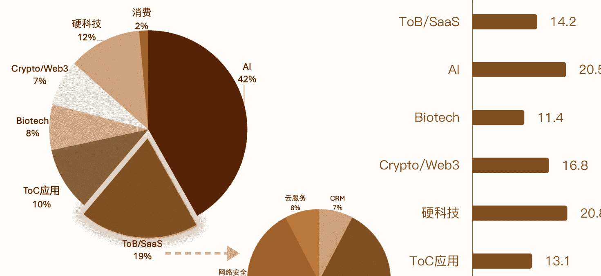

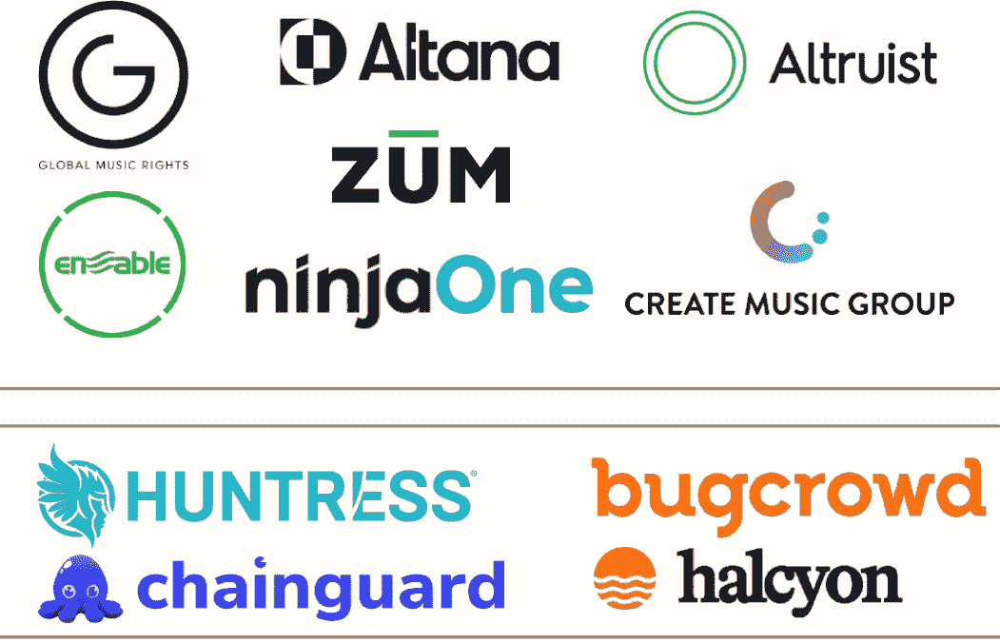

垂类SaaS

网络安全

## 行业分布-AI细分

### 美国新晋生成AI相关独角兽

67家新晋独角兽，28为AI类公司，其中25为生成式AI公司

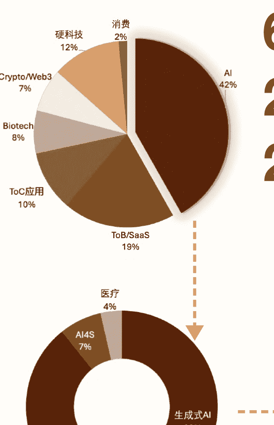

| ToB/SaaS |
| --- |
| 基础设施 | WEKA |
| 基础 | together.ai, fluent |
| 营销 | WRITER |
| 法律 | EvenUp Harvey |
| 安全 | EliseAI |
| 安全 | CYERA |

| ToC应用 |
| --- |
| 编程助手 | Anysphere codename Magic |
| 教育 | Speak perplexity |
| 语音生成 | IIElevenLabs |

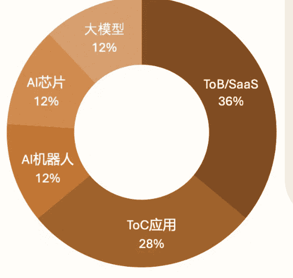

| 大模型 |
| --- |
| World Labs ssi X |

| AI芯片 |
| --- |
| groq | |
| AI机器人 | pi FIGURE, SKILD AI |

美国生成式AI独角兽平均增长年限（年）

非生成式AI独角兽

#### Anysphere

#### Cognition
成立时间: 2023
具体行业: AI-To-C应用

#### 业务简介
输出了产品AI代编程编辑器、Cursor能预测一行代码、帮助用户管理模型参数、用户可以对其进行自然语言指令

#### 商业模式
目前免费，该产品在shopify、OpenAI、replicate、Perplexity、Midjourney等同类中

#### 业务简介
发布了一名为Devin的AI程序员，能自主学习技术、从底层编码到部署应用程序、调试、调试和调整模型。

#### 商业模式
到B端，订阅每月600美元。企业可以选择定制服务；合作包括Microsoft Lumen、OpenSearch、ramp、vesta等。

## 年轻创业人

| Name | Title | Experience |
| --- | --- | --- |
| Michael Truell | 联合创始人CEO | 在Two Sigma、Google、Octant实习；本科毕业于MIT |
| Saleh Asif | 联合创始人 | 在校期间从事研究实习；本科毕业于MIT |
| Aman Sanger | 联合创始人 | 曾担任Abelian AI创始人（来自AI/ML类公司）、在Google。曾曾做过软件实习，曾在MIT、在Bridgewater做投资实习 |
| Arvid Lunnemark | 联合创始人 | 曾在Quant、Stripe做软件工程实习，曾在Jane Street量化交易实习；本科毕业于MIT |

| Name | Title | Experience |
| --- | --- | --- |
| Scott Wu | 联合创始人CEO | 曾担任Devin软件创始人、是Lunchub的联合创始人CTO（AI）、A轮融资（240万美元）；曾获得互联网信息类奖霍克莱赛奖金，曾获得美国学生实习包括Jioper、OpenAI工程师 |
| Steven Hao | 联合创始人CTO | 本科毕业于MIT；曾在Scale AI做程序员、在Google、Meta Development Group做实习、在Jane Street做D. E. Sharp 集团做量化分析/交易实习，在Dropbox做过架构实习 |
| Walden Yan | 联合创始人CPO | 本科学毕业于斯坦福；是Google的高管（担任首席技术官），2021年被Soft收购的联合创始人CEO、是Anysphere的早期创始人 |

| Date | Round | Amount | Investors |
| --- | --- | --- | --- |
| 2024/07/16 | A轮 | 6000万美元 | Thrive Capital |
| 2023/10/12 | 种子轮 | 980万美元 | Nat Friedman、Arash Ferdowshi及其他投资者 |
| 2024/04/25 | A轮 | 1.75亿美元 | Founders Fund, Conviction Partners |
| 2023/03/12 | 种子轮 | 2100万美元 | Founders Fund, Elad Gil, Conviction Partners |

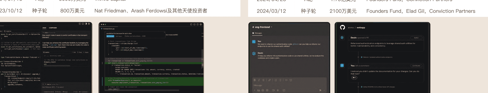

## Magic 估值1.5Bn
成立时间：2022
具体行业：AI-ToC领域

## Codelein
成立时间：2021
具体行业：AI-ToC领域

#### 业务领域
AI编程助手。

美国人工智能工具公司提供，推出AI编程助手Windsurf，可根据提示生成程序代码，是世界上第一代AI工具，集成了Copilot的编程能力和AI助手功能，能够理解代码并实时感知开发者的操作，推出了Cecode(AI)工具，深度理解代码的内容，提供灵活的代码访问权限，并支持用户对正在的操作进行无需切换窗口，大幅提升了开发者的工作效率和协作体验。

#### 商业模式
用800亿token来构建之前的代码模型，推出了LTM-1 (500万token文本窗口)、LTM-2-Mini (1000万token文本窗口)模型。

### 业务场景

| Name | Title | Experience |
| --- | --- | --- |
| Eric Steinberg | 联合创始人 CEO | 曾任Meta深度学习志愿者学习创业，曾是ClimateScience(科学气候化相关组织)负责人，曾带过1k+志愿者团队进行调研、募资、竞赛，联合创始人，就读期间从哈佛大学 |
| Sebastian De Ro | 联合创始人 | 曾任swift技术开发、软件工程师，FireStart CTO，曾是ClimateScience志愿者，曾活跃在Software Amber(Seaver Technologies)内做过软件工程和产品实用 |

| Date | Round | Amount | Investors |
| --- | --- | --- | --- |
| 2024/08/29 | C轮 | 1.5亿美元 | General Catalyst Partners |
| 2024/01/30 | B轮 | 6500万美元 | Kleiner Perkins, Greenocks, General Catalyst Partners |
| 2024/02/28 | A轮 | 2500万美元 | Founders Fund, Greenocks |
| 2021/01/01 | 种子轮 | 300万美元 | Greenocks, 个人投资者 |

以ToBC业务为主，面向全球开发者的工具。

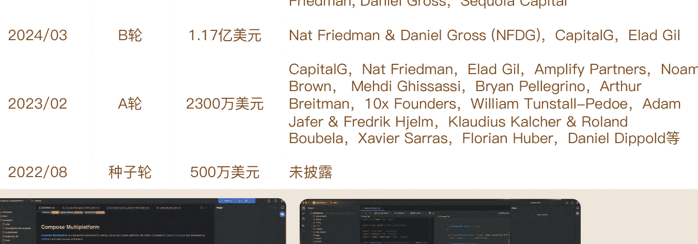

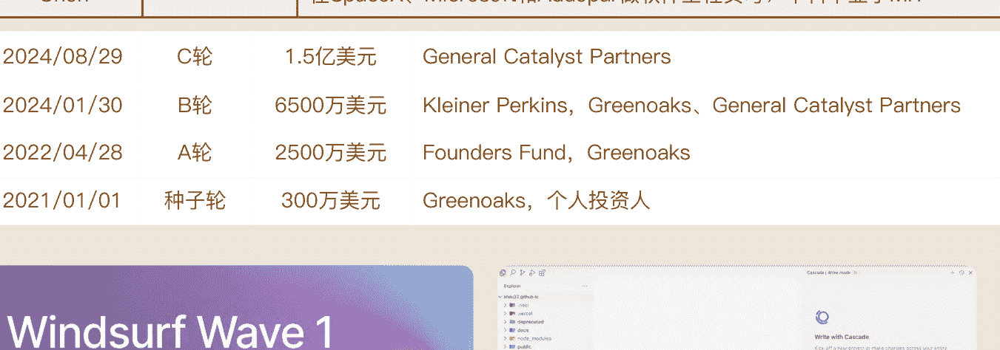

### Windsurf Wave 1

### Speak 估值$Bn
成立时间：2015

### ElevenLabs 行业领域：AI-ToC
成立时间：2022

#### 业务模式
AI驱动的口语学习平台，提供个性化的口语训练和反馈，帮助用户快速提升口语水平

#### 业务模式
AI语音合成，帮助企业和个人用户产生高质量、流畅的语音内容。核心业务包括语音生成、语音交互

#### 商业模式
To B，为企业提供定制化的翻译解决方案，确保安全；为个人用户和开发者提供丰富的音频工具，帮助作者。
To C，为企业提供定制化的培训方案，高级版每月$19，每年$23；普通版每月$8，每年$99，提供课程即时练习。

## 创始人、年龄、院校

| Name | Title | Experience |
| --- | --- | --- |
| Connor Zwick | 创始人兼CEO | 19岁从哈佛大学申请AI应用，全球用户，加入Thiel Fellowship |
| Andrew Hsu | 联合创始人兼CEO | 12岁来自斯坦福大学，生物学、化学和物理工程，斯坦福大学获得计算机科学硕士，加入Thiel Fellowship |

| Name | Title | Experience |
| --- | --- | --- |
| Mati Staniszewski | 联合创始人 | 曾在Palantir重要工作，BlackRock产品负责人，本科毕业于荷兰工业大学 |
| Piotr Dabkowski | 联合创始人 | 曾在Google做工程师，曾任软件工程师；本科毕业于牛津大学，硕士毕业于剑学院 |

| Date | Amount | Notes |
| --- | --- | --- |
| 2024/12/10 | C | 7800万美元 | Accelerator Partners, OpenAI Startup Fund, Y Combinator |
| 2023/08/31 | B+ | 1600万美元 | Lachy Group, OpenAI Startup Fund, Austin |
| 2022/11/17 | B | 2700万美元 | OpenAI Startup Fund, John Buckley, Justin Mateen, Gokul |
| 2020/08/01 | A | 1100万美元 | JAM Fund |
| 2017/03/20 | 种子轮 | 未披露 | Khosla Ventures, Investo |

| Date | Amount | Notes |
| --- | --- | --- |
| 2024/01/22 | B | 8000万美元 | Andreessen Horowitz, ICONQ Group, World Innovation Lab (WIL), Valor, Endeavor Capital Fund, Lunate, Sequoia Capital, Salesforce Ventures, Brightlight Capital, Credo Ventures |
| 2023/06/20 | 股权投资 | Nat Friedman, Daniel Gross, Sequoia Capital, SV Angel, Brendan, Andreessen Horowitz |
| 2023/01/22 | Pre-Seed | 200万美元 | Credo Ventures, Concept Next

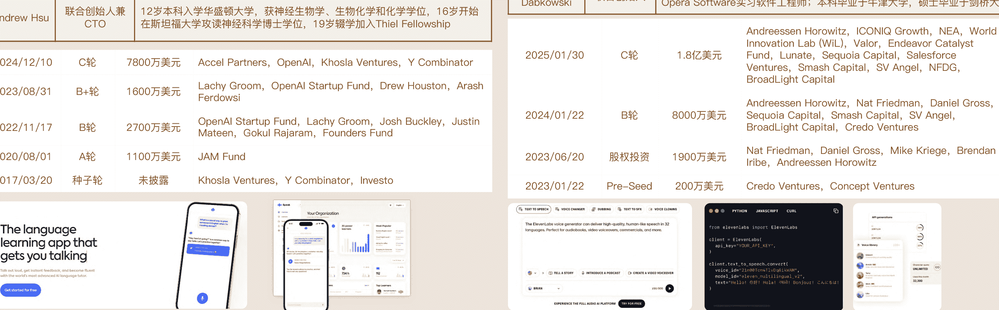

## Doc.com 估值$1.3Bn
成立时间:2012
行业领域: AI-ToC应用

## EvolutionaryScale 估值$1Bn
成立时间:2023
行业领域: AI数据科技

#### 业务简介
医疗区块链服务商，基于加密货币技术，为用户提供多种AI驱动的健康管理服务

#### 业务简介
生物学AI模型开发，旨在帮助科学研究、构想和创造蛋白质；推出了ESM模型生成新生蛋白质的AI模型，是第一个蛋白质ESM1的转换语言模型，其帮助提示了进化过程，生成与自然已发现不同的蛋白质。

#### 商业模式
to C，商业模式未披露

#### 商业模式
2024年推出ESM3多序列生成模型，不仅能够生成功能性蛋白质，还能预测超过5亿的进化序列数据。

| Name | Title | Experience |
| --- | --- | --- |
| Charles Nader | 董事会CEO&总裁 | Blitzscaling Ventures Founder, 曾任Netflix合伙人；曾在斯坦福大学毕业 |
| Isao Hojo Uehara | 创始人 | 现MedicalImpact董事会总裁，曾任Bionome Corporation医疗卫生负责人、科技在连接领域项目经理、Samoa & Health Center医疗经理；医学博士，硕士毕业于斯坦丹大学 |
| Alexander Rives | 联合创始人首席科学家 | 曾任Accelerator Life Sciences Research Associate, AFTV Ventures Affiliate, Affiliate Fintech数据科学家、AI分析专家；Syros Therapeutics（为血源疾病患者开发药物），曾纳达上市；Syros Kalloye（口服药物开发公司），曾负责2和36亿美元交易；联合创始人；本人毕业于斯坦福大学，哈佛大学 |
| Salvatore Candido | 联合创始人 CTO | 曾任Google软件工程师、Meta软件工程师、Chief Robotics工程技术负责人；硕士毕业于耶鲁大学，斯坦福大学 |
| Tom Sercu | 联合创始人 VP | 曾任IBM工程师、曾在Goldman Sachs做实习，本科毕业于密特根大学，斯坦福大学获得计算机科学学位 |

## 金融背景
2024/06 | 退出 | 3亿美元 | Rock Group
2024-01 | | 2亿美元 | Lunate |

## Telemedicine
Our global tool is the perfect point of entry to AI powered ecosystems. Patients can consult with doctors anytime, anywhere. We are developing decentralized healthcare system to reach remote regions.

### Clinics
A tool for scientists to capture proteins through AI-driven methods.

### Sequence
2024/06 | | 4亿美元 | AWS, NVIDIA, Daniel Ross, Nathan Friedman

### Xaira Therapeutics 估值$7Bn
AI驱动的药物发现，主要通过三个关键要素：先进的AI研发能力、海量的药物数据分析以及产品开发加速从基础研究到临床发现的过程。

#### 业务重心
to B，主要面向药物研发和生物技术领域的企业。

#### A new dawn for discovery—AI end-to-end
Our capabilities range from fundamental computational methods to drug development. The application of these methods to biological discovery, molecular design and clinical development. Our mission is to accelerate how we discover and develop drugs. Nobel Laureate David Baker, and our team are at the forefront of this era of AI-driven discovery. AI allows us to design new proteins from scratch, meeting the reality of engineering novel molecules to target targets that have been resistant to other approaches. Xaira is advancing groundbreaking discovery while designing new drugs that can illuminate biological understanding and translate it into new medicines.

#### First principles for understanding the data universe
AI can't learn without high-quality data. We are building a data platform that can capture everything from molecular structures to human cells. Our team of scientists is exploring new approaches to gain unprecedented insights from data into the known relational boundaries.

| Name | Title | Experience |
| --- | --- | --- |
| Marc Tessier-Lavigne | 联合创始人 CEO | 现任斯坦福大学医学教授（休假），曾任Genentech的执行首席官，曾任斯坦福大学和洛格莱矶教授，并共同创立Daniel Therapeutics（17年被纳达收购）和Renovis（08年被纳达收购），在神经科学领域取得成就，获019年获得Greuber奖。曾担任美国科学院主席。 |
| David Baker | 联合创始人 | 现任斯坦福大学生物物理学设计研究所所长。博士毕业于华盛顿大学，硕士，华盛顿大学生物化学，学士于斯坦福大学加州伯克利校 |
| Humeti Kisamatsu | 联合创始人 CTO | 现任Xaira医药负责人，曾在Genentech任职10年担任运营总裁，负责定制化产品的开发，曾在软微公司担任CTO，现是斯坦福大学David Baker实验室博士后。本科学于印度的大学，硕士毕业于斯坦福大学马理工学院，博士毕业于马理工大学，学士于卡内基大学 |
| Buwei Huang | 联合创始人 | 现是浙江大学生命科学学院方向员，致力于创新的研发与商业落地，博士毕业于华盛顿大学医学工程系，学士毕业于华盛顿大学生物工程，从David Baker实验室任职 |
| Nathaniel Bennett | 联合创始人 | 在康奈星大学校从事本科科学，在Genentech任职执行工程师；现是康奈星大学校医学工程教授，博士毕业于华盛顿大学医学工程系，并在斯坦福大学担任博士后 |
| Justas Dauparas | 联合创始人 | 现是ProteinNN的科学家（这项让蛋白质功能能够在毫秒内合成世界上不存在的蛋白质），在软微公司担任机器学习工程师，现是强化学习小组组长；博士毕业麻省理工大学，现是斯坦福大学生物学蛋白质设计研究所博士后研究员及哈佛大学博士后研究员，专注于机器学习与生物系统设计 |

| Date | Round | Amount | Investors |
| --- | --- | --- | --- |
| 2024/04/23 | A轮 | 1.2亿美元 | Foresits Capital, Arch Venture Ventures, Tmi Group, SV Angel, Sequoia Capital, R-Squared Ventures, Parker Institute for Cancer Immunotherapy, MEA, Menlo Ventures, Lux Capital, Park, Lightspeed Venture Fund, F Future Partners, F-Prime, 拜东 |

## Writer

### 估值1.9Bn

成立时间: 2020

行业领域: AI-ToB/SaaS

## Harvey

### 估值3Bn

成立时间: 2022

行业领域: AI-ToB/SaaS

#### 业务简介

企业AI助手，核心功能包括生成文档/内容等各类类型文档（特色能生成企业风格的、全平台AI助手，多人在线协作）。

#### 业务简介

AI法律服务商，律师可以通过简单的指令/编辑法律文件并查询相应文件，操作界面直观、高效、流畅。

#### 商业模式

平台级应用采用LLM, AI Studio, KnowledgeGraphTrust & Security，团队订阅一个18个月，为不同行业的企业及部门提供解决方案；合作企业包括Hilton、Input、Dropbox、Local、salesforce等。

#### 商业模式

推出的产品使用AI Assistant（处理复杂的自然语言查询）、Vault（加密/存储/分析文档）、Knowledge（支持跨领域的智能检索查询）、Workflow（自动化工作流功能）；客户包括YoShelf Partners、A&O Sharma、Ashurst、PwC UK、Mainis。

### 联合创始人、企业背景

| Name | Title | Experience |
| :--- | :--- | :--- |
| May Habib | 联合创始人 CEO | 曾任Lehman Brothers分析师、Mukabad Development Company VP、曾在World Economic全球顶级市场负责人，曾曾在Google联合创始人（公）作为UI的设计架构师，年薪380万美元；本科学毕业于南乔州大学 |
| Winston Weinberg | 联合创始人 | 曾在国际律所O'Melvenry & Myers工作一年；本科学毕业于斯坦福学院，法学博士毕业于南加大学 |
| Gabe Pereyra | 联合创始人 主席 | 曾任Google Brain Director。DeepMind科学家、数学研究科学家；本科学毕业于南加大学期间选择留学 |
| Waseem Altshiq | 联合创始人 CTO | 曾任Advanced Web Solutions软件开发、AI营销创业网站开发者、阿拉伯集团软件工程师、Dantev Ventures高级产品经理，曾是CloudJasper联合创始人、IMENA CTO、Google联合创始人；曾为我们提供 |

| Date | Round | Amount | Description |
| :--- | :--- | :--- | :--- |
| 2024/11/13 | C | 2亿美元 | ICONIQ Growth、Premmi Invest, Radical Ventures, Salesforce, Adobe, IBM, Workday Ventures, Insight Partners, Partners Ventures, Capital Group, 首领领 |
| 2023/09/19 | B | 1亿美元 | ICONIQ Growth、WanderCo、Capital Insight, Partners, Ventures, Accenture, Vanguard |
| 2022/02/01 | A+ | 未披露 | Angel Collective Opportunity Fund |
| 2021/11/15 | A | 2100万美元 | Insight Partners, Gradient Ventures, The Todd & Rahul Angel Fund |
| 2020/08/30 | 种子轮 | 500万美元 | Bonfire Ventures, Uptens Ventures, Aerospace, Broadway Angels, ValueStream Ventures |
| 2024/07/25 | C | 1亿美元 | (GV) Ventures;OpenAI, Kleiner Perkins Caulfield & Byers, Sequoia Capital, Kleper Perkins,field, Coad, REV.VC |
| 2023/12/05 | B | 800万美元 | Kleiner Perkins Caulfield & Byers, Sequoia Capital, OpenAI |
| 2020/05/01 | A | 500万美元 | Sequoia Capital, Elad Gil, Conviction Partners |
| 2022/11/18 | 种子轮 | 500万美元 | OpenAI, Elad Gil, Conviction Partners |

## EvenUp 估值1.1Bn

成立时间: 2019

具体行业: AI-ToB/SaaS

## EliseAI 估值1Bn

成立时间: 2017

具体行业: AI-ToB/SaaS

#### 业务简介

美国智能法律公司，利用先进的AI技术和平台，帮助律师进行案件索赔工作。

#### 业务简介

美国房地产平台，通过整合合同、邮件和在线聊天等多渠道，自动处理、维护和缴款，同时提供数据分析和运营。

#### 商业模式

To B，主要服务于事务所和保险公司。

#### 商业模式

To B，主要服务于物业公司。

### 年轻创始人、背景

| Name | Title | Experience |
| :--- | :--- | :--- |
| Rami Kara | 联合创始人 CEO | 曾任投资合伙人、业务发展负责人、曾在Zoom(YC14)工作、Equity Management担任董事，毕业于哈佛大学、麦吉尔大学 |
| Raymond Miesz | 联合创始人 CEO | 曾任技术增长合伙人、曾在EquitySystem、中国大陆风险投及Scottishbank Capital，毕业于加州州立 |
| Minna Song | 联合创始人 CEO | 曾任Required联合创始人，在Lincoln Laboratory和微软开发任职；毕业于MIT |
| Tony Stoyanov | 联合创始人 CTO | 曾任Required联合创始人；毕业于剑桥大学 |

| Date | Round | Amount | Description |
| :--- | :--- | :--- | :--- |
| 2024/10/08 | D | 1.35亿美元 | Bain Capital, Lightspeed Venture Partners, Premium Investment, B. Capital, SignalFire |
| 2023/12/01 | C | 3500万美元 | Lightspeed Venture Partners |
| 2023/04/06 | B | 500万美元 | B. Venture Partners, Bain Capital, Clio, Scott Belok |
| 2021/09/24 | A | 未披露 | SignalFire |
| 2020/08/05 | 种子轮 | 未披露 | DCM, NFX, SignalFire, Tribe Capital |
| 2024/08/14 | D | 7500万美元 | Koch Investments Group, Divoco,Point72 Ventures, Navitas Capital, Sapphire Ventures, Point72 Real Estate, Golden Seeds |
| 2023/06/07 | C | 3500万美元 | Navitas Capital, JLL Spark, DivockWest |
| 2021/07/18 | B | 2350万美元 | Navitas Capital, Puget Sound Venture Club, DivockWest |
| 2020/07/21 | A | 650万美元 | Navitas Capital, Avalonbay Communities, Equity Residential |
| 2019/03/11 | 种子轮 | 190万美元 | Golden Seeds, Navitas Capital, Ground Up Ventures, Avalonbay Communities, Durst Ventures, Stonehenge NYC |

## Piai solution for winning personal injury claims

### Together AI

成立时间： 2022

### io.net

成立时间： 2019

> *Ahmad Shidid，作为创始人于2024年加入io.net

### 估值 $3Bn

美国生成式AI提供商，致力于为运行、训练开源模型提供平台，由于主流厂商（包括阿里云、AWS）的定价限制昂贵的计算力，线下带来了ChatGPT模型

## Pyjama-Incline：

### 估值 $1B

业务行业：AI-ToB/SaaS

#### 业务简介

Solana生态DePIN提供商，提供连接服务、去中心化计算资源、分析市场基于基础设施的DePIN、可租高性能计算资源、租机器学习训练（提供共享训练的ML工具）、部署与扩展资源、通过Solana方案实现区块链计算资源，降低“按需”和“租赁”模式购买GPU，可用GPU的接入，获取数据。

#### 商业模式

to B/C，希望在短时间内在运行中的AI企业可以使用已有的开源模型进行微调或根据需求进行模型调整；为需要计算力的业务用户提供了高性能的GPU集群，使其能够快速训练、推理和部署模型。

#### 商业模式

to B，通过中心化的GPU算力平台，为机器学习以及其他企业提供按照需的计算资源。

| Name | Title | Experience |
| :--- | --- | :--- |
| Vipul Prakash | 联合创始人 | 曾任Google高级总裁，曾是创始人兼CEO（被收购收割）曾加入Cloudmist（Proof创始人），参与过Uber之VIP、曾在PayPal和Tradeleading.com担任经理，曾创立SenseNet，负责其业务运营多年经验 |
| Ahmed Shidid | 联合创始人 CEO | 曾任Required联合创始人、曾在WhalesTrader、Arabia平台工作；毕业于哈佛大学 |
| Tory Green | 联合创始人 | 知名区块链技术专家、公开公司、金融创业者 |

| Date | Round | Amount | Description |
| :--- | :--- | :--- | :--- |
| 2025/02/20 | B | 3.05亿美元 | General Capital, Salesforce Ventures, DAMAC Capital, NVIDIA, Kepler Perkins, Emergence Capital, SE Ventures, Grecroft, Datadence Capital, Long Journey Ventures, Brave Capital, James Hamilton |
| 2024/03/13 | A | 6亿美元 | Salesforce Ventures |
| 2023/11/29 | A | 103亿美元 | Kleiner Perkins, NVIDIA Ventures, Emergence Capital, NEA Partners, Prosperity Ventures, Grecroft |
| 2023/05/15 | 种子轮 | 2000万美元 | Lux Capital, Factory Ventures, Long Journey Ventures, Robot Ventures, Definition Capital, Susa |
| 2024/03/05 | A | 3000万美元 | Hack VC, Multicoin Capital, Solana Ventures, Aptos, Delphi Digital, The Sandbox |

## WEKA 估值1.6Bn

成立时间:2013

具体行业:AI-ToB/SaaS

#### 业务简介

为企业/机构提供高性能、低延迟的解决方案。核心产品是WEKA®存储平台，满足万级、高性能计算（HPC）和数据分析领域的需求；产品可以在服务器上运行，提供更灵活的部署选项（数据中心、公有、私云等）。

#### 商业模式

to B，企业可以购买许可在其自己的数据中使用，也可以选择订阅模式，或按存储和容量付费；合作企业包括：Samsung、OMRF、stability.ai、ADEPT、Midjourney、maker.com。

| Date | Round | Amount | Description |
| :--- | :--- | :--- | :--- |
| 2024/05/16 | E轮 | 4亿美元 | Qualcomm, Atreides Management, Generation Investment Management, MoreTech Ventures, Key Capital, Ibex Investors, Hitachi Ventures, Valor |
| 2022/11/15 | D轮 | 3.5亿美元 | Generation Investment Management, Samsung Catalyst Fund, Northwest Partners, NVIDIA, Atreides Management, Celesta Capital, Gemini Israel Ventures, Hitachi Ventures, Micron Ventures, Key Capital, Mire Asset Financial Group, Lumir Ventures, MoreTech Ventures |
| 2022/01/04 | 战略投资 | 7300万美元 | Key Capital, Micro Technology, Ibex Investors, MoreTech Ventures, HPE, Hitachi Ventures |
| 2019/05/14 | C轮 | 3170万美元 | NVIDIA, Cisco, Hewlett Packard Enterprise |
| 2019/01/31 | 未披露 | Northwest Partners |

| Name | Title | Experience |
| :--- | :--- | :--- |
| Liran Zvivel | 联合创始人 CEO | 曾任Insight软件工程师，IDF (以色列国防军) 软件工程师，高级软件架构师，IBM存储和平台工程师，曾是Fusion联合创始人R&D VP（视频平台），他本科毕业于特拉夫大学 |
| Maor Ben Dayan | 联合创始人 首席架构师 | 曾任IDF开发工程师、Mobile软件工程师，IBM项目经理，他本科毕业于特拉夫大学，硕士毕业于哈伯来大学，MBA硕士毕业于特拉夫大学 |
| Omri Palmon | 联合创始人(COO、CEO) | 曾任IDF开发和研发工程师，Ro Sofer Information Processing and Computer Vision软件工程师，ECI，电信产品经理、Linux市场VP、IBM全球市场和项目管理负责人，曾任Magma Information Technologies CEO，曾与xtremi合作，为其开发套系统架构；他本科毕业于特拉夫大学，博士毕业于圣彼得堡大学 |

| Date | Round | Amount | Description |
| :--- | :--- | :--- | :--- |
| 2016/06/07 | B轮 | 3200万美元 | Walden River Ventures, 华盛国际集团, Northwest Partners, Gemini Israel Ventures, Qualcomm |
| 2014/01/01 | A轮 | 1000万美元 | 未披露 |

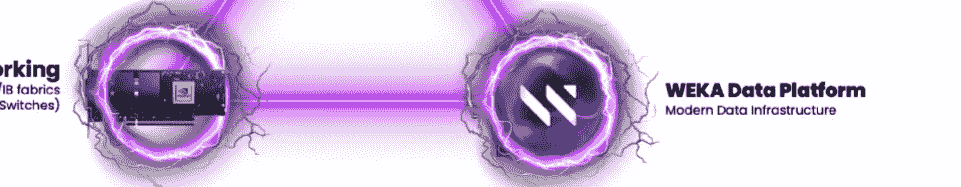

## Sierra 估值$4.5Bn

成立时间: 2023

## Cypera 估值$3Bn

具体行业: AI-ToB/SaaS

成立时间: 2021

具体行业: AI-ToB/SaaS

用 AI 改变客户的运营方式；核心是智能对话，帮助客户更自然地交互。

#### 业务简介

AI安全平台，利用先进的AI技术在安全领域，让企业发现攻击、控制、检测并修复。

#### 商业模式

to B，为行业提供 AI 平台，通过 AI 运营。

| Name | Title | Experience |
| :--- | :--- | :--- |
| Bret Taylor | 联合创始人 | 现OpenAI董事、曾SalesforceCEO、Twitter董事成员、FacebookCEO (2009年加入)、Google经理参与；毕业于斯坦福大学 |
| Yotam Segev | 联合创始人 | 曾任以色列安全局产品负责人、IDF主管、军高级工程师；毕业于伯莱大学、Talpi经理 |
| Tamar Bar-lan | 联合创始人 | 曾在IDF参与R&D、曾任Netflix架构师；毕业于伯莱大学、Talpi经理 |
| Clay Clavor | 联合创始人 | 曾在Google工作，负责产品（Gmail、Google Drive、Google Docs、Apps的设计）；AI/VR、Google Labs；毕业于斯坦福大学 |

| Date | Round | Amount | Description |
| :--- | :--- | :--- | :--- |
| 2024/10/29 | 战略融资 | 1.75亿美元 | Greenocks Capital Management |
| 2024/01/26 | A轮 | 8500万美元 | Sequoia Capital, Benchmark Capital, Conviction Partners |
| 2023/06/01 | 战略融资 | 2000万美元 | Benchmark Capital, Sequoia Capital |
| 2024/11/21 | D轮 | 3亿美元 | Coaut Management, Redpoint Ventures, Accel Capital, Sapphire Ventures Sequoia Capital |
| 2024/04/09 | C轮 | 3亿美元 | AT&T, Redpoint Ventures, Accel Capital, Sequoia Capital, Georgian Partners, Spark Capital, Coatee Management, Cyberstars |
| 2023/06/28 | B轮 | 1亿美元 | Redpoint Ventures, Accel Capital, Sequoia Capital, Cybersarts |
| 2022/03/29 | A轮 | 6000万美元 | Accel Partners, Sequoia Capital, Cybersarca, Center Partners |
| 2022/12/20 | 子轮 | 450万美元 | Cybersarts |

## Groq 估值$2.8Bn
成立时间: 2016
主要行业: AI芯片

#### 业务简介
Groq是以联芯片与计算计划的公司，致力于开发高性能的AI计算硬件，专注于推理的加速，主要应用于大语言模型(LLM)等任务，提供比GPU更快速、更高效的性能。

Celestial是美国一家人工智能加速芯片提供商，基于其特殊的Photonic Fabric技术，利用光在芯片内和芯片间实现数据重构。

#### 商业模式
- 为开发者和企业提供GroCloud™以及AI芯片构建AI应用程序。
- GroqRack™计算集群需要为自己的云或AI计算中心提供本地解决方案。
- To B，为企业提供领先的芯片设计与内存集成解决方案，满足巨大的市场需求。

#### 公司高管、技术人才
| Name | Title | Experience |
| --- | --- | --- |
| Jonathan Ross | 创始人兼CEO | 曾任Pacmid R&D及主管、软件与硬件工程师，参与并领导了Groq AI项目并参与与TPU项目，设计应用于原始芯片的核心业务，本科毕业于斯坦福大学 |
| David Lavazovsky | 创始人兼CEO | 曾任Khosla Ventures合伙人、SSG总裁、POGET Technologies董事兼主席、总裁CEO（在Nasdaq担任职），曾曾在伯克大学任教 |
| Preet Virk | 联合创始人COO | 现任斯坦福大学校董委员会委员，曾任北美华语通讯公司Intermolecular(2011年加入)首席执行官市场部门总经理COO/企业部总裁、Freescale Semiconductor通市场总裁、Constantex总部总裁，以及在Synopsys和ViewLogic Systems的项目负责人，本科毕业于工程师技术学院，MBA毕业于斯坦福硕士学院 |

#### 融资历史
| Date | Round | Amount | Investors |
| --- | --- | --- | --- |
| 2024/06/04 | D轮 | 6.4亿美元 | BlackRock, Samsung Capital, First, Cisco Investments |
| 2024/06/26 | 战略融资 | 未披露 | BlackRock |
| 2024/06/20 | 战略融资 | 未披露 | Open Capital, Seven Rivers Capital |
| 2024/01/16 | C轮 | 3亿美元 | Tiger Global, D1 Capital Partners, Adoption, Firebolt Ventures, GCM Rowe, TDK Ventures, General Global Capital, The Spruce House Partnership, XTX Ventures |
| 2020/08/14 | B轮 | 未披露 | D1 Capital Partners, TDX Ventures |
| 2018/09/05 | B轮 | 5230万美元 | Sequoia Capital |
| 2017/04/21 | A轮 | 1000万美元 | Sequoia Capital, Daniel Gross |

## Celestial 估值$1.2Bn
成立时间: 2020
主要行业: AI芯片

#### 业务简介
美国光芯片研发公司，主要从事光学连接技术的研发、应用和推广，以高效的光互连模块集成到处理器中，致力于为行业提供高效的光互连。

#### 商业模式
- To B，为数据、航空、电信等行业的客户提供高性能光/O解决方案。
- AI芯片：解决数据瓶颈，帮助优化AI模型的训练和推理。
- 云计算服务：通过光/O技术解决高带宽、极低延迟满足需求。
- 半导体公司：与Intel、HPE等合作，推动光/O技术的集成和应用。

## Ayar Lab 估值$1.2Bn
成立时间: 2015
经营领域: AI芯片

#### 融资历史
| Date | Round | Amount | Investors |
| --- | --- | --- | --- |
| 2024/12 | D轮 | 1.55亿 | Advent Global Opportunities, Light Street Capital, AMD Ventures, Intel Capital, NVIDIA, Ventures, Autopilot |
| 2023/05 | C+轮 | 2500万 | Capital TEN, VentureTech Alliance, Boardman Bay Capital Management, IAG Capital Partners, NVIDIA, Tyche Partners |
| 2022/04 | C轮 | 1.3亿 | Boardman Bay Capital Management, Hewitt Packard Enterprise, Applied Ventures LLC, Globalfounders, Intel Capital, Lockheed Martin Ventures, Agile SPV, Spectre, Capital, Frontier Fund, IAC Capital Partners, Infimum Capital, Tyche Partners |
| 2022/02 | 股权投资 | 未披露 | Hewlett Packard Pathfinder |
| 2020/11 | B轮 | 3500万 | Downing Ventures, BlueSky Capital, Castor Ventures, SGinnovate, Founders Fund, GLOBALFOUNDRIES, Intel Capital, Lockheed Martin Ventures, Playground Ground |
| 2018/11 | A轮 | 2400万 | Founders Fund, GlobalFoundries, Intel Capital, Playground Ground |
| 2016/08 | 子轮 | 2500万 | Founders Fund, The House, TechU Ventures, Silicon Catyst |

## Skid AI 估值$1.5Bn
成立时间: 2023
具体类型: AI机器人

#### 业务简介
人形机器人操作系统，推出了Skid Brain（基础模型）、移动操作平台（能够调用应用程序）、安全机器人专注于视觉导航、数据收集和强化学习，用于工业场景完成许多任务。

#### 商业模式
- To B/C，目标是那些面临劳动力短缺的行业，包括建筑、医疗、零售以及家用市场。

#### 核心人才
| Name | Title | Experience |
| --- | --- | --- |
| Abhin Gupta | 创业兼CEO | 现任卡内基大学（CMU）机器人系教授，曾任机器人经理和负责人，在斯坦福大学创立研究小组，本科获得教育硕士，博士于马里兰大学 |
| Deepak Pathak | 创业兼创始人 | 现任卡内基大学助理教授；曾任Facebook AI研究员，VisageMap（后被First收购），在机器人担任实习生；本科攻读工程硕士，博士于加州帕洛矶分校 |

#### 融资历史
| Date | Round | Amount | Investors |
| --- | --- | --- | --- |
| 2024/07/09 | A轮 | 3亿美元 | Lightspeed Venture Partners, Coature, Jeff Bezos, Founders, Sequoia Capital, Menlo Ventures, General Capital, CRV, Amazon Angel, CMU |

## Physical Intelligence 估值$2.4Bn
成立时间: 2024
类型: AI机器人

## Figure AI 估值$2.6Bn
成立时间: 2022
具体行业: AI机器人

#### 业务简介
研发人形机器人，致力于开发能够在不同环境中处理各种任务的通用人形机器人，从仓储到零售领域均可以使用。

#### 商业模式
ToB，通过开发自主人形机器人，为制造、物流、仓储和零售等行业提供灵活的解决方案。

| Name | Title | Experience |
| --- | --- | --- |
| Brett Adcock | 创始人兼CEO | 从中学期间开始创业，曾创立VTOL公司（纽交所上市）、监控的安全价格公司，在控股平台Vetter（后被Adecco收购）获得1.1亿美元的融资），本科毕业于斯坦福大学 |

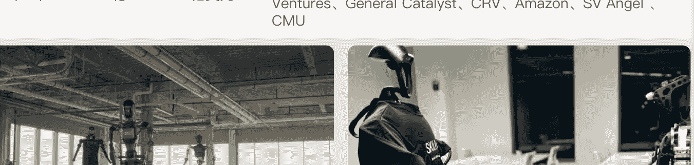
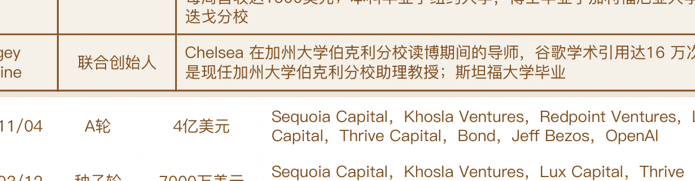

## Create Music Group

## Global Music Rights
成立时间: 2015
具体行业：垂直ToB/SaaS
估值: $1Bn

#### 商业模式
#### 业务简介
唱片版权公司、集团唱片、发行公司和音乐娱乐网络。与音乐人、主流及独立唱片公司、全球音乐品牌合作，同时运营多个公司，包括Label Engine（全球独立唱片发行平台，拥有7.5万音乐人和600万独立客户）以及Flighthouse（专注注册代理的歌手版权，在音乐平台上拥有超过30个平台）。

从音乐版权管理，为音乐版权（如著作权、词曲等）管理和保护作品版权。

为音乐人创造价值。发行、同步授权、数字版版权管理、ASR和版权以及录制服务。每月在各大流平台（DSP）上创造超过150亿歌曲播放量，2020年被美国最快业务公司Inc第5000名。

为音乐作者和版权提供者管理服务，包括授权和收集版权的使用费用。通过商业/行业经纪公司（如电视、电影、晚会、流媒体平台）等许可授权，授权音乐作品，从中收取费用，包括Bill Eilish、George Michael、Brandon Flowers等Adam Taylor等。

#### 团队
| Name | Experience | 公司类型 |
| --- | --- | --- |
| Jonathan Strauss | 创建Edit Builder的创始人（作为后期经理和签约经纪公司提供成功构成的决策解决方案。客户包括Paramour Pictures, Bad Robot, Dreamwalks等）；本科毕业于UCLA | |
| Alexander Williams | 联合创始人 COO | 曾任Label Engine内容负责人，曾在Lersen Mastering实习；本科毕业于洛杉矶州大学明根分校 | |
| Randy Grimmett | 联合创始人 CEO | 曾任世界领先的艺术家利益组织ASASCAP执行董事。在扩大市场份额，“Create Music”扩展为美国亚洲音乐版权行业上发挥了重要的作用；本人毕业于哈格姆斯大学 | |
| Wayne Hampton | 联合创始人 CEO | 曾任版权&R/音乐公司经理，曾加入过HiCo Music Publishing、Island Def Jam、环球音乐（UMG）、华纳、索尼比BMG公司；曾管理和向粉丝艺人、Young Chop、Lee Reese、Lil Duke、Chief Keefe、Sean Garrett等艺人，还是洛杉矶Harold's Chicken连锁的许可版权公司 | |

2024/06/25 次不明
1.65美元 Flexpoint Road, Charles Goldocks
2024/09 股权投资
未披露
Hellman & Friedman

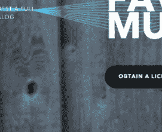

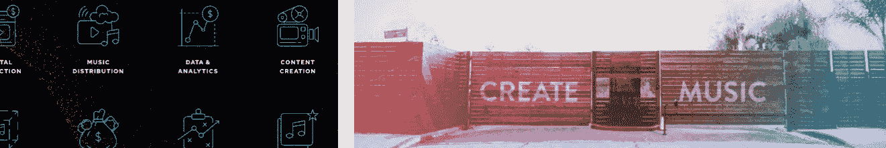

## Altruist 估值$1.6Bn
成立时间：2018

## Enable 估值$1.1Bn
企业行业：垂类ToB/SaaS
主要业务：向投资经理（RIA）的客户管理及投资组合管理平台。

#### 业务简介
为B2B企业提供智能化工具和解决方案，涵盖垂直领域、特定行业（SPA）等交易流程。

#### 商业模式
ToB，提供投资咨询服务的集成性经纪平台，为投资服务提供免去交易、零售股份、几分钟内在线开账户功能，并以核心服务与本地投资组合会计软件之一。

ToB，通过驱动的分析工具和数据平台，帮助企业实现业务策略、提升效率、加速资金流转，并优化复杂的合同管理与合作伙伴关系，从而实现高效运营和业务增长。

| Name | Title | Experience | 金融背景 |
| --- | --- | --- | --- |
| Jason Wenk | 创始人CEO | 现任MatterScale Ventures风险创始人及Endeavor Great Lakes董事会成员、现任Morgan Stanley分析，也是Retirement Wealth创始人CEO（财富公司）、后Backstone Management、Folios创始人CEO（转型公司），截至2018年估值3亿美元 |

| Name | Title | Experience |
| --- | --- | --- |
| Andrew Butt | 创始人CEO | 曾任DCS Group (UK)联合创始人电子商务总监 |
| David Hunt | 联合创始人CEO | 曾任DCS Group (UK)联合创始人电子商务总监、出生于英国 |
| 2024/05/02 | E轮 | 1.69亿美元 | ICONIQ Growth, Granite Capital, Sound Ventures |
| 2023/04/12 | D轮 | 1.12亿美元 | Insight Partners, 投资 |
| 2021/11/01 | C轮 | 1.1亿美元 | Insight Partners, Venrock, Vanguard |
| 2021/05/19 | B轮 | 5000万美元 | Insight Partners, Venrock |
| 2021/01/11 | 战略投资 | 未披露 | Venrock, Ron Carson, McNabb |
| 2023/11/07 | D轮 | 1.2亿美元 | Lightspeed Ventures, Menlo Ventures, Norwest |
| 2022/10/18 | C轮 | 9400万美元 | Insight Partners, Lightspeed Ventures, PSP Growth, HarbourWest |
| 2021/08/18 | B轮 | 4500万美元 | Lightspeed Ventures, Menlo Ventures, Sierra Ventures |
| 2020/04/04 | A轮 | 1300万美元 | Menlo Ventures, Sierra Ventures, Castor Ventures, Inclusive Ventures |
| 2019/10 | 战略投资 | 2400万美元 | Barclays |

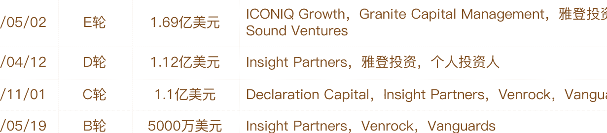
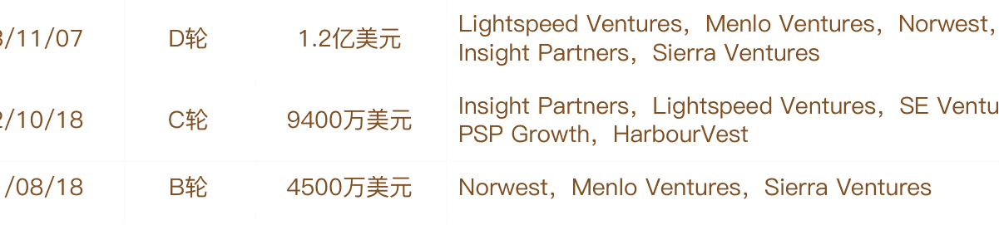

## Züm 估值:1.3Bn

## Altana Technologies 估值:1Bn
成立时间: 2014
业务领域: 类ToB/SaaS

#### 业务简介
学生上下接交通服务，为了一个安全可靠的接送队伍，依靠家长和学校安排学生的流动、接送和活动功能，提供服务。AI驱动的全球供应链平台，能够连接企业上下游的数据链（包括传输、存储等）进行整合分析，预见可能的颠覆和风险。

#### 商业模式
To B，面向市场和校区，提供领先的学生上下接解决方案，包括本地化车辆（电动汽车）、优化路线的技术和实时调度功能；直接连接家长和学生，通过方便的应用程序提供实时调度功能，让家长了解学生的位置和车辆到行业，价格标准根据用户的使用量进行灵活调整，提供定制化的解决方案；主要面向企业、金融服务以及政府部门，合作客户包括美国政府、LLB、Boston Scientific、英国政府等。

| Name | Experience |
| --- | --- | --- |
| Ritu Narayan | 创业创始人 | 曾任Tech创始人、eBay集团投资经理。Yahoo!产品经理、Oracle产品经理，以及斯坦福商学院博士还是斯坦福商学院硕士学位（Sloan）；本科毕业于斯坦福大学，硕士毕业于纽约斯坦福大学 |
| 2024/01/31 | E轮 | 1.4亿美元 | Sequoia Capital, Softbank Vision Fund, GIC, Climate Investment, Aerospace Ventures |
| 2021/10/06 | D轮 | 1.3亿美元 | Sequoia Capital, BMWI Ventures |
| 2019/09/28 | C轮 | 4000万美元 | BMWI i Ventures, Sequoia Capital, Spark Capital, Volvo Cars Tech Fund |
| 2018/03/14 | B轮 | 1900万美元 | Spark Capital, AngelPad, Sequoia Capital |
| 2017/08/29 | A轮 | 550万美元 | AngelPad, Sequoia Capital |
| 2016/02/10 | 种子轮 | 230万美元 | AngelPad, TEEC Investment Fund, Lulu Ventures, Sand Hill Angel, Greylock Ventures, Founders Ventures |

#### 连续创业者、公司背景
| Name | Experience |
| --- | --- |
| Evan Smith | 联合创始人 | 曾是Versno系统公司（作为可再生能源核心技术和服务的公司）、Full Smith合伙人、管理经验；本科毕业于耶鲁大学 |
| Raphael Tehranian | 联合创始人COO | 在统一的范围内负责公司运营，Lehman Brothers与业务发展、J.P. Morgan顾问、Suncore能源部门；本科毕业于耶鲁大学 |
| Peter Schwartz | 联合创始人首席科学家 | 曾任Panij数据负责人；本科毕业于耶鲁大学，加州理工学院和MIT双学位 |
| 2024/07/29 | C轮 | 2亿美元 | Innovation Technology, March Capital, Salesforce, GV (Google Ventures), Activate Capital |
| 2022/10/07 | B轮 | 1亿美元 | OMERS Ventures, Prologis Ventures, More Capital, GV (Google Ventures), Floating Point |
| 2021/09/20 | A轮 | 1500万美元 | GV (Google Ventures), Floating Point, Ridgeline Partners, American |
| 2020/11/24 | 种子轮 | 700万美元 | Amadeus Partners, Schematic Ventures, Working Capital |

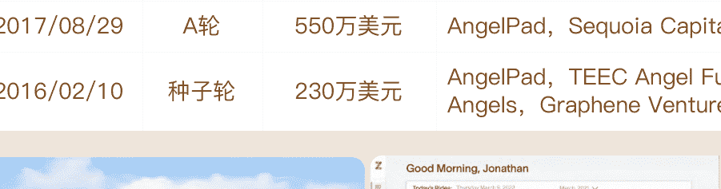

## Huntress 估值$1.6Bn
成立时间: 2015
具体行业: ToB/SaaS

#### 业务简介
一家专注于网络安全的公司，致力于“IT部门”和托管服务，提供常规漏洞扫描、发现及分析威胁情报、生成报告等。连接企业与全球安全人员，帮助企业优先处理攻击中最关键风险。漏洞计划（Bug Bounty）、渗透测试（Pen Testing）以及持续测试。

#### 商业模式
To B，通过网络安全平台，为企业的漏洞发现和管理。

## Bugcrowd 估值$1Bn
成立时间: 2012
具体行业: ToB/SaaS

| Name | Title | Experience | 公司背景 |
| --- | --- | --- | --- |
| Kyle Hansloan | 联合创始人 CEO | 曾任StrikeStrategy创始人、曾任美国陆军网络经理，此外还是CertTIA网络顾问主席，曾获得世界大奖（DEF CON）；毕业于耶鲁大学法学院 |
| Chris Bisnett | 联合创始人 CEO | 曾在美国海军安全情报专家和网络分析师，并在国家安全软件工程师中包括Genesis LLC、Raytheon Applied Signal 和 ManTech，Legalform.com CTO，毕业于马来西亚科学馆 |
| 2024/06/18 | D | 1.5亿美元 | Kleiner Perkins, Martin Capital, Sapphire Ventures |
| 2023/05/16 | C | 6000万美元 | Sapphire Ventures, Forgepoint Capital, JMI Equity |
| 2022/09/07 | 债权融资 | 4000万美元 | CIBC Innovation Banking |
| 2021/05/06 | B | 4000万美元 | JMI Equity, Forgepoint Capital, Gula Tech Ventures |
| 2020/02/18 | A | 1800万美元 | Forgepoint Capital |
| 2019/10/10 | 天使轮 | 1000万美元 | Blue Venture Ventures, Stonehill Ventures, SaaS Ventures, Kathryn Stewart |
| 2017/07/01 | 种子轮 | 76万美元 | Blue Venture Ventures, SaaS Ventures, Kathryn Stewart, 原, Gula Tech, Broad Street Advisors |
| 2024/07/12 | E | 1.2亿美元 | General Catalyst, Rally Ventures, Costanoa Ventures |
| 2020/04/09 | D | 3000万美元 | Rally Ventures, Salesforce |
| 2018/08/01 | C | 2600万美元 | Triple Peak Ventures, Salesforce Ventures, Blackbird Ventures, Costanoa Ventures, Indigo Capital Group, Rally Ventures, Homestead, First Step Up |
| 2016/04/20 | B | 1500万美元 | Blackbird Ventures, Rally Ventures, Costanoa Venture Capital |
| 2015/03/13 | A | 600万美元 | Costanoa Ventures, Rally Ventures, Paypal Group, Blackbird Ventures |
| 2013/09/04 | 天签轮 | 160万美元 | StartMate, Square Peg Capital, Rally Ventures, Partech Ventures, Aladdin Capital Group |
| 2013/03/04 | 种子轮 | 5万美元 | Blackbird Ventures |

| Casey Ellis | 联合创始人 | 曾创立Bugcrowd担任执行总裁CEO/CTO、2024年初、曾任RedEye总监、Tally Poppy Group负责人，还曾负责过渗透测试（Pen Testing）、disclose（漏洞防护系统的专家）、曾担任UpGuard SaaS、Crowd Corporation International，Network IT经理，曾创立White Label Security | Bugcrowd.com,NTT Security Corporation,LogicHub亚洲运营负责人、全球安全销售总监及副总裁总监（美）、Sumitomo 日本出口安全销售及区域经理、Jerweep Group Ventures、Veracode销售经理、本科学毕业于马来西亚大学科学馆 |

## Halcyon 估值$1Bn

成立时间：2021

具体行业：ToB/SaaS-网络安全

| 类别 | 描述 |
| :--- | :--- |
| 业务简介 | 网络安全技术开发，保护企业客户免受恶意软件或威胁的平台 |
| 商业模式 | To B，为企业提供对抗攻击/勒索威胁的平台，减少数据丢失、设备维护和品牌风险。合作伙伴包括Dellpoint, OPTIV, Direct Defense, Crowdstrike等。 |

## Chainguard 估值$1.1Bn

成立时间：2021

具体行业：ToB/SaaS-网络安全

| 类别 | 描述 |
| :--- | :--- |
| 业务简介 | 软件供应链安全服务，将优先级标准应用于安全，使软件生命周期自动化安全，帮助组织构建和治理其内部软件供应链安全。 |
| 商业模式 | 客户在云端、优化的容器基础的基础上构建安全的应用程序，防止供应链和攻击；合作企业包括Cera, snowflake, GitLab, GitHub, Technologies, Truststore等。 |

| Name | Title | Experience | 公司高 |
| :--- | :--- | :--- | :--- |
| Jon Miller | 联合创始人CEO | 曾任IBM管理咨询顾问、Accuant VP、Cyance RO（现担任委员会成员，公司被BlackBerry收购）、创始人兼CEO（现任董事会成员） | |
| Ryan Smith | 联合创始人CEO | Hustle 负责人，曾任Accuant R&D VP/科学负责人、Exodus Technology Intelligence、Cyance研发&同步委员会成员 | |
| 2024/11/26 | C轮 | 1亿美元 | Basin Capital, Evolution Equity Partners, Corner Capital, 和鸿湾汽车、ServiceNow Ventures, Drobox Ventures, SYN Ventures | |
| 2024/07/31 | 战略轮 | 未披露 | Cisco Investments | |
| 2023/12/20 | B轮 | 4000万美元 | Basin Capital | |
| 2023/05/15 | A轮 | 5000万美元 | Corner Ventures, SYN Ventures, Dell Technologies Capital | |

| Name | Title | Experience | 公司高 |
| :--- | :--- | :--- | :--- |
| Dan Laurence | 创始人兼CEO | 曾任Microsoft软件开发工程师及DISQ、Google软件工程师，在Excel Engineering、Intl担任软件工程师及软件开发发生；其业务始于MIT | |
| Kim Lewandowski | 联合创始人CEO | 曾任National High Military Field Laboratory、Lawrence National Laboratory及顶级软件工程师，曾任EBR+Co&产品工程师，负责人，Digital Foundation董事会成员，在工作了7年后离开德州州立大学 | |
| Matt Moore | 联合创始人CEO | 曾任Microsoft软件开发工程师及jQuery。Uber业务技术负责人、VMware工程师；其本科毕业于北京大学 | |
| Ville Aikas | 联合创始人 | 曾任软件架构工程师、华盛大学工程师、Google软件工程师、VMware研发工程师；其职业始于华中理工大学 | |
| 2024/07/25 | C轮 | 1.4亿美元 | Redundant Ventures, Lightspeed Ventures, IPV、Sequoia Capital, Spark Capital, Market Tis | |
| 2023/11/02 | B轮 | 6000万美元 | Amplify Partners, Sequoia Capital, Spark Capital, Banana Capital, Mantis VC | |
| 2022/06/06 | A轮 | 5000万美元 | Sequoia Capital, LiveOak Ventures Amplifier, Amplifiers, Banana Capital, K5/JPMC | |

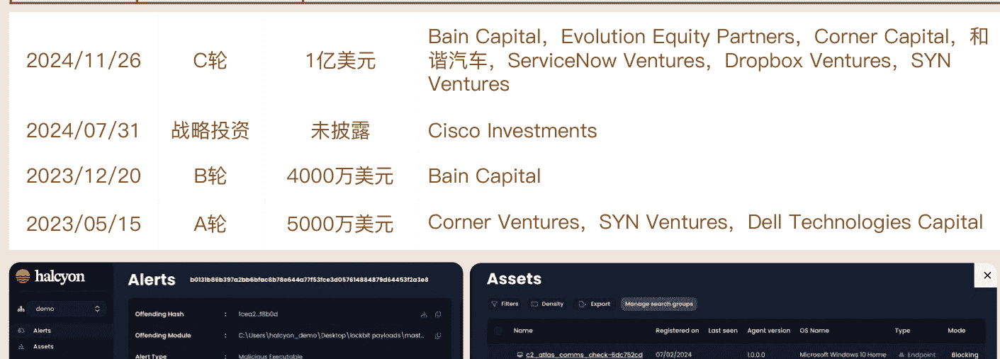

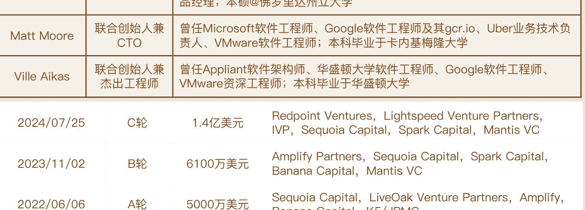

## Eon 估值$1.4Bn

成立时间：2024
具体行业：ToB/SaaS-云服务

业务简介
针对企业的数据管理工具，能够将不同平台和数据库中的数据整合在一起，并提供备份。

商业模式
采用订阅模式，用户能够在使用Eon时恢复和找到存在任何平台上的文档，并使用SQL对数据库进行查询。

连续创业者、金融军事家、政府平台

| Name | Title |
| --- | --- |
| Oehr Rlich | 联合创始人 CEO | 天使工程师，投资人，曾创立多个B2B科技创业公司，任Google Ventures技术委员会主席、8200 Alumni成员、曾任Simbolik软件工程师、以色列列军事战略研究监、Digican联合创始人（共获800万美元）、AcceloWeb联合创始人R&D VP、Limelight网络工程师（AWS收购）、Limelight Web Technologies发展主管、CloudEngine联合创始人（AWS创始者）、AWS认证及恢复部门工程师 |
| Genen Stein | 联合创始人 CTO | 曾任IT软件工程师总监、SafFirst销售工程师总监、Wave Systems销售总监、CTERA Networks技术销售总监、CloudEngine曾负责业务发展、AWS认证及恢复部门负责人 |
| Ron Kimchi | 联合创始人 CTO | 曾任Algotest R&D总经理，本科毕业于特拉维大学 |

| Date | Round | Amount |
| --- | --- | --- |
| 2024/11/27 | C轮 | 7000万美元 | Greenoaks Management, Lightspeed Partners, Sequoia Capital, Bond Capital |
| 2024/10/02 | B轮 | 7700万美元 | Greenoaks Management, Quiet Ventures |
| 2024/09/01 | A轮 | 3000万美元 | Lightspeed Partners, Sheva Capital |
| 2024/01/01 | 种子轮 | 2000万美元 | Sequoia Capital, Vine Ventures |

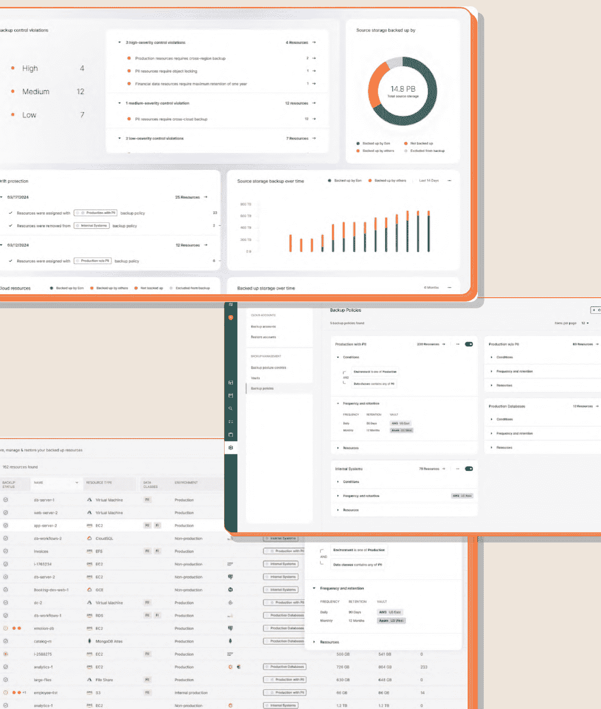

## ToC应用类创企业

## Flex 估值$1.9Bn

成立时间：2019
具体行业：Fintech

## Aven

成立时间：2019
具体行业：Fintech

业务简介
提供房屋按金支付解决方案。

业务简介
由房屋净值支付的消费者，业内为拥有房屋净值的客户提供信用，最低利率，最高额度和活性。

商业模式
to C，让租户可以分期支付；用户通过方式支付，金额将转换为账户。

商业模式
Aven和通用信用卡作为日常使用，并获得无限制的现金返现；每年注册或按月费，达到最低额度，需支付2.5%的手续费。

| Name | Title | Experience |
| --- | --- | --- |
| Lichtenstein | 联合创始人CEO | 曾任投资人、Boundless联合创始人；毕业于哈佛大学 |
| YeTong Shao | 联合创始人 | 在BlackRock, Trequant Investment做量化分析，曾任投资人、Boundless联合创始人；毕业于加州大学 |
| 2024/01/31 | D轮 | 2亿美元 | 未披露 |
| 2019/11/01 | 种子轮 | 300万美元 | Matrix, Coutobre, camber Credit |
| 2019/07/24 | Pre-Seed | 550万美元 | Restive, Ludere Ventures |

| Name | Title | Experience |
| --- | --- | --- |
| Sadi Khan | 联合创始人 | 是微软工程师/程序经理，The Thiel Foundation顾问、Facebook产品总经理，还是HAAS的创始人；毕业于南加大学 |
| Murtada Shah | 联合创始人 | 是Serene Technologies创始人，ETA Holdings联合创始人；毕业于耶鲁大学 |
| Collin Wikman | 联合创始人设计负责人 | 是Colin Wikman, Involver,Square设计师，曾为RemindHQ设计、Square设计；毕业于加州斯坦福 |
| 2024/07/17 | D轮 | 1.42亿美元 | Khosha Ventures, General Catalyst Partners, Caffeinated Capital, Electric Capital, Founders |
| 2023/05/31 | C轮 | 百千万 | Caffeinated Capital, Electric Capital, Sci VC |
| 2020/11/20 | B轮 | 百千万 | Founders Fund, Electric Capital, NY Partners, The General Partnership |
| 2019/10/17 | A轮 | 百千万 | SV Capital |
| 2019/07/25 | 天使轮 | 百千万 | Four Cities Capital |

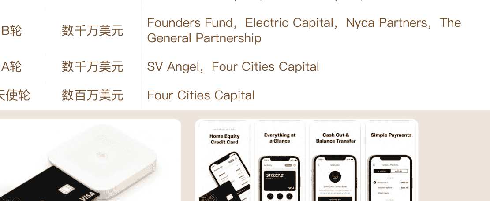

## Octane 估值1.1Bn

## Blink Health 估值$1.3Bn

成立时间：2014
行业领域：Fintech
行业领域：ToC-TMT

业务简介
美国信贷服务供应商，提供汽车和摩托车贷款，主要为用户提供自助保险、资信审核等服务。 (注：此处内容似乎混入信贷描述)

| Name | Title | Experience | Background |
| --- | --- | --- | --- |
| Jason Guss | 创始人 CEO | Nexu Story，兼任Raven Ridge Capital合伙人，曾兼任Cital One策略负责人，曾担任Peter，曾在New Amsterdam担任股权投资实习，毕业于哥福大学 | 年轻创始人、金融背景 |
| 2024/08/06 | E | 5000万美元 | Valar Ventures, Upper |
| 2021/08/05 | D | 5200万美元 | Gaingels, Cit Ventures, Valar Ventures, Trajectory Ventures, Waters, Progressive |
| 2019/11/04 | C | 7030万美元 | Valar Ventures, Contour Partners |
| 2018/05/14 | B | 4080万美元 | Cit Ventures, Contour Partners |
| 2019/06/30 | A | 6700万美元 | Berenson & Company, Contour Partners |
| 2014/12/04 | 种子 | 140万美元 | Dreamit Ventures, Sequoia Capital |

| Name | Title | Experience | Background |
| --- | --- | --- | --- |
| Geoffrey Chaiken | 联合创始人 CEO | 曾担任Brave Advisors专项负责人、Alvarez & Marsi创立人，曾担任Harvard Medical执行总裁，MBA毕业于哈佛学院 | |
| 2024/11/16 | D | 1.42亿美元 | Cardano Management, 8VC, Sweetwater Capital | |
| 2020/10/27 | 融资 | 1000万美元 | Suro Capital, The K, Sweetwater Capital | |
| 2017/04/12 | B | 9000万美元 | 8VC, Byte Creative | |
| 2016/06/12 | A | 7500万美元 | 8VC, LeFrak | |

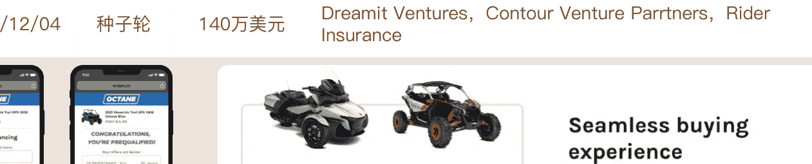

## Rentberry 估值$1Bn

## HomeLight 估值$1.7Bn

成立时间：2012
具体行业：ToC运营-TMT

业务领域：数字化租房平台，为房东和租户提供全链路服务，透明和自动化的租赁服务。

业务领域：帮助房主寻找当地的房产代理，将房屋以最快速度和最高价格租出去。

商业模式：利用AI优化了租赁流程，租户可线上与房东畅，目前有租赁基金；地区包括纽约、LA、芝加哥、奥克兰、柏林、首尔、亚洲等。

商业模式：面向买家和家中中介，平台收集用户信息并对接需求；现有100万用户、3万+中。

| Name | Title | Experience |
| --- | --- | --- |
| Oleksiy Lubinsky | 创始人 CEO | 曾任Gold Sachs财务分析、Sevens First Capital、Deloitte锡投银行、Raiffeisen Bank International Associate Director、BIC Securities Director，2015年上市；他本科毕业于加利福尼亚大学伯克利 |
| Lily Ostapachuk | CPO | 曾任Gallillow房地产经纪市场总监、CityHub IPO；毕业于乌克兰基辅国立大学 |
| 2024/09/06 | A轮 | 9000万美元 | GTM Capital, Berkeley Hills Capital | |
| 2022/10/17 | A轮 | 1500万美元 | StartEngine | |
| 2021/12/29 | A轮 | 540万美元 | StartEngine | |
| 2017/10/03 | 种子轮 | Zing Capital, 808 Ventures, Beachwood Ventures, JadeValue, Andrew Barlow | |
| 2016/07 | 种子轮 | 120万美元 | 未披露 | |
| 2015/10/20 | 种子轮 | 84.5万美元 | The Carlyle, Synergo Capital, IFC, Pegasus Advisors, Advisors Capital Partners | |

| Name | Title | Experience |
| --- | --- | --- |
| Drew Uher | 创始人 CEO | 天使投资、曾为Q Investments投资分析、Morgan Stanley、PubMatic Media、曾创立Gameworks（Flash游戏的分销和货币化平台，由UbFund）；他本科毕业于斯坦福A&M，MBA毕业于斯坦福大学 | |
| 2024/08/27 | D轮 | 2000万美元 | Zeev Ventures, Menlo Ventures, Stereo Capital | |
| 2022/06/17 | D轮 | 1.15亿美元 | Zeev Ventures | |
| 2021/09/02 | 战略轮 | 3.63亿美元 | Zeev Ventures, Group 11, Menlo Ventures, STCAP, Lydia Jellic |
| 2019/11/06 | C轮 | 1.09亿美元 | Zeev Ventures, Group 11, Crosslink Capital, Menlo Ventures, Stereo Capital |
| 2017/08/16 | B轮 | 4000万美元 | Menlo Ventures, Citi Ventures | |

Negotiate Your Rent and
Apply Online
Virtual Tour Available

Virtual Tour Is
t New Normal

eSign Papers
From Home

## Flip

成立时间：2019
具体行业：ToC应用–TMT

#### 业务简介

社交媒体电商。
To C，用户可以通过查看真实用产品的视频，分享购物体验获取奖励，同时购买自己喜欢的品牌商品，平台还支持所有用户成为创作者，通过内容互动和销售分成收益，无需传统的抽佣力基础。

#### 商业模式

| Name | Title | Experience |
| --- | --- | --- |
| Noor Agha | 创始人兼CEO | 曾任El 社交创始人兼CEO（中东地区，Facebook粉丝量1M），Elephanation创始人兼主席，以及Baker Hughes高级现场工程师；本科毕业于萨洛州美国大学 |
| 2024/04/02 | C轮 | 1.44亿美元，Streamlined Ventures, Mubadala Capital Ventures, WestCap, AppLovin |
| 2022/06/19 | B轮 | 6000万美元，WestCap, Mubadala Capital Ventures, Streamlined Ventures |
| 2021/08/30 | A轮 | 2800万美元，Streamlined Ventures, BDOMI, Human Capital, Mubadala Capital Ventures, Rudy Lu |
| 2019/10/23 | 种子轮 | 375万美元，TLV Partners, Lool Ventures |

### 连续创业者

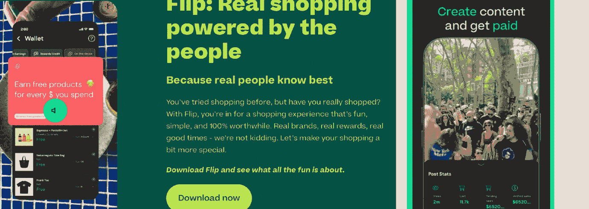

## 硬科技类初创企业

## 24M Technologies
估值$1.3Bn

成立时间: 2010
具体行业：硬科技-清洁能源

技术人才

#### 业务领域
半固态电池研发，专注于锂离子电池的研发和生产。

#### 商业模式
我们为开发并销售电池，应用于电动汽车、eVTOL、消费电子产品中；
2024年推出新型固态电池-24M Imperium(TM)，锂锰硅极底可通过控制防止电池发生短路，从上进一步提升电池安全性；客户包括Kyocera, GPSC, Aisin, Itochu, Fujitsu

| 日期 | 轮次 | 金额 | 机构 |
|---|---|---|---|
| 2024/09/05 | A轮 | 800万美元 | Asahi Case, MOL PLUS, Lucas TVS, Dai Nippon, 日本，京都, Nuvo+ |
| 2022/09/14 | 战略投资 | 2000万美元 | Fujifilm |
| 2022/01/18 | F轮 | 未披露 | 大众汽车集团 |
| 2021/05/21 | E轮 | 5680万美元 | 伊藤忠, North Bridge Venture Partners, Global Power Synergy, Kyocera, Mirai Creation Fund, Growth Equity, Fujifilm |
| 2018/12/20 | D轮 | 2180万美元 | 伊藤忠, North Bridge Venture Partners, Kyocera Corporation |
| 2016/05/13 | C轮 | 1380万美元 | Shumway Capital, GPSC |
| 2014/04/06 | B+轮 | 1500万美元 | PTT |
| 2013/06/03 | B轮 | 2500万美元 | 未披露 |
| 2010/08/16 | A轮 | 1600万美元 | CRV., North Bridge Venture Partners, US Department of Energy |

| Name | Title | Experience |
|---|---|---|
| Yet-Ming Chiang | 联合创始人兼首席科学家 | AMSC, A123 Systems (3D打印锂离子电池开发，斯纳克上市), Desktop Method (3D打印系统开发，京交易所上市),联合公司, Form Energy (储能开发和制造，融资4500万美元), 联合创始人兼首席科学家，2009年进入美国国际工程学院, Sublime Systems (开发新型水凝材料),任MIT教授，研究集中在先进材料及其在能源技术中的作用上，发表了300多篇论文，拥有100多项专利，华盛顿大学 |
| Throop Wilder | 执行董事 (曾创始人兼CEO) | 现任Quadratic 3D首席执行官;曾任American International Corp.(被收购SystemsCEO), Crossbeam Systems联合创始人 |
| Naoki Ota | 首席董事 (首席COO) | 现任Nagease项目经理、Qualcom与Hitachi Research Center高级经理。EnerDel曾首席CEO(汽车应用锂离子电池，可再生军事及海军航空储能制造),Ener1 COO&CTO(纳斯达上市);本科毕业于大阪府大学 |

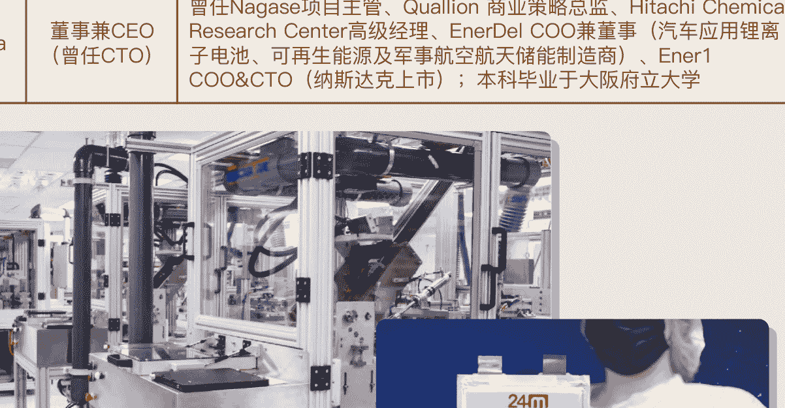

## Twelve 估值$1Bn

成立时间: 2015
具体行业: 硬科技- 清洁能源

## Nexampt 估值$1.5Bn

成立时间: 2007
具体行业: 硬科技- 清洁能源

#### 业务简介

碳化公司，通过技术将二氧化碳碳化为燃料的关键化学品、材料和燃料来降低排放，推出了产品Jet-SAF，一种由生物质和再生能源制造的可持续燃料。美国一家清洁能源提供商，从设计、建造和运营分布式储能和解决方案，该业务涵盖整个项目周期，包括投资、项目开发、设计、运营和维护，帮助企业降低成本，实现可持续发展目标：让用户无需安装设备即可每年节省10%-15%电费。

#### 商业模式

To B, Jet-SAF与传统航空燃料竞争，生产过程中排放降低90%，需要1000倍的水和土地，符合ASTM标准；合作伙伴包括Jet, Alaska Airlines等。

To B – 提供储能、光伏充电站，通过先进技术独立储能解决方案，帮助企业降低成本，实现可持续发展。

| Name | Title | Experience | 金融背景 |
|---|---|---|---|
| Nicholas Flanders | 联合创始人 CEO | 曾为高盛投资分析师、Level CEO & COO（工作/线下社区）,本科毕业于罗伦大学，硕士毕业于新福大学 |
| Etosha Cave | 联合创始人 CSO | 现任National Renewable Energy董事兼顾问，曾在高盛工程师；本科毕业于富兰、东林学院，硕士毕业于布鲁克大学 |
| 2024/09/20 | C轮 | 6亿美元 | Capricorn Investment Group, Fundamental Labs, Pulse Fund, TPG Rise |
| 2024/04/10 | 未披露 | 5亿美元 | Manila Investment Management, Diamond Generating Corporation |
| 2022/07/01 | B轮 | 3亿美元 | Carbon Direct Management, Capricorn Direct Capital, Breakout Ventures, Evo Innovations |

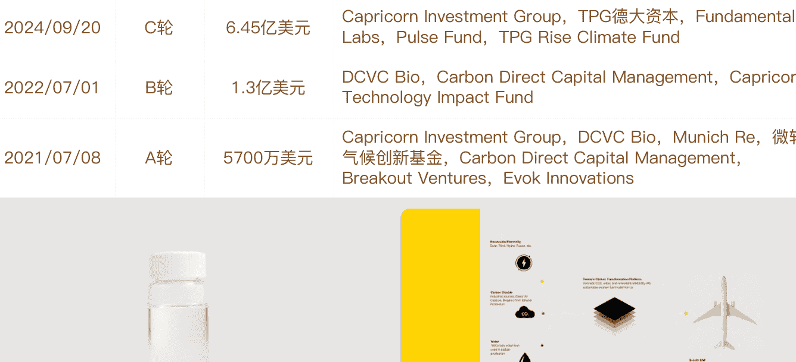
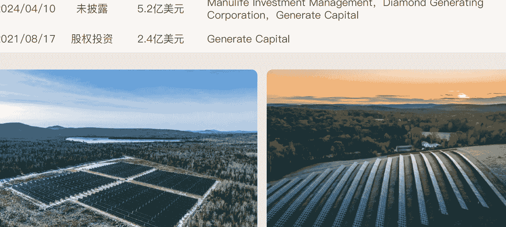

## Zap Energy 估值$1Bn

成立时间：2017
具体行业：硬科技-清洁能源

Soros Fund Management LLC, BAM Elevate, Emerson Collection, Leitmotif, Financial Group, Lyynth Energy, Xplor Ventures, Addition, Breakthrough Energy Ventures, Chevron Technology Ventures, Energy Impact Partners, Lowercarbon Capital, Shell Ventures

2024/10/09 | D轮 | 3亿美元

#### 业务领域

聚变电力服务，主要从事聚变技术的研究、应用和推广，并建立一个聚变反应能够，使用剪切场来稳定等离子，通过驱动电流产生聚变场，并限制等离子，致力于为用户提供能量管理解决方案。Lowercarbon Capital, Breakthrough Energy Ventures, Shell Ventures, Value Equity Partners, Addition, Energy Impact Partners, Chevron Technology Ventures

2022/06/27 | C轮 | 1.6亿美元

#### 商业模式

通过Zap装置开发Zap工厂，并成为商业发电厂，可以提供小、高效的廉价能源，无需巨大设施、超导磁体或高功率激光。Addition, Energy Impact Partners, Chevron Technology Ventures, Lowercarbon Capital, GA Capital, Fourth Realm

2021/05/19 | B轮 | 2750万美元

2020/07/12 | A轮 | 650万美元 未披露

| Name | Title | Experience |
|---|---|---|
| Benjamin Conway | 联合创始人兼首席官 | 在英国外交和贸易部长期职业生涯，重心在亚洲和中东，政府部门领导并创立了新市场和技术领域的业务，包括私募公司In Frontier；毕业于剑桥大学与斯坦福大学与牛津大学 |
| Brian A. Nelson | 联合创始人兼CTO | 2019年成为威斯康星大学能源教授，研究了串磁&对称磁场等多个聚变实验，也曾在华盛大学多个实验负责人；本人毕业于华盛大学，毕业于威斯康星大学 |
| Uri Shumlak | 联合创始人兼科学家 | 现任密歇根大学、UWF Flow F-Pinch研究项目以及UIUC计算等离子物理实验室的首席研究员，美国物理学家学会；在1994年加入斯坦福大学之前，曾在哥特兰军事基地的空军菲利普斯实验室工作，是世界上著名的理论、计算和实验等离子物理学家；也是Zplasma联合创始人兼科学家、董事；本科毕业于得克大学，博士毕业于德州大学奥拉斯分校 |

## Fervo Energy 估值$1.4Bn

成立时间：2017
具体行业：硬科技-清洁能源
技术人才：年轻精英

| Name | Title | Experience |
| --- | --- | --- |
| Tim Lamer | 联合创始人兼CEO | 曾任BHP工程师、Data咨询、Clean Energy Leadership Institute、Activate Fellow，曾在Ford做过实习，毕业于耶鲁大学，MBA毕业于斯坦福大学 |
| Jack Norbeck | 联合创始人兼CTO | 现任Berkeley Lab成员、曾任Calpine地热储备工程师、美国国家实验室地质学家、后研究员；毕业于罗多大学，硕士毕业于罗多大学，博士毕业于斯坦福大学 |

#### 业务简介

地热项目开发，通过地热钻井、储层工程和高级数据方面的创新，希望满足清洁能源的需求。

#### 商业模型

采用精密钻井向地热区域增加地热能源的潜力，在地热井下安装光纤传感器，收集和分析实时数据。

| 日期 | 轮次 | 金额 | 机构 |
|---|---|---|---|
| 2024/12/19 | D+ | 2.55亿元 | CPP Investments, DVN, Congruent Ventures, Mercuria Energy Group, Liberty Strategic Ventures, Capricorn Investment Group, Galvanize Solutions, Breakthrough Fund |
| 2024/02/29 | D+ | 2.44亿元 | Devon Energy, Galvanize Solutions, John Arnold, Liberty Mutual Investments, Marunouchi Mitsubishi Heavy Industries, Capricorn Congruent Ventures, Elementalator, Helmer & Payne |
| 2021/04/30 | B轮 | 2800万美元 | 3x Opportunity Fund, Helmer & Payne |
| 2019/07/03 | A轮 | 1100万美元 | 未披露 |

## Quantinuum 估值5.3Bn

成立时间: 2021
具体行业: 量子计算

## Nimble 估值$1Bn

成立时间: 2017
具体行业: 硬科技-物流

#### 业务简介

美国量子计算服务商，专注于科学和企业级为主，将Cambridge Quantum软件与Honeywell Quantum Solutions相结合，致力于建立量子生态系统以加速计算。开发由AI驱动的智能机器人，主要执行制造和物流任务（从工厂到消费者）。机器人可以智能移动、包装和处理百万种产品，从服装到电子到食品、日用品，旨在建立自主供应链，为企业提升效率。

#### 商业模式

To B，通过通用方法帮助企业在化学、物理、药物、能源等行业保持竞争力。

#### 商业模式

To B，面向有物流需求的企业，尤其是电商平台；合作伙伴包括BlendJet、AdoreMe、PUMA、BestBuy等。

| Name | Title | Experience |
|---|---|---|
| Rajeev Hazra | 总总裁CEO | 曾任Microsoft Technology计算与战略业务部总裁总经理，Intel与数据中心总裁总经理，Lockheed Martin技术人员；本科毕业于明鲁大学，硕士于普林斯顿大学，在哥比亚大学期间创立博士 |
| Ilyas Khan | 董事会主席总裁 | 现任Cambridge Quantum创始人兼CEO；创业师大学毕业；本科毕业于华中大学 |
| 2024/10/24 | C轮 | 1.06亿美元 | FedEx, Cedar Capital |
| 2024/09/05 | B+轮 | 未披露 | FedEx |
| 2023/03/20 | B轮 | 6500万美元 | DNS Capital, Breyer Capital，金沙创投，Cedar Capital |
| 2021/03/14 | A轮 | 5000万美元 | 金沙创投，DNS Capital, Accel Partners, Reinvent Capital |
| 2024/01/15 | 股权投资 | 3亿美元 | JP Morgan Chase, Amgen, 三日本井、Honeywell Venture Capital |
| 2022/02/22 | 股权投资 | 2500万美元 | IBM |
| 2021/11 | 战略投资 | 3亿美元 | Cambridge Quantum Computing, Honeywell Venture Capital |

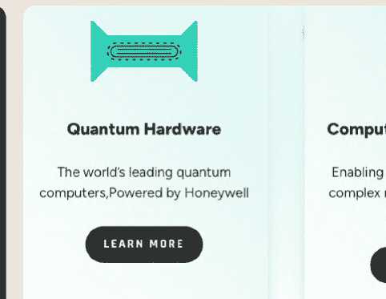
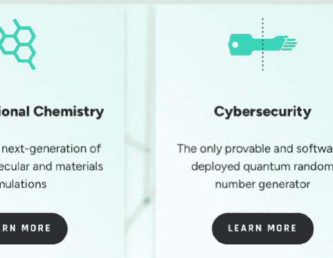

## Saronic 估值$4Bn

成立时间：2022
具体行业：硬科技-无人机

Soros Fund Management LLC, BAM Elevate, Emerson Collection, Leitmotif, Financial Group, Lyynth Energy, Xplor Ventures, Addition, Breakthrough Energy Ventures, Chevron Technology Ventures, Energy Impact Partners, Lowercarbon Capital, Shell Ventures

2024/10/09 | D轮 | 3亿美元

#### 业务领域

聚变电力服务，主要从事聚变技术的研究、应用和推广，并建立一个聚变反应能够，使用剪切场来稳定等离子，通过驱动电流产生聚变场，并限制等离子，致力于为用户提供能量管理解决方案。Lowercarbon Capital, Breakthrough Energy Ventures, Shell Ventures, Value Equity Partners, Addition, Energy Impact Partners, Chevron Technology Ventures

2022/06/27 | C轮 | 1.6亿美元

#### 商业模式

通过Zap装置开发Zap工厂，并成为商业发电厂，可以提供小、高效的廉价能源，无需巨大设施、超导磁体或高功率激光。Addition, Energy Impact Partners, Chevron Technology Ventures, Lowercarbon Capital, GA Capital, Fourth Realm

2021/05/19 | B轮 | 2750万美元

2020/07/12 | A轮 | 650万美元 未披露

| Name | Title | Experience |
|---|---|---|
| Benjamin Conway | 联合创始人兼首席官 | 在英国外交和贸易部长期职业生涯，重心在亚洲和中东，政府部门领导并创立了新市场和技术领域的业务，包括私募公司In Frontier；毕业于剑桥大学与斯坦福大学与牛津大学 |
| Brian A. Nelson | 联合创始人兼CTO | 2019年成为威斯康星大学能源教授，研究了串磁&对称磁场等多个聚变实验，也曾在华盛大学多个实验负责人；本人毕业于华盛大学，毕业于威斯康星大学 |
| Uri Shumlak | 联合创始人兼科学家 | 现任密歇根大学、UWF Flow F-Pinch研究项目以及UIUC计算等离子物理实验室的首席研究员，美国物理学家学会；在1994年加入斯坦福大学之前，曾在哥特兰军事基地的空军菲利普斯实验室工作，是世界上著名的理论、计算和实验等离子物理学家；也是Zplasma联合创始人兼科学家、董事；本科毕业于得克大学，博士毕业于德州大学奥拉斯分校 |

## 其它领域

## Flo Health
### 估值$1Bn
成立时间：2016
行业：Biotech

**业务简介**:女性管理平台，主要用于跟踪和预测周期、排卵和孕期，通过检测用户在周期中的粘液颜色、情绪波动和变化，以帮助用户调整生活。

## BillionToOne
### 估值$1Bn
成立时间：2015
行业：Biotech

**业务简介**:美国领先基因检测研发，目前已推出三款产品，分别是通过单次血液抽样进行癌症风险检测的UNITY Select、在临床实验室决定治疗方案的Northstar Response、以及行为提供精准肿瘤的Northstar Oncology，涵盖了从预测到治疗的疾病的全领域。

**商业模式**:To C 提供平台服务，如果 Beta拥有高价值的粉丝、最易订阅的4.2亿用户，则让订单订阅每月约25美元。

**商业模式**:向C 输出，面向癌症有家族遗传等问题的困扰的患者。

### 连续创业者

| Name | Title | Experience |
| --- | --- | --- |
| Dmitry Gurski | 联合创始人 CEO | 是IDEANomix（图书出版）和IDEANomix Digital（软件开发公司）之一，App Store受欢迎的创始人、Edu4（非营利组织）联合创始人兼董事长；本科毕业于以色列罗伯斯德大学，硕士毕业于以色列罗伯斯德大学 |
| Oguzhan Atay | 联合创始人 CEO | 曾为普津大学主任员、斯坦福大学研究生研究员；本科毕业于普林斯大学；曾任AI软件工程师和招聘人员，在Northrop Aerospace Systems担任工程师；硕士毕业于普林斯顿大学，博士毕业于莱士大学 |
| David Tsao | 联合创始人 CTO | |

## Rula
### 估值$1.3Bn
成立时间: 2019
具体行业: Biotech

**业务简介**:为寻找高质量治疗师或精神科医生的心理健康平台，同时负责服务提供者的招聘、认证、管理等。

**商业模式**:通过在线平台为用户寻找最适合他们的治疗师、预约并在线治疗；治疗师及医生通过认证已有的资质可以加入平台，并开始盈利。
- to B/C，该平台为私人医生提供技术支持，同时帮助我们找到合适的咨询并进行心理治疗。

 连续创业者、金融背景

## Grow Therapy
### 估值$1.4Bn
成立时间: 2020
具体行业: Biotech

**业务简介**:美国的心理服务商，通过跨平台连接客户、治疗师和保险公司，提供便捷、高效且可靠的心理健康服务。

###融背景

| Name | Title | Experience |
| --- | --- | --- |
| Josh Bruno | 创始人CEO | 曾任Silicon Laboratories软件工程师、鸭公司创始人、Campus Company Association负责人Bain Capital Ventures投资，还是Hometeam创始人CEO（为老客户提供护理服务）；本科毕业于斯坦福大学 |

| Name | Title | Experience |
| --- | --- | --- |
| Jake Cooper | 联合创始人 CEO | 曾任于Blackstone、Apolo Global Management，以及Campus Enterprises CEO；本科于斯坦福大学 |
| Alan Ni | 联合创始人 CTO | 曾任Stripe产品负责人、HVF Labs产品/技术负责人以及Google经理；本科毕业于斯坦福大学 |
| Gabe Diep | 联合创始人 | 曾任LinkedIn销售策略专家、FEATS SaaS负责人兼主管、Talent Director及FellowHealth首席；本科毕业于耶鲁大学 |

| | | |
| --- | --- | --- |
| 2024/04/07 | C轮 | 8800万美元 | Sequoia Capital, Goldman Sachs Alternatives, PLUS Capital, 个人投资者 |
| 2022/09/29 | B轮 | 7500万美元 | TCV, Transformation Capital, Silicon Valley Bank, SignalFire |
| 2021/01/23 | A轮 | 1500万美元 | SignalFire |

| | | |
| --- | --- | --- |
| 2024/07/15 | C轮 | 未披露 | |
| 2021/01/28 | B轮 | 8800万美元 | Upfront Ventures, Tribe Capital, Wing Venture Capital, Harmony Partners |
| 2021/04/01 | A轮 | 1750万美元 | Upfront Ventures, SemperVenture Capital, Jackson Moses, Meridian Street Capital |
| 2019/10/07 | 种子轮 | 540万美元 | Upfront Ventures, SemperVenture Capital, Meridian Street Capital, Howard Chaney, Amy Shannon |

- Find the right provider
- Virtual or in-person
- Care that fits your schedule
- Clear costs and transparent billing

## IntraBio
### 估值$1Bn
成立时间: 2015
具体行业: Biotech

**业务简介**:一家遗传性药物研发公司，其产品ACNEURE已获得批准，用于治疗遗传性疾病。

**商业模式**:美国新医药开发，通过部署智能合约，允许他们的ETH和ETH再次使用EigenLayer。专注于医药行业和开发者，致力于满足医疗的需求。

## EigenLayer
### 估值$1.1Bn
成立时间: 2021
具体行业: Crypto/Web3

**业务简介**:专注于医药开发，在EigenLayer上质押资产，为应用提供节点防护，应用提供积分服务。

**商业模式**:To B，医疗机构和开发者提供基于以坊的质押（Restaking）服务和基础设施。

| Name | Title | Experience |
| --- | --- | --- |
| Mallory Factor | 创始人CEO | 现任斯坦福大学助理教授、纽津大学的创始人，担任委员会、合伙人；创立公司，发表了《The New Times》，活跃在Sky News、Netflix等 |

| Date | | |
| --- | --- | --- |
| 2023/11/07 | C轮 | 300万 | 未披露 |
| 2024/03/05 | C轮 | 1500万 | 未披露 |
| 2018/01/26 | B轮 | 490万 | 未披露 |

| Date | | |
| --- | --- | --- |
| 2024/02/22 | B轮 | 1亿 | Andres Horowitz |
| 2023/03/28 | A轮 | 5670万 | Blockchain Capital, Hack VC, Electric Capital, IOSG, 个人投资者 |
| 2022/08/22 | 种子轮 | 1450万 | Figment Capital, Robots |

| Name | Title | Experience |
| --- | --- | --- |
| Sreeer Kannan | 创始人CEO | 现任斯坦福大学硕士、微软实习生、Qualcomm研究生及工程师（研发与开发），亚太市场，硕士毕业于华盛顿理工大学 |

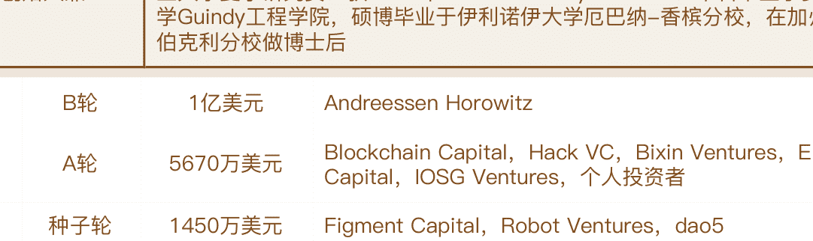

## Monad Labs
### 估值$1Bn
成立时间：2021
具体行业：Crypto/Web3

**业务简介**:EVM 兼容区块链，将采用基于权益的共识机制，并支持以太坊虚拟机（EVM）。

**商业模式**:To B，面向开发者和企业。高高性能、EVM 兼容的 Layer 1 架构为开发者提供了更高的效率，支持高效的定制化；To C，面向用户，降低成本和提高用户体验，吸引更多用户参与和生态系统。

## Humanity Protocol
### 成立时间：2023
具体行业：Crypto/Web3

**业务简介**:Human Institute 推出用于验证 Web3 身份的链上协议。对于红外扫描等生物验证方法提供一种免疫较小的替代，解决了隐私泄露、机器伪造以及个人数据滥用的问题。

**商业模式**:To C 通过识别和数字身份技术，为个人用户提供隐私保护、人类防伪和数据主权的解决方案。

| Name | Title | Experience |
| --- | --- | --- |
| Keone Hon | 联合创始人 | 曾任 Jump Crypto 量化开发、Jump Trading, LLC 高级技术负责人、KCS Holdings Inc. 分析师；本科毕业于 MIT |
| James Hunsaker | 联合创始人 | 曾任 Monad Crypto 量化交易负责人及 Jump Trading, LLC 高级技术负责人、高管、Monad 的 VP；本科毕业于华盛大学 |
| Eunice Giarta | 联合创始人 COO | 曾任 Monad Crypto 产品负责人；曾在 St-George Management 投资集团担任技术部门副长；曾在 Shutterstock 担任高级产品经理；曾在 Goldman Sachs、Merr Lynch 担任高级投资分析师；曾在 Shopee 担任高级产品经理；曾本科毕业于理工科学大学 |

| Name | Title | Experience |
| --- | --- | --- |
| Terence Kwok | 创始人 CEO | 曾是香港第一独角兽 Tank Labs 的创始人，其主要产品 Halo 是在中国市场出口的智能手机，为个人提供无限的互联网和连接，以及创新、作者；曾本科毕业于香港大学 |

| Date | | |
| --- | --- | --- |
| 2025/01/27 | 种子轮 | Jump Crypto, Pantera Capital |
| 2024/05/15 | 种子轮 | 3000 万美元 | Keysways Capital, Animomoca Brands, Blockchain.com, Shima Capital |
| 2024/02/28 | Pre-seed | 150 万美元 | Hashed, CMCC, Capital Foresight Ventures, Mechanism Capital |

Introducing Monad.
With Monad, a new paradigm of blockchain technology is available to developers.

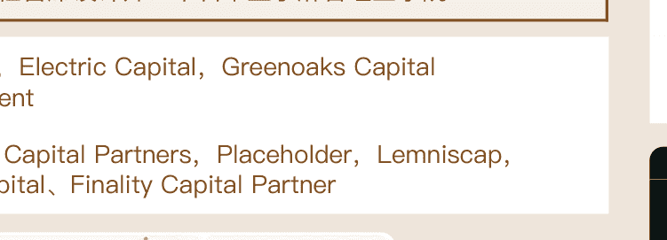
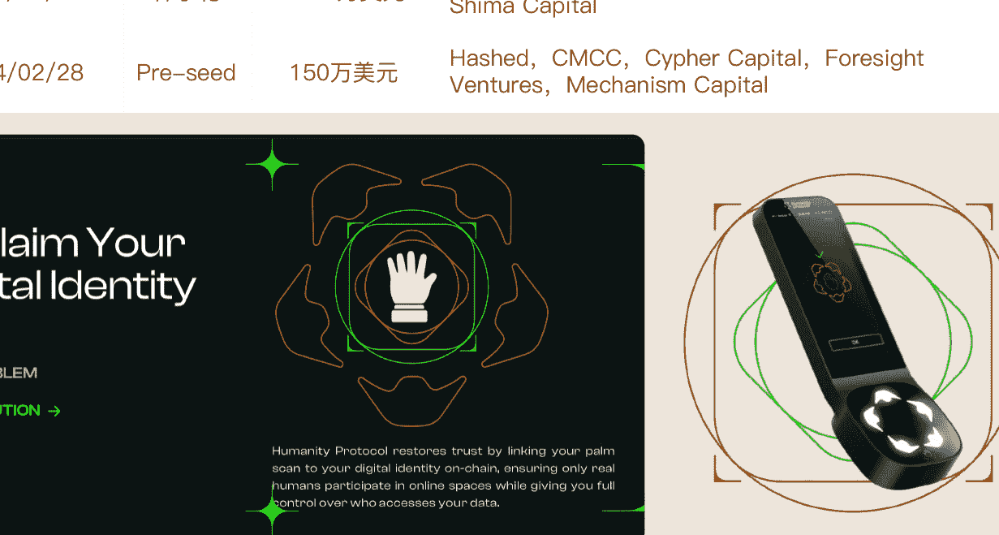

## Farcaster
### 估值$3B
成立时间: 2021
具体行业: Crypto/Web3

**业务简介**:去中心化网络，通过智能合约，允许他们的ETH和再次使用EigenLayer。专注于中心化应用，满足医疗的需求。

**商业模式**:去中心化应用。
- To B/C，面向癌症患者等，在Farcaster部署。

## Story
### 估值$2B
成立时间: 2022
具体行业: Crypto/Web3

**业务简介**:去中心化网络，通过智能合约，允许他们的ETH和再次使用EigenLayer。专注于中心化应用，满足医疗的需求。

**商业模式**:去中心化应用。

| Name | Title | Experience |
| --- | --- | --- |
| Dan Romero | 联合创始人 | 曾任Coinbase执行员、产品经理。 |
| Seeyong Lee | 联合创始人 | 曾任产品经理。 |

| Date | | |
| --- | --- | --- |
| 2024/07/15 | C轮 | 8800万美元 |
| 2022/09/29 | B轮 | 7500万美元 |
| 2021/01/23 | A轮 | 1500万美元

| Date | | |
| --- | --- | --- |
| 2024/02/22 | B轮 | 1 亿 |
| 2023/03/28 | A轮 | 5670万 |
| 2018/01/26 | 种子轮 | 490万 |

## The Row
### 估值$1Bn
成立时间：2006
具体行业：消费服饰

**业务简介**:服装设计品牌，以低调丰富、宽松的极简风格著称，专注于优质面料，服装细节与剪裁，品牌创立之初推出的首单是一件195美元的T恤。

**商业模式**:to C，销售服装、鞋履、包袋等，目前在亚洲和欧洲已开展战略性店铺扩张。

| Name | Title | Experience |
| --- | --- | --- |
| Ashley Olsen & Mary-Kate Olsen | 联合创始人 CEO & 创始人设计总监 | 两人幼年红一统的双胞演员，不到1岁时就开始读共同参与ABC电视的剧情策划者《奥莎娜》，5岁时两人共同成立制作公司Duelor，拍摄电影、动画、游戏等节目，18岁时再次成为公司的联合CEO，并在同年推出了自己的服装系列：两人曾考入纽约大学，后辍学退居离开。
