# 英国营商环境报告
## 2024

## 免费 价值 及时 专注

## 扫码加入知识星球TOP 免费资源群

- 每日免费获取价值资源
- 可提供各类资源搜索服务

| 热门付费文章 | 各行各业报告 |
| :--- | :--- |
| 精选图书资源 | 副业赚钱方法 |
| 职场实用资源 | AI政经自媒体 |

公众号：知识星球TOP 微信信号：jntsg8 微信信号：jntsg2

分享资料仅供个人学习，请及时删除，切勿商用传播

本报告所含信息仅供参考，任何内容均不构成财务、法律、商业、投资建议、投资咨询意见或其他意见。中国贸促会促进产业促进部对本报告所含信息的时效性及完整性不作任何明确或隐含的保证，亦不对对因使用该信息而获得的结果承担任何法律责任。

# 《英国营商环境报告2024》

## 编委会
主任：杨晓军
副主任：谢睿哲
委员：张军 刘晓红 张红阳 刘骏娇

## 编写组
组长：赵泽
副组长：周晋竹
成员：李媛 秦邦媛 张玉静 王钰瑄
李佳悦 何宗武 薛宜昂 赵力进
李明哲 杨文静

## 目录
CONTENTS

# 前言

## 第一章 中英经贸合作现状

### 一、中英经贸交流相对稳定
（一）中英双边货物贸易略有增加
（二）英国是在欧洲第二大投资目的地
二、中英经贸交流前景可期
（一）高层对话指明未来合作方向
（二）金融服务领域合作意向增强
（三）绿色低碳经济领域交流加深
（四）数字经济领域交流频繁

## 第二章 总体评价

### 一、英国经济复苏面临挑战
（一）国民经济增长放缓
（二）货物贸易额呈下降趋势
（三）外商投资流出出现下滑
二、英国营商环境有待改善
（一）英国营商环境总体退化
（二）对英国营商环境改善预期乐观
（三）与英国供应链合作意向增强

## 第三章 总体问题

### 一、经济复苏放缓
（一）经济增长动能不足
（二）企业经营成本上升
二、贸易限制一步加大
（一）针对中资企业的双反调查占比最高
（二）对中国的出口贸易管制制加强
（三）2027年起对部分产品征收碳税
### 三、以国家安全为实施政治性外审查
（一）经济问题政治化倾向增加
（二）对中资企业加大安全审查力度
### 四、部分政策亟待完善
（一）部分政策缺乏清晰的实施细则
（二）部分新兴领域政策支持不足
（三）签证政策收影响企业用工

## 第四章 总体建议

### 一、维护稳定高效的市场营商环境
（一）加速进入经济复苏
（二）切实减负企业税收负担
（三）提高政服务水平
二、完善公正的法治营商环境
（一）优化新兴领域法律法规
（二）明确行政执法规范
（三）公平公正对待中资企业
三、优化自由便利的国际贸易环境
（一）滥用贸易救济措施
（二）宽松对华出口管制
（三）以减关税为由实施过渡政策
（四）通过稳定签证政策保障人员自由流动

## 第五章 市场准入

### 一、最新发展
（一）发布《关键进口产品和供应链策略》
（二）实施新的动植物产品检疫管控措施
（三）拟出政策吸引投资关键领域
（四）《国家安全与投资法》提出收购申报报告
## 二、问题分析
（一）超长企业为我国市场环境适应需要
（二）外资审查存在程序复杂、申诉渠道匮、扩大范围等问题
（三）外资审查提高合规成本与投资风险
（四）中小微企业预计英国市场门槛提高
## 三、我们建议
一）简化外资审查程序降低合规义务
二）缩减需提前申报的外资收购清单
三）建立健全外商投资审查申诉渠道

## 第六章 公共采购

### 一、最新发展
（一）出台《2023年采购法》
（二）发布《2023年采购法》系列指导文件
## 二、问题分析
（一）中小企业为英国采购环境需要
（二）公共采购存在不透明、区别对待、程序复杂
（三）参与公共采购深度较大
（四）中小企业对英国采购环境预期乐观
## 三、我们建议
一）提高公共采购透明度
二）规范公共采购流程
三）给予中小型企业参与采购的机会

## 七章 数字经济

### 一、最新发展
（一）批准《2024年数字市场、竞争和消费者法》
（二）执行《产品安全和电信法2023》
（三）加强个人数据保护
（四）发布《网络安全评估框架》
（五）制定公共场所规则
## 二、问题分析
（一）中小企业反映英国数字环境需要
（二）《数字市场、竞争和消费者法》产生负面影响
（三）数字经济存在开放、支持不够等问题
（四）中小企业对英国数字环境预期乐观
## 三、我们建议
（一）保障公平的数字发展
（二）放宽数字经济要求
（三）加强中英数字领域合作

## 八章 金融

### 一、最新发展
（一）放宽上市标准
（二）执行《融资法案》
（三）发布“反洗钱指南”
（四）正式出台“增长计划”
## 二、问题分析
（一）中小企业认为金融环境需改善
（二）金融环境存在汇率波动、融资成本高等问题
（三）中小企业对英国金融环境预期乐观
## 三、我们建议
一）降低企业融资成本
二）提供公平的金融监管
（三）深化中英双边金融合作

## 第九章 绿色经济

### 一、最新发展
（一）取消岸上风电发展的限制性政策
（二）通过基金支持绿色发展
（三）组建英国能源公司
（四）以法律保障清洁能源
## 二、问题分析
（一）中小企业认为绿色经济需改善
（二）绿色经济存在审批效率低、支持不足等问题
（三）中小企业对英国绿色环境预期乐观
## 三、我们建议
（一）扩大绿色领域开放水平
（二）给予中资企业国民待遇
（三）深化中英双边绿色合作

## 第十章 竞争政策

### 一、最新发展
（一）出台新的“竞争指南”
（二）采用更加灵活的调查程序
（三）发布年度竞争监管制度报告
## 二、问题分析
（一）中小企业认为竞争市场环境需改善
（二）英国竞争审查对中资企业存在歧视
（三）半数企业对英国市场环境预期乐观
## 三、我们建议
（一）持续优化市场竞争环境
（二）避免过度干涉市场竞争
（三）公平公正对待外资企业

## 附录一 研究过程综述
## 附录二 企业在英国生产经营情况
## 附录三 中国贸促会简介

感谢

# 前言

中国作为联合国安理会常理事国和世界主要经济体，既肩负推动各国发展的重任，也承担应对全球性挑战的责任。两国在贸易投资、清洁能源、金融服务、医疗民生以及推动热点问题解决、加强人工智能治理等领域有着广泛合作。中英关系经历起伏，整体不断向前发展。2024年，中英关系持续回暖。习近平主席8月与英国首相斯塔克斯通话，1月会晤斯塔克斯，为中英双方关系发展指明方向、规划蓝图。

中英两国经济互补性强、合作潜力大。是中国亚洲最大的贸易伙伴，双边贸易额多年持续增长；英国是中国欧洲第三大贸易伙伴、第二目的地和第三大贸易来源，双向投资已超过500亿美元。近年来英国政府以“国家安全”为由，提高分领域市场准入门槛、加强出口控制、在对外安全审查中针对企业，一定程度上影响了中国企业投资英国的积极性，并对中国企业在英经营带来挑战。

为充分反映中英企业声音，推动英国改善营商环境，中国国际促进会英国营商环境研究研究院发布了《英国营商环境报告2024年》，全面分析英国一年以来采取的法规政策，通过实地走访、座谈会、问卷等多种方式对中英企业开展调研，此次抽样占中国总量的近20%。当前，中英企业认为英国营商环境持续恶退，但对未来英国营商环境预期仍乐观。

一、英国经济面临挑战。2024年第一季度，英国国内生产总值（GDP）增长0.7%，走出“技术性衰退”，随后三季度增速明显放缓。2024年1-10月，出口总额同比下降7.5%，其中进口同比下降9.9%，直接投资流量持续下降为年来最低。

二、英国营商环境有所改善。调查显示，2024年英国营商环境评价下降1.1个百分点，2023年下降2.1%。评价为“好”的比例下降18.8%，2023年上升2.2%。评价为“待改善”的比例下降3.1个百分点。

三、未来英国营商环境有望改善。2024年以来，英国政府释放了一系列积极信号，具体效果仍待观察。调查显示，74.4%的中资企业普遍认为营商环境存在以下主要问题：

一、经济复苏困难。英国长期面临需求不足，再加上生产成本持续上升，导致投资压力增大。融资方面，英国基准利率升到5.2%，2024年国内工资较去年涨幅3.8%；人力方面，企业利润增长超过25万英镑，所得税率从19%上升到27.9%，企业负担重，业务办理相关需要。

二、贸易限制进一步加大。2024年贸易救济案件中，23项与中国有关，占比67.6%。修订《出口管制令》，新增量子技术、半导体技术、制造设备（3D打印）等特定技术的管制措施，将进一步加强出口审查。调查显示，59.0%的受访企业认为英国存在贸易保护主义倾向。

三、以国家安全为首实质性外资审查。英国政府进一步加大针对中资企业的安全审查。英国国内内阁发布的《国家安全与投资法》显示，2023年4月1日至3月31期间，在41项交易中，41%的交易涉及中国。57.4%的受访企业认为英国审查具有政治倾向性；45.5%认为外国审查对其具有歧视。

四、部分政策法规待完善。受英国签证政策变动影响，2024年1-9月签证发放量较2023年下降2%，影响企业用工。同时，部分企业反映英国部分政策缺乏明确的实施规则，存在规则边界不清晰、政府回应不明等问题。例如，因《数字市场、竞争和消费者法》对具有“战略市场地位”的企业的监管规则不明，使得32.8%的受访企业认为会导致并购频率上升。

一、维护稳定的高增长在首位，避免将经济政治化。稳定宏观经济，平衡财政收支与政府投资。慎重处理中央及地方政府的财政压力问题，慎通过增加税收缓解财政困难。制定企业办理各项业务的收费标准，持续优化公共标准，进一步提升人员效率和效率。

二、完善公平公正的法治营商环境。建议英国系统处理新领域的法律法规，加强支持政策到位。对外企业一视同仁，加强针对外企业的优惠政策宣传与解读。提高签证发放的稳定性，放宽工作签证和居留许可的过度管制。制定合理、边界明确的合规规范，对法律法规、规章中的原则性规定或者具有一定弹性的法律权限、裁量权等进行细化。

三、优化自由便利的国际贸易环境。建议英国履行WTO自由贸易原则，避免在补贴调查中针对中资企业。取消部分华关键技术的出口管制政策，避免打压中国科技企业。以“碳关税”为借实施贸易公平，公平对待发展中国家及其企业。明确外资审查边界，制定公平、合理、透明、可预期的外资审查规则，依法审查。

# 第一章 中英经贸现状

### 一、中英经贸交流相对稳定
（一）中英双边货物贸易略有增加
英国是中国亚洲最大的贸易伙伴，2024年1-11月，中英双边贸易额达893.1亿美元，同比增长35%；其中中国向英国出口714.6亿美元，自英国进口178.6亿美元。
（二）英国是在欧洲第二大投资目的地
英国是中国欧洲第二目的地和第三大贸易来源。2023年末，中国对英直接投资存量为476.8亿美元，同比增长20%，排名第二。

### 二、中英经贸交流前景
（一）高层对话指明未来方向
2024年以来，中英双方高层交往不断，通过各种对话机制，巩固政治互信、加强经贸合作，有力推动了中英关系发展。

| 日期 | 交流情况 |
| :--- | :--- |
| 2024年8月23日 | 习近平会见英国首相斯拉克逊。习近平表示，当前国际形势复杂，中英作为联合国常任国和主要经济国家，应该努力，扩大合作空间，增进交流，确保中英关系良好运行。斯拉克逊表示，当前国际形势复杂，中英作为联合国常任国和主要经济国家，两国应对全球性挑战方面负有责任。希望双方能够尊重和平共识，共同加强协作，解决共同问题。习近平祝贺中英建交十周年，赞赏中英作为“战略伙伴”作出贡献。习近平表示，中英作为联合国常任国和主要经济国家，两国加强合作符合双方利益，也有助于国际社会应对挑战。 |
| 2024年1月18日 | 习近平在伦敦出席第20次英国首脑会议会见英国首相 |
| 2024年5月15日 | 李强会见中英商协会访问华团 |
| 2024年7月7日 | 习近平向英国新首相斯拉克逊致电祝贺 |

伦敦是世界著名的国际金融中心，伦敦金融城的金融聚集地，也是中英金融合作的主要载体之一。截至2023年末，伦敦金融城内中国金融机构数量已超过40家，中国工商银行、中国农业银行、中国银行、中国建设银行、交通银行等均设立了分行。

2016年起，伦敦金融城通过绿色金融与英国合作开展，在2019年成立了中绿色金融中心，举办中英绿色领袖论坛，双方共同探讨在气候转型后可持续投资的最佳实践，挖掘两国在投资管理领域的合作机会。2023年，时任伦敦金融城长洪望在中英ESG领袖论坛上表示，英国伦敦金融非常重视中国绿色金融，希望与更多来自中国和国际的资产管理公司交流和合作。2024年，新任伦敦金融城长睿芬访问中国时再次表示，伦敦金融城将继续参与高水平开放，推动中英绿色金融和经营合作获得更多成果。

多家受访金融机构反映，中英金融合作受地缘政治影响较大，伦敦金融城能够较为公平对待中国金融机构，每月都有针对中国金融合作事宜，特别关注双边绿色金融领域的探讨，取得了效果。

（三）绿色低碳领域交流
中英不断扩大低碳领域友好互动，共同推进能源优化和清洁能源发展。2023年，英国驻华贸易官史华率访问中国，与中国企业代表共同讨论能源的生产和供应。2024年，中国氢能联盟与英国驻华大使联合主办首届中英能源对话会，在上海会上氢能联盟研究院和英国气候变化委员会（CBI）就签署合作备录。中英未来能源发展论坛于伦敦举办，以“未来净零能源系统”为主题，围绕“支持可再生能源与灵活性的市场机制”“电力稳定性与韧性”“数字化加速绿色转型”

方案》四个专题促进中国电力产业界和学术界的交流与合作¹。9月，国家能源局主要负责人对接中国能源安全与净零排放报告国务大臣英莱德，双方围绕中国能源政策、数据库机制和清洁能源技术交流²。在中国新能源汽车领域合作巨大、前景良好。2019年以来，英国先后出台一系列政策支持中国新能源汽车发展，促进交通零排放，实现减碳。英国驻华贸易表示，英国在软件开发、自动驾驶技术和储能解决方案等领域的研发能力可以为联合项目做出贡献。英国在标准、基础设施等方面的合作可以帮助两国向低碳交通的过渡。2024年7月，英国贸易部明确表示，英国目前尚未效仿欧盟，对从中国进口的电动汽车征收高关税，此举进一步提振了中国新能源汽车的信心。

### （四）数字经济领域交流

在智慧城市、智慧财经、互联网金融、大数据、智能物联网等数字经济领域利益增长，近年来两国在数字经济领域的交流与合作不断增强。2023年2月，中国科学院香港分院人工智能与机器人创新中心与英国帝国国王学院成立实验室³，在首代人工智能基础理论、新型机器人交互技术、面向健康的先进机器人技术、增强型人工智能开放平台技术等方面开展研究工作，为推进人工智能技术国际交流带来更大助力。2024年4月，中国国际青年交流中心与英国贸易协会在北京共同举办中英企业合作交流会“亮马丝路”国际论坛，以“中英企业经济合作机遇”为主题，中英双方代表等80余人围绕数字技术与创新合作机遇、中英数据要素如何价值转化推动两国实务合作开展讨论。

¹ 资料来源：中国电机工程协会，http://m.weixin.com.qq/_biz=mru4NDkTQ2MA&mid=2247561295&idx=1&sn=4feefiahafile1375df14f2a7ade19801b8hl&ls=fcb87438d5e8b156f592a28372016a52038d4e2920ae2ac4638e86078864552281ae905d6af9&scene=27。
² 资料来源：国家能源局，https://www.nea.gov.cn/2024-09/13_1307186115.html
³ 注：来源自 The HK Tech Hub.

## 第二章  总体评价

### 英国经济复苏面临挑战

#### （一）国民经济增长放缓

根据英国国家统计局数据，2024年第一季度英国国内生产总值（GDP）增长0.7%，继2023年第三季度（环比下降0.1%）、四季度（环比下降0.3%）连续两个季度下滑后，首次正增长，意味着英国经济逐步走出“技术性衰退”；但随后的二季度英国国内生产总值环比上升0.4%，三季度英国国内生产总值与二季度相比基本持平，经济增速有所放缓（如图2-1所示）。

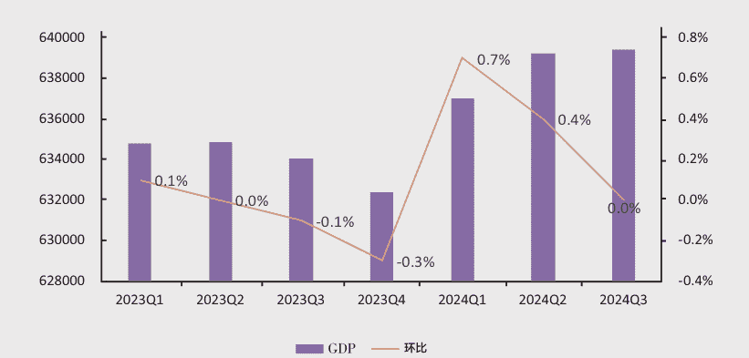

图2-1：2023年第一季度至2024年第三季度英国GDP及环比（单位：百万英镑）

数据来源：英国统计局。

#### （二）货物贸易额呈下行趋势

受通胀高涨、外部需求萎软、政策不确定性增加等因素影响，英国货物贸易呈现下滑趋势。2024年1-10月，英国货物贸易总额为7790亿镑，同比下降4.7%，其中出口额为3040亿镑，同比下降7.5%；进口额为4750亿镑，同比下降2.9%（如图2-2所示）。

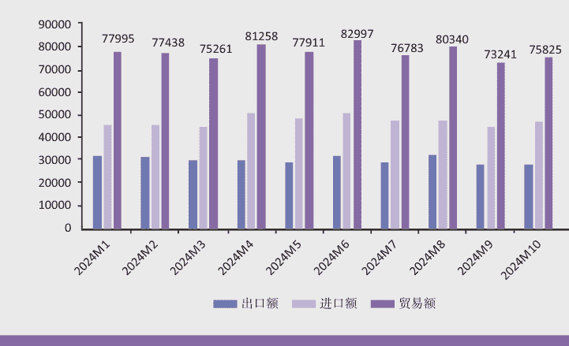

数据来源: 英国海关。

#### （三）外商流量出现下滑

由于在使用外资领域缺乏针对性政策，2017年以来，英国外商直接投资流量持续下降，2023年为近8年来最低点，为-892.5亿美元（如图2-3所示）。

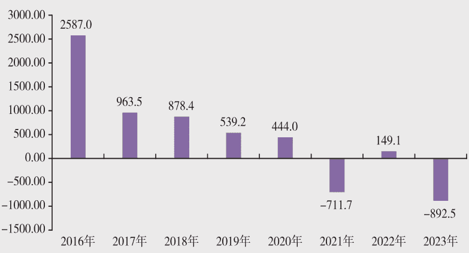

数据来源: 联合国贸易会议。

### 二、英国营商环境有所改善

#### （一）英国营商环境总体退步

中资企业对英国营商环境评价下降。调查显示，31.1%的受访企业认为英国营商环境较好，较2023年下降2.1个百分点；50.8%认为英国营商环境有所改善，较2023年下降4.1个百分点；18.1%认为英国营商环境有所改善，较2023年上升6.2个百分点（如图2-4所示）。

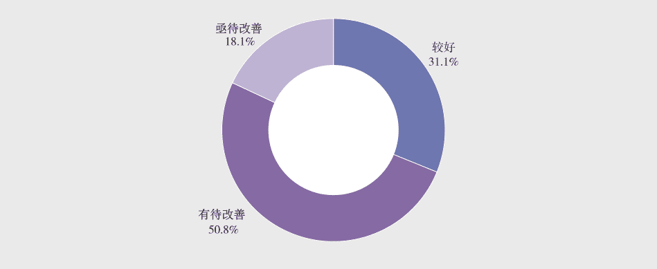

图2-4：受访企业对2024年英国营商环境的总体评价

数据来源：中国贸促研究院。

生产要素成本上升、合规成本较高、资金流动受阻是普遍反映的三大问题。调查显示，41.0%的受访企业反映营商环境存在生产要素成本持续上升；34.4%反映合规成本较高；32.8%反映资金流动受阻；企业税务负担重（27.9%）、便利化水平下降（26.2%）、劳动力短缺（21.3%）等问题也被较提及（如图2-5所示）。

- 生产要素成本上升
- 合规成本较高
- 资金流动受阻
- 税务负担重
- 便利化水平下降
- 劳动力短缺
- 市场准入壁提高
- 入境签证困难
- 企业无法参与
- 法律环境恶化
- 行政透明度下降
- 金融服务不够
- 生活不便利

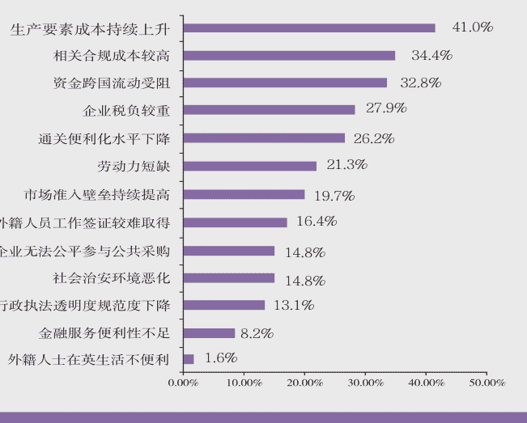

数据来源：中国贸促研究院

#### （二）对英国营商环境预期乐观

2024年，英国工党上台后释放了积极信号，中资企业对未来营商环境改善较为乐观。调查显示，57.4%的受访企业对未来营商环境预期乐观。从性质来看，72.7%的受访企业对未来营商环境预期乐观（如图2-6所示）。

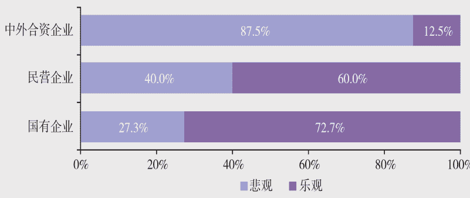

数据来源：中国贸促研究院

#### （三）与英国供应链意向增强

绿色经济、数字经济等领域各项优势，双方发展前景广阔、潜力巨大。调查显示，77.0%的受访企业认为未来供应链合作将增加或不变，其中23.0%认为未来增加，54.0%认为未来不变（如图2-7所示）。从性质来看，国有企业更看好与供应链合作，54.5%的受访企业对未来开展供应链合作的预期增加（如图2-8所示）。

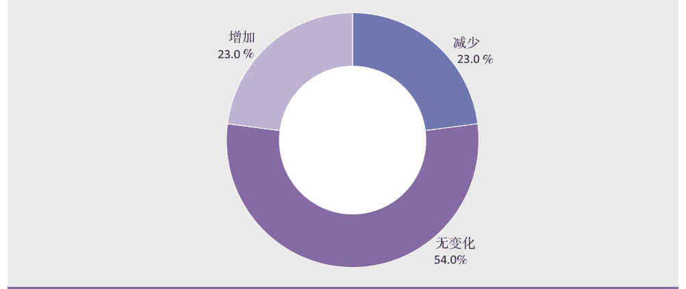

数据来源：中国贸促研究院。

| 企业类型 | 增加 | 不变 | 减少 |
| :--- | :--- | :--- | :--- |
| 中外企业 | 50.0% | 50.0% | |
| 民营企业 | 22.5% | 62.5% | 15.0% |
| 国有企业 | 9.1% | 36.4% | 54.5% |

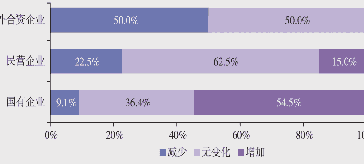

数据来源：中国贸促研究院。

## 第三章 总体问题

### 一、经济复苏缓慢

#### （一）经济增长动力不足

截至2024年11月底，英国政府债务规模约占GDP的98.1%，较年初上升了2.5个百分点（如图3-1所示）。2023年英国两大城市——伯明翰（9月）与诺丁汉（11月）相继宣布财政破产，此时已有12个地方政府陷入破产境。2024年2月，英国《卫报》援引地方政府信息机构LGU的一份报告，英格兰的一个地方政府已预警预算削减等影响，预计未来一年内将面临破产风险。英国首相光逊于8月表示“英国正面临财政和社会管理‘黑洞’”，英国政府投资空间有限。此外，2024年1-9月英国国内消费支出同比回升3.12%，高于同期2.9%的通胀率（如图3-2所示），消费增长乏力。

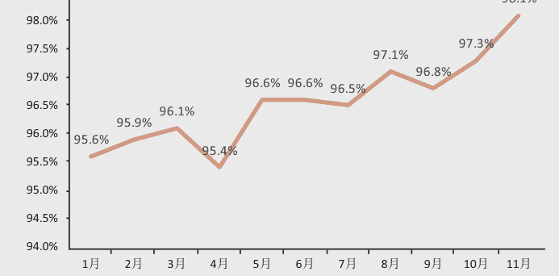

图3-1：2024年1-11月英国债务占GDP的比（单位：%）

数据来源：英国国家统计局。

¹ 资料来源：中国工网，baijiahahao.baidu.com/?id=18040633067326647&w=spider&for=pc。
² 资料来源：卫报网站，https://www.theguardian.com/commentisfree/2024/feb/28/the-guardian-view-on-local-government-finance-a-crisis-that-corrodes-democracy。

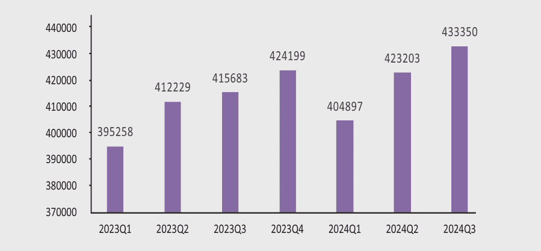

#### （二）经营成本上升

经济增长缓慢、政府债务高、通胀等影响，中资企业普遍反映经营压力增加。调查显示，40.0%的受访企业反映“生产要素持续上升”，主要体现在融资、人力、税收及非负担四大方面。融资方面，银行利率调整在2023年8月达到最高点，调查显示，37.7%的受访企业反映成本高昂。人力方面，2024年最低工资从62英镑涨至87英镑，同比涨9.8%。税收方面，2024年3月净利润税率从19%涨到25%，调查显示，27.9%的受访企业反映税负重。英国政府预算案中为了填补220亿镑赤字，此举遭到工商界的广泛批评。根据最新度趋势，制造业在2024年第一季度呈现下降。自2024年5月以来，商务部下属机构——Companies House全面提高办理费用，注册费用幅幅超过180%，网站费用幅幅超过140%，软件费用幅超过70%。2024年7月，英国移民局（UKVI）宣布申请签证的费用从1048英镑调至1258英镑，增长20%。

表3-1：通过 Companies House注册费用变化

| 项目名称 | 2024年5月之前 | 2024年5月日起 |
| :--- | :--- | :--- |
| 公司注册登记 | £12 | £50 |
| 公司注册登记（当日） | £30 | £78 |
| 重新注册 | £20 | £71 |
| 年度审核报告 | £13 | £34 | £34 | £62 |
| 更换名字 | £8 | £10 | £20 | £30 |
| 更换名字（当日） | £30 | £30 | | £83 |
| 押登记 | £15 | £23 | £15 | £24 |
| 自主停工 | £8 | £10 | £33 | £44 |
| 资本减少（当日） | £50 | £136 | £33 |
| 取本减少 | £10 | £33 |
|  行政恢复 | £100 | £468 |
| 申请地址不公开 | £32 | £30 |

#### 二、贸易限制进一步增大

#### （一）针对中国企业的双反调查力度最高

¹ 资料来源：英国下院图书馆：https://researchbriefings.files.parliament.uk/documents/CBP-9859/CBP-9859.pdf。

2024 年，英国贸易救济署（Trade Remedies Authority）公示的 34 项贸易反补贴案件中，23 项与中国有关，占比 67.65%，涉及皮革、金属材料、有色金属加工、自行车制造等领域，排名第二的印尼仅涉及2项，明显针对中国（如表3-2所示）。

表3-2：2024 年英国贸易救济署公示的涉华双关调查

| 序号 | 立案号 | 商品 | 发起时间 | 更新时间 |
| :--- | :--- | :--- | :--- | :--- |
| 1 | TD0063 | 暖衣板 | 2024年9月30日 | 2024年12月13日 |
| 2 | AD0062 | 锦纶制品 | 2024年9月25日 | 2024年12月19日 |
| 3 | TD0061 | 自行车和某些自行车零件 | 2024年8月23日 | 2024年12月9日 |
| 4 | AD0058 | 生物柴油 | 2024年6月5日 | 2024年12月18日 |
| 5 | TD0057 | 某些粘胶 | 2024年5月20日 | 2024年11月20日 |
| 6 | TD0056 | 陶瓷餐具及厨具 | 2024年5月15日 | 2024年12月20日 |
| 7 | TS0055 | 有机层钢 | 2024年4月15日 | 2024年10月22日 |
| 8 | TD0054 | 有机层钢 | 2024年4月15日 | 2024年11月11日 |
| 9 | TD0053 | 鲍壳 | 2024年2月20日 | 2024年11月11日 |
| 10 | AD0047 | 某些挖掘机 | 2023年11月15日 | 2023年12月20日 |
| 11 | AS0046 | 某些挖掘机 | 2023年11月15日 | 2024年12月12日 |
| 12 | TS0038 | 电动自行车 | 2023年5月22日 | 2024年6月24日 |
| 13 | TD0037 | 电动自行车 | 2023年5月22日 | 2024年6月20日 |
| 14 | TS0036 | 轮胎和货物 | 2023年5月3日 | 2024年10月4日 |
| 15 | TD0035 | 轮胎和货物 | 2023年5月3日 | 2024年10月4日 |
| 16 | TD0034 | 钢丝和钢 | 2023年3月30日 | 2024年1月14日 |
| 17 | TD0031 | 耐腐蚀钢 | 2023年2月2日 | 2024年2月7日 |
| 18 | NE0048 | 陶瓷餐具 | 2023年12月20日 | 2024年10月4日 |
| 19 | NE0043 | 陶瓷餐具 | 2023年9月20日 | 2024年5月2日 |
| 20 | CE0042 | 自行车零件 | 2023年9月20日 | 2024年3月25日 |
| 21 | TD0029 | 铸铁制品 | 2022年11月23日 | 2024年4月4日 |
| 22 | TD0027 | 氯制制品 | 2022年9月22日 | 2024年10月18日 |
| 23 | AD0012 | 铝胶件 | 2021年6月21日 | 2024年2月27日 |

#### （二）对中国的出口管制

2024年3月，英国商业和贸易部修订了2008年发布的出口管制条例《Export Control Order 2008》，防止量子计算机和相关技术被对手用于军事；新增量子技术、低温技术、半导体技术、制造设备以及先进材料相关的条目，并增加到该条例的附件3中。这些新增条目要求出口上述技术领域的相关物品，必须获得出口许可。修订后的政策已于2024年4月1日生效。近年来，英国不断加强对中国的敏感技术出口管制。出口管制联合部门数据显示，英国在2023年拒绝了14项向中国提供半导体技术的许可申请，仅批准2项，拒绝了5个许可。发放了26个许可证，通过率仅为12.5%，较2022年下降71.4个百分点。大部分拒绝的是半导体制造设备，以及运行系统的组件和软件。由于英国人工智能芯片巨头Graphcore面临对华出口管制的压力，大量在华员工停止在华销售活动，正式退出中国市场。英国芯片设计先锋 ARM 公司，由于英国政府对其华销售尖端芯片技术的限制，不得不裁70名中国软件工程师。

#### （三）对特定部分征收碳税

2024年3月，英国海关总署（MRC）和财政部（HMT）联合发布英国跨境边界调节机制（Carbon Border Adjustment Mechanism，简称CBAM）的设计和管理方案，并向各方征求意见。英国政府结束碳关税的公众意见，声明将在2024年正式实施跨境碳调节机制，对于铝、水、陶瓷、玻璃、氢气、钢铁等大行业的进口商品征收碳费用。英国关税本质上取决于进口生产过程中的碳排放量，以及原产国与英国生产商之间的差异。碳边界调节机制分阶段实施（如表3-3所示）。

表3-3：英国碳边界调节机制申报周期

| 企业类型 | 增加 | 不变 | 减少 |
| :--- | :--- | :--- | :--- |

这些企业尚未被通知名单，但为了防风险，不得进行业务更换。另有企业如，民用电是《国家安全与投资法》规定需审批的行业，英国政府以该领域属于国家安全的关键行为，希望企业在合同内退出项目运营，严厉违反合同；同时英国政府与法国电力集团签署的核站建设项目。此举表明英国政府未能公平对待所有外资企业。

| | 不存在 | 存在 |
|---|---|---|
| 中外企业 | 37.5% | 62.5% |
| 民营企业 | 47.5% | 52.5% |
| 国有企业 | 18.2% | 81.8% |

图 3-3：不同性质受审外资企业为英国存在经济政治倾向的比例
数据来源：中国贸合研究院。

## (二)对中资企业加大审查力度

英国政府出于国家安全、经济利益考量，持续加大中资企业投资的审查力度。英国内阁办公室发布的《2021年国家安全与投资法：2023–2024年度报告》显示，2023年4月1日至2024年3月31日期间，在正式审查的41项交易中，41%的交易涉及中资¹。

2024年，英国政府有关部门以“国家安全”为由，正式启动对长和集团下电信子公司UK与英国电信巨头沃达丰之间合作案的深入调查²。6月，英国政府对5家中国实体实施制裁，涉及团体、机械、微电子等精密制造领域，对中国实体的经济利益和经营活动造成损害³¹月，英国政府依据《2021年国家安全与投资法》第26条发布了最新的行政命令，要求中资企业未来科技设备国际控股有限公司出售其持有的苏格芯片未来科技设备国际有限公司80.2%的股份。调查显示，18.0%的受访企业遭遇过英国政府以“国家安全”为要求企业退出投资项目的情况。

¹1 资料来源：英国内阁办公室，https://assets.publishing.gov.uk/government/uploads/media/66b0ff6e6ae41d8/National_Security_and_Investment_Annual_Report_2023-24.docx.pdf.
2 资料来源：英国政府，CMA launches formal investigation into Vodafone/Three merger - GOV.UK (www.gov.uk).
3 资料来源：中国驻英国大使馆，Embassy Spokesperson on UK sanctions against Chinese entities (china-embassy.gov.cn)。

### 四、政策法规定待完善

### （一）部分政策缺乏明确的实施细则

英国法律法规繁复且多数解释较为模糊，政策存在解释不明确、回应不及时等问题，导致企业无所适从。例如，某受访企业反映，企业经营多种跨境电商商品，按照英国产品认证（UKCA）的标准管理，在与英国产品安全与标准办公室（OPSS）通过相关技术标准后，未能获得明确答复，无法向当地第三方寻求帮助，增加了必要的经营成本。在数字经济领域，《数字市场、竞争和消费法》对“战略市场”的监管准则不明确，32.8%的受访企业认为该法导致并购难度上升。在公共采购领域，《2023年采购法》对公共采购流程和中标规则则进行修订，允许采购部门根据需要更改采购程序、在采购流程后修改采购条款，导致55.6%的受访企业反映英国采购程序不透明、监管不到。

英国在部分新兴领域支持政策较少，导致企业缺乏发展方向。在绿色经济领域，36.1%的受访企业反映英国政府对绿色经济发展的激励政策不足。多数企业表示，英国政府一直将绿色视为重点领域，但部分低于经济发展的鼓励细则迟迟没有出台，企业无法根据政策细则推出发展计划。另有企业反映，英国尚未推出绿色发展政策，要求企业达到B级排放标准，但对于达到A级标准的节能产品缺乏支持，企业缺乏提升等级的经济动力。在数字经济领域，32.8%的受访企业反映英国政府对数字经济支持政策力度不够。

1：国际控股有限公司英文为Future Technology Devices International Limited，是未来科技半导体有限公司在英国设立。
2：未来科技国际控股有限公司英文为Future Technology Devices Limited。

### （三）签证政策收紧影响

受签证政策收紧影响，近年来英国对外国工作及留学生签证发放量下滑。2024年9月，英国签发投资者、业务扩展及高端人才的工作签证量为7715个，较2023年同期下降22%；留学签证发放量为44385个（如图3-4所示），对企业造成不利。

| 单位 | 2023年9月 | 2024年9月 | 变化 |
|---|---|---|---|
| 工作签证总数 | 58304 | 45306 | - |
| 工作人 | 468990 | 337498 | - |
| 临时工 | 75343 | 80260 | - |
| 投资者、业务扩展及高端人才 | 9922 | 7715 | -22% |
| 其他工作签证和特殊研究 | 29349 | 27583 | - |
| 留学签证总数 | 642698 | 443854 | -31% |
| 赞助研究 | 638012 | 439930 | -31% |
| 其他研究 | 4686 | 3924 | -16% |

数据来源：英国政府，vis-summary-2024-tables.com。

## 第四章 总体建议

### 一、维护高效的市场环境

（一）加快经济复苏

建议英国将促进增长放在首要位置，避免将经济问题政治化。稳定宏观经济，平衡财政与投资，有效降低企业经营风险，提振企业在英信心。

（二）切实减轻企业税费负担

建议英国慎重处理财政压力问题，谨慎选择加税手段缓解财政困难。进一步优化税收结构，合理制定企业办理各项业务的收费标准，采取积极措施减轻企业费用负担。

（三）提高行政服务水平

建议英国持续优化公共服务标准，进一步提升执法效率，及时给予企业具有参考价值的回复，避免企业正常经营困扰。

### 二、完善公平的法治化环境

（一）优化新兴领域法律法规

建议英国系统梳理数字经济、绿色经济等新兴领域的法律法规，在避免过度监管的同时，加快制定鼓励支持政策的落实细则。在各项优惠政策的适用范围内，对内外资企业统一，加强对外政策宣传与解读。

（二）明确部门执法规范

建议英国制定规则清晰、边界明确的执法规范，按照事实和细节，对法律法规中的原则性规定或具有一定弹性的执法权限、裁量等内容进行细化，持续规范行政裁量，为外资企业营造公开透明的经营环境。

（三）公正对待中资企业

建议英国明确外资审查边界，制定公平、合理、透明、可预期的外资审查规则，合法依规审查。缩减高科技领域外资审查范围，避免因过度审查影响双边交流合作。

### 三、优化自由便利的国际化环境

（一）勿滥用贸易救济措施

建议英国秉持开放自由的市场理念，切实履行WTO贸易原则，避免在反倾销反补贴调查中针对中资企业，给予中国产品公平对待。

（二）放宽华技术出口管制

建议英国放宽对华部分关键技术的出口管制政策，避免对中国科技企业施加不必要的压力，通过扩大交流、合作促进共同发展。

（三）以碳税为由过度贸易

建议英国遵守《联合国气候变化框架公约》及《京都议定书》确定的“共同但不同的责任”原则，勿以“碳税”为借口进行过度管制，公平对待发展中国家及中资企业。

（四）通过稳定签证确保人员自由流动

建议英国提高工作签证发放的稳定性，放松工作签证和居留许可的过度管制，确保具有稳定投资和长期经营的外资企业获得合理的签证数量。

## 第五章 市场准入

### 一、最新发展

（一）发布《关键进口产品和供应链策略》

2024年1月17日，英国政府发布《关键进口产品和供应链策略》（以下简称“进口战略”），降低关键进口壁垒，营造商业友好的环境。英国政府在《进口战略》中将关键产品定义为对国家至关重要的，包括英国指定的13个关键基础设施（CNI）部门和5个经济增长部门（如表5-1所示）。

| 关键基础设施部门 | 经济增长部门 |
|---|---|
| 化学 | 8 | 食品 |
| 民用核能 | 9 | 数字技术 |
| 通信 | 10 | 绿色产业 |
| 国防 | 11 | 生命科学 |
| 紧急服务 | 12 | 交通 |
| 能源 | 13 | 水资源 |
| 全能 | 5 | 先进制造 |

资料来源：英国政府，https://assets.publishing.gov.uk/government/uploads/attachment/detail/655af41c867cd0013ae977/critical-imports-and-supply-chain.pdf

二）实施新的卫生检疫措施

2023年4月，英国公布了《边界运营模式》（BTOM），同年8月30日发布最终版本，自2024年1月31日起对来自欧盟进口产品正式实施卫生认证，自2024年4月30日起对非欧盟进口产品流程转换（如表5-2所示），旨在实施新的卫生检疫管控，并建立单一贸易窗口，采用数字化海关申报。BTOM一定程度上降低了低风险进口产品进入英国的海关负担，但对高风险进口产品采取了有力控制措施，也增加了相关成本。英国政府的一项调查显示，目前BTOM产生的总成本约3亿英镑²。

| 表 5-2:“边界运营模式”实施阶段 | 阶段时间 | 更新内容 |
|---|---|---|
| 2024年1月31日 | 对来自欧盟的中等风险动物、植物、高风险非动物食品和饲料进行身份验证。取消低风险植物的预通知义务。 |
| 2024年4月30日 | 对来自欧盟的中等风险动物、植物、高风险非动物食品和饲料，以文件和风险为基础的身份验证和检查。对来自欧盟的高风险植物进行检查，转移到边境。开始实施非英国进口产品的海关程序，包括来自非英国国家的低风险动物、植物，减少来自非英国的中等风险产品的身份验证和检查。 |
| 2024年10月31日 | 英国对部分国家（地区）的低风险进口产品的安全声明于2024年10月31日生效。英国海关开始使用简化的进口数据以及单一贸易窗口。要求进口提前提交海关申报，尽可能不在数据抵达海关前撤销货物。 |

资料来源：英国政府。

（三）政策引发直接投资挑战

2023年1月23日，英国政府发布《哈林德国外投资吸引报告》（简称《报告》）称，在全球利益日益增长的背景下，英国关键业务吸引直接投资的趋势持续，可再生能源行业表现出色，但制造业等领域的投资却停滞不前。英国吸引外国直接投资面临三大挑战：(1)资金压力。在未来十年，英国需要数百亿英镑的投资，以实现净零目标。(2)体制制约。一项调查显示，投资者认为英国政府厌恶风险，缺乏灵活性。(3)竞争压力。当前面临全球竞争规模扩大，英国的竞争对通过补贴、税收减免和其他竞争性措施吸引战略性投资。

为应对上述挑战，《报告》提出英国政府需从根本上改变运作方式，包括应应用准确的战略、组织和工具（如表5-3所示），以吸引外资投资五大关键领域——绿色产业、先进制造、生命科学、数字技术和创意产业。2024年，英国党发布《增长融资计划》，将解决外国直接投资问题作为首要任务，建立适当的问责机制，灵活的优势。

¹ 资料来源：英国政府，https://assets.publishing.service.gov.uk/media/64fe6e222ef00d7b8be7f0_Final_Target_Operating_Model.pdf。
2 资料来源：英国政府，https://assets.publishing.service.gov.uk/media/64fe6e222ef00d7b8be7f0_Final_Target_Operating_Model.pdf。
3 资料来源：英国政府，https://assets.publishing.service.gov.uk/media/655f331c27ec8001195bd5/523113_Harrington-Report_FINAL-2__HH_Global.pdf。
4 哈林德爵是英国国外投资审查委员会主席。

## 二、问题分析

### （一）市场准入环境改善

调查显示，16.4%的受访企业认为2024年英国市场准入环境良好，较2023年下降26.7百分点；65.6%认为英国市场准入环境待改善，较2023年增加16.6百分点；18%认为英国市场准入环境亟待改善，较2023年增加10.1百分点（如图5-1所示）。

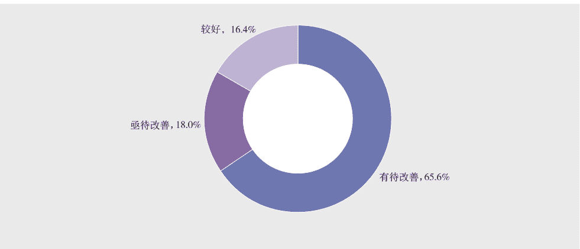

图5-1:受访企业对2024年英国市场准入环境的评价
数据来源：中国贸会研究院。

### （二）外资审查存在程序复杂、申诉缺乏、范围扩大等问题

调查显示，遭受过外资审查的受访企业表示，英国外资审查制度存在程序复杂且耗时长、缺乏申诉渠道和范围扩大等问题，持上述三类观点的企业分别为63.3%、54.6%和54.6%；为英国外资审查对其重视性强的企业占比为45.5%（如图5-2所示）。

| | |
|---|---|
| 审查程序复杂 | 63.6% |
| 审查申诉渠道缺失 | 54.6% |
| 审查范围扩大 | 54.6% |
| 审查裁视性强 | 45.5% |
| 由自由裁量加大 | 9.1% |
| 审查过程透明 | 9.1% |

图 5-2:受访企业认为是英国外资审查存在的主要问题
数据来源:中国贸会研究院。

### （三）外资审查提高合规成本与投资风险

调查显示，受访企业认为是英国外资审查的最大影响是提高合规成本，企业占比达63.6%;认为是英国外资审查会提高赴英国投资的风险的企业为54.6%;认为是限制经营范围、影响企业公平参与市场竞争的企业占比均为36.4%（如图5-3所示）。

| | |
|---|---|
| 影响投资信心 | 18.2% |
| 降低投资效率 | 27.3% |
| 影响公平参与市场竞争 | 36.4% |
| 限制经营范围 | 36.4% |
| 提高赴投资风险 | 54.6% |
| 提高合规成本 | 63.6% |

图 5-3:受访企业认为是英国外资审查存在的问题
数据来源：中国贸会研究院。

### （四）小微企业预计英国市场准入壁垒提高

近期英国出台《国家安全与投资法》，要求跨境收购项目需提前向政府申报，且政府存在自由裁量权较大的问题，导致部分企业预期偏差。调查显示，27.9%的受访企业认为英国市场准入壁垒提高（如图5-4所示）。

| 序号 | 需申报领域 | 序号 | 需申报领域 |
|---|---|---|---|
| 1 | 先进材料 | 10 | 防御 |
| 2 | 先进机器人 | 11 | 能源 |
| 3 | 人工智能 | 12 | 军用 |
| 4 | 民用技术 | 13 | 量子技术 |
| 5 | 通信 | 14 | 卫星空间技术 |
| 6 | 计算机软件 | 15 | 紧急服务 |
| 7 | 政府关键供应商 | 16 | 合成生物 |
| 8 | 加密认证 | 17 | 运输 |
| 9 | 数据基础设施 | | |

表 5-4：《国家安全与投资法》提出的17类申报领域

资料来源：英国议会，lords.parliament.uk/attracting-more-foreign-investment-to-the-uk/.
资料来源：英国政府，www.gov.uk/publications/national-security-and-investment-guidance-on-notifiable-acquisitions-advanced-materials.
资料来源：英国政府。

## 三、 我们建议

### （一）精细化外资审查程序降低投资合规义务

建议英国进一步精细化外商投资审查程序，减少不必要的部门审核，提高政府执法人员行政效率，降低政府执法人员自由裁量权，避免程序冗杂增加外资企业合规义务。

### （二）缩减需提前申报的外资收购清单

建议英国进一步细化 17 类需提前申报的收购领域涉及的投资部门，将将其与国家安全不相关的部门移除，切实保障外企企业合法权益。

### （三）建立健全外商投资审查申诉渠道

建议英国建立并完善针对外国投资审查制度的申诉渠道，同时细化申诉工作制度，在官方网站上采用中英双语进行公示，提高外商审查制度透明度。

## 第六章
## 公共采购

## 最新发展

### (一) 出版《2023年采购法》

2023年10月26日，英国《2023年采购法》获国王批准，并将于2025年2月24日生效，主要点是突出公共采购的灵活性、透明度和高标准。

灵活性是贯穿《2023年采购法》的一个关键主题，如果采购部门在设计采购程序时会有更大自由，可以选择开放式程序或定制适合其需求的程序，在满足至少一条条件下，即使在采购流程开始后也可修改采购条款；对于合同的授予方式进行调整，“有利投资”(MAT)标准取代了之前的“最经济优势投资”(MEAT)标准，允许更广泛地考虑因素、创新和环境影响以外的因素，在特定情况下非财务标准可能是合同授予的决定性因素。

英国政府扩大在整个采购生命周期中及时发布公共信息的要求，从规划到合同，相关部门必须向公众提供更多信息。此外，对于超过50万英镑的合同，至少公布三个关键绩效指标，并根据这些指标评估公共项目绩效。

更新强制性和灵活排除供应商的，引入了新的排除条件，除非违反竞争法；供应商的分包是否符合采购相关标准和要求，将决定供应商是否被排除在相关采购之外；社会价值和可持续性变得更加突出，鼓励相关部门在做出决策时更多考虑社会利益，并在当地创造就业和减少碳排放。

### (二)《2023年采购法》系列指导文件

2023年11月13日，英国政府发布《2023年采购法》实施文件《公共采购转型：我们的新思维》，通过鼓励创造创新型公共采购，使公共机构能够更多解决方案以提升服务质量和效率。主要涉及三项具体内容，包括一般义务、初步参与及选项与竞争性招标程序。

一般义务。要求采购考虑增长等国家战略优先事项。任何支出超过1亿英镑的采购部门必须发布一份流程图，概述估值超过200万英镑的公共合同。考虑中小企业面临的参与障碍，考虑是否可以消除或减少这些障碍。考虑将大型合同分为若干标段，吸引小型公司投标。

初步参与。鼓励采购部门在正式招标流程之前更好地与市场互动，帮助部门了解市场的供应情况。

竞争性灵活采购。采购部门可灵活设计和运行采购流程，通过加深对资源的了解来找到解决方案。采购部门在启动招标程序之前，与潜在供应商进行磋商，并参与或支持供应商的创新研发等活动，加深对供应商相关技术和解决方案的了解，以提高后续采购程序的效率。在最终评估以确定有利目标之前，可遵循流程的推进和理解的加深来完善招标标准。该程序的目的是尽可能消除采购相关的决策实施时的风险，确保采购部门能够满足特定需求与市场方案实现最佳匹配。

此，《2023年采购法》的实施指南《提高采购：我们的雄心》还提出通过新增采购审查（PCS）和禁入审查（DRS）两项工作，配合已有公共采购审查（PPRS）机制，旨在通过完善公共采购的透明度、公平性和水平（如6-1所示）。PPRS、PCS 和 DRS均由采购审查处（PRU）负责执行，并与英国采购同时进行。其中，PPRS的作用是应对供应商对采购的违，调查公共采购流程，并在发布约束性建议；PCS将重点调查公共采购系统性和制度性问题，并发布强制性建议；DRS由PRU和国家安全审查部门（NSUP）共同实施，重点关注国家安全，主要工作是管理公共采购人员名单。

表6-1 英国公共采购监管内容
| 项目 | 主要内容 |
| --- | --- |
| 公共采购审查业务（PPRS） | 背景：2011年建立，旨在优化公共采购流程，特别是为小型企业创造公平环境。范围：涵盖中央及地方政府采购机构，包括政府部门、大学等。功能：根据对影响公共采购利益的投诉或申请，审查相关采购项目，并发表非约束性建议。处理效果有效。依据：依据《2015年企业与采购法》，未来将整合至《2023年采购法》与采购合同服务（PCS）协同。 |
| 采购合同服务（PCS） | 覆盖范围：涵盖中央及地方政府采购机构，利用法定和非法律方法执行采购监管。调查：公共采购中的不符合项。透明度：审查结果将记录在簿中，公开，要求采购机构提供计划和进度报告。 |
| 禁入审查业务（DRS） | 管理机制：由采购审查处（PRU）和国家安全审查部门（NSUP）共同实施，重点关注国家安全，主要工作是管理公共采购人员名单。调查：禁止或剔除供应商理由是否正当且可能发生。 | 数据来源：英国政府，https://www.gov.uk/government/publications/raising-standards-our-ambition/raising-next-for-the-public |

## 二、问题分析

### (一)八成企业认为英国公共采购环境改善

由于2023年采购法尚未实施，其公共采购透明度、便利化改革仍待落实。调查显示，77.8%的受访企业认为2024年公共采购环境改善，较2023年下降6.8个点；仅22.2%较为好，较2023年增加2.2个点。

### (二)公共采购存在程序不透明、差别对待、程序复杂等问题

调查显示，英国公共采购环境存在的最大问题（如图6-1所示）：

| 问题 | 占比 |
| --- | --- |
| 公共采购程序不透明、监管 | 55.6% |
| 对企业实施差别或歧视 | 44.4% |
| 公共采购程序复杂、效率低下 | 33.3% |
| 英国公共采购法规和招标文件规定 | 22.2% |
| 公开获取信息增大 | 22.2% |
| 其他 | 20.0%, 30.0%, 40.0%, 50.0%, 60.0% |

受访企业认为英国公共采购存在的主要问题资料来源：智库

### (三)参与公共采购难度较大

除采购流程透明度、便利化等问题外，英国在通信、电子、产品等相关领域存在很大难度。调查显示，85.2%的受访企业未参与公共采购。

### (四)六成企业对英国公共采购环境预期乐观

基于英国政府公共采购领域上述问题，企业对未来改善并不乐观。调查显示，60.2%的受访企业表示持乐观态度，仅39.8%。

## 三、我们建议

### （一）提高公共采购透明度和信息获得性

建议英国进一步优化公共采购信息发布和渠道，提高相关采购信息的可靠性和完整性。优化公共采购服务和流程，提高公共采购流程的透明度和规范性。

### （二）规范公共采购流程

建议英国制定严格的公共采购流程规范指引，坚决杜绝针对企业设定招标标准或超出合理需求等歧视行为，提高公共采购流程的规范度，减少壁垒。

### （三）给予企业公平参与公共采购的机会

建议英国杜绝在制度和执行层面设置歧视性标准，保障企业公平参与公共采购项目的权利，遵守WTO非歧视原则。

## 第七章
## 数字经济

## 最新发展

### （一）批准《2024年数字市场、竞争和消费者法》

2024年5月，英国王国正式批准《2024年数字市场、竞争和消费者法》，为数字市场引入新的“促进竞争”制度，成为十年来对竞争和消费者的最大变革。该法规定了促进竞争制度、市场门槛、域外管辖、市场调查、高额罚款和消费者保护方面内容（如表7-1所示），建立了一套数字市场监管新制度，授权英国数字管理局（CMA）规范竞争，通过严格执行有关促进竞争的规则，防止垄断性的科技企业滥用其损害竞争对手和消费者的利益。此外，该法还加强了CMA执行法律和解决消费者纠纷的能力，允许其对某些违反消费者保护法的商业行为执法，保障消费者不受不利行为的影响。

表 7-1：《2024年数字市场、竞争和消费者法》的具体内容

| 内容要素 | 具体说明 |
|---|---|
| 构建了基础的促进竞争制度，赋予CMA下的数字市场部门（DMU）针对特定科技公司的监管权。如果一家企业被认为在关键服务中具有“市场地位”（Strategic Market Status, SMS），并对其行为进行战略性监管。例如，CMA有权要求企业对搜索结果进行排序，并限制其应用可能影响市场竞争的行为。根据该法，SMS的企业符合以下条款之一：（一）在相关期间内的全球营业额超过250亿元，或者该企业属于一个集团，该集团在相关期间内的全球营业额超过250亿元；（二）在相关期间内的全球营业额超过10亿元，或者该企业属于一个集团，则该集团在相关期间内的全球营业额超过10亿元 |
| 定义了对合并的控制，扩大了CMA的监管范围，并允许在该范围内对具有重大影响的收购进行审查，未经公告。（一）使用其在英国的股份份额符合20%以上；二）对外国法人具有控制权的收购付出的总额不超过2500万，且一项不受上述限制。 |
| 增强了CMA的能力，赋予其访问个人数据、加强强制调查、无需搜令的权力，并定义市场和范围。 | 资料来源：Digital Markets, Competition and Consumers Act 2024, https://www.gov.uk/government/publications/dmcc-2024/contents/enacted |

### （二）确保产品安全、促进基础设施发展《产品安全和电信法规2023年》

| 内容要素 | 具体说明 |
|---|---|
| 域外管辖 | 扩大了CMA的范围，使其能够调整国外实施的反竞争协议，从而快速识别和限制违法。 |
| 高额罚款 | 未遵守相关规定的，最高处以1000万英镑或其全球营业额的4%罚款。 |
| 消费者保护 | 要求企业在签署合同前提供更清晰的信息，提前告知消费者，并避免虚假、压力等做法。 |
| 涉及范围 | 针对大部分联网产品或设备，包括：智能手机、摄像机、视频、玩具、安全相关产品（如探测器）、物联网网站、可穿戴追踪器、护理用品（如不可携带的GPS设备）、家庭自动化和报警系统、电器（如洗衣机和冰箱）、智能家居助手、医疗保健监控、智能电表及计量设备、自动驾驶汽车、台式机、笔记本电脑、无线蓝牙的平板电脑、汽车充电桩。 | 资料：根据《产品安全和电信法规2023年》内内容整理。来源：英国国家立法库，https://www.legislation.gov.uk/ukdsi/2023/9780334284967/introduction

### （二）发布指南加强数据保护

2024年2月，英国信息专员办公室（ICO）发布《内容审核和数据保护指南》。该指南根据《2023年在线安全法》（OSA）制定准则，规定内容审核主体主要为用户对用户（U2U）提供服务和索引引擎。如果外国提供数量较大的用户或将英国作为目标，或该服务可被英国用户使用且具有合理理由相信该服务对个人造成重大损害的实质性风险，同样内容审核主体监管范围。

该指南强调，内容审核系统通常涉及处理个人数据，有时甚至可能处理特殊类别数据（如种族、宗教信仰、遗传、生物特征数据等），处理要求包括：1)在处理个人数据前开展数据保护影响评估，如在新技术、新方式处理个人数据（如人工智能的应用）时；2）组合、比较来自源获取的个人数据，开展对用户适用法律或具有重要影响的完全自动化处理，或基于自动化决策或使用特殊类别数据决定个人访问服务的权限。(3)遵循“设计和默认的数据保护”原则，将保护纳入系统设计环节以对隐私风险降至最低。(3)根据《通用数据保护条例》（UK GDPR）第6条(1)条的规定，确保处理数据的合法性（如涉及特殊类别数据，还需符合UK GDPR 第9条的规定），并确保数据处理过程的公正和透明。(4）采用符合个人预期且不会对个人产生不利或不受影响的方式处理个人数据，并确保内容审核准确运行并输出公正的、一致的结果。(5）遵守UK GDPR 的目的和数据最小化的规定。(6）重视儿童个人数据的信息和更正，还需要《适应设计规划》。

该指南还规定了相关组织在使用内容审核技术和流程处理个人数据时，应向政府报告任何发生的事宜。

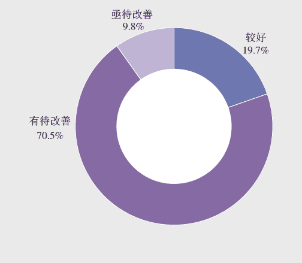

数据来源：中国智览会研究院。

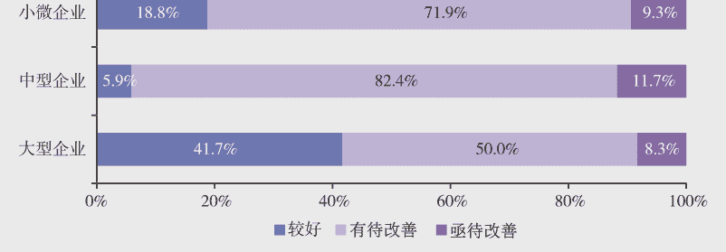

数据来源：中国智览会研究院。

### （二）《数字市场、竞争和消费者法》已产生负面影响

英国《2024年数字市场、竞争和消费者法》针对外资企业设立了更高的市场准入门槛，对中资企业业务布局、投资并购、合规成本等方面造成负面影响。数据显示，45.9%的受访企业表示其合规成本提高，32.8%表示自己已在具体企业业务布局造成影响，32.8%表示其合规压力上升，24.6%反映该法对行政部门给予了自由裁量权（如图 7-3所示）。

- 行政部门自由裁量权过高
- 企业合成成本不够
- 影响在具体业务布局
- 企业合规购买难度上升

图 7-3: 受访企业对英国《数字市场、竞争和消费者法》的评价

| 评价项目 | 比例 |
| :--- | :--- |
| 合规成本提高 | 45.9% |
| 影响在具体业务布局 | 32.8% |
| 合规压力上升 | 32.8% |
| 行政部门自由裁量权过高 | 24.6% |

数据来源：中国智览会研究院

## (三)数字经济环境开放不足、支持不够问题

调查显示，42.6%的受访企业反映英国数字经济中企业开放不足，反映英国数字经济环境在大企业滥用市场支配地位的现象，32.8%的受访企业反映英国政府对数字经济支持政策少、支持力弱。此外，还有27.9%的受访企业反映英国数字领域中中资企业有监管真空，26.2%反映英国数字经济领域相关法律不完善（如图7-4 所示）。

- 难以享受数字转型型的促进政策
- 专业人才匮乏
- 政府支持政策少、支持力弱
- 相关法律不完善
- 数字基础设施建设不完善
- 对中资企业有监管真空
- 对中资企业开放不足
- 大企业存在滥用市场支配地位

图 7-4: 受访企业反映英国数字经济环境存在的问题

| 问题项目 | 比例 |
| :--- | :--- |
| 企业开放不足 | 42.6% |
| 大企业存在滥用市场支配地位 | 34.4% |
| 政府支持政策少、支持力弱 | 32.8% |
| 相关法律不完善 | 26.2% |
| 对中资企业有监管真空 | 27.9% |
| 数字基础设施建设不完善 | 18.0% |
| 专业人才匮乏 | 23.0% |
| 难以享受数字转型型的促进政策 | 9.8% |

数据来源：中国智览会研究院

## (四)越企业对英国数字经济预期展望

英国数字经济发展迅速，但因上述问题的存在，导致中资企业对英国数字环境的预期较为不乐观。调查显示，42.6%的受访企业对英国数字经济环境持悲观态度。

## 三、我们建议

### （一）保障公平公正的数字经济发展环境

建议英国正视外资企业对促进英国数字经济发展做出的贡献，取消视性监管政策，纠正视性监管行为，为数字经济企业提供公平的环境。

### （二）适度宽松数字经济领域合规要求

建议英国完善《数字市场、竞争和消费者法》，提高合并控制的适用门槛，明确竞争与市场管理局在促进竞争、合并控制、域外监管、市场调查、罚款等方面的执法规则，避免以行政手段过度干预数字经济领域发展。

### （三）加强中英数字经济领域对话与合作

建议英国进一步提高对数字经济的重视程度，开展双边数字经济交流合作，充分利用在中国数字经济领域的丰富投资与先进技术促进英国数字经济发展。

# 第八章

## 金融

## 最新发展

### （一）放宽上市企业标准与条件

2024年7月，英国金融监管局（FCA）发布了《2024年上市规则文件》，对英国上市监管制度进行了修订与简化。新规则废除了上市公司在进行重大或关联方交易时必须获得股东投票的传统要求，并赋予机构投资者在特定情况下更大的投票权，旨在吸引更多企业转向英国市场。

新规则还对上市制度进行了改革，涵盖上市板块、信息披露、双重股权架构及上市期限限定等多个关键领域，具体规定为：
(1) 取消已久的“高级板块（premium）”和“标准板块（standard）”双层上市板块，将两者合二一，构建新的“商业公司股权板块”，并增设“海外公司二次上市板块”。
(2) 对重大重组或关联方交易进行股东投票的硬性要求，但不包括反向收购、公司退市等新事项。
(3) 通过过去三年的经营记录和“标准无保留意见”的运营表现作为上市的门槛，招股说明书需披露其财务状况。
(4) 双重股权架构发行人在上市后仍可维持此架构，创始人或董事可享无限制投票权之外，允许IPO 前的机构投资者持有超级投票权最长10年。

### （二）通过《诉讼融资协议（可执行性）法案》

2024年4月，英国上院二通过了《诉讼融资协议（可执行性）法案》。该法案在英国和苏格兰适用，通过修改1990年《法院和法律服务》，明确了诉讼融资，并为诉讼追索提供了法律依据，进一步推进诉讼融资。诉讼融资是一种金融形式，涉及第三方融资（third-party），指的是通常独立的独立的机构、与诉讼人无利益关系。

根据该法规定，诉讼融资可视为一种安排，其中管理服务的实体（funder）负责为以下一项或全部提供资金：
(1) 辩护或诉讼费用；
(2) 潜在的诉讼费用；在诉讼过程中，如果诉讼人需要支付诉讼费用（如因对方而承担）产生的额外法律费用。

诉讼人（client）需要按照双方约定的条件，向诉讼融资支付相应费用，包括资金本金、利息等。

### （三）发布“反洗钱规则”

2024年4月，英国金融管理局（FCA）发布了FG24/3《关于洗钱规则的最终版》。该指南考虑到金融服务和市场监管（Financial Services and Markets Act），旨在规范金融实体行为，确保其可持续的发展声明准确、清晰且不具有误导性。指南认为金融实体提供的声明应当满足“准确”、能够得到“清晰”以及尽可能的方式呈现“完整”，考虑在生命周期内不遗漏和隐藏重要信息与“与其他产品比较公平且有意”的要求，并且为了这些特别问题提供了典型案例（如表8-1所示）。

| 表 8-1：FG24/3：关于洗钱规则的最终版指南提供的典型案例 |
| :--- |
| 1 一位客户对某基金感兴趣，标其基金不包含“化石能源”，但随后的条款和解释称投资基金包含参与化石能源产品、销售和分销相关的投资（人士未提及该投资）。由此可见，该基金内的内容可能被认为是“化石能源”。这一声明可能是不准确的，但其真实性未经证实，这可能导致误导性。 |
| 2 在基金投资活动中，投资经理会关注所有他们投资的行业具有可持续性的行业。但实际情况是，审查过程并不是系统性的，可能将可持续特征而非将其作为投资决策的考虑。这可能导致投资在可持续性方面的考虑缺失，且与声明不符。 |
| 3 表示要对其关注的行业进行筛选。该基金承诺，基金经理将严格遵循国际最佳实践…… |

> 1 资料来源：FG24/3: Finalised non-handbook guidance on the anti-money laundering rules | FCA

一家公司在它的储蓄账户内使用了绿色插图，并配以“持续储蓄”的目标标识，通过营销方式在此处列出了“绿色储蓄”的多种储蓄选项。这类分类与事实的文字不同，公司通过储蓄账户开启的储蓄账户募集资金，让储蓄账户能够用于其可持续发展。事实上，当客户选择“绿色储蓄”时，资金会被专门用于绿色储蓄。在账户中，这种选项是绿色的。

“一项正在进行的银行业务中执行，并产生了持续性的收益。据此，这项募集的资金专门用于支持多个国家的可持续发展，主要由于其运营的效率以及资产利用效率的提升，值得被关注。在投资的材料中，由于这类分类的业务已经推动了增长，提高了化石能源的生产效率和产出质量。这一信息告诉我们运营的业务可能对可持续性产生影响。

有一个被广泛认可的定义，即“可持续性”，其将事实、财务与经济、社会与环境（ESG）整合。在此之外，管理层通过其报告明确阐述了其可持续性影响的评估。由于考虑到如果公司的可持续性风险低于3，那么在可持续性风险之外，管理层通过报告明确证明了其真实性。由于所采用的报告范围未能涵盖全面的评估，导致其可持续性风险可能对真实性产生影响。

一家基金通过其向投资者的募集资金的策略，加大了影响力，使投资者能够可持续发展（例如）。在所关注的投资者材料中，公司区分了投资者的选择，例如符合“市场最佳实践”的SLB框架，表明公司已经评估了SLB的具体要求，绩效指标与其业务目标密切相关。一家公司在购买债券时，将比市场上其他债券更有效地降低风险。这存在一定的风险，由于我们对关注的事实，无法反映局部状况。

### （四）英国推出“增长计划”

表 8-2：英国“增长计划”览

| 项目 | 具体内容 |
| :--- | :--- |
| 贷款额度 | 最高限制：借款人最多2000万英镑；每个企业最多100万英镑。 |
| 覆盖范围 | 最低限制：资产融资、发展融资低于1000万，定期贷款和银行贷款低于2500万。 |
| 贷款期限 | 定期贷款和资产融资、银行贷款为3个月到6年。 |

资料来源：中国贸易研究院内部报告。

## 二、问题分析

### （一）八成企业认为金融环境需改善

近年来，英国通胀率高导致利率大幅提高，使得企业对英国金融环境评价下降。调查显示，37.7%的受访企业认为英国金融环境好，同比下降27.0个百分点；55.7%认为待改善，同比增加26.3个百分点；6.6%认为亟待改善，同比增加0.7个百分点（如图8-1所示）。

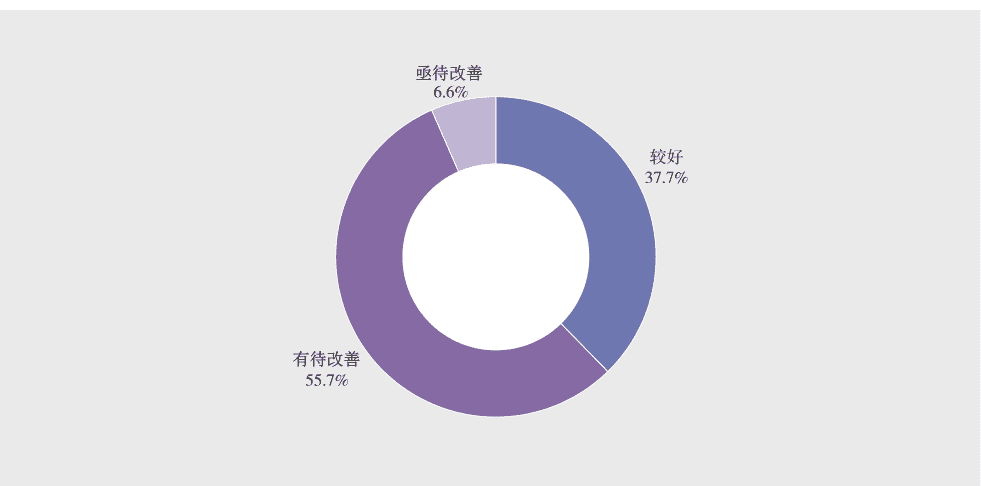

数据来源：中国智览会研究院。

### （二）金融环境存在波动大、融资成本高、处罚重等问题

调查显示，41.0%的受访企业反映“波动大”是英国金融环境的主要问题；其次是“处罚重”（37.7%）和“融资成本高”（37.7%）（如图8-2所示）。

| | 比例 |
| :--- | :--- |
| 金融基础设施不足 | 23.0% |
| 金融风险加大 | 23.0% |
| 融资手续复杂 | 11.5% |
| 融资渠道到位 | 26.2% |
| 融资成本高 | 77.7% |
| 金融处置过重 | 77.7% |
| 汇波动大 | 41.0% |

数据来源：中国贸易学会研究院。

### （三）四成企业对英国金融环境预期乐观

政府上台对其释放了一系列积极信号，双方提出的第一项合作领域是金融。但是，金融领域营商环境的改善还有待检验。调查显示，42.6%的受访企业反映对英国金融环境维持预期乐观态度。

## 三、我们建议

### （一）降低企业融资成本

建议英国重视外资企业在推动经济发展过程中的重要作用，为外资企业，特别是外资中小企业提供更便利、多元的融资渠道，降低企业融资成本。

### （二）提供公平的金融环境

建议英国清理现有金融领域优惠政策执行情况，清理歧视性条款和政策，避免以行政手段过度干涉金融市场，为外资企业提供公平的监管环境。

### （三）深化中英双边金融领域合作

建议英国同中国充分挖掘金融合作方面的契合点，在绿色金融、金融科技创新等方面加强合作，同时建立有效的信息共享机制，开展反洗钱等金融监管合作，共享资源、协同作战。

# 第九章

## 绿色经济

## 最新发展

### （一）取消陆上风电开发的限制性政策

2015年9月9日，英国政府在《国家规划政策框架（NPPF）》中提出，在陆上风电场建议书中必须确保当地居民没有任何反对意见，这事实禁止了在陆上开发风电。
2024年7月5日，英国首相苏纳克上任后第一周宣布取消一项限制性政策¹。

### （二）通过相应基金支持绿色经济发展

2024年7月7日，英国政府宣布设立73亿英镑“国家财富基金”，并将立即投资绿色能源、绿色工厂等绿色经济领域，支持英国工业净零排放。该基金将在5年内投资低碳能源转型的重点项目，由英国基础设施银行执行。

# 第十章

# 竞争政策

## 最新发展

### (一) 出台的“绿色协议指南”

2023年10月，英国竞争与市场管理局发布的《绿色协议指南》，旨在帮助企业应对气候变化和促进环境可持续发展过程中避免法律风险。

根据该指南，供应链同级企业完成以下类型协议时，引起竞争的风险较低：

- (1) 涉及公司内部行为的协议（如禁止在工作场所使用一次性塑料产品）。
- (2) 开展联合活动以提高环境可持续性的协议（联合活动不构成联合营销或联合销售）。
- (3) 规定具有约束力的全行业企业可持续性目标的协议。
- (4) 使用企业能够更好地监控和报告自己环境的可持续目标的协议。
- (5) 参与环境可持续性标准（如绿色标签标识）或尝试防止不可持续的协议。
- (6) 协议各方的市场占有率未10%，且不通过价格等方式限制竞争的协议。
- (7) 开展开发新产品的协议。

根据该指南，供应链同级企业完成以下类型协议时，可能会损害竞争环境，存在违法风险：

(1) 限制使用或开发更环保可持续性的产品或服务的。
(2) 规定固定价格的协议。
(3) 关于竞争对手之间客户或市场的分配。
(4) 操控投资的协议。
(5) 限制质量提升或创新的协议。

该指南还规定了豁免规则，如消费者从协议中获得的处处大于带来的损害（如导致产品价格上涨，但有助于应对气候变化），则协议应符合绿色标准，仍可能。

### (二) 采用更灵活的第二阶段合并调查程序

2024年4月，英国竞争与市场管理局发布公告，将对第二阶段调查程序进行修改，并发布指导文件明确的调查流程。新的指导文件修改了英国竞争与市场管理局和调查小组调整的方法，包括：

1) 简化第二阶段的启动程序。
2) 为所有受影响的企业提供更多与调查小组接触和交流的机会。
3) 鼓励合并并提出可行的替代措施，尽早解决竞争争端。新的第二阶段调查流程使决策更加灵活，推进调查小组与合并企业之间的讨论、促进企业提供数据措施等。

同时，多数由英国竞争管理局与市场调查的合并以及以符合第二阶段参考条件的合并，无论是否提交调查均需支付费用。该费用在竞争与市场调查做出第一阶段合并时决定，费用金额根据收购企业的英国年度营业额而有所不同。

- 1 资料来源：英国竞争与市场管理局，https://assets.publishing.service.gov.uk/media/6526b81b244e000d8e742green_agreements_guidance.pdf
- 2 资料来源：英国竞争与市场管理局，https://www.gov.uk/government/mergers-guidance-on-the-jurisdiction-and-procedure.

### (三) 发布第十年竞争纠纷并开发监管制度年度报告

2024年，英国竞争与市场管理局发布了《2024年行业年度报告》(Annual report on concurrency 2024)，这是自2024年1月1日英国竞争网络开发监管制度生效以来发布的第十份报告。

该报告报告了英国竞争与市场管理局及行业监管部门根据《1998年竞争法》第一章和第二章竞争禁止措施，开展的涉嫌违法的调查案例。近年来，每年年度报告初期调查进行中的案例数量根据《1998年竞争法》引发的调查数量均接近，每年没有变化。在2023年4月1日至2023年3月31日年度内，报告初期调查进行中的案例数量为9，较上一年度增加两个；收到的新投诉数量为13，较上一年度减少4个；根据《1998年竞争法》引发调查的数量为4个，较上一年度减少1个（见表10-1所示）。

| 类型 | 2023-2024 | 2022-2023 | 2021-2022 | 2020-2021 | 2019-2020 | 2018-2019 |
| :--- | :--- | :--- | :--- | :--- | :--- | :--- |
| 报告初期进行的案例数量 | 9 | 7 | 8 | 9 | 9 | 7 |
| 新投诉数量 | 13 | 17 | 25 | 18 | 14 | 16 |
| 根据《1998年竞争法》发起调查的数量 | 4 | 5 | 4 | 3 | 3 | 5 |

数据来源：中国贸促进会研究院公开竞争资料。

- 1 资料来源：英国竞争与市场管理局，https://www.gov.uk/government/publications/annual-report-on-concurrency-2024/annual-report-on-concurrency-2024-competition-enforcement-in-the-regulated-sectors。
- 2 注：英国以竞争与市场管理局为核心形成了竞争网络并开发监管制度，竞争网络成员包括竞争民、金融市场行为监管机构、自然资源与市场管理局、通讯办公室、邮政路、公共事业管理局、体系监管机构、事务事处。各成员与英国竞争与市场管理局共同协作，分别针对相应竞争行业实施监管措施。

## 二、问题分析

### （一）超六成企业认为英国市场竞争环境改善

调查显示，34.4%的受访企业反映2024年英国市场环境较好；44.3%有待改善；21.3%反映亟待改善（如图10-1所示）。

数据来源：中国贸促进会研究院。

### （二）英国竞争审查对企业存在歧视

调查显示，85.3%的受访企业反映英国未遭受歧视，但仍14.7%反映遭受过歧视。从同质企业来看，国有企业遭受歧视最严重，18.2%的受访企业遭受歧视（如图10-2所示）。

| 类型 | 未遭受歧视% | 遭受歧视% |
| :--- | :--- | :--- |
| 中外合资企业 | 87.5% | 12.5% |
| 民营企业 | 85.0% | 15.0% |
| 国有企业 | 81.8% | 18.2% |

数据来源：中国贸促进会研究院。

### （三）超半数企业对英国市场环境预期悲观

调查显示，52.4%的受访企业对英国市场环境预期悲观，不少中资企业表达了对未来市场环境的不乐观。

## 三、建议

### （一）优化市场环境

完善竞争审查体系，提高审查的效率、精准度，继续推广灵活的并购程序，为企业提供公平、科学、可预期的竞争环境。

### （二）避免过度干涉市场

持续提高审查政策的科学性，确保政策公平、公正、合理。审慎利用审查政策，规范竞争网络成员权力，避免出现自由裁量过度干涉。

### （三）公平对待企业

进一步提高审查过程的透明度，避免在采矿业、卫生和社会业等领域造成事实上歧视。

## 附录一 研究过程综述

### 一、研究方法

2024年，中国促进会启动了《英国营商环境报告2024》调研，为充分了解企业诉求，课题组综合采取了文献分析、问卷调查、企业经营等方法。

### （一）文本分析

课题组梳理了近一年英国经贸领域的法律法规和政策，涵盖市场准入、竞争政策、金融、数字经济、公共采购、绿色经济等议题，运用分析方法总结相关法律法规和政策的最新进展，对其对营商环境的影响提出问题和相关建议。

### （二）问卷调查

此次抽样调查样本占当地企业总量的近20%。为了解释企业具体经营情况的高层管理人员，在问卷调查过程中，课题组独立完成问卷编写、数据整理与分析等环节。

### （三）企业调研

课题组通过实地走访、召开座谈会等方式在英经营的中资企业超过60家，接受调研的对象为负责英国业务的高层管理人员。从不同视角更加全面的了解企业在英经营情况，课题组还走访了会计事务所、咨询服务公司等第三方服务机构。

### 二、问卷对象特征

### （一）受访企业性质

接受问卷调查的企业性质看，民营企业占比65.6%；国有企业占比18.0%；中外合资企业占比13.1%；其他类型企业占比3.3%。

### （二）受访企业规模

从接受问卷调查的企业规模看，小微企业占比52.5%；中型企业占比27.8%；大型企业占比19.7%。

### （三）受访企业行业

采样调查企业覆盖矿业、金融业、制造业、建筑业、批发和零售业、租赁和商务服务业、卫生和社交工作、电力/热力/燃气及水的生产和供应业、农/林/牧渔业、房地产、交通运输/仓储和邮政业等行业。

数据来源:中国对外研究院。

## 附录二 企业在英国生产经营情况

英国营商环境报告 2024

## 一、近四成企业 2024 年在英经营盈利

调查显示，37.7%的受访企业预计2024 年在英经营盈利；47.5%预计亏损；14.8%预计平衡；9.9%预计增长。

## 二、近四成企业认为英国市场环境改善

调查显示，37.7%的受访企业预计市场环境改善；26.2%预计待改善；21.5%预计待减；14.3%预计扩大。

## 三、半数企业对英国市场环境预期悲观

调查显示，52.4%的受访企业对英国市场环境预期悲观；19.5%预期稳定；14.3%预期缩减；13.8%预期退出。
