# 中国大类资产投资2024年报

## SBBI China Yearbook 2024

陈鹏、有知行、Roger G. Ibbotson

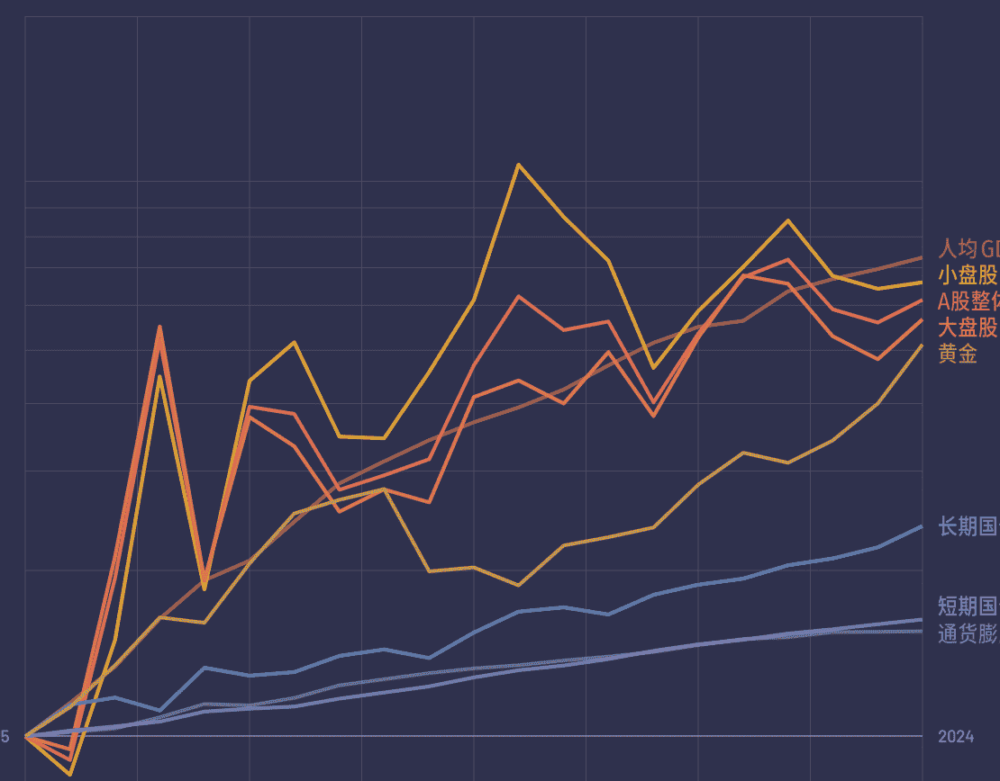

# 免费 价值 及时 专注

# 扫码加入 知识星球TOP 免费资源群

- 每日免费获取有价值资源
- 提供各类资源搜索服务

| 热门付费文章 | 各行各业报告 |
| :--- | :--- |
| 精选图书资源 | 副业赚钱方法 |
| 职场实用资源 | AI经营自媒体 |


公众号: 知识星球TOP 微信号: jntsg8 微信信号: jntsg2


分享资料仅供个人学习，请及时删除，切勿商用传播


# 法律声明

本报告所有内容均以交流分享与投资者教育为目的，仅供参考，不构成任何市场预测、判断，或投资、咨询建议。本报告作者共同声明，市场有风险，投资需谨慎；投资产品的历史业绩不预示其未来表现，请根据自身情况独立做出判断并自行承担风险。本报告作者对所述内容的准确性、可靠性、时效性及完整性不作任何明确或暗示的保证；对于依据或使用本报告造成的后果，不承担任何形式的责任。

本报告所有内容的版权归《中国大类资产投资2024年报告》作者所有，受中国知识产权相关法律法规的版权保护。如需另行引用，请注明出处。未经许可，任何组织/或个人不得使用本报告中的信息用于任何商业目的，本报告作者保留追究相关法律责任的权利。

# 目录

作者简介 01

前言 02

附：中国大类资产投资2023年报前言 04

# 01 中国各类资产的长期收益 07

- 图 1-1 中国各类资产的长期收益 10
- 图 1-2 中国A全市场加权P/E 11
- 图 1-3 中国A全市场加权P/B 12
- 图 1-4 长期信用的长期收益 13
- 图 1-5 美国各类资产的长期收益 14
- 图 1-6 中国股市基差系数占比 15
- 图 1-7 中国各类资产收益规模对比 16

# 02 中国各类资产的年化收益与滚动性收益 17

- 图 2-1 中国A股整体的年化收益与滚动性收益 19
- 图 2-2 滚动持有中国A股股型1年、5年、10年的年化收益 19
- 图 2-3 中国大盘股的年化收益与滚动性收益 20
- 图 2-4 滚动持有中国大盘股1年、5年、10年的年化收益 20
- 图 2-5 中国小盘股的年化收益与滚动性收益 21
- 图 2-6 滚动持有中国小盘股1年、5年、10年的年化收益 21
- 图 2-7 中国长期信用的年化收益与滚动性收益 22
- 图 2-8 滚动持有中国长期信用1年、5年、10年的年化收益 22
- 图 2-9 中国国债的年化收益与滚动性收益 23
- 图 2-10 滚动持有中国短期债1年、5年、10年的年化收益 23
- 图 2-11 中国短期债的年化收益与滚动性收益 24
- 图 2-12 滚动持有中国短期债1年、5年、10年的年化收益 24
- 图 2-13 中国国债到期收益 25

# 03 中国股市收益来源分析

- 图 3-1 中国A股整体收益与资本利得
- 图 3-2 A股整体每年资本利得收益
- 图 3-3 A股每年分红收益率
- 图 3-4 中国大盘总收益与资本利得
- 图 3-5 大盘每年资本利得收益
- 图 3-6 大盘每年分红收益率
- 图 3-7 中国小盘总收益与资本利得
- 图 3-8 小盘每年资本利得收益率
- 图 3-9 小盘每年分红收益率

# 04 中国各类资产的名义收益与实际收益

- 图 4-1 中国A股整体名义收益与实际收益
- 图 4-2 中国大盘名义收益与实际收益
- 图 4-3 中国小盘名义收益与实际收益
- 图 4-4 中国长期信用的名义收益与实际收益
- 图 4-5 中国长期名义收益与实际收益
- 图 4-6 中国短期名义收益与实际收益

# 05 中国各类资产的收益与波动

- 图 5-1 中国各类资产的收益与波动
- 图 5-2 中国A股整体不同年份收益区间分布
- 图 5-3 中国大盘不同年份收益区间分布
- 图 5-4 中国小盘不同年份收益区间分布
- 图 5-5 中国长期信用不同年份收益区间分布
- 图 5-6 中国短期信用不同年份收益区间分布
- 图 5-7 中国短期债券不同年份收益区间分布
- 图 5-8 黄金不同年份收益区间分布
- 图 5-9 中国通胀不同年份收益区间分布

# 06 中国资产中的风险溢价

- 图 6-1 中国各类风险溢价图
- 图 6-2 美国黄金风险溢价
- 图 6-3 中国、美国黄金风险溢价
- 图 6-4 中国每年的实际收益
- 图 6-5 中国每年的隐含风险
- 图 6-6 中国每年的风险
- 图 6-7 中国每年的股票溢价
- 图 6-8 中国每年的小盘股溢价

# 07 黄金需求

- 图 7-1 上海黄金的年化收益与波动率
- 图 7-2 持有上海黄金1年、5年、10年的年化收益
- 图 7-3 伦敦黄金的年化收益与长期收益
- 图 7-4 持有伦敦黄金1年、5年、10年的年化收益
- 图 7-5 黄金全球供给
- 图 7-6 黄金全球需求
- 图 7-7 股票、黄金与通胀长期收益对比（1969~2024年）
- 图 7-8 股票、黄金与通胀的相关系数（1962~2024年）
- 图 7-9 股票、黄金与通胀长期收益对比（1969~1980年）
- 图 7-10 股票、黄金与通胀的相关系数（1969~1980年）
- 图 7-11 股票、黄金与通胀长期收益对比（1981~2001年）
- 图 7-12 股票、黄金与通胀的相关系数（1981~2001年）
- 图 7-13 股票、黄金与通胀长期收益对比（2002~2024年）
- 图 7-14 股票、黄金与通胀的相关系数（2002~2024年）

# 08 各种资产相关性

- 图 8-1 中国各类资产的相关系数
- 图 8-2 中国、美国主要资产的相关系数

# 09 单一股票、分散风险和波动率

- 图 9-1 不同数量的沪深300组合的年化收益分布
- 图 9-2 不同数量的沪深300组合的年化波动分布

# 附表

| 附表 | 页码 |
| :--- | :--- |
| 附表1 中国各类资产的长期收益 | 73 |
| 附表2 中国各类资产的年收益率 | 75 |
| 附表3 中国股市各资产收益率 | 76 |
| 附表4 中国各类资产的实际收益 | 77 |
| 附表5 中国各类资产的年度风险溢价 | 78 |

## 估算数据

| 数据项目 | 页码 |
| :--- | :--- |
| 2005-2006年沪深300全收益估算 | 79 |
| 2005、2006年中国短期债收益估算 | 80 |
| 2005、2006年中国长期收益估算 | 81 |

## 后记

# 参考资料 83

# 作者简介

# 陈鹏


2012年至今在景信基金管理有限公司（Dimensional Fund Advisors，旗下）全球资产规模约6,000亿美元，并担任（除日本外的）董事和首席执行官。2006年至2012年陈鹏担任晨星公司（Morningstar）全球投资部总裁，负责北美、欧洲、亚洲和澳洲的投资管理、投资咨询、退休基金管理以及投资管理的运营。旗下投资规模约190亿美元。此前，陈鹏在Ibbots公司担任副总裁、首席执行官。2004年至2012年陈鹏是金融分析师期刊（Financial Analysts Journal）的年度评选委员，2008年作为优秀分析，陈鹏获得“25位最具影响力人物”，并在2003年、2007年和2011年多次获得金融分析师期刊（Financial Analysts Journal）的Graham和D Scott大奖。陈鹏拥有哈佛州大学经济学学士学位，并在约翰霍普金大学获得工程学硕士学位。

# 有知公司

有知公司创立于2010年，是一家致力于提升个人投资者的认知，希望通过公募基金帮助人们做好理财。2020年8月推出新名“有知”。“有知”意味着投资是站在“用户视角”视角，诸如“投资是认知的升级”、“投资是为了更好的生活”，我们出版了《有知投资》书籍、《股票指南》、《无知指南》、《有知》视频系列还涵盖过“有我有”、理财工具大全，得到百万人投资者的认可和喜爱。


陈瑞博士，Ibbotson编写了中国资产年报（SBBI China Yearbook），有知认为在中国资产领域建立了一个完善的系统，基于此为投资者提供投资和理财服务。

# Robert G. Ibotson

Robert G. Ibotson是哥伦比亚大学商学院的校长，担任Capital Management Group的创始人兼董事长。超过50年的学术和实务撰写了许多报告和文章，《SBBI报告》（Stocks and Inflation），这本是美国市场的重要参考。Ibbotson进行了广泛的研究，包括共同基金、国际市场组合。他在哈佛大学获得金融学学位，在印第大学获得MBA学位，并在芝加哥大学获得博士学位，担任教学教授。

投资是一门科学，也需要与市场紧密结合。我们应该秉持科学严谨的态度，运用科学的方法观察市场、分析市场内在动力，才能得出结论并应用于实践。SBBI是一份帮助投资者理性地识别历史规律的工具。2024年，Roger G. Ibbotson和有知团队提交了《中国资产2023年报》（SBBI China Yearbook 2023），系统性回顾了中国市场的历史演变和政策，并得到了广大读者的认可。在此多方关注中，我们期待并希望每年更新数据，覆盖更多资产类别，比如地产、黄金。

2024年的中国资产类别都带来了新的发现：

| 资产类别 | 2024年收益率 | 年化收益 | 2005~2023年化收益 | 年化波动率 |
| :--- | :--- | :--- | :--- | :--- |
| A股 | 9.98% | 9.63% | 55.48% | 9.61% |
| 大盘股 | 18.24% | 9.18% | 54.82% | 56.33% |
| 小盘股 | 2.79% | 10.04% | 62.49% | 10.43% |
| 长期信用 | 10.22% | 5.47% | 6.24% | 5.19% |
| 长期债 | 9.38% | 4.53% | 6.26% | 4.28% |
| 短期债 | 2.00% | 2.49% | 0.86% | 2.52% |
| 上海黄金 | 28.19% | 8.60% | 13.97% | 7.66% |
| 通胀 | | | | |

注：中国长期数据的基数从2007年开始。值得注意的是，2024年的市场表现发生了变化，但它对过去20年的历史平均收益、风险溢价以及之间的关系带来了重大影响。这说明SBBI风险定价体系非常稳固，让我们更加有助于解释和判别中国资产类别的长期趋势。

# 中国大类资产配置2024年收益特征具有重要指导意义。我们在今年六月的报告中分析了风险展望，希望大家对风险收益有深度。最后需要提醒大家，中国20年的数据还是偏扁，希望未来能更多数据帮助我们检视这些风险的规律。

## 2. 新资产：黄金

2024年的黄金表现亮眼，收益高达28%，超过了国债和中国债，成为了“明星”投资。本文的第七章全面分析了黄金的供需关系、长期收益以及历史表现，并结合SBBI分析了黄金在资产组合中的作用。我们试图用历史的数据解释黄金收益，并告诉投资者要配置黄金和何时投资黄金。

虽然2024年的黄金上半年度确实有一些提高，但是我们也清楚地看到它还有许多不足之处，计划在今年报告中展示的股票收益和债券收益的展望，将延续至2025年报告带来大家的观点。

我们和Roger特别感谢我们的合作伙伴——在与有知意的合作的过程中，我们深刻感受到整个群体都是非常用心的，为投资者提供了价值。

我们非常感谢那些具有合作关系的人，为投资者提供了投资信息，帮助投资者科学地分析市场，引导投资者能够做出投资决策。我们特别感谢基金，基金是一个能够快速整合历史数据并结合市场趋势展示数据的作者，依靠他的专业技能和不懈努力，促进了我们一起完成了2023和2024年中国大类资产投资报告。感谢基金和全员，让报告以清晰、直观的方式呈现出来。

再次感谢读者对《中国大类资产投资报告》的关注与支持，非常欢迎大家继续提出你们的建议。希望这份报告能够帮助你更系统地理解中国投资市场，以及各类资产的底层收益，帮助你在长期投资中获得投资经验和时间的力量。

大家投资顺利，收获多多。


# 中国大类资产报告 2024年

这些数据不仅为资产定价、资产配置等专业模型提供了必不可少的数据支持，更重要的是，这些数据加强了机构和个人投资者对于大类资产的识别，切实推动了专业资产配置、资产配置在投资者当中的应用。可以不忽视实地说，这些历史数据是全球投资市场的规则和基石。近年来，CFA研究基金会、晨星（Morning）等机构在全球范围内持续维持SBBI数据报告的应用。2000年，Dimish、Marsh和Staunton教授披露了全球蓝筹25个国家的类似数据和全球收益年报，他们观察到的数据和结论，与SBBI在美国看到的基本一致（详见 Global Investment Returns Yearbook 章节）。

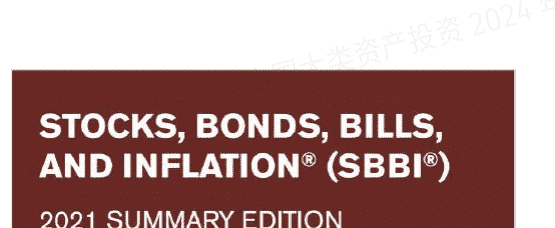


制作这本SBBI是中国是我多年来的愿望，从90年代开始接触SBBI数据，然后从1997年开始与Roger Libbotson等专家深度合作，非常容易通过SBBI学习到了金融资产配置的逻辑，并有机会在扩展SBBI数据为中国的机构和个人投资者服务。我越觉得应该收集SBBI数据会在中国市场具有巨大的意义，也希望借此验证全球金融市场的规则和逻辑在中国是否成立。2023年，我和Roger与许多位有行经验的朋友一起完成了这项工作，特别是陈晨，一起完成了第一个中国SBBI的报告——《中国大类资产报告2023年》（SBBI China Yearbook 2023）。

从资本市场的历史长度来看，这延续了1905年（1925年）以来的资本市场，标注了不同资产类别之间内在的联系，展示了它们的名义和实际（通胀调整）回报。SBBI的研究涵盖了很长时间，能够让投资者经历、可能经历的大多数或所有类型的资产，如何经历了战争与和平、增长与衰退、股市与通货膨胀和货币贬值，以及其他资产回报经历。通过研究过去，人们可以对未来做出预测。虽然2004—2023年的样本事实不会完全重复，但是某些（未特定的资产）大类再次出现。

中国大类资产报告 2024年

# 中国各类资产的长期收益

中国资本市场的主要资产包括A股、大盘股、小盘股、长期信用、长期国债、短期国债及黄金等种类。为了全面展示这些资产类别的表现，我们精选了一系列代表性指数。考虑到这些代表性指数的起始日期和起点位置各有差异，为了更直观地比较它们的涨跌，我们采用了一种统一的比较方法。

假设投资者在2004年底以1元的初始资金全投入于各类资产。忽略交易成本，将所有股息分红和利息再次投入，以此计算每年年底各类资产的总价值。就得到了代表中国各类资产长期收益的指数曲线。这些线条直观地反映了各类资产随时间的收益变化。

需要注意的是，由于数据限制，长期信用的相关分析是从2006年底开始的。这些分析结果为投资者提供了宝贵的历史视角，帮助大家更好地理解中国资本市场的长期趋势和特点。

# 各资产说明

## 中国A股整体

| 代表指数 | 指数代码 | 数据来源 | 统计区间 |
|---|---|---|---|
| 中证全指等权指数 | H00985 | Wind | 2005~2024 年 |

## 中国大蓝盘

| 代表指数 | 指数代码 | 数据来源 | 统计区间 |
|---|---|---|---|
| 沪深300全收指数 | H00300 | Wind | 2005~2024 年（2005 年的分红数据根据成分分红数据计算得出） |

## 中国小蓝盘

| 代表指数 | 指数代码 | 数据来源 | 统计区间 |
|---|---|---|---|
| 中证1000全收指数 | H00852 | Wind | 2005~2024 年 |

## 中国长期信用

| 代表指数 | 指数代码 | 数据来源 | 统计区间 |
|---|---|---|---|
| 中债-高信用级新财富(7-10年)指数 | CBA04751 | 中国债券信息网 | 2007~2024 年（代表指数的起始日为2006年12月31日） |

## 中国短期国债

| 代表指数 | 指数代码 | 数据来源 | 统计区间 |
|---|---|---|---|
| 中债-7-10年国债财富指数 | CBA14101 | 中国债券信息网 | 2005~2024 年（2005、2006 年的数据根据滚动 7 个月国债收益率债券计算得出） |

* 特别计算方法详见估值计算部分

## 上海黄金

| 代表指数 | 指数代码 | 数据来源 | 统计区间 |
|---|---|---|---|
| 上海黄金交易所金9999 | Au9999.SGE | Wind | 2003~2024 年 |

## 伦敦黄金

| 代表指数 | 指数代码 | 数据来源 | 统计区间 |
|---|---|---|---|
| LBMA Price | 伦敦黄金市场协会 | 1969~2024 年 |

## 中国通膨胀

| 代表指数 | 指数代码 | 数据来源 | 统计区间 |
|---|---|---|---|
| CPI指数（1978年=100） | 国家统计局 | 2005~2024 年 |

## 中国人均GDP

| 代表指数 | 指数代码 | 数据来源 | 统计区间 |
|---|---|---|---|
| 人均国内生产总值 | 国家统计局 | 2005~2024 年（2024年的数据为初步值） |

# 图1-1 中国各类资产的长期收益（2005~2024年）

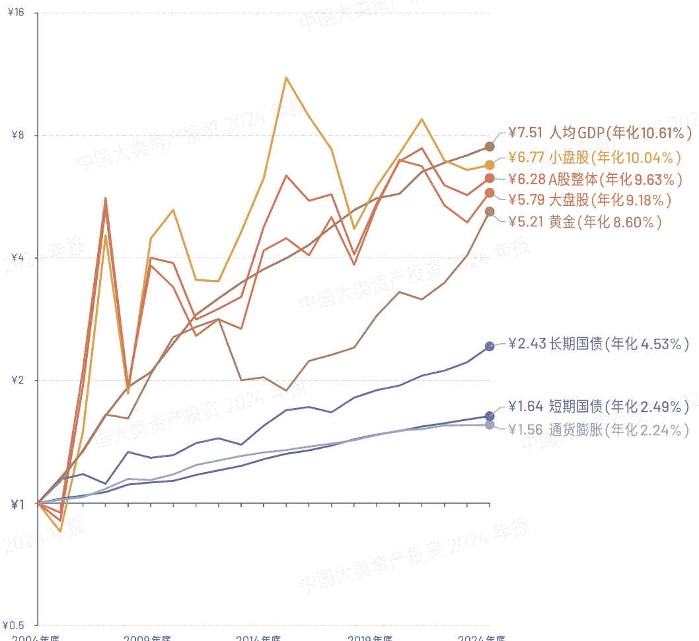

- 人均GDP（年化10.61%）
- 小盘股（年化10.04%）
- A股整体（年化9.63%）
- 大盘股（年化9.18%）
- 黄金（年化8.60%）
- 长期国债（年化4.53%）
- 短期国债（年化2.49%）
- 通膨胀（年化2.24%）

从资本市场历史来看：
- 股票的长期收益高于债券
- 小盘股的长期收益高于大盘股
- 长期国债的长期收益高于短期债
- 股票和长期国债的长期收益可以胜通胀

# 股市与经济的关系

在《图1-1 中国各类资产的长期收益》中，我们引入了人均GDP对比，为了更直观地展示股市长期收益和增长的关系。股票投资本质上是股市市场的整体发展取决于上市公司创造的利润和整个国家的发展。从图1-1中我们可以看到，股市市场波动巨大，但长期来看随着经济增长，证明了股市的长期收益和经济增长密切相关。

# 2004年后股市低点

《中国各类资产投资2023年报告》发布后，部分读者认为A股整体年化收益率9.61%，是因为起点2004年处于A股估值低点。我们忽略了历史数据。图1-2显示的是2004年至2024年中国股市加权市盈率（P/E）。我们可以在过去的20年里看到，2004年并非P/E的历史低点。

# 图1-2 中国股市加权P/E (2005~2024年)

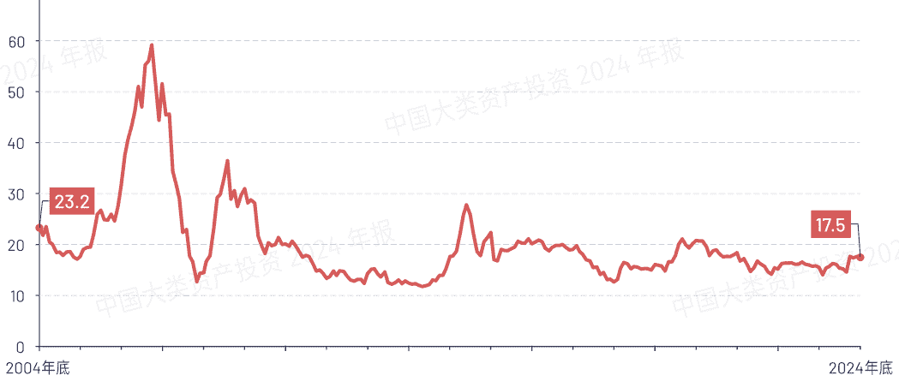

```
R = Inc + (1 + earnings) * (1 + g/PE) - 1
```

其中，R — 股票长期收益；Inc — 股票分红与再投资收益；earnings — 股票利润的年化增长；g/PE — 股票市盈率的增长。

数据来源：Wind 公式来源：Ibbotson & Chen (2003) Long-Run Stock Returns: Participating in the Real Economy, Financial Analysts Journal 59, Issue 1.

# 中国大资产投资2024年

公式中的GPE是连接股票整体估值的平均年化增长率，指的是从起点和终点来看PE的变化。从图中可以看出，2004年的PE比2024年略高，说明2004年~2024年的GPE为负值。换言之，选择2004年作为起点来计算A股的历史收益，没有拉高平均收益，反而显得略低了。

图1-3显示的是2004年~2024年中国全市场加权净收益率 (P/B)，结论是类似的。

# 图1-3 中国全市场加权P/B (2005~2024年)

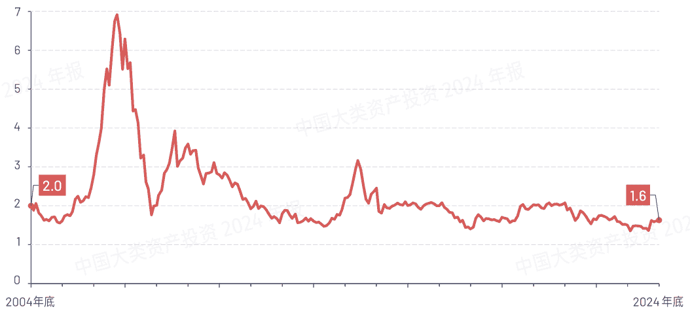

数据来源：Wind、东方行情

如果用P/B来解释股票市场的估值，收益率的分解公式也类似：

```
R = Inc(1 + gbook)(1 + gPE/B) - 1
```

R — 长期增长率；Inc — 分红+再投资收益；gbook — 股票净资产的年增长率；gPE/B — 股票净资产的增长率。

公式来源：Ibbotson & Chen (2003) Long-Return Stocks: Participating in the Real Economy, Financial Analysts Journal. Volume 59, Issue 1.

这也从反侧反映出，我们容易受到市场波动的干扰，缺乏对历史数据的深入理解。当市场短期表现良好，投资者可能会对历史收益低估；当市场短期不佳时，又觉得历史收益被放大。事实上，历史收益是客观不变，但投资者的心态往往随着市场波动。

# 中国大资产投资2024年

# 图1-4 中国长期信用长期收益（2007~2024年）

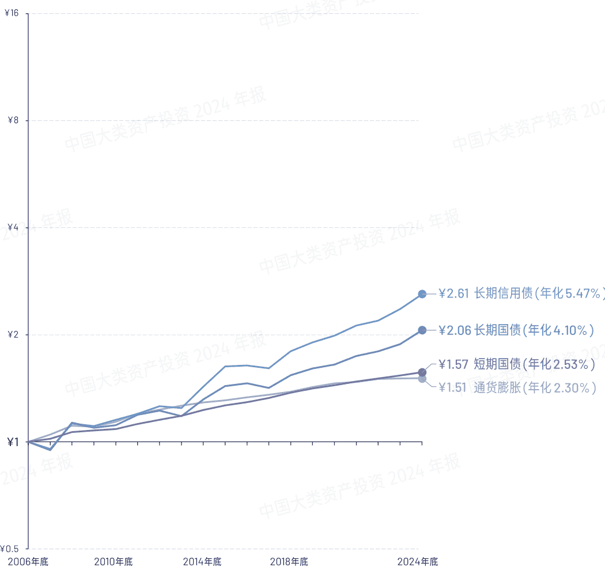

从图中可以看到，2007~2024年，中国长期债年化收益为5.47%，国债为4.10%，短期国债为2.53%，通胀为2.30%。中国长期债的代表指数“中国债-高信用级财富7-10年指数”起始于2006年12月31日。

# 图1-6 中国蓝筹市值占比（2024年）

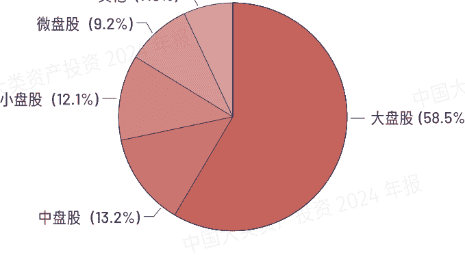

| 类别 | 大盘股 (沪深300) | 中盘股 (中证500) | 小盘股 (中证1000) | 微盘股 (中证2000) | 其他 |
|---|---|---|---|---|---|
| 总市值 | 57.8万亿元 | 13.0万亿元 | 12.0万亿元 | 9.1万亿元 | 6.9万亿元 |
| 占比 | 58.5% | 13.2% | 12.1% | 9.2% | 7.0% |

# 图1-7 各类债券规模 (2024年末)

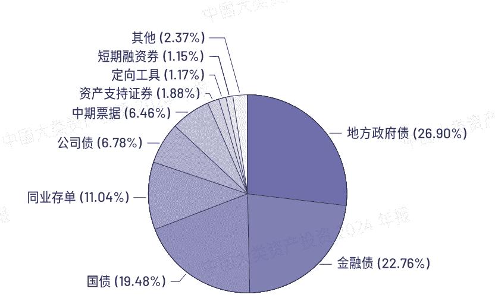

| 类别 | 地方政府债 | 金融债 | 国债 | 同业存单 | 公司债 |
|---|---|---|---|---|---|
| 债券余额 | 473,413亿元 | 400,613亿元 | 342,926亿元 | 194,350亿元 | 119,302亿元 |
| 占比 | 26.90% | 22.76% | 19.48% | 11.04% | 6.78% |

| 类别 | 中期票据 | 资产支持证券 | 定向工具 | 短期融资券 | 企业债 |
|---|---|---|---|---|---|
| 债券余额 | 113,762亿元 | 33,099亿元 | 20,510亿元 | 20,241亿元 | 15,971亿元 |
| 占比 | 6.46% | 1.88% | 1.17% | 1.15% | 0.91% |

| 类别 | 政府支持机构 | 可转债 | 可交换债 | 国际机构债 | 央行票 | 项目收益债 |
|---|---|---|---|---|---|
| 债券余额 | 15,875亿元 | 7,339亿元 | 1,146亿元 | 910亿元 | 621亿元 | 44亿元 |
| 占比 | 0.90% | 0.42% | 0.07% | 0.05% | 0.04% | <0.01% |

统计日：2024年12月31日
数据来源：Wind

# 02 各类资产的年化收益率与滚动收益率

各类资产在一年内获得的收益率为年化收益率，年化收益率则是将多年的总收益率转换为一年投资期限所获得的平均收益率。它能让投资者更容易地比较不同期限或不同资产在长期投资后的收益表现。

其中，$n$ — 投资期限（以年为单位）；$V_n$ — 投资结束时的市值；$V_0$ —投资起始时的投入本金。

> 年化收益率 = $\frac{V_n}{V_0} - 1$

滚动收益率先选取一个固定的周期，然后从不同时间开始并计算该周期内的年化收益率。例如以5年为周期，分别计算2005~2009年、2006~2010年……的年化收益率，将它们连接起来，即为持有5年的的滚动收益曲线。滚动收益曲线可以更准确地评估在不同时期相同期限的表现，从而为投资者提供更全面的回溯。

# 说明

以起始年份为结束年份，交汇处为区域内的年化率。例如，2024年的年化率为9.63%。从左上到右下斜线代表n年的年化率。图中的颜色代表年化率的高低。红色越高，绿色越深，数值越大。

| 年份 | 2005 | 2006 | 2007 | 2008 | 2009 | 2010 | 2011 | 2012 | 2013 | 2014 | 2015 | 2016 | 2017 | 2018 | 2019 | 2020 | 2021 | 2022 | 2023 | 2024 |
|---|---|---|---|---|---|---|---|---|---|---|---|---|---|---|---|---|---|---|---|
| 2005 | - | - | - | - | - | - | - | - | - | - | - | - | - | - | - | - | - | - | - | - |
| 2006 | - | -29.67% | 18.37% | - | - | - | - | - | - | - | - | - | - | - | - | - | - | - | - | - |
| 2007 | - | - | 34.61% | -22.21% | 17.42% | - | - | - | - | - | - | - | - | - | - | - | - | - | - | - |
| 2008 | - | - | - | 17.81% | 28.58% | -0.65% | 43.77% | - | - | - | - | - | - | - | - | - | - | - | - | - |
| 2009 | - | - | - | - | 21.59% | 40.53% | -27.19% | 13.83% | - | - | - | - | - | - | - | - | - | - | - | - |
| 2010 | - | - | - | - | - | 28.31% | 53.82% | -14.81% | -9.20% | -18.85% | 23.68% | -2.99% | - | - | - | - | - | - | |
| 2011 | - | - | - | - | - | - | 25.99% | 20.85% | 7.89% | 14.66% | -10.16% | -6.34% | - | - | - | - | - | - | |
| 2012 | - | - | - | - | - | - | - | 19.23% | 18.67% | -14.40% | -10.16% | 8.25% | 6.77% | - | - | - | - | - | |
| 2013 | - | - | - | - | - | - | - | - | 18.19% | 23.37% | -11.58% | -16.83% | 22.32% | 16.55% | 19.25% | 20.87% | 20.81% | | | |
| 2014 | - | - | - | - | - | - | - | - | - | 21.55% | 14.28% | 8.07% | 16.63% | 23.65% | 28.50% | 40.81% | 23.78% | | | |
| 2015 | - | - | - | - | - | - | - | - | - | - | 19.23% | 17.89% | 10.66% | 14.35% | 14.72% | 14.92% | 19.84% | 23.69% | -15.51% | | |
| 2016 | - | - | - | - | - | - | - | - | - | - | - | 14.38% | 13.63% | 10.70% | 8.35% | -2.36% | -7.81% | 0.02% | 6.01% | 5.77% | 2.86% | -13.32% | -14.68% | -8.34% | -23.44% |
| 2017 | - | - | - | - | - | - | - | - | - | - | - | - | 10.59% | 12.383 | 7.6.64% |5.. |8 | 7.00 | | .. ..0% | 5.53% | 3.88% | 5.17% | 6.42% | 10.15% | 24.67% | 28.21% |
| 2018 | - | - | - | - | - | - | - | - | - | - | - | - | - | 12.64% | 14.07% | -9.34% | 2.44% | 10.96% | 5.50% | 8.09% | 10.18% | 11.82 | 11.07 | 11.62 | 26.05% | 21.12 | 23.18 | 23.68% | 26.70% | 28.21% |
| 2019 | - | - | - | - | - | - | - | - | - | - | - | - | - | - | 10.52% | 11.60% | 7.23% | 8.50% | 3.20% | 3.74% | 7.16% | 7.24% | 2.85% | -2.09% | -1.46% | 10.25% | 13.27% | 14.45% | -6.56% | 18.85% | 20.23% |
| 2020 | - | - | - | - | - | - | - | - | - | - | - | - | - | - | - | 9.13% | 10.78% | 6.53% | 6.46% | 7.02% | 2.27% | 3.01% | 6.05% | 6.05 | 6.25 | 5.93% | 2.79% | -0.37 | -0.46 | -0.95% |
| 2021 | - | - | - | - | - | - | - | - | - | - | - | - | - | - | - | - | - | 8.53% | 6.72% | 0.69% | 7.87% | 3.05% | 3.49% | 6.34% | 6.35% | 6.29 |


# 图 2-1 A股整体的年收益率与波动收益率（2005~2024）

| 2005 | 2006 | 2007 | 2008 | 2009 | 2010 | 2011 | 2012 | 2013 | 2014 | 2015 | 2016 | 2017 | 2018 | 2019 | 2020 | 2021 | 2022 | 2023 | 2024 |
|---|---|---|---|---|---|---|---|---|---|---|---|---|---|---|---|---|---|---|---|
| 2006 | -9.43% | 15.78% | 31.21% | 22.25% | -0.65% | 20.59% | -12.17% | -10.68% | -20.98% | -2.22% | | | | | | | | | | | |
| 2007 | 38.67% | 28.58% | -0.65% | 21.09% | 23.85% | 18.81% | -9.67% | -13.63% | -18.33% | -27.21% | | | | | | | | | | | |
| 2008 | 15.95% | 23.88% | 7.69% | -11.53% | -9.82% | 33.52% | 8.07% | 16.63% | 22.03% | 28.55% | 40.88% | 33.38% | -10.38% | | | | | | | | |
| 2009 | 21.19% | 23.82% | 21.81% | 18.81% | 7.68% | 14.63% | -10.17% | -9.13% | 10.24% | 27.21% | | | | | | | | | | | |
| 2010 | 19.95% | 23.88% | 7.69% | -11.53% | -9.82% | 33.52% | 8.07% | 16.63% | 22.03% | 22.20% | | | | | | | | | | | | |
| 2011 | 12.65% | 18.73% | 7.74% | -12.85% | 10.11% | -9.13% | -6.13% | 6.17% | 6.27% | 20.21% | | | | | | | | | | | | |
| 2012 | 13.65% | 11.76% | 7.84% | -10.74% | 5.35% | 6.24% | 6.88% | 28.25% | 20.88% | 48.11% | | | | | | | | | | | |
| 2013 | 16.19% | 23.27% | 11.81% | -11.53% | 0.82% | 3.55% | 0.00% | 16.63% | 22.03% | | | | | | | | | | | | |
| 2014 | 18.51% | 26.15% | 14.22% | 2.22% | 5.82% | 8.07% | 16.63% | 22.03% | 28.55% | 40.88% | 33.38% | -10.38% | | | | | | | | | | |
| 2015 | 14.39% | 16.63% | 10.22% | 0.77% | 4.45% | 5.75% | 12.53% | 11.53% | 6.34% | 6.41% | 6.27% | 7.20% | -3.50% | -3.87% | -14.08% | -23.41% | | | | | | |
| 2016 | 10.39% | 22.18% | -2.36% | 2.71% | 0.21% | 0.62% | 6.35% | 8.86% | 9.25% | 7.20% | 7.20% | -3.87% | -0.50% | -2.53% | -13.41% | | | | | | |
| 2017 | | | | | | | | | | | | | | | | | 11.99% | 3.80% | 11.13% | 0.91% | 3.12% | 5.14% | 5.08% | 10.46% | 11.95% | 6.37% | 5.71% | 6.42% | 22.16% | 7.44% | -5.68% | -18.23% |
| 2022 | 12.54% | 14.07% | 8.94% | 2.44% | 3.56% | 6.12% | 10.11% | 9.57% | 6.29% | 8.61% | 1.03% | 10.25% | 7.47% | 5.46% | -16.28% | | | | | |
| 2023 | 10.50% | 11.83% | 7.23% | 0.65% | 8.25% | 3.24% | 7.14% | 7.23% | 8.95% | -0.17% | -1.61% | 1.31% | 7.45% | 28.89% | -23.56% | -12.40% | -6.50% | -2.03% | 9.98% | | |


来源：财经、聚宽、Robert G. 统计

## 图 2-2 持有中国A股整体1年、5年、10年的收益率（2005~2024）


来源：财经、聚宽、Robert G. Gibson

2005~2024年A股整体收益率说明：
- A股整体样本的收益率极大
- 持有时间越长，获得收益的概率越高，收益率越稳定
- 持有10以上的正收益较高

## 2-3 中国大盘的收益率与滚动收益率（2005~2024）

| | 2005 | 2006 | 2007 | 2008 | 2009 | 2010 | 2011 | 2012 | 2013 | 2014 | 2015 | 2016 | 2017 | 2018 | 2019 | 2020 | 2021 | 2022 | 2023 | 2024 |
|---|---|---|---|---|---|---|---|---|---|---|---|---|---|---|---|---|---|---|---|---|
| 2005 | -6.26% | 29.23% | 22.23% | 77.77% | 143.51% | -16.54% | -28.47% | 17.50% | 28.62% | -21.86% | -17.35% | -11.58% | -26.61% | | | | | | | |
| 2006 | 48.06% | 23.81% | 12.95% | -20.29% | -12.47% | -17.35% | -16.33% | -10.58% | -20.46% | -9.66% | -8.80% | | | | | | | | | | |
| 2007 | 14.14% | 18.15% | 23.81% | 12.95% | -20.29% | -12.47% | -17.35% | -16.33% | -11.58% | -10.58% | -20.46% | | | | | | | | | | |
| 2008 | 13.68% | 18.62% | 14.81% | 8.75% | -4.16% | 19.70% | 17.30% | -12.30% | -9.68% | -8.96% | | | | | | | | | | |
| 2009 | 15.36% | 23.71% | 8.37% | -2.60% | 28.57% | 14.02% | 14.67% | 19.52% | 19.27% | 29.27% | 1.26% | -6.39% | | | | | | | | | |
| 2010 | 14.15% | 16.80% | 18.63% | -6.80% | 23.52% | 24.41% | 10.08% | 12.19% | 10.74% | 7.01% | 10.65% | 9.71% | 3.10% | | | | | | | | |
| 2011 | 13.86% | 14.84% | 15.05% | 11.10% | 3.44% | 5.64% | 11.65 | 11.27 | 11.73% | 17.50% | 6.63% | 24.25% | 18.19% | -23.64% | | | | | | |
| 2012 | 10.18% | 11.40% | 5.05% | 0.00% | 1.65% | 5.60% | 8.50% | 9.60% | 12.27% | 12.14% | 9.31% | -4.87% | -23.64% | 19.89% | | | | | | |
| 2013 | 11.89% | 13.18% | 0.30% | -0.75% | -3.76% | 5.71% | 6.45% | 11.68% | 12.19% | 10.08% | 14.44% | 10.48% | 20.38% | 11.95% | -5.62% | | | | | | |
| 2014 | 11.63% | 13.05% | 7.33% | 0.38% | 4.71% | 6.45% | 10.08% | 12.19% | 10.74% | 7.01% | 10.65% | 9.71% | 3.10% | 34.48% | 29.89% | | | | | | |
| 2015 | 9.81% | 10.36% | 0.29% | -7.08% | 3.94% | 6.65% | 8.31% | 3.24% | 6.62% | 4.82% | 8.71% | 8.14% | -12.08% | -19.84% | 18.24% | | | | | | |
| 2016 | 8.18% | 9.39% | 5.10% | 0.18% | 7.08% | 7.28% | 6.42% | 6.15 | 3.32% | 4.55% | 8.88% | 7.22% | 14.56% | -4.52% | -4.83% | 18.24% | | | | | | |


来源：财经、聚宽、Robert G. Gibson

## 图2-4 长期持有中国大盘1年、5年、10年的年化收益率


来源：财经、聚宽、Robert G. Gibson

2005~2024年中国大盘收益数据描述：
- 中国大盘和A股整体的特点相似
- 每年的收益差异很大
- 持有时间越长，获得收益的概率越高，年化收益越稳定
- 如果在2008年年中买入中国大盘，持有13年到2020年可以回本

## 图 2-5 中国小盘的收益率与波动率（2005~2024）


来源：财经、聚宽、Robert G. Gibson

## 图 2-6 长期持有中国小盘1年、5年的年化收益


来源：财经、聚宽、Robert G. Gibson

2005~2024年小盘收益描述：
- 中国小盘和A股整体的特点相似每年波动很大
- 持有时间越长，获得收益的概率越低，年化收益越稳定
- 如果在2016年小盘的高点买入，持有9年依然亏损。

## 2-7 中国长期债的年化率与滚动收益率（2007~2024年）

| | 2007 | 2008 | 2009 | 2010 | 2011 | 2012 | 2013 | 2014 | 2015 | 2016 | 2017 | 2018 | 2019 | 2020 | 2021 | 2022 | 2023 | 2024 |
|---|---|---|---|---|---|---|---|---|---|---|---|---|---|---|---|---|---|
| 1年化收益率 | -6.46% | 17.81% | -1.64% | 7.69% | -1.64% | 1.17% | 4.06% | 2.01% | 4.07% | 2.12% | 3.94% | 5.77% | 2.88% | 4.40% | 4.97% | 5.08% | 1.87% | -1.24% |
| 2年化收益率 | 6.14% | 3.63% | 6.47% | 2.10% | 3.10% | 3.71% | 5.75% | 2.88% | 4.40% | 4.97% | 5.08% | 3.15% | 4.23% | 2.03% | 4.98% | 4.05% | 5.25% | 6.03% | 8.25% | 6.17% | 7.19% | 6.05% | 8.07% | 8.47% | 8.61% | 8.35% | 9.64% | 9.13% | 7.12% | 0.70 | -0.17% |
| 3年化收益率 | 5.98% | 6.13% | 5.23% | 2.96% | 8.05% | 6.05% | 5.05% | 5.25% | 5.25% | 4.05% | 5.25% | 5.05% | 4.05% | 5.85% | 5.85% | 5.75% | 5.75% | 5.80% | 5.75% | 5.20% | 5.15% | 4.30% | 4.25% | 4.16% | 4.16% | 8.36% | 4.36% | 4.79% | 4.99% | 3.24% |
| 4年化收益率 | 5.20% | 5.98% | 6.13% | 5.23% | 2.96% | 8.05% | 6.05% | 5.05% | 5.25% | 5.25% | 4.05% | 5.25% | 5.05% | 5.85% | 5.85% | 5.75% | 5.75% | 5.80% | 5.25% | 5.15% | 5.15% | 5.35% | 5.25% | 5.15% | 5.5% | 5.5% | .25 | 5.61 | 5.62 | 5.51 | 5.47 | 7.74 | 8.97 | 10.22% |
| 5年化收益率 | 5.19% | 5.18% | 5.01% | 5.78% | 5.93% | 5.85% | 5.62% | 5.75% | 5.70% | 5.65% | 5.20% | 5.35% | 5.23% | 5.36% | 5.15% | 5.16% | 5.31% | 5.18% | 4.79% | 4.99% | 3.24% |
| 6年化收益率 | 5.24% | 5.20% | 5.15% | 5.15% | 5.25% | 5.05% | 5.05% | 5.85% | 5.85% | 5.75% | 5.75% | 5.80% | 5.25 | 5.35 | 5.61 | 5.62 | 6.37% | 6.96% | 8.97% | 10.22% |


2007~2024 年年化率

来源：聚源、历史数据、Roger G. Gibson 中国长期债收益率表

## 2-8 滚动中国债1年、5年、10年的年化率（2007~2024年）


2007~2024 年中国长期债收益说明：
- 债券久期基本保，投资长期债持有1~2 年也可能
- 持有3年以上获得正收益的概率较高
- 持有时间越长，年化率越稳定。

# 图2-9 中国长期的收益率与收益率（2005~2024年）

| 年份 | 收益率 | 收益率 |
|---|---|---|
| 2005 | 14.23% | 20.06% |
| 2006 | 8.52% | 3.10% |
| 2007 | 3.77% | -17.26% |
| 2008 | 7.45% | 6.48% |
| 2009 | 5.33% | -7.35% |
| 2010 | 4.51% | 2.75% |
| 2011 | 4.97% | 3.52% |
| 2012 | 3.59% | 1.91% |
| 2013 | 3.68% | 3.38% |
| 2014 | 3.75% | 2.74% |
| 2015 | 4.45% | 3.46% |
| 2016 | 2.89% | 5.23% |
| 2017 | 4.02% | 3.22% |
| 2018 | 4.36% | 3.67% |
| 2019 | 4.35% | 4.21% |
| 2020 | 4.20% | 3.60% |
| 2021 | 4.34% | 3.37% |
| 2022 | 4.25% | 3.68% |
| 2023 | 4.69% | 4.01% |
| 2024 | 4.52% | 4.04% |

2005年的年收益率

来源：聚源、知网、Roger G. Gibson 中国国债长期收益率表


## 图2-10 长期持有中国长期债1年、5、10年的年收益率（2005~2024年）


来源：聚源、知网、Roger G. Gibson

2005~2024年中国长期国债收益说明：
- 长期债和长期信用债特征相似，投资长期债持有1~2年也可能亏损；
- 持有年以上以上获得正收益的概率较高；
- 长期债的收益略低于长期信用债。


## 2-11 中国短期国债年化收益率与收益率（2005~2024年）

| | 2005 | 2006 | 2007 | 2008 | 2009 | 2010 | 2011 | 2012 | 2013 | 2014 | 2015 | 2016 | 2017 | 2018 | 2019 | 2020 | 2021 | 2022 | 2023 | 2024 |
|---|---|---|---|---|---|---|---|---|---|---|---|---|---|---|---|---|---|---|---|---|
| 2005 | 2.46% | 2.06% | | | | | | | | | | | | | | | | | | |
| 2006 | 2.13% | 1.90% | 1.89% | | | | | | | | | | | | | | | | | |
| 2007 | 2.07% | 1.90% | 2.18% | 2.35% | | | | | | | | | | | | | | | | |
| 2008 | 2.88% | 2.72% | 2.72% | 3.18% | 2.09% | | | | | | | | | | | | | | | |
| 2009 | 2.13% | 2.51% | 2.33% | 2.76% | 1.96% | 2.01% | | | | | | | | | | | | | | |
| 2010 | 2.05% | 2.11% | 2.16% | 2.38% | 2.45% | 3.11% | 3.35% | | | | | | | | | | | | | |
| 2011 | 2.29% | 2.36% | 2.48% | 2.81% | 3.14% | 3.35% | 3.32% | | | | | | | | | | | | | | |
| 2012 | 2.32% | 2.41% | 2.42% | 2.31% | 2.01% | 2.35% | 2.55% | 2.52% | | | | | | | | | | | | | |
| 2013 | 2.38% | 2.35% | 2.40% | 2.50% | 2.51% | 2.77% | 2.85% | 3.01% | 3.04% | 3.12% | 3.82% | | | | | | | | | | |
| 2014 | 2.52% | 2.53% | 2.67% | 2.74% | 2.73% | 3.07% | 3.01% | 3.05% | 3.16% | 3.54% | 3.52% | 4.08% | | | | | | | | |
| 2015 | 2.46% | 2.51% | 2.67% | 2.74% | 2.71% | 2.85% | 2.93% | 3.05% | 3.06% | 3.08% | 3.15% | 3.19% | 3.78% | | | | | | | |
| 2016 | 2.45% | 2.54% | 2.61% | 2.69% | 2.68% | 2.72% | 2.75% | 2.81% | 2.83% | 2.85% | 2.86% | 2.91% | 2.94% | 4.72% | 4.76% | | | | | | |
| 2017 | 2.54% | 2.64% | 2.67% | 2.69% | 2.72% | 2.76% | 2.81% | 2.85% | 2.86% | 2.91% | 2.94% | 2.96% | 3.17% | 3.53% | 3.10% | | | | | | |
| 2018 | 2.61% | 2.62% | 2.69% | 2.76% | 2.81% | 2.83% | 2.85% | 2.86% | 2.88% | 2.90% | 2.91% | 2.95% | 3.17% | 3.53% | 3.19% | | | | | | |
| 2019 | 2.63% | 2.65% | 2.70% | 2.75% | 2.76% | 2.78% | 2.81% | 2.83% | 2.85% | 2.86% | 2.87% | 2.89% | 2.90% | 2.37% | 2.38% | 2.01% | | | | | | |
| 2020 | 2.59% | 2.60% | 2.70% | 2.75% | 2.76% | 2.78% | 2.80% | 2.81% | 2.82% | 2.83% | 2.85% | 2.86% | 2.87% | 2.65% | 2.67% | 2.37% | 2.38% | 2.01% | | | | |
| 2021 | 2.57% | 2.58% | 2.63% | 2.65% | 2.67% | 2.69% | 2.71% | 2.72% | 2.74% | 2.75% | 2.76% | 2.77% | 2.78% | 2.14% | 2.20% | 2.21% | 2.16% | 2.17% | 2.01% | | | |
| 2022 | 2.54% | 2.55% | 2.58% | 2.60% | 2.61% | 2.63% | 2.64% | 2.65% | 2.66% | 2.67% | 2.68% | 2.69% | 2.70% | 2.15% | 2.16% | 2.17% | 2.18% | 2.19% | 2.09% | 2.10% | | | |
| 2023 | 2.49% | 2.50% | 2.52% | 2.53% | 2.54% | 2.55% | 2.56% | 2.57% | 2.58% | 2.59% | 2.60% | 2.61% | 2.62% | 2.12% | 2.13% | 2.14% | 2.15% | 2.16% | 2.17% | 2.05% | 2.06% | | | |

2005~2024年化收益率
数据来源：期货、知网、Robert Gibson
中国中期国债收益率对比表2

## 图2-12 中国短期国债1年、5年、10年的年化收益率（2005~2024年）


数据来源：期货、知网、Robert Gibson
2005~2024 年中国短期国债收益表明：

- 短期债券的投资收益相对稳定，持有1年获得正收益的概率很大。

## 2024 年债券的高收益率和未来预期

2024 年，投资中期国债的收益率为2.0%，基本上在2023 年时中期国债的到期收益率与此同时，长期国债的收益率为9.38%，远高于2023 年的长期国债到期收益率（2.5%）和历史平均收益率（3.2%）。

这一现象的主要原因是，2023 年底到2024 年初，10 年国债到期收益率从2.6%降至1.7%，跌幅0.9%。对于长期国债，债券价格和利率反比，利率下降时，反而导致了债券收益率提高。

我们用债券收益的分解式分析发现2024 年长期国债收益来源，可以看到，2024 年中国长期国债9.38%的收益中，大约2.5%来自自债券利息，6.9%来自国债利率下降带来的债券价格上涨。据言，70%的收益来自自国债利率下降。

$R = Interest + \Delta YTM \times Duration$

其中，$R$ — 债券利息；$\Delta YTM$ — 债券到期收益率的变化；Duration—剩余久期。

图 2-13 对于不同时间点的中国国债到期收益率曲线。可以看到，2024 年的国债到期收益率处历史最低，未来国债的到期收益率回落历史水平。

## 图2-13 中国国债到期收益率


基于以上国债到期收益率曲线和历史业绩，可以简单预测，未来中期国债的投资收益在2%左右，长期国债的投资收益在1.7%左右，低于2024 年和过去20 年的平均水平。此，投资者需要对待。

# 03 中国股市收益

股票投资的收益主要来源于三个方面：一是资本利得，即股票价格的上涨；二是股息分红；三是分红再投资带来的收益。

股票投资收益率=$(1 + 资本利得率)\times(1 + 分红率)$

对于股票收益来说，资本利得占据总收益的大部分约60%~90%，但每年波动很大；股息分红和分红再投资的收益占据总收益的比例较小，每年波动也较小，也就是说，资本利得收益的风险更大，而分红收益的稳定性和确定性更强。分红收益每年带来的看似很小，但在长期积累下，这部分收益对股票总收益的是显著的。评估投资表现时，应重视包含分红收益的投资收益，而非仅仅关注价格代表的资本利得。

## 图3-1 A股整体收益与资本利得（2005~2024年）

总收益：中证全指数；资本利得：中证全指数。


## 图3-2 A股每年资本利得收益率（2005~2024年）

## 图3-3 A股每年分红收益率（2005~2024年）


数据来源：知网、Robert G. Ibbotson
2005~2024年这20年，A股整体年化收益率为9.63%，其中资本利得年化收益率为8.10%，分红年化收益率为1.41%。

数据来源：知网、Robert G. Ibbotson
具体数据详表3。

## 图3-4 中国大盘总收益与资本利得（2005~2024年）

总收益：沪深300全指数；资本利得：沪深300指数。


数据来源：彭博亚洲数据库、郑辉、有权、Roger G. Ibbotson

## 图3-5 大盘股每年资本利得率（2005~2024年）

## 图3-6 大盘股每年分红收益率（2005~2024年）


数据来源：彭博亚洲；郑辉、有权、Roger G. Ibbotson
具体数据见表3。
2005~2024年这20年，大盘股年化收益率为9.18%，其中资本利得年化收益率为7.09%，分红年化收益率为1.95%。

## 图3-7 中国小盘股总收益与资本利得（2005~2024年）

总收益：中证1000全收益指数；资本利得：中证1000指数。


## 图3-8 小盘股每年资本利得收益率（2005~2024年）

## 图3-9 小盘股每年分红收益率（2005~2024年）


数据来源：知网、聚有、有行、Roger G. Ibbotson
具体数据详表3。
2005~2024年这20年，小盘股年化收益率为10.04%，其中资本利得年化收益率为9.33%，分红年化收益率为0.64%。

# 中国各类资产的名义收益与实际收益

名义收益是指未经过调整考虑通胀的影响的投资收益。它是可以直接观测到的收益。假设在2022年初购买100元，年底涨了5元，那么名义收益率为5/100=5%。与名义收益对应的实际收益，实际收益考虑了通胀的影响，代表了投资真实购买力的增长。计算公式为：

实际收益率 $= \frac{1 + 名义收益率}{1 + 通胀} - 1$

假设2022年通胀为2%，年初105元相比年初100元的购买力变化，即实际收益率为：$(1+5\%)/(1+2\%)-1=2.94\%$。对于投资者来说，比起名义收益，更应该关注实际收益。如果实际收益率为正，意味着投资能够抵御通胀的影响，起保值的作用；反之，说明投资没有胜通胀，购买力减少了。

## 图4-1 A股整体收益与实际收益的对比（2005~2024年）


数据源，实际数据见表4。
2005~2024年，A股整体的名义收益率为52%，实际收益率为30%，年化名义收益9.63%，年化实际收益率为7.23%。
数据来源：知网、Roger G. Ibbotson

## 图4-2 中国大盘股名义收益与实际收益的对比（2005~2024年）


数据根据历史调整，实际数据见表4。
2005~2024年，中国大盘股的名义收益率为47%，实际收益率为27%，名义收益9.18%，年化实际收益率为6.79%。
数据来源：知网、有权、Roger G. Ibbotson

## 图4-3 中国小盘股名义收益与实际收益的对比（2005~2024年）


该缩放直方图数据表4，实际数据详细表4。
2005~2024年，中国小盘股的名义收益率为57%，实际收益率为33%，名义收益10.04%，年化实际收益率为7.63%。


统计区间：2005~2024年
数据来源：Roger G. Ibbotson

## 图4-4 中国长期信用债名义收益与实际收益的对比（2007~2024年）


读取隐含期率系数表4，实际数据详细表4。
2007~2024年，中国长期信用债的名义收益率为161%，实际收益率为73%，年化名义收益率为5.47%，年化实际收益率为3.09%。
名义收益率161%，实际收益率73%
统计区间：2007~2024年数据来源：知网、陈国、Roger G. Ibbotson

## 图4-5 中国长期国债名义收益与实际收益的对比（2005~2024年）


2005~2024年，中国长期国债的名义收益率为143%，实际收益率为56%，年化名义收益4.53%，年化实际收益率为2.24%。
统计区间：2005~2024数据来源：广发、财经、Roger G. Ibbotson

## 图4-6 中国短期债名义收益与实际收益的对比（2005~2024年）


名义收益64%，实际收益5%。
2005~2024年，中国短期债的名义收益率为64%，实际收益率为5%，年化名义2.49%，年化实际2.25%。统计数据：2005~2024来源：测算、Roger G. Ibbotson

# 05 中国各类资产的收益与波动

波动率是衡量风险的关键指标。高波动率意味着每年的收益较大，但亏损风险也随之增加；低波动率说明收益较为稳定，亏损的可能性较低。

年化波动率 $=\sqrt{\frac{1}{n-1}\sum_{t=1}^{n}(R_t-R_A)^2}$

其中，$n$——投资周期（以年为单位）；$R_t$——第$t$年的收益率；$R_A$——投资周期内每年收益的算术平均。

## 图 5-1 中国各类资产的收益与波动

| 资产类型 | 年化收益率 | 年化波动率 |
|---|---|---|
| A股整体 | 9.63% | 55.48% |
| 大盘股 | 9.18% | 54.82% |
| 小盘股 | 10.04% | 62.49% |
| 长期信用 | 5.47% | 6.24% |
| 长期国债 | 4.53% | 6.26% |
| 短期国债 | 2.49% | 0.86% |
| 上海黄金 | 8.60% | 13.97% |

统计区间：2005~2024年；长期信用为2007~2024年来源：聚宽、同行、Roger G. Ibbotson

## 图 5-2 中国A股整体不同年份收益率区域分布（2005~2024年）

| | | | | | | 2024 | | | 2019 | | | | 2008 |
|---|---|---|---|---|---|---|---|---|---|---|---|---|---|
| | 2008 | | | 2018 | 2022 | 2023 | 2017 | | | | 2007 | 2006 | |
| | | | | 2011 | 2016 | 2013 | 2006 | | 2020 | 2015 | 2014 | | |
| -90% | -80% | -70% | -60% | -50% | -40% | -30% | -20% | -10% | 0% | 10% | 20% | 30% | 40% | 50% | 60% | 70% | 80% |
| | -80% | -70% | -60% | -50% | -40% | -30% | -20% | -10% | 0% | 10% | 20% | 30% | 40% | 50% | 80% | 90% |

数据来源：聚测、有权者、G. Libotson

## 图 5-3 中国中小股不同年份收益率区域分布（2005~2024年）

| | | | | | | 2021 | | | 2020 | | | | 2009 |
|---|---|---|---|---|---|---|---|---|---|---|---|---|---||
| | 2008 | | | 2019 | 2022 | 2023 | 2015 | | | | 2007 | 2006 | | |
| | | | | 2011 | 2016 | 2013 | 2012 | 2014 | 2017 | 2018 | | | |
| -90% | -80% | -70% | -60% | -50% | -40% | -30% | -20% | -10% | 0% | 10% | 20% | 30% | 40% | 50% | 60% | 70% | 80% |
| | -80% | -70% | -60% | -50% | -40% | -30% | -20% | -10% | 0% | 10% | 20% | 30% | 40% | 50% | 80% | 90% |

## 图 5-4 中国中小股不同年份收益率区域分布（2005~2024年）

| | | | | | | 2024 | | | 2019 | | | | 2008 |
|---|---|---|---|---|---|---|---|---|---|---|---|---|---||
| | | 2008 | | | 2018 | 2022 | 2023 | 2017 | | | | 2007 | 2006 | | |
| | | | | | 2011 | 2016 | 2013 | 2006 | | 2020 | 2015 | 2014 | | | |
| -90% | -80% | -70% | -60% | -50% | -40% | -30% | -20% | -10% | 0% | 10% | 20% | 30% | 40% | 50% | 60% | 70% | 80% |
| | -80% | -70% | -60% | -50% | -40% | -30% | -20% | -10% | 0% | 10% | 20% | 30% | 40% | 50% | 80% | 90% |

数据来源：聚测、有权者、G. Libotson


# 图 5-5 中国长期信用债不同年份收益率在区间分布（2007~2024年）

| | 2023 | 2022 | 2021 | 2020 | 2019 | 2018 | 2017 | 2016 | 2015 | 2014 | 2013 | 2012 | 2011 | 2010 | 2009 | 2008 | 2007 |
|---|---|---|---|---|---|---|---|---|---|---|---|---|---|---|---|---|---|
| >80% | | | | | | | | | | | | | | | | | | |
| 70%-80% | | | | | | | | | | | | | | | | | | |
| 60%-70% | | | | | | | | | | | | | | | | | | | |
| 50%-60% | | | | | | | | | | | | | | | | | | | |
| 40%-50% | | | | | | | | | | | | | | | | | | | | |
| 30%-40% | | | | | | | | | | | | | | | | | | | | |
| 20%-30% | | | | | | | | | | | | | | | | | | | | |
| 10%-20% | | | | | | | | | | | | | | | | | | | | |
| 0%-10% | | | | | | | | | | | | | | | | | | | | |
| -10%-0% | | | | | | | | | | | | | | | | | | | | |
| -20%-10% | | | | | | | | | | | | | | | | | | | | | |
| -30%-20% | | | | | | | | | | | | | | | | | | | | | |
| -40%-30% | | | | | | | | | | | | | | | | | | | | | | |
| -50%-40% | | | | | | | | | | | | | | | | | | | | | | |
| -60%-50% | | | | | | | | | | | | | | | | | | | | | | |
| -70%-60% | | | | | | | | | | | | | | | | | | | | | | |
| -80%-70% | | | | | | | | | | | | | | | | | | | | | | |

数据来源：聚源、有知行、G. Libotson

# 图 5-6 中国长期信用债不同年份收益率在区间分布（2005~2024年）

| | 2024 | 2023 | 2022 | 2021 | 2020 | 2019 | 2018 | 2017 | 2016 | 2015 | 2014 | 2013 | 2012 | 2011 | 2010 | 2009 | 2008 | 2007 | 2006 | 2005 |
|---|---|---|---|---|---|---|---|---|---|---|---|---|---|---|---|---|---|---|---|---|
| >80% | | | | | | | | | | | | | | | | | | | | | |
| 70%-80% | | | | | | | | | | | | | | | | | | | | | |
| 60%-70% | | | | | | | | | | | | | | | | | | | | | |
| 50%-60% | | | | | | | | | | | | | | | | | | | | | |
| 40%-50% | | | | | | | | | | | | | | | | | | | | | |
| 30%-40% | | | | | | | | | | | | | | | | | | | | | | |
| 20%-30% | | | | | | | | | | | | | | | | | | | | | | |
| 10%-20% | | | | | | | | | | | | | | | | | | | | | | |
| 0%-10% | | | | | | | | | | | | | | | | | | | | | | |
| -10%-0% | | | | | | | | | | | | | | | | | | | | | | |
| -20%-10% | | | | | | | | | | | | | | | | | | | | | | |
| -30%-20% | | | | | | | | | | | | | | | | | | | | | | |
| -40%-30% | | | | | | | | | | | | | | | | | | | | | | |
| -50%-40% | | | | | | | | | | | | | | | | | | | | | | |
| -60%-50% | | | | | | | | | | | | | | | | | | | | | | | |
| -70%-60% | | | | | | | | | | | | | | | | | | | | | | | |
| -80%-70% | | | | | | | | | | | | | | | | | | | | | | | |

数据来源：聚源、有知行、G. Libotson

2005~2024年，中国的长期债券有一定的波动，收益分布直方图集中在窄区间。当长期债券价格变动时，个年份亏损，大部分年份获得收益。

# 图 5-7 中国短期国债不同年份收益率在分布（2005~2024年）

| | 2024 | 2023 | 2022 | 2021 | 2020 | 2019 | 2018 | 2017 | 2016 | 2015 | 2014 | 2013 | 2012 | 2011 | 2010 | 2009 | 2008 | 2007 | 2006 | 2005 |
|---|---|---|---|---|---|---|---|---|---|---|---|---|---|---|---|---|---|---|---|---|
| 年份 | | | | | | | | | | | | | | | | | | | | |

数据来源：聚源、有行、G. Robert Libotson

2005~2024年，中国的短期国债波动率较低，收益分布直方图集中在正收益，代表短期国债每年都获得正收益。

# 图 5-8 上海黄金不同年份收益率在区间分布（2005~2024年）

| 年份 | 2023 | 2018 | 2017 | 2019 | 2014 | 2010 | 2012 | 2006 | 2008 | 2007 |
|---|---|---|---|---|---|---|---|---|---|---|

数据来源：聚源、有行、G. Robert Libotson

2005~2024年，上海黄金价格波动率较高，不同年份的收益率相差较大，收益分布直方图相对A股收益，每年的收益率在-30%~30%之间波动。

# 图 5-9 中国通货膨胀率不同年份收益率所在区间分布（2005~2024年）

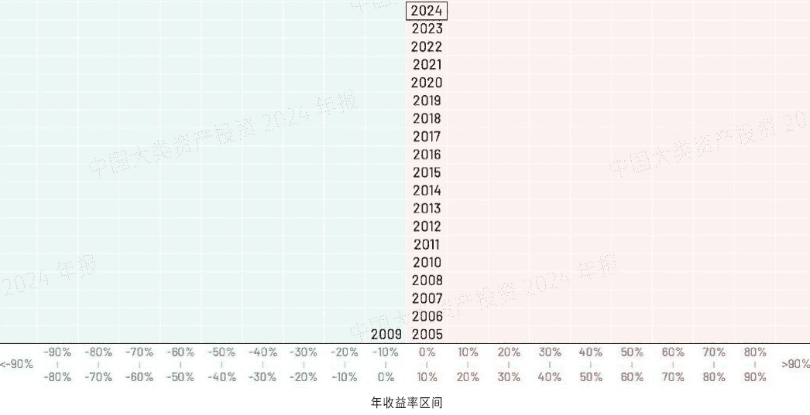

数据来源：张亮、有知、Roger G. Ibbudson

2005~2024年，中国的通货膨胀波动率小，收益分布直方图基本完全集中在通货膨胀一侧，只有别物价下跌，大部分年份上涨。

# 中国大类资产中的风险溢价

风险与收益相伴。不同的资产类别承担着不同程度的风险。高风险资产通常需要提供更高的预期收益来吸引投资者，这种预期收益的增加就为风险溢价。换句话说，投资者在面临更高的风险时，通常会期望获得更高的补偿。

不同类别的收益可以拆分为：

- 短国债收益率由通货膨胀和实际风险收益组成
- 长期国债收益率由通货膨胀、实际风险收益和期限收益组成
- 长期债券收益率由通货膨胀、实际风险收益、期限收益和违约风险收益组成
- 大盘股票收益率由通货膨胀、实际风险收益、期限收益和股票溢价组成
- 小盘股票收益率由通货膨胀、实际风险收益、期限收益和小盘溢价组成

各项风险溢价的计算公式为：

- 实际风险溢价 = (1 + 实际风险收益率) - (1 + 通货膨胀)
- 期限溢价 = (1 + 长期国债收益率) - (1 + 短期国债收益率)
- 违约溢价 = (1 + 信用收益率) - (1 + 长期国债收益率)
- 股票溢价 = (1 + 大盘股票收益率) - (1 + 长期国债收益率)
- 小盘溢价 = (1 + 小盘股票收益率) - (1 + 大盘股票收益率)

理解背后的风险是获得收益的前提。只有清楚地认识资产风险，并承担这些风险，才有可能相应的收益。在投资决策时，风险与收益的关系需要深入理解。

# 图 6-1 中国各类资产风险溢价（2005~2024年）

| | | | | |
|---|---|---|---|---|
| | | 0.79% | 小盘溢价 | |
| | | 4.44% | 股票溢价 | 股票溢价 |
| | | 1.32% | 违约溢价 | |
| | | 1.99% | 通胀溢价 | 通胀溢价 |
| | | 0.25% | 实际无收益率 | |
| | | 2.24% | 通货膨胀 | 通货膨胀 |
| | | 0.49% | 无风险率 | Risk Free |
| | | 0.90% | 期限溢价 | Term Risk Premium |
| | | 1.32% | 违约溢价 | Credit Risk Premium |
| | | 4.44% | 股权溢价 | Equity Risk Premium |
| | | 0.79% | 小盘溢价 | Size Premium |

统计区间：2005~2024年，长期信用溢价为2007~2024年
数据来源：整理、有知、Roger G. Ibbudson

# 6-1 使用“资产分解法”展示资产之间的风险

资产分解法（Building Blocks Method）理解为把不同类别的长期收益拆分为不同风险（块），并用类别的历史收益来计算风险（Risk Premium）。这些风险衡量了投资者投入资产类别（不同的敞口）而获得的补偿，一定程度上反映了市场对于风险的历史定价。

从图6-1可以看出，每个资产的长期收益都是正的，也就是说，随风险的增加，资产的平均收益也会增加。股票相对于长期风险的收益是最大的，达到了平均4.4%，高风险的股票能够带来长期收益，这也反映了股票和债券的不同。

## 6-2 美国各类资产风险

| | | | | |
|---|---|---|---|---|
| | | 1.3% | 小股溢价 | |
| | | 5.2% | 股票溢价 | 股票溢价 |
| | | 0.6% | 违约溢价 | |
| | | 1.6% | 期限溢价 | 期限溢价 |
| | | 2.9% | 实际无收益率 | | |

统计来源：1996~2024年
数据来源：SBBI 2025

# 图 6-3 中国、美国无风险溢价对比

| 国家 | 通货膨胀 | 实际无风险收益 | 期限溢价 | 违约溢价 | 股票风险溢价 | 小盘股溢价 |
|---|---|---|---|---|---|---|
| 中国 | 2.24% | 0.25% | 1.99% | | 4.44% | 0.79% |
| 美国 | 2.9% | 0.3% | 1.6% | 0.6% | 5.2% | 1.3% |

统计区间：2005~2024年（违约溢价统计区间为2007~2024年），美国1926~2024年
数据来源：聚源、有利、Roger G. Libatson, SBBI 2025

图 6-1、图 6-2和图 6-3 是 SBBI 年报中最具价值的图。对比中美美国的风险溢价数据，我们可以看到，虽然两国资本市场的时间跨度较短，中美两国国情不同，政策及经济发展存在差异，但我们计算出的中美两国资产市场的风险溢却是相似的。金融市场的成熟程度越高，风险和收益越相关，长期来看，高风险需要更高的收益来补偿。这一规律在中美市场中都得到验证，这充分证明了市场中这只“看不见的手”在资源配置中的强大力量。

# ### 6-4 中国年的实际无风险收益率（2005~2024年）

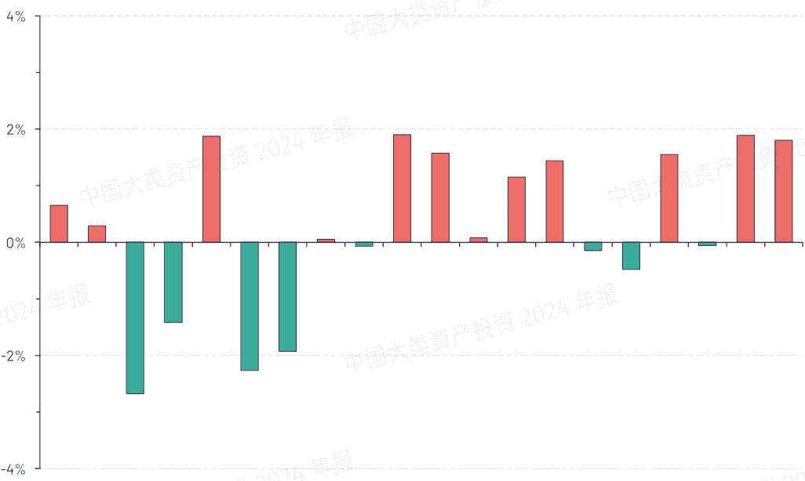

数据来源：财经、有行、Roger J Ibbotson
具体数据附表5

实际无风险收益率（Real Riskless Rate of Return）指的是短期国债收益率扣除通货膨胀后的结果，反映了投资者投资短期国债获得的购买力的实际增长。短期国债通常被认为是整个资本市场中无风险资产，其历史收益率与通货膨胀相当，因此实际无收益率为零，说明短期国债无法带来购买力的实际增长。2005~2024年，大部分年份为正，年份为负。

# 图 6-5 中国年的限期溢价（2005~2024年）

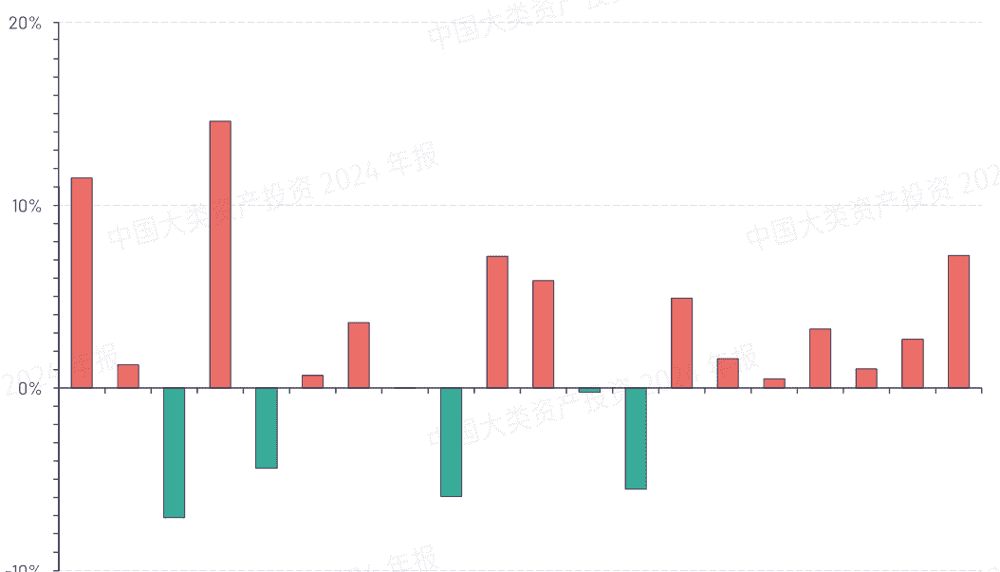

数据来源：聚源、有行、Roger G. Ibbudson

限期溢价（Term Premium）是衡量投资时间长短收益的差异。时间越长，流动性越差，面对的不确定性也越多，投资者承担了更久的风险，自然会有额外的补偿，所以长期债券的收益通常高于短期债，这一风险即为限期溢价。具体来说，当长期利率处于下行时，长期债能够跑赢短期债；反之，当长期利率上升时，长期债的表现不如短期债。

# 图 6-6 中国年的违约溢价（2007~2024年）


数据来源：财经、有行、Roger Ibbudson

违约溢价是决定投资者承受风险的基础要素：违约概率。相比国债担保，信用债发行主体可能无法还债务，因此违约溢价高。2007~2018年中，中国的违约溢价15年为正，3年为负。相比美国市场，中国的违约溢价要高。

# 图 6-8 中国年的小盘溢价（2005~2024年）


数据来源：张凯、郭有莉、Roger Ibbudson

2005~2024年，小盘股相对于大盘股的溢价年化为0.79%，年化波动率为24.23%。然而，2024年小盘的表现的表现理想，收益率仅有2.79%，远低于大盘股的18.24%，这一年的小盘溢价为-13.06%。这一现象在历史数据中经常出现。图6-8展示了2005~2024年每年的小盘溢价。可以看到，过去20年中，小盘溢价8年为正收益，12年为负收益，小盘股的风险集中在少数内，历史上实现了“牛短熊长”——一年内小盘溢价为正并不常态。这提醒投资者，虽然在SBBI历史溢价的资产类别中，小盘股的长期收益率是，但投资小盘股风险非常高。想要获得小盘溢价，投资者需要非常有耐心，有时要忍长时间小盘股跑赢大盘，投资小盘股的钱应该是长期不用的钱。虽然2024的时间有限，我们仍期待通过更长期的全面观测来进一步证实这些规律。

# 07 黄金

2024年，黄金的表现尤为亮眼，上海黄金的价格上涨高达28%，远超中国股票和债，成为新的“明星”投资类别。本章全面分析了黄金的供需关系、长期收益来源和历史成就，并结合SBBI分析框架系统揭示了黄金在长期投资组合中的作用。我们用不同阶段的历史数据解析了黄金收益的，并回答了投资者是否需要配置黄金和何时可以配置黄金。

# 中国大资产投资2024年报

# 图-1 上海黄金的年收益率与联动收益率（2003~2024年）

| | 2003 | 2004 | 2005 | 2006 | 2007 | 2008 | 2009 | 2010 | 2011 | 2012 | 2013 | 2014 | 2015 | 2016 | 2017 | 2018 | 2019 | 2020 | 2021 | 2022 | 2023 | 2024 |
|---|---|---|---|---|---|---|---|---|---|---|---|---|---|---|---|---|---|---|---|---|---|---|
| 2003 | 18.62% | 8.38% | 20.03% | | | | | | | | | | | | | | | | | | | |
| 2004 | 12.81% | 6.34% | 20.05% | | | | | | | | | | | | | | | | | | | |
| 2005 | 12.96% | 13.56% | 18.31% | 20.07% | | | | | | | | | | | | | | | | | | |
| 2006 | 17.02% | 15.13% | 18.31% | 20.65% | 23.46% | | | | | | | | | | | | | | | | | |
| 2007 | 12.75% | 11.41% | 12.72% | 12.60% | -3.26% | -2.28% | | | | | | | | | | | | | | | | |
| 2008 | 14.49% | 14.57% | 10.51% | 16.24% | 19.11% | 11.90% | | | | | | | | | | | | | | | | |
| 2009 | 20.65% | 19.33% | 14.56% | 14.58% | 13.58% | 13.18% | 18.12% | 14.27% | 23.61% | | | | | | | | | | | | |
| 2010 | 14.76% | 14.74% | 14.50% | 18.57% | 14.63% | 7.40% | 20.53% | 25.32% | 23.61% | | | | | | | | | | | | |
| 2011 | 13.89% | 8.66% | 7.42% | 7.60% | 5.24% | 3.94% | -3.02% | -10.26% | -8.63% | -16.59% | -19.75% | -23.27% | | | | | | | | | |
| 2012 | 7.76% | 7.26% | 6.68% | 8.17% | 5.34% | 4.62% | -0.15% | -21.71% | -23.6% | -5% | -3.75% | 13.62% | 18.62% | | | | | | | | |
| 2013 | 7.45% | 6.64% | 6.68% | 6.14% | 5.07% | 3.22% | 3.50% | 4.29% | 4.05% | 14.05% | -24.05% | -3.8% | -8.5% | -6% | 2.22 | | | | | | |
| 2014 | 2.21% | 7.28% | 5.45% | 5.95% | 4.95% | 3.25% | 1.65% | -2.05% | -2.68% | -2.35% | -2.28% | -7.28% | | | | | | | | | |
| 2015 | 8.05% | 8.70% | 7.71% | 7.46% | 6.45% | 6.15% | 4.35% | 2.25% | 1.81% | 1.87% | 5.05% | 11.68% | 11.28% | 17.66% | 10.25% | 14.44% | 14.44% | | | | |
| 2016 | 7.01% | 7.05% | 7.05% | 6.68% | 6.2% | 5.0% | 5.5% | 1.5% | 1.5% | .5% | 7.28% | 7.01% | 7.01% | 7.01% | 4.1 | 4.12% | 4.24% | | | | |
| 2017 | 7.02% | 7.15% | 7.13% | 6.59% | 6.09% | 5.63% | 4.07% | 2.60% | 2.70% | 6.27% | 6.91% | 7.64% | 7.65% | 8.08% | 6.50% | 4.50% | 4.22% | | | | |
| 2018 | 8.24% | 8.33% | 7.96% | 7.76% | 7.98% | 7.76% | 5.96% | 5.28% | 5.21% | 7.23% | 10.06% | 11.15% | 11.68% | 12.30% | 13.50% | 16.06% | 22.38% | 28.18% | | | |


# 图-7 某基金的年化收益与波动收益率（1969~2024年）

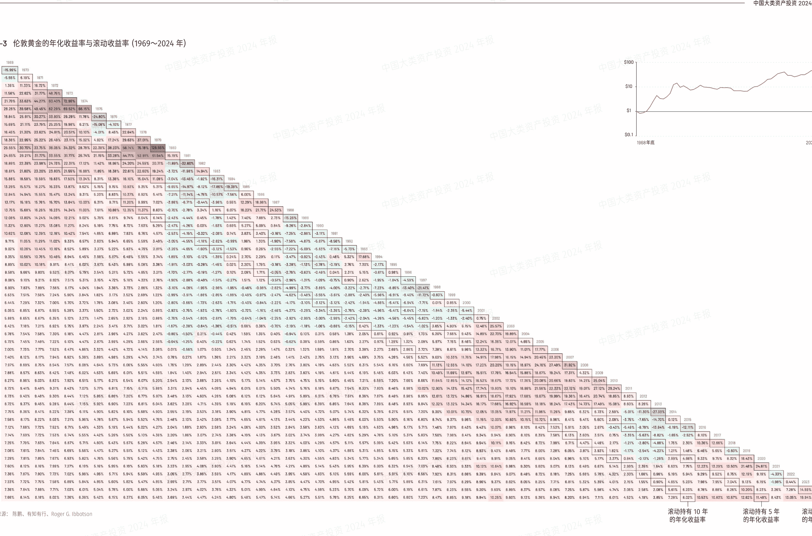

数据来源：基金、历史数据、Roger & Dobson

波动率10年
年化收益5年
年化收益1年

## 
# 图 7-4 滚动持有伦敦黄金1年、5年、10年的年化收益率(1969~2024年)

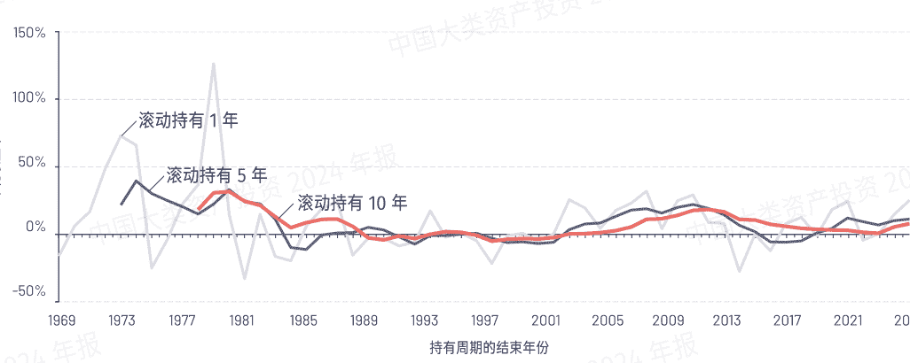

1969~2024 年伦敦黄金全数据收益率表明：

- 黄金的长期收益率低于股票，但波动率与股票相近；
- 黄金上涨或下跌周期可能非常长，可能达 20 年。

## 黄金供给端

黄金作为一种金属，其价格由市场供给关系决定，长期黄金价格走势和波动主要受需求变化的影响。

黄金的供给端主要有两个，一个是通过开采和冶炼获得的黄金，约占全球每年黄金供给的80%；二是黄金回融，比如旧金饰、电子器件的回收再利用，约占全球黄金供给的20%。

从勘探到冶炼，整个过程需要投入大量资源和时间。例如，建立矿业公司、获取许可证、购买设备、建设冶炼厂等，可能需要多年才能实现黄金产出。因此，供给的产量变化会影响价格波动。

从图7-5中可以看出，2010~2024年，黄金全球供给稳定在4500~5000吨之间，尽管全球黄金价格

图 7-5 黄金全球供给（2010-2024年）

| | 2010 | 2011 | 2012 | 2013 | 2014 | 2015 | 2016 | 2017 | 2018 | 2019 | 2020 | 2021 | 2022 | 2023 | 2024 |
|---|---|---|---|---|---|---|---|---|---|---|---|---|---|---|---|
| 矿产 | | | | | | | | | | | | | | | | |
| 回收 | | | | | | | | | | | | | | | | |
| 生产净供给 | | | | | | | | | | | | | | | | |

数据来源：世界黄金协会网站

## 黄金需求

黄金的主要用途有三：

- 1. 首饰制作：这是黄金最主要的用途，占每年黄金总需求的 5%。%。许多国家和地区，黄金首饰在传统仪式中扮演着重要角色，尤其是是在婚礼和葬礼场合。中国和印度都是巨大的黄金首饰消费国。
- 2. 工业用途：黄金在工业中有着广泛的应用，主要用于电子产品、医疗设备和航天技术等领域。由于其优异的导电性、热性和抗腐性，黄金常被用作导体材料、反射器以及电子元件的导体。这一用途占每年黄金总需求的 10%~20% 左右，需求的较少与发达国家水平密切相关。
- 3. 投资：世界上最大的黄金投资者是各国政府，将黄金视为储备，用于应对极端风险。

在政治动荡或冲突时期，法币可能贬值，黄金作为硬通货，价值被认可。例如 2022 年乌克兰冲突期间，俄罗斯储备的美元黄金被封锁，其存在全球金库的黄金就可以自由使用，证明了黄金在危机中的重要性。

近年来，全球局势的不确定性增加，各国政府大幅增加了黄金的购买，图 7-6 显示，近三年来，黄金作为储备的需求大幅增长。

图 7-6 黄金全球需求(2010~2024年)

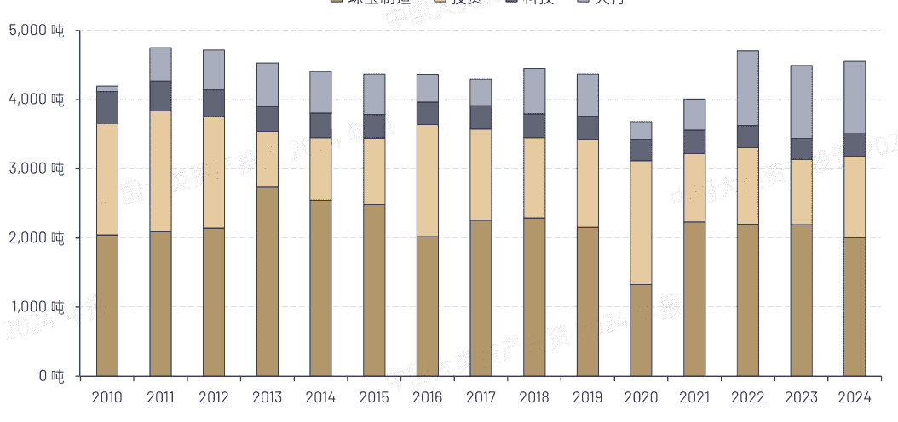

数据来源：世界黄金协会

## 图 7-7 股票、债券、黄金和通货胀的长期收益对比(1969~2024年)

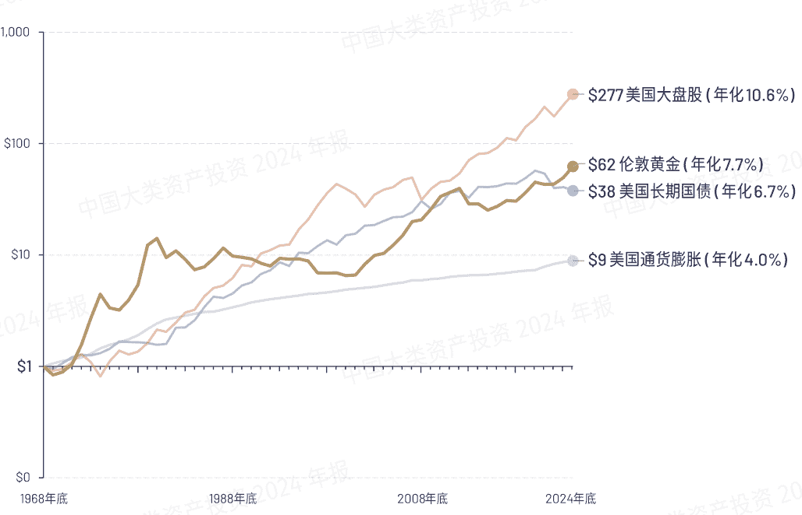

| 资产类别 | 美国大盘股 | 美国长期国债 | 伦敦黄金 | 美国通货胀 |
| --- | --- | --- | --- | --- |
| 年化收益率 | 10.6% | 6.7% | 7.7% | 4.0% |
| 年化波动率 | 17.2% | 12.6% | 26.0% | 2.9% |

数据来源：彭格尔、有知、有行、Roger G. Ibbotson

## 图 7-8 股票、债券、黄金和通货胀的相关性系数(1969~2024年)

| | 美国大盘股 | 美国长期国债 | 伦敦黄金 | 美国通货胀 |
| --- | --- | --- | --- | --- |
| 美国大盘股 | 1 | | | |
| 美国长期国债 | 0.10 | 1 | | |
| 伦敦黄金 | -0.16 | -0.08 | 1 | |
| 美国通货胀 | -0.14 | -0.29 | 0.42 | 1 |

数据来源：彭格尔、有知、有行、Roger G. Ibbotson

# 黄金长期的风险、收益和成本

由于股市、债券、黄金市场的波动，这里用黄金在投资组合中的作用。1969~2024 年数据：

- 黄金的年化收益率为7.7%，远高于长期债；
- 黄金与股市负相关（相关系数为 -16），这说明黄金具有良好的分散作用；
- 黄金与通胀的相关性为42，意味着黄金价格倾向与通胀相同。

长期来看，黄金作为一种避险资产，能够应对通胀风险，然而其短期波动率较高，并不是理想的选择。从投资角度来看，黄金价格从35美元/盎司涨幅高达17倍，目前约为600美元/盎司，仅是买入黄金的代价，其波动性高达10%~30%，决定了其作为单一资产的选择。

## 黄金收益的双面性

黄金的收益具有很强的双面性：

- 当购买力稳定且市场需求充足时，黄金收益通常低于股票和债券；
- 当货币贬胀风险上升时，黄金避险属性开始发挥作用，其收益甚至高于股市。

这种属性与保险型产品相似，风险时保险不会赔付，此时黄金会带来高额回报。接下来的图 7-9 至 7-14，我们将回顾过去55年的黄金走势，帮助投资者更地理解黄金的投资逻辑。

## 图 7-9 股票、债券、黄金和货币膨胀的长期收益对比（1969~1980年）

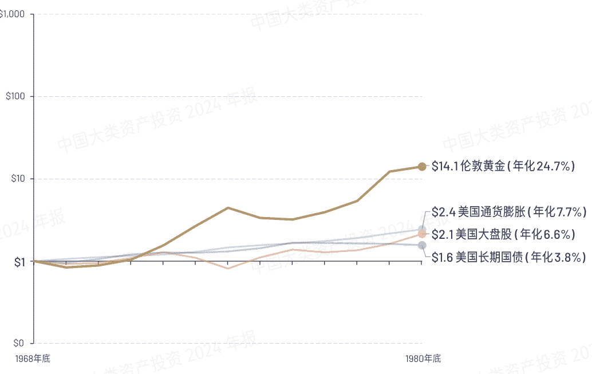

| 资产类别 | 美国大盘股 | 美国长期国债 | 黄金 | 美国通膨胀 |
| --- | --- | --- | --- | --- |
| 年化收益率 | 6.6% | 3.8% | 24.7% | 7.7% |
| 年化波动率 | 19.6% | 7.3% | 42.8% | 3.5% |

数据来源：凯恩、有知、有行、Roger G. Ibbotson

## 图 7-10 股票、债券、黄金和货币膨胀的相关系数（1969~1980年）

| 资产类别 | 美国大盘股 | 美国长期国债 | 黄金 | 美国通膨胀 |
| --- | --- | --- | --- | --- |
| 美国大盘股 | 1 | | | |
| 美国长期国债 | 0.30 | 1 | | |
| 黄金 | -0.29 | -0.34 | 1 | |
| 美国通膨胀 | -0.14 | -0.59 | 0.57 | 1 |

数据来源：凯恩、有知、有行、Roger G. Ibbotson

## 1969~1980: 高通胀、高风险下的黄金崛起

战后，世界经济格局发生巨大变化，欧洲经济地位大幅削弱，美国成为世界最大的债权国，经济实力表现雄厚。1944年7月，44国家的代表签署了《布雷顿森林协议》，标志着布雷顿森林体系的建立。

该协议规定：

- 1. 美元直接和黄金挂钩，1盎司兑于35美元，美国政府承担接黄金价值的义务；
- 2. 其他货币与美元挂钩，各国货币与美元保持固定汇率，汇率波动幅度为1%。

布雷顿森林体系在战后经济复苏中发挥了重要作用，帮助美国制定了货币政策，控制了通膨胀。20世纪60年代末70年代初，美国逐渐进入泥潭，经济实力下行，又经历了石油危机，国际支出出现了大量的赤字，美国的通胀值已经接近35美元/1盎司的黄金。

1971年8月15日，美国宣布停止美元兑黄金的义务，标志着布雷顿森林体系的崩溃。1973年，各国开始放弃本位制度，实行浮动汇率，布雷顿森林体系彻底瓦解。

图 7-9展示了布雷顿森林体系瓦解后股票、债券、黄金和货币通胀的走势。可以看到1969~1980年，通胀率高达7.7%，美元大幅贬值。在此期间，黄金从35美元/盎司涨到600美元/盎司，远高于股票和债券。

## 图 7-11 股票、债券、黄金和货币通胀的长期收益对比（1981~2001年）

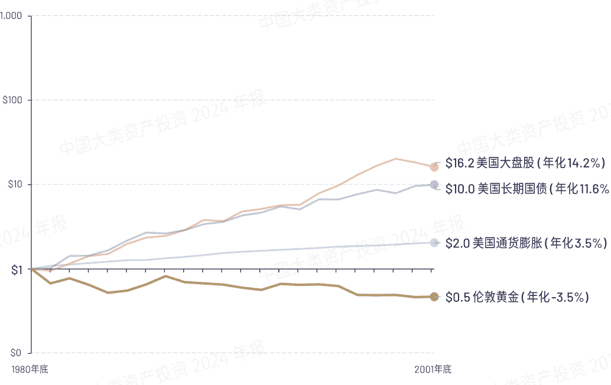

该图以收益为坐标：

| 资产类别 | 美国大盘股 | 美国长期国债 | 黄金 | 美国通膨胀 |
| --- | --- | --- | --- | --- |
| 年化收益率 | 14.2% | 11.6% | -3.5% | 3.5% |
| 年化波动率 | 15.0% | 13.3% | 14.1% | 1.7% |

数据来源：凯凯、有行、Roger G. Ibbotson

## 图 7-12 股票、债券、黄金和货币通胀的相关系数（1981~2001年）

| | 美国大盘股 | 美国长期国债 | 伦敦黄金 | 美国通膨胀 |
| --- | --- | --- | --- | --- |
| 美国大盘股 | 1 | | | |
| 美国长期国债 | 0.42 | 1 | | |
| 伦敦黄金 | 0.06 | 0.25 | 1 | |
| 美国通膨胀 | -0.32 | -0.17 | -0.41 | 1 |

数据来源：凯、有行、Roger G. Ibbotson

## 1981~2001年：通胀与利率导致吸引力减弱

20世纪70年代末，美国通胀高达13%，经济增长停滞，失业率上升，民众对政府的信心缺失，传统的货币政策未能应对这一复杂局面。1979年，美联储主席保罗·沃尔克采取激进紧缩，通过公开操作等手段控制货币供应，成功遏制了通胀，吸引大量资金回美国。到1983年，美国终于结束了高通胀压力，进入了一个新的增长和通通周期。

随着苏联解体，东西方持续四十年的冷战结束，世界朝着多元化发展，进入相对持久的和平时代，越来越多国家进入经济发展的大潮，全球化的步伐逐步趋近。图 7-11 展示了这一时期的股票、债券、黄金和通胀的趋势。数据显示，随着全球经济的增速放缓，美国通胀稳定在3.5%，黄金作为避险资产的吸引力减弱，价格从600美元/盎司回落至400美元/盎司，最终跌落到300美元/盎司以下，投资收益为负。与此同时，美国股市和债券的收益都超过10%。

## 7-13 股票、债券、黄金和货币通胀的长期收益对比 (2002~2024 年)

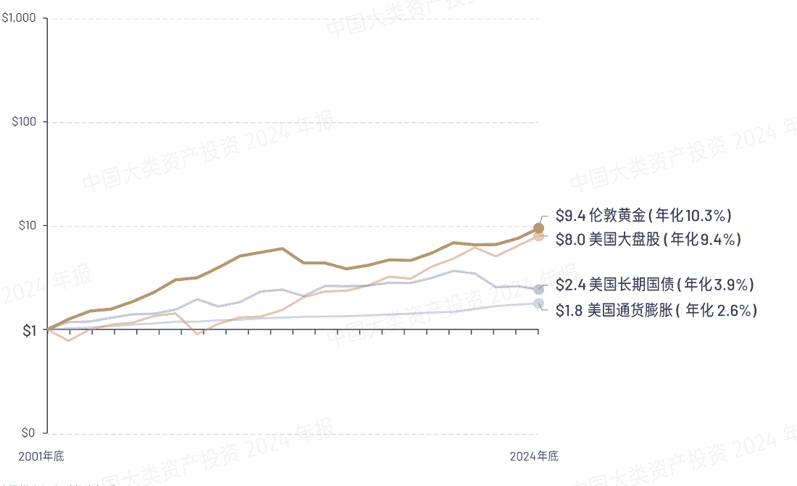

$9.4% 美国黄金(年化10.3%)
$8.0% 美国大盘股(年化9.4%)
$2.4% 美国长期债(年化3.9%)
$1.8% 美国通胀(年化2.6%)

| 资产类别 | 美国大盘股 | 美国长期国债 | 伦敦黄金 | 美国通胀 |
|---|---|---|---|---|
| 年化收益 | 9.4% | 3.9% | 10.3% | 2.6% |
| 年化波动率 | 18.0% | 13.1% | 14.5% | 1.6% |

数据来源:瞻顾、有行、Roger G. Ibotson

## 7-14 股票、债券、黄金和货币通胀的相关系数 (2002~2024 年)

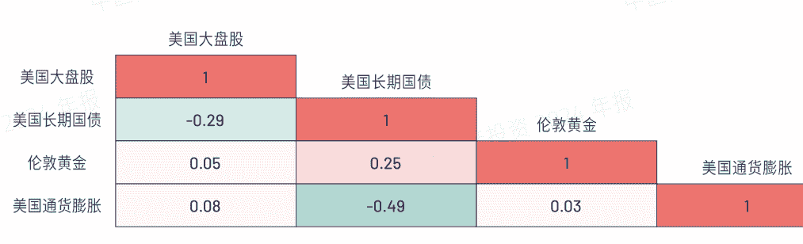

| | 美国大盘股 | 美国长期国债 | 伦敦黄金 | 美国通胀 |
|---|---|---|---|---|
| 美国长期国债 | -0.29 | 1 | | |
| 伦敦黄金 | 0.05 | 0.25 | 1 | |
| 美国通胀 | 0.08 | -0.49 | 0.03 | 1 |

数据来源: 瞻顾、有行、Roger G. Ibotson

## 2002~2024年：低通胀、高风险下的新轮行情

2001年，互联网泡沫破；2008年，金融危机爆发；2016年，英国脱欧；2020年，新冠疫情遭遇；2022年，乌克兰冲突等地。2022年，美联储实施量化宽松，引发市场对黄金的需求增长。2024年，黄金价格涨至6600美元/盎司，涨幅高达68%。

从历史数据来看：

- 黄金作为避险工具，在股市波动时表现优异；
- 黄金的年化收益率为7.7%，高于长期债；
- 黄金的收益与股票负相关，波动与股票持平；
- 黄金和债券与通胀均负相关。

2025年还能投资吗？

# 各类资产的相关性

资产相关性衡量的是不同资产在价格和收益方面的关联程度。
- 相关系数接近1，代表两种资产经常同涨跌；
- 相关系数接近-1，代表两种资产经常反向；
- 相关系数接近0，代表两种资产变化没有相关性。

选择相关性低或者负相关的资产构建组合，能够降低投资风险，提升整体收益。关于资产收益相关性的研究，是分散风险的关键之一。只有知道了哪些资产相关性高，哪些资产相关性低，我们才能有效地分散投资。

## 图 8-1 中国各资产的相关系数

| | 大盘股 | 小盘股 | 长期信用 | | |
|---|---|---|---|---|
| 大盘股 | 1 | 0.98 | | | |
| 小盘股 | 0.95 | 1 | 0.88 | | |
| 长期信用 | -0.47 | -0.50 | -0.44 | 1 | |
| 长期国债 | -0.54 | -0.53 | 0.95 | 1 | |
| 短期国债 | -0.43 | -0.40 | -0.44 | 0.65 | 1 |
| 上海黄金 | 0.37 | 0.24 | 0.26 | -0.21 | -0.13 |
| 通膨胀 | -0.17 | -0.17 | -0.14 | 0.07 | 0.19 | 0.45 | -0.21 |

统计周期：2005~2024年，长期信用与其他资产的相关系数为2007~2024年。
数据来源：数据，版权所有：Roger, G. Ibotson
计算方法：使用X和Y的相关系数公式 $\rho_{XY}$
其中，$sigma_X$为X的收益率的标准，$sigma_Y$为Y的收益率的标准；
$Cov(X,Y) =$ X和Y的相关系数，计算公式：$Cov(X,Y) = \frac{\sum(x_i-\bar{x})(y_i-\bar{y})}{n-1}$
其中：$\bar{x}$为X在第i年的收益率的平均值；$\bar{y}$为Y在第i年的收益率的平均值；$n$为X和Y的收益率个数。

| | 大盘股 | 小盘股 | 长期信用 | | |
|---|---|---|---|---|
| 大盘股 | 1 | | | | |
| 小盘股 | | 1 | | | |
| 长期信用 | | | -0.47 | | |
| 长期国债 | | | -0.54 | | |
| 短期国债 | | | -0.43 | | |

中国长期债券和中国国债的相关性也较高，大多数份是同向的。

# 中国大类资产投资 2024 年报

中国大类资产投资 2024 年报

| | A股整体 | 大盘股 | 小盘股 | 长期信用 | 长期债 | 短期限 | 通货膨胀 |
|---|---|---|---|---|---|---|
| 上海黄金 | 0.37 | 0.43 | 0.26 | -0.21 | -0.13 | -0.57 | -0.21 |

中国长期债券和中国国债的相关性也较高，大多数份是同向的。


# 单一股票、分散投资和“免费午餐”

根据《中国证券登记结算公司统计年鉴2023》的数据，截至2023年，中国约有2.24亿直接参与A股市场交易，但我们观察到，大多数个人投资者的收益并不常被“割韭菜”。

根据上海证券交易所统计聚集的数据，2016年，个人投资者持股市值占比23.7%，但金额占比高达35.4%。2017年，个人投资者持股市值占比21.2%，仅获得股票市场不到9%的盈利。

其原因在于，个人投资者在股票市场信息获取、信息处理以及决策执行等方面均处于劣势，尤其是许多个人投资者倾向于单一股票，对单个股票的预期收益和风险特征了解有限。

本章分析了单一股票和投资组合的风险特征，帮助投资者更好地理解为什么个人投资股票组合风险更高，收益更低。

## 图 9-1 不同深度的沪深300成股组合的年化收益率分布

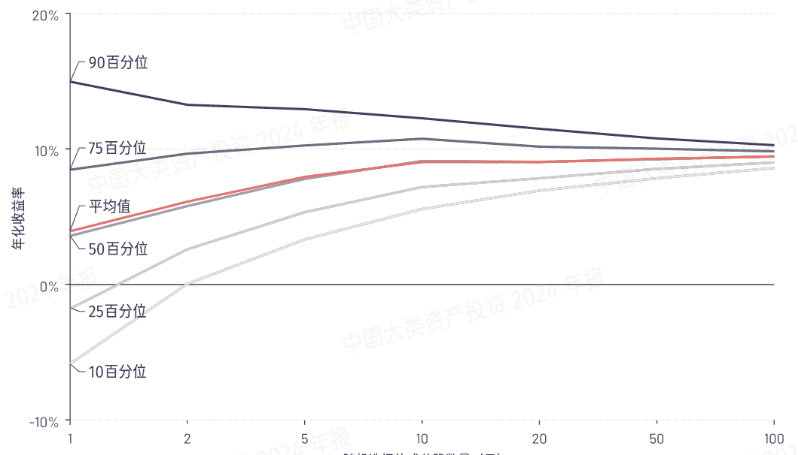

| 成分数量 | 1 只 | 2 只 | 5 只 | 10 只 | 20 只 | 50 只 | 100 只 |
| --- | --- | --- | --- | --- | --- | --- | --- |
| 平均值 | 2.59% | 6.10% | 7.95% | 9.03% | 9.02% | 9.28% | 9.43% |
| 90 百分位 | 14.95% | 13.25% | 12.93% | 12.27% | 11.48% | 10.78% | 10.27% |
| 75 百分位 | 8.47% | 9.65% | 10.26% | 10.74% | 10.16% | 10.01% | 9.82% |
| 50 百分位 | 3.58% | 5.78% | 7.78% | 9.11% | 9.05% | 9.24% | 9.45% |
| 25 百分位 | -1.80% | 2.59% | 5.33% | 7.18% | 7.83% | 8.52% | 8.99% |
| 10 百分位 | -5.85% | 0.04% | 3.33% | 5.56% | 6.93% | 7.84% | 8.59% |

数据来源：携、有序、Roger G. Libbotson
计算方法：2005~2024年，每半年从沪深300成股中随机选择不同数量的成分（1, 2, 5, 10, 20, 50, 100）的成股组成一个等权重组合，计算每半年内的组合，将其逐推算 20 年的组合回报。每种成分数量的等权重组合模拟 300 次，再迭代 300 次的年化收益率分布

## 图 9-2 不同数量的沪深300分股指数组合的年化波动分布

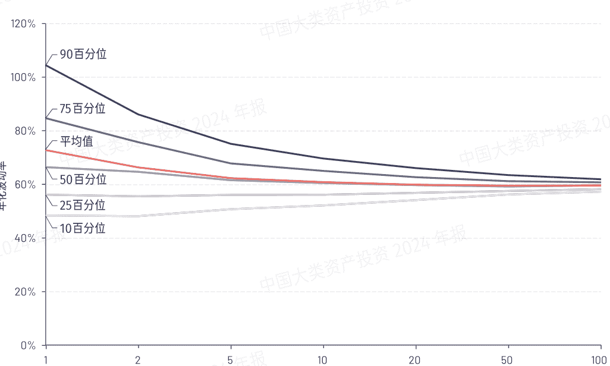

| 成分数量 | 1 只 | 2 只 | 5 只 | 10 只 | 20 只 | 50 只 | 100 只 |
| --- | --- | --- | --- | --- | --- | --- | --- |
| 平均值 | 72.89% | 66.39% | 62.38% | 60.91% | 60.00% | 59.60% | 59.69% |
| 90 百分位 | 104.53% | 86.14% | 75.18% | 69.75% | 66.16% | 63.58% | 62.03% |
| 75 百分位 | 84.80% | 75.83% | 67.87% | 65.13% | 62.74% | 61.30% | 60.89% |
| 50 百分位 | 66.51% | 64.81% | 61.64% | 60.60% | 59.80% | 59.29% | 59.73% |
| 25 百分位 | 56.22% | 55.61% | 56.15% | 56.20% | 56.91% | 57.76% | 58.36% |
| 10 百分位 | 48.50% | 48.20% | 50.88% | 52.23% | 54.22% | 56.33% | 57.35% |

数据来源：聚宽，东方。方法：2005~2024年，每半年为沪深300分股指数随机选择（1, 2, 5, 10, 20, 50, 100）的成分组成一个等权重组合，计算每半年年内的组合收益，将其计算20 年的组合收益。每份成分股收益的等权重标准回测300次，回溯过去300年的年化波动分布

2005~2024 20年不同数量成分股的组合回测结果表明：

- 成分越越多，年化收益越确定
- 成分越越多，年化波动越接近于单个市场的系统风险，而系统风险是不能通过分散来消除风险的。

9-1和9-2 展示了不同股票组合20年的年化收益分布。左侧的是随机挑选10只沪深300成分股模拟300次的分布，最右侧是随机挑选100只沪深300成分股等样本，模拟了300次的分布。通过这个过程，我们可以观察到：

- 单股票的平均收益最低有5%在左右，有多股票组合的平均收益趋近于整个样本；
- 单股票的收益波动特别大，说明单股票收益的不确定性较高；
- 随着组合中股票数量的增加，平均收益上升，同时分布变窄，有多股票组合的波动比单股票小，收益的增加降低了单股票带来的波动；
- 当股票数量增加到10只时，平均收益和波动不再发生变化。以上结论了分散投资的合理性——分散收益是投资中的“免费餐”。持有单一股票时，所面临的是非风险，即行业特有的风险，这种风险通常无法带来更高的收益，因此首要原则就是分散。在实践中，这结论不仅用于股票，也适用于其他。从风险的角度来看，持有单一股票风险越高。一般来说，只有当单一股票收益比市场高出一倍以上，才能继续持有。

## 附表 1 中国各类资产的长期收益

| 日期 | A股 | 大盘股 | 小盘股 | 长期收益 | 短期收益 | 黄金 | 通胀 |
| --- | --- | --- | --- | --- | --- | --- | --- |
| 2004/12/31 | 1.00 | 1.00 | 1.00 | 1.00 | 1.00 | 1.00 |
| 2005/12/31 | 0.91 | 0.95 | 0.85 | 1.14 | 1.02 | 1.13 | 1.15 |
| 2006/12/31 | 1.95 | 2.13 | 1.50 | 1.18 | 1.04 | 1.35 | 1.34 |
| 2007/12/31 | 5.31 | 5.62 | 4.55 | 1.12 | 1.06 | 1.65 | 1.64 |
| 2008/12/31 | 1.93 | 1.93 | 1.86 | 1.33 | 1.11 | 1.61 | 1.93 |
| 2009/12/31 | 4.01 | 3.84 | 4.47 | 1.29 | 1.12 | 1.14 | 2.10 |
| 2010/12/31 | 3.89 | 3.39 | 5.28 | 1.31 | 1.13 | 2.56 | 2.47 |
| 2011/12/31 | 2.83 | 2.58 | 3.53 | 1.40 | 1.17 | 2.71 | 2.91 |
| 2012/12/31 | 3.00 | 2.83 | 3.51 | 1.44 | 1.20 | 2.83 | 3.19 |
| 2013/12/31 | 3.21 | 2.68 | 4.65 | 1.39 | 1.23 | 2.00 | 3.48 |
| 2014/12/31 | 4.77 | 4.17 | 1.55 | 1.22 | 1.28 | 2.04 | 3.76 |
| 2015/12/31 | 6.38 | 4.48 | 11.10 | 1.69 | 1.32 | 1.89 | 4.00 |
| 2016/12/31 | 5.53 | 8.91 | 1.71 | 1.72 | 1.35 | 2.23 | 4.31 |
| 2017/12/31 | 5.75 | 5.05 | 7.41 | 1.67 | 1.39 | 2.31 | 4.77 |
| 2018/12/31 | 4.08 | 3.85 | 4.72 | 1.82 | 1.43 | 2.41 | 5.25 |
| 2019/12/31 | 5.45 | 5.36 | 5.99 | 1.50 | 1.47 | 2.19 | 5.61 |
| 2020/12/31 | 6.91 | 6.97 | 7.22 | 1.94 | 1.50 | 3.30 | 5.75 |
| 2021/12/31 | 7.45 | 6.72 | 8.78 | 2.06 | 1.54 | 3.17 | 6.52 |
| 2022/12/31 | 6.04 | 5.39 | 6.95 | 2.12 | 1.57 | 3.48 | 6.86 |
| 2023/12/31 | 5.71 | 4.90 | 6.59 | 2.22 | 1.60 | 4.06 | 7.16 |
| 2024/12/31 | 6.28 | 5.79 | 6.77 | 2.43 | 1.64 | 5.21 | 7.51 |

## 附表 2 中国各类资产的收益率

| 年份 | A股 | 大盘股 | 小盘股 | 长期国债 | 短期国债 | 上海基金 | 通货膨胀 |
| --- | --- | --- | --- | --- | --- | --- | --- |
| 2005 | -9.43% | -5.25% | -14.99% | / | 14.23% | 13.10% | 1.80% |
| 2006 | 115.38% | 125.23% | 76.73% | - | 3.10% | 1.80% | 19.31% | 1.51% |
| 2007 | 172.40% | 163.28% | 203.10% | -4.46% | -5.26% | 1.99% | 22.40% | 4.80% |
| 2008 | -63.77% | -85.61% | -59.19% | - | 17.91% | 4.39% | -2.25% | 5.90% |
| 2009 | 108.10% | 98.58% | 144.44% | -1.84% | -3.31% | 1.15% | 28.25% | -0.71% |
| 2010 | -2.99% | -11.58% | 17.64% | 1.64% | 0.94% | 0.95% | 23.44% | 3.29% |
| 2011 | -27.32% | -24.05% | -32.78% | 7.08% | 3.35% | 5.96% | 5.39% |
| 2012 | 6.24% | 9.80% | -0.77% | 5.08% | 2.67% | 4.60% | 2.60% |
| 2013 | 7.10% | -5.33% | 32.50% | -1.24% | -3.54% | 2.53% | -29.31% | 2.60% |
| 2014 | 48.41% | 55.85% | 35.26% | 14.85% | 11.43% | 3.93% | 1.75% | 2.00% |
| 2015 | 33.78% | 72.22% | 76.59% | 13.96% | 9.03% | 3.00% | -7.37% | 1.40% |
| 2016 | -13.31% | -9.26% | -18.69% | 0.70% | 1.86% | 2.08% | 18.42% | 2.00% |
| 2017 | 3.68% | 24.25% | -16.89% | -1.77% | -2.94% | 2.76% | 3.45% | 1.59% |
| 2018 | -28.79% | -23.64% | -36.28% | 8.67% | 3.57% | 4.25% | 2.14% | 2.10% |
| 2019 | 33.41% | 39.19% | 26.98% | 5.98% | 4.40% | 2.75% | 19.75% | 2.90% |
| 2020 | 26.87% | 29.89% | 20.46% | 4.40% | 2.52% | 2.00% | 14.44% | 2.49% |
| 2021 | 7.70% | -3.52% | 21.61% | 6.76% | 5.76% | 2.46% | -4.14% | 0.90% |
| 2022 | -18.93% | -19.84% | -20.77% | 3.24% | 3.00% | 1.94% | 9.80% | 2.01% |
| 2023 | -5.34% | -9.14% | -5.28% | 7.74% | 4.80% | 2.09% | 16.83% | 0.20% |
| 2024 | 9.98% | 18.24% | 2.79% | 10.22% | 9.38% | 2.00% | 28.19% | 0.20% |

## 表附3 中国各类资产收益率统计

| 年份 | A整体收益 | 资本利得 | 分红+投资 | 大盘收益 | 资本利得 | 分红+投资 | 小盘收益 | 资本利得 | 分红+投资 |
| --- | --- | --- | --- | --- | --- | --- | --- | --- | --- |
| 2005 | -9.43% | -10.99% | 1.75% | -5.25% | -7.85% | 2.60% | -14.99% | -15.73% | 0.88% |
| 2006 | 115.38% | 112.17% | 1.52% | 125.33% | 121.02% | 1.90% | 76.73% | 76.22% | 0.29% |
| 2007 | 172.40% | 170.88% | 0.56% | 163.28% | 161.55% | 0.06% | 203.10% | 202.57% | 0.17% |
| 2008 | -63.77% | -64.08% | 0.82% | -65.61% | -65.95% | 1.01% | -58.19% | -59.26% | 0.15% |
| 2009 | 108.10% | 106.46% | 0.79% | 98.58% | 97.81% | 0.95% | 140.44% | 139.85% | 0.25% |
| 2010 | -2.99% | -3.77% | 0.81% | -11.58% | -11.28% | 1.07% | 17.64% | 17.40% | |
| 2011 | -27.32% | -24.05% | -32.78% | 7.08% | 3.35% | 5.96% | 5.39% | |
| 2012 | 6.24% | 9.80% | -0.77% | 5.08% | 2.67% | 4.60% | | |
| 2013 | 7.10% | -5.33% | 32.50% | -1.24% | -3.54% | 2.53% | -29.31% | 2.60% |
| 2014 | 48.41% | 55.85% | 35.26% | 14.85% | 11.43% | 3.93% | 1.75% | 2.00% |
| 2015 | 33.78% | 72.22% | 76.59% | 13.96% | 9.03% | 3.00% | -7.37% | 1.40% |
| 2016 | -13.31% | -9.26% | -18.69% | 0.70% | 1.86% | 2.08% | 18.42% | 2.00% |
| 2017 | 3.68% | 24.25% | -16.89% | -1.77% | -2.94% | 2.76% | 3.45% | 1.59% |
| 2018 | -28.79% | -23.64% | -36.28% | 8.67% | 3.57% | 4.25% | 2.14% | 2.10% |
| 2019 | 33.41% | 39.19% | 26.98% | 5.98% | 4.40% | 2.75% | 19.75% | 2.90% |
| 2020 | 26.87% | 29.89% | 20.46% | 4.40% | 2.52% | 2.00% | 14.44% | 2.49% |
| 2021 | 7.70% | -3.52% | 21.61% | 6.76% | 5.76% | 2.46% | -4.14% | 0.90% |
| 2022 | -18.93% | -19.84% | -20.77% | 3.24% | 3.00% | 1.94% | 9.80% | 2.01% |
| 2023 | -5.34% | -9.14% | -5.28% | 7.74% | 4.80% | 2.09% | 16.83% | 0.20% |
| 2024 | 9.98% | 18.24% | 2.79% | 10.22% | 9.38% | 2.00% | 28.19% | 0.20% |


## 附表 4 中国各类资产的实际收益指数

| 日期 | A股整体 | 大盘 | 小盘股 | 长期信用 | 长期国债 | 短期国债 |
| --- | --- | --- | --- | --- | --- | --- |
| 2004/12/31 | 1.00 | 1.00 | 1.00 | / | 1.00 | 1.00 |
| 2005/12/31 | 0.89 | 0.93 | 0.84 | / | 1.12 | 1.01 |
| 2008/12/31 | 1.89 | 2.07 | 1.45 | / | 1.14 | 1.01 |
| 2007/12/31 | 4.91 | 5.19 | 4.21 | 0.91 | 1.03 | 0.98 |
| 2008/12/31 | 1.68 | 1.69 | / | 1.62 | 1.02 | 1.16 |
| 2009/12/31 | 3.52 | 3.37 | 3.92 | 1.01 | 1.13 | 0.99 |
| 2010/12/31 | 3.30 | 2.88 | 4.47 | / | 1.01 | 1.12 |
| 2011/12/31 | 2.28 | 2.08 | 2.85 | / | 1.13 | 0.95 |
| 2012/12/31 | 2.36 | 2.22 | 2.76 | / | 1.02 | 1.13 |
| 2013/12/31 | 2.46 | 2.05 | 3.56 | 0.99 | 1.07 | 0.95 |
| 2014/12/31 | 3.58 | 3.14 | 4.72 | 1.11 | 1.16 | 0.96 |
| 2015/12/31 | 4.73 | 3.32 | 8.22 | / | 1.25 | 0.98 |
| 2016/12/31 | 4.02 | 2.95 | 6.47 | / | 1.23 | 0.98 |
| 2017/12/31 | 4.10 | 3.61 | 5.29 | 1.19 | 1.19 | 0.98 |
| 2018/12/31 | 2.86 | 2.70 | 3.30 | 1.30 | 1.27 | 1.00 |
| 2019/12/31 | 3.71 | 3.65 | 4.08 | 1.34 | 1.25 | 1.00 |
| 2020/12/31 | 4.59 | 4.63 | 4.79 | 1.37 | 1.29 | 1.00 |
| 2021/12/31 | 4.90 | 4.42 | 5.78 | 1.46 | 1.35 | 1.01 |
| 2022/12/31 | 3.89 | 3.48 | 4.49 | 1.46 | 1.37 | 1.01 |
| 2023/12/31 | 3.68 | 3.15 | 4.24 | 1.57 | 1.43 | 1.03 |
| 2024/12/31 | 4.04 | 3.72 | 4.35 | 1.73 | 1.56 | 1.05 |

## 附表 5 中国各类资产的年度溢价

| 年份 | 实际收益 | 期权溢价 | 违约溢价 | 股票溢价 | 小盘溢价 |
| --- | --- | --- | --- | --- | --- |
| 2005 | 0.65% | 11.49% | / | -17.06% | -10.27% |
| 2006 | 0.29% | 1.27% | / | 118.46% | -21.53% |
| 2007 | -2.68% | -7.10% | 0.84% | 177.89% | 15.12% |
| 2008 | -1.42% | 14.60% | -1.44% | -71.25% | 18.64% |
| 2009 | 1.87% | -4.40% | 1.72% | 105.37% | 21.08% |
| 2010 | -2.27% | 0.69% | 2.38% | -13.01% | 33.05% |
| 2011 | -1.93% | 3.59% | -2.80% | -29.06% | -11.50% |
| 2012 | 0.05% | 0.02% | 2.35% | 6.95% | -9.63% |
| 2013 | -0.07% | -5.93% | 2.39% | -1.85% | 39.96% |
| 2014 | 1.90% | 7.21% | 3.07% | 39.87% | -13.21% |
| 2015 | 1.57% | 5.86% | 4.52% | -1.67% | 64.70% |
| 2016 | 0.08% | -0.22% | -1.14% | -10.91% | -11.49% |
| 2017 | 1.15% | -5.54% | 1.20% | 28.01% | -33.31% |
| 2018 | 1.44% | 4.92% | 2.71% | -29.73% | -16.56% |
| 2019 | -0.15% | 1.60% | 1.51% | 33.32% | -8.77% |
| 2020 | -0.48% | 0.50% | 1.84% | 26.70% | -7.27% |
| 2021 | 1.55% | 3.22% | 0.94% | -8.78% | 26.04% |
| 2022 | -0.06% | 1.04% | 0.24% | -22.17% | -11.17% |
| 2023 | 1.89% | 2.66% | 2.81% | -13.30% | 4.24% |
| 2024 | 1.80% | 7.24% | | 8.10% | -13.06% |

## 估算数据

### 2005年沪深300全收益指数估算

中证指数公布的沪深300全收益指数2005年末收益指数数据和沪深300指数一致，都是923.45。全收益指数包含成分股的中国红利再投资收益，应该高于价格指数，因此此2005年沪深300全收益指数的数据存在误差，需要估算。

| 日期 | 沪深300 | 沪深300净收益 | 沪深300全收益 |
| --- | --- | --- | --- |
| 2004-12-31 | 1000.00 | 1000.00 | 1000.00 |
| 2005-12-31 | 923.45 | 931.06 | 923.45 |
| 2006-12-31 | 2079.9 | 2133.98 | 1252.33 |
| 2007-12-31 | 5475.61 | 5618.25 | 163.28 |
| 2008-12-31 | 1883.37 | 1932.34 | -65.61 |
| 2009-12-31 | 3739.99 | 3837.23 | 98.58 |
| 2010-12-31 | 3306.94 | 3392.92 | -11.58 |
| 2011-12-31 | 2511.63 | 2576.93 | -24.05 |
| 2012-12-31 | 2757.77 | 2829.48 | 9.80 |
| 2013-12-31 | 2610.75 | 2678.63 | -5.33 |
| 2014-12-31 | 4068.82 | 4174.61 | 55.55 |
| 2015-12-31 | 4362.44 | 4475.87 | 7.22 |
| 2016-12-31 | 3958.53 | 4061.45 | -9.26 |
| 2017-12-31 | 4918.52 | 5046.40 | 24.25 |
| 2018-12-31 | 3755.91 | 3853.57 | -23.64 |
| 2019-12-31 | 5227.73 | 5363.65 | 39.19 |
| 2020-12-31 | 6790.39 | 6966.94 | 29.89 |
| 2021-12-31 | 6551.59 | 6721.93 | -3.52 |
| 2022-12-31 | 5251.97 | 5388.52 | -19.84 |
| 2023-12-31 | 4772.18 | 4896.25 | -9.14 |
| 2024-12-31 | 5642.60 | 5789.30 | 18.24 |

通过万得查询沪深300指数的成分股在2005年的股息、权重、除权除息，加权计算沪深300指数在2005年之前的收益率为2.6%。以此作为中国指数在2005年的分收益率，并修正大盘指数的历史收益、波动率等数据。注：灰色背景数字为估算。

### 2005、2006年中期债估算

中信-0-1年国债财富指数（CBA1401）的基日为2006年12月31日，而三个债券指数的基日都是2004年12月31日，为了方便同期比较，我们对2005、2006这两年中期债的收益进行了估算。估算方法：
1. 2005、2006年的3个月、6个月国债收益率、6个月国债发行利率（每季度末之前最后一次6月账日国债发行利率）

| 日期 | 3个月国债收益率 | 6个月国债收益率 | 6个月国债发行利率 |
| --- | --- | --- | --- |
| 2004-12-31 | 2.6828% | 2.7634% | 2.6746% |
| 2005-03-31 | 2.4392% | 2.4934% | 2.6746% |
| 2005-06-30 | 1.9315% | 1.9904% | 2.6746% |
| 2005-09-30 | 1.1472% | 1.1282% | 2.6746% |
| 2005-12-31 | 1.6312% | 1.6808% | 1.7154% |
| 2006-03-31 | 1.5095% | 1.6400% | 1.6936% |
| 2006-06-30 | 1.7350% | 1.8600% | 1.9453% |
| 2006-09-30 | 1.7690% | 1.9170% | 2.1232% |
| 2006-12-31 | 1.9900% | 2.0100% | 2.1232% |

2. 假设以上数据计算每季度末持有剩余期限6个月的3个月到季度末，然后再持有剩余期限6个月的国债。每季的收益包括两部分：
- 价值收益（使用 Excel Price Function）
- 票息收益（以6个月国债利率）

| 日期 | 买入价格（元） | 卖出价格（元） | 价收益 | 票息收益 | 总收益 |
| --- | --- | --- | --- | --- | --- |
| 2004-12-31 | 99.9562 | / | / | / |
| 2005-03-31 | 100.0895 | 100.5544 | 0.10% | 0.67% | 0.77% |
| 2005-06-30 | 100.3387 | 100.1817 | 0.09% | 0.67% | 0.76% |
| 2005-09-30 | 100.7238 | 100.3788 | 0.04% | 0.67% | 0.71% |
| 2005-12-31 | 100.0172 | 100.2571 | -0.46% | 0.67% | 0.20% |
| 2006-03-31 | 100.0266 | 100.0497 | 0.03% | 0.43% | 0.46% |
| 2006-06-30 | 100.0423 | 99.9879 | -0.04% | 0.49% | 0.38% |
| 2006-09-30 | 100.1021 | 100.2017 | 0.14% | 0.49% | 0.49% |
| 2006-12-31 | 100.0553 | 100.0305 | -0.07% | 0.53% | 0.46% |

3. 计算季度总收益和年度收益，计算公式：
季度总收益 = Π[(1+季度收益)×(1+差收益)] - 1
年度总收益 = Π[(1+季度收益)] - 1

结合以上数据计算得到2005年、2006年中国长期国债的收益分别为2.46%和1.80%。

### 2005、2006年中国长期债收益估算

中7~10年国债财富指数（CBA06501）的基日为2006年12月31日，而三个股票指数的基日是2004年12月31日，为了方便同一基期比较，我们对2005、2006年中国长期债的收益进行了估算。计算方法如下：
1. 收集2005、2006年的6期、7年国债收益率、7年国债发行利率（每年年末的最后一次7年国债发行标识）

| 日期 | 6年期季度收益率 | 7年期季度收益率 | 7年国债发行利率 |
| --- | --- | --- | --- |
| 2004-12-31 | 4.1634% | 4.3412% | 4.86% |
| 2005-12-31 | 2.6203% | 2.7600% | 3.01% |
| 2006-12-31 | 2.7069% | 2.8656% | 2.91% |

2. 根据以上数据计算每年末有剩余7年期的国债1年时间到下一年末，然后滚动持有剩余7年期的国债。每年的总收益包括两部分：
差收益（使用 Excel Price Function 计算）
收益（以7年期国债发行利率计算）

以持有面值为1000元的7年期国债发行利率一例：

| 日期 | 买入价格（元） | 卖出价格（元） | 差价收益 | 票息收益 | 年度总收益 |
| --- | --- | --- | --- | --- | --- |
| 2004-12-31 | 103.0750 | | | | |
| 2005-12-31 | 101.5718 | 112.2871 | | | |
| 2006-12-31 | | | | | |
| 2007-12-31 | | | | | |
| 2015 | | | 1.94% | 4.86% | 13.21% |

## 后记

感谢SBBI2024年 - 陈栋、张慧、所有朋友。希望本报告能让你更深入中国市场，做出更你的决策。

如有任何疑问或建议，请联系我们。邮箱：SBichina@zn.com
