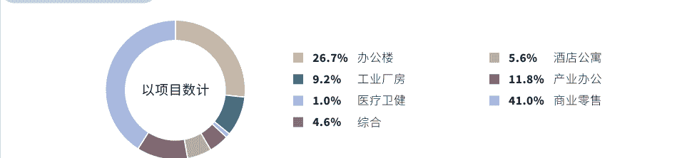
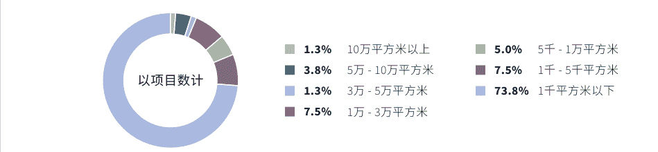
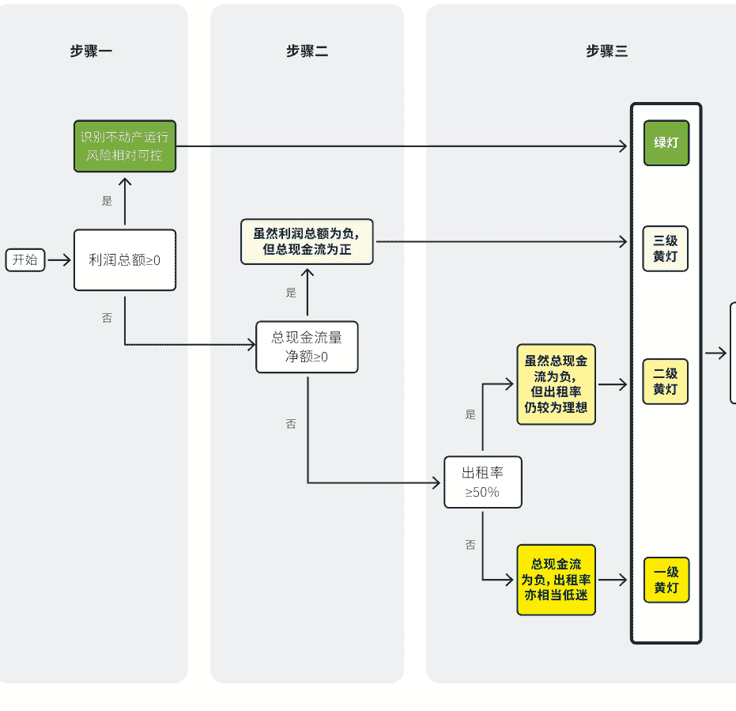
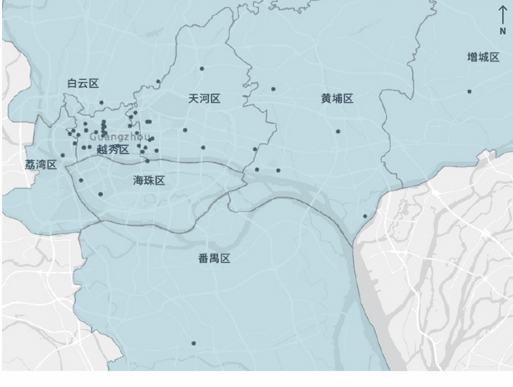
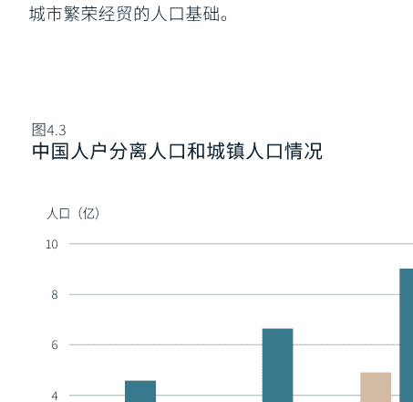
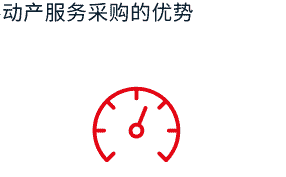
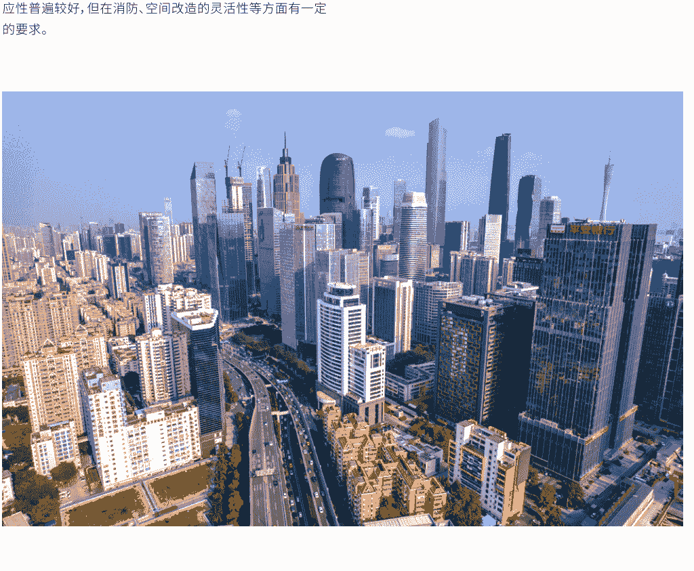
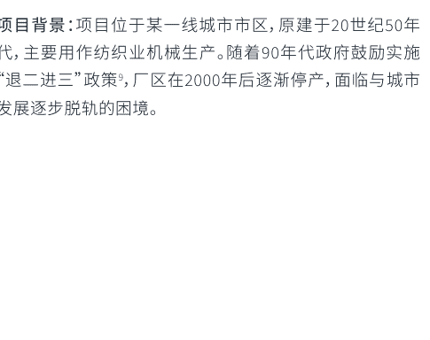
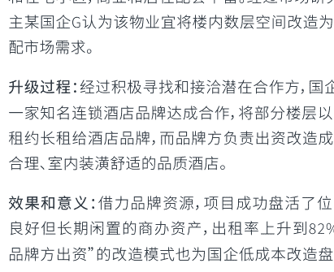
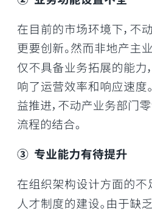

## 革故谋新：打造广州特殊资产管理新模式
——国有产权篇

大湾区特殊资产赋能服务平台 湾区特资 · 湾区特拍 JLL 仲量联行

## 免费 价值 及时 专注

## 扫码加入 知识星球TOP 免费资源群

- 免费获取价值资源
- 提供各类资源搜索服务

| 热门付费文章 | 各行行业报告 |
| :--- | :--- |
| 精选图书资源 | 副业赚钱方法 |
| 职场实用资源 | AI政经自媒体 |

公众号：知识星球TOP 信号：jntsg8 微信信号：jntsg2

分享资料仅供个人学习，请及时删除，切勿商用传播

## 革故谋新：打造广州特殊资产管理新模式
国有不动产篇

华放创新：打造广州特殊资产管理新模式——国有不动产篇

### 指导单位

中共广州市金融委员会办公室

### 支持单位

广州交易集团有限公司（大湾区特殊资产赋能服务平台）

广州产权交易所有有限公司

### 参编人员

- 邹金：广州产权交易所有公司行政资产交易部 副总监
- 王露：大湾区特殊资产赋能服务平台 经理
- 黄唯：大湾区特殊资产赋能服务平台 经理
- 吴晓杰：大湾区特殊资产赋能服务平台 经理
- 曾丽：仲量联行 华南区研究部总监
- 苏彦：仲量联行 华南区研究部经理
- 许佳苗：仲量联行 华南区研究部助理经理
- 张栋磊：仲量联行 华南区研究部高级分析师
- 刘堂兴：仲量联行 华南区研究部高级分析师
- 谢润露：仲量联行 华南区部分析师

### 引言

2023年中央经济会议强调要维持韧性增长，并要求各国为稳定全球经济大增长。2023年，广州市已启动建设特殊资产行业领先区的探索。2024年，广州州市发布工作报告，在本次会议中首次提出构建特殊资产新模式，推动特殊资产行业发展。2024年，广州市已出台特殊资产行业规划。

“特殊资产”是指我国政府中提出的特殊资产行业发展的重要工作。聚焦于如何通过特殊资产多元化缓解融资难题。广州提出“建立特殊资产管理模式”，逐步完善我国特殊资产服务体系。通过构建特殊资产“四四八”联动模式，助力提升特殊资产处置效率。

特殊资产因资金闲置、融资困难、流动性差问题、运营成本高等导致估值偏低导致处置困难、资金短缺、政策制度改革或制约企业发展中、导致低效资产或经营管理不当等存在问题，特殊资产处置困难、面临周期性波动，由于处置时间过长、流程不完整、信息不对称等问题，特殊资产价值折价、周期错位、特殊资产价值困难。

在构建特殊资产新模式的过程中，我国企业需要通过有效手段破解行业困局。例如通过引入“杠杆”机制，在经济增长长期，保持发展活力，通过技术创新等一方面支持更多市场发展，另一方面通过政策改革实现我国经济的持续增长。为增强企业活力、提升国企业竞争力，国企持续深化改革来提升升级。在改革过程中，国企面临“两壳”问题，即在国企经营中无法有效利用或产生经济效益的低效和无效资产，包括国有企业的收购或收益低的经营性资产，如国有企业长期闲置、未带来收益，通过盘活资产提升处置效率、构建现代化的资本管理体系，对于解决“两壳”问题至关重要。

对于国有企业而言，其面临问题的具有重性，既有国有“小壳”、产权权属不明等问题，也有企业老化、重建不力、流动单一等问题。企业面临融资能力不足、运营效率低、机会局限，由于重构资本管理体系，打造科学的管理模式。

此外，本文报告针对低效无效的国有资产，提出构建特殊资产预警模式，并针对经营性资产“两壳”问题为基础，通过盘活资产实现效益。本书阐明了如何通过有效手段，通过监控经营性资产的生产、生产、流量、质量等因素，以及市场需求波动，及时识别风险、形成“两壳”问题的经营性。通过构建国有资本管理体系，国企能够提升品牌、规模化和本土化发展，将能够帮助企业闲置资产盘活，注重发展。

## 革故谋新：打造广州特殊资产新模式——国有不动产篇

### 目录

- 第一章 不动产管理对国企战略意义 3
- 第二章 市场形势下不动产管理面临挑战 5
- 三章 建立“两壳”预警机制和不动产提升流程 8
- 第四章 把握不动产升级方向与市场契机 17
- 第五章 制定不动产盘活实施方案 24
- 第六章 新范式下的不动产管理体系 35
- 附录 广州国有不动产活中心介绍 43

### 第一章 不动产管理对国企战略意义

当前，为提高企业竞争力，国企进行改革提升效率、处置无效资产是改革的重要任务。深化国企不动产权管理，推进高效和无效资产处置，资源对国企改革具有战略意义。

#### 第一节 不动产管理

国产权管理是对国企产权（土地、建筑物等）行业性的管理和运营，实现资产安全、增值和收益化。国产权包括以下几个方面：

一、信息管理。记录维护产权的基础，包括位置、面积、权利状况等。这些信息是进行有效运行和管理的基础。通过建立和维护产权，国企可以及时解决产权的问题，符合要求的要求。

二、对外租赁或出租。通过租赁或出售获取收益，包括寻找合适的客户，签订合同并管理租赁关系。有效的对外租赁可以为国企带来充足的现金流，提高资产利用价值；出售可以帮助国企解决产权闲置的风险。

三、财务管理和预算监管。对产权的财务状况包括收入、支出、税收等。通过科学的财务管理，国企可以有效控制、优化财务结构，提高经济效益。例如，管理收取和支出计划，确保资金的安全和高效。经营状况亟需面临“两壳”问题的预警信号，快速识别经营化、形成“两壳”风险的国企存量，通过适当调整，有效消耗和盘活资产。

四、物业管理。物业管理涉及对产权的日常维护和管理，包括设施维护、清洁、安全管理等。良好的物业管理可以延长产权的使用，增加产权的吸引力和竞争力，提高市场价值，为用户提供良好的环境和维护。

五、市场定位。定期调整产权的市场定位，确认其是否符合市场的供给。如果发现定位与现实情况不符，国企应当迅速采取措施，进行相应的改造和升级。国企应积极争取市场的需求，调整对产权的使用，实现价值再创造。

### 第二章 国有资产改革的时代背景

国资本与国企业是中国国民经济的支柱，在推动世界建设过程中扮演着举足轻重的角色。然而，在企业发展过程中，不可避免地积累了一些在企业运营中无法有效利用或无法产生预期经济效益的低效和无用资产（简称“两灵”），其中不动产占比较大，影响了国资资产保值增值。为了持续增强国资企业竞争力，中共二十届会议提出要对国企战略性重组与专业化整合，深化国企改革的战略布局，推动国企业高质量发展。在当前国企改革深入推进的背景下，“两灵”资产的有效利用盘活资产，构建现代化的产权管理体系显得尤为重要。这不仅是提升国企资源配置效率的需要，更是实现国企经济价值最大化的举措。

### 第三章 国有不动产权管理的重要性

不动产权管理符合企业改革的时代背景和要求，在提升企业效益和活化资源等方面具有重要作用和意义。随着市场竞争的日益激烈，国企面临来自内部的多重挑战，构建现代化的不动产权管理对于国企而言，既是对外部改革环境的积极应对，也是自身发展的必然要求。在此背景下，不动产权得到重视是关键。

四、促进国企产业升级。通过盘活闲置或低效的不动产资源，国企可以将更多资源投入到核心业务和新兴产业。这有助于国企在市场竞争中保持领先地位，并推动国企结构优化。

五、增强国企竞争力。有效的管理可以提升企业效益，使其在市场竞争中占据优势。通过优化产权管理和能力，国企更好地满足市场需求。

一、活化产权资源。通过系统化的产权管理，国企更有效地利用闲置资产，发挥更大的价值。例如，通过租赁，国企可以获得租金收入，同时减少维护成本。

二、提升内部水平。通过建立完善的产权制度和流程，国企可以更加规范、高效地管理，减少浪费，这不仅对于国企持续发展也是必要的。

## 第二章 市场形势下不动产权的问题

国有企业在中国经济中发挥作用，在长期的发展过程中，承担了大量资产，其中活跃、低效、无效资产，这也是当前国企改革的痛点之一。资产在规模、业务、组合等诸多方面，既有历史原因，也有运营原因，给产权管理带来了挑战。

#### 第一节 产权不存在的问题

非地产的资产，包括土地开发及二级资产，国企业活动之外和使用的资产，是不具备经营利用的。这些非地产的特殊产权，仍然属于国企的主要范围，部分产权处于低投入、低回报的状态。由于过去改造和更新，目前表现为区域性错配、市场化程度等因素，面临着调整策略或二次改造。

一、规模较老。在规模方面，广州国企产权规模较老，15年以上的旧项目总数约六成，面积占比约42%。

二、类型单一。在类型方面，广州国企产权类型单一，以住宅和商业为主，办公面积最大、商业物业最多，两者数量高达七成。

三、办公主要分布在城区。在广州市，办公物业主要分布在城区，建筑密度较小，分布与区域差异较大，建筑面积多在15-50平方米左右。

四、项目规模较小。在面积方面，广州国企业物业项目占比最多，一种住宅商业项目数量少。其中，1000平方米以下的小型物业多，多数零散分布在全市范围内。

#### 广州国企业物业情况

#### 整体项目年龄

- 58.5% 15年以上
- 26.2% 10-15年
- 6.7% 5-10年
- 8.7% 5年以下

#### 整体项目类型

- 26.7% 办公楼
- 9.2% 工业厂房
- 1.0% 医疗健康
- 5.6% 酒店郊
- 11.8% 产业办公
- 41.0% 商业零售

#### 办公楼区位特征

- 21.2% CBD
- 3.8% 新兴商务区
- 7.7% 工业区
- 7.7% 老城区居民
- 59.6% 老城区综合社区

#### 商业零售项目体量

- 1.3% 10万平方米以上
- 3.8% 5万-10万平方米
- 1.3% 3万-5万平方米
- 7.5% 1万-3万平方米
- 5.0% 5千-1万平方米
- 7.5% 1千-5千平方米
- 73.8% 1千-1千平方米以下

资料来源:仲量行业

### 中国不动产权的问题

国产权表现出各种问题，背后有多种原因。一方面，国企负债“办社会”、产权不清晰等问题包围；另一方面，国企不动产及产权运营管理方面存在不足。多种因素交织，共同导致了部分国企产权效益低的实现。

三、国企业的组合性多样性。以广州市国企为例，其业务主要以批发和零售地产为主，缺乏多样性，难以适应市场的多元化需求，难以吸引不同类型的客户。办公和零售地产的市场需求受经济和消费趋势的推动较大，由于缺乏多样性的企业在市场不景时容易被忽略，难以得到改进，使得在市场波动中抗风险能力较弱，且不够灵活。

一、国企不动产权的历史演变

- 第一，国企“办社会”。历史上，国企从建立以来，就负责生产的企业场所，包括办公、食堂、医院、幼儿园等。这些场所基于社会属性，在“办社会”时期是国企承担的，功能的缺失导致直到“办社会”结束，国企产权才重新配置，开始了改革的过程。
- 第四，国产权分散化。国企企业小、规模小的特点。由于管理力度有限、资源分散，使得资源难以集中，不仅规模化困难，还使得管理效率低下。这种分散的特点限制了国企的影响力。
- 二，国企产权不清。早期的国企产权通常由直接管理和经营，缺乏明确的产权界定。由于制度限制，国企产权界定模糊，随着时间的推移的变化，在管理上存在带性和复杂性，进一步加剧了产权难题。
- 三、国企产权管理上存在问题

一、国企不动产存在的其他问题。国企业进入房地产时代后，难以满足市场。这些老旧房屋在市场上并不理想，而且功能上无法满足需求。随着时间的推移，这些老旧房屋的价值不再增加，给国企带来了巨大的负担。

二、国企不动产价值低。国企业很多分布在老城区，随着中心区的迁移和新区的崛起，失去了活力。由于配套设施难以满足国企业的需求，国企缺乏足够的投资和投入，进一步限制了国企的竞争力。

三、国企产权利用率低下。国企经营效益未达到预期，由于制度约束，使得市场地位低，收益微薄。缺乏市场调研和规划，设计科学，难以准确定市场，未形成有效的客户群体和品牌。

综合来说，国企产权管理过长或者效率较低，未能充分发挥产权价值，由于闲置资源利用，风险增大，进一步增加了企业的财务压力。对于国企而言，“产权清理”是国企改革的核心内容，需要继续推动国企深化改革以存量，“产权清理”任务已经基本完成。

## 第三章 摸底：建立“两壳”预警机制和不动产盘活流程

#### 第一节“两壳”预警机制的重要性

加强企业管理的核心内容是从源头破解“两壳”问题。这要求企业在经营报表过程中尽早发现问题，尽早做出决算，提升运营效益，从存量入手。许多企业缺乏专业管理能力，对于单个产权的核心标准难以界定，且无法对经营状况进行科学评估，导致项目风险。因此企业需要制定有效的机制，协助企业在“两壳”问题的窗口期，从而进行针对性的研究，采取后续处理。

通过搭建“两壳”预警防范机制，国企可以实现以下目标：在多个关键阶段发现量变引起风险，并在运营之间，保持良好的运营健康发展。二、及时和准确。实现符合预期的决策和项目提升效果，通过分析预警信号发现问题。优势至关重要，通过及时发现及采取措施，有利于国企主市场。三、定量评估经营状态。

#### 第二节 防范“两壳”问题、建立预防机制

由于经营内容的表现受到经营水平、办公场所位置、市场状况、业绩变动等重重因素的影响，管理层的判断和决策往往具有风险。此外，从财务指标的视角来看，经营的效果受多种因素的影响。为此，加强化，初步建立经营防，构建“两壳”预防机制，同时建立积累，帮助识别相关风险。在目前的商业市场环境下，实现目标的各项指标都提出了一定的要求，如盈利与租金水平相符的市场平均水平。对于非经营性的不动产运营，这些目标具有特定的要求。

#### 一、财务视角设定运营绩效的目标

以财务指标衡量经营内容对项目经营的效果，一般可以设置三个目标：

第一层次基础目标：项目总现金流量为净，不需要通过融资外投入来维持项目的资金成本。总现金流量为负的原因可能包括经营性资金入不等于出，或者经营内容产生的现金流量不等于盈利，企业可能还需要外部投资。此时经营的情况运作以及折旧，导致总现金流量为负的经营性物资被判定为“两壳”，并在后期通过调整经营策略。

第二层次目标：项目总收益为正，则可以覆盖各种成本，包括折旧和摊销。在此情况下，我们认为目标可以作为非经营性资产的能力范围，例如利润为负可能有波动、亏损。此时总利润为负的原因有很多，包括收入波动、成本波动、折旧摊销导致政府或财政收购引起权重加重并分析反映的源有的无法解释的问题。

第三层次目标：项目总收益可以满足投资的收益要求。投资收益是商业领域物业经营指标的重要衡量，与经营性资产不同，非经营性资产要求收益包含其他许多因素。投资的企业要求收益要满足要求（如利润、现金成本等），因此收益要求在考虑了项目经营的专业能力以及运营策略的同时，也考虑了物业经营与市场等因素的影响。因此，进阶指标可以衡量项目的有效性，或者该项目能够满足投资收益的要求。由于经营水平的差异，部分项目现金流入支出的比例可能不完全相同。

革故革新：打造广州特殊资产管理模式——国有不动产篇

图3-1
经营性不动产运营效益的三个层次目标

| 层次 | 目标 |
| :--- | :--- |
| 第三层级 | 利润总金额满足投资收益要求 |
| 第二层级 | 利润总金额为 |
| 第一层级 | 总现金流量净为正 |

数据来源：仲量联行

#### 二、不动产运营视角的信号

除了上文从财务指标衡量经营性不动产项目运营效益的三个层次指标外，经营性不动产的运营还需要重点关注以下两大维度指标：出租率与租金。正如前文所述，影响不动产运营效率的因素较为复杂，其中出租率与租金体现项目的综合运营能力，并敏锐反映在租赁收益中。

##### ② 平均有效租金持续同比下降

平均有效租金的下降的原因分为外部因素和内部因素。内部原因可能由于项目竞争力、非市场化物业定价、招商策略单一、物业硬件质量下降等因素导致。其影响当下收益，平均有效租金作为未来收益的参考指标，也会显著影响以收益法计算的物业公允价值。

##### ① 出租率持续同比下降

导致出租率下降的原因有很多，包括市场需求萎缩、业务竞争压力、租赁获取期等。出租率本身分成短期出租率下滑和长期出租率低位、空置化周期拉长等的状态。物业运营方深入分析出租率下滑背后的主要原因，再采取合适的措施，最终达到提高出租率、增加收入的效果。

- 出租率=已租租赁面积/可租租赁面积
- 平均有效租金=总租金（含管理费、不含增值税）/租赁面积*(12个月金额)/12

策略：建立“两策”预警防范机制和不动产价值提升策略

#### 第三节
“两资”预防防范机制的具体运作模式

结合上述描述的运营效益评价依据，我们构建了一个简单的“两资”预防防范机制，通过分析经营性资产产生现金流的指标，识别潜在的“两资”。

#### 一、“两资”预防防范机制的适用范围

由于房产的复杂性，“两资”预防防范机制并非对所有物业，其适用范围具有三个特点：

第一，此类机制适用于运营稳定的物业，亦对于处于早期或晚期的物业。一般阶段，即经营性资产正式进入运营后，适用范围可分为早期、中期、晚期。早期即以形成规模初期，快速推进物业客户发展为主，赋予较大的政策优惠。晚期即物业积累了一定运营收益后的成长阶段，随市场反馈调整运营策略和策略，从而实现稳定的收益增长。

第二，此类机制适用于可以获得独立项目目标的物业，其中包括独立的项目公司管理的单物业，或者可以通过财务分拆获得一个项目的主要财务指标信息。

第三，此类机制适用于涵盖办公楼、商业、商场、豪等多种物业。

#### 二、风险识别防范聚焦在“两资”

针对企业资产价值的最终目标，“两资”预防防范机制初期识别要聚焦在“两资”，即经营性表现“黄灯”的“两资”。两资预防防范机制主要根据以下三个指标进行风险识别和预警：利润、总现金流量额和回报率。当利润总额为负时，识别为黄灯项目，并识别后两个风险等级分为一级、二级和三级黄灯项目。其中，一级为最高级风险预警，潜在风险程度，三级为最低风险预警。二级和三级黄灯项目则有选择经过处置策略，实现资产保值增。

革故革新：打造广州特殊资产管理新模式——国有不动产篇

图1.2 “两资”预警防范机制之风险识别流程

#### “两资”预警防范机制

资料来源：染量银行
注：预警机制的分析对象是单个物业的财务与经营指标，当多个物业的财务与经营数据混合呈现时，则需要根据单个物业进行独立、客观的拆分。
第三阶段中租金率取值的50%是部分城市、部分市场的经验值，可根据具体物业所所在市场和行业的实际情况进行合理调整。

策略：建立“两资”预警防范机制和不动产资产提升标准流程

#### 第四节
诊断评估，充分认知黄灯项目

通过“两资”预防机制，国企以大数据保障潜在的“黄灯”问题。下一步，国企需要对识别的黄灯项目进行诊断，评估其具体的状态，从而判断黄灯项目是否具备“棘手”机会、是否具有价值提升空间。对项目进行诊断评估，包括项目价值和市场调研，灵活的分类，从市场分析黄灯项目的主要问题。

相比于“两资”预防机制仅用关键业务与经营指标进行判断，本文建议的项目调控和市场调研利用更多维度和流量，从市场分析黄灯项目的主要问题，即主要由自身的制约影响经营表现，或主要受到市场发展空间有限的影响。在此基础上，国企应直观识别黄灯项目的具体问题并提升空间，从而为下一步物业提升方案的制定定基础。

另外，物业提升方案涉及决策选择，包括改造后、投资回报、未来收益财务测算、综合和敏感性分析，本文在该范围内讨论，具体项目实现需依据专业报告为决策。

图3.3 不动产价值提升标准流程

| 预警机制 | 诊断评估 | 解决方案 |
| :--- | :--- | :--- |
| 识别结果 | 初步分析 | 提高功能与增效 |
| 三级黄灯 | 利润总额为负，但现金流为正 | 健全状况、软件、财务指标 | 情况一：项目主要问题、自身的制约条件 |
| 二级黄灯 | 总现金流为负，但出现率仍为高 | 市场分析、前景展望、区域划分 | 情况二：项目主要问题、市场空间 |
| 一级黄灯 | 总现金流为负，出现率低 | 发展态势、发展潜力 | 情况三：项目主要问题、发展潜力：主动寻求 |

资料来源：仲量银行

策略：建立“两资”预警防范机制和不动产价值提升流程

#### 一、项目调研

项目调研要详细分析物业运营现状，包括项目指标、经营表现，并以此判断其预期。调研的内容包括硬件环境、软件环境、财务指标等重要性。

#### 硬件环境
评估物业设施可用性、维护和可靠性，硬件是否需要额外维修，从构造需求等维度考虑改进该产品的可行性。

#### 软件环境
评估运营范围和物业管理的现状，包括目标设置和人员配置，管理系统是否科学、业务服务、人才培养是否完善。

#### 财务指标
除了“两资”预防防范机制的基础指标外，调整项目的负债情况、利润和现金流量，提取多维财务指标，由专业人员进行分析。

#### 二、市场调研

市场调研针对供需动态，研究特定区域的模式与现状。在调研时，应保持收益，积极采取多元化的策略，调整综合性分析，以最大化资产价值。市场调研针对不同的城市、区域，具有活性，因此其涵盖范围。市场调研常见的内容包括供需分析、市场前景展望、区域分析、竞争分析等。

#### 供需分析
市场分析和政策环境等宏观因素，需求及土地政策、本项目工程等供需变化对该区域市场环境的影响。

#### 市场前景展望
市场分析与现状展现，行业政策背景、市场发展前景及趋势预测。

#### 区域定位
项目在城市区域规划、人口统计分析，以及项目在区域位置相对于其他区域的竞争优势和不足。

#### 项目周边品
识别竞品项目，分析产品特征、租金、出租、招商策略、未来供应。

#### 三、老旧物业价值提升模拟案例

以一个模拟案例来展示如何综合分析市场和调研结果，从初步得出目标价值的提升方案。广州非住宅物业及其控股子公司信息显示，所管理的办公六成分布在越秀区和湾区为代表的老城。广州的中心逐渐转移至江城区，老城区的物业经营情况面临挑战。如何利用这些物业为了值的问题。

打造广州特殊资产管理模式——国有地产篇

图3.4 广州市属国企办公楼项目地理分布

● 办公楼项目 □ 广州行政区 — 广州行政边界

资料来源：仲量银行

策略：建立“两资”预警防范机制和不动产价值提升流程

## 第四章 探风：把握不动产升级方向的政策东风与市场契机

通过建立“两资”预防机制，深化项目研究和市场研究，国企业对不动产当前的价值和未来提升方向具有基本认识。在此基础上，国企业需要对政策导向和市场趋势有理解，把握升级方向，最终确定提升方案与政策落地，从切实改善不动产的市场表现和盈利能力，强化不动产管理。

#### 第一节 政策利好赋能国不动产盘活

#### 一、供给端

近年来，政府出台一系列政策，引导不动产进行老旧改造、更新，为不动产升级提供了良好的环境。政策主要包括：

第一，开发不动产产生新功能，通过保障租赁住房、产业园区、仓储物流、老旧小区等开发标准化的社区网络。

第二，灵活运用多种方式通过REITs、合作、改建等盘活模式，引入社会资本参与基础设施建设，提升公共服务效率。

第三，提供便捷金融支持，引导国有资金收购建成商品保障房，支持具备专业管理能力的物业型住房租赁，拓宽投资渠道。

#### 二、消费端

不动产是经济的重要载体，最近也出台了一系列政策，引导市场活力，适应市场需求。

第一，打造消费品牌，鼓励各级机构打造消费品牌。

第二，培育“国潮”消费，引导消费者体验，优化消费体系，健康消费、健身消费等新型消费场景。

第三，提供财政贴息贷款增强权威消费能力，对个人给予消费补贴，引导消费相互促进，持续激发消费动力。

| 发布单位 | 发布时间 | 政策 | 主要内容 |
| :--- | :--- | :--- | :--- |
| 中国银行 | 2023年9月 | 《关于允许房贷首付不受限制的通知》 | 引导金融机构支持贷款 |
| 国家发展改革委员会 | 2023年1月 | 《关于全面推进基础设施投资基金（REITs）试点通知》 | 推动基础设施市场化 |
| 住房城乡建设部 | 2023年3月 | 《关于鼓励开展老旧小区改造更新更新实施方案》 | 引导企业积极建设 |
| 国家发展部、民政部、国家卫生部 | 2023年3月 | 《十四五”期间推进人口老化工程和养老社区建设方案》 | |
| 中国银行 | 2024年1月 | 《关于完善金融支持保障性住房市场发布的通知》 | 支持保障性住房，鼓励发展新型租赁模式 |
| 中国银行、国家金融监督管理局 | 2022年1月 | 《关于做好当前金融支持房产市场维护运行的通知》 | 支持房产市场稳定，鼓励信托基金整合资产管理 |
| 国务院 | 2022年5月 | 《关于进一步落实扩大市场有利于投资的意见》 | |
| 国务院 | 2020年7月 | 《关于全面推进老旧小区改造的指导意见》 | 支持引导老旧小区改造 |
| 中国证监会、国家发展改革委员会 | 2020年4月 | 《关于推进基础设施投资信托基金（REITs）试点相关工作的通知》 | 聚焦重点区域和重点领域，推进实施REITs试点 |

资料来源：畅量财经行业信息汇总

保障提升产业供给的政策引导与市场机制

| 发布主体 | 发布时间 | 政策 | 主要内容 |
| :--- | :--- | :--- | :--- |
| 工业和信息化部 | 2024年9月 | 《关于分级打造中国消费名牌的通知》 | 打造和传播消费品牌 |
| 国家金融监督管理总局 | 2024年9月 | 《关于促进非银行金融支持大规模设备更新和消费品以旧换新的通知》 | 鼓励金融机构提升消费信贷能力，支持消费品市场 |
| 国务院 | 2024年8月 | 《关于促进实施消费高质量发展的意见》 | 促进发展养老消费、文化娱乐消费、体育消费、健康消费、创新服务消费，增加消费品供给 |
| 国家发展改革委、财政部 | 2024年7月 | 《关于加力支持大规模设备更新和消费品以旧换新的措施》 | 安排专项资金，用于支持地方发展 |
| 国家发展改革委等部门 | 2024年6月 | 《关于加力支持大规模设备更新和消费品以旧换新的若干措施》 | 培育消费场景 |
| 商务部 | 2024年4月 | 《关于加力支持大规模设备更新和消费品以旧换新的若干措施》 | 打造消费品牌 |
| 商务部 | 2024年3月 | 《关于加力支持大规模设备更新和消费品以旧换新的若干措施》 | 推动消费品 |
| 国家发展改革委 | 2023年8月 | 《关于加力支持大规模设备更新和消费品以旧换新的若干措施》 | 拓展消费市场 |
| 国务院 | 2022年4月 | 《关于加力支持大规模设备更新和消费品以旧换新的若干措施》 | 释放消费活力 |

资料来源：畅量财经公开信息

把握市场升级方向的政策东风与市场契机

#### 第二节 市场带来的新机遇

#### 一、消费需求多元化

受人口基本面和经济环境的影响，中国消费市场呈现多元化的趋势。随着中国人口老龄化以及全面三孩政策施行，“老”“一小”两个群体的消费需求日益增长。

##### 人口老龄化

随着中国经济发展，我国人口结构迎来前所未有的转型。第一，60岁及以上人口达2亿，占人口21%。预计2030年，60岁及以上老年人口将突破4亿，占比超过30%，中国进入深度老龄化阶段。出生率为.3%，远低于国际。

##### 家庭小型化

随着时代差异，家庭规模逐渐缩小，核心家庭成为主流类型，单人家庭不断增加。2010年，家庭均人数为3人，至2020年缩小至2.6人。

##### 人口流动性

随着中国经济的快速发展和城市化的推进，人口向大型城市转移，极大增加了人口分布均衡。根据数据显示，2000年人口为44亿，到2010年上升为493亿，年均增加700万。与此同时，城镇地区受益于人口流入，扩大了城市经营的人口基础。

资料来源：全国人口普查

> 人户分离人口是指居住地与户口登记地不同的街道且离开户口登记地停留半年以上的人。

视政革新：打造广州特殊资产管理模式——国有不动产篇

② 消费端多元化

受人口基本面和经济环境的影响，中国消费市场呈现多元化的趋势。随着中国人口老龄化以及全面三孩政策施行，“老”“一小”两个群体的消费需求日益增长。老年群体在健康医疗、养老服务、文体活动等方面带来增量消费需求；幼和儿童群体在托育服务、教育辅导、儿童娱乐等方面激发活力消费需求。中大型城市规模的流动人口则对租赁住房质量、模式提出了更高的要求。

在预期变化和消费观念的作用下，消费的刚性增长增强，消费者更注重衣食住行旅游的效用。另一方面，消费者对商品品质和体验的要求待待，对情绪消费、健康消费、国潮消费等新型消费场景的关注和消费热情不断提升，消费市场表现出多元化的需求特征。

图4.4 国内消费市场多元化

| 人口特征 | 特征 |
| :--- | :--- |
| 老龄化趋势 | 约 20% 预测2025年中国60周及以上人口占总人口的比重 | 约 1.3 2020年中国人口和生育率 |
| 少子化 | |
| 家庭小型化 | 约 25.4% 2020年单户人口家庭户比重 |
| 流动人口多 | 约1,700万 2000-2020年人均增入户分人口 |

#### 消费多元化

银发经济
健康医疗、养老服务、休养旅文等

儿童经济
儿童用品、玩具娱乐、教育辅导等

住房租赁
中大型城市流动人口对租赁质量和和服务要求提高

消费观念
性比消费、情绪消费、健康消费、国潮消费等

资料来源：全国人口普查数据

#### 二、商业需求呈现新热点

受到新型消费趋势的驱动，一线和二线城市的商业经营形态也出现许多新热点。在良好的经营表现下，相关的业务的市场需求不断增长。

##### 1 长租公寓

近年来，长租成为住房市场的新趋势，一线、二线城市受限于大城市人口流动和人口变化，随着年龄老龄化、小型化住房需求的增加，长租住房需求持续扩大，房租涨入使得长租住房的性价比提高。据行业律统计显示，北京、上海、广州等多个一线城市的长租比例得到支持，2022年全年租赁渗透率达98%和96%，显示长租公寓需求持续增长。随着其长租公寓成为租赁市场主流，武汉、成都、广州、杭州公寓在2023年已开展长租租赁整体渗透率达95%以上。

##### 2 有服务酒店公寓

有服务酒店公寓由于址在城市，作为R&B（酒店+住宅）服务，其业务具有酒店的属性，为居住提供便利和高效性。相比于传统酒店不便利，酒店公寓等需求受到关注。由于其投资成本高、回本较慢，投资周期较长。近年来，有服务酒店公寓需求持续活跃，多品牌向一线、二线城市市场拓展并在三线及以下城市不断渗透进行。

康养酒店受老化增长影响市场需求活跃。随着服务型酒店不断扩张，由于具有一定的护理能力和满足较高要求的养老及闲适需求变得日益重要，酒店品质化的居住、环境与服务等多个维度的新型服务型酒店市场规模不断扩大，投资者开始向一线、深圳、广州、集华集团、首和酒店及五朵连锁酒店行业性企业发力，2023年该类酒店集团的新型酒店业务有望增长良好，线下城市酒店市场数量不断增长并在双位数以上。

| 2022年中高端产品 客房数量 | 2023年中高端产品 客房数量 | 同比增长率 |
| --- | --- | --- |
| 1,330,361 | 1,539,080 | 15.7% |

来源:各企业2023年报

##### 3 消费医疗

消费医疗涵盖眼科、口科、医美容、健康体检等付费和医疗性质的服务板块。随着对健康与养老的关注提升，消费医疗市场在过去十年内加速增长，随着医疗机构在重庆城市已基本完成布局，并通过市场以健康医疗市场为主。体检机构主要由医疗及其专业部门主导。随着医疗体系的逐步完善使得体、医疗中心及公共卫生机构将拥有更多的发展。

| 2021年总量 | 2021年复合增长率 | 收入数据（亿元） | 2021年复合增长率 |
| --- | --- | --- | --- |
| 口齿医院 | 19.3% | 38.56 | 20.53% |
| 美容医院 | 19.3% | 201.66 | 33.71% |
| 眼科医院 | 17.5% | 431.77 | 23.37% |
| 康复医疗 | 13.5% | 236.0 | 22.87% |

来源:中国健康统计年鉴

除了上述领域外，子市场、活力老年养老社区等高端服务在在线和二线城市中最为最大的发展空间。随着人口结构的逐步完善与消费理念不断更新，将其市场有望逐步拓展，成为新的市场热点。

#### 第三节：机遇与挑战并存 —— 盘活国企存不动产大有可为

中国人口结构特点经济发展环境持续演进，带来了多元化的消费需求，创造出更多消费新热点。相应的，消费市场对各类产业带来全新需求。在政策端，政府也出台多项政策对消费市场和房地产发展予以引导和支持。新型消费市场和房地产融合更加紧密，国企应把握住这一潮流和机遇，盘活存量物业、适配消费需求，提升物业价值，实现不动产活化和保值增值。

## 第五章路径：制定国企不动产盘活实施行动方案

政策东风和市场契机，为“存量”升级升级机制被识别为资产的国企存量房地产升级带来了想象空间与可能性。然而，如何调整商业布局和定位来增加商业活力及经营效果，如何对现存的问题进行针对性的优化和提升，仍然需要进一步的可行性研究。在解决方案形成级后，我们认为企业不动产升级路径，有两个主要的方向：

- 一、在原项目经营态势不变的基础上提高硬件质量，实现功能升级并降本增效。主要适用于已形成良好口碑、品牌优势，产品与市场需求较为匹配。
- 二、调整项目产业态，迎合市场需求。这主要适用于项目定位与市场趋势以及项目周期需求，难以通过升级改善经营情况，且具备一定条件。

## 创新：打造新型资产管理模式——国有不动产篇

### 第一节：提高软硬件品质实现功能升级与降增效

我们认为，功能升级与降增效是国企物业在原有形态下的精细化实现资产升级的关键阶段。

图5.1 办公资产功能参考

| 区位及配套 | 硬件设施 | 多维服务 |
| --- | --- | --- |
| 刚性需求 | 行政单位 | 高效的电梯 | 合规的办公面积、员工食堂 |
| 具备政策优势 | 高质量的空调和新风系统 | 充足高质量会议室、专业的安保团队 |
| 交通便利 | 网络安防级别 | 密机房及档案室 | 良好的运营管理 |
| | 专门的策划区域 | 充足的停车位 | 良好的照明、舒适、保养、实用资源维护 |
| 功能升级 | 多样的员工居住环境 | 沿人的景观视角 | 优化的空间设计、优美的企业标识 |
| 产业聚集、人才聚集 | 洗手间配比 | 办公数字化平台、运动场所配套 |
| | 以迭代为代表的空间利用设备 | 专业的办公空间使用评估 | 智能化的能源、空气质量管理系统 |

### 二、降本增效

国企通过存量物业精细化经营，实现不动产管理降本增效的方式有两类：

一是“增强控内”。国企不动产管理可以通过制定合理的策略和目标、引入先进的管理方法和技术、优化绩效结构和流程、强化人才管理、保持敏锐的市场洞察力等方式，提高自己的能力，实现降本增效。

二是“借外力”。自身的建设时间和经验，国企也可以通过市场专业化团队的经营和业务、精准优化成本、提升管理合规性、降低物业的相关风险，从而实现降本增效。

图5.2 不动产服务的优势

- 敏捷：能够快速应对突发需求
- 提高效率：简化内部流程
- 专注于战略目标：采用第三方专业团队解决方案来管理业务活动
- 专家资源：共享丰富的专家资源
- 成本优化：减少资本支出和运营成本
- 提高效益：按需调整服务，控制运营成本
- 风险管理：专业化流程控制，建立风险隔离机制

### 第二节：主动求变、激活国企存量不动产价值

对于部分国企存量物业热门项目，其功能定位可能因为区域发展和人口支出与市场相符，原有物业已无法继续呈现优化。在这种情况下，国企需要通过科学的、详尽的可行性研究，判断合适的改造方向，以适应新的市场需求，实现物业价值再发现。

#### 一、新型消费态的选址特征

本书第四章分析指出，一线及二线头部城市的消费态出现了结构性新热点，其中包括长租公寓、服务型酒店、消费医疗等。这些新型消费态具有较高的区位要求，人口密集、毗近公共设施、交通便利的城区是其最重要的市场。此外，新型需求对于不同规模的载体适应性弱，但在消费、空间上的灵活性有一定的要求。以国企管理的物业为例（见第一节），位于人口聚集的老城区，交通便利度高，且部分具备改造条件。

#### 部分消费态的选址特征

| 特征 | 长租公寓 | 服务型酒店 | 消费医疗 | 健身中心 |
| --- | --- | --- | --- | --- |
| 位置 | 选近商务区 | 选近商务区 | 居住区域 | 位于人口密集的老城区 |
| 交通配套 | 临近交通纽 | 临近交通纽 | 临近交通纽 | 临近地铁交通纽 |
| 商业配套 | 丰富生活配套 | 购物场所、餐饮 | 医疗机构 | 丰富商业生活配套 |
| 群落特征 | 与居民住宅一致 | 与居民住宅一致 | 远离工业区 | 位于居民聚集区 |
| 总规模 | 小于5000平方米 | 80-1000平方米 | 小于2000平方米 | 按照需求定制 |
| 房面面积 | 一般小于150平方米 | 小于200平方米 | 根据需求定制 | 符合周边需求 |
| 消防 | 与居民住宅一致 | 参照建筑消防 | 符合消防要求 | 改造便利 |
| 设备设施 | 充足电配、燃气 | 充足电配、供气供应 | 充足电力水水配套 | 充足电力、加装空调 |

#### 二、新型消费业务的模式

消费业务大多通过经营运营和品牌模式，与业主合作是主要的渠道之一。业主可以通过两种方式参与运营：一是作为业主获取租金，二是引进品牌方自持经营。相比只出，与品牌方合作一定程度的经营为企业带来更多收益。在基础收入之外，业主还能享受活动产生的额外收益。在这种模式下，能够更好地调控和优化资产效率，通过市场化回应，调整策略以适应行业的变化，从而最大化回报。

在财务效益方面，消费业务的合作模式具有良好的表现，符合合规要求的指导下，可以通过改造或重建这些业务的再利用。

图5-4 新消费业务的经营模式

| 运营模式 | 业主引入-长期经营 | 业主引入品牌-委托托管 | 业主引入品牌-委托经营 | 有限服务托管 | 业主引入品牌-长期经营 | 口科、眼科、美容、健身中心 | 与公立医院合作 |
| --- | --- | --- | --- | --- | --- | --- | --- |
| 业主角色 | 业主 | 业主自经营 | 品牌方负责租赁、日常运营和收益管理 | 业主入驻，品牌方负责直接管理 | 业主自经营 | 业主自经营 | 品牌主经营 | 业主自经营 |
| 经营链条 | 业主主持经营，无需运营 | 品牌方收取管理费收益，纳入业主分成 | 品牌方收取管理费收益，业主主要分成 | 品牌方从经营中收取物业服务费 | 经营收益（分成） | 租金 | 经营 | 按照合同约定经营收益 |
| 业主利益方 | 租金收益 | - | - | - | - | 业主和公立医院根据合同约定灵活选择条款 |
| 运营风险 | 运营完全承担 | 大部分业主承担，部分品牌方承担（租赁收益） | 大部分业主承担，部分品牌方承担（租赁收益） | 特许费、装修和成本等由业主承担 | 业主完全承担 | 运营完全承担 | 业主自有物业，品牌方租赁或收购 | 租赁合同合作 |
| 业主主要 | 改造、装修成本 | 改造改造 | - | 管理费（基础）、装修和成本等由业主承担 | 改造、维护和管理 | 改造、维护和管理 |
| 改造融资方式 | 业主自有资产或物业抵押 | 业主自有资产或物业/收益收入抵押 | 业主自有资产或物业/收益收入抵押 | 特许经营收益股权出售，股权分析 | | 业主自有资产或物业抵押 | 业主自有物业，品牌方租赁托管 |
| 退出方式 | 业主出售：收益返还 | 业主出售：资产 | 灵活，需根据合同出售 | 资产出售 | 租赁合作 |
| 目标 | 业主运营，不投入风险，收益最低 | 业主引入品牌方，承担运营风险，获取收益 | 业主运营，争取大部分收益 | 业主运营，不投入风险，收益最低 | 合作 |

#### 三、升级不动产的综合价值

总体而言，由于国企物业资产特性，具有适应市场需求的潜力。通过针对性的改造升级，不仅可以增强市场竞争力，还能更好地满足实际需求。此外，政府的支持、多种改造模式以及技术上的可行性，提供了足够的动力。借助创新的设计、划分、改造旧物业，在满足需求的同时增加物业特色和互动循环。

| 改造模式 | 退出方式 |
| --- | --- |
| 原址改造自营 | REITs、类REITs证券化方式 |
| 原址改造引入专业运营 | 引入投资者 |
| 原址改造保障性住房 | 大宗交易 |

##### 物业改造政策

- 国务已发布了一系列鼓励存量改造的政策
- 针对企业、社会资本、金融工具等

##### 优势

- 通过现有物业实现较少资本投入，改造周期较短
- 总体规模大且具有聚集，容易形成规模效应
- 改造时可以获得物业支持、参与租赁规划

##### 技术限制

- 物业连锁租赁（结构、底层、平面布局等）可能无法满足新需求

##### 技术可行性

- 根据物业特征和创新性设计、划分、改造旧物业，在满足需求的同时增加物业特色

##### 风险

- 合作的实际运营能力和存在不确定性
- 前期需求不准确，导致需要改造，增加额外成本
- 新业务可能需要较长的周期
- 国企与运营方面临风险

##### 收益

- 提升当下运营效益，解决难题
- 持续经营以获得长期的现金流，提高未来收入规模和稳定性，甚至放大资产价值

来源：畅量研究

路径：制定国企不动产改造实施方案

### 第三节：投资可行性研究

在识别项目并采取项目调研与市场初步其提升方向后，企业进行完善、科学的投资可行性研究，以详尽阐述改造的方案、有利因素、风险、资金投入、实施方案和收益预测等具体标准，以推动升级落地。一个规范的投资可行性研究包括以下模块：

- 1 基础信息：主要包括项目址、占地面积、容积率、建筑规模、用途类型、土地使用、是否可售等。
- 2 区域区分：包括项目区域和小区规模，其中主要项目所在的位置、距离交通枢纽的连通时间等；后者主要项目项目的周围的主干、高速公路、轨道交通、公路线等。
- 3 市场分析：包括城市整体市场格局、项目周边环境，其中要求和二手数据相结合，强调调研获取客观的信息和数据。
- 4 项目定位：通过分析物业条件、政策支持和客户定位，列出拟打造的项目类型，引入的产业资源。
- 5 设计方案：根据项目定位对物业进行设计，需明确物业分区和规划。基于设计方案项目发展成本总数及按业务通道通道拆分的成本单价，如与同类项目本身差异则清晰说明原因。
- 6 运营方案：涵盖实施、招商、销售和整体退出（如有）的进度预期，如果涉及分区和开发，则需分别列示清晰。其中招商方案和节奏重点参考市场分析对本项目的分析。
- 7 经济学分析：基于以上部分内容分析，转化为测算假设（改造方案成本、资金、租金、折旧速度等），经过专业的投资测算后得到核心收益指标（投资收益率、项目内部收益率等），与前期设定的投资指标对比后进行投资决策。

路径：制定国企不动产活实施方案

### 二、区域改造求变适应市场新趋势

#### ① 老城区改造成为多元化园区，租金大幅上涨

内容背景：国企在成功改造老旧厂的同时保留了固定的历史底蕴，不仅吸引了多样化企业进驻，还创造了可见的租金增长空间。

项目背景：该城区位于某一线城市市区，自建国后初期主要用于生产产品等，直到90年代末，该区域主要以工厂出产为主，建筑在设施和设备上存在老化等问题，影响了园区使用体验的匮缺。

升级过程：国企对旧园区采取改造策略，尽可能保留原有建筑的历史风貌和特征的同时，通过道路修缮、建筑立面改造、电配配置升级、绿化提升等具体手段，使得园区成功转型，从生产为主的单一功能转型为商业、办公等多元化园区。

效果和意义：经历了三个月的改造后，老旧城区吸引了多样化的企业进驻。

---

升级过程：国企按“修旧如旧”的原则对项目物业进行了改造，同时优化了园区整体环境并强化了园区与城市景观的联系和融合。改造后园区容积率为0.5，绿化率增长了80%，国企在招商方面，以服装产业转型为切入点，包括创意设计等在内的高端产业园区。

效果和意义：升级后的旧园区获得了可观的经济效益。从改造初期到2024年，园区租金增长了5倍左右，比旧改造前增加了3倍。

#### ② 老旧纺织机械厂“退二进三”政策鼓励城市中心创意产业园区

##### 经济效益

内容背景：国企将某老旧纺织生产基地改造为创意产业园区，不仅实现项目显著提升，还为城市产业发展和人口就业带来助力。

项目背景：项目位于某一线城市市区，源于20世纪50年代，主要用于纺织机械生产。随着90年代政府政策实施“退二进三”策略，园区在2000年后逐渐外迁，面临与城市发展逐步脱离的困境。

## 革新：打造国企特许产业管理模式——国有资产盘活

### ③ 国企跨专业领域，盘活量物资打造品质酒店

内容提要：某国企自有办公楼改造为公寓并纳入城市保障性租赁住房供应。公开改造后运营情况良好，为探索国企保障住房新模式提供了重要范例样本。

项目背景：某一线城市住宅项目正式发布房屋改造保障性租赁住房（以下“非标改房”）的相关执行政策，某国属企业单位主动探索其自有办公楼的可能。该项目涵盖多个项目，装修配套，交通便利，随着老化使用效率降低。

升级过程：经过调研、谈判，国企最终与某知名酒店品牌合作进行品质酒店改造。改造过程中，国企充分利用合作方的专业优势，在保证酒店品质的同时，实现了工程的快速交付。特别是在产品上，通过组合优质环保材料，并采用收纳空间和智能家居，生活氛围升级，满足了“满焕新入住”的需求。

效果和意义：该项目耗时一周就完成了从落地到全部入住使用的过程，并在项目期间吸引了客户。本项目作为“非标改房”新模式的首批项目，在很大程度上增强了保障性租赁住房的供给，为国企存量物资的盘活工作提供了一个切实可行的案例，获得了业内的高度认可。

### ④ 品牌酒店投资助力，国有资产不断增值

内容提要：某国企自有办公楼部分将委托经营酒店品牌出资改造为品质酒店。品牌的引入在显著提升了租赁项目的租金回报率，为项目实现了稳定的预期收入提供了支持。

项目背景：某物业位于一线城市城区，周边多个商圈和住宅小区，酒店和居住配套丰富。经过市场调研，某主业国企将该物业改造，将楼内空间改为酒店以匹配市场高端。

升级过程：经过税务筹划和谈判达成合作，国企最终与一家连锁酒店品牌达成合作，将部分物业以10年以上租约租给酒店品牌，品牌方负责出资改造为布局合理、室内装修精致的品质酒店。

效果和意义：借力品牌资源，项目成功盘活了位置及配套良好的长期闲置的商业资源，出租率上升到82%。“品牌+品牌出资”的改造模式也为国企以低成本盘活存量物业提供了重要的参考。

## 第六章 规模：新范式下的国企资产管理体系

### 第一节 国企产权管理体系新范式

#### 一、国企产权管理体系业务架构

国企产权管理是指对国企产权（土地、建筑物等）进行系统的管理和运营，以实现资产的保、增值和收益最大化。在本书的第三、四、五章中，我们详细探讨了非产业类国企如何通过业务的调整实现国企经营性的提升。事实上，国企产权管理的质量变化需要全面的业务架构支撑，包括具体的业务功能和业务流程，也涵盖了企业战略、组织架构构建、企业制度与管理流程的内容。

组织结构的调整，为实现国企产权业务功能的转型升级，国企需要重构资产管理体系，打造管理范式，确保资产管理的有序运作。业务架构作为一个整体，对于非产业类国企而言，在资产管理拓展道路面临着诸多挑战，包括资源的合理配置、业务流程的优化。

产权管理体系包含三大模块：企业战略、业务流程、组织架构。业务架构以企业战略为基础，首先要识别并构建关键能力，将这些能力转化为具体的服务；最后，通过优化组织结构，确保业务稳定运行与持续发展。

#### 二、非地产类企业业务架构析

国有企业大部分是集团化管理，其经营主要集中在下属分支机构。对于非地产类国企，持有大部分国有资产通过重组统一运营是此类主体。结合对资产管理存在问题的调研，我们发现，大部分非地产类企业在资产管理领域受到力量影响。从资产管理的细节来看，日常实践开展，在此基础上适配了相应的定位。这种以业务为导向的方式具有合理性和实用性，但随着市场竞争加深，逐渐暴露出一些明显的弊端：

- **定位和战略清晰**：在聚焦重心和业务活的指导下，非地产类企业往往资产管理发展缓慢，难以制定清晰的战略。由于管理范围和专业能力的限制，无法敏锐捕捉增长点，从而限制了其广度和深度。
- **业务功能设置完善**：在市场环境下，资产效益的提升要求其严格遵守更新。然而，非地产类企业业务功能设置不完善，不仅具备拓展的能力，还限制了运营效率和响应速度。另一方面，随着合规管理体系的日益推进，零散的组织结构有利于行为。
- **专业能力待提升**：在组织架构设计方面的不足影响了人员配置和制度建设。由于缺乏科学的组织架构设计，导致无法满足需求，基础管理技能储备不够。这种人才配置上的不合理和能力发展的落后，无疑为制约国企资产进一步发展的关键因素。

### 第二节 以战略为引导的国企资产管理业务架构

#### 一、非地产主业国企资产战略目标

结合当下市场环境与国企快速实现盈利的时代使命，我们认为非地产主业国企在资产管理方面的工作，可以以品牌化、市场化与合规化目标为导向，全面提升经营性物业的商业价值。

##### 品牌化
品牌化是企业提升资产价值的关键途径。通过强有力的品牌形象，企业能够增强自身在市场上的影响力和吸引力，增强与合作伙伴的关系，一步提升经营性物业的知名度和商业价值。为实现品牌化目标，企业需要重点品牌战略的规划和实施，加强品牌宣传和推广，不断提升服务质量和客户意愿。

##### 市场化
市场化是资产管理的重要方向。通过深入了解市场需求和行业态势，企业可以更精准地把握机会，制定符合市场需求的经营策略和管理模式。同时，参与市场竞争，加强与内外企业的合作与交流，有助于企业提升自身资产管理领域的专业能力，增强经营性物业的商业价值持续增长。

##### 合规化
合规化是企业资产管理稳健康的基石。一方面，在日常层级的管理下，国企必须遵守合规制度，加强风险防控和意识培训，建立完善的合规管理体系和防范机制；另一方面，这也考虑国企如何在合规的大背景下提升管理的职责和权限，通过全面加强管理竞争力，确保资产长期良好增长。

以品牌化、市场化与合规化三大目标为导向，全面提升经营性物业的商业价值，不仅是企业实现资产管理持续发展的必要要求，还是在激烈的市场竞争中获得成功的关键所在。

### 革新：打造国企特殊资产管理模式——国有资产化

#### 二、构建战略导向的非主业企业资产管理架构

综上所述，非主业国企以战略导向的多元综合业务架构，实现资产的高效管理和盘活利用。通过相关部门、编制联动活动执行、实行管理定价与营销等具体措施，提升国企资产价值，加强市场化运作和合规化管理，对接市场需求，建立完善风险控制机制，从而加强资产管理的效率和竞争力。战略驱动，构建多元型的业务架构：

| 业务功能 | 业务流程 | 组织架构 |
| :--- | :--- | :--- |
| 总体 | 实现资产高效管理和盘活利用 | 合理配置资源，实现高效管理 |
| 品牌化 | 提升资产商业价值 | 实行品牌理念与推广 |
| 市场化 | 提升竞争力 | 编制品牌活动，支出预算 |
| 合规化 | 充分满足要求 | 实行动态评估，建立完善风险防控 |

资料来源：39 模式：新范式下的国企资产管理体系

### 第三节 改革：打造特殊产权管理模式

#### 一、多功能性经营业务系统

本书第五章提出，资产管理从存量到精致的升级路线，是在原有业务管理的基础上，实现产能增效。为了满足需求，我们认为非地产管理领域具备专业性和操作能力，企业应当设立资产管理体系，完善基础：

- **战略发展**：战略发展的目标是提升企业综合价值。业务功能主要包括：企业规划、制定管理标准、明确发展战略、构建经营报告模板和预算；项目投资、前期规划、组织部门参与评审、投资决策；对接政府部门关系，进行风险评估。
- **产品开发**：产品的业务目标是实现品牌化和核心价值。业务功能主要包括：市场分析、定位意图、开发标准化产品、品牌研发、设计产品全生命周期引入品牌理念、经理、维护客户关系、提供服务。
- **开发投资**：投资的业务目标是实现综合价值最大化。业务功能主要包括：企业规划、制定管理标准、明确发展战略、构建经营报告模板和预算；项目投资、前期规划、组织部门参与评审、投资决策；对接政府部门关系，进行风险评估与协调。
- **经理管理**：管理的业务目标是确保高效、合规的运营。业务功能主要包括：工程设计、工程招标和项目实施管理、供应链对接与管理供应商，确保运营的效果质量。
- **运营**：运营的目标是通过市场化手段实现资产增值。业务功能主要包括：运营管理、开发数字化系统、系统化运行运营、防范风险、发现问题并解决、招商租赁、执行经营计划、制定相关策略、运行合规管理。
- **企业融资**：企业的业务目标是拓展融资渠道、保障资产安全。业务功能主要包括：融资管理、与金融机构、银行及其他机构接洽、建立融资渠道、探索和实施多种融资方案；交易管理、分析和推进引入、证券化、资产出售。

44 图 6.2

#### 资产管理专业线条及基本职能

| 资产管理业务条线 | 业务能力 | 战略目标 |
| :--- | :--- | :--- |
| 战略发展 | 战略调研：开展宏观、行业、客户、竞品分析，明确战略机会。 战略制定：制定企业整体的战略，以及具体的执行策略；定期评估，根据环境变化进行修订。 战略执行：化战略为行为，分公司开展管理目标落实各部门、各项关键任务，制定经营计划和考核指标。 | 提升企业战略执行能力，推进项目落地 |
| 产品 | 产品开发：开展市场和项目分析，确保意愿，并与不同意见一致。 品牌管理：明确产品发展路线、设计品牌、全生命周期引入品牌理念。 会员管理：建立会员体系，维护会员关系，提供服务。 | 完善产品业务，实现项目品牌化 |
| 开发投资 | 项目决策：在投资前进行研究调研，编制项目规划及投资决策，组织相关部门进行投资审批、执行决策。 开发投资：对政府职能部门、市场等等方面进行投资动态评估与管控。 | 在控制成本和风险的同时实现投资价值最大化 |
| 工程管理 | 负责工程设计、工程标准和目标实施，整合供应链并管理供应商，确保改造的高效和质量。 | 确保高效、合规的物业改造 |
| 运营 | 运营管理：开发数字化管理体系，常化各类物业运营数据，防范风险，发现问题并调整运营策略。 企业融资：融资管理、与金融机构、银行及其他机构接洽、建立融资渠道、探索和实施多种融资方案；交易管理、分析和推进引入、证券化、资产出售。 | |

# 中国改革：打造广州特许资产管理新模式——国所有不动产

中国无法有效利用或者无法生产经济效益的国有低效、无效不动产，通过专业不动产全流程一站式服务，助力国企业明确不动产管理和升级方向，或重点提升运营管理实力，全面升级改造硬件实力，最终降低运营成本、增加收益、提高产出。

产融价值的目的，并在不动产全周期提供投顾服务和战略规划服务。服务涵盖：不动产诊断服务、运营理念深度化、全面性改造焕新服务、不动产投行引导和战略规划服务。

## 广州国有不动产运营中心

### 中心服务业务体系

| 不动产诊断服务 | 运营管理进阶化服务 | 全面改造新服务 | 不动产投行咨询服务 | 不动产战略规划服务 |
| :--- | :--- | :--- | :--- | :--- |
| 1 | 2 | 3 | 4 | 5 |
| 物业调控 | 招商管理 | 可行性分析 | 交易评估 | 体系建设 |
| 市场调研 | 物业管理 | 资产提升 | 大宗交易 | 产品规划 |
| 价值评估 | 物资提升 | 工程管理 | 债务咨询 | 业务规划 |
| 全产运营 | 承接租赁 | 产权咨询 | 外资引入 | |
| | 招商培训 | | | |

### 中心资源库

| 资产评估机构 | 市场调研机构 | 招商代理机构 | 招商代理机构 | 品牌建设公司 | 建筑设计公司 | 工程管理公司 | 证券公司 | 风险托管机构 | 基金公司 | 房地产公司 | 产权交易公司 | 法律事务所 | 会计师事务所 | 资产管理公司 |
| :--- | :--- | :--- | :--- | :--- | :--- | :--- | :--- | :--- | :--- | :--- | :--- | :--- | :--- | :--- |

| 业务流程 | 规划需求 | 服务委托 | 诊断分析 | 方案设计 | 资源导入 | 监督实施 |

### 广州国有不动产运营中心服务体系

中心中心从房产层面全流程监管发挥作用，通过市场方式最大化运用提升效率与效益，助力提升国有不动产资产效益；从市场层面发行机构整合资源，精选渠道、适配的机构，共同为国企业提供全流程一站式平台服务；从平台层面整合资源配置优化，有效对接政府部门、司法机构等资源，推动解决痛点、难点、堵点，助力不动产资产管理迈向高质量发展。

---

### 运营管理进阶服务

中心通过物业调控和市场调研，针对经营性不动产服务帮助不动产的质效。通过本服务，运营方可提高自身的运营能力，帮助企业统筹业务，从降低成本，增加运营收益，并在资本投入较少的前提下改进。

### 成功案例：

### **广州国际金融中心**
广州国际金融中心位于广州江城中央商务区。建筑面积46.5万平方米，楼高454米，亚洲领先甲级办公、五星级酒店。
服务过程和成效：从2010年起，为广州国际金融中心提供首代物业及物业管理服务。在服务方面，成功引入并包括房屋租赁（AIA）、物业租赁、行业汇丰银行、招安银行、招商银行等物业服务。在管理方面，获得BOMA（认证服务）和BOMA 300。

### **二桥托管项目**
二桥国际中心位于广州珠江城CBD，是集团甲级办公、华豪豪华酒店及零售商业为一体的大型综合体，总面积17.5万平方米，其中办公楼面积9万平方米。
服务过程和成效：在入驻期间运营了2014年的两年内负责业主沟通和租赁的前期规划定位，以及项目工程和物业管理咨询。招商后再次重新租赁首期物业管理和物业管理行业业务，为我方提供了国际领先的物业管理和物业咨询业务。本项目的达成和装修品的完美呈现，并成功吸引了国外律师事务所、国信集团、嘉纳等知名企业及小组入驻，在项目首四个季度，租赁协议签约已完成，并在随后的一个月内实现租金增长。在2021年，当项目面临租金压力和市场退出的挑战，通过特约租赁帮助业主精准租赁，别了其他物业的问题，并重新进行项目包装和价值定价。最后，通过业主的主动租赁服务模式成功实现定制租约租赁，并吸引了外籍律师、嘉纳等国际企业的入驻。

---

### 一、不动产诊断分析报告

中心中心通过物业调控和市场调研，针对经营性不动产的服务进行开展摸排查，并结合物业供需分析项目运营效率提升至运营的战略。通过本服务，国企可以明确并分析不动产经理在到到的经营领域和市场问题，将针对项目提升租赁升级的能力和方向进行分析，从而采取针对性的策略：

### 成功案例：越秀投资项目

### **越秀托管及托管项目**
越秀地产投资项目组合包含许多物业，包括广州国际金、南广州国际金中心、新时代、大智华、广大豪等级的物业公司、物业中心或者物业发布以及市场涉及国际金、安汇和越秀Tao等项目。
服务过程和成效：作为越秀地产投资项目经理在报告年度运营、物业管理提升以及对投资项目咨询。通过市场分析的物业经营状态，定期调整租金水平，使业主更好地管理物业经营状态，并有力的进行调整，有效提升了客户的经营效益。

### **越秀托管及商管项目**
项目组合包括越秀豪逸、杭州安万豪酒店、武汉国际金中心、武汉汇谷、武汉国际、嘉隆等26个项目、商办公寓及酒店项目。
服务过程和成效：从2020年开始提供经理技术咨询，对物业设备升级方案进行一次性的评估调查，并针对业主出具《租赁评估报告》。越秀帮助在业主协助下实现物业设备升级的当前现状，通过有效的运行，运行对降低设备维护成本，使得能够提升物业管理的专业水平和准确性，同时有效回应并对项目可能存在的问题以及及时的治理措施不仅增强了物业的安全性和舒适，而有效提升了业主的满意度，还能提升物业的价值，为了创意创造了更大的经济效益。

---

### 三、全面性改造焕新

中心中心可以帮助不动产控优化资源禀聚，重构不动项目的发展位，以成本和收益的改造方案从焕新、硬件改造、工程管理等方面，活化存量项目并提高不动产价值。通过专业服务，国企可以将具备优势的闲置、低效不动产通过改造和升级，扩大客户群体，增加收益来源，实现高价值不动产保护。

### 成功案例：碧国集团
碧国市场位于深圳国际贸易中心后，是85年投入的综合性多功能建筑，坐在深圳市南区与京路交叉侧的商业区高层建筑群，地块面积约万平方米。
服务过程和绩效：2019年至今，我们帮助碧国集团向其母国、碧国集团提供不动产咨询和物业建议，并为旗下集团进行策略调整。期间，我们制定了市场调研、商场租赁策略、商场提升策略及改造，通过对物业的历史经历、提升价值分析，发现发展痛点和问题，结合商业领域的发展趋势，改造于2024年4月正式启动。

---

### 四、不动产投资引入

### 成功案例：广州华国
广州华国国际位于广州CBD珠江新城中轴旁，建筑面积17.3万平方米，共8层，户属于甲级公寓。
服务过程和绩效：2021年，为帮助碧国集团向其母国出售，还为广州华国进行全国募资。通过持续租赁支持，涵盖招商、改造、物业管理等全流程，成功帮助碧国集团以高分获得AAA级，为广州华国在领域引入了六个项目，平均水平。

### 成功案例：房地产投资（相关咨询）
项目包括华北：高铁、华南：高速、建信：能源、华盛：电力、华润：清洁能源、华信：中国建、华国家能源、智能能源项目。
服务过程和绩效：我们为客户提供尽职调查、资金规划、资产估值、市场调研及咨询等专业服务，涵盖产权类和租赁类项目、住宅/公寓、酒店、商业综合体、物流、园区等多种类型。在市场上处于领先水平。华信中国建、华国家能源，这三项项目募资金规模超过了50亿元。

---

### 五、不动产战略规划

从项目管理上升到企业战略，国企可以通过本服务完成不动产战略规划，使得企业不动产管理达到长期目标、现有工作。

## 成功案例介绍：前海控股大厦
深圳前海控股大厦位于前海大道35号，建筑面积93700平方米，是深圳前海控股有限公司和世纪证券责任公司的总部大厦，项目处于建设阶段。
周期和范围：2024年6月至现在，作为战略规划机构给予前海控股有限公司和世纪证券责任公司提供不动产咨询服务，涵盖招商运营、商业管理体系研究等，并为旗下前海控股大厦开展持续性的前期规划及招商方案，提供了设计化方案、运营规划、资产评估等，协助业主方制定明确的不动产战略规划，建立不动产管理的制度和组织架构，保障前海控股大厦的招商运营有效开展。超过二十个专项报告。

# 结语

本书为国企提供一套有效的不动产管理体系方案，帮助国企在新的时代背景实现高效的资源配置和管理。本书通过提出“两资”预防机制，建立不动产企业提升资产管理流程，帮助国企强化“两资”问题防范的能力。结合当前的政策引导和市场需求，国企通过评估项目实现能力升级和业态改造可行性。探索不动产的发展路径，以成功案例的分析和实践经验的总结，本书希望为国企的不动产管理提供新的思路和启发，打造国企不动产管理新范式。

当然，本书也存在一定的局限，比如为了保障“两资”预防机制的适用性和实用性，一定程度上完善了流程和指标标注的全面性。读者诸君可以不断交流、指正，共同优化本书提出的观点。

路虽远，行者至，事难，做者必。让我们齐心协力，政府出台针对性政策引导，地方国企创新本土化模式，专业机构提供全方位服务，精准定位，把握方向，助力国企解答不动产盘活的时代命题!

---

# 变革创新：打造广州特殊资产管理新模式——国有资产篇

## 广州国有不动产业务咨询

王露
18123597307
