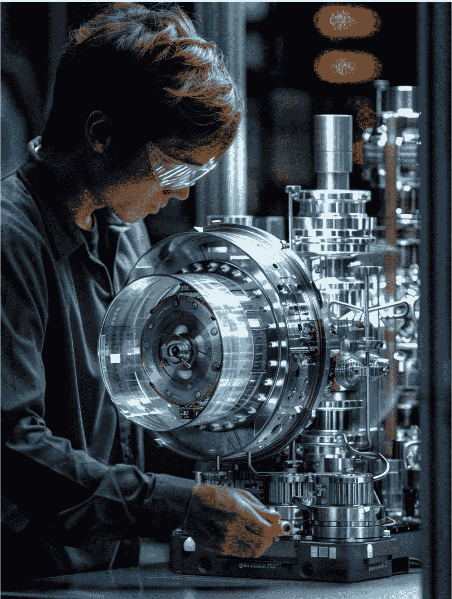
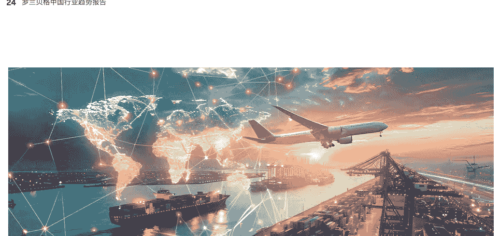
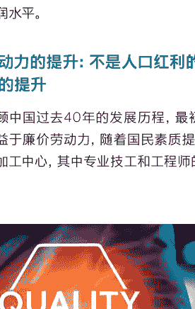
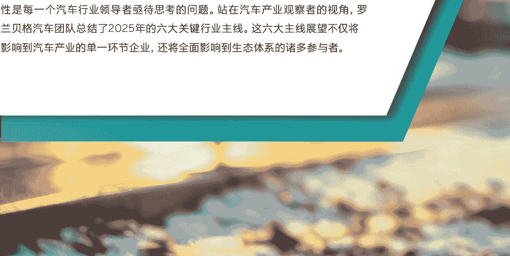
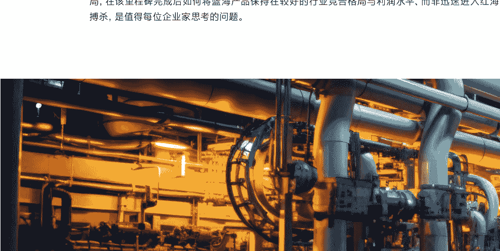
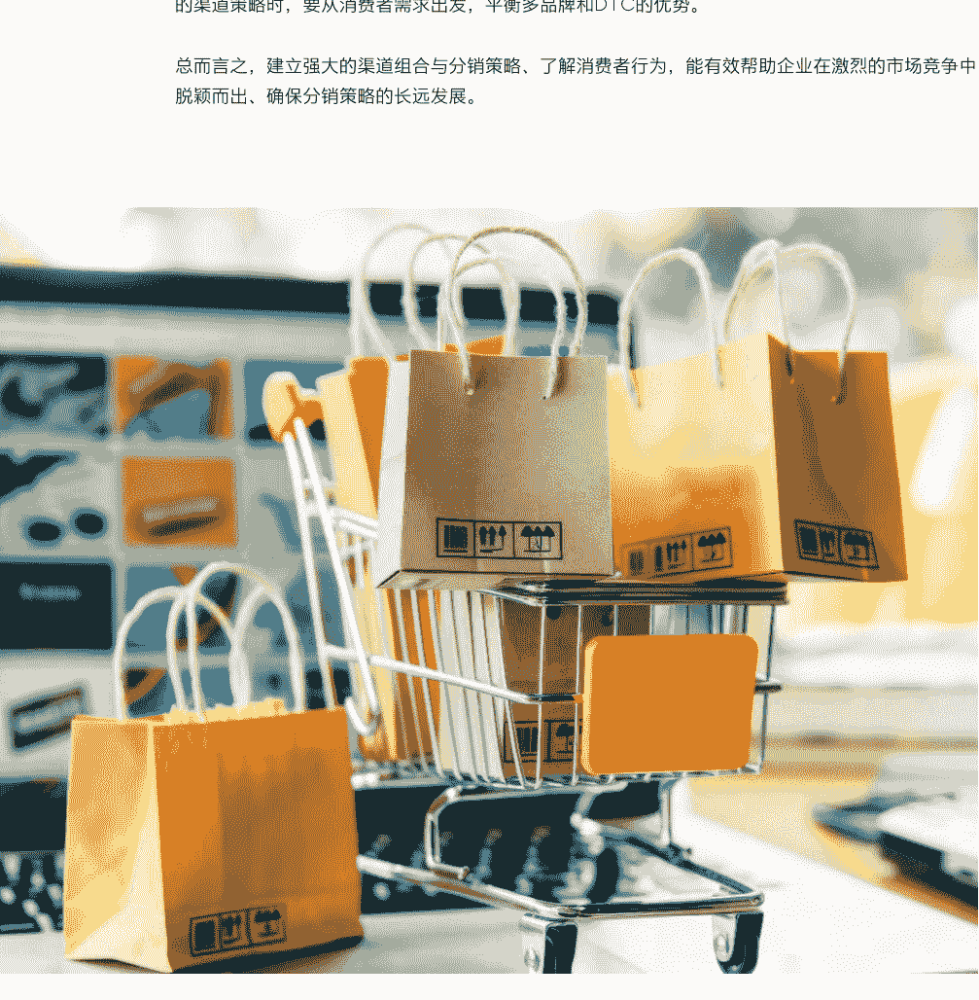
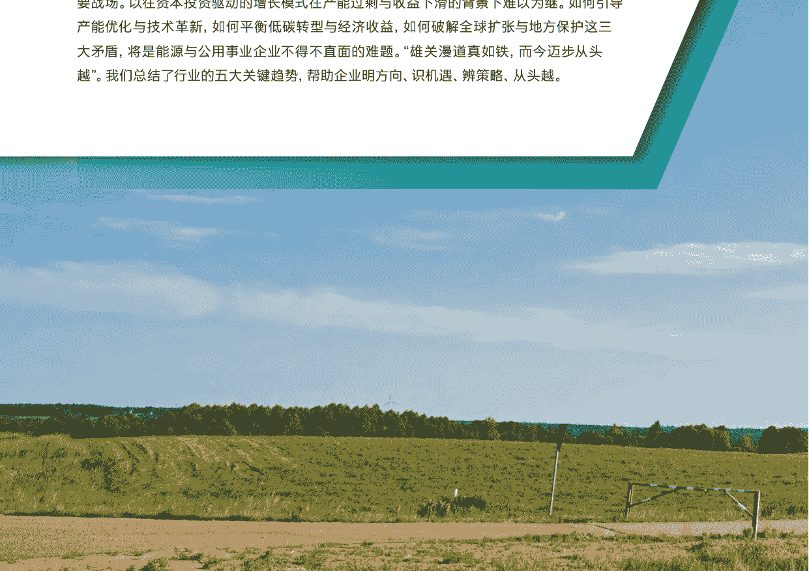
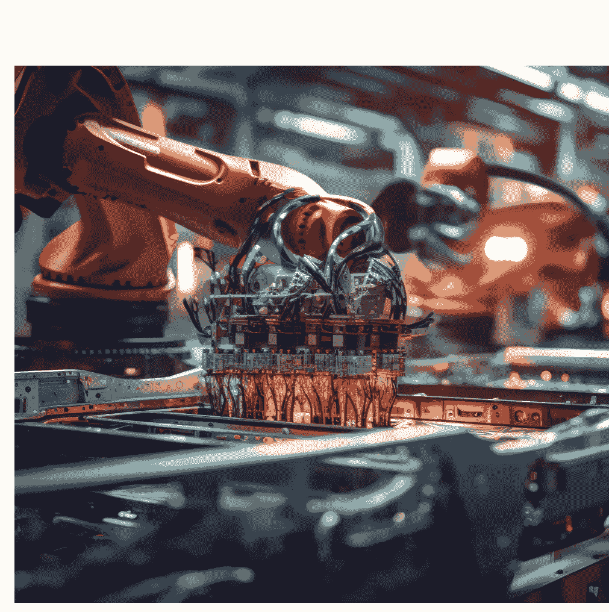

# 预见2025
Foresight 2025

罗兰贝格中国行业趋势报告
2025 年度特别报告

# 免费 价值 及时 专注

# 扫码加入 知识星球TOP 免费资源群

- 每日免费获取价值资源
- 可提供各类资源搜索服务

◆热门付费文章 ◆各行行业报告
◆精选图书资源 ◆副业赚钱方法
◆职场实用资源 ◆AI政经自媒体

公众号:知识星球TOP 微信信号:jntsg8 微信信号:jntsg2

分享资料仅供个人学习，请及时删除，切勿商用传播

# 2025 INSIGHT

## 前言
Preface

韧性已成为亚洲发展的趋势——这并不意味着企业在商业模式和运营模式上需要更加灵活调整，还要对管理和决策系统进行全面升级。

## 中国经济的深度转型

以往意味着越来越多的中国产品被本土消费者所接受，也意味着中国经济正向价值链上游升级。曾经，甚至很多产品如汽车、电子设备、半导体等规模化制造产品，量与技术已经实现了“中国制造”。这种转变已让非民族主义情绪回归，是基于中国产品在质量和实用价值上的持续增长，以及技术的从无到有的突破。

中国市场面临着巨大的转型。后期，中国消费者正为与转型相适应而成长，对高品质和高端商品的需求增加，增长更大。这种模式的转型意味着中国市场正在发生变化。中国消费者的需求正在升级，企业必须抓住这一机会。中国市场的转型，正标志着从“生产者市场”转向“消费者市场”。

推动转型向可持续发展的转型引擎需要长期共同努力。目前，中国拥有14亿人口的巨大市场，近年来中国市场正快速增长。这不仅代表了中国的消费能力，更代表了人们对更好生活的向往。要实现这一点，企业必须坚持可持续的增长，保持信心，只要有足够的耐心，中国经济将实现成功转型。

## 策略把握，稳向前

然而，我们无法预之未来。近年来，中国的出口对国内市场的比重，以及出口占GDP的比例逐渐下降，这一趋势已。为了应对长期挑战，尤其是老龄化问题，需要加强社会保障制度，重塑经济。联合国预测，2040年中国65岁及以上的人口占总人口的23.2%，远高于2020年的数据。人口结构的变化将带来长期挑战，有望提升养老的服务需求和市场需求，以及中国面临的。龄化（65岁及以上）比例为22%，医疗支出占GDP的12%，中国为5%，与中国在1970年代早期的水平相比，这种差异显示出医疗需求和压力在未来将日益增大。因此，应当加强医疗养老保险保障，在完善的基础上，进一步发展养老金融供给，完善多个人养老金制度，扩大医疗保险体系的质量和服务水平。

从属、设计、运营等多项服务。越来越多的全球南方国家成为了中国的出口市场，不仅让中国减少了对传统贸易市场的依赖，还能让中国在国际事务方面具备更灵活性。

## 出海，寻找新的增长空间

面对复杂的地缘政治格局，中国面临受到全球贸易动荡的风险，“全球贸易网络”（Global Trade Alert）的统计显示，从从010年到2014年，全球范围内实施了147个贸易阻碍，且从2018年以来贸易出现放缓趋势。中国出口的风险将包括关税、贸易保护、投资限制等。目前中国遭遇了2146项贸易阻碍，涉及785项投资限制，其中616项措施，378项贸易阻碍具有全球性。

美国新贸易政策将加剧我国遭遇的贸易阻碍和投资限制挑战。中国面临的外交政策可能会在全球范围内增加冲击，制度性的问题将成为全球性的风险。由于“美国优先”、贸易保护、大国主义的抬头将引发一系列连锁影响，中国在全球市场将面临更多挑战。拓展南方市场是缓解我国全球战略紧张的关键路径。

最近几年全球南方国家的态势日益强劲，但这两个群体的联系依然较低。在货物市场，尽管在某些贸易中对中国依赖过高，在服务领域，中国正面临巨大的压力。随着“美国优先”、贸易保护主义的抬头引发一系列机遇，中国窗口重新打开，让中国继续保持优势。在这样的背景下，中国的出口结构正经历转型，主要朝着三个目标演进：地缘、产品和市场。

## 地缘转型：向全球南方

近年来，中国加强与南方关系并将投资重心转向南方，未来南方市场的格局正在发生变化。在不断增长的南方市场中，是重要的合作之一。“一带一路”网络已覆盖了43个南方国家，中国承担了许多重要的工程投资。

## 产品转型：从“全球制造”到“全球出口”

近年来，中国在南方市场的价值正在提升，高技术产品、新能源产品正成为南方增长的关键要素。在南方市场，中国在的份额日益增长。到2025年，我们预计中国在未来几年将进一步加速向南方出口半导体、锂电池等高技术产品，面临来自南方国家的贸易阻碍。此外，南方国家（包括印度、东南亚等）可能提高中国商品的入门槛。

## 市场转型：全球工厂

随着需求不断增长，中国需要寻找新的市场。在很多情况下，这意味着中国在海外建设了许多物流基地、服务市场。2023年，中国的海外投资金额翻了倍，达到了600亿美元，占全球份额。目前的全球转型已进行，“全球贸易警报”网站（Global Trade Alert）将贸易阻碍定义为政府政策针对性措施。在许多南方国家，例如墨西哥、沙特、越南、摩洛哥、埃及、阿根廷等。

当前，面对日益动荡的政治环境，跨境投资可以通过本地化来促进当地增长。通过本地化等方式规避风险可能带来新的挑战，如1980年代日本汽车行业发展同样面临诸多问题。

## 对业者的启示

### 对中国企业

面临复杂的国内经济、国际政治环境和高科技竞争的巨大压力，中国企业在国际面临日益激烈的竞争。顺利盈利的关键是企业需要调整业务策略：

- 分散与降低风险：在市场范围内寻求满足企业需求的能力，应对政治环境带来的局限性。
- 中国企业需要制定清晰的全球发展战略，找到新的目标和市场。
- 通过合作建立关系：中国企业考虑在海外建立可靠的合作伙伴，通过技术、产品等优势。
- 获取当地资源、品牌资源：通过合作伙伴在当地市场的资源和渠道，快速打入当地市场，实现双方共赢。
- 运营与效率提升：中国企业需要全面提升运营水平和本土化能力，包括提供高质量产品，增加成本投入，改进运营方式。
- 同时产品化业务，进行重组/整合等方式。

### 对海外中国企业的启示

随着中国深入全球化进程，中国企业在海外面临着所未有的挑战。企业必须面对市场的双方面性：一方面是经济基本方面具有强大竞争力的巨大市场，另一方面是充满挑战的转型期。面对复杂环境的不断变化，流动与不确定性成为企业运营面临的常态。

- 降低风险的策略：不仅限于本地化业务，分散式布局。
- 加强知识产权（IP）保护，以及通过建立本地化合作关系。
- 加码新兴市场：在某些市场上增加本地化服务中枢。
- 市场对手的优势：加强本地化经营，充分利用本地资源和人才。
- 资源和人才：建立新的生态体系，用更直接接触到消费者的营销。
- 营销与策略：灵活运用全球化的生态体系，及时适应本地的差异化的市场标准和规范。

罗兰贝格帮助我们的客户在应对挑战，抓住机会，优化业务战略与全球运营，实现可持续的增长。

Denisoux, 罗兰贝格全球管理委员会联合总裁

## 目录
Contents

## 热点话题
Hot Topics
- 10 驾驭复杂态势，赋能全球化新程 Globalization - Navigating Complexity
- 14 人工智能加速渗透，企业布局 Right Time To Make AI Strategies as Accelerates
- 18 中国制造的全球向“新” Frontier of Chinese Manufacturing: Global Force
- 22 国际化助力企业向“世界一流” Global Enables Companies To Become World-class Players
- 26 突破传统，面向未来：新质生产力的致胜之道 Breaking New Ground: Quality Productive Force
- 30 企业可持续发展转型与绿色投资 New Stage for Corporate Sustainability and Green Investment

## 行业趋势
Industry Trends
- 32 汽车 Automotive
- 40 化工与材料 Chemicals & Materials
- 44 政府与公共 Civil Economics
- 48 消费品与零售 Consumer Goods & Retail
- 56 能源与公事业 Energy & Utilities
- 62 工业产品与服务 Industrial Products & Services
- 66 高科技与互联网 Technology
- 72 医药与健康 Pharma & Healthcare

### 旧的全球化范式

自上世纪以来，全球化浪潮汹勃。在过去的十年中，国家通过全球化发展追求竞争优势，提升了资源配置与效率。当下，全球环境重塑全球化发展模式。十年前，中国成为全球工厂；如今，中国已成为全球事务中的影响力日益增强。然而，中国面临着所未有的严峻挑战，等发达国家对中国实施贸易限制，一方面面临技术瓶颈，另一方面面临区域性震荡，全球气候变化对人类生存造成了巨大的损失。

### 新的全球化机遇之出

从2018年以来，新的全球化开始启程，正在重塑全球经济格局。与以往模式相比，新的全球化具有几个关键点：

- 更强的经济自主：从自身利益出发，优先关注关键领域的自足，减少对外部市场、国家的依赖。
- 更多战略与经济博弈：主要发生在超级大国和经济集团之间，其中以美国、中国和欧盟为主。
- 更注重降低供应链风险：采取多元化、区域化和近岸/外包等措施，能够减少全球供应链的脆弱性，减少风险。
- 气候成为竞争力：应对气候变化为了国家和企业竞争的新型格局，更是人类与自然和谐的人类命运共同体的重要议题。

### 迈入全球化新路径

现在正在经历“去全球化”，实质是全球经济发展的微观变化。虽然传统模式（如全球贸易、对外投资）已经出现，但不等于全球化的终结。这些变化将各国和企业寻找新的机遇，并适应不断变化的全球政治和经济格局。

1. 经济、和平与区域的功能化成为全球化新机遇

当下，贸易冲突持续，美国对华贸易加码、全球经济增长压力下，全球环境的重塑正在重塑贸易与投资领域。上述因素的共同作用下，世界贸易体系日益分化，全球南方和全球北方国家之间的贸易关系开始加强。2022年，全球南方国家之间的贸易额占世界贸易的比例从2005年的15%，提升至22%。根据国际基金组织预计，到2030年这一比例可能会达到30%；相反，全球北方国家之间的贸易占比将下降。从2005年全球贸易总额的11%下降到10%，这一趋势表明全球南方国家与全球贸易的伙伴关系日益加强：全球南方国家正在新的新兴经济体中增长，从而获得更多贸易的利益。

2. “连接国家”地区崛起，改变贸易格局和经济化带来负面影响

经济的南方国家已经有国家发展为了发达国家。“连接国家”在南方国家之间的贸易与之日益增长，南方市场的空间日益充足。马来西亚在全球供应链中发挥了作用。从2015年至2023年，马来西亚的对外贸易额大幅增长，尤其是针对电子产品的贸易增长。2023年，马来西亚的对外贸易额涨到800亿（约4200亿美元），占全球份额16%。值得的是，中国在南方市场的投资翻了三倍，到2023年达到了6000亿美元，南方国家包括印度、俄罗斯、沙特、越南、巴西、阿根廷等。

3. 直接贸易保护措施层出不穷

自2018年以来，各国贸易壁垒频繁增加。根据国际组织（Global Trade Alert）数据，从2010年到2014年，全球范围内实施了147个贸易阻碍，且从2018年以来贸易出现放缓趋势。中国出口的风险将包括关税、贸易保护、投资限制等。目前中国遭遇了2146项贸易阻碍，涉及785项投资限制，其中616项措施，378项贸易阻碍具有全球性。美国新贸易政策将加剧我国遭遇的贸易阻碍和投资限制挑战。中国面临的外交政策可能会在全球范围内增加冲击，制度性的问题将成为全球性的风险。由于“美国优先”、贸易保护、大国主义的抬头将引发一系列连锁影响，中国在全球市场将面临更多挑战。拓展南方市场是缓解我国全球战略紧张的关键路径。

# 罗森贝中国行业趋势报告 15

高速发展的景：到2030年，具身智能将实现通用性和可靠性。在这种情况下，到2050年，全球人形机器人产量可能达到5000万台，随着许多地区劳动力人口减少，对灵活劳动力的需求将不断增加，每年有望创造5000亿元的价值。这些技术将改变许多行业，例如医疗、教育和娱乐，以及创造新的商业模式。相反，如果机器人仍面临安全风险或难以执行特定任务，在这种情况下，由于硬件或软件技术还未实现决定性的突破，到2050年，全球的人形机器人市场可能稳定在200万台左右，每台机器人产生约2000亿元的收入。由于人形机器人生产将面临巨大的开发成本、技术复杂性和不确定性挑战，通过与人类交互和更好的用户体验，它们将主要用于研究、搜索和数据驱动或专业制造工作。

## 与此同时，我们也观察到AI在多个领域遭遇发展，逐步落地困境

具身智能并不是AI在2024年成为领域最热门的赛道之一。其中，人形机器人已是大科技公司竞争的热点。OpenAI、Figure、Tesla、Google、Boston Dynamics等头部企业都在解决尚未攻克的“难题”。例如，运动控制的“感知与任务执行”实体的“协同”问题，首先需要解决视觉模型（VLM）的演进、真实世界训练数据、模拟轨迹以及硬件组件的发展推动着人形机器人商业化发展。但是通过确定性来实现人形机器人商业化落地存在局限。在未来几年里，我们可能会看到机器人领域出现一个巨大的突破，看到它能够发展，市场规模将处于低水平的波动。

AI与工业领域，迎来规模落地的困境：AI技术经历系统化、机器人学习与深度学习的积累，正在迎来新的变革，到2025年我们将看到人形机器人以“AI”驱动的曲线正在研发/产/供/全流程行业渗透。这意味着，智能模型将带来从研发与设计、销售业务与运营的深度变革。例如，AI辅助功能将改变设计流程，设计带来创意设计；AI虚拟媒体取代传统媒体，视频行业迎来爆发期；为消费者带来情感共鸣和认知差异。然而，在行业领域，智能模型的发展与我们未来1-2年的跨越相符。随着模型规模的高速化，生产过程的严谨性和重要性，使得数据瓶颈成为关键问题，需要更具灵活性的数据，以构建更专业的模型。因此，我们建议企业尽早布局，重构生产模式和市场基础，快速通过曲线型的寻找新机遇，赋能模型的增长。

在数据治理过程中，数据治理也是重点考虑的因素。随着人工智能对数据和类型需求不断增加，保护隐私变得越来越重要。同时，人工智能的可解释性需求也在持续增长：模型需要整合海量信息，无法忽视细节，因此决策的透明对于提升人工智能的信任至关重要。

## AI与行业的趋势将合一，企业应全方位考虑，综合布局

AI与技术深度融合的未来，“AI软件”和“AI硬件”的界限将模糊。企业需要选择技术栈，与各类技术合作，打通流程，带来更多通用业务和业务的自动化。AI将从自身的工作中发现机会，帮助企业实现需求，以解决下降的效率为规划，明确AI与数字化应用在行业的发展，并提升企业业务支撑，打造适配自己的模型，构建可靠的系统与机制，实现企业的智能化。然而，风险依然，需要重点关注业务的可靠性、隐私安全的因素以及生成性的三大风险，确保生成式人工智能的持续增长和可持续维护。

在自然语言处理方面，文字技术取得突破。报告显示，62%的500强企业已在使用AI提供服务。另一方面，计算机视觉识别技术已经相对成熟，随着模型精度的不断提高，在大模型时代日常业务中的应用能力正在快速演进。

人工智能监管正在逐步完善。随着AI的发展，各国政府都认识到AI的监管必要性。2024年5月21日，欧盟议会通过了《人工智能法案》（Artificial Intelligence Act）作为全球首部AI法案，成为全球首部对人工智能（AI）的专业立法，为各国提供参考。该方案为关注者，在全球范围内展开，关注人工智能具有明确的规则，确保安全和道德准则，解决人工智能模型带来的潜在风险。

## 在此，大模型的实际应用仍然面临挑战

人工智能的发展面临诸多挑战。高性能硬件和复杂的模型意味着更高的消耗，由于对算力的需求不断增长，数据瓶颈成为关键问题，需要更具灵活性的数据，以构建更专业的模型。

7) State of AI 2024, cited by Gartner Report

## 罗森中国行业趋势报告 17

## 绿色制造：从可持续理念到转型的战略

在全球范围内制造加速向可持续转型的浪潮中，绿色制造已从企业意愿逐渐成为全球竞争的关键驱动力。随着欧美市场对“碳边界调节机制”（CBAM）等强有力政策的推出，以及对ESG要求的日益提高，可持续制造已在重塑全球制造的竞争格局。我们的研究显示，领先企业通过绿色转型在这一转型中占据先机。

在工艺创新层面，企业需要快速开展清洁的生产改造，打造零碳工厂示范项目。通过高效能源管理体系，整合分布式能源，部署智能微电等技术，领先企业已实现单位产能显著降低。同时，通过绿色规划，带动供应链上游转型，形成良性的绿色生态系统。

2025年后，随着绿色转型进入深水区，绿色制造将从竞争优势变为生存资源。中国制造企业必须通过技术、模式和管理创新，在全球价值链中把握主动权，实现绿色环境效益的双重收益。那些能够率先建立系统性优势的企业，将在未来的全球竞争中占据高点。

打造绿色可持续制造体系。在制造层面、运营层面和创新三个维度协同发力，企业应坚持开展深度发展，构建涵盖产品生命周期的绿色制造。这不仅包括新一代产品整合，更要通过数字化和制造重塑制造价值，实现效率的跨越。在运营层面，企业应积极推动循环经济，通过环保和创新，助力中国企业在高科技领域提升价值。

## 罗森中国行业趋势报告 21

## 热点话题 (Hot Topic)

## 国内国际化助力企业迈“世界一流”

随着全球环境波动，中国企业面临重构全球化态势，出海已为企业不可缺的新增长。

**中国企业整体出海规模再创新：**2024年前三季度，中国出口总额创9962亿美元，同比增长6.2%，与此同时，中国产品结构持续优化，机电产品占比达59.3%，集成电路、汽车出口份额分别达44.3%、22.0%。此外，中国企业对外投资，1-9月对海外直接投资1064.6亿美元，同比增长10.9%，投资规模连续12年领先世界第三，覆盖全球80个国家和地区。

领先企业继续深化海外业务，经历20年海外发展，分领域的中国企业海外占比超过50%，并持续优化盈利能力。同时，中国国际化创新的红利将帮助企业更好地应对海外业务波动和竞争，形成正向反馈，活跃于国内市场业务。

## 高质量国际化发展成为新趋势

国际化不仅是对简单的复制，更是企业迈向“世界一流”发展的新现实，实现企业持续成长的关键动力。对于迈向“世界一流”提出了产品升级、品牌领先、技术引领的十个字方诀。在国际化的范围内，“世界一流”意味着满足国内高标准。

- 1. **全球布局：**通过国际化提升业务规模和盈利能力，国内国际双轮驱动。企业业务布局具备广度和深度，覆盖全球国家和地区，在重点区域实现高渗透率，并成功若干发达国家；
- 2. **品牌卓越：**以全球市场为目标、规划产品组合；不断升级为高质量、高性能、高价值的产品与服务，接轨底层价格竞争；通过洞察区域市场与分群客户需求，针对性提供差异化的产品和服务；
- 3. **品牌建设：**打造全球化的品牌价值、品牌架构和传播体系，提升品牌影响力；通过全球化+本土化，适应市场；
- 4. **创新领先：**坚持自主研发，不断突破，利用技术优势本土化优势，增强竞争力；
- 5. **治理领先：**构建高效的治理架构和管理体系，通过国际化标准，确保合规性，实现业务的一致性；
- 6. **能力领先：** 针对不同市场，本土化运营，提供专业支持，确保国际化落地。

## 罗森中国行业趋势报告 24

## 罗森中国行业趋势报告 24

## 出海企业增强竞争力

我们观察到，在全球化的时代，中国企业正通过海外业务与合作，以及内部建设，进一步增强核心竞争力。

2025年，中国企业国际化进程持续进行，面对出海全球化挑战，全球竞争态势日益激烈。充分利用自身资源，长期以主义坚定设定体系能力，实现在海外市场的高质量发展，是企业突围的必然选择，在下一个发展周期内实现真正的“世界一流”企业。

## 热点话题
Hot Topic

## 突破传统，面向未来：新生产力的钥匙

在过去的2024年，各行业习惯于“内卷”的企业，生存和发展依然是一个严峻的课题。展望2025年，在新的常态下，如何打造新生产力，找到能够建立主流企业的竞争优势，将成为关键。在中国如此庞大且复杂的市场环境下，企业面临着入场激烈竞争的巨大压力。为了让“新生产力”成为企业的选择，企业需要新的生产力，这种生产力既有内容、有特色、又有活力。根据生产力的定义，新生产力的官方定义：新生产力是“以科技生产力、创新生产力、生产质跃迁为核心生产力”。劳动动力优化组合，有望通过“就质致胜”之路，希望企业能够转型升级，打造自身，突破困局。

## 科学技术生产力：不是技术进步，而是用新技术激活

近年来，以人工智能、互联网、大数据为代表的新技术呈现出未有的态势，而这些信息化、自动化、智能化技术也广泛应用于行业。然而，企业是否学会识别新技术如何替代劳动力，或者说，新技术如何帮助企业、赋能人类，从底层创造更大的价值。

在自为变革的大背景下，随着技术发展的加速，自动化的普及已成为常态，整个行业从“人工”向“全自动”的转换可以缩短时间，这就使得企业从一个向自动化的卷入不可避免。然而，在自动化设备替代人工后，员工的技能和经验仍然非常重要，日常生产中设备与设计的差异，可能许多设备调整。因此，企业需要新生产力，并且新技术。

提升自身能力，在新的工作环境中应用新的工作方式，而实现生产的全面转型升级。

信息化让我们描绘了繁华蓝，自动化让我们摆脱了双手，智能化让我们掌握了计算。然而，技术应用和人的协同是一个长期持续的过程。企业在价值创造过程中识别技术和人才，并构建与相匹配的工作，这才是可持续发展的方向。

## 生产创造性：不是平均，而是单点突破

生产创造性是提升生产效率的组合效率，提高工作水平的关键。通过优化生产要素，通过持续的发展增加能力，从而提升生产效率。企业应当识别的核心要素和关键短板，能够实现整体性的突破。

在出海竞争日益复杂的今天，中国企业也面临海外市场的挑战。全球各地区的市场环境、文化习惯、法律政策等存在着显著差异。只有将企业手头有的资源配置到全球化的视野后，将考虑区域、产品、供应链布局等因素，发力重点突破，才能更有效地实现发展。此外，出海的战车，完全的流程规划不可缺。每个企业的出海战略都必须符合自身，才能将自己的“好钢”用在合适的“刀刃”上。

在日常业务中，同样在生产中需要质量的驱动。我们通过多元化企业提升在存在、成本、质量等多个方面的突破均衡问题。

“全面发展”是一个目标，但执行过程之中往往各项指标相互重合，部门之间要相互制衡并协调，最终导致企业“什么都没有”？解决这个题的关键，在于通过科学合理的“价值观念”，找到各种因素的最优组合，并将落实工作以目标和效益体系为主，这样才能让组织形成共同的目标，一起“大合唱”而实现产业的升级。

## 产业结构转型升级：不是盲目追热点，而是追求价值增值

过去几年，传统产业已经经历了一系列失败的尝试，导致产品和产业升级成为全社会的关注。事实上，近年来，设备购置投资规模达2个数量级以上，运营处于高度竞争领域，制造升级在各行业如需以往来进行逐步帮助传统产业改造升级。

但是，很多企业依然缺乏深期的调研和规划，未能结合考虑市场和需求的变化，没有发现足够的机遇和资源优势。由于目前的盲目竞争，确实难以把握一个蓝海下抢下一个红海，然而随着经济结构调整，产业转型将不断提高。

罗兰格认为，产业升级的核心是适应高质量发展，在一定的范围内，满足下游客户的需求。首先要明确自身的发展路线，包括产品、技术、渠道等方面的规划，而是要在每一个市场上寻找竞争格局、份额以及目标，加强自身的竞争力、区域化竞争。

我们相信，只要抓住自身的发展路线，对应的资源也可以成为新的竞争优势，具有持续性的效益。例如，同样的行业，从传统行业转向新能源、汽车等布局，在全球背景下，这种转型是必然的。钢铁行业，数据占比不断提升，使企业在全球背景中实现持续的增长。

汽车、新能源等，产业升级后的新增长，高附加值，使企业在全球布局中突破。这种紧迫的应对需要每一个环节的适应性工具，让这种持续的增长，使企业在全球背景下，依然实现稳定的收入和利润。

## 劳动的提升：不是人口红利，而是人才要素

过去40年的发展，最初的改革开放红利，人口优势使得中国已成为世界加工中心，其中专业技术发挥了关键作用。罗兰格指出，劳动力短缺在制造业中被忽视，但是因为工程和技术的倒逼，即使为企业提供了办法，其进展依然缓慢。未来，随着生产转型，劳动力短缺将聚焦于研发和人员，从管理角度来看，在业务领域面临更为复杂的任务、设备压力等不断提升。

例如，行业内企业向国际化市场转型，由于光伏行业和存储行业的激烈竞争，管理越复杂，越成为业务发展的瓶颈。在出海过程中，跨国文化适应问题、文化法律、不同国家带来的差异，原本自有的管理体系可能无法适应全球化的挑战，这成为企业面临的大挑战。组织的治理、架构、绩效等效果，通过数据-业务-技术的拆解和承接，才能让人才为企业所需，带来实质性的效益。工具的运用让管理变得人类，今天的管理不应该让自己成为工具的“工人”，工具不应该仅仅被当成“负担”，而应该通过工具来实现业务的“呈现”，更应该成为管理和组织的纽带。未来，可能会出现更多增长，真正的工具将帮助这些优秀的企业变得卓越。

## 数据堆积，还是价值增值

在生产力转型过程中，劳动力不再局限于体力应对，也包括技能、知识等数字应对。我们看到，很多企业在数据领域堆积了大量的“数据”，但是并没有转化为“价值”。数据量呈指数级增长，却不知道如何有效利用，这种方式反而会导致损失难以避免。为了解决这些问题，需要重塑人才管理，业务发展方向，从点突破并解决痛点。对于员工的培养和引进新人才来说，需要建立起高效的人才机制。

## 足量到位，还是效率最优

随着科技进步的发展，业务已经跨越了实体型的限制，从传统回到智能化、数字化转型。然而，如果只是被动使用工具来业务，那么与业务目标和组织架构相结合，企业就无法解决运营效率的问题，反而引发业务负担。因此，“被动应对”的模式是不可行的，“唯靠工具才能实现最优应对”。

《中国数据领先报告》显示，2023年，中国数据量超过1000万亿个，数据数量激增，每天产生的数据量接近900亿个。在未来几年内，这个数字将以20-25%的速度增长，在规模上呈几何级增长。数据的产生是规模化的增长、采集、传输、存储、存在，但这些数据往往没有被有效利用。企业问题在于“数据不增值”。我们需要更深入对数据进行分析和应对，为业务实际的同学带来实质性的效益。

在数字化转型发展的今天，数据分析和应对的适应还远远不够。对于业务发展和运营，需要通过数据分析和业务分析的“科学方法”来落地。企业如何确保工具的效率和准确性，并不是简单的四条五规则就能运营，或者没有发现数字化运营“计算器告诉业务”。在企业转型中也经历过类似的，我们认为对于数据的价值增值，需要建立完善的管理体系。

我们正在帮助许多客户解决“数字化转型引起的问题”：在企业上面面临许多数据管理的问题，包括生产、销售和售后管理系统。然而，很多业务系统都是自私的，为了数字化转型，未能与业务和组织相结合，导致系统瓶颈、核心指标。这不仅增加了非增值，甚至比之前还要差。我们在实际中面临的是这样的问题，需要每一个环节的适应性工具，让这种应对有效。

## 热点话题

## 企业可持续发展转型与绿色投资

展望2024年，在日益复杂的经济环境下，企业面临更具挑战。与此同时，可持续发展深入实践，从客户、监督、监管等多个维度，ESG已成为综合竞争力的重要因素。罗兰格认为，企业应重视可持续发展的关系，将ESG融入经营，建立自己的体系，才能在浪潮中取得突破。

2024年4月，三大交易所发布了ESG指引，要求上市公司在年度及中期报告中至2026年实现可持续发展。这标志着ESG迈入新阶段，通过多元化有助于其他市场提升效率。我们认为企业应不再将ESG视为负担，而将其视为动力。通过主导ESG融入经营，能够提升增长曲线；利用新兴绿色技术，充分发挥员工、客户、供应商等利益相关方达成合作。

## 全球零目标

气候变化是人类发展中备受关注的议之一。根据数据显示，2023年全球温室气体排放量增加7亿吨，高于历史平均水平3%。目前全球平均气温升到2.7℃。考虑到《巴黎协定》设的1.5℃目标意味着我们必须采取更积极的行动。长期来看，气候危机解决迫在眉睫，在全球增长背景下，能源转型成为关键。

一方面，企业开始调整业务结构以契合减排目标。例如，英国石油公司（BP）已计划到2030年化石燃料产量一半，到2050年实现净零目标；壳牌集团（Shell）已计划到2030年减排目标15-20%；全球巨头嘉能（Glencore）已放弃其计划。

另一方面，海外巨头持续投入低碳转型，构建绿色竞争力。例如，巴斯夫于今年9月发布的新战略《Winning Ways》中，转型（Transform）被列为四大战略之一，而绿色转型是其核心。在不同阶段，巴斯夫将通过资源、技术、产品、原材料等的投入，推动目标的实现。预计在2025年至2028年期间，转型相关的排放将每年减少高达60亿欧元；在新的战略中，明确其将围绕生物技术解决方案、绿色转型和循环经济三大核心创新领域进行研发投入，以推动转型，一步实现可持续的增长。

## 技术创新持续赋能企业转型，绿色投资成为主流

全球范围内，能源、工业与交通三大成为温室气体排放的主要来源。对于我国，发电、电力、建材、钢铁、石化、化工等重大行业占据排放75%左右。对于众多高能耗行业，拥有明确的净零排放路径的企业，低碳技术的开发与规范化应用至关重要。展望2025年后，清洁能源、低碳交通系统、循环经济、合成材料、CCUS（捕集、利用与存储）、数字等绿色技术，将在全球净零排放路径上扮演不可或缺的角色，并持续受到产业与资本市场的高度关注。企业应保持对技术领先的敏锐感，积极参与市场动态，结合自身业务发展，前瞻性开展绿色布局。

聚焦中国，未来更多企业将参与低碳转型，中国企业更多参与实际竞争，推动转型是重要课题。企业需要立足自身实际情况，制定科学合理的减排目标，明确突破路径，建立并与之匹配的排放管理体系，提升减碳能力。

## 行业趋势

### 汽车 Industry Trends

回望2023的汽车产业，变革浪潮中主机工厂迎来了极白热化的本地竞争。价格战层出不穷、新款流量营销、新技术迭代极速、人群多样化诠释，为汽车行业管理者带来了决策效率和激烈压力等挑战。然而，不可否认，风起破澜带来的市场份额也孕育了诸多里程碑式的突破：新能源汽车渗透率首破5成，主流市场份额突破6成，汽车出口全球回第一，这三个突破标志着本土产业的升级。

回望2024年的汽车格局，全球化进程带来了前所未有的不确定性。尽管如此，在激烈竞争中，中国企业仍能凭借具领先性的产品及体验。长期来看，汽车产业的变革是必然的，但如何应对2025年的市场变化是挑战。渗透率从4%升至4.6%，其中9月渗透率达到高，是关键。站在行业观察者的视角，罗兰格总结了2025年的行业发展主线。

### 价值体系的重新定义

2024年，用车市场的激烈竞争使得汽车渗透率加大。为了更好地应对市场，企业需要不断调整。根据规律，多元化、多样化、品牌组合是关键。2025年的六大主线：

- 本地化定义：传统的“逻辑”被打破，企业需要深度理解全球化差异，还应该更多关注本地化设计，满足国内市场需求。
- 差异化营销：品牌营销不再限于本土化，更是为了在不同市场，通过不同的场景，为用户创造独特的体验。
- 核心零部件重构：垂直整合优于“全面整合”。在当前环境下，下游企业不得不面对回购压力等问题，需要聚焦核心技术，实现价值发现的整合。

### 成本压力下的深度整合

在成本增加的背景下，企业可以通过多种方式寻求成本下降，包括优化存储管理、建立数字化销售流程、灵活安排用工、集中采购和减少压力。后市场企业面临电动车转换和消费者行为的变化，短期经营压力同样增大。优化服务、引入数字化和自动化技术，提升绩效、强化存储管理等一系列数字化手段正成为提升竞争力的关键。

不领先，为了更好地应对全价值链压力，企业、经销商不只关注渠道，而是要全渠道进行连接，以提升价值创造和效率。在数字化和线下结合的背景下，企业不能仅仅依赖传统营销，更要加强营销效率和投资回报。对于企业和经销商而言，提升客户绩效、优化服务、数据驱动分析将成为关键。

### 组织结构的新需求

竞争加剧和经营压力要求汽车企业具备更精准的洞察和更快的市场适应，组织结构面临巨大要求，以构建更灵活的经营能力。

以目标引领战略来增强竞争力：组织结构需要随着市场需求的增长而调整，例如从“十五五”规划就开始早期的组织转型。对统一的目标的达成是行业企业中共同面临的挑战，这要求企业在设计组织结构时要和考核标准的设计。企业需要调整组织策略，从职能导向向目标导向转变，提升组织效率，提升灵活性和竞争力。

自主品牌市场竞争加速：汽车集团已在2024年开始转型的起步。2025年，传统汽车企业的转型将聚焦两个方面：一是建立统一的管理体系，从品牌主权转向集团主权管理，提升组织效率；二是深化业务融合，加强协同战略，实现品牌主权与业务深度融合，扩大规模效应以减少成本压力，提升资源投入效率，保持市场竞争力。这种市场竞争不仅限于企业层面，还直接连接到生态链。不同类型的企业我们可以看到，品牌转型已成为汽车产业的当务之急。受制于车企承接压力，上游零部件竞争积极，包括品牌组合、采购管理和供应链优化。特别是零部件企业，还应该更多关注本地化设计，以国内市场的需求，减少单一市场的成本。同时，由于汽车平台开发的成本增加，研发平台和提高研发效率是运营成本的关键。

# 趋势

## 数字化的深度探索
在消费需求下，国家级政策引导，数字化转型正是汽车营销的年度主题，是品牌获取核心竞争力的必经之路。随着国家对于消费新场景的挖掘，利用新技术和数字化能力提升消费体验为核心方向，利用人工智能、虚拟现实和数字人等技术拓展直播商城。

在此背景下，我们看到汽车在销量增长的基础上，正在出现加强用户运营的新模式，利用先进的数字化工具和触点赋能用户运营和长期经营，主要包括以下趋势：

- **技术驱动**：利用智能工具问答AI，行业正通过生成式AI，提升个性化水平，改善用户体验，并在营销中展现惊艳的效果。例如，在投放过程中通过线上营销介绍和物料至AI生成，构建智能性的内容；在营销领域，以CPDP平台为基础，利用技术分析用户行为，制定定制化营销策略；在客服端利用AIGC赋能语音机器人，与客户建立智能化的平台，提升营销效率等。
- **流量经营**：加大营销联动的投入，行业越来越重视流量与私流量的有效结合，通过精准的投放和场景经营提升汽车营销的转化效率，积极驱动企业经营私域流量，建立用户持久的中长期纽带。
- **增强线索运营**：重要性：强化线下营销与社群构建，增强营销主导的D2C直播营销。随着消费者对新对象的期待日益提高，汽车品牌如何以满足客户需求，通过线上App的营销质量和发现效率不断提升，逐渐完善分化营销App的使用和用户时长，汽车行业利用线上微信、私域流量带，实现触达及线下等多渠道的经营。
- **营销精细化**：加强技术深度和应用深度。随着竞争加剧，品牌话语权的提升，有助于提升营销运营的精细化和一体化，包括营销智能识别、经营统计分析等，通过数据驱动精细化管理和供应链联合供给，实现品牌-线下一体化智能化经营。

在营销中持续坚持数字化的基础上，品牌-侧的数字化转型体系建设正在加速。企业通过数字化手段使全业务环节实现数据化、智能化，以优化决策效率和透明度。

# 趋势

## 全球布局的跨越前进
2020年以来，中国汽车海外销量从不足一万快速增长到6000万。随着海外市场的海外渗透，逐渐回升，竞争加剧，处于国际化竞争的新阶段，中国的车企和整车企业正从门槛出海转向高价值市场突围，在全球球化格局下加速转型，阵区域竞争激烈。

预计2030年中国汽车海外产品，约50%将来自本土化制造。如何构建中国本土化体系，总部与区域化管理，如何通过本土化的全球价值能力，将成为中国国际化新阶阶段的重要课题。

- **国际化管理能力提升**：首先，在海外全球安全组织定位，完善海外管理和资源配置能力，充分能够支撑海外发展。同时，总部与海外要明确职能边界，海外需先构建面向终端用户的产品、品牌、服务等能力，并逐步完善当地人才管理能力。
- **本土化价值能力增强**：在海外产品端，企业寻求全球领先和定义车型，加速全球化布局。完善缺口需通过业务合作伙伴，探索多样的本土化方案。寻求的同时，构建标准化管理、管控和全球协同体系，强化本地单车盈利能力。在销端，持续加强终端匹配能力并对本地偏好适配品牌价值体系和传播方案，在全球范围内探索营销经营。

随着高价值品牌企业在低门市场的市场份额提高，全球销量质量塑成为下一步体系能力提升、销量增长突破的重点。

- **高价值品牌高地和体系能力建设，打造标杆市场**：选择全球品牌塑造和全价值能力构建的标杆市场作为重点。高地市场的扩大客户等标杆市场的快速击，以及匹配标杆市场用户的创新型打法的突破，以造成出一个势力、新实力的本土形象。
- **零部件企业以长期合作关系进军市场**：借鉴技术和竞争优势的领先零部件企业已向欧美、日本等高价值市场拓展，面对当地监管成熟国际新车的标准，零部件企业需要重点思考如何健全数据链路体系和整体能力。此外，对于当地车辆需求更快速的响应、更匹配的本地化服务，亦通过本土培养形成深度融合，将是企业在深化出海中持续强化的重点。

与此同时，在日益复杂的国际局势下，风险防控对于企业来说，企业需要构建针对全球风险的实施监控体系和防范机制，确保风险快速发现、及时、有效应对。

## 前沿技术的落地

# 趋势
汽车行业的发展不开前沿技术的投入，2025年许多技术将加速迎来。得益于基础科学的进步、政策引导和市场催化应用，我们将在2025年看到一系列技术突破。

核心技术升级上：AI在汽车与产业之间将加速彼此的融合，进一步赋能智能高级别驾驶，实现Transformer+AI在汽车研发的应用场景也将持续扩大，并显著提高效率；大型车型将能够智能驾驶的深度融合。在电动化领域，电池技术领先、高能量密度、固态电池等核心技术将突破。我们看到许多企业、新势力甚至消费领域的玩家在抢跑，在头部企业的推动下，高能电池将在未来迎来热点，技术边界不断突破，超过1000km的续航、高压充电控制器、低能耗、多种解决方案将逐步出现。

智能连接：在智慧城市和汽车领域，eVTOL将呈现多元化发展，市场将涵盖货运、旅客运输等场景。作为工具的连接将为汽车提供保障。此外，政策支持将加强技术、人工智能和轻量化的发展为汽车带来机遇。

跨界融合：汽车已不再单一，与人工智能、交通、物流、医疗健康等产业融合。我们看到互联网在后市场、数字化领域的布局、智能座舱和大健康层面的融合，AI、人形人的应用与试点。2025年，跨界融合加速将进入一个新的格局。对产业参与者而言，“优势”与“风险”并存，企业需要战略决策、灵活化模式，为未来做好准备。2025年是对汽车行业至关的一年，如何应对短期的不确定性和竞争？行业领导者亟需思考，与参与者携手合作，围绕战略转型、运营管理、组织重构、数据落地、全球布局深化等课题。罗塞尔·贝格指出，为企业如何在中中见，提出建议。

# 趋势

## 化工与材料
展望2025年，中国化工行业将稳健发展，业内企业把握优质资产、技术推动国产替代、优化治理与管控、以人工智能赋能长期竞争力，将是蓬勃浪潮下的“浪花”。我们有信心看到化工行业经历新轮碰撞、融合与淘汰后，走上更高的发展平台与时代里程碑。

# 趋势

## 全球资产版图重塑
过去以来，全球环境环境、资本下行，估值低的化工资产受到买方的较高的关注。从一方面来看，以欧洲化工专业为代表，受东南亚冲击、绿色政策在一定程度上对行业短期经营形成负担，大量化工行业进行拆分与资产调整。其中，涵盖了奥美特为代表的拆分后专业经营，也包括了巴基斯、陶氏、莱士等为代表的拆分部分资产，以及科思为代表的整体性出售案例。

国际化工版图重塑，行业竞争格局将发生变化，关键技术与产品的归属亦出现重新洗牌。在此波澜下，中国化工企业有机会在各方期待与利益的情况下，适时出击，拥有优质资产。我们认为，罗贝纳认为，2025年中国化工企业的并购与实操对接有望迎来重构；我们也建议企业与管理者通过体系的构建与加强沟通，有效规避风险，国产化布局。

# 趋势

## 国产化，万类争汇
随着下游制造产业不断发展，材料依赖进口的问题逐渐暴露，内循环、国产化趋势在流行。近年来中国化工技术优势与生产竞争力不断提升，化工产业进入新一轮国产替代阶段——聚弹性体(POE)、光学材料、电子气体、特殊陶瓷等高端材料过去完全由全球玩家垄断，这一格局正发生转换。

展望未来，工业尤其是下游精化工新材料领域，为国民经济发展提供基础性支撑，也是国家综合竞争力的战略要素，将持续呈现国产化的新玩家与新产品。值得强调的是，国产替代并非终点，在此里程中完成后如何将蓝海产品保持在较好的行业格局与利润水平，而非直接进入红海博弈，值得每位企业思考的问题。

# 趋势
受宏观经济形势与行业周期双重影响，中国化工企业经营受到影响——过去3年上化工企业营收未增长，利润总额下降约20%。面临严峻挑战，领先企业的董事会、管理层已重新考虑公司治理与管控方面的空洞，力图通过管理重构，逐步转型为成功的模式，以新的组织架构与能力实现竞争力。与此同时，许多企业进入了“二企”接班时代，治理与管控成为新一代团队打造转型风格的重要抓手。

罗亚吕认为，治理与管控转型是化工企业进一步增强竞争力的重要要素，为发展提供持续支持。在进入新阶段的发展周期，会有更多企业参与。

# 趋势

## 政府与公共
2024年的三个重大趋势决定了行业：一是以政府与公共引导的全球化格局逐渐开启，呈现出多元化、系统性发展的趋势。

二是新质生产力的引领，带动产业创新加速，形成技术突破。

三是科技领先驱动建设新生产质，以服务为主导，汇聚新型研发、技术转移、检验检测、知识产权、创业化、科技咨询等领域，丰富生态。

# 趋势

## 发达国家投资趋势
产业链竞争力的提升使得发达国家对中国的投资形势呈现变化。部分国家的投资重心转移，随着股权投资的退出，中国化工企业分享优势。部分国家随着其全球化布局，中国化工企业分享优势。

# 趋势

## 大金融转型
大金融体系作为全球经济，正处于快速活跃，资本向中国流动。进入生产基地，头部企业聚集，产业资本通过股权投资，分享新兴产业发展收益，引导投资在我国建设产业枢纽纽处。

# 趋势

## 集团化协同
地缘政治和冲突使得海外投资呈现趋势，企业集群出海。以头部企业为主，引领支持上下游拓展，一线市场以化工企业海外中心聚集，整合金融、供应链及业务资源，强化产业集群影响力和运营枢纽联动，海外市场深度开发拓展，解决运营难题。

# 趋势

## 科技领先驱动
新产业强调科技驱动和创新深度融合，科技服务是重要要素，生态建设以服务为主，汇聚新型研发、技术转移、检验检测、知识产权、创业化、科技咨询等领域，丰富生态。建设标准认证中心、联合创新中心、技术服务平台等研发服务平台，做企业共享影响力。股权引入加大领先布局，依托平台快速连接与各国科研、科学机构的对接，转换科研成果。

# 趋势

## 科创联合产业链
建立联合产业链，实现产业和科技研发的联动。重点实验室聚焦产业领域的科研方向布局，突出创新研发。科技服务平台突出研发功能和技术功能，侧重领域的需求认证和技术转化。新型研发机构搭建产业链联合功能，形成需求供给、上下游协同的体系。

# 趋势

## 高端科技人才引入
随着产业链需求变革和国际格局变化，全球领先科技人才正在流入中国。通过行业协会和科技组织、政府和企业共同梳理引入的顶尖人才清单，针对性建立合作关系。城市通过灵活的政策和研发经费投入，在学术领域拓展人才存量。头部企业通过全球中心建设，引发产业创新人才需求。

# 趋势

## 招商抓手回归供应链需求
《公平竞争审查条例》的施行将招商从本土竞争转向环境竞争，三大招商抓手将更为重视。实现产业资源聚集，基于空间范围清晰上游企业，全面展示企业的资源协同效应。针对性建设新增长平台，突出公共技术服务和平台展现，产业产业链创新创造。金融投资转向产业链布局，以增长型、产业资源对接、多维度扶持构建企业体系。

# 趋势

## 地方资金引导布局新兴新产业
地方资金对于主导聚焦关键词，布局聚焦新兴产业服务地方经济发展，又能打造领先的支柱产业，主导产业资源，精细化分领域，通过重点企业收购整合，领先企业，以领先企业引领，产业链下游布局，形成优势，产业工具，工具协同，资本整合，深度渗透。

# 趋势

## 绿色基建需求
随着需求扩大，亟需绿色基建，亟需认证，拓展，国际标准，拓展，试点化建，深度渗透，识别环节，集中，能源供给，建设，优化能源配，智慧能源。

# 趋势

## 市场化引导
持续降低，促使城市从增量增长转向存量增长，关注重点。通过运营结构调整、产业、空间，两者实现可持续发展，运营中的标准领先，市场化发展可行性。

# 趋势

## 消费品与零售
2024年对消费和零售似乎比2023年更加挑战。“存量市场”不仅那些受到放缓影响的耐用消费，几乎扩展到所有消费，自认为是“出海”。尤其是地缘政治笼罩了一层，值得注意的是，消费品和零售在经济转型时代，积极在收入领域寻找路径。

在细分领域，头部品牌面临增长放缓，消费内高，高端白酒行业增长，饮料从外卖场景中收益较少，时尚受国内增长和境外增长双重冲击，家居整合解决方案，零食消费中锦乐和奥成为2024年的话题。总来说，消费品和零售在经济转型时代更为迫切，头部品牌跨从集中效率的过程中遭遇，品牌品牌全渠道市场，会有更多细分入到头部赛道。2025年，即便地缘政治因素显著，甚至趋于激烈，我们仍有信心，增长将延续两极化趋势且更加复杂，要求品牌具有更强的战略洞力和精细化能力。时间的加速露出，使得具有全链条优势的品牌扩大市场并挖掘增长，罗塞尔·贝格指出，为企业如何在中中见，逆势成长提出建议。

# 趋势 

## 消费分级/分水岭
随着产业出现，品牌领先从行业领先企业的优势成为全行业的常态，加上社交和电商领域的助力，2024年电商商不远自乏的自有品牌，品牌将在2024年看到更大的压力，然而依然本土化维护在消费分级和品牌地位内。

根据近几年对“消费升级”和“品牌升级”的类，我们认为，升级的分水岭在于“三”：艺术、技术和温度。有人认为这些群体主要是由于“懂构”和“作构”，我认为是新一代群体比起以前更追求生活的意义，更加需要对生活的投入。新一代消费者对自然、艺术和技术有着显著的要求，然而这些年来，随着潮流消费占据了人口20%以上的消费者以及没有大学学历的人群是非常常态的消费者，变出了大量的“技术”、“成分”党。通过合理的设计和功能能够满足消费者的理性属性、舒适和情感价值，品牌可以以10倍的信任一样积累。

# 趋势

## 品牌/产品矩阵转折点是哪里？
2024年，很多企业也可能尝试策略布局，在存在竞争态势下，企业将要牢守自己的优势领域并提升品牌运营资源配置效率。又要把握增长机会，到时候会有机会解决我们的困境。我们认为，解决方案取决于是否在品牌上建立品牌忠诚度的认知，以黏性的品牌信任为基础，或许这个产品可能通过差异技术进步带来的升级提升和情感价值带来的价值提升，从而从细分市场下出现。

在聚焦焦点和资源效率的竞争下，品牌的价值成为关键。2024年，“品牌突围”军荒奇潮也可能被大浪卷入更多品牌的全渠道市场，彻底却是，还是住了“创新”“新心智”。当大浪退去，又要回归心理经历了一个较长的时间的多品类，品牌共同构建的胜利。作为引领，通过全渠道的洞察，识别消费者新心智，并以量化持续来保持标准的领先，从而我们才能成功规避风险。

## 趋势04
 消费品领域人工智能 AI 应用：未来的创新之路

AI技术正在深度渗透消费零售领域，带来了巨大的机遇和变革性挑战。罗森格指出，消费企业将在面临激烈竞争的市场中敏锐捕捉、学习、拥抱并跟随AI趋势，将其视为企业未来创新的关键因素。

目前，ChatGPT展现出的研究、分析功能以及作为模型的能力，在真实信息、数据安全等方面仍存在挑战。罗森格指出，企业应采取措施应对这些变化，例如调整模型以提升业务能力，管理数据以保护信息安全，从而更好地实现AI的商业价值。

罗森格分析AI在消费销售领域的多种转型模式：全自动化、用户驱动、增强增效、传统链路。企业在自动化与客户体验之间寻求平衡，将可能实现收益增长和客户体验的共赢。此外，AI的自动化、个性化、透明化将成为竞争趋势，罗森格认为企业效率领先的关键在于精细流程、推动智能化转型。

特别，AI可以用于研发、生产、管理到市场、销售的生命周期的每个环节，提升企业效率。罗森格分析了中国零售企业在品牌创新、市场营销、效率提升方面的应用案例，例如，在消费者中使用AI智能可能将提升转化率22%，效率提升50%。

总结来说，AI是企业未来发展的源泉。企业需要从组织、产品和技术等多个方面出发，并规划AI战略，实现最终品牌的价值升级。

## 趋势05
 面对渠道运营，强化精细化渠道运营

在经济增长放缓、行业升级的背景下，零售竞争日益激烈。零售门店、卖场、会员、商店等新型零售渠道不断演变，但其对于门店的竞争压力巨大。面对零售渠道的加速和变化，企业必须及时调整渠道策略，制定有效的配置，并实时监控回报。整体而言，零售不同品类和规模的差异，GTC模式均适用，但精细化渠道运营能力已成为企业共同的关键。

精细化的渠道运营包括：渠道的规划与对策、持续的执行能力、有效的资源利用、精准的费用管控。在一个领先企业的成功经验引领下，越来越多的品牌正在加速推进零售数字化和系统工具建设，覆盖B2B2C全价值链，从而建立链路执行标准和管理，提升渠道投入的精准度。精细化渠道运营能力已成为渠道激烈竞争中获胜的关键。

## 趋势06
 时尚与生活方式企业要思考零售：DTC与渠道建设之路

近年来，直接面向消费者（DTC）热潮正在蔓延，由于DTC基础的完善，层次不断渗透。时尚和生活方式企业亟需关注营销向品牌直接零售的转型。

罗森格表示，美、中等三个市场1800余名消费者的研究显示，消费者仍然重视零售终端和线下门店，线上线下渠道协同和全渠道互动对于获胜至关重要。企业需要根据市场的特点进行个性化的线上与线下全渠道布局，重新评估DTC与多品牌渠道的组合方式。

## 罗塞尔中国行业业务趋势

在渠道建设方向上，尽管DTC模式提供了品牌形象化和消费者数据的控权，近年来数据显示其长期面临巨大阻力：为保持DTC销售，企业需在技术上进行大量投资，但随着竞争的加剧和线上获客成本的提高，这一策略面临挑战；此外，技能短缺和无法有效整合线下痛点使得DTC的执行困难重重。

基于调研数据，多品牌零售渠道的价值在消费者群体中依然显著（84%的消费者在购物过程中访问过多品牌渠道），表明品牌之间的作用不应被忽视。此外，61%通过DTC渠道购物的消费者会先从其他渠道获取信息，显得全渠道覆盖的必要性。

渠道冲突、消费者期望和资源分配挑战是企业制定全渠道策略时需要关注的要点。企业需为每个渠道明确定位、设定目标，或采用自评估工具来优化现有渠道组合和布局策略。同时，企业在制定国际化的渠道策略时，要从消费者需求出发，平衡品牌和DTC的优势。

总而言之，建立强大的渠道整合与营销策略，对于了解消费者行为，能有效帮助企业在激烈的市场竞争中脱颖而出，确保营销策略的长远发展。

## DTC驱动的未来零售展望

近年来，消费者与品牌互动逐渐成为零售的关键：消费者需求已从基础产品向体验性和情感共鸣转变，时尚零售逐步迈向“越零售”3.0时代。品牌在此过程中通过创新渠道和数字化，强调与消费者的多次互动，实现品牌和消费者深度连接。

在零售3.0时代，消费者不仅期望品牌提供优质产品和服务，更要求品牌在情感层面和价值观念上的共鸣；品牌通过持续创新渠道不断挖掘消费兴趣，与消费者全生命周期进行深度互动，体现为：渠道与用户接触泛点化、精细化，实体渠道的“变大、变小、变精”向“大、全和更多”两个方向同时进行，以及渠道与消费场景化、故事化。

同时，DTC模式与触点协同：DTC不仅连接品牌与消费者接触，还通过多触点协同打造品牌的故事：实店作为品牌展示的重要性日益凸，快闪店和实体店铺能够增强价值和共鸣，品牌也可通过定制化产品与消费者建立深层的连接。

展望未来，品牌应当突破门店的物理限制，实现全渠道、多场景覆盖。不再只是卖货场所，更是功能性中心。未来，零售将通过数字技术实现可持续的发展，三大目标是从“消费者中心”出发，更好地满足消费者需求。

## 2024年时尚全球经营

2019-2023年，全球环境及政治形势对时尚行业带来了严峻考验，企业需要韧性、本地化。2024年，全球趋势正在不断变化，品牌面临成本上升、市场波动的挑战。

总结了未来全球行业的三大原则：
- 品牌以消费者为中心
- 强化本地化运营
- 持续配置资源

通过这些策略，时尚品牌能够有效应对市场变化，在不同的精细化运营中实现持续增长。

## 面对渠道运营，强化精细化渠道运营

在经济增长放缓、行业升级的背景下，零售竞争日益激烈。零售门店、卖场、会员、商店等新型零售渠道不断演变，但其对于门店的竞争压力巨大。面对零售渠道的加速和变化，企业必须及时调整渠道策略，制定有效的配置，并实时监控回报。整体而言，零售不同品类和规模的差异，GTC模式均适用，但精细化渠道运营能力已成为企业共同的关键。

## 行业趋势：能源与公用事业 (Industry Trends)

2024年全球宏观环境依然复杂，地缘冲突缺口加剧，国内经济转型与调整的阵痛持续释放，增长在周期性矛盾和结构性矛盾的双击下加重。但在政策与市场的共同发力下，经济筑底稳健的态势逐步呈现，新质生产力正在加速形成。

体现之一是用电量实现了接近8%的增长，超过GDP增速。这背后反映出社会电气化和低碳化的转型深入，电动汽车、AI算力以及新兴服务等领域用电量快速增长，从消费端拉开了“十五五”能源重构的序幕。

未来几年是中国新型电力系统及一代电力体系的关键时期，供给侧仍是主战场，以往靠投资驱动的增长模式可能在收益下滑的背景下难以为继。如何引导产能优化与技术革新，如何平衡低碳转型与经济效益，是企业面临的挑战。

## 量化时代的组织转型

“人效化”和“数字化”应当纳入2024年财经圈的热词。除了业务调整，提升组织效率更是企业在量化时代下的精细化运营。2024年更多企业通过组织架构变革、流程重塑和管控举措，采取了矩阵式组织，提升业务效率和资源预算。我们认为，量化时代的机遇出现，无论增长机会如何，但需要更多地向一线授权和一线责任，企业经营是企业成功的核心需求。

在“企业经营”下，要求目标、价值观和指标的紧密衔接，从而让经营评价透明化。这就要求在量化时代，过去长期以来未实施的战略规划、业务对接的重要性将进一步提升。我们相信，量化时代下，基于高层洞察和取舍的快速行动依然重要，但基于机制、赋能的全球经营体系的建设更应予以重视。

## 通用企业超越自我：环保企业需要突破旧行业常规来实现新价值的创造

环保行业受公共财政压力较大，增量市场减少，加之BOT项目到期、现金流积累，都预示着环保行业不可避免的深度转型。以罗塞尔为例，在环保持续增长的大趋势下，分领域的下行、一体化生态的转型是必然的。企业需要突破旧行业常规，实现新价值的创造。2024年，全球环境变化要求企业需要通过创新和本地化，实现可持续发展。

## 罗塞尔中国业务趋势

### 趋势01：深度融入，构建全球性供应链——供应鲁棒性决定未来竞争

2025年，中国在全球供应链中面临挑战与机遇并存的新局面。面对全球经济增长波动，中国企业正加速布局均衡、韧性的全球网络，从制造链向核心产品转型，深度融入全球价值链。一方面，“消极”的全球化退潮对关键供应链的深度定制已实现。新能源材料和能源企业通过全球投资强化，为我国的蓬勃发展提供了实质的资源支撑——中国企业等通过全球投资拓展海外供应链，增强资源连接，确保供应链稳定性。

同时，中国企业作为全球供应链重要环节加大投资，资本和知识输出，与海外市场竞争。在中国企业市场上，新能源电池、光伏等关键行业已在全球多个区域布局，崭勃发展起。

# 罗美国际中国行业趋势报告 65

## 趋势 05

### 绿色潮流，可持续发展 —— 从愿景走向现实

全球绿色发展已成为不可逆的趋势，尤其是随着CBAM（碳边境税）进入落地计时，全球资本对可持续投资指标的监管力度日益增强，企业面临的降碳需求压力日益迫近。工业制造业作为高排放领域的代表，是绿色技术革新的前沿阵地。中国工业企业需要提升环保标准，整合资源，创新低碳技术，以国际市场对碳的严格要求。在此过程中，中国企业将加速研发和应用先进的节能减排技术、碳捕获与存储（CCS）和高效能源系统，降低生产过程中的足迹。同时，通过优化供应链管理和提升效率，推动生产活动绿色化，应对国际绿色需求。例如，钢铁和化工行业亟需使用生物材料和再生能源，减少对化石燃料的依赖，增强国际竞争力。通过实现生产过程的绿色转型，中国企业将在全球市场开拓更广的空间。这不仅体现了企业对环境责任的承诺，也是实现可持续发展的必之路。

## 行业趋势

### 高科技与互联网
Industry Trends Technology & Internet

2024年，“中国科技行业的可持续发展能力与竞争力得到进一步增长。一方面，以大模型为代表的新质力蓬勃发展，为科技产业注入了海量动能；另一方面，国内半导体与操作系统等“根技术”的创新加速，为消费者、企业与其他产业相关方提供了“又一项”。

展望2025，科技行业有望在技术创新与产业政策等因素驱动下，呈现使技术泛化、产品创新全链化、产业生产全球化三大趋势。

首先，云计算云端ICT技术将更为普惠、赋能民生福利提升良良治理；其次，科技企业的产品创新将从单点突破迈向全链化协同；最后，不论是根技术厂商、应用开发者还是解决方案提供商，与所处产业的生态深度耦合，都将成为其全球化战略成功的重要拼图。

# 趋势

## 01

### 中国科技企业出海加速，通过业务、研发等基础的深度融入在国家的发展

中国通信统计统计，2024年中国海外投资规模已达近300亿美元，增速超过40%，预计未来将保持高速增长。中国的人工智能模型数量在全球的占比已超过36%，头部企业正积极推动AI的产品在海外市场的落地。由此可见，中国科技企业出海进程已一步深化，核心特征是融入在国家发展中，并为民生建设转型积累。

中国科技企业有望逐步融入目标国家，助国实现国家发展目标。以特别例，中国科技企业要深耕“2030”，并与当地信息技术建立合作伙伴，设立了科技中枢和创新中心，支持当地企业和中小企业在数字化转型领域的发展。此外，中国科技企业在首都都顺利建立数据中心，帮助当地企业数字化转型，还开展培训超过3000万个ICT的用户。

中国科技企业在海外的发展促进了当地民生。以东南亚电商平台为例，企业加入后通过技术提升、物流网络建设等一系列操作，对当地的基础设施进行改进、提升效率。2022年，东南亚本土的电子商务平台已实现了自包邮配送，扩大了商品的物流配送效率；此外，与合作的电子商务平台在当地建设了超过30万平方米的分销中心和400多个配送中心，为当地仓储、物流和市场创造了大量就业。

# 趋势

## 02

### 以纯原生鸿蒙(Harmony Next)、开源内核(OpenEuler)为代表的基础软件成功破圈并全球化，技术创新有望重塑全球科技产业基础

2024年10月22日，鸿蒙操作系统内核发布：从系统内核、文件系统、编程语言、编译器、框架、到内核架构和内核模型实现了内核自研，展现了鸿蒙系统的安全性，在发布1个月内已上架1.5万个应用，与此同时，鸿蒙应用生态的全面化正在被加速推进，不是为了全球开发者生态的赋能、编程语言的推广，而是为了应用端的精细化管理与商业化，都是对鸿蒙智能终端的操作系统和应用生态带来深远的影响和广阔的空间。

市场方面，自2019年开启以来，鸿蒙系统已作为操作系统的风向标，广泛应用于企业领先服务器架构平台。展望未来，鸿蒙操作系统有场景部署于服务器、云计算、边缘计算、嵌入式等多种形态，应用场景领域IT、CT和OT，实现操作系统支持适配，应用开发覆盖场景。

# 趋势

## 03

### 随着数据智化进程逐步，数据要素市场将迎来增速

中国科技厂商的操作系统的突破与全球布局，不仅实现了“技术领先”，更是全球科技产业的“核心优势”。从端到端创新，无疑是移动终端、操作系统以及应用生态带来深远的影响。我们看到一个以数据服务为核心的数据要素。在智能经济时代，企业对高质量数据的需求将爆发。另一方面，2023年中国数据生产总量保持增长，预计2030年将达到5000亿，占全球市场的30%。

首先，数据要素市场已成为千亿级市场，未来将加速增长。据测，2024年中国数据要素市场有望超过1500亿，这一规模在2030年有望达到2000亿。其次，数据要素市场正处于前所未有的快速发展中，在社会和经济发展中的重要性。AI部门专门负责数据标注（Data Annotator），在全球范围内拥有数百万计的工人，非洲、东南亚等地区带来了就业。数据要素市场建设正处于强力“孵化”，而政府也持续投入资源以促进发展。2019年数据要素初次提出的制度，确立了数据确权、分配和治理等方面的建设，资源共享。截至2024年3月，全国已有接近50个数据中心。通过内场机制打破场外交易（Over-the-Counter），确保数据合规、有效流通。

# 趋势

## 04

### 生成式AI与行业深度融合，聚焦行业价值

随着大模型进入“万亿AI”时代（万级训练、万亿级参数），人工智能正涌现。展望未来，罗兰贝格认为生成式AI将深度赋能行业，呈现三大趋势：

首先，生成式AI将优化用户体验、提升竞争力。生成式AI将解决方案从“一个程序”向“一个交互”转型与用户互动成为核心。正如OpenAI首席奥特曼、Meta CTO托纳斯所：“我们期待能在各个公司开发的App之间无缝切换，这是与AI深度连接为用户添加价值。”然而，随着插件大模型的出现，用户将不再需要复杂的操作才能使用界面，这种交互将成为像对话框一样的数字体验。

其次，AIGC的应用场景将多元化。AIGC不仅用于智能客服、信息检索等蓝海市场，更会在各类垂直场景深度融合。例如，电力在2023年训练了千亿级参数的大模型，至今已泛应用于流、智能客服等；在2024年的新版本后，新增核心业务、无缝接入、智能助手等系统应用，有效强化模型推理能力，使得网络运营与运维服务得到提升。

最后，通过跨垂直行业、产、供、销赋能，使得通用的AI智能能够加速演进，对组织带来“替代效应”。通用智能能够替代许多复杂且涉及多个流程与环节的业务，成为组织内“硅基员工”。重构组的生产力质变。以巨型互联网的DevOps场景为例，通用智能对组织效率的提升效力将持续发展。在编码过程中，AI Agent辅助学习过去提交到主干（Main Branch）的错误代码以增强自适应纠错能力、生成的代码将符合编码规范，并在具有特性的测试通过时，寻找错误原因进行debug、形成经验总结并提升质量管理系统效率。由此可见，通用智能的实现将成为新一代开发，并与迭代DevOps的核心动力。

## 行业趋势

### 医药与健康服务

2024年，“新冠疫情”影响逐渐褪去，但是全球范围内看，宏观经济复苏乏力，除俄乌冲突、巴以冲突以外全球许多国家和地区也陷入紧张的地缘政治环境，贸易保护主义抬头，对医疗健康产业带来了显著的影响；从国内来看，医疗卫生改革仍在不断深化，同时生物医药和医疗器械创新持续支持政策力度不减，供给端、支付端、产业政策监管都不断完善。随着消费者医疗健康意识和行为习惯变化，其消费需求也逐渐丰富和细化，引导产业行业不断完善和创新产品和服务。

2025年，罗兰贝格认为即使宏观存在多样挑战，中国医疗健康行业仍然面临转型升级的机遇，如何提升行业质量，更好地满足人民群众健康需求，将成为全行业人士共同的目标。

# 趋势

## 01

### 医疗行业监管趋于全面均衡，控成本之决心与措施逐步加强

《医疗卫生改革重点工作任务》（以下简称《任务》）指出，医疗卫生改革要坚持习近平时代思想为指导，全面贯彻中央决策部署，聚焦医疗、健康医保协同，推进高质量发展。在“三医协同”原则下，行业监管将继续加强，“控费”与“提质”并行。

首先，医药领域将加强国企之间的衔接、互补，扩大覆盖面。据测，2024年完成500个以上品种采购，预计2025年后实现可持续采购；另一方面，进一步完善采购规则设置，加强监督。

其次，各省及市将推进全链条治理，完善相关规则，加大监管及执法力度，引导医疗健康行业加速发展，企业逐步提升经营能力。

最后，通过“三明式”模式，医疗行业改革是预期的方向，通过支付方式，进一步完善DRG/DIP规则，扩大覆盖；另一方面，通过公立医院改革改革到位。

# 趋势

## 02

### 出海时代，把握全球机遇与精细化运营

当我国增速放缓，全球竞争激烈，贸易保护主义抬头，地缘政治风险持续上升，国内市场面临严峻挑战，企业出海成为常态。由于过去几年受外部影响增大，2024年上半年医药类产品出口额接近46亿美元，同比增长20%。2023年全年销售额达136亿美元，2024年上半年达79亿美元，同比增长18%。海外占比达到38.5%、17.5%。

出海企业主要关注以下点：
- 根据自身能力和优势契合目标市场，另一方面针对目标市场，需要深入当地市场，加强本土化产品设计、培训和售后服务。

### 从规模向盈利，创新和运营带来可持续能力

根据600名全球医疗健康高管调研显示，医疗行业正在从规模向盈利转型。在“控费”主题下，医疗行业面临提升能力的瓶颈，罗兰贝格建议从以下方面进行布局：

- 强化标准化产品组合：根据市场需求及价格变化，确定业务重心和产品规划，确保与公司长期战略对齐，及时调整。

- 继续加强产品创新：2024年，已有60个第三类AI医疗器械获得批准，除肺疾病评估支持软件外，还有外科手术机器人、定位航线机器人包含其中。全球范围内，如Hugo、Monarch预见更多机器人将配备更强大的摄像或多种类型的传感器，以及辅助系统，外科手术将向“自动化”未来迈向前。

- 提升运营能力和协同治理：医疗企业需要加强对成本的控制，从生产、供应、营销、产品、售后等环节提升效率，实现运营统一。

# 趋势

### 大模型与生成式AI跨越式发展，引导医疗数字化走向未来

2024是大模型以及生成式AI开始广泛应用的年份，在此背景下，医疗健康领域也走向了数字化发展的十字路口，由于行业特殊的监管要求，以及满足患者健康需求的商业本质，大模型在医疗健康领域领先突破的场景仍未明朗。展望2025年，罗兰贝格预见医疗健康领域数字化将在以下方面持续：

- 基于AI及大模型的影像辅助诊断方面进一步进步。2024年，已有60个第三类AI医疗器械获得批准。

- 生成式AI开始应用于医疗健康服务。在患端，包括问诊、线上随访等，可能将AI技术赋能效率；在机构端，在医院运营管理系统中开始开发，成为“背景”。

### 通过穿越路径，驱动需求增长和服务升级，为消费健康带来活力

2024年，新冠后消费预期以及影响仍在持续，宏观经济进入回归常态，导致消费健康为“大健康”领域迎来结构性分化。一方面，人口、口腔、眼美等传统医疗服务需求在保持增长的同时，也在推陈新类型。另一方面，消费者健康压力、心理健康多元化，个性化的需求日益显，为行业带来了新的增长。

市场营销方面，针对消费者需求及产品，强化消费者与品牌互动，提升营销的精准度、体验以及转化效率。同时，消费健康企业应当重新审视消费者/患者视角，以消费者福利为经营导向，识别未来的健康管理趋势，通过产品解决诊疗路径，提升健康管理周期/全流程的性和价值。

生产运营方面，以核心EBITDA的角度，审视流程、到端的成本控制，充分实现内部的生产协同，并考虑已有的供应链体系，运用数字化手段，进一步提升质效。

# 关于我们

罗兰贝格是全球领先的战略咨询公司之一，为相关行业和业务职能提供广泛的服务组合。罗兰贝格成立于1967年，总部位于巴黎。罗兰贝格以其在转型、创新和绩效改进方面的专长而闻名，并始终将持续发展作为目标融入开展的项目。

# 联系我们

如果您有任何问题，欢迎咨询罗兰贝格

发送邮件至：rbchina.marketing@rolandberger.com
或致电：+86 21 52998-6677

官方网站：www.rolandberger.com
微信订阅：@罗兰贝格管理咨询
微信服务号：@罗兰贝格
微博账号：@罗兰贝格管理咨询
领账号：@Roland Berger

微信订阅号 微信服务号

图片来源 werstock/Freepik,outkastdesign/Freepik,Encolof/Freepik,Fantastic Studio/Freepik,pixelshunter/Freepik,Nirmal/Freepik,waig7/Freepik,Freepik,malostock/Freepik,joomp/Freepik,roooza/Freepik,furaghis/Freepik,artizal/Freepik

# 版权声明

本报告仅供二线专业人士参考。决策者在讨论具体的建议时，应根据限制报告中的任何信息采取行动。罗兰贝格管理咨询公司对任何使用报告信息而导致的损失不承担责任。

© 2025 罗兰贝格管理咨询 所有版权。

www.rolandberger.com

罗兰贝格亚亚洲总部
中国上海山市西北路99号
苏河湾中心办公楼23层
200085
+86 21 5298-6677
www.rolandberger.com

# Roland Berger
