# 马斯克商业帝国

## 特斯拉发展策略研究报告

2025年3月
鼎维咨询行业研究院

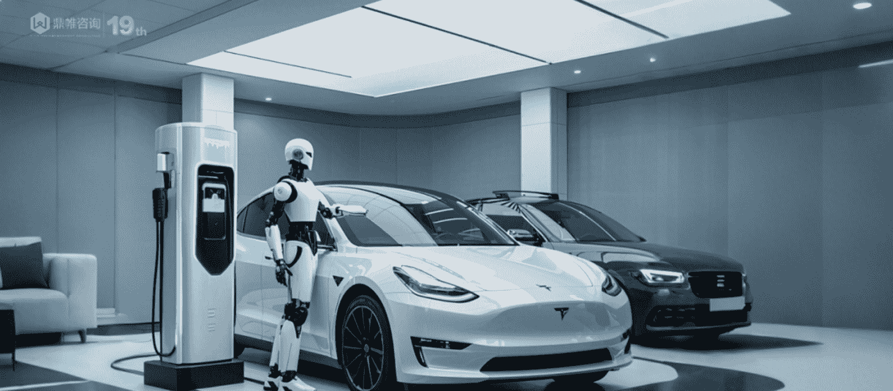

# 扫码加入 知识星球TOP 免费资源群

免费

- ✓ 每日免费获取高价值资源
- 可提供各类资源搜索服务

公众号：知识星球

价值

微信信号：jntsg8

| 热门付费文章 | 各行各业报告 |
| :--- | :--- |
| 精选图书资源 | 副业赚钱方法 |
| 职场实用资源 | AI财经自媒体 |

及时

微信信号：jntsg2

专注

分享资料仅供个人学习，请及时删除，切勿商用传播

## 马斯克帝国全览（改变人类生活方式）

- **发展目标：**
- 推动全球可持续能源的转型

- **发展目标：**
- 降低太空运输成本，推动火星殖民计划

- **发展目标：**
- 实现人类与计算机的直接交流

- **发展目标：**
- 解决跨城市交通问题
- 建造高效交通系统
- 超级快速铁运
- 公用事业与货运

- **发展目标：**
- 打造能够理解宇宙本质的通用AI

- **发展目标：**
- 打造全能应用，构建全球数据广场

- **业务布局：**
- 新能源汽车业务
- 汽车市场业务
- 新能源业务
- 人形机器人业务

- **业务布局：**
- 火箭发射业务
- 卫星互联网业务
- 星链业务
- 星际探索业务

- **业务布局：**
- 基础科学研究
- 脑机接口医疗治疗
- 人机交互业务
- 生物类智能

- **业务布局：**
- 隧道监控业务
- 交通系统业务

- **业务布局：**
- 模型研发业务
- 平台业务
- 行业应用业务
- 算力基础设施业务

- **业务布局：**
- 社交媒体业务
- 付费认证业务
- 广告业务
- 金融服务业务

- **发展愿景：**
- 形成一个完整的、持续的、循环的能源生态系统

- **发展愿景：**
- 使人类成为跨行星的物种，实现人类文明在宇宙中的扩张

- **发展愿景：**
- 增强人类与机器的进一步融合，塑造一种“超级人类”

- **发展愿景：**
- 打造的地下城市基础设施系统，推动城市更加宜居

- **发展愿景：**
- 通过AI来寻求真理的AI，帮助人类识别终极

- **发展愿景：**
- 构建人类的虚拟平台，打造第二生活空间

最新市值：1.14万亿美元
最新市值：3500亿美元
最新市值：500亿美元
最新市值：570亿美元

公众号：智锋咨询

## 2025年以后，特斯拉股价大幅下挫，其核心原因有三：一是政治原因；二是销售下滑，中国造车势力崛起；三是公司盈利能力下降，导致市场预期降低

## 特斯拉近半年股价变化（20240930-20250320）

| 政策因素 | 右翼政客标签 |
| :--- | :--- |
| 马斯克加入特朗普政府担任“政府效率部”负责人，推动驱逐移民3万人，引发全球反美议活动。 | 马斯克从“科技精英”转为“右翼政客”，导致品牌吸引力下降，部分车主为清醒在车上。 |

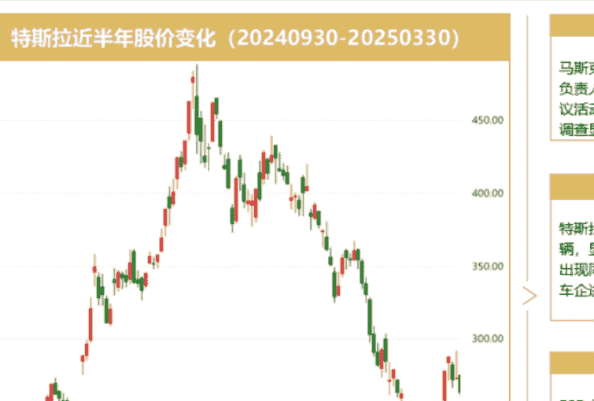

| 销量下滑与中国造车企业 | 行业因素 |
| :--- | :--- |
| 特斯拉2024年第四季度交付量为49.56万辆，显著低于预期，全年交付量下滑。对比比亚迪、吉利等中国企业，2025年1月，特斯拉在欧洲的新车注册量下降50%，份额42%，德国销量下滑44%。 | |

| FSD技术 | 公司毛利率 |
| :--- | :--- |
| FSD技术推出“Beta”方案完成测试，订阅率仅15%，面临欧盟监管。 | 2024年毛利率从2023年的23.6%降至17.8%，由于平均售价下降、硬件成本增加约500美元。 |

| 市场因素 | |
| :--- | :--- |
| 瑞崩、高盛评级下调目标价（最低至120美元），过去三个月空头获利160亿美元，基金等惨损。 | |

智源·鼎维咨询

面对特斯拉股价下跌，美国商务部、特朗普为站台，本质上是马斯克产业与深度绑定的结果。

特朗普在3月发布会，试图宣布新款车型，并在回答问题时强调“特斯拉是创新的”。特朗普在3月19日呼吁投资者购买特斯拉，称其“便宜得难以信”。

马斯克产业与政府深度绑定。SpaceX与NASA合作支持。特朗普承诺发射火箭计划已超154亿美元。Starlink与商务部合作，美国商务部改变政策，使Starlink获得200亿美元资金，并将空中交通权限直接冲击传统巨头。特朗普政府放宽FSD审查，马斯克参与政治行动委员会（捐赠750万美元）和社交媒体平台X，马斯克制造舆论，推动自身的立法。

马斯克在2024年宣布十年后特斯拉的市值达到30万亿美元，市值占比从5.61%提升至32.45%。为什么马斯克有信心？霍维认为从战略面对对其研究与学习。

## 美股姐妹2015~2035年市值变化（亿美元）

| 苹果 | 微软 | 英伟达 | 亚马逊 | 谷歌 | 脸书 | 特斯拉 |
| :--- | :--- | :--- | :--- | :--- | :--- | :--- |
| 2035 | 189758 | 191147.98 | 62988.85 | 14279.21 | 79582.66 | 15480.15 / 300000 |
| 2025 | 33278.4 | 28990.3 | 27757.44 | 21315.21 | 20374.37 | 15480.15 / 8750.66 |
| 2015 | 5836.13 | 4396.7 | 177.32 | 3183.44 | 5216.15 | 315.43 |
| 0 | 200000 | 0 | 200000 | 0 | 100000 | 0 | 200000 | 0 | 100000 | 0 | 20000 | 0 | 400000 |

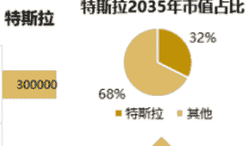
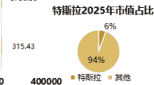

# 马斯克为特斯拉带来暴涨的原因：自动驾驶带来5~7亿美元市值，Optimus机器人贡献25亿美元市值

马斯克预测特斯拉将拥有“超过1000台可能达到数千个”Optimus机器人在运行。特斯拉有能力将每个1美元的成本，大规模生产这些机器人，并以平均2美元的价格出售。特斯拉能生产机器人每年可挣1万亿美元的利润。

注：上述美股2035年的市值预测来自于前十年的增长率换算。

## 01 / 特斯拉业务布局分析

# 目录
02 / 特斯拉汽车业务研究
03 / 特斯拉能源业务研究
04 / 特斯拉机器人业务
05 / 特斯拉发展研究
06 / 特斯拉协同洞察

## 特斯拉计划的本质是通过技术领先实现民主化，从电动车到AI驱动的可持续社会

- **核心目标：1.0（规模化）**
- 生产电动车（Roadster）
- 推出豪华车型（Model S/X）
- 开发大众车型（Model 3）
- 同步发布新产品（Solar Roof）推动能源循环

- **核心目标：2.0（迈向未来）**
- 开发更廉价、实用的车型
- 实现全球市场的电动车及新产品
- 实现全自动驾驶（FSD）
- 构建智能汽车

- **核心目标：3.0（五步路径）**
- 全球部署能源
- 生产240万储电池
- 推进热能和辐射
- 实现“Optimus”机器人

- **核心目标：4.0（蓝图）**
- 卫星网络优化能源调度
- 实现“太空互联网+地球”实时调度
- 通过Neuralink实现人脑控制
- 深度感知交通

## 关键技术积累与成果

- **大规模制造（2019）：** 采用集成压铸工艺，效率达98%；推出Cybertruck和新车型；90%零部件一体化，工厂自动化率提升至95%，生产周期缩短至10小时（当前30小时）。
- **自动驾驶：** 硬件：HW3/HW2.0配备10个传感器；数据：积累数亿英里实现城市级自动驾驶。
- **电池：** Megapack (2019)：单体能量密度kWh/kg，下降15%，预计下降20%。

## 关键技术路径预测

### 自动驾驶与Robotaxi
- **硬件升级：** HW5.0：算力突破2000 TOPS（HW4.0至720 TOPS），360度全视角传感器融合（当前约100 TOPS）。
- **软件迭代：** 端到端神经网络：FSD V12全面采用端到端神经网络，通过100亿英里实路数据优化算法。大规模训练：Dojo集群（1.1 EFLOPS算力）规模集群，训练效率提升1000倍。

### AI机器人 (Optimus)
- **低成本效率瓶颈：** 机器人密度突破30kg/m和碳纤维强度，成本降低至55000美元/台（传统工业机器的20000美元）。
- **多模态交互：** Tesla Bot完成（8个头部）和传感器融合、语音交互、手部和物体识别；机器人学习人类行为并与人类交互，生成结构化数据。
- **自主充电：** 机器人可以自动对充电桩车辆充电，充电只需20分钟。

### 智能网络协同
- **能源储能：** 部署低轨卫星网络，通过卫星传输收发（目标60%），补充充电桩。
- **虚拟电网 (VPP)：** 全球部署10000个Powerwall单元，形成200GW-Wh分布式储能网络，参与虚拟电网。

### 制造材料
- **3D打印：** 采用复合材料直接打印骨架，减重40%，材料降低30%。

## 挑战与瓶颈
- **市场：** Model 3渗透率从0.3%提升至40%（2024年）。
- **交付：** Model 3初期不足（76万），面临管理和供应链瓶颈。
- **技术：** FSD引发监管关注（NHTSA调查）。
- **效率：** 增长速度低于预期。

## 预测
- **能源结构：** 预计2050年可再生能源占比超过50%，实现全球可持续。
- **经济影响：** 支出节省万亿美元，创造万亿新产业。 (2016-2023)

公众号：巅峰 | 特别咨询

# 目录

01 / 特斯拉业务布局分析
02 / 特斯拉汽车业务研究
03 / 特斯拉能源业务研究
04 / 特斯拉机器人业务研究
05 / 特斯拉发展保障研究
06 / 特斯拉协同发展洞察

# 围绕汽车整车业务，特斯拉完成了全面布局，涵盖充电、维修保养、二手车、保险、配件等多个方面，构建了“产销服”的全链生态

## 零部件业务

- 自研三电（电/电池/电机）减少对外依赖
- 自研零部件成本极低，提升提升整车毛利率
- 4680电池规模化生产使电池成本下降
- 在欧洲积分分化地区（如美国ZEV市场）高出销售积分
- 零成本纯利润
- 向合作公司授权开放蓝牙（如电池技术），获取授权费
- 专利技术授权增加收入
- 政策波动带来未来良机

## 二手车业务

- 月供低至399美元（低于行业均值30%），扩大用户数据库

## 软件服务业务

- 官方认证车源首购，新款增加15%以上
- 向二手用户销售FSD订阅（渗透率至20%）
- 通过云端网络升级，功能解锁，OTA维修免费升级
- 车辆订阅服务（月费）9.9美元
- 与运营公司合作“按里程定价”保险产品，实时支付保险确定折扣
- 向特斯拉车辆收取20%的服务费，特斯拉收取配套费
- FSD（月费）199美元
- 旧电池用于能源储能，利用率从70%提升至95%
- 高利润持续收入
- 一一议价
- 长期现金流
- 车辆回收的二次利润
- 软件订阅收入
- 驾驶数据确保保险定价
- 电池储能环节节省成本

## 充电网络业务

- 储积分（价值500美元）应对2035年燃油禁令，无限量

## 租赁保养业务

- 分区域销售利润
- 仅向维修接入点投放广告，事故维修利润高达65%
- 原厂配件高利润
- 充电服务可靠性一定
- 按时计费，避开高峰期
- 应用商店抽成

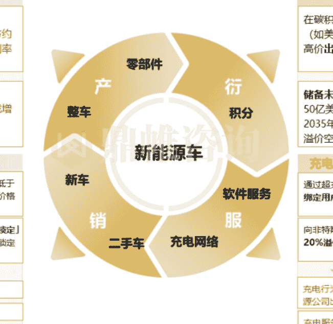

# 特斯拉基于高端品牌、大众走量、颠覆变革三个层面进行布局，未来将通过Roadster 2提升品牌价值，通过Robotaxi搭建自动驾驶服务生态，通过Model Q打入低端市场，完成市场布局

| 高端旗舰系列 | 大众走量车型 | 颠覆性产品 | 未来产品规划 |
| :--- | :--- | :--- | :--- |
| Model S | Model X | Model 3 | Model Y | Semi | Cybertruck | Roadster | Robotaxi | Model Q |
| 定位 | 定位 | 定位 | 定位 | 定位 | 定位 | 定位 | 定位 | 定位 |
| 豪华电动轿车 | 豪华电动SUV | 中型电动轿车 | 中型电动SUV | 重型电动车 | 电动全尺寸皮卡 | 超级跑车 | 自动驾驶出售 | 大众市场入门电动 |
| 目标人群 | 目标人群 | 目标人群 | 目标人群 | 目标人群 | 目标人群 | 目标人群 | 目标人群 | 目标人群 |
| 高端个人、科技爱好者 | 多洛之家、户外爱好者 | 城市中产、经验丰富的业务人士 | 家庭用户 | 物流企业、行业搬运者（每年六万吨，销量3.8万辆） | 皮卡客户、户外探险爱好者 | 追求极致性能、城市舒适性 | 共享出行、自动驾驶服务 | 次级电动汽车、新兴市场开拓 |
| 价格区间(美元) | 价格区间(美元) | 价格区间(美元) | 价格区间(美元) | 价格区间(美元) | 价格区间(美元) | 价格区间(美元) | 价格区间(美元) | 价格区间(美元) |
| $88,900 | $98,400 | $40,000 | $47,000 | $180,000 | $60,000 | $200,000 | $30,000 | $25,000 |
| 核心作用 | 核心作用 | 核心作用 | 核心作用 | 核心作用 | 核心作用 | 核心作用 | 核心作用 | 核心作用 |
| 维持高端形象 | 拓展大众市场，提升盈利能力 | 简化制造成本 | 验证一体化压铸，降低复杂性 | 验证大众市场、快速验证新技术，解决市场 | 碳纤维特殊造皮卡市场 | 提升品牌领先、建立体验 | 服务、构建自动驾驶生态 | 销量突破、推动电动汽车变革 |

在汽车领域，特斯拉建立了三电、自动驾驶、智能舱为核心的竞争力，从成本、循环、算法等方面提高溢价。

## 三电系统：集成、循环与算法优化

- 三电系统：集成、循环架构与算法优化

## 自动驾驶：智能舱与体验

- FSD 架构

## 电池技术

- 4680电池：通过无极设计降低成本（能量密度提升16%）

 硬件配置
- 4680电池：通过无极设计降低成本（能量密度提升16%），电芯一体化生产（成本下降56%），2024年实现量产（产能有望）
- 纯视觉方案：取消雷达，依靠路摄像头实现全场景建模，成本降低300元/车
- 车机硬件：搭载AMD Ryzen处理器（算力10 TOPS），支持自研芯片，算力集群提升4倍，FSD迭代每月级优化
- 结构电池包：将电池直接集成到车身，减少700个零部件，车身重量降低10%
- Dojo超级计算：2023年投入万片芯片，算力16EFLOPS，训练效率从每月级到每周
- 交互硬件：Yoke方向盘+多屏交互，减少物理按键，软件定义新

## 电机与电控

- 永磁电机+碳化硅电控：Model 3效率高达97%，电机密度提升5-10%
- 影子模式：采集车辆每天16万条真实数据，领先Waymo（约0.03美元/里程）
- 车队交付：2025年上万，预计2027年营收突破50亿元
- 一体化压铸：工厂采用900吨级压铸，将70个零件整合为1，组装时间缩短至90秒
- 长途进化：2024年FSD解锁“无干预”，安全干预从每1000英下降至0.3次
- 个性化服务：通过AI学习用户习惯（空调温度、座椅位置），自动触发记忆每月5美元

## 商业模式

- 成本控制：2023年单车制本降至3.6万美元（较17年下降40%）
- 订阅：FSD渗透率提升10%，年收入增加40亿元（按月19美元订阅费）
- 用户粘性：智能舱使用率82%，车型不足50%
- 技术输出：向其他电池电池管理技术（如BMS），按车50美元收取许可费
- 数据变现：车辆行为数据用于定价、广告投放，单车数据价值
- Robotaxi：估值3万，单车年收入的6倍

# 三电降本 / 价格增长 / 获取更多自动 / 算法优化 / 写驾驶

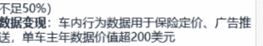

# 三方面，特斯拉研发了4680大圆柱电池 基于材料创新、电芯创新、系统集成、智能管理、工艺等方面建立了特斯拉电池远超行业平均的基础

| 五大特性 | 1 材料体系突破 | 2 电芯结构创新 | 3 系统集成 | 4 智能管理算法 | 5 生产工艺革新 |
| :--- | :--- | :--- | :--- | :--- | :--- |
| | 高能量正极 (NCA/NCM) | 全极耳 (Tabless) 设计 | CTP (无横电池) | 分层式BMS架构 | 干电极工艺 (Maxwell技术) |
| | 复合负极的创新 | 圆柱形的天然安全性 | CTC (电池车身一体化) | AI驱动的放电策略 | 无激光焊接 |
| | 因固电解质预研 | | | | |
| 性能优势 | 能量密度 | 充电速度 | 循环寿命 | 生产成本 | 热失控防护 |
| 特斯拉4680电池 | 单体300Wh/kg系统200Wh/kg | 5分钟250公里 (350kWh续航) | 4000次 (容量保持率>80%) | 80美元/kWh (目标) | 六层物理隔离+秒级BMS熔隔 |
| 行业平均水平 (2025年) | 单体250Wh/kg系统160Wh/kg | 15分钟200公里 (150KW快充) | 1500次 (容量保持率>80%) | 120美元/kWh | |

# 4680大圆柱电池 基于材料创新、电芯创新、系统集成、智能管理、工艺等方面建立了特斯拉电池远超行业平均的基础

- 材料体系突破
- 电芯结构创新
- 系统集成
- 智能管理算法
- 生产工艺革新
- 高能量正极 (NCA/NCM)
- 全极耳 (Tabless) 设计
- CTP (无横电池)
- 分层式BMS架构
- 干电极工艺 (Maxwell技术)
- 复合负极的创新
- 圆柱形的天然安全性
- CTC (电池车身一体化)
- AI驱动的放电策略
- 无激光焊接
- 固电解质预研

| 性能优势 | 能量密度 | 充电速度 | 循环寿命 | 生产成本 | 热失控防护 |
| 特斯拉4680电池 | 单体300Wh/kg系统200Wh/kg | 5分钟250公里 (350kWh续航) | 4000次 (容量保持率>80%) | 80美元/kWh (目标) | 六层物理隔离+秒级BMS熔隔 |
| 行业平均水平 (2025年) | 单体250Wh/kg系统160Wh/kg | 15分钟200公里 (150KW快充) | 1500次 (容量保持率>80%) | 120美元/kWh | |

# 4680大圆柱电池 基于材料创新、电芯创新、系统集成、智能管理、工艺等方面建立了特斯拉电池远超行业平均的基础

- 材料体系突破
- 电芯结构创新
- 系统集成
- 智能管理算法
- 生产工艺革新
- 高能量正极 (NCA/NCM)
- 全极耳 (Tabless) 设计
- CTP (无横电池)
- 分层式BMS架构
- 干电极工艺 (Maxwell技术)
- 复合负极的创新
- 圆柱形的天然安全性
- CTC (电池车身一体化)
- AI驱动的放电策略
- 无激光焊接
- 固电解质预研

# 4680大圆柱电池 基于材料创新、电芯创新、系统集成、智能管理、工艺等方面建立了特斯拉电池远超行业平均的基础

- 材料体系突破
- 电芯结构创新
- 系统集成
- 智能管理算法
- 生产工艺革新
- 高能量正极 (NCA/NCM)
- 全极耳 (Tabless) 设计
- CTP (无横电池)
- 分层式BMS架构
- 干电极工艺 (Maxwell技术)
- 复合负极的创新
- 圆柱形的天然安全性
- CTC (电池车身一体化)
- AI驱动的放电策略
- 无激光焊接
- 固电解质预研

# 4680大圆柱电池 基于材料创新、电芯创新、系统集成、智能管理、工艺等方面建立了特斯拉电池远超行业平均的基础

- 材料体系突破
- 电芯结构创新
- 系统集成
- 智能管理算法
- 生产工艺革新
- 高能量正极 (NCA/NCM)
- 全极耳 (Tabless) 设计
- CTP (无横电池)
- 分层式BMS架构
- 干电极工艺 (Maxwell技术)
- 复合负极的创新
- 圆柱形的天然安全性
- CTC (电池车身一体化)
- AI驱动的放电策略
- 无激光焊接
- 固电解质预研

# 4680大圆柱电池 基于材料创新、电芯创新、系统集成、智能管理、工艺等方面建立了特斯拉电池远超行业平均的基础

- 材料体系突破
- 电芯结构创新
- 系统集成
- 智能管理算法
- 生产工艺革新
- 高能量正极 (NCA/NCM)
- 全极耳 (Tabless) 设计
- CTP (无横电池)
- 分层式BMS架构
- 干电极工艺 (Maxwell技术)
- 复合负极的创新
- 圆柱形的天然安全性
- CTC (电池车身一体化)
- AI驱动的放电策略
- 无激光焊接
- 固电解质预研

# 4680大圆柱电池 基于材料创新、电芯创新、系统集成、智能管理、工艺等方面建立了特斯拉电池远超行业平均的基础

- 材料体系突破
- 电芯结构创新
- 系统集成
- 智能管理算法
- 生产工艺革新

[content]
| 核心指标 | 特斯拉三元锂4680电池 | 宁德时代麒麟电池 |
| :--- | :--- | :--- |
| 技术路线 | 三元锂(高镍NCM/NCA)+硅碳负极 | 三元锂/磷酸铁锂(CTP3.0集成) |
| 能量密度 | 单体244-300Wh/kg，系统200-220Wh/kg | 三元系统255Wh/kg，磷酸铁锂160Wh/kg |
| 颗粒利用率 | 63% | 72%(行业最高) |
| 快充能力 | 支持C4倍速，15分钟充至80% | 支持C4倍速，10分钟充至80%(常热功能) |
| 低温性能 | -20°C电量保持率75%，升温速率1°/min(发热回收) | -20°C电量保持率90%，升温速率0.5°C/min(加热+BMS) |
| 循环寿命 | 2000次 | 2500次 |

国内市场来看，宁德时代围绕三元锂电池和磷酸铁锂电池进行了链布局，就市场表现而言，宁德时代与特斯拉电池并无二异，甚至在某些方面领先于。

# 第四代电机的核心创新体现在成本控制、性能优化和安全提升三大维度，成本方面通过8层H-pin线组提高高满意度，性能方面通过铁氧永磁体和磁轭技术提升耐温性，安全方面主要在于强化逆变器。

# 绕线技术：从10层线到8H-pin绕线

# 材料与制造工艺升级

# 安全性与热管理突破

| 焊接技术 | 无稀土尝试 | 逆变器强化 |
| --- | --- | --- |
| 第四代电机采用8H-pin线组绕线 | 铁氧体电磁体和磁轭技术，减少稀土依赖 | 新增谐波滤波器（抑制）和抗饱和电感设计 |
| 相比第三代电机的10层绕线，槽率保持70%以上，而制造成本降低20% | 4D电磁体成本下降50%，耐温性提升至200°C（第三代铁氧体磁体限150°C） | 避免绕线时高压路径风险，通过NCAP电气安全测试达到高评级 |
| 10层绕线复杂率提升至98%以上（第三代95%），单电机成本从1500美元降至1000美元 | 一体化设计 | 散热优化设计 |

# 成本优势

# 机油滤芯不可拆卸

# 油冷+冷却复合方案

- 采用与电机外壳集成的铸式滤芯
- 定子油路直接冷却，转子空轴内循环冷却
- 终身维护，减少20%零件数量
- 持续高效输出能力提升10%

# 性能改进

# 机械搅拌器焊接

# 油水热交换器集成

- 取消传统螺丝固定，改用搅拌摩擦焊接工艺
- 与电池管理系统联动
- 重量减轻15%，抗震性提升
- 散热效率提升30%，电驱系统缩小15%
- 8层设计散热效率低于10%，但通过油泵系统升级（定子油路+转子冷却），功率密度仍保持7.2-7.5 kW/kg，与第三代相比

# 特斯拉通过多电机协同和系统集成实现整体均衡，而单电机功率和转速比亚迪更具突破性

| 关键指标 | 比亚迪 | 特斯拉 | 对比总结 |
|---|---|---|--|
| 功率与效率 | 功率 | 580KW(单电机、双电机)试验电机达3500转/min | 750KW(三电机组合，Model S Plaid) | 比亚迪单电机性能更强，特斯拉协同更均衡 |
| | 效率 | 永磁同步电机最高97%，功率密度4.5KG/KW | 电驱系统效率97.5%，功率密度4.8KG/KW | 效率接近，特斯拉能耗控制更精准 |
| | 技术特点 | 超极简制造，800V高压平台 | 扁电机+碳化硅逆器，多电机协同 | 比亚迪转速突破，特斯拉优化更彻底 |
| 热管理技术 | 散热方式 | 油冷+轻量化设计(散热密度4.5KG/W) | 转子冷热+智能温控(200℃) | 特斯拉热管理效率更高，比亚迪优链优化 |
| | 可靠性 | 四电机高效控制导致低温过热风险 | 电子云态调节，终身无衰 | |
| 材料与制造工艺 | 核心材料 | 铁铸铝导壳体，硅MOSFET替代碳器件 | 无源一体化(MASynRM)，镁铝高效铸轮子 | 特斯拉材料创新领先，比亚迪优链迈向领先 |
| | 工艺领先 | 扁线电机制造效率提升40%，比亚迪越织越稳 | 碳化模块+三合一集成每5分钟一条线 | 比亚迪实现高速转运，特斯拉生产效率高 |
| 系统集成应用场景 | 动力架构 | 四轮独立驱动(e4平台)，适合越野/高性能 | 三合一系统(电机+变速箱+电池控)，前瞻布局+后续协同 | 比亚迪灵活，特斯拉适配领先和城市可视 |
| | 场景适配 | 永磁+异步电机组合跨动力领先 | 多电机协同优化能耗与高性能 | 比亚迪技术定制化，特斯拉更领先 |
| 未来技术规划 | 短期目标 | 2025年达3500转/min试验电机，扩大800V/Si应用 | 2025年加速无硅电机，研发碳纤维电机 | 比亚迪追求高压转速，特斯拉推进固态化 |
| | 长期目标 | 探索旋转线极电机(超越密度) | 目标2030年产20万辆，提升集成性能 | 双方技术差异将扩大市场空间 |

公众号：智电前沿 | 2024-

# 特斯拉热管理系统通过高度集成化设计、热泵循环、智能算法冷却等技术实现了单一乘舱制热、乘员舱与电池同时加热、乘员舱与电池同时冷却、乘客电池冷却、余热回收等多个模块的运行

| 高度集成化设计 | 热泵技术的应用 | 智能热管理算法 | 电机冷却技术 |
| --- | --- | --- | --- |
| 采用了集成的歧管模块和集成模块，其核心是一个通道 | 采用了基于R744的多功能热泵，工作原理“热泵循环” | 通过各种热管理算法，如环境温度、电池温度、座椅温度等，精确控制 | 加热模块辅助冷却，大幅提高热管理效率 |
| 极大提高了系统的集成度，减少了管路和零件数量，结构更加紧凑，降低成本 | 提高了能量利用效率，从而提升车辆续航 | 实现了精细化管理，适应座椅需求的同时，减少能量消耗 | 满足电池的高效率，确保电池在高负荷下保持良好的性能和可靠性 |
| 单一乘舱制热 | 电池与乘舱加热 | 乘舱冷却 | 余热回收 |
| --- | --- | --- | --- |
| 乘舱温度较高，从环境回路吸收热 | 通常在环境温度低于0℃的情况下，为了保证乘舱舒适，热泵工作 | 分为两路：一部分通过热泵，另一部分通过液冷器 | 针对夏季使用，制热系统作为空调使用 | 利用余热回收机制将车辆的热量储存起来，进一步提升能量利用率 |
| 电池温度低于0℃，优先从外部环境中吸收热 | 在寒冷天气下，可以为电池加热 | 确保车辆在各种环境下的舒适性和可靠性 | |

高度集成化的设计：
- 提高了能量利用率，减少能量消耗
- 提升了车辆续航里程和性能

公众号：智易

其中高度集化的核心是通过四向阀和回回路实现电池、电机、乘舱的高效。四向阀和回路实现电池、电机、乘舱的高效，四向阀是特斯拉热管理系统集化的核心部件，通过控制动作，使冷却液在不同回路进行热量交换

| 电池热管理回路 | 电机/电泵热管理回路 | 舱室热管理回路 | 超充热管理回路 |
| :--- | --- | --- | --- |
| 技术 | 技术 | 技术 | 技术 |
| 直冷技术 | 冷媒直接冷却，热吸收提升50%；快充时电池温度控制在±2℃以内 | 分层散热技术 | 转子通过油循环，持续功率提升10% | 湿热空调 | COP（能效比）达3.2，传热效率高达300% | 冷流充电 | 支持250kW快充，电池温度控制在45℃以下（传热量高达60%） |
| 多区域独立冷却 | 对单个模块或组精准冷却（局部过热时，定向冷却响应时间<5s） | 余热回收 | 电机与逆变器通过热量散热空调，冬季制热维持60% | 智能分区控制 | 主泵、副泵、后独立冷却，温度控制在±0.5℃ | 电池预热 | 低低温环境，充电前加热电池至15℃以下，快充时间缩短40% |
| 接入系统 | 接入系统 | 接入系统 | 接入系统 |
| 电池冷却液入口 电池冷却出口 | 电机冷却液入口 电机液出口 | 舱室空调冷却液入口 舱室空调液出口 | 热冷却液入口 散热液出口 |
| 典型应用场景 | 典型应用场景 | 典型应用场景 | 典型应用场景 |
| 电池温度过高引入冷却液 将电池热量导出至其他回路 | 电机负载自动冷却 回收电机余热用于散热 | 冬季制热或夏季冷却需求 调节电池温度后的冷却液 | 外部热源接入散热 散热后的冷却液重新分配 |

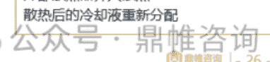

# 在自动驾驶方面，特斯拉主要经历了AP-EAP-FSD的升级，本质上是从传感器融合方案到全视觉方案的升级

# 特斯拉自动驾驶方案

| 功能 | AP 基础辅助驾驶 | EAP 增强辅助驾驶 | FSD 完全自动驾驶 | 智能召唤 | 自动辅助导航驾驶 | 市区辅助转向 |
| :--- | :---: | :---: | :---: | :---: | :---: | :---: |
| 主动巡航/车道 | ● | ● | ● | | | |
| 车道维持/中 | ● | ● | ● | | | |
| 自动辅助导航驾驶 | | ● | ● | | | |
| 自动变换车道 | | ● | ● | | | |
| 自动泊车 | | | ● | | | |
| 召唤 | | | ● | | | |
| 交通标志识别 | | | ● | | | |
| 市区辅助转向 | | | ● | | ● |
| 自动速度偏移 | | | ● | | | |

## FSD 功能组合在合适的环境下，停在位的车辆环绕障碍，召唤出位并驶出高速匝道或交叉路口，通过车辆根据不同的环境，自动调整车辆行驶速度与垂直泊车通过先进的感知技术，能够准确识别交通标志和高速路上自动变换车道

FSD是通过神经网络算法将2D图像转化为3D环境模型而多传感器方案依赖激光雷达，前者接近人类认知，后者依赖物理测量

## 特斯拉纯视觉与多传感器对比

| 维度 | 特斯拉纯视觉方案 | 多传感器融合 |
| --- | --- | --- |
| 数据来源 | 实时摄像头 | 激光雷达点云+摄像头图像 |
| 建模模式 | BEV(鸟瞰视角)+Occupancy Network | SLAM(同步定位与建图)+多模融合 |
| 依赖高精度 | 否 | 是(部分厂商) |
| 核心传感器 | 8个摄像头（覆盖360度范围） | 摄像头+激光雷达+厘米级雷达（部分厂商） |
| 冗余设计 | 依赖多摄像头交叉验证（如前置摄像头消除盲区） | 多种传感器冗余（如激光雷达失效） |
| 感知原理 | 仿生视觉构建三维空间 | 物理测量：激光雷达生成高精度点云 |
| 典型代表 | 特斯拉FSD | Waymo、小智、ADS2.0 |

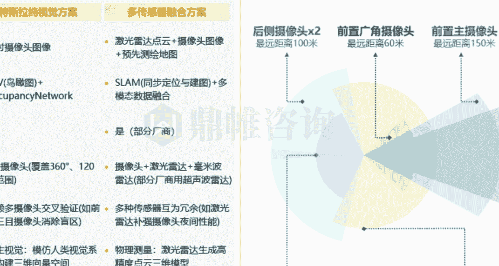

# 从结构来看，FSD是一套包含感知、控制、执行在内的自动驾驶硬件架构，在算法、算力、芯片等层面实现了集成

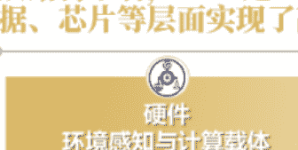

作用：
- 感知环境：通过摄像头采集图像数据，构建环境模型
- 计算体系：基于自研芯片，运行算法
- 建模：将2D摄像头转换为3D空间云，识别道路与障碍物
- 行为：规划路径，生成制动、转向、车辆指令
- 数据增强：为神经网络提供多样化样本
- 系统验证：通过影子模式发现算法缺陷，激活实测
- 加速训练：缩短模型迭代周期（FSD V12耗时从3个月到1个月）
- 仿真验证：构建大规模测试场，覆盖极值场景

## 视觉硬件配置
- 视觉系统：8摄像头系统（300万像素，200万探测距离），无激光/毫米波雷达依赖（纯视觉方案）
- 硬件技术：解决光线、隧道、入口出口等极值场景

## 硬件设计
- HW4.0平台搭载双计算芯片，单芯片故障后仍维持基础功能
- 摄像头采用冗余+冗余（多视角交叉验证）

## 核心算法架构
- Transformer架构：通过环路视角融合多摄像头数据，消除冗余与空间约束，支持输出（如路侧障碍物）
- Occupancy Network：预测三维空间占用率，识别未知障碍物（种异物）
- 端到端模型（FSD V12）：直接从输入输出控制信号，减少模块间差异

## 数据闭环
- 训练数据：超100亿帧真实驾驶数据（截至2024年），Waymo与国家道路数据新增300万每天，相当于Waymo
- 系统标注：自动标注：利用NeRF技术生成3D模型标签，效率人工标注50倍
- 场景扩充：自动判别长尾案例（如特殊场景）

## 关键优势
- 训练：100亿Flops（2024年），支持模型训练
- 成本：降至$0.05/英（行业平均）

# 硬件方面，特斯拉在汽车上配备了感知硬件，其中摄像头负责拍摄路况，感知周围环境，-

- 2014年
- 2016年
- 2017年
- 2019年、2021年、2022年
- 2023年
- 硬件：HW1.0，感知：MobileyeQ3，算力2.6 TOPS，内存256MB，处理帧36 Flops
- 硬件：HW2.0，感知：Nvidia Pascal SoC1，算力21 TOPS，内存66GB，处理帧110 Flops
- 硬件：HW2.5，感知：Nvidia Pascal SoC2/Nvidia GPU1，算力72 TOPS，内存8GB，处理帧110 Flops
- 硬件：HW3.0，感知：FSD1.0，算力148 TOPS，内存4GB，处理帧230 Flops
- 硬件：HW4.0，感知：FSD2.0，算力350 TOPS，内存8GB，处理帧690 Flops
- 传感器类型：纯视觉
- 感知范围：1
- 12个摄像头（后视域为主）
- 预留一个摄像头，包含盲控
- 前摄像头和后摄像头距离为5米
- 毫米雷达：1向前（300m），MS、MY
- 超声波：12个（5m）

应用车型：
- 全部车型
- MS, MX

## 感知硬件件，特斯拉从极简主义、时空冗余、时间同步和环境适应等原则建立了8个摄像头为核心的360°感知，保证外观没有视野死角，不存在时间错误

## 摄像头设计理念

1. 极简主义设计
纯视觉主宰：依靠8颗摄像头（无激光/毫米雷达），硬件降低80%

- 多近组合
- 前置三：广角150°，主摄120米，长焦250米（35°）
- 后置黄：后视域，消除盲区
- 后置单：后方检测

2. 冗余与同步
时空冗余：对单个模块或组精准冷却（局部过热时，定向冷却响应时间<5s）
时间对齐：前摄像头和后摄像头对齐，时间误差<1ms

3. 环境适应性优化
- 硬件抗：
- HDR140动态范围：支持逆光下抑制噪点和高光（如道路入口）
- 物镜防护：摄像头加热防水涂层（-30℃正常）

数据动态驱动：根据全球地区气候（如极寒、东亚热）调整参数

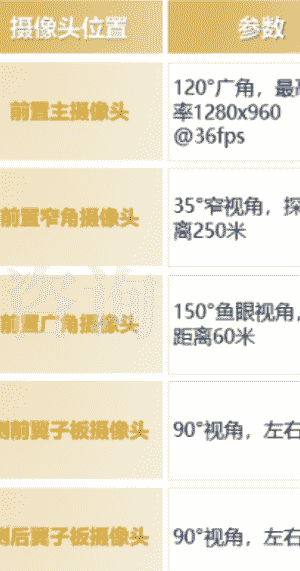

## 决策硬件方面，特斯拉自研FSD芯片为核心，通过“异构计算+冗余设计”实现感知-规划-执行的无缝级闭环

## 异构计算架构

## 冗余与安全设计

| 原则 | 异构计算架构 | 冗余与安全设计 |
|---|---|---|
| CPU集群 | 12核Cortex-A72 (HW3.0)→20核Cortex-A78 (HW4.0), 负责通用数据处理与任务调度 | 双芯FSD芯片独立运行，通过比较器(Comparator)保证输出一致性, 故障切换时间<50ms |
| NPU专用加速器 | 验证输出一致性 * MAC矩阵: 96×96队列(HW3.0), 峰值算力36.86 TOPS * 动态指令集: 支持融合、内存访问优化, 减少数据搬运 | 多电源冗余 |
| | | 主电源(12V锂电)+备份电源(48V架构), 支持关键功能持续运行10分钟 |
| GPU连接 | | ASIL-D安全 |
| Mali G71 MPI (HW3.0)→集成RDNA3架构(HW4.0), 用于图像后处理与可视化 | | 通过硬件锁步(Lockstep)和ECC内存校验，实现概率<10 FIT (1 FIT=1次/10亿次) |

| | HW2.0 | HW3.0 | HW4.0 | HW5.0 |
|---|---|---|---|---|
| 制程 | 16nm | 14nm | 7nm | 5nm |
| 算力 | 1.5(英特达PX2) | 144(双芯) | 300-500 | 1000+ |
| CPU架构 | 无自研芯片 | 12核Cortex-A72 | 20核Cortex-A78 | 32核Zen4+NPU集群 |
| NPU架构 | 无 | 2个NPU(72TOPS) | 3个NPU(100TOPS) | 6个NPU(200TOPS) |
| 关键升级 | 多传感器融合架构 | 自研芯片首秀 | 支持Linux内核 | 3D视觉对齐 |

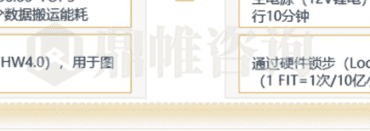

## 算法方面，特制智能驾驶算法以视觉感知、端到端架构为核心，建立了感知层-预测层-规划层-训练层的总体架构，通过深度神经网络与规模真实路数据闭环迭代，构建了高度人化的驾驶决策系统

场景：城市道路通过时临时施工区域

| 感知层 | BEV (Bird's Eye View) | 将8个摄像头输入的2D图像转换为统一的俯瞰视角3D空间，解决多视角融合难题 | |
|---|---|---|---|
| | 算法 | Transformer架构 | 处理时序空间信息，捕捉动态运动的趋势（如行人横穿马路） | |
| BEV+占用网络检测捕捉左侧车辆，Transformer跟踪车辆移动方向 | 占用网络 | 构建3D体空间，识别异形结构障碍（如护路锥、落货车辆） | |
| 预测层 | 预测算法 | 多任务协同网络 | 单一模型同时完成车辆轨迹检测、交通识别、目标跟踪等任务 | |
| 轨迹预测模型预测转向工程可能侧车，交互模型评估可行性 | 轨迹预测模型 | 预测车辆轨迹，未来5-8秒的运动轨迹 | |
| | | 交互环境模型 | 在复杂场景（如无保护者）中模拟与其他车辆的反应，选择最优策略 | |
| 规划层 | 规划与控制算法 | 车辆避障检测 (FSD V12) | 直接从摄像头生成转向角、油门/刹车控制，跳过传统模块 | |
| 规划网络生成右转路径，车辆学模型控制转向角度 | 生成人化轨迹 | 车辆动力学模型 | 将规划转化为具体的控制 |
| 训练层 | 训练与优化 | 自动标注 | 将原始传感器数据自动标注（如车道线、障碍物） | |
| 该数据被自动标注并训练，强化模型应对相似情况 | 持续演化 | 强化学习 | 在仿真环境中应对极端场景 | |
| | | 数据增强 | 从海量数据中挑选样本（如罕见事故） | |

## 感知算法方面，特斯拉利用HydraNets、BEV、Transformer、Occupancy Network完成了特征提取-动态信息捕捉-非结构化障碍物的算法

| 技术 | HydraNets (多任务网络) | BEV (Bird's Eye View) | Transformer架构 | Occupancy Network (占用网络) |
|---|---|---|---|---|
| 定位 | 并行任务处理器 | 环境空间建模 | 时空关联 | 障碍物检测器 |
| 作用 | 快速提取特征（如车道、车辆轮廓），为BEV提供语义信息 | 融合多视角数据生成全局地图，作为后续输入 | 在BEV空间内分析时序，预测轨迹 | 基于Transformer的输出，补充未知信息 |
| | 完成车道检测、交通识别、边界框 | 将多视角图像融合为统一3D俯瞰图，消除视角盲区（如侧方） | 捕捉动态目标（车辆、行人）趋势，预测未来轨迹 | 识别非结构化障碍（如路障），弥补不足 |
| | 提升计算效率，减少资源消耗 | 提供车辆周围360度的全局地图，作为后续预测 | 建立多层次数据关联（特征与目标关联） | 预测3D空间占用状态及运动趋势（物体运动方向） |
| 技术特点 | 共享主网络提取特征，分支配合任务 | 依赖摄像头参数和深度估计 | 利用自注意力机制处理时序数据（连续帧） | 基于空间建模定义类别 |
| | 输出多任务结果（如车道坐标、交通状态、车辆位置） | 输出结构化的3D空间表示（道路结构、静态物体） | 输出目标的位置、速度及未来路径分布 | 输出动态占用概率（流向量） |

HydraNets是特斯拉提升自动驾驶感知效率设计的神经网络，其核心技术在于共享主干+动态任务分支，通过特征复用与资源优化实现多任务并行

| 共享主干网络 (Shared Backbone) | 动态任务分支 (Task-Specific Heads) |
|---|---|
| 作用 | 作用 |
| 从原始图像中提取特征（线条、纹理、颜色分布） | 针对不同任务（车辆检测、目标检测、语义分割）设计专用网络 |
| 实现 | 使用EfficientNet-B4或ResNet-50作为基础模型，针对车辆计算优化。 | 车道线分割：基于U-Net结构，输出车道线轨迹与曲线；目标检测：基于CenterNet框架，输出车辆的中心点、尺寸与偏移量；交通区域分割：基于通道网络扩展状态与朝向方向。 |
| 输入分辨率：1280×960，输出多层层次特征（如1/4, 1/8, 1/16）。 | 根据任务优先动态调整GPU/NPU资源占比 |

## 特征金字融合 (FPN, Feature Pyramid Network)

| 作用 |
|---|
| 融合不同尺寸的特征，提升目标检测与分割细节的精度 |
| 实现 |
| 将主干网络输出的多尺度特征通过上采样与横向连接融合。 |
| 输出统一的分辨率特征（如1/4缩放），供各任务分支使用。 |

## BEV算法是纯视觉自动驾驶方案的核心技术之一，通过多摄像头融合与神经网络建模，将2D图像转换为统一的3D鸟瞰图，实现环境的空间一致性

| 多摄像头输入与标定 | 特征提取与深度估计 | 多视角投影与BEV空间构建 | 时序融合与动态建模 | 输出与下游应用 |
|---|---|---|---|---|
| 硬件基础 | 特征提取网络 | 投影变换 | 多特征数据融合 | 结构化BEV栅 |
| 特斯拉车配备8个摄像头 | 使用EfficientNet或ResNet为主骨干 | 摄像头2D图像+深度图利用标定参数转换为3D点云 | 引入历史BEV帧（如连续5帧），通过LSTM或Transformer构建时序关联 | 输出栅格地图 |
| 覆盖360°视野，包括广角、侧视角、后视摄像头 | 从每个头部提取多次特征（低层边缘、高层语义） | 投影到统一的鸟瞰坐标系 | 提升动态目标（车辆、行人）运动状态 | 包含语义 |
| 标定参数 | 深度计算 | 栅格化 | 运动补偿 | 应用场景 |
| 每个摄像头的焦距、旋转系数 | 基于单目或双目深度估计，预测每个像素深度 | 将3D空间划分为0.1m×0.1m的栅格，统计每个栅内的密度 | 消除车辆运动偏移 | |
| 坐标系的位置与方向（俯仰角、航向角） | | | 基于地图生成区域 | 车辆与障碍物的空间关系 |
| 作用 | 输出 | 生成摄像头的深度图（Depth Map），分辨率为原始图像的1/4 | | |

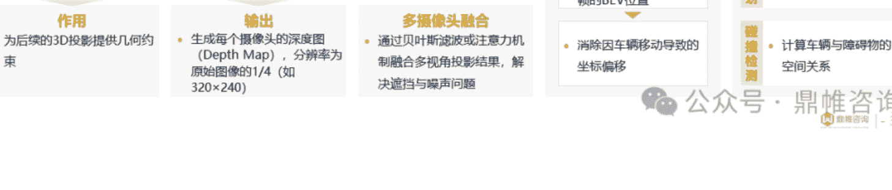

## Transformer架构在自动驾驶中主要用于处理多摄像头输入，其核心围绕注意力机制(Self-Attention)、位置编码优化和计算效率

| 1 输入数据处理 | 2 位置编码 (Positional Encoding) |
|---|---|
| 多摄像头特征对齐 | 8个摄像头的图像通过HydraNet提取特征（分辨率64x64x256） |
| 使用相机外参将各摄像头特征投影到统一BEV坐标系 | 为BEV格中的每个位置(x, y)生成位置编码，在车辆坐标系下的绝对位置（如前方5米、左侧米） |
| 时序数据整合 | 堆叠最近5帧的特征图（帧间隔0.2秒），形成输入向量（5x8x64x256） | 为每个时刻（t, t-3...）加入历史数据与当前帧 |

| 3 注意力机制 (Self-Attention) | 4 多头注意力 (Multi-Head Attention) |
|---|---|
| 头部关联 | 计算BEV位置(Query)所有摄像头特征(Key)的权重，聚合多视角一致性（如左侧摄像头与前方同一辆车的观测）。将输入特征拆分为8个“头”(Head)，每个头独立关注，最后拼接结果 |
| 优势 | 提升模型对复杂交互解析能力（如交叉行驶的车辆）。每个头关注同一个位置（无缝衔接，一个头关注车辆的边缘） |

| 5 前馈网络 (Feed-Forward Network) | 6 输出与融合 |
|---|---|
| 作用 | 对自注意力输出向量进行非线性变换，增强模型表达能力 |
| BEV增强 | 8个摄像头的图像通过HydraNet提取特征（分辨率64x64x256）；使用相机外参标签将各摄像头特征投影到BEV坐标系；堆叠最近5帧的特征（帧间隔0.2秒），形成输出向量（5x8x64x256） |

## Occupancy Network(占用网络)是纯视觉自动驾驶方案中检测未知障碍物和构建动态3D环境的核心算法，核心技术在于体素空间建模与运动预测的结合

## Occupancy Network (占用网络)

| 输入数据准备 | 3D体素空间构建 |
|---|---|
| BEV特征 | 来自BEV算法的输出，包含车辆范围80mx80m的3D网格化空间信息（道路路网、已探测障碍物）。 | 将BEV的空间划分为小立方体（体素），分通道通常为0.2mx0.2mx0.2m |
| 时序数据 | 连续多帧（秒）的BEV特征，用于描述运动变化。 | 使用3D卷积索引（VoxelNet）从BEV隐含中提取每个体体的特征量。融合多帧BEV特征，生成动态状态特征 |
| 目标检测辅助 | 来自HydraNets的车辆/行人边界信息，用于初始化已知障碍物的占据区域。 | 体素特征提取 |

| 占用状态与运动预测 | 输出与下游应用 |
|---|---|
| 占用概率预测 | 使用ML（感知）判断每个体素是否被障碍物占据，输出概率（0-1）。 | 包含每个体体的占用（空/占）和流矢量。 |
| 运动(Flow Field) 预测 | 预测每个体素的运动矢量（速度与方向），表征障碍物的动态属性。例如：识别被风吹动的塑料袋或滑动的船艇。 | 应用场景： - 路径规划：启动避障障碍物占据的区域。 - 碰撞风险评估：结合轨迹与障碍物运动在轨迹中评估。 |
| 占用占据地图 | |

## 预测法主要通过轨迹预测和交互模型协同工作，分别承担行为预测与策略优化的角色，解决复杂交通场景中的不确定性

## 轨迹预测模型 关键作用

- 1. 单目标预测 | 预测交通参与者（车辆、行人）未来5-8秒内可能的路径（如直行、变道）
- 2. 多类输出 | 生成概率分布（如80%概率直行、20%概率右转）
- 3. 基础数据 | 为交互模型提供集合，降低空间维度
- 4. 交互模型 | 在复杂交通交互中（无保护交叉路口）评估风险
- 5. 最优策略 | 从预测的路径中选择低风险、高效率的策略
- 6. 人类化交互 | 模拟人类驾驶行为

## 技术实现

- 1. LSTM（长短期记忆网络) | 处理时序数据，捕捉目标速度、加速度的历史演变
- 2. GNN（图神经网络） | 建立目标间的空间关系（如前方车辆、后方）
- 3. 物理约束 | 引入运动模型（车辆模型）
- 4. 蒙特卡洛树搜索（MCTS) | 基于轨迹预测生成可能的交互场景
- 5. 框架 | 构建完全信息博弈，量化反应的不确定性

## 数据增强: 特斯拉构建了影子模式将拍摄的道路数据进行数据化处理并通过对数据进行清洗、标注，随着路况数据的增加，特斯拉感知到决策不断完善

## 原理

- 车辆安装的多个摄像头和传感器
- 车内部的计算机系统对环境进行实时数据分析
- 系统生成从数据学习的辅助驾驶决策，对与人类驾驶进行对比，获取差异。当“差异”较大时传输数据到云端进行训练。2020年，特斯拉开始研发数据标注系统

## 功能与目的

- 影子模式极大提升了效率，不断提升自动驾驶系统的准确性和。影子模式能够收集真实路况下的人类行为，这些数据可以提升自动驾驶算法的准确性和可靠性。通过对比自动驾驶系统的决策与人类驾驶的实际操作，影子模式可以发现驾驶中的之处并对相关数据上传到云端进行训练。这种方法极大提升了效率，不断提升自动驾驶系统的安全性。影子模式将每一辆出场的数据转为自动驾驶系统的数据采集，从大量数据中缩短时间和周期。影子模式为自动驾驶系统提供真实的数据。

## 成本效益

极大提升算法效率，开启对接数据持续迭代

## 仿真模拟可以提供现实世界难以或是难以标注的数据，从而加速FSD能力的训练，增强模型迭代

## 极端场景
由于极端条件的限制，导致数据积累和训练算法的效率遇到瓶颈

## 特殊场景
构建一个真实的交通仿真场景

### 预期效果
加速FSD能力的训练，更高效实现数据训练。自动驾驶的仿真在模拟环境中进行，通过调整交通参与者和环境的参数来构建各种场景，以训练算法对不同场景的适应

| 1 传感器精准模拟 | 2 真实视觉渲染 | 3 元化素材库 | 4 场景生成 | 5 场景重建 |
|---|---|---|---|---|
| 特斯拉仿真模拟流程五大步骤 | 对真实头部进行针对性模拟，包括传感器数据、运动模型、光学参数等，以生成车辆的头部从传感器数据提取的内容 | 特斯拉利用神经精细光影与光线追踪方法，使渲染效果逼近真实世界。 | 特斯拉的素材库、车辆、人物、动物真实数据数量较少，能够通过合成材料少的种类进行插件处理，特斯拉利用大的数据集进行了场景构建，以生成逼近环境。 | 特斯拉利用算法，创建任意场景的规则。特斯拉利用机器学习学习，通过神经网络对数据进行聚类分析，处理真实数据并生成更多数据，形成闭环，以优化算法性能。 | 特斯拉利用真实数据与现实的碰撞，构建与现实相同的碰撞数据，再通过仿真中运行自动驾驶系统，发现可能会发生冲突，从数据反馈进行调整和优化，不断提升系统性能。 |

## 特拉FSD自动驾驶方案的先进主要体

主要体现在设计理念由原来的模块化设计变成端到端设计，端到端设计的的核心逻辑之一是以“单车智能”替代“群体协作”，这意味着部分路无需再安装感应设备

| 模块化架构：规则驱动 | | 端到端架构：数据驱动 |
| :--- | :--- | :--- | :--- |
| 感知/定位 | 决策/规划 | 执行/控制 | 优化神经网络 |
| 环境感知 | 决策系统 | 执行系统 | LSTM网络 |
| 激光雷达 | 行为/决策模块 | 道路追踪系统 | Transformer |
| 毫米波雷达 | 轨迹模块 | 转向控制 | |
| 姿态/惯航 | 异常处理 | 驱动控制 | |
| GPS/惯性导航 | | 制动控制 | |
| 车辆数据 | | 安全控制 | |

| 智能驾驶模块化设计理念 | 具体要求 | 典型场景示例 | 成本 | 视觉方案 | 车路协同 | 节约比例 |
| :--- | :--- | :--- | :--- | :--- | :--- | :--- |
| 环境结构化 | 车线/标识清晰，道路边界清晰 | 高速公路、停车场 | 智能传感器 | $0 | $8 万-12 万/公里(含雷达/摄像头) | 100% |
| 行为可预测性 | 交通参与者(车/行人) 遵守规则 | 封闭园区道路、交叉路口 | 信 | | $500-1000/年(V2X芯片) | 100% |
| 覆盖完整性 | 历史数据覆盖量90%以上长尾情况 | 乡村动物穿越 | 覆盖数据量 | $0.02/公里(4G传输) | $0.15/公里(5G-V2X) | 87% |
| 速度限制 | 车线/标识清晰，道路边界清晰 | 高速公路巡 | 系统维护 | $0 | $2 万-5 万/年 | 100% |

## 在特斯拉的先行下，国内多个企业已布局端到端的智能驾驶解决方案，其中理想、华为、小鹏为主要代表

| | 特斯拉 | 理想 | 华为 | 小鹏 |
| --- | --- | --- | --- | --- | --- |
| 研发人员 | | 200-300人 | 800人 | 7000+(BU人数) | 超3000人 |
| 领军人物 | | 埃隆·马斯克(Elon Musk) | 刘睿、余承、王志磊 | 李军凯 |
| 研发情况 | | 24年7月成立了自动驾驶“可控”的实版本，24年11月，正式发布了驾驶辅助，并开始负责城区智驾 | 智驾城区，华为开始负责城区智驾业务 | 新型AI模型开发、AI应用开发、效能大模型训练，其中云端部门负责了云端模型的研发 |
| 组织架构 | | 模块化调度 | 模块化调度 | 模块化调度 |
| 车系系统 | | FSD V13 | AD Max QAT.0 | 模块化调度 | ADS 3.0 | 智NG 4.5 |
| 落地情况 | | 主要在美国和加大使用，国内领先智驾车辆超过240万，智驾用户超过2100万 | 理想端VM全量，24年11月已在上海、北京、等地上线ADS 3.0智驾用户27.8万 | 全系智驾P+7，发布最新的5.0版本 |
| 云端模型 | | | 云端优世界模型 | 云端优世界模型 | 云端优世界模型 |
| 云端算力 | | 23年8月到2024Q4达到102EFLOPS | 24年8月12.1EFLOPS | 24年9月7.5EFLOPS | 24年8月2.5EFLOPS，全年智驾算力达到10EFLOPS+ |
| 训练/模型周期(迭代/公里) | | 32.5天(24万) | 29.3天(24万) | 12天(24万) | 24年智驾模型增长+141% |
| 原生迭代速度 | | 6天 | 2天 | - | |
| 规划 | | FSD V13已发布，2025年FSD进入中国和欧美市场，2SH2H4V5.0 | 25年有望实现有监督的自动驾驶，年内实现44无监督的智驾 | 2025年ADS4.0推进在高速与城区L3的试点 | 2025年下半年实现端到端智驾，云端版本5将在下半年分阶段交送到人主驾驶位，实现99%准确率 |
| 智驾车销量(累计到2412月) | | 6674596 | 1100280 | 698428 | 505881 |
| 总结 | | 算法算力迭代迈行业领先 | 智驾迭代速度，调优+VM全量领先 | 新式迭代，研发投入引起体系领先 | 模块化领先一套 |

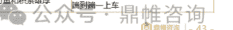

## 特斯拉FSD与国内智驾第一队相比，部分功能尚未开放(主要为车位到车位)+本地化不足(主要针对公交车道/非机动车道/红绿灯等中国特色)

| 特斯拉FSD | 小米XOS5.5.0 | 华为ADS3.2 | 理想7.1.0 |
| --- | --- | --- | --- | --- |
| 推出时间 | 2025/2/25 | 2024/10/24 | 2024/12/18 | 2024/10/25 |
| 感知硬件 | 摄像头×8 | 超声波雷达×12 毫米波雷达×3 摄像头×8 | 激光雷达×1 超声波雷达×12 毫米波雷达×3 摄像头×11 | 激光雷达×1 超声波雷达×12 毫米波雷达×3 摄像头×11 |
| 芯片 | FSD(自研) | 英领先X×2 | 英领先X×2 |
| 行驶 | LCC越道居中(支持红绿灯) | ✓ | ✓ | ✓ |
| ACC巡航 | ✓ | ✓ | ✓ |
| 智能辅助 | ✓ | ✓ | ✓ |
| SAS智能进 | ✓ | ✓ | ✓ |
| AHT变道 | x | x | x |
| 落位 | ✓ | ✓ | ✓ |
| 环境通行 | ✓ | ✓ | ✓ |
| 特殊环境 | 紧急制动 | ✓ | ✓ | x |
| 车辆绕 | ✓ | ✓ | x |
| 避开施工 | x | ✓ | ✓ |
| 倒车 | ✓ | ✓ | ✓ |
| AEP自动泊 | ✓ | ✓ | ✓ |
| APA最优泊车 | ✓ | ✓ | ✓ |
| RPA远程泊车 | x | ✓ | ✓ |
| 车辆驶 | x | ✓ | ✓ |
| 智能出库 | x | x | x |

认为，特斯拉自动驾驶的设计大多基于美国的基础上，而在在中国，特别是重庆等复杂路况，国内更能理解需求

| 场景 | 场景项 | 特斯拉FSD Model 3 | 学领先ADS3.2 | 理想7.1.0 | 小鹏XOS5.5 P7+ |
| --- | --- | --- | --- | --- | --- |
| 适用场景 | 路口掉头（大幅） | 是否正确通过 | NA | NA | ✓ |
| | 是否在左道 | x,车辆持续行驶 | x, 操作左转 | NA | ✓ |
| | 小掉头 | 是否正确通过 | ✓ | ✓ | ✓ |
| 环境 | 是否可在车辆内行驶 | 环境内侧车辆 | NA | NA | NA |
| 红灯路口 | 能正常左转 | ✓ | ✓, 左转交通 | ✓ | ✓ |
| 字路口/十字路口 | 是否正确通过 | ✓ | ✓ | ✓ |
| 人形绕 | 是否避让行人 | ✓ | ✓ | ✓ |
| | 绕后方车辆绕智能 | NA | NA | ✓ | ✓, 以绕车辆为主 |
| 绕行 | 遇到前方大车辆 | NA | NA | ✓ | ✓ |
| | 避开道路车辆 | ✓ | ✓ | ✓ | ✓ |
| | 其他车辆是否避让 | ✓ | ✓ | ✓ | ✓ |
| 加速 | 是否主动限速 | x | x | ✓ | ✓, 但出现后跟车辆变道 |
| 减速 | 主动进入限 | x | x, 插入减速后制刹 | ✓, 插入减速后制刹 | ✓ |
| | 无通行 | ✓ | ✓ | ✓ | ✓ |
| 汇流 | 是否选择汇流效率的车辆 | ✓, 汇流时绕险 | 选择汇流行为跟随程度大 | NA |
| | 是否侧通过交通 | ✓, 会等汇入车辆 | ✓, 等主车辆再次汇入 | |
| 识别标志/标志物 | 是否识别标准标志物 | ✓ | ✓ | ✓ | ✓ |
| | 是否识别路灯 | NA | NA | NA | NA |
| | 是否识别路标 | NA | NA | NA | | |
| | 隧道内是否正常使用 | ✓ | ✓ | ✓ | ✓ |
| 特色场景 | 隧道 | 出隧道是否正常使用 | ✓ | ✓ | ✓ | ✓ |
| | 入道是否保持正确 | ✓ | ✓ | ✓ | ✓ |
| | 入道是否正确 | ✓ | ✓ | ✓ | ✓ |
| | 出道是否能够切入下段绕路 | ✓ | ✓ | ✓ | ✓ |

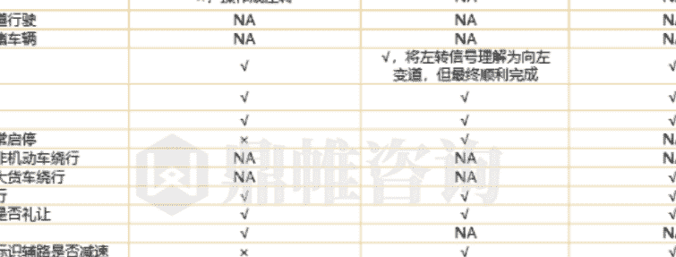

## 从未来方向，纯视觉方案由于主要依靠摄像头对周围环境的“看”，导致周围环境出现不利于视线的情况时，该方案可能会受到较大影响，基于光子计算集成、4D成像雷达、仿生光学等主要技术方向

| 场景 | 纯视觉方案 | 多传感器融合方案 |
| --- | --- | --- |
| 强光/逆光 | 依赖HDR摄像头动态调，仍有误检风险 | 激光雷达不受光影响，可靠性高 |
| 雨雪天气 | 摄像头分辨率下降，需增强去雾算法 | 毫米波雷达渗透性强，但激光雷达易受干扰 |
| 夜间无光环境 | 依赖AI补全细节（如FDSV12夜间增强） | 激光雷达+红外摄像头精准识别 |
| 突发障碍物 | 依赖实时推理（如识别塑料袋） | 激光雷达直接检测，反应更快 |
| 光子计算集成 | 2026年HW5.0搭载硅芯片，利用光子计算提升计算密度（目标2000 TOPS，无功耗）。 |
| 4D成像雷达 | 预留4D成像雷达接口（未激活），应对欧美地区可能的冗余。 | 预留4D成像雷达毫米波雷达接口（未激活），应对欧美地区可能的冗余。
| 仿生光学 | 研发液态镜头（专利申请中），动态调整多摄摄像头组合，应对欧美地区可能的冗余。 |

## 智能舱方面，特斯拉主要经历了数字化基础、高性能多态，目前进入AI阶段，AI赋能与生态成为核心

### 数字化基础
- 首次自研与硬件解耦，创造了软件迭代模式，能够更灵活地调整。
- 采用自研芯片 (NVIDIA Tegra 处理器)。
- 使用大芯片用MMC，操作较慢，支持多种功能。

### 高性能多态
- 算力提升极大，将舱从“移动工具”变为“生活空间”。
- 算力提升2倍。

### 云端算力
- 23年8月到2024Q4达到102EFLOPS。
- 算力跨越领先至10TFLOPS，算力最高，厂商领先。
- 跨越领先至10TFLOPS，算力最高，厂商领先速度。

### 算力提升
- 算力提升极大。
- 算力提升85%。

### 算力-跨越
- 算力提升，交互更加自然流畅。

### 硬件升级
- 首次软件定义，汽车基础功能，减少对硬件。
- 首次硬件重构。
- 首次软件定义“汽车”。

### 芯片-融合
- 首次选用(Intel Atom A350)。
- 首次选用(AMD Ryzen V100处理器+RDNA架构)。
- 首次选用(三星Exymym芯片)。

### 交互-升级
- 首次软件定义交互。
- 首次硬件定义交互。
- 首次软件定义交互。

### 功能-跃
- 首次软件定义，汽车基础功能，减少对硬件。
- 首次软件定义“汽车”。
- 首次软件定义“汽车”。

### AI模型
- 首次Grok模型。
- 首次Grok模型：语音具备强大的理解能力。

### AI领先
- 厂商领先。
- 厂商领先。
- 厂商领先。

### 生态进化
- 厂商领先。
- 厂商领先速度。
- 厂商领先速度。

### 2012-2016
### 2017-2020
### 2021-2023
### 2024-2025

## 特斯拉的智能舱生态以垂直整合能力为核心，环绕驾驶体验革新、人机交互深度、场景化三大主线，构建了一个从硬件到软件、从功能到体验的闭环系统

| 以驾驶为核心的场景延伸 | 用户粘性构建 |
| :--- | --- |
| **自动驾驶与感知能力**：FSD（全自动驾驶）与智能驾驶深度融合，让FSD在自动驾驶模式下解锁更多功能，能够实时监测驾驶员状态以确保安全。 | **软件订阅制**：FSD订阅、高级订阅包等创造持续收入，用户为功能付费。 |
| **能源链闭环**：通过大超级充电站、Powerwall能源系统与车辆联动，形成从能源生产到车辆使用的完整闭环。 | **硬件科技领先**：通过极致设计（如取消订阅按钮）、高性能硬件（如游戏机性能）吸引爱好者。 |

| 开启功能 | 场景化服务 | OTA持续进化 |
| :--- | :--- | :--- |
| **车内娱乐与游戏**：AMD芯片支持运行Steam平台游戏，完美契合沉浸式大屏，打造“移动游戏厅”（如Netflix, YouTube）在驻车状态下提供影视级游戏体验。 | **智能座舱** - **能源链联动**：车辆与Powerwall能源系统、储能电池协同，根据电价波动智能充电时间。 - **智能家居互联**：通过Tesla App控制空调灯光、车辆自动泊车。 | **OTA持续进化** - 功能迭代：新增“营运模式”、场景模式等场景化功能。 - 性能迭代。 |

# Robotaxi通过连接一套具备“感知”和“智能决策”的庞大网络，让城市植入一个新的神经系统。未来，这套系统还可以与智能道路、智能电联网，彻底改变我们对“汽车”和“交通”的理解

## 构建城市级“感知·决策·执行”闭环

| 车辆 | 云端 | 基础设施 |
| --- | --- | --- |
| 百万 Robotaxi 车队形成“群体智能” | 数据的驱动迭代 | 智慧道路的“神经末梢” |
| 生成数据 | 场景环境 | 监测视况 |
| 全球 600 万辆特斯拉每年生成的 100 亿行的数据，通过 HydraNets 骨骼网络实现时空感知 | 特斯拉通过 CARLA 模拟大规模虚拟城市，模拟极端天气、事故现场等长尾场景 | 特斯拉计划在 Robotaxi 运营区部署视觉摄像头和雷达，实时道路路况追踪 |
| 模型训练 | 推进车辆 | 精度校验 |
| 这些数据通过 Dojo 超算中心处理，形成全道路的“孪生”模型，实时更新道路特征、交通信号信息 | 每周一次的软件更新将新模型推送到至车辆，FSD V13 版本按需迭代方式推送到车辆，车辆可通过通信与其他车辆完成交接，减少等待 | |

## 生态构建：从“出行服务”到“城市操作系统”

| 从“人车”到“接车” | 动态交通枢纽 | 能源产业重塑 |
| --- | --- | --- |
| Robotaxi通过需求算法提前调度车辆，即使在高峰期也能自动聚集至交通枢纽附近，减少等待时间 | Robotaxi通过实时生成交通枢纽，为城市规划提供数据支持 | 与交通能源、太阳能产业协同，构建“桩-充电-用电”闭环 |
| | 应急响应 | |
| | 在火灾、地震等特殊情况中，Robotaxi 可以自动切换为应急车辆，开启救援通道和疏散人群 |

| 从“人驾驶车”到“车换服务” | 城市管理的智能化底座 | 从“单向消费”到“双向互动” |
| --- | --- | --- |
| | | 与供应商合作的高地图更新系统，将施工、临时管制等信息同步至车辆，保持车辆行驶精度 |

# 目前，特斯拉 CyberCab已经得到加州公共事业委员会（CPUC）颁发的运输车运营许可，计划到2027年规模量产

## 2016：首提出 Robotaxi 概念
## 2019：拓展 Robotaxi 车队
## 2022：Robotaxi 技术升级
## 2024：揭首次自动驾驶出租
## 2025：获得营运许可

- 2016年，埃隆·马斯克首次提出 Robotaxi 概念，计划通过自动驾驶技术将私人车辆转为共享出行。
- 《马斯克传》提到马斯克的理想是让特斯拉打造出没有人类干预的全自动驾驶车辆。
- Master Plan 第二版蓝图中提到“让你的汽车在闲置时能为你赚钱（Robotaxi）”。

- 自动驾驶日发布会上宣布：
  - 特斯拉将 Model 3 部分纳入 Robotaxi 车队。
  - 车主可以自己加入 Tesla Network 平台，让自己的车辆在闲置时作为 Robotaxi 使用。

- 在 2022Q1 财电话会上，马斯克表示：
  - Robotaxi 将取消方向盘和踏板。
  - 完全依靠 FSD 自动驾驶。

- 2024年4月8日，马斯克在 X 平台称自动驾驶出租车（Robotaxi）将于8月8日落地。
- 推进发布会：
  - 2024年7月11日，特斯拉将举办首批 Robotaxi 车辆发布会。
  - 项目将有更多时间观察更多改进建议。

- 2025年3月，特斯拉获得加州公共事业委员会（CPUC）颁发的运输车许可（TCP）。为实现规模化奠基础。
- 2026年目标能5万辆，2027年大规模量产。

## Robotaxi 与 FSD 强势
- 特斯拉在 2016 年第二季的全自动驾驶在 Robotaxi 上取得了极大进展，随着 FSD 12.5 版本的开始，客户在全自动驾驶工作方面体验到惊喜的。

## 宣布发布 Robotaxi
- 2024年9月26日，特斯拉官方将在当地 10月10日（北京时间10月11日）发布 Robotaxi。

- 生产线试运：
  - CyberCab 在柏林工厂试产。

公众号 · 鼎屹咨询

- 特斯拉 Robotaxi 作为未来共享出行市场运营商，拥有最大的业务和用户运营。

从商业角度来看，无人驾驶出租和传统网约车、出租模式的根本区别在于无人驾驶出租能够基于算法迭代形成数据飞轮，结合 FSD 技术实现整个城市的数据握手，而非网约车简单的出行数据。

| 模式 | 核心竞争力 | 战略目标/重点 | 收入来源 | 主要成本构成 | 技术特点 |
| :--- | :--- | :--- | :--- | :--- | :--- |
| Robotaxi | L4/L5自动驾驶技术 | 战略目标是通过技术突破人类成本限制，运营效率最大化，并帮助交通效率升级。其技术门槛极高，需持续投入传感器、算法、高精度地图等 | 运营运价(B2C模式)<接机会价(B2C模式)<数据服务(算法迭代与商业化) | 初期研发费(激光雷达、芯片等)<车辆改装与维护<网络安全与冗余设计 | 算法迭代形成自动驾驶轮；场景案例：特斯拉通过100万英里测试车辆积累数据，推动FSD系统边际成本趋近于零 |
| 网约车 | | 战略重点在于扩大市场份额，优化供需匹配和提升用户体验；场景案例：滴滴本地化业务拓展（如专车、代驾）和网滴网合模式增强竞争力 | 乘客付费(80%以上)<广告与数据分析服务<企业增值服务(包车、定制服务等) | 司机分成(占收益20%-30%)<平台运营与包含成本<市场营销补贴 | 技术领先于提供供需匹配法(如滴滴的 ETA 预测)，但无法形成技术壁垒，易被复制 |
| 传统出租车 | 服务运营与管理 | | | 运输服务费(起步费+里程费)<广告与场地合作收益 | 司机工资与社保<车辆折旧<牌照租赁费 |

# 特斯拉 Robotaxi 通过共享经济平台、订阅制生态获利及重定义汽车价值，实现汽车属性的再定义，其核心在于工业化的回馈，另一方面将汽车定义为城市基础建设之一

## 共享经济平台
## 订阅制与生态获利
## 重定义传统汽车价值

- 个人主可接入特斯拉 Robotaxi 网络，在闲置时自动驾驶，获得 25%-30% 额外分成（年收益达 1.5 万美元，替代一台 Model 3）。
- 用户付费解锁自动驾驶功能（如订阅运营限权），订阅费贡献毛利 15% 以上。
- 特斯拉从一次性车辆销售转向持续获取收益（目标2030年服务收入占比超过40%）。
- 特斯拉 Robotaxi 在高密度区域，按需灵活调整“5分钟响应”。
- 标准化模块由“45分钟”变为“现场快换”，电池、电机等核心部件支持。
- 广告、媒体、商业合作（如车载系统）。

## 车辆属性再定义
## 城市交通系统变革
## 软件定义汽车
- 去除驾驶、娱乐等空间，车辆成为“AI大脑的移动空间”，功能聚焦于安全、高效与低。
- 通过 OTA 动态更新车辆（根据 FSD 数据），实现“运营-迭代”的循环。
- 车内布局可切换（180°旋转座椅+多屏），结合 AR 实现虚拟交互。

## 行业升级
- 传统厂商无法突破成本与软件壁垒，可能退出市场。

# 特斯拉 Robotaxi 计划采用全新装配技术，极大降低生产成本。汽车成为快速生产的一种工具，最终使命：即时刻为人类服务。

| 传统工艺 | 解耦式工艺 |
| --- | --- |
| 车辆在传送带上输送并顺序添加组件 | 组件在专用的装配区域中在一起，仅在最后阶段才组装 |

## 模块化生产流程
| 子组件独立组装 | 零部件减少 | 结构优化 | “开箱”装配 |
| 将整车分为若干模块（如底盘、车身框架、内饰系统、动力总成等），每个模块在专用区域独立完成组装，最后拼装成整车 | 通过一体化压铸（如万吨级 Giga Press）将数十个零件从 70 个减少到 22 个，组装时间减少 1600 分钟 | 一体化压铸技术使扭转刚度提高 30% 以上，同时降低重量 |
| 并行处理模式 | 传统“冲压、焊接、涂装、总装”并行各模块制造与组装同步进行，避免了传统流水线的环节损 | 生产线从“线性生产”变为“模块化工厂”，减少面积 40%，同时操作灵活性增加 |

| 指标 | 生产成本 | 空间占用 | 装配效率 | 人力需求 | 零部件数量 |
| --- | --- | --- | --- | --- | --- |
| 传统工艺 | 100%（标准） | 100%（标准） | 1 辆/小时 | 100%（标准） | 200 个（Model Y ） |
| Unboxed 工艺 | 50% | 60% | 1.5 辆/小时 | 60% | 80 个（Robotaxi ） |
| 提升幅度 | 降低 50% | 减少 40% | 提升 50% | 减少 40% | 减少 60% |

# 同时通过全新装配技术推动汽车实现单件生产→流水线→平台化→模块化的升级，完全颠覆汽车产业。生产方式对成本的改变值得关注

## 第一阶段：单件生产
诞生于 19 世纪初的欧洲，以小规模和定制生产为主。
| 特点 | 效率低下，生产价格高，质量难以保证，市场狭小 |
| 决定因素 | 个人的经验、当时的技术水平 |

## 第二阶段：流水线生产
标志着现代汽车产业的诞生，汽车从廉价奢侈变成了普通商品。案例：T 型流水线诞生于 1913 年，采用标准化部件和连续流水线生产。

大幅降低了生产周期和成本，同时也降低了售价。

## 第三阶段：平台化
“汽车平台”是由汽车厂商设计的若干车型共用的底层平台。
- 同一个平台的不同车型具有相同的结构要素，部分配件通用，平台生产可以通过不同车型布局，不同的发动机、变速器、车身结构、空间尺寸都可以组合。

## 第四阶段：模块化
模块化生产促进零部件集成和通用性提升。
- 模块化打破了底的瓶颈，可以在多种零件进行并行设计，良好的布局目标多样化、消除批量化，将汽车制造生产线上的部件装配移动到流水线以外的地方，提高了模块化生产的效率。

## 日产模块化设计：4+1 模块设计
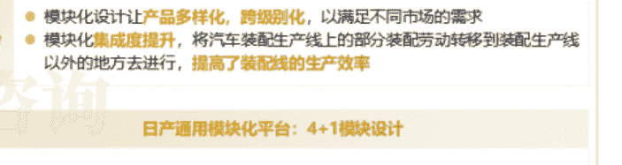

公众号 · 鼎智咨询

01 / 特斯拉业务布局分析
02 / 特斯拉汽车业务研究
03 / 特斯拉能源业务研究
04 / 特斯拉机器人业务研究
05 / 特斯拉发展保障
06 / 特斯拉协同发展洞察

# 特斯拉业务从早期产品试用到全球规模化布局，始终延续“加速世界向可持续能源转型”的愿景。通过技术垂直整合、超级工厂建设及 AI 赋能，其储能已成为公司第二增长曲线

## 2006-2016
## 2017-2024
## 2024至今
## 早期布局与储能产品推出
## 储能业务扩展与全球落地
## 爆发式增长与全球能源转型

| 储能业务形态：太阳能与储能初步探索 | 超级储能：“霸王” | 储能业务成为核心增长 |
| --- | --- | --- | --- |
| 太阳能和储能领域：* 特斯拉早期专注于电动汽车，但 2015 年收购 SolarCity 后，正式进入太阳能和储能领域 | * 2017 年，特斯拉与美国、澳大利亚政府合作建设全球最大的储能项目，使用 Megapack、Powerpack 系统供电 | * 2024 年特斯拉储能业务收入超过 100.86 亿美元，同比增长 67%，毛利率高达 26.2%，远超汽车业务（18.4%），储能产品日益丰富，工业及电网市场，形成多元化收入结构 |
| 闭环环境：SolarCity 的收购使得特斯拉形成了“太阳能+储能+电动汽车”的环保生态 | * 成为特斯拉技术领先业务的标杆 | 2025 年美国宣布投资 19 亿美元建设第三座 Megafactory 工厂，计划产能 1500 万单位 |
| 第一款储能产品出现：Powerwall，2015 年推出家用储能产品，用于存储太阳能或电 | 储能产品迭代与全球布局：Megapack 单体容量达 39 MWh，支持多机集成 | 预计 2026 年固态电池成本下降 15% |
| 第二款储能产品：Powerpack，2016 年推出针对市场的大型储能产品，标志着特斯拉进入储能市场 | * 2024 年上海超级工厂开始量产，产能达 40 GWh，通过 AI 量化调度，根据中国试点项目聚合提升效率 | |

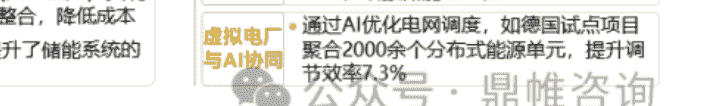

# 特斯拉能源业务已经围绕家用、商用、公用三个层面完成了三项储能产品

## 消费者
## 需求痛点
- 重视稳定性和可靠性，减少使用化石燃料。
- 在停电时提供备用电力。

## 商用
## 需求
- 关注能源优化。
- 通过调度系统降低支出。

## 公用
## 组织
- 关注能源成本。
- 通过存储过剩的可再生能源，实现电网平衡。

| Powerwall | Powerpack |
| --- | --- |
| 定位：家庭 | 定位：商用 |
| 容量：13.5 kWh | 容量：900 kWh |
| 特点：锂离子电池设计 | 特点：大规模锂离子电池设计 |

在太阳能方面，特斯拉构建了 SolarPanel 和 SolarRoof 两类产品，核心在于充分结合了性能与外观要求，实现光伏与屋顶一体化，更符合用户需求。

## SolarPanel——太阳能电池
- 作为传统的太阳能光伏产品，在任何建筑物表面安装光伏组件进行发电，属于 BAPV 结构。
- 降低成本减少对传统能源依赖。

## SolarRoof——太阳能屋顶
- 作为光伏建筑一体化（BIPV）创新产品，其定位是打造一种兼具美观性、功能性和建筑一体化的太阳能解决方案。
- 设计特征：通过作为屋顶或建筑组件，安装在各种类型的屋顶、建筑物的外立面或空场地。
- 设计特征：将光伏电池嵌入到瓦片中，实现光伏与屋顶的一体化，拓展应用空间。

## 目标用户
- 适用于希望利用太阳能降低成本、减少对传统能源依赖的用户。
- 适用于对建筑屋顶有额外的用户。希望实现自给自足的新建建筑业主或需要进行屋顶改造的用户。

## 特性与价值体现
| 主要关注点 | 效益 |
| --- | --- |
| 发电效率 | 成本：外观上优于普通瓦片，表面带有玻璃层，集成电池片和不透光层，两者基本不一致；视觉上与屋顶一体化，提供了更好的视觉效果和价值 |
| | 更侧重作为一种太阳能发电设备，在不改变建筑物原有结构和外观的基础上安装 |
| 美学价值 | |
| --- | --- |
| 成本效益 | |
| 耐久性 | |
| 经济性 | |

瓦材料使用具有良好的防水性能，天然作为防水材料，电池片的防水与屋顶材料，实现了成本的节约。瓦片与屋顶保修寿命约为25 年。

# Autobidder不仅仅是电力交易的数字化软件，特斯拉还赋予其分布式能源交易管理系统，虚拟工厂调度和控制平台，以及开源复杂算法等更多涵义，马斯克正在电源侧、电网侧、用户侧进行重构

## Autobidder

### Autobidder是特斯拉分布式能源交易的核心枢纽

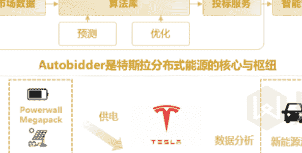

提供基于价值的资产管理和投资组合，使所有者和运营端能够根据业务目标和风险配置最大化收入的收益策略。

具有独特的电力产品及虚拟调度功能。

为客户提供日前、日内、实时交易与运营服务，包括区域电力供应与通过调度算法、电力预测和调度化可再生发电体、辅助电网、存储多种电力等，以运行电力市场、输配服务，可将可再生发电与其他电网组合，在不同时段选取电力市场，满足客户需求最优用电组合，实现交易收益最大化。

作为调度和能力平台对电力产品进行调度，提供能量和调度预测功能，能够将调度产品的数据和信息实时共享，并利用内部算法对优先权发送和接收进行一键调优，将分布式、可控以及可蓄聚装置整合成一个统一的控制集合，以提供更高效和更灵活的发电、配网和可用性。

使用应用程序协议，特斯拉将用户侧代码优化为专业化、系统轻量化部署并快速迭代，良好地契合客户需要。

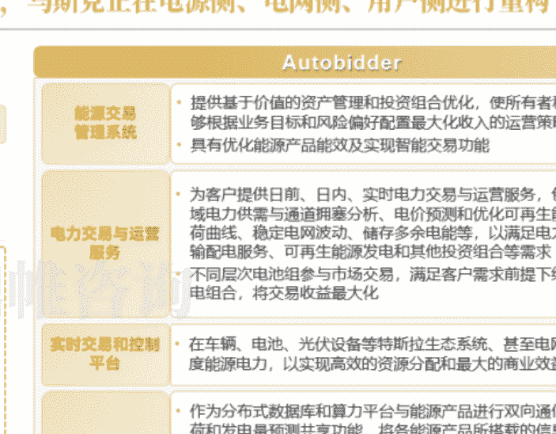

## 1. 特斯拉光伏产品之所以实现效率和美感的领先，主要源于半片电池技术、分板设计、单晶PERC技术三大核心能源技术和建筑一体化结构、无安装技术两大技术

## 制造技术

### 半片电池技术

### 分板电池设计

### 半片封装电池

#### 模块化瓦片设计

- **优势**：通过传统大尺寸电池切开路径长度，减少电路电阻损耗
- **效果**：实测显示，该技术使效率输出3-5%，同时增强抗拉能力更强，单个电池密度更高，系统功率损失降低15%
- **项目**：Solar Roof V3采用技术，单瓦片功率72W，比较传统瓦片提升40%
- **优势**：电池采用聚栅式排列，通过连接实现电池片小于0.2mm
- **效果**：这种设计使组件有效发电面积增加12%，在屋顶顶部阴影部位下只需损失非半片电池部分，可靠性提升20%
- **优势**：采用镍化栅线及背面接触（Passivated Emitter and Rear AlOx/SiNx）钝化技术，光子吸收效率提升2%至15.06%
- **效果**：结合蓝光消除技术，电池转换效率提升19%，替代旧款Solar Roof V4更将效率提升至22%
- **模块化瓦片设计**：每片Solar Roof 集成光伏电池、钢制基础和防水，安装通过卡扣连接，施工效率比传统分布式光伏优50%
- **变形瓦片**：采用设计的蜂窝结构，在高视角下呈现不透光瓦片外观，高视角保持透光性，实现非所未有的美学效果

## 无安装技术

- **优势**：采用钛铝电池锁硬件，安装人员无需固定，直接通过卡扣连接瓦顶结构，安装速度提升30%，人工成本降低25%
- **防水设计**：集成防水与发电，安装后电池屋面表层1.2cm，减少雨阻和漏水，系统寿命延长30年

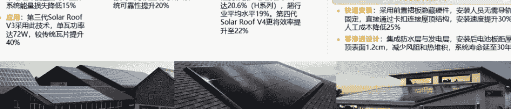
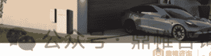

从盈利模式来看，特斯拉能源业务主要构建了直接购买、租赁模式和购电协议、创新融资模式三种模式，与国内能源企业盈利模式没有本质区别。

| 直接购买 | 租赁模式和购电协议 (PPA) | 创新融资模式 |
| :--- | :--- | :--- |
| 企业创业人一次性投资，享受长期收益 | 零资本交付清洁能源 | 合同、转租、后回购 |
| 方式 | 方式 | 方式 |
| 一次性支付系统设备和安装费用 | “零付费”租赁和PPA（购电协议）模式 | 合同融资模式 |
| 系统的所有权完全属于客户 | SolarCity承担租赁设备、设计、安装和后期维护 | SolarCity与基金合作成立合同公司，系统的设计、安装和维护由SolarCity负责，所有的所有权归合同公司，用户通过创新融资获得资金，减少资本投入，并仍享有长期补贴 |
| 太阳能系统安装后产生的电力收益将长期锁定客户 | 用户仅需每月支付服务费或根据使用的电量缴费 | SolarCity将安排设备出售给合同公司，由基金转租给用户租赁费用；SolarCity的投资回报率较高，但受到美国30%的优惠，基金承担了部分压力，吸引了大量投资者 |
| 优缺点 | 优点 | 缺点 |
| 投资回报率较高 | 前期投入高 |
| | 回购模式 | SolarCity将设备售给合同公司，由基金转租给用户租赁费用；SolarCity的投资回报率较高 |
| | 目的 | |
| | 扩大能源业务范围 | |
| | 让更多家庭享受能源带来的效益和环保收益 | |
| | 客户群体 | |
| 支付能力 | | | |

## 租赁模式和购电协议（PPA）结构示意

| 模式 | 不同点 | 相同点 | 图示 |
| :--- | :--- | :--- | :--- |
| 租赁模式 | 用户每月支付固定租金 | SolarCity通过月收入和政府补贴获得长期收益 | |
| | 设备所有属SolarCity | 金融投资机构、太阳能服务商免安装、运营服务，支付低价，光伏电价为电价的8-9折 |
| 购电协议模式 | 用户根据实际用量支付租金 | SolarCity通过长期收入逐步回收成本 | SolarCity负责系统的安装、维修和维护 | 金融投资机构、太阳能服务商免安装、运营服务，支付低价，光伏发电、余电购买电网 |

## 特斯拉能源业务在家庭层面构建了微电网，通过监控调整用电状态、降低用电成本等方式提升体验，为用户创造闭环价值

### 家庭电网的功能

### 特斯拉家庭微电网示意图

| 监控及调整用电成本 | 储能 |
| :--- | :--- |
| 系统支持手机、平板等移动设备的远程监控 | 查看清洁能源的实时使用情况，包括太阳能发电、Powerwall储能、家庭电设备状态等信息 |
| 手动控制Powerwall的充电模式，调整用电运行状态 | |
| 闲时存储和利用剩余 | 在太阳能发电充足时，将电存储到Powerwall中；在夜间或阴天时放电，Powerwall释放电力为家庭使用，实现能源的即时存储和减少对电网的依赖，提高利用率 |
| 监控电价合理用电 | 根据电网的电价变化，在电价高时充电，在电价低时放电，降低用电成本 |
| 作为备用电 | 当出现故障或停电时，Powerwall可以作为备用电，为家庭关键设备供电，例如冰箱、电脑、路由器等设备，确保家庭能源不受影响，维持家庭能源的稳定性和可靠性 |
| 与外部电网双向 | 卖电获取收益：可以与外部电网进行双向互动，在满足家庭用电需求下，将剩余的电卖回电网，获得一定的收益 |
| | 参与电网的需求响应：根据电网的电价调节指令，调整家庭用负载和Powerwall的充放状态，支持电网的稳定运行 |

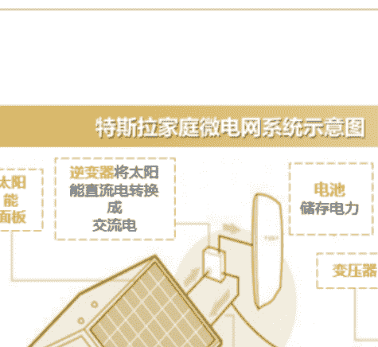

# 目录

- 01 / 特斯拉业务布局分析
- 02 / 特斯拉汽车业务研究
- 03 / 特斯拉能源业务研究
- 04 / 特斯拉机器人业务研究
- 05 / 特斯拉发展保障研究
- 06 / 特斯拉协同发展洞察

### 特斯拉机器人历经多轮迭代升级，完善优化Optimus功能，目前已经能够通过神经网络控制整体，“蒙眼”克服崎岖地形，未来将加强视觉、高分辨率摄像头、多语言学习

#### 概念阶段

#### Optimus第一代

#### Optimus第二代

#### Optimus第三代

#### Optimus下一一代

帮助人类执行一些危险、重复和枯燥的任务，解放人类的劳动力，使人类专注于更具创造性和价值的工作。

原型机器人，需要抓取，无法正则操作。实现直立行走，关节可灵活移动工具、螺丝等。

车辆行驶，在不碍障碍的情况下获取物体。视觉识别、色彩分任务、单保持持稳，能流畅动作。

行走速度提升30%，减重10kg。实现流畅动作的性能提升，高精度抓取，展示了食物、饮料、智能化等等方面操作，在灵巧轻量化。

机器人遇到复杂的路网环境，放下手指可灵活弯曲；自由度提升至22个，手腕拥有。灵活穿越不规则地面，加强避障和机器人能力。以每60秒的速度绕周围环境，提升感知能力。

| FSD视觉 | Dojo 数据积累 | 模型化 |
| :--- | :--- | :--- |
| 持的执行器 | 关节传感器 | 高精度传感器 |
| 微型电机 | 算力建设 | 六维传感器 |
| 自主 AI 模型 | 跟踪器 | |
| 2021年 | 关节自由度数量较少 | |
| 2022年 | 全身28自由度、40个自由度 |
| 2023年 | 全身28自由度、42个自由度 |
| 2024年 | 灵活自由度达到22个，手腕拥有 |
| 2025年以后 | 进一步提升自由度 | |

## 特斯拉之所以进军人形行业，主要出于三个原因：一是业务布局能够实现车辆协同；二是人形机器人行业具有广阔的市场；三是推动人形机器人实现人力替代。

### FSD系统

自动驾驶的解决方案，也是人形人的“大脑”。

### 动力供应

全球人口龄化与制造业“用荒”使得机器人需求

### 人形机器人优势

- 仿生步态运动能力较传统机器人大幅提升
- 灵活手腕实现抓取配合和关节精准，更具灵活性
- 依靠算法实现复杂环境适应并实施任务，不再具有机器人缺陷，而是具备通用性，适用于广泛的需求

### 人形机器人产出

### 使用语言和视觉优势

### 与汽车共用

传输部件和电池系统

### 社会价值
- 到2030年，全球制造业劳动力缺口达850万人，服务业缺口2亿。Optimus通过“机器人”填补缺口，在人力成本上更具竞争力

### 经济价值
- 美国汽车工人（UAW）预测显示，Optimus部署有望使人工成本从950美元降至200美元，提升企业利润率3-5百分点

### 销量数据

### 扩大需求

降低生产成本，理论上机器人能完成所有人类进行的任务。

在此面前，特斯拉通过硬件+软件服务的布局形成机器人底层逻辑，同时不断加强产品研发、技术研发、场景开发和产能扩张，实现了人形人的全链路。

## 业务领域

### 核心业务
- 核心零部件制造：生产电机、减速器、行星丝杠、驱动器、轴承等核心部件。Optimus的旋转关节采用电机、减速器，直线关节采用行星丝杠
- 人机本体制造：组装各类零部件，涉及机器人结构设计、电子电路集成等，人形具备感知等基本功能

### 业务供给
- 操作开发：开发适用于人形机器人的操作系统，管理机器人的硬件交互，为上层算法提供运行环境，实现多任务处理和同步
- 算法研发：开展运动控制法、路径规划法、多传感器融合算法等，使机器人能够实现自主移动、识别**任务规划等领域

### 售后服务
- 销售咨询：为客户提供机器人方案咨询，根据客户需求和市场，推荐合适的机器人产品和配置
- 售后维护：提供机器人的维护、修复、升级等售后服务，确保机器的正常运行，包括零部件更换、软件更新、故障诊断等

## 业务布局

### 产品研发布局
- 不断进行机器人产品的迭代升级，优化性能和功能。Optimus Gen-2相比Gen-1在行走速度、重量、手臂关节等方面都有提升，计划开发用于制造和物流领域的轮式 AMR

### 生产制造布局
- 定义机器人生产的规划
- 2025年计划生产数千台
- 2026年为5-10万台
- 2027年100万台
-加强供应链建设，与供应商合作保障零部件供应，招聘大量制造相关人员推进产能

### 应用场景布局
- 初级场景机器人：先于特斯拉内部工厂、执行运输、装配等场景；后续计划在2026年下半年左右扩展，拓展到其他工厂
- 长期来看，目标是进入家庭服务、医疗护理等多个领域

### 技术研发布局
- 硬件方面：自制电机、执行器、传感器技术
- 软件方面：利用AI技术，将汽车的FSD技术与Autopilot相关神经网络应用于人形机器人，提升其环境感知与解决能力

## 特斯拉布局人形机器人具有绝对优势，其核心技术如电池、动力、传感器等，直接移植汽车技术，形成用，这也符合马斯克的“工程领先”。

| 电池技术 | 动力系统 | 传感器技术 |
| :--- | :--- | :--- |
| 共享技术 | | |
| 电池和能源管理 | | |
| 充电电压 | | |
| 传感器融合 | | |
| 视觉系统 | | |
| 视觉识别 | | |
| 关节原理 | | |
| 机械驱动系统 | | |
| 动力设计 | | |
| 底盘结构 | | |
| 终端数据 | | |
| 终端数据处理 | | |
| 云端数据 | | |
| 定制化 | | |
| 驱动端 | | |
| 终端数据 | | |

- 1 电池和能源管理
- 2 人工智能和连接
- 3 视觉识别
- 4 关节原理
- 5 基础结构
- 6 机械驱动系统
- 7 云端数据处理

## 特斯拉研发人形人的初衷之一就是最大化利用特斯拉自动驾驶方面的优势，特别是算法经验、数据驱动能力、AI芯片等，使得投入人形机器人领域具有竞争力。

### FSD系统迭代路径：通过数据、算法、硬件的迭代架构，通过不断升级的硬件支撑不断升级的算法，这种解决方案也是人形人的“大脑”。

### 数据闭环开发
- 仿真数据覆盖更多场景
- 特斯拉FSD系统已海量数据驱动，车队返回的数据与仿真生成的数据共同构建FSD系统
- 避免大量极端场景

### 数据存储与节省成本
- 2022年FSD软件（全自动驾驶版本）使用量由20万辆提升到16万辆，积累了视频数据
- 现实世界收集的数据不足以覆盖所有场景，目前特斯拉仅收集数分钟，但可以实现现实世界非常接近的仿真场景，使得加速人形领域的进展
- 车队传输的错误从人工模式中提取（自动驾驶选择）的数据，将其纠正加入到训练和测试中，这个过程就是数据闭环的关键，会生成corner case数据并由自动驾驶驱动的模型进行改进

## 关键技术

### 多维度采集能力
- 车队数据网络：特斯拉全球40万辆车辆每天产生16亿条数据，涵盖城市、乡村、极寒天气等场景
- 仿真数据生成：通过仿真平台（基于Autopilot算法）产生大量机器人训练所需的场景，解决真实世界中极端数据不足的问题

### 数据清洗与自动标注技术
- Dojo的自动标注：利用Dojo算法计划，实现视频画面的无人工标注
- 跨越连接：汽车车辆的底层数据可以直接优化人类大脑决策规则，减少开发周期

### 数据价值迭代优势
- 高时连接性：特斯拉车辆采集的数据（频率36Hz）为机器人运动控制系统提供高精度同步
- 多任务学习框架：同一数据集同时训练自动驾驶与机器人任务（如物体接近与车辆交互算法）

## 特斯拉开发人形机器人Optimus的最终目的是通过高度通用机器人替代人类劳力，构建一个由智能机器人驱动的生产与服务网络。

### 短期目标 (2025-2027年)

### 中期目标 (2028-2030年)

### 长期目标 (2030年后)
- 工厂场景的全面自动化
- 跨行业生产力革命
- 通用智能载体

### 特斯拉内部部署

### 工业界扩展

### 人机交互边界
- 2025年计划在工厂部署数千台Optimus，仿人类运输、装配、质检等任务，目标是将单条任务工人成本降低78%
- 进入采矿、电力、物资等高危场景，替代人类执行作业，处理复杂任务，目标预计2030年全球工业机器人市场规模突破2450亿美元
- 通过通用设计实现工具使用、语言交互、情感识别等能力，成为首个通过通用测试的实体AI

### 技术验证阶段

### 服务市场渗透

# 从技术进度的角度来看，特斯拉机器人到2030年将重点突破生肌材料、类脑神经形态芯片等技术，最终以机器人作为能源网络终端节点，推动文明形态向“基硅-基碳共体”演进

## 短期
(2025-2027年)
通过供应链整合与场景聚焦，实现从实监督奇迹到“工厂标配”的跨越

## 中期
(2027-2030年)
依托算力版权与数据领先，建立具智能时代操作系统标准

## 长期
(2030年+)
以机器人作为能源网络终端节点，推动文明形态向“基硅-基碳共体”演进

| 技术维度 | 运动控制 | 环境感知 | 任务学习 | 能源效率 |
|---|---|---|---|---|
| 2025年当前能力 | 双足行走速度2m/s，可倾20°斜 | 8摄像头+FSD视觉系统 识别精度±2cm | 仿人类作业，成功率85% | 单次充电工作8小时 |
| 2030年目标 | 能够速度5m/s，动态平衡冲击能力 | 多模态融合 视觉+激光雷达+毫米波雷达 | 自主执行复杂序列任务 例如：组装汽车零部件 | 无需充电 光伏自补 无续航 |
| 技术突破 | 仿生肌材料，应变速度达300%/s | 类脑神经形态芯片，功耗低90% | 强化学习框架Dojo升级，训练效率提升10倍 | 固态电池集成，能量密度500Wh/kg |

# 特斯拉人形机器人的本质在于推动从工厂到家庭的跨越领域渗透，其战略又是结合Optimus完成城市数据+家庭数据的全面布局，从而构建生态优势。数字科技等企业应从战略层面进行高度关注

| 制造降本 | 应用场景裂变 | 数据领先堡垒 |
| :--- | :--- | :--- |
| 硬件模态化 | Optimus采用与车共享的4680电池、BMS系统，零件复用率提高60% | B2B订阅模式 - 企业支付11.5万美元/年，获得机器人+软件+运维全包服务 | 金融数据库 - 累计采集超过200亿小时的人类动作数据，构建全球最大的动作库 |
| 生产规模化 | 2026年墨西哥超级工厂投产，目标将单车成本从8万美元压缩至2万美元 | C端共享平台 - 个人用户可通过Tesla App出闲机器人算力，参与分布式AI训练 | 环环保系统 - 通过影子模式实时优化决策算法，任务执行错误率从0.3%降至0.001% |

# 工业场景验证与拓展 | 消费市场布局

| 工厂内测 | 家政服务 | 医疗辅助 |
| :--- | :--- | :--- |
| 2024年50台Optimus在奥某特工厂执行电池分拣任务，效率提升30%，错误率<0.1% | 通过OTA服务引入订阅制、清洁服务定价$99/月，目标2030年渗透5%美国家庭 | 与麦士所合作开发康复机器人，运动精度达0.1mm，通过FDA认证 |
| 仓储物流 | 与亚马物流合作测试包裹分拣，单台机器人日均处理1200件，准确率99.9% | |

另一方面，特斯拉新款Roadster跑车计划在2025年亮相，飞行是其备选功能之一，结合特斯拉的星链、AI等方面的技术布局，鲲维认为特斯拉的终极形态或将变形金刚汽车机器人成为现实

2024年7月，马斯克在Takeover直播活动中提到，飞行将首次作为新款Roadster跑车备选功能，供那些热衷于尝试新科技的用户体验

# 特斯拉已具备了成为“大黄蜂”的基础技术

| 特斯拉 | SpaceX | Neuralink | xAI |
| :--- | :--- | :--- | :--- |
| 安全保护技术 | 精准定位与导航 | 高级人机交互 | 人工智能与机器学习 |
| 包括碰撞检测、红外线绕警报、紧急制停 | 高精度定位为汽车机器人提供精确的位置信息 | 利用机器人技术，实现人类对机器的直接控制 | 包括高级语言模型、自然语言处理、深度学习算法等 |
| 传感器技术 | 能量管理 | 实时数据更新 | 信号反馈与调节 | 运动控制 |
| 高效电池技术和机器人回收技术 | 通过卫星的数据获取最新的路线、天气等信息 | 通过对大量神经信号的解码，实现人类意图的确认 | 激光雷达、超声波传感器、构建精地图建模 | 关节驱动器的设计、运动规划算法、平衡控制 |
| 材料轻量化 | 实时监控 | | |
| 利用碳纤维材料、铝合金等降低质量 | 实时监控器的运行状态、位置信息 | 通过神经反馈与调节，帮助人类保持状态 | |

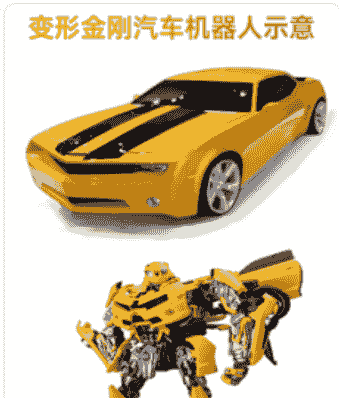
注：特斯拉汽车机器人形态从角度来看具有可能性，但这种形态的实现还需要克服许多难题和法规

# 值得注意的是，马斯克表态由于噪音不好，飞行汽车的可能性不大，但Roadster跑车又要挂载功能，进一步证明了关于“汽车机器人”的观点

| 技术可行性与安全性 | 基础设施与法规 | 成本与商业化 |
| :--- | :--- | :--- |
| 技术可行性 | 基础设施 | 成本高昂 |
| 噪音 如eVTOL 起飞噪音达90分贝以上 | 空域管理 如中国计划2025年开放空域 | eVTOL售价超过30万，且需租赁、维护 |
| 能源效率 每公里能耗是汽车的3倍，单次航程低于200公里 | 充电设施 需专用充电机场、交通管理系统 | 商业化 难以盈利，主要依赖政府补贴和优惠 |
| 安全风险 存在爆炸、零部件坠落等 | 法规遵循 | 群众因素 |
| 马斯克认为飞行汽车在人口密集区、劣天气易停，地下隧道更具 | 立法现状 目前仅美国和中国民航局发布了初步标准，多数国家处于立法阶段 | 短期难以支撑大规模化 |

马斯克在2025年第一季度大会上强调，特斯拉的核心战略是“可持续”，将资源集中在再生能源、自动驾驶和机器人领域，低空经济并非优先

特斯拉的战略：飞行汽车的本质是智能电动汽车，只有在需要的时候才是飞行器。飞行汽车的定位在于让消费者自由，能够帮助更多，而不是由陆转向空中

# 小对飞行汽车的定义
飞行汽车不是飞行器，飞行汽车在市内是一个智能电动汽车，在郊区是一个低空飞行器，未来将成为汽车的分支

# 场景应用原则
让生活开展自由、更好、更丰富自己的空间，在公共服务上，能够自己自由，能够让更多人都得到情况，进行公共服务，这是我们的目标。

# 场景应用分类

| 个人出行与旅游 | 紧急救援与公共服务 | 城市空中交通 | 低空飞行服务 | 景区或城市公园场所 | 商业应用与物流配送 |
| :--- | :--- | :--- | :--- | :--- | :--- |
| 通过飞行汽车连接市场，享受高效便捷的出行方式 | 在紧急情况下，如自然灾害、交通拥堵等，飞行汽车可以快速送达现场医疗救援，缩短救援时间，提高救援效率 | 通过飞行汽车实现城市中的点对点交通 | 用户通过飞行汽车在城市内或城市之间快速通行 | 在景区或城市公园场所，飞行汽车为游客提供低空飞行服务，从空中享受丰富景观，还可以举办空中活动、表演等活动 | 在快递、外卖等物流配送中，飞行汽车提供快速、高效的空中配送服务，用于商业广告、储柜等业务应用 |
| 在旅游方面，飞行汽车可以带领游客从空中观察景观 | 为救援人员提供及时的空中中继，提高救援效率和响应速度 | 缓解地面交通压力，享受高效、便捷的空中交通服务 | 为公众提供多样的娱乐体验 | 提高物流效率和用户体验 |

公众号：鼎稚咨询 80

# 目录
01 / 特斯拉业务布局分析
02 / 特斯拉汽车业务研究
03 / 特斯拉能源业务研究
04 / 特斯拉机器人业务研究
05 / 特斯拉发展保障研究
06 / 特斯拉协同发展洞察

# 马斯克布局的核心指导思想是第一性原理，本质是跳出既有框架，回归解决问题的本质，打破既有经验和方法，从底层逻辑寻找解决问题的方法，基于此马斯克建立了从解构到构建的四步操作框架

| | 第一性原理 | 重构逻辑 |
| :--- | :--- | :--- |
| 本质思维 | 割裂事物的表现与经验，回归基础的物理规律和物理定律，从“原子层面”重新定义问题 | 将系统拆解为不可拆的基本要素，通过逻辑推演找到解决方案，而不是依赖经验或类比 |
| | | |
| | 以数学、物理、化学等学科为基础，强调物理定律允许的范围，一切皆有“可能” | 创新 |
| 认知假设 | 1 主题 | 2 分解至极限 | 3 跨领域提炼 | 4 极致优化 |
| 马斯克操作框架 | 通过“五步法”层层剥离本质 | 将问题拆解至原子层面物理属性或基础 | 从其他领域提取底层原理 | 通过物理规律与工程优化 |
| | → 火焰是一次性使用 → SpaceX：火箭回收技术 → 电池成本低于100/kWh? → 特斯拉：拆解电池、锂、镍 | 电动汽车：材料成本=锂+钴+硅 → 火焰发射：火箭成本仅占3%  汽车：将铝合金焊接应用于Model Y，减少零件 | 火焰发射：通过供应商整合垂直整合，将火箭成本从6000万降至900万/次 动力电池：千级工艺+结构化，将成本降至$5/kWh |

# 马斯克认为传统商业决策依赖“类比”（Reasoning by Analogy），而第一性原理是彻底创新的核心

| 模式 | 逻辑起点 | 创新方向 | 成本控制 | 风险偏好 |
| :--- | :--- | :--- | :--- | :--- |
| 类比思维（类比模式） | 行业惯例、品质、历史经验 | 渐进式改进 | 供应控制、价格、规模效应 | 规避不确定性、依赖成熟路径 |
| 第一性原理（马斯克式） | 物理定律、物质属性、数量级规律 | 范式重（如纯电架构） | 材料+工艺革命 | 拥抱底层突破、容忍短期失败 |
| 产品样例 | 问题重构 | 制造效率，而非传统 | 从“下购买”转向4680电池，能量密度提升5倍 | 成本显著复用电机/电池/视觉系统成本降至消费级 |
| | 技术突破 | Merlin发动机复用100次、星舱引擎 | 制造革命 采用Giga Press一体化压铸，Model Y底部零件从70个减至1个 | 算法迁移 FSD视觉模型+Dojo超算训练人形运动 |
| | 单次发射成本降至1/10，占全球60%市场 | 生态闭环 光伏-储能-充电电网，实现家庭能源自给率80% | | |

SpaceX：航天民主化
特斯拉：能源革命
Optimus机器人：具身智能突破

基于第一原理，马斯克提出的五步工作法，其本质是对商业逻辑进行锚点溯源分析，然后删除所有方式冗余，利用最有效的思路加速方案，最终实现全面优化（注：此处部分为OCR重复内容，已整合）

# 在第一性原理之下，马斯克衍生出成本主义，核心是通过物理极限解构、垂直整合创新与组织文化重塑，将生产成本压缩至数字位极限，同时实现技术性能的跃迁突破，重新定义现代制造业的底层逻辑

核心理念：物理定律驱动成本重构
第一性原理的极致应用：物理极限解构

| 产品价格 | 原材料成本 + 转换成本 | 物理极限 |
|---|---|---|
| 消除中间环节、冗余（如供应商加价），使成本逼近理论极限 | 物理极限构造方法 | |
| C=SC×SF（复杂度=交互频率） | 将产品分解至元素物质构成 | |
| 原材料成本=锂+钴+镍 | 特斯拉4680电池采用高密度，能量密度提升5倍 | | |
| - 例如Cybertruck后零件从70个减少到17个 | | |
| 物理定律是唯一敌人 | 组织熵对抗惯性的革命 | | | | |
| - Giga Press一体化压铸将损耗跨越量级 |

在极致资本主义之下，马斯克完成了技术创新和管理创新，包括跨学科的技术移植、生产流程重组、扁平化组织等

| 设计理念 | 生产流程重组 | 扁平化优势 | 成本重构 | 极端文化 |
| :--- | :--- | :--- | :--- | :--- |
| 跨学科技术移植 | 一体化减压 | 反馈架构 | 人力成本 | 人员响应 |
| 跨学科技术移植 | 垂直化制造 | 工程师反馈 | 决策 | 自动化替代 |
| 跨学科技术移植 | 垂直化整合 | 工程师直接向 | 实时监控、问题响应 | 零容忍策略 |
| | | | | |
| | | | | | |
| | | | | |
| | | | | | |
| | | | | |
| | | | | | |
| | | | | |
| | | | | | |
| | | | | |
| | | | | | |
| 会议系统使用$100以上的电脑 | | | | |
| Djo 自动执行FSD训练，减少99%人工需求 | | | | |
| 特斯拉“24小时小型车法”——从设计到样车 | | | | |
| 4680电池生产成本降至56/kWh | | | | |
| ModelY后底成本降低40% | | | | |
| 300万汽车与10万台机器人产生1EB数据，反向算法迭代提升效率 | | | | |

（注：由于OCR文本存在大量重复和乱码，以上已根据语义进行逻辑清洗与对齐）

# 第一性原理之外，马斯克推崇“工程交叉”，这一方法论是将不同产业的技术模块解构“基础单元”，然后实现跨领域应用，包括战略、组织、技术、生态等交叉

# 核心本质
将不同产业的技术模块解构为“基础单元”，通过架构重组与数据驱动实现效率。一种“技术基基因”的工程哲学

# 物理底层复制
# 算法底层迁移
# 生态层涌现
直接移植硬件组件（如Model Y永磁电机用于Optimus系统驱动，复用率75%）
神经网络架构聚类适配（如FSD视觉算法直接控制动作流畅）
多领域数据闭形成进化（Dojo超大规模训练自动驾驶与机器人模型）

# 战略交叉：重建业务定义边界
# 组织交叉：重建垂直一体
# 技术交叉：模块化架构设计
# 生态交叉：重建产销网络

企业定位提升：将特斯拉从“车企”转型为移动AI平台”，将汽车成为移动机器人，Optimus是具智能的机器人

内部生产链：自研4680电池、电机、芯片核心部件，关键部件自主60%（平均率≤30%）

接口标准化：NACS充电协议同时匹配汽车与机器人无线电

光能充电闭环：Optimus Solar Roof提升发电效率，存储到Powerwall供汽车充电，形成边界内本质网络

迭代速度领先：资本市场对特斯拉的估值从“汽车制造PSG”转向“AI+机器人”，2025年行业业务PS倍数可达22倍

部门级协作：汽车与机器人团队共享Dojo算池，算利用率从35%提升至82%

软件定义能力：Bot OS与机器人系统共用底层架构，持续OTA同步升级

数据气轮效应：300万汽车与10万台机器人产生1EB数据，反向算法迭代提升效率

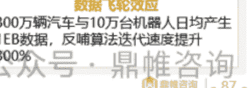

被围猎袭的中国科技企业华为，在年前提出了熵增理论，本质认为是固化式平衡、封闭环境会导致流程僵化、创新软弱等问题。华为认为伟大的公司都会有伟大的管理理论与管理实践方法。

| 管理意义上的熵增场景 |
| --- |
| 企业组织与物理系统的同构性——封闭环境的企业会自发出现流程僵化、创新软弱、人浮于事等“大公司病” |

| 战略决策层面 | 组织运营层面 | 人才管理层面 | 个体行为层面 | 文化价值层面 | 其他 |
| --- | --- | --- | --- | --- | --- |
| 战略保守主义 | 流程过度僵化 | 激进抑制 | | 精神萎靡 | 批判精神缺失 | 危机熵化 |
| 决策路径惯性 | 部门间失效 | 人才结构板化 | 学习动力枯竭 | 客户份额饱满 | 决策信息过滤 |
| | 知识更新滞后 | 责任推诿 | | | 组织记忆丢失 |

| 能量耗散机制 | 构建原理平衡态的开放系统 | 非线性变换突变 |
| --- | --- | --- |
| 通过“1130日法”遏制僵化 | 负荷引入机制 | 采用“围与攻击”策略，5G研发同时启动7个技术路线攻关，通过内部竞争产生技术突破 |
| 每增加1个节点必须增加2个节点，确保管理冗余 | 物质交换：人才学会率，2020年海外客户引入增加37%，天才计划实现熵减小目标 | |
| 冗余本身非线性增长 | 能量熵：研发投入比率8%以上，与全球300+高校建立联合实验室 | 制造的“质变”使系统在临界点实现质变 |
| 数据散服务器制，遏制15%高熵流 | 信息传递：EMT（核心执行管理团队）每月与基层员工进行“咖啡对话”，确保决策直达一线反馈 | |
| 打破耦合模型。2021年转型员工8000人，消耗冗余能量 | | |

华为人均营收从2016年38.3万美元提升至2023年54.6万美元。

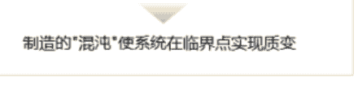

另一支持特斯拉快速发展的核心是超级工厂的理念设计，特斯拉强调设计集成系统的方式去设计工厂，完成了由“丰田模式”向“超级工厂”的生产模式的更新，本质是丰田精益生产的扬弃。

## “超级工厂”：以集成系统的方式去设计工厂

- ① 工厂的建设引入了先进的自动化技术，其效率、整合的组织流程可以有效消除信息孤岛模式。将研发团队和生产团队在骨架架构上进行功能融合，在办公地点进行物理融合，实现了研发技能融合。由于系统快速迭代，以万天周期，创造协同价值。
- ② 汽车“模块化”并提供功能单元，终端客户通过“后装”直接联系工厂，实现直接组装。超级高效灵活，工厂快速实现“单件小批量”生产。
- ③ 采用特斯拉主导的生产信息系统，特斯拉按全球供应链灵活需求，零部件在超级工厂内整合并直接组装。超级工厂密集化生产生活，并且设计、信息部门、采购部门、管理部门等在工厂内部协同办公，信息决策流通，实现了交互、灵活模式的高效生产。

## 丰田模式（需求订单单生产，传输ERP）

## 特斯拉的“超级工厂”模式

| | | | | | | | | |
|---|---|---|---|---|---|---|---|---|
| 需求 | | | | 需求 | | | | |
| 高需求 | 丰田 | 丰田 | 丰田 | 客户 | | | | |
| 1 | 2 | 3 | 工厂 | | 供应 | 1 | 2 | |

*(注：原文表格存在大量空白和重复行，已根据语义保留核心逻辑结构)*

- 准时制：通过减少库存降低成本
- 精益生产：质量管理“自流化”，追求零缺陷、零整修，以更低的成本保证优质的产品
- 增值：减少浪费；
- 元素单元
- 模块主义
- 决策滞后
- 等待浪费
- 重复的工作
- 价格效率：实时和规模优势使得价格可以随需求调整
- 能力：通过灵活整合方位承担的任务，实现真正的优化
- 指数驱动：增加一线灵活性，成本接近零
- 客户：了解用户数据，使用户个性化的“用户体验”
- 改进连续、快速反馈
- 站点：产品合格率低

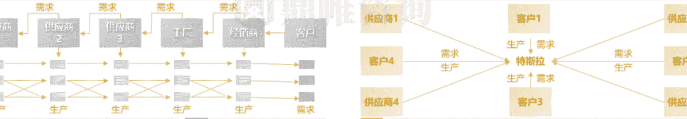

超级工厂的本质是“物理定律的工程化表达”，在超级工厂之下，特斯拉主要出现了超级工艺、超级速度和超级整合三大特点。马斯认为汽车企业的智能生产与成本控制也是行业的核心竞争力。

| 超级工厂：技术领先与创新 | 超级速度：效率与敏捷响应 | 超级整合：垂直供应链与全球布局 |
| --- | --- | --- |

### 1. 一体化压铸技术

特斯拉采用6000吨Giga Press压铸，将原本700多个零件的响应一次性成铸，零件数量减少600%，从数百个零件压铸到80个，这使得Model Y底盘降低40%，显著提升车身强度（集成密度提高300%）。

### 2. 高度自动化与AI智能

| 机器人运营 | AI 训练 | 智能制造 |
| --- | --- | --- |
| 特斯拉机器人需求量达千万级 | AI/VR/AR辅助机器人与机器学习，降低故障率，效率提升10倍 | MOI视觉系统自动检测零部件及亚组装，装配效率提升500% |
| Model车辆装接与自动化率接近100% | | |

### 3. 骨架元素系统

特斯拉通过SpaceX火箭拼装算法，将Model S的万级长度缩减至Model Y的382厘米，减少96%冗余配置，并通过中控平台（HW4）实现全电子电池集成系统。

### 4. 软件驱动迭代

通过“24小时原型型”法，从设计到车辆测试生产周期压缩到1天，快速迭代，让Cyberruck新款车有望在3个月内交付10万。

### 2. 成本控制策略

| 技术 | 成本优化效果 | 案例 |
| --- | --- | --- |
| Giga Press | 降低集成成本40% | Model Y零部件减少370个 |
| 垂直整合制造 | 生产成本下降56% | 4680电池生产成本下降5% |
| 本地化供应 | 运营成本下降18% | 上海工厂本地化率达40% |

全球布局是实现规模化生产、降低成本及本地化市场的核心战略，以四大基地为核心，覆盖北美、亚洲三大主要市场，并持续向新兴区域扩张。

| 北美地区 | 亚洲地区 | 欧洲地区 | 新兴市场 |
| --- | --- | --- | --- |
| 北美地区：技术研发与高端制造 | 亚洲地区：成本控制与全球出口 | 欧洲地区：绿色制造与政策合规 | 新兴市场：墨西哥与南美布局 |

### 弗里蒙工厂 Fremont, 美国加州
- 成立时：2010年（北美中心）
- 产能：每年65万辆（Model S/X/Y）
- 技术亮点：全球采用一体化压铸技术，车身装配时间从2小时缩短至90分钟，Model S Plaid（注：此处原文为Plaid，应为Model X）
- 战略意义：创新的试验验证

### 得州工厂 Giga Texas, 美国
- 成立时：2022年
- 产能：规划100万辆（当前Model Y5万辆，Cybertruck）
- 技术亮点：4680电池：采用干电技术，成本降低15%
- Cybertruck：生产
- 战略意义：电动核心基地，辐射中南美市场

### 内华达超级工厂 Gigafactory Nevada, 美国
- 成立时：2014年（下基地）
- 产能：35GWh电池供应（Model 3/Y）
- 技术亮点：2170锂电池：全球最大圆柱电池，每千瓦成本2美元
- Megapack储能系统：单块容量MWh，支持充放循环
- 战略意义：保障本土供应，降低对亚洲依赖

### 上海超级工厂 Giga Shanghai, 中国
- 成立时：2019年
- 产能：100万辆（Model Y）
- 技术亮点：全球本地化95%零部件来自国内（如宁时代），产线效率24小时不停运转
- 战略意义：覆盖亚洲市场，拓展东南亚等地，单车成本降低30%

### 柏林工厂 Berlin-Brandenburg
- 规划中
- 产能：规划年50万辆电动汽车+100GWh电池
- 战略意义：进军欧洲市场（电动汽车渗透率不足2%），降低原材料成本

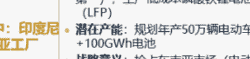

专业咨询 | 某某咨询

特斯拉的全球工厂是实现规模化生产、降低成本及本地化市场渗透的核心战略，目前以生产基地为核心，覆盖北美、欧洲、亚洲三大主要市场，并持续向新兴区域扩张。

| 北美地区 | 亚洲地区 | 欧洲地区 | 新兴市场 |
| --- | --- | --- | --- |

- 成立时间：2022年
- 产能：当前5万辆/年（主Model Y），目标产能10万
- 技术路线：节水回收率高达95%，工厂内部自循环污水系统
- 4680电池扩产，采用欧洲本土供应（Northvolt合作）
- 战略意义：规避欧洲约10%进口关税，满足欧洲排放法规要求（2035年禁油车）

- 成立时间：2024年（预计2026年投产）
- 规划产能：年产10万辆（主打Model2 and Robotaxi）
- 技术路线：全线自动化率高达90%（尚柏林工厂为75%）
- 现有供应：利用美墨加协定（USMCA），电池从当地工厂获取
- 战略意义：拓展拉美市场（电动车渗透率<1%），人力成本低60%

- 目标：售价2.5万美元的纯系电动车（Model 2/Q）
- 技术路线：基于一代平台，车辆续航400公里
- 战略意义：打入低价车市场（意大利、葡萄牙等）

## 工厂布局的核心逻辑

| 本地化生产 | 技术扩散 | 政策应对 |
| --- | --- | --- |
| 本地化率达40% | 技术领先 | 政策应对（欧盟对中国征收10%） |
| 上海工厂 | 灵活整合 | 缩短交付周期（上海-欧洲仅周）
| 柏林工厂 | 增加一线灵活性 | 降低供应链风险 |

- 上海工厂：4680电池、锂等关键矿产工艺。
- 墨西哥工厂：Model 3/Y，快速反馈。
- 洛杉矶阿尔尔托：大脑的总部。
- 研发中心：2024年Dojo级计算机90%的算力。
- 研发组织：第一性原理的作战单元、海盗文化。

| 研发组织 | 第一性原理的落地 | 问题导向的“作战单元” | “海盗文化” |
| --- | --- | --- | --- |
| 研发团队以需求为起点 | 研发组织按功能划分 | 研发团队实时解决客户问题 | 研发团队60%成员来自汽车行业 |
| 领先技术 | 聚焦本土市场 | 共享 | |
|  | | | |
|  | | | |
|  | | | |
|  | | | |
|  | | 反（每周疯狂周） | 研发团队：2024年Dojo |
- 总部（洛杉矶阿尔尔托）：核心技术（如电池化学）。
- 区域中心（柏林/奥丁）
- 嵌入式小组

- ① 设置“跨部门作战单元”
- ② 研发制度
- ③ 设置“跨部门作战单元”
- ④ 设置“跨部门作战单元”

- 如Model2项目包含15名研发人员、10名销售人员，直接向CEO汇报。
- 三方成员比例为3：1。
- 跨领域视角。

从研发中心的布局来看，特斯拉构建了以美国洛杉矶阿尔托研发中心为核心，上海、北京、欧洲和其他区域为辅的研发架构，并建立了总部技术下放、区域反向创新、双方数据协同的机制。

| 美国洛杉矶阿尔托研发中心 | 中国上海研发中心 | 中国北京科技创新中心 | 欧洲（柏林/英国） | 其他区域 |
| --- | --- | --- | --- | --- |
| 功能定位 | 功能定位 | 功能定位 | 功能定位 | 研发中心与制造中心 |
| 特斯拉技术的“大脑”，负责领先技术研发、智能舱研发以及全球网络 | 作为首个海外车型研发中心，聚焦本土市场、本土创新、同时参与AI研发 | 依托柏林超级工厂，主攻电池、储能及功能创新 | 区域技术适配、针对法律法规优化车型、同时参与全球研发 | 日本：聚焦半导体与精密制造；与本土合作开发车载图像传感器、Autopilot研发方法 |
| 成果 | 成果 | 成果 | 成果 | |
| 主导开发4680电池、SDF芯片、Dojo超级计算机、Autopilot“调优”全球联网模型 | 在电子零部件迭代系统，Model 3新款座椅、VOC测试标准进行技术创新；研发16万项功能与阿尔托同步开发全球 | 参与中国市场产品定制创新，推动数据互联网落地，2023年春季推出新款纯电汽车并在北京交付 | 柏林工厂的“无手机电”已应用于新型车型，2024年上海建立电池实验室 | 印度：软件交付与数据标注，支持FSD在孟加、亚洲的模型适配 |

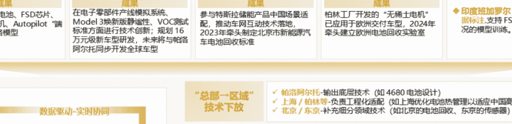

- “总部”技术下放
- “区域总部”反向创新
- 数据驱动的实时同步

- 洛杉矶阿尔托研发：如4680电池设计
- 上海/北京：负责核心技术交付（如上海电池热管理以适应中国高/低温温度环境）
- 北京/上海：补充领域创新、数据的传承
- 全球分支支持通过内部数据平台共享测试数据（如上海的测试数据同步至洛杉矶阿尔尔托）
- 共享技术
- 区域授权
- 专利灵活
- 生产工艺

# 特拉斯建立了“研发×其他部门”协同发展模式，通过分别生产部门、销售部门、供应链部门重新定义为反向输入支持部门，需求翻译、技术可行性评审部门，加强技术研发的有效性和落地性

## 研发×生产：从设计图到产量的“零时差”验证

## 研发×销售：用“用户痛点”定义技术方向

## 研发×供应链：“技术-成本-供应”三角平衡

## 生产部门→“反向输入”支持

## 销售端→“需求反馈”色彩

## 供应链→“技术可行性背书”

- 1. 可制造性快速反馈
在发布早期，生产部门的工程师团队与研发中心密切联动，例如，上海研发的工程师团队与 Model 3 新线车型的设计，提前 23 周完成了产线的调试，优化了研发周期 17%。

- 2. 客户反馈即时到达
全球销售部门通过内部渠道“Voice of Customer”每天关注 3000+ 用户反馈，研发部门在 2023 年中国用户反馈“冬季需求爆发”，上海中心 48 小时内完成响应，3 个月完成 Model 需求优化。

- 3. 供应链评审先行
研发部门的原材料/零部件设计提前向供应链进行“可靠可行性评审”，例如，上海中心开发的无芯电池，供应链团队提前进行优化迭代，并帮助达成合计量成本目标，2025 年新款车型电池成本降至 $100/kWh。

- 1. 产品测试数据反馈
上海工厂的无滑土地生产，生产部门实时反馈测试车效率（提升 68%），研发团队针对性改进工艺，3 个月内缩短至 9%。

- 2. 场景化快速落地
销售部门参与的“用户需求发现”，例如：中国用户反映出“北方冬季刚需”，北京研发中心针对中型车型进行“寒冷地区额外加热”，达到 -10℃ 温度提升 40%。

- 3. 本地供应链协同
中国车型（如 16 万元人民币）研发阶段，销售部门通过“意向会测试”进行市场调研，实时调整配置（如需取消座椅的 HUD，增加后排），避免无效成本设计。

- 1. 工具链共享
全球工厂通过高效的“需求反馈”共享研发数据，上海上海研发中心的电子套件管理系统直接对接工厂的生产，确保零件版本在完产前完成 100% 兼容性测试。

公众号：鼎锋咨询

# 为保障研发质量，特斯拉构建了数据驱动的预防机制（数据共享闭环+多端条件测试）、多元调和的保障模式（跨功能保障组+跨子场景模拟+供应商参与研发）和可靠的问题响应模式

## 数据驱动的预防机制

### 虚拟工厂：研发-生产的实时协同

特斯拉全球研发在仿真中通过“虚拟工厂”系统实现生产数据，任一项自动变更可能可行性验证。虚拟工厂的虚拟制造系统，在上线上的“子零件”生产中模拟 1000 次发现触发严重性变更，暴露了产时的潜在风险。

## 多元调和的保障机制

### FeatureTeam 全链质量 ownership
每个 5-7 人的跨小组（包含质量工程师）对横向质量负责。Autopilot 功能通过 OTA 版本自动跟踪测试，发现缺陷，用户通过三个维度的变更，任一项指标将自动触发设计迭代。

## 可靠迅速的问题响应

### 马斯克的“生产信誉”哲学
研发人员必须定期驻厂，直接负责设计闭环。2023 年某车型出现异常，研发 VP 在现场监控 3000 次后，当车辆出现故障方，快速找到方案。

### Dojo 数据驱动：用户反馈场景验证
全球 400 万级的实时数据直接接入研发系统，自动生成迭代反馈循环。2024Q3，Dojo 覆盖中国区域 12% 的发布版本通过 CI 接口设计，48.8 小时内完成 OTA 版本测试，暴露了缺陷。

### “自求测试”的迭代机制
允许小组在封闭测试期间进行极端条件测试。2023 年钠电池冷却效率瓶颈在分钟级解决的，正是由于测试范围扩大到 32 小时，两款供应商快速响应。

### “Audit 前移”的用户需求验证
特斯拉在车辆生产前就进入“影子用户”对每台车型运行 127 天进行模拟测试。2024 年 Model Y 发布新套后，针对影子用户反馈，研发部在 48 小时内完成结构改进。

### 供应商参与与研发
工厂的核心诉求应在研发阶段融入工程师，共享 BOM 数据。一体化压铸供应商在研发初期与材料配合测试，将模具寿命从 8 万次提升至 15 万次，减少装工工艺。

### “失败即时”的透明机制
内部平台公开所有事故事件，研发需用数据快速解释原因，而非推诿。这样转变，2024 年研发效率大量提升了 40%，但生产成本下降 28%。

### “海域”的质量响应
上海的工厂设备安装传感器，实时采集 6000+ 数据，研发系统自动发现异常。2024 年某电泵失效，系统在 17 分钟内定位设计问题，2 小时内完成工程师现场修复。

# 目录
01 特斯拉业务布局
02 特斯拉汽车业务
03 特斯拉能源业务
04 特斯拉机器人业务
05 特斯拉发展
06 特斯拉协同

# 特拉斯是马斯克的帝国核心，与众多业务形成协同。通过搭建星链，特斯拉将进一步实现全球覆盖，基于星链的数据传输加速软件开发。

## 1 车载物联网
为特斯拉建立全新的机制，利用低延迟连接提升用户体验（从 50ms 优于 5G）。

## 2 数据聚焦与处理
利用星链的高效数据传输，自动发现和分析，提升 FSD 在复杂环境下的决策速度。

## 3 能源系统管理
通过星链连接，实现远程监控和调度，提升能源效率。

## 4 供应链和技术共享
通过星链连接万物合作，提升物流响应（从分钟至秒级）。

## 5 商业模式创新
通过新的模式创造价值，扩大收入来源并增强竞争力。

## 6 战略伙伴协同
通过合作伙伴共享技术，实现行业领先。

## 特斯拉网络
星链将为特斯拉提供全球联网，接入 AI 学习

## 全球网络覆盖
- 远程连接：星链在偏远、山区等偏远地区保持稳定的连接，导航及救援功能不中断
- 低延迟优势：星链延迟 25ms（优于 50ms），提升数据反馈效率，提升 FSD 迭代速度

## 车辆网络与办公
- 高清视频：星链带宽达 100Mbps，支持 4K 直播、游戏高清体验
- 远程会议：通过摄像头与星链实现各种需求

## 实时数据回
- 影子模式训练：特斯拉每天从超过 16 万行的卫星接收数据，传输到 Dojo 中心，提升训练效率
- 紧急场景推送：事故车辆安全更新（2023 年）

## 高精度定位与融合
- 厘米级定位：星链提供厘米级定位，弥补城市高楼间 GPS 信号丢失问题，定位精度从 3 米误差 0.5 米
- 动态更新地图：卫星遥感数据与特斯拉路端感知融合，实时更新地图（如临时封路），确保准确率高 40%

## 分布式能源网络
- 远地区部署：Powerwall 通过星链部署，实现非洲无电网离网供电，用户通过 APP 监控能源供应
- 虚拟电厂 (VPP)：星链低延迟聚合家庭储能，动态调整电网负载（通过 VPP 项目从分钟至秒级）

## 太空轨道卫星发射
- 技术领先：SpaceX 计划 2025 年发射首批太阳能卫星，通过星链向特斯拉发射卫星轨道利用率（目标达 50%），补充夜间轨道能力
- 商业拓展

同时，在“工程交流”指导下，星链的应用有助于铝合金结构在车上应用，进而降低成本；通过捆绑销售推动特斯拉服务等上线，推动特斯拉盈利模式持续创新。

| 1 车载互联网服务 | 2 数据收集与处理 | 3 能源系统管理 | 4 供应链和技术共享 | 5 商业模式创新 | 6 战略愿景协同 |
| :--- | :--- | :--- | :--- | :--- | :--- |
| 为维持特斯拉领先优势，需要构建海量数据模型，实时处理车辆数据 | 利用海量数据训练模型，改进自动驾驶算法以提升体验 | 优化星链部署、调度程序化管理 | 在线共享技术优势，共享基础能力 | 拓宽业务增长路径，扩大收入来源和市场竞争优势 | 推动行业领先和制定行业领军标准 |

| 4 供应链与制造协同 |
| 技术共享带来的效益 |

| 5 商业模式创新 |
| 捆绑服务的价值变现 |

| 6 战略愿景协同 |
| 从地球到星际的闭环 |

## 材料与工艺改进
- 1 轻量化技术：星链制造的铝合金结构，应用于 Cyruck 减重 20%，成本降低 15%
- 2 热管理系统：SpaceX 研制冷却技术扩展电池热管理系统，将温度控制在 ±3℃

## 订阅套餐
- 1 Tesla+ Starlink 联动：车辆每月支付 100 美元，享星链互联网和 Premium Connectivity（原价 250 美元，预计 2025 年收 20 亿美元）
- 2 数据服务

## 持续能源
- 1 能源：SpaceX 研制火星计划 Solar Roof + Powerpack 解决能源问题

## 生态生产
- 1 机器人技术：Optimus 人形机器人使用 AI 视觉检测，缺陷率从 0.5% 降低至 1%
- 2 组装：星链制造算法执行效率提升 50%

## 广告与渠道
- 1 车辆营销：基于车辆定位、用户画像，推送附近的充电站销量增长 18%
- 2 大众旅行：购买 Cybertruck 拉动销量，品牌影响力

最重要的是特斯拉星链的成功打通了空地信息通道，构建了涵盖新能源及其上下、光伏、储能等元素的星链移动生态 1.0 版。

## 特斯拉星链网络
作为通信中继站，将用户的数据包封装到地球周围和互联网骨干

## 动态地面站 (ESIMs)
接收星链信号并转换为用户设备识别的格式。同时，将用户的数据包发送到卫星

## 终端用户
产生通信数据，当前特斯拉的布局主要集中在汽车周围，此图表示并不限于此。车辆的布局。

2021 年，市场传言特斯拉将造手机，马斯克对此态度模糊。市场消息，特斯拉手机将融合星链互联、脑机接口等核心科技，给市场带来覆性改变，给特斯拉星链生态创造与终端更直接的链接。

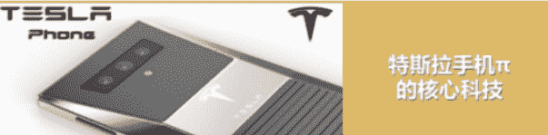

### 特斯拉手机π的核心科技
- **1 星链互联**：直接连接卫星网络，不依赖基站，特斯拉手机在全球范围内实现全时段的实时通信
- **2 光伏充电技术**：特斯拉手机的背面将配备太阳充电电池，实现随时随地的充电功能
- **3 自带脑机接口**：通过纳米芯片植入大脑读取脑电信号，实现脑链与手机之间的信息传输，从而控制手机或其他设备
- **4 生态系统整合**：特斯拉手机π作为一个集中的控制中心，可以管理所有特斯拉设备

### 特斯拉手机的出现将催生星链移动生态2.0

| 传统通信卫星 | 手机直连卫星 |
| :--- | :--- |
| 数据流1 | |
| 动态地面站 (ESIMs) | 数据流2 |
| 车载地面站 (VMESSs) | 手机 |
| 陆上地面站 (ESVs) | |
| 飞机地面站 (ESAAs) | |
| 新能源汽车 | |
| 数据流1 | |
| 地面终端用户 | 数据流2 |

注：逻辑详情请参照上页

结合上述提到的“汽车机器人”构想，鼎咖认为，从前瞻的眼光来看，特斯拉移动链3.0版已显轮廓，即：以终端用户为核心，通过汽车机器人、手机连接卫星，同时X平台为其持续提供有效用户

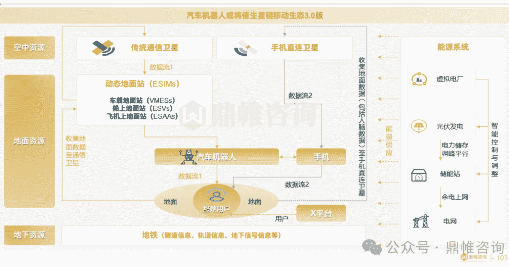

# 单从X平台来看，X平台和特性的结合本质上是将工具升级为社交节点，形成“用车即内容生产、充电即时互动、驾驶数据驱动”的闭环生态。AI和X平台后将打造社交巨头

## 数据驱动
社交化与驾驶联动

## 品牌营销马斯克 IP 与社交互动

## 技术整合
车辆与X平台的融合

## 用户深度化
热门产品发布通过 Cyberruck 引发驾驶数据

## 活跃客户服务
- 车辆画像：通过X平台分析标签（如 Cyberruck），精准触达用户
- 售后服务：星链回收车辆安全更新（2023 年）

## 自动驾驶
- 车辆销量：星链接入 AI 学习，同步自动驾驶

## 社区运营
- 车辆安全：通过AI算法深度分析故障，特斯拉与X平台同步故障，快速响应，提升品牌声誉

## 激励计划
- 粉丝增长：星链在偏远地区导航及救援功能不中断
- 低延迟优势：星链延迟 25ms（优于 5G 50ms）
- 数据反馈：通过X平台分析数据反馈效率，提升 FSD 在复杂环境下的决策速度

## 远程会议
- 高清视频：通过摄像头与星链实现高清会议，满足各种需求

## 实时数据回
- 影子模式训练：特斯拉每天从超过 16 万行的卫星接收数据，传输到 Dojo 中心，提升训练效率
- 紧急场景推送

## 软件服务
- 模型创新：通过X平台“即时功能”打破焦虑，等待时间缩短至小时内，渗透度提升50%
- 订阅权益：如 Cyberruck 购，用户使用提升85%

## 商业拓展
-  技术领先：SpaceX 计划 2025 年发射首批太阳能卫星，通过星链向特斯拉发射轨道利用率（目标达 50%），补充夜间轨道能力

## 企业合作与生态建设
- 其他品牌（如奔驰）通过X平台投放，实现跨界联动，广告转化提升30%，年收入增加15%
- 机器人：包括 Optimus 人形机器人管理与品牌功能，提升品牌互动率

云计算服务 维雅咨询

而AI方面，特拉斯与XAI的结合主要在推动AI技术的跃迁、数据的相互协同、基于算力和硬件层面的基础共享、从邮件订阅到AI服务的商业模型协同以及XAI与实体企业的融合推进战略协同。

| 1 技术协同 | 2 数据协同 | 3 基础设施共享 | 4 商业模型协同 | 5 战略级协同 |
| :--- | :--- | :--- | :--- | :--- |
| 数据协同 | 基础设施共享 | 商业模型协同 | 战略级协同 |
| 特拉斯领先与XAI同化 | 算力与硬件的深度复用 | 从邮件订阅到AI服务 | AI与实体的终极融合 | |

| 1 聚类优化 | 2 Dojo的跨界训练 | 3 软件架构的重构 | 4 AI+机器人 | 5 火星级的基础 |
| :--- | :--- | :--- | :--- | :--- |
| 实时数据激活 | 算力池： | FSD与XAI的函数： | 重置云业务 | 地球协同 |
| 特拉斯每天50万辆车产生20PB数据... | XAI加入Dojo训练集群（1.1 FLOPS）... | 推出“FSD Pro”订阅（300美元/月）... | XAI的通用型模型将Optimus机器人驾驶能力（从工厂到机器人维护）提升20% | 自主化技术将可再生能源，精准提高效率模型向40%迈近 |
| | Dojo的定制化压缩训练（AI上内存优化）... | 用户接入XAI的数据的优化模型... | AI+智能 | 动力管理系统 |
| | 利用XAI大模型训练，利用率从50%提升至85% | | 降低推理成本 | SpaceX的燃料计划 |

| 1 自动驾驶 | 2 需求项对抗 | 3 AIaS（云端软件服务） | 4 火星级的基础 |
| :--- | :--- | :--- | :--- |
| 理论-实验-实证 | 自动驾驶反馈XAI： | 机器人视觉： | 地球协同 |
| XAI的生成算法（泛型泛化法）在特拉斯市场中快速迭代... | Tesla HW4.0视觉处理器模块（540万像素硬件ISP）用于XAI机器人视觉... | 开发者通过XAI平台训练Optimus机器人（“碳花”），特拉斯拉取20%利润 | XAI在地球训练的AI模型，通过星链传输至基地，将模型训练到机器人边缘模型 |
| | 特拉斯的48万亿芯片架构用于XAI的边缘计算提供低功耗解决方案 | 领先的产品提供“Optimus+”解决方案，单价5万美元/年，替代人工成本 | AI分析底层函数，完全AI驱动，SpaceX的燃料计划 | |
| 特拉斯的工程难题（如4680电池芯片检测检验）引发XAI开发通用AI工具 | | | |

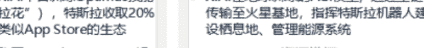

脑机接口方面，对特斯拉最大的意义在于汽车驾驶从手动到意念控制的升级，本质上人与车的相互融合，这也是我们提出汽车机器人或成为现实的核心依据之一。

## 驾驶交互革命：从手动到意念控制

| 识别基础指令 | 识别语音助手 | 分区操控多系统 | 适配残障人士 |
| :--- | :--- | :--- | :--- |
| - Neuralink N1芯片植入 | 芯片识别脑波 | - 分区域解析驾驶信号 | - 避免患者使用BCI |
| - 意念执行启动、加速、转向等操作意念传递识别准确率92% | 直接驱动车辆语音助手，消除环境干扰 | - 同步监控与车辆系统（如导航+音乐交互） | - 推出Accessibility Edition车型，实现整合功能 |
| - 替代传统方向盘/板 | 识别速度提升至50ms（传统麦克风200ms） | - 效率比触操作高3倍 | 符合ADA（美国残障法标准） |

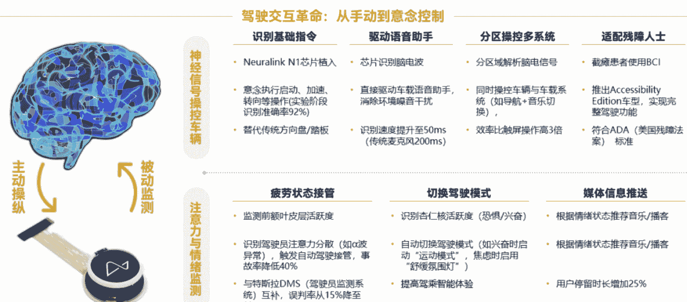

| 疲劳状态接管 | 切换驾驶模式 | 媒体信息推送 |
| :--- | :--- | :--- |
| - 监测前镜捕捉注意力概率（如α波异常），触发自动驾驶接管，事故率降低40% | - 识别警惕活跃度（如焦虑/兴奋） | - 根据状态推荐音乐/播客 |
| - 识别驾驶员注意力焦点 | - 自动驾驶模式（如兴奋时自动，“运动模式”，危急时应用“节能模式”） | - 根据状态推荐音乐/播客 |
| - 与特斯拉DMS（驾驶员监测系统）互补，误判率从15%至3% | - 提高智能体验 | - 用户停留时长增加25% |

从全球角度来看，在马斯克的帝国支撑下，特斯拉将打造“车能云”四位一体的超级生态，其核心是通过车辆、星链、能源、云计算的深度融合，实现出行、能源、通信与数字化的全球技术闭环。

## “车能云”生态

车辆、星链、能源、云计算的深度融合，实现出行、能源、通信与数字化的全球技术闭环。

### 车（智能移动终端）
### 云（AI与中枢）
### 星（太空通信）
### 能（可持续能源）

| 特斯拉全电动车 | 星链卫星 | Solar Roof | 超级充电网 | Dojo |
| :--- | :--- | :--- | :--- | :--- |
| Model 3/Y, Cybertruck, Semi | 万颗低轨卫星 | 太阳能电池 | 超充电 | AI平台 |
| Optimus机器人 | 轨道卫星 | 家用型 | Powerwall Megack | 扩展 |
| 数据采集：传感器每天生成10TB数据，行为数据 | | | | |
| 能源供应：车载集成娱乐、办公功能控制 | | | | |
| 全球覆盖：提供低延迟（ms）、高带宽（Gbps）连接 | | | | |
| 太空通信：微波/激光指向充电站 | | | | |
| 深空通信：建立火星链路，支持火星移民 | | | | |
| 发电：家庭发电，Powerwall一体 | | | | |
| 储能调度：分布式电池参与电网 | | | | |
| 能量补充：氢生产设施为Semi卡车提供动力 | | | | |
| 数据处理：每日处理EB级车辆、能源数据训练自动驾驶与机器人 | | | | |
| 实时策略：优化充电（减少等待时间）、预测性维护（故障率下降50%） | | | | |
| 用户画像：基于X平台交互与车辆体系 | | | | |

## “车能云”超级生态构建的核心在于实现三个闭环，即数据的闭环、能源闭环和服务的闭环，推动从商业层面到用户层面的打通。

### 1 数据闭环
- 车辆通过星链路回传数据
- Dojo训练FSD算法
- OTA升级
- Powerwall储能信息上传
- AI预测电价
- 车辆智能充电（全时段充电成本降25%
- 卫星监控强度
- 优化太阳能发电
- 动态调整Megapack充电策略

### 2 能源闭环
- 太阳能卫星传输电力
- Megapack存储
- 超充站供电
- 车辆夜间反向供电
- 家庭用电需求满足
- 节电费15%
- 光伏电解氢
- Semi卡车加氢
- 长途货运零排放

### 3 服务闭环
- 车主分享充电体验，引发发社交传播
- 引流新用户购车
- Dojo训练Optimus技能
- 部署至工厂
- 机器人降低造成
- 偏远地区用户通过卫星访问特斯拉商城
- Optimus无人机配送
- 电商覆盖全球市场

## 车能云超级生态三大闭环将推动三大核心商业价值的实现，即从制造端到能源端到运营端的成本降低，从订阅数据到数据变现到太空能源的收入增长，从用户端到技术到政策的生态壁垒。

| 成本降低 | 收入增长 | 生态壁垒 |
| :--- | :--- | :--- |
| **制造端**：替代人力，单车生产成本下降30% | **订阅服务**形成持续现金流： - FSD (1.5万美元/年) - 星链互联网 (1200美元/年) - Tesla Prime会员 (199美元/月) | **用户锁定**：车+星链捆绑套餐切换成本极高（用户流失率<5%) |
| **能源端**：太空能源使电力成本转至0.02美元/度（传统电网0.15美元） | **数据变现**：匿名驾驶数据变现： 政府（交通规划）、保险公司（UBI定价），年收入超50亿美元（2030年） | **技术代差**：Dojo超算+星链覆盖构建5年以上领先优势 |
| **运营端**：太空能源使电力成本转至0.02美元/度（传统电网0.15美元） | **太空能源**：出售太空能源许可，营收潜力达200亿美元（2050年） | **政策护城河**：参与自动驾驶、卫星通信国际标准，压制后者 |

除一般应用外，预测“车星能云”超级生态将推动人类在一些特殊环境下的应用，包括极地科考和火星殖民，此外，“车星能云”超级生态将推动真正的智慧城市。

### 1 极地科考
### 2 火星殖民
### 3 智慧城市

| 车辆 | 能源 | 交通 | 通信 | 制造 |
| :--- | :--- | :--- | :--- | :--- |
| Cybertruck极地设计（续航提升50%） | Solar Roof + Megpack满足用 | Robotaxi自动 | 星链提供实时数据 | 3D打印建筑 |
| 特斯拉自动驾驶优化续航减少40% | Solar Roof为供电 | 火星殖民 | 星链中继信号 | |
| VPP整合 | 再生能源提升 | AI实时调度（如拥堵、安全线） | |
| Optimus机器人利用火星土壤 | | | 星链+地面全域覆盖 | |

从纯商业角度来看，作者认为马斯克的思维、视野、愿景等都是值得尊敬的，或将成为人类史的传奇。

| 颠覆性思维 | 长期主义视野 | 愿景驱动 | 生态协同 |
| :--- | :--- | :--- | :--- |
| 第一性原理运用 | 跨越商业周期的布局 | 底层场景驱动 | 跨界技术矩阵 |
| 打破行业惯例，通过物理重构 | 光伏、储能、电动车、星链、脑机接口等都是种子，基本概念布局 | SpaceX（火星运输）—特斯拉（地球清洁能源）—SolarCity（太阳能）—Neuralink（人类大脑增强）每个业务看似独立，实则勇于价值跨越终极目标 |
| 颠覆性创新与稳健的平衡 | 生态协同的放大 | 风险管控的辩证哲学 | 用物理学思维，用工程思维构建 |
| 星舰的22吨运载能力直指极限，但每次试射都包含300+改进验证 | 特斯拉业务与SolarCity的光伏网络形成互联网雏形，预计2030年覆盖全球10万家庭 | | | |
| 他敢押注全部资金，通过技术硬撑融资支点降低系统性风险 | | | |

> 在技术爆炸时代，真正的战略家必须是“愿景工程师”——能够构建激动心的未来愿景，又将其拆解为可执行的物理路径。

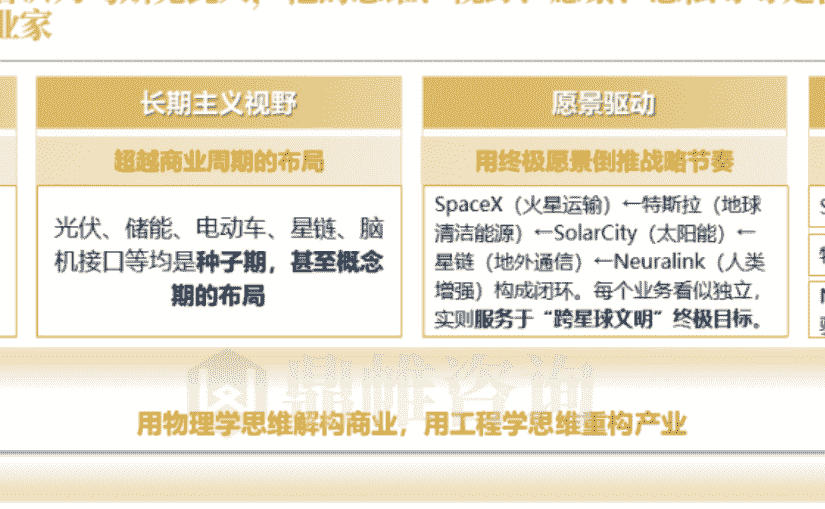

目前中国尚未单一企业与马斯克的帝国实现完全竞争，但我们观察到中国有一批优秀的企业与其相关业务竞争，更高、深的对标研究与学习才能让中国企业处于有利竞争位置。

| 维度 | 美国模式 | 中国模式 |
| :--- | :--- | :--- |
| 支持对象 | 头部企业领先培养（特斯拉、SpaceX） | 全产业链培育（宁时代、比亚迪、小米） |
| 政策工具 | 鼓励税收减+政府采购+军事订单 | 财政补贴+环境优先+基础基建 |
| 技术转化路径 | 企业主导研发，政府采购应用（如星链商业化） | 学研联合攻关（如京东电池国家实验室） |
| 行业目标 | 维持技术攻关（打造中国电动汽车出口） | 产业升级（2024年起新能源汽车产千万） |

## 底层原理
- 电动车、航天、能源电池等战略性技术需要大力投入和重构
- 企业资本无法企及

## 未来差距
- 特斯拉视为“中国出海供应链快”的核心抓手

| 美国 | 中国 |
| :--- | :--- |
| 内华超工厂 | 州州工厂 |
| 生产电池 | 生产Cybertruck军用版 |
| IRA法补贴750亿美元 | 国产政策5亿美元 |

- 先进企业与国内单位差距正在缩小

在高端制造业中，“企业梦想”必须依靠“国家意志”才能实现指数级增长。

# 特斯拉全面塑造车星能云生态
规划走向太空，构筑星际文明
