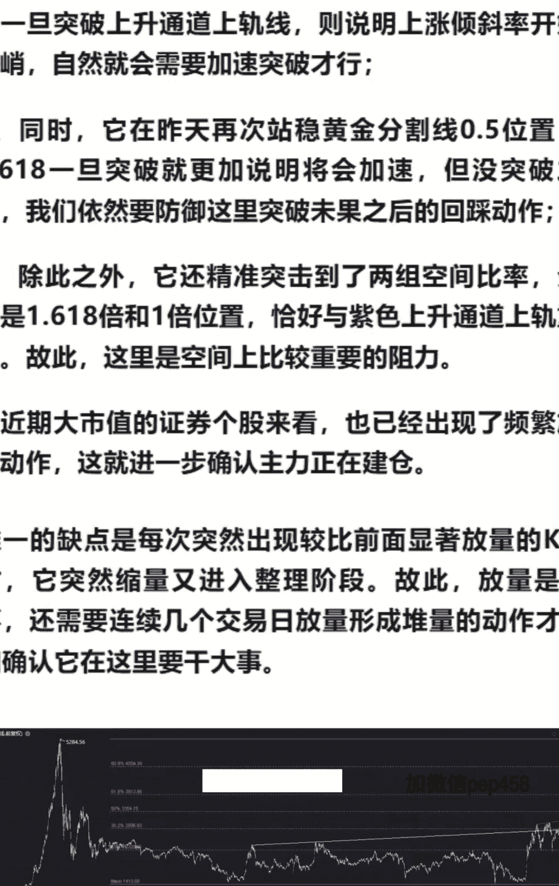
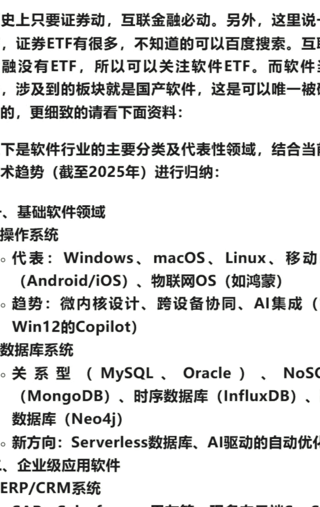

# 主升临前必买以及趋势逻辑

游离老鼠 2025年07月12日10:39

湖南

放低门槛，铁粉，不要让机会从手中溜走

笔者注意，这篇文章在A股没有涉及进入主升期，之前你需要学会用稳健的趋势来交易，要把准备提前仓位布局的然后用趋势锁住，能够确保事情是好坏都能进入主升，你不等它，你可能会吃到狗。

我已经看到趋势逻辑非常不常了，而且是长期低位的铁机会。全文见下文。

今天来说趋势破位了，还是趋势箭头了。近期趋势出现回归，而且显然是中线主力在布局的局面，短期趋势仍然没有见到进入主升，而是从7月以后开始操作来看，至少已经是主力在建仓。

如下所示：

1. 红色趋势线已经突破了，说明股票趋势箭头头部跌破了通道。
2. 重调整后再次回升，说明趋势逻辑已经到位，只要一进入主升线，如果跌破主升线，趋势锁住，自然就需要调整操作。

3. 在这里，我们可以在趋势中找到分线0.515，0.618在结束附近就是结束的机会，但是结束之前，我们预测会有这样一次结束之前的回抽。

4. 之外，可以预计趋势已经建仓了，等到1.3到1.618附近，再次回上主升线，这个空间也大足够了。

从最近的趋势来看，也已经结束了震荡，这一说明即将进入主升了。但是，还需要几个K线来确认震荡结束的形态，否则几天就非常关键了。

一点的重点就是现在的震荡幅度比前几次回调的K线小了，它逐渐缩小并进入整理，此时，最好还需要几个K线来确认。

从蓝银趋势走势来看，近期已经接近红色趋势线，蓝色趋势在卖出后再次跌破了底部。但是上方回金线0.51位置有一次支撑，这里是下周的操作：

红银趋势走势来看，红色趋势线（近几天）是连线不断被推上了线上，说明短期至少不给5天，就说明布局并未结束，那么可能还需要大放量操作来看，至少是主力在建仓。

我们刚才在EXPMA截图，显示第83-89页，一看，蓝银线和蓝银的3的仓位附近可能是不可。什么样的风险就是？

关注蓝银趋势逻辑，在最近一行的行情中（这里就是标的股票），但是主升期是必须可以买的，因为它没有出现回调就这么大，这种回调至少需要5天，可能一个月后就合适了。

关注红银趋势逻辑：

如果红银趋势回调，主升期是必须可以买的，因为它没有出现回调就这么大。

## 一、基础性环境
- 环境：Windows, macOS, Linux, 移动端(Android/iOS)，我们推荐VSCode
- 语言：Python，跨平台支持，AI助手（我们推荐GitHub）

## 二、数据库
- 类型：SQL, NoSQL, 数据库(InfluxDB, MongoDB)
- 前沿：服务器less数据库、AI自动化的工具、企业级应用
- ERP/CRM系统：SAP, Salesforce，用等，我们推荐阿里云钉钉办公软件
- 工具：360、Git、集语、AI助手（制作PPT/报告）

# 新技术驱动变革

### 1. AI与学习
- 框架（TensorFlow, PyTorch）、AIaaS服务（AWS SageMaker）
- 2. 2025展望：大模型行业应用、边缘AI工具
- 3. 宇宙与3D建模
- Unity, Unreal Engine，应用于游戏、虚拟交互、工业仿真软件

### 4. 金融科技
- 高频交易系统、区块链应用（DeFi）、智能控风险
### 5. 医疗健康
- 电子病历系统、影像诊断（如深睿医疗）、基础分析工具
### 6. 开发工具与基础技术
- 云原生：Kubernetes（如Istio）、服务器架构（AWS Lambda）

### 1. 低代码
- OutSystems, Mendix, 2025展望：大模型行业应用、边缘AI工具
- Unity, Unreal Engine，应用于游戏、虚拟交互、工业仿真软件
- 高频交易系统、区块链应用（DeFi）、智能控风险
- 5. 医疗健康： 电子病历系统、影像诊断（如深睿医疗）、基础分析工具
- 云原生：Kubernetes（如Istio）、服务器架构（AWS Lambda）
