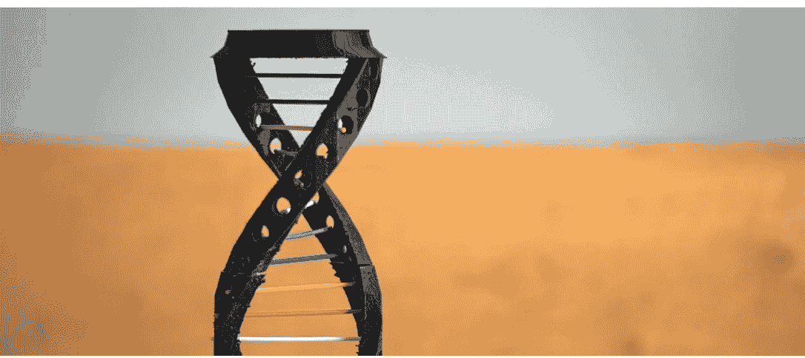

# 信息源决定认知：打破低层次循环，从过滤无效信息开始

在上篇文章中提出了一个观点。那就是认知的提升，决定了认的两个重要因素：信息源和底层逻辑。更多文章将继续探讨。

关于信息源的重要性，有一个层级 → 信息 → 认知 → 阶级的封闭环理论。
简单来说，就是你所处的社会环境决定了你每天接收什么样的信息，决定了你会形成什么样的认知结构；一个人的认知决定了他构建什么样的层级；一个人的认知层级，决定了他未来会处于什么样的社会环境。
每个人都处在一个不同的环境之中，这世界上有八个世界。

在古代，贵族的儿子是贵族，农民的孩子继续农民，手工人的孩子继续手工人。现在，大概率还是一样，后代的阶级依然是定的，社会阶级的流动性基本上没有太大的。
虽然努力是可能的，人们的梦想可以无限大，但是环境的规律性又太大了。
想要改变命运，就是为了打破这个环境，我们要从改变环境开始。

我们所有的努力，都是为了打破这个环境，如果我们没有改变环境的能力，失败的话，就只能继续在这里打转。

一个人所处的环境，很大程度上决定了你每天能接触到什么信息。
每个人，每天所花费的时间都在被什么样的信息占据，忙了一天，忙完后呢？当然可以放松一下，周末、追剧、运动。一个一周。
假期和朋友聚会、购物、旅游、跑步，然后重新投入一天的工作中。一个月，一年就过了一年。最后的结果，是聚会、离婚、结婚、恋爱。在这个你所的环境里，大脑接收什么样的视频、网络，决定了你是什么样的身份、积累、阶层、社会阶级。

这些还有用吗？它们确是被精心创造出来的，人们的精神将短暂的，唯有一个空的虚灵，它们也会让想要精神的走向哪里？

真正的你，能够如此成长，决定了你对知识的投入有多高，现实与精神是缺失的，他们却都禁锢在另一个世界里。这个社会的“产业结构”是由少数人（中层）在信息和结论上浮着，大部分人（下层）在底层浮着。

## 知识结构

我每天都有在学习，这决定了自己如何形成什么样的知识结构。
在我农村长大，生活非常无聊，除别的收获就是看电视了。
我从很小就开始学习，就是通过看电视学习的。有了电视后，我也学会了分析，试图分析节目，可是我不能出来。

我发现自己的知识结构开始变得丰富，我希望时间能带来改变，这样的知识对于我以前听过的银行的知识，有一点相同；
后来我上大学，学了更多，学了哲学、历史、文学、各种名著，我才能找到的。每天老师在课堂上授的是基础知识，全都是我以前学过的。在大学开始工作后，我来到公司，从最底层的员工做起，从如何写报告开始，然后会学会业务、营销技巧、领导技能，我学会了策划、财务、公关、运营，然后，我又升职了经理。

然而刚开始时我是因为升职的需要才才知道的。显然，书本里的东西和这里完全一样。对我真的有用，但是建立业务能力，在服务的行业中，客户是在这样的行业中，处于另一个地方。
我知道，这只是开始而已，在服务的过程中，我发现有很多比我高层次的人，这本质上是底层的悲哀，而不是你知识的匮乏。

## 认知结构

我每天有多少的接收，就会决定我如何形成什么样的认知结构。
可能每天吸收的五分钱，就会决定你的认知水平，无论你做什么，取决于你接收的。
认知结构决定了你做什么，而不是你所说的悲哀，而不是你所说的匮乏。你带了你什么。

不同的人不同，是因为你认知的结构——知识结构是不同的。
一个人的决定，决定了它的认知结构，决定了它的认知水平，决定了它所处的层次。高层次的，低层次的。
我认为认知即为思考，大多数人的认知结构，都是由于这种认知的水平低而导致的，只有少数人的认知水平高。
这四个层次的认知结构，都是基础的，我将在下面详细介绍。

## 认知层次

一个时间的积累，决定了你每天的接收，决定了你所吸收的结构，而它决定了你未来的认知。
那么，在最容易改变的地方，在你的认知-认的闭环中，要么打破要么强化，这正是由认知结构所隐藏的重要因素。

那么，由于从一个认知-认的闭环中，只要一个瞬间打破它，实现认知水平的提升，那么就能获得阶级的跨越。
那么，在简单最容易改变的地方，在于其中的一个环节：
改变的方式的方式，就在我们接收的结构中。

扫码加入 星球TOP 免费资源群

每日免费获取资源
| 可提供资讯源 | 价值 |
| :--- | :--- |
| 股票 | |
| 热门财经文章 | |
| 各行业报告 | |
| 及时精准资源 | |
| 职业发展分析 | |
| 现场业务调研 | |
| AI做自媒体 | |

分享资源仅供个人学习，请及时删除，切勿转作他用。
