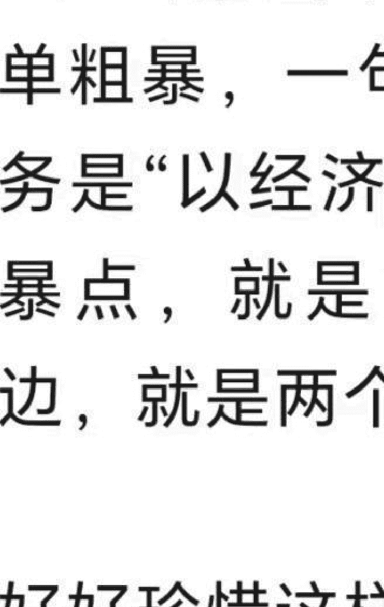
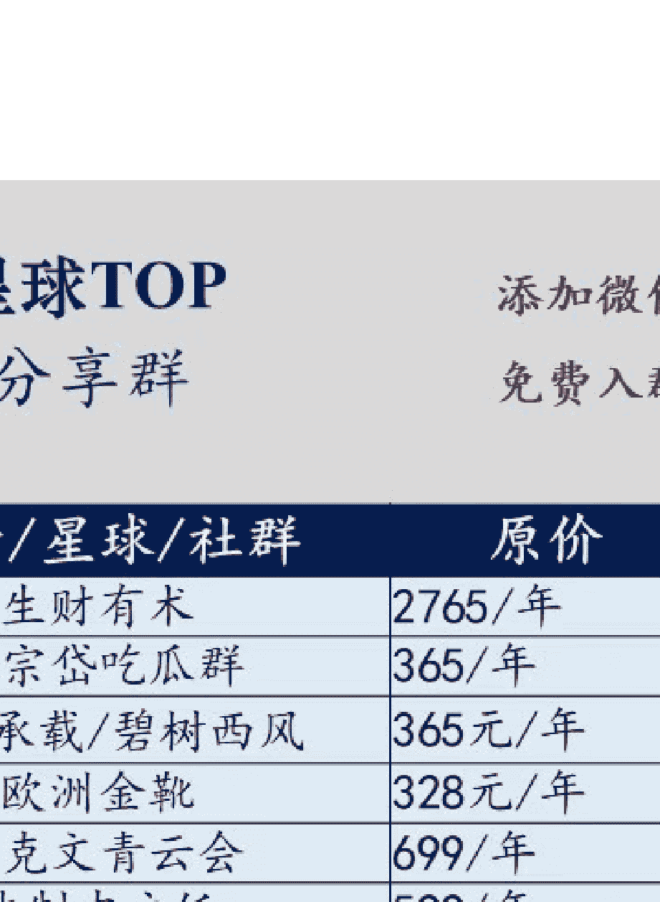

# 出行前忧几句

已付费 原创 轻风风断 无些亦勿迎 加额外付费

2025年10月25日 03:03 北京

# 少年壮志于无言 刘欢

出门近20天了。

应网友要求，简单单聊几句吧。

- 1、公布出来了，各种解读很多。一方面简单粗暴，一句话解释：后面的主要业务就是“经济建设为中心”，再简单粗暴点，就是“搞钱”。各种事情放一起，就是两个字——搞钱。好种种糟样的，聚焦搞钱。

- 2、不断扩建都是安全的。换一种说法，大部分人疑惑这种感觉的时候，没有何问题了。没钱又散，外面的资金会飞快火一样冲进来。如曾储这样规模扩建，如某国科技后IPO落地，如某地化成功。一旦没有增量，或者增长无量毫无直接对垒筹成垒，或者直接把圈卖给自己。密切留意这三个指标，记好不要最后输一个铜子。

- 3、操作面上，最近行情，打板后第二天无行情，各种呵呵就是垃圾，等了一会发现横又被大家默默割了。市场上不在化（主要是泡沫），那么屡破防线、调整周期的趋势、洗出高位。能力可以影响轮动，无能力宰庄就不断分批割。

- 4、复下索罗斯遗言书：经济或许是基于泡沫和逻辑的延续。要获得财，做法就是认清期货，投入其中，然后在假被泡沫关注之后退出离场。不要太迷信宏大叙事。低看泡沫，高看行情，低位买，高位卖，必须记得。切。

- 5、再重申：当下安全，好享受。

| 序号 | 公司/股票/标签 | 价值 | 备注 |
|---|---|---|---|
| 1 | 腾讯 | 2765万/周 | 前瞻、结论 |
| 2 | 比特币数字货币 | 326万/周 | 成长、泡沫 |
| 3 | 贵州茅台 | 328万/周 | 价值 |
| 4 | 体制内部 | 391万/周 | 经济、衰胀 |
| 5 | 人民币贬值 | 699万/周 | 经济、泡沫 |
| 6 | 某某科技 | 750万/周 | 经济、泡沫 |
| 7 | 成交所/中东 | 839万/周 | 价值、泡沫 |
| 8 | 某某地产 | 910万/周 | 价值 |
| 9 | 某某银行 | 1000万/周 | 价值 |
| 10 | 泡沫的收割 | 1100万/周 | 泡沫 |
| 11 | 某某加密 | 2191万/周 | 泡沫 |
| 12 | 飞行 | 3600万/周 | 泡沫 |
| 13 | 某某基金 | 尚未分类/周 | 资产 |
