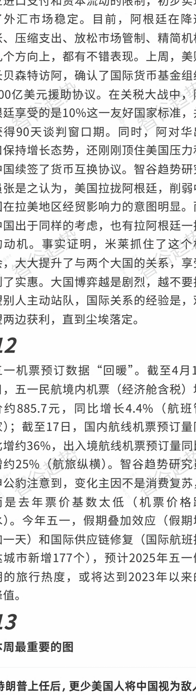

# 智能手机行业深度研究

在全球宏观经济波动的背景下，智能手机市场面临下行压力，消费者换机意愿持续放缓，行业进入存量竞争的激烈阶段。

## 一、

回顾2022年，全球手机市场持续低迷，出货量同比下降约23%。受全球经济增长放缓、通胀高企、利率上升等因素影响，消费者支出意愿下降，换机周期被拉长。

## 二、

2023年，全球手机市场出现回暖迹象，但整体表现依然并不乐观。一季度出货量同比下降12%，二季度缩小至5%，三季度降幅为5%。市场份额格局发生剧烈变化。

其中，苹果市场份额一度升至第一，超越三星，但三星凭借S23系列成功反超。此外，小米份额也大幅回升，市场竞争进一步加剧。

## 三、

由于竞争压力加大，降价促销已成为手机厂商的首要任务。与此同时，国产手机在海外市场表现亮眼，小米、OPPO、vivo等品牌在东南亚、欧洲等市场持续发力。

2022年，中国智能手机出货量同比下降28.8%，仅为1.8亿台。受宏观环境影响，高端市场需求受阻，中低端市场需求持续疲软。

## 四、

此外，折叠屏手机成为新的增长点。华为、vivo、OPPO、小米等在折叠屏领域展开了激烈竞争。

## 五、

2023年上半年，中国手机市场呈现复性增长趋势。一季度出货量同比下降19%，二季度缩小至11%。虽然仍处于低位，但市场需求开始回暖。

苹果在2023年Q1凭借iPhone 14系列夺得市场份额，但随后被三星反超。小米、vivo等品牌表现稳健。

## 六、

2023年，全球手机市场面临严峻挑战。通胀、利率加息、地缘政治冲突等因素导致消费者支出减弱，手机行业面临巨大压力。

预计2023年全年全球手机市场将继续低迷，但2024年有望迎来触底性反弹。

图：2019-2023年全球手机市场份额变化趋势

## 七、中国手机市场展望

2023年中国手机市场出货量预计为1.68亿台，同比下降约5%-10%。国产手机品牌在高端市场将持续发力。

# 免费 价值 及时 专注

# 扫码加入 知识星球TOP 免费资源群

- 每日免费获取价值资源
- 可提供各类资源搜索服务

| 热门付费文章 | 各行行业报告 |
| :--- | :--- |
| 精选图书资源 | 副业挣钱方法 |
| 职场实用资源 | AI经营自媒体 |

公众号：知识星球TOP 微信信号：jntsg8 微信信号：jntsg2

分享资料仅供个人学习，请及时删除，切勿商用传播
