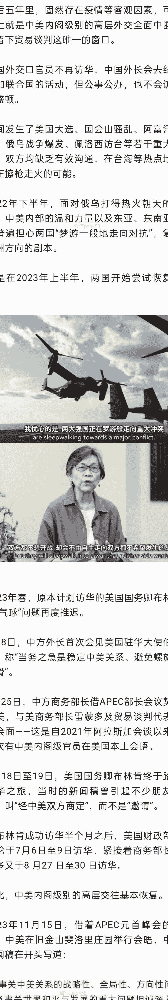
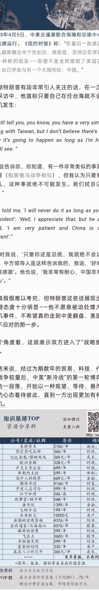

# 信得爱

作者：陈晓 发布时间：2020-03-26 10:15

1997年，在通往好莱坞的漫漫之路上，我遇到了那个让我终生难忘的女孩。她那时候只有18岁，长得那么美丽，却又带着那么忧郁。

我记得我第一次见到她的样子，她穿着一件白裙子，眼神里透着一种让人心碎的气质。

后来，我们走在一起了。那段时光，是我生命中最快乐、最难忘的时光。

然而，生活总是充满了出人意料。那个女孩，最终还是离开了我的生活。

### 一、也许是永别

正如电影里说的，有些爱情注定是错过。

2020年3月23日，我在新闻上看到了那个消息。那个一直牵挂的女孩，去世了。

得知她去世，是因为我偶然看到了新闻。我反复揉了好遍眼睛，才相信这是是真的。

我一直以为，她会一直活下去，直到某一天，她再次出现在我面前。

虽然我已经接受了这个事实，但我还是无法接受她已经离开的事实。

据报道，她是因为患病多年，在2020年3月23日去世的。

我回想起我们在一起的时光，那时候我们是那么年轻，无忧无虑。

### 二、No Substitute for Victory

> “After being so depressed for such a long time, I feel a sense of relief that it's over.”

这是她去世前留下的最后句话。看着这句话，我的泪夺眶而出。

她的一生都在与病魔斗争，而现在，她终于获得了痛苦的解脱。

虽然她感到解脱了，但我却为她的离开感到无比痛苦。

我无法想象，没有她的世界会是怎样。
