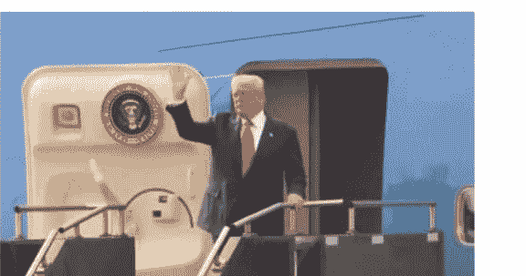
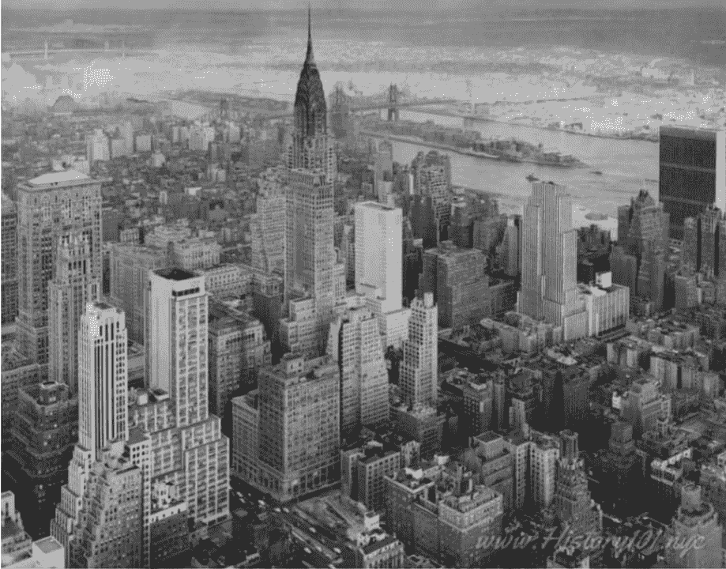
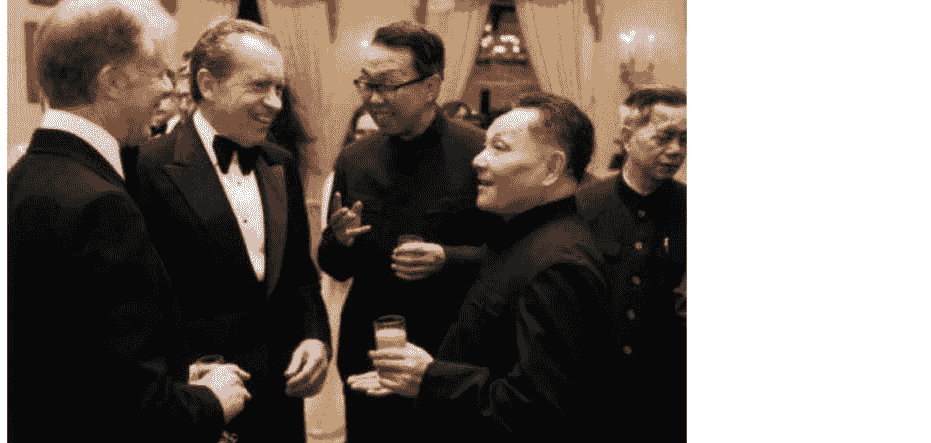
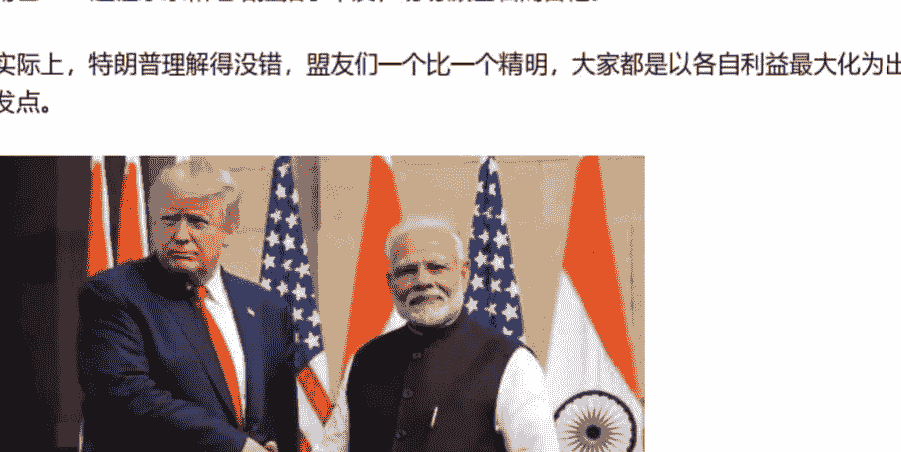
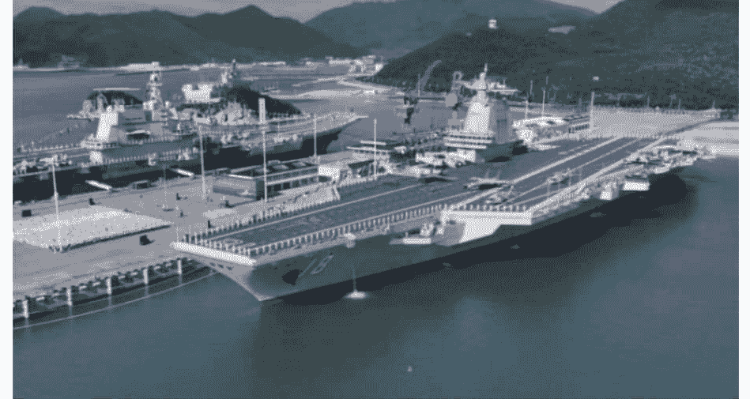

# 釜山峰之后中美交易的思路

中美釜山会议办了三件大事：
1. 关税争端整体延后一年，包括涵盖范港口岸、芬太管制（对应10%关税）和农产品采购等。
2. 出口管制“换一换一”，用中国手封美国高端半导体之外的航空零部件、关键软件，以及暂停扩张力巨大的穿透制裁。
3. 秉持先易后难的原则，将与其他地缘政治问题搁置不说，留到2026年4月特朗普访华期间再详聊，双方各自自洽。

在中方的通稿中，中美关系近期经历曲折，也给双方带来一些启示。双方应该算大，多看合作带来的长远利益，而不陷入相互报复的恶性循环”。

具体具有“启示”呢？

南京大学关系教授刘锦认为：“在特朗普首发贸易和关税战后，中国是中国唯一与美国针锋相对的国家国家。中国最大的利益可能在于，美国今后在对中国实施新措施前会三思而行。”

釜山峰后，中美关系暂时进入一段稳定期，处于“等待还谈判的状态”——2026年双方元首将互动，即4月特朗普访华和12月中特朗普访美美国出席G20峰会。

考虑到明年12月美国大选已经结束，增加了许多变量，因此4月的会面更值得期待一些。

即使太关心国际政治的朋友也能感受到，2025年的中美关系相较2024年已经有了很大不同。

这是因为美政府把中美关系直接套接美国的“冷战框架”下，而在特朗普看来，“药方只用古时方”是不行的，此时不同于以往。

中美竞争比美苏竞争更令美国焦虑，里面有一正一反两个原因。

从正面讲，中国的经济实力远超昔苏联，苏联确实集中力量办大事搞出了几个花样，但绝大多数产品都明显落后于西方，比如汽车、航空、造船、家电、轻工业品等。

今天美国人一般把中国视为“巅峰苏联+巅峰日本”的结合体，即同时在军事、科技、经济等多个领域挑战美国。

除了这一显而易见的“正面原因”外，其实还有一个隐藏的“反面原因”在中美博弈中发挥重要作用。

1945年至1990年美国处于二战后的局势上升，尽管苏联在1950年至1970年代也在上升，但大家“上升对上升”，美国从王朝期的上升周期的角度来看一点也不虚。

冷战期间美国社会始终朝向苏联，那就是就是要打败苏联——苏联被视为一种可能威胁美国人自由生活方式的存在。

而今天的美国有一点自我怀疑、自足成功的感觉，但凡那些1980、1990年代在美国工作生活的朋友（也包括长期的美国人），都会觉得当时的美国在积极向上多。

从政治氛围来说，那个年代美国民主共和两党的政客多为谦谦君，擅长协和与共存，当下这种相互互信、可攻击的风格截然不同。

1979年习近平访问美国时，克林在白宫举办宴会——因“水门事件”被迫辞的美国总统奥尼尔。

习近平与奥尼尔握手，笑着道：“我是第一次见到您，您访问中国时，我还在南郑一家工厂工作过。我很高兴。”

今天我们想象来说，民主党或共和党去邀请一位有争议的、对方阵营的总总统出来境外交流，真的不容易了。

以城市环境来说，对的“街区”、乱的“街区”，冷战期间美国是个体为主的美国，当时的氛围在今天看来简直就是宝贝。

# 简单概览：苏联遇到了“王朝上行的美国”，而中国遇到了“王朝下行的美国”。

王朝时期是比大国竞争更让美国焦虑的事情。

正是因为美国自身出了问题，所以它的目标不仅聚焦在中国身上，而是泛化到所有“关系好的国家”。

冷战期间美国被认为是一个对待仁义的霸权（相对于苏联），向其他西方国家输送大量援助，以至于美国关系富起来了。

换言之，冷战期间美国关系高度聚焦于霸权竞争，美国可以调动一切资源服务于霸权，但今天中美关系受到三个维度的影响。

具体来说：
- 霸权主义（美国霸权被中国抗击）
- 民主主义（美国极化且损害了传统）
- 分配主义（美国遭遇了传统劳工就业）

特朗普视察背景写着“美国工作”，越是受教育不高的人，越容易用直觉反应，越容易被口号和情绪吸引。

在第一个维度权威主义里，特朗普跟民主党是完全一致，他们都要应对中国，仍然世界上最强大的国家。民主党有一种和平基因，不断强调一切很好，至少表现出来如此。2024年9月特朗普在奥斯汀进行演讲时，曾公开美国是“falling nation”（一个衰落的国家）。这种语义属于野党惯用的叙事，但核心圈确实焦虑，认为民主党做得远不如。

当我们试图理解特朗普的行为时，必须从三个维度来看。举例来说，为什么美国在应对中国挑战的同时要争取盟友，这符合事实吗？因为盟友接触到了后两个维度。在特朗普看来，你们不要拿什么“印太战略”“民主主义”来忽悠我，然后继续美国的便宜，掏空我们的产业这条路已经结束“Stop！”

2025年7月22日，特朗普在白宫圆形会议室会见菲律宾总统小马科斯，其间小马科斯要炸南海，结果特朗普打断：“我不介意与中国相处，因为我们与中国很好。为了让菲律宾再次伟大，你可以做任何的事情，你与中国交道不会困扰我。”

特朗普曾打断小马科斯，是因为他根据自己的意为了“盟友应对中国”的借口从美国捞好处、要优待，而他不吃这一套。识别菲律宾，美国“印太战略”最重要的框架——美印四方安全对话受到了关税政策的严重冲击。四方安全对话原定于1月在印度举行，可因受美印贸易进度影响，2025年的日期尚未确定。从中不难体会，特朗普事实上后两个阶段都超过了中美竞争的强度。注意的是，对盟友的转变并不代表弱化中国的竞争，美国希望盟友承担更多与中国竞争的责任。据英国《金融时报》报道，今年7月，美国国防部负责政策的副部长科比（Elbridge Colby）曾敦使日本和澳大利亚立场澄清，如果美国和中国就台湾问题发生冲突，它们将扮演什么角色——这让东京和台北陷入左右。实际上，特朗普理解没错，他们一个比一个精明，大家都是以自身利益最大化出发。

印度惹怒特朗普的根本问题在于不逐步开放市场，购买俄罗斯石油只是借口。

拜登时期美国口口声称捍卫“基于规则的国际秩序”，特朗普完全过来，喜欢采用打破规则的方式来解决问题。在特朗普的脑海中，加沙可能变成美国的一个口袋，俄罗斯可能被吞并，乌克兰的土地也可以被我们拯救，那时中国将什么都得不到。

接下来说，中美为霸权维持高度对立的双方，如果想谈地缘政治议题，比如今天，必然会涉及其余两个维度，即特朗普关心的产业与分配题。所谓“分配”，说白了就是中国向购买特朗普支持者存在的产品，比如大豆。所谓“产业”，考虑到种种风险因素，中国不太可能大规模投资台湾，但中方也没有那么意美国空海台湾产业的行为。台湾民意之所以抗俄，一个重要原因是它确实比大陆富，假如穷到一定程度，或大陆富到一定程度，这种阻力将会减小。当前台湾经济高度依赖半导体，从产业层面是非常脆弱的，只不过许多人浑然。除以上项外，俄乌问题是特朗普最关心的议题。

釜山峰后特朗普告诉记者：“乌克兰问题重点提及，双方进行了长时间讨论，看能否取得一些成就，中国将帮助我们共同解决乌克兰问题”。具体来说，台湾对美国的价值依次为政治、地缘和经济；反过来，台湾对大陆的价值大于美国，这里的差提供了空间。当然，即使是最亲的朋友也很难想象会达成“一次性”，但另一方面在“全武装”和“完全交易”之间，其实有很多中间地带。台湾最好的航母，而最好的靠岸。

# 回到王朝上升与下降的话

当我们看古代历史时，不禁感叹，同样的王朝，同样的版图、人口和军队，上升与下降的战斗力堪称天壤别。王朝初兴之时，君主有士抱理想，社会阶层激烈流动，国家能够以较低代价培养高效组织和昂扬。然而王朝步入晚期，官僚体系崩坏、赋沉重，制度活力逐渐丧失，战斗力也不与荣誉挂钩，通道逐渐封闭，民众心态冷却。后者属于“系统性衰退”，而非单纯力量消耗。

勃列涅夫带领下享受共产主义和奢靡，贪婪无度。二战是一次涉及全球的“格式化”，旧秩序被摧毁，美苏各自获得了广阔的发展空间。在最初的三十年里，两国都呈现一种均衡上升态势，然而在1970年代，苏联制度走向失灵。苏联高层在勃列涅夫家族加剧了畸形的产业结构和僵化的经济体制，短短几年就陷入了无法解决的困境。美国在90年代延续了苏联僵局，进入21世纪以后，反恐战争和奥巴马时期得利巨大，美国无须承担代价。

现在的美国不再是冷战期的美国，它的外交政策无法全专注于大国竞争，而是跟内政援一组，形成“关税主导外交”“贸易谈判与安全钩”。近期美国智库指出，特朗普政府似乎同时推进划分势力范围、优先应对中国和将军事力缩回美洲三条路线，让外界不侧摇头。有观点甚至重新视了苏联联合体的影响，认为当初苏联联合体并非美国的胜利，是一件喜忧参半的事情。

会谈期间，中方曾向特朗普表达这样观点：“中国的发展振兴同您实现的让美国再次大并并行”。仔细触摸，这不仅是一句外交语言。大国国力的起伏多由内在造成的，能够正视并解决自己内部的问题，谁就希望走得更远。与完全隔离、零和博弈的美国相比，中美过去几十年的竞争真有一点彼此激励、良性互动的意思，这从两国拉与其他国家的差距也能观测出一二。
