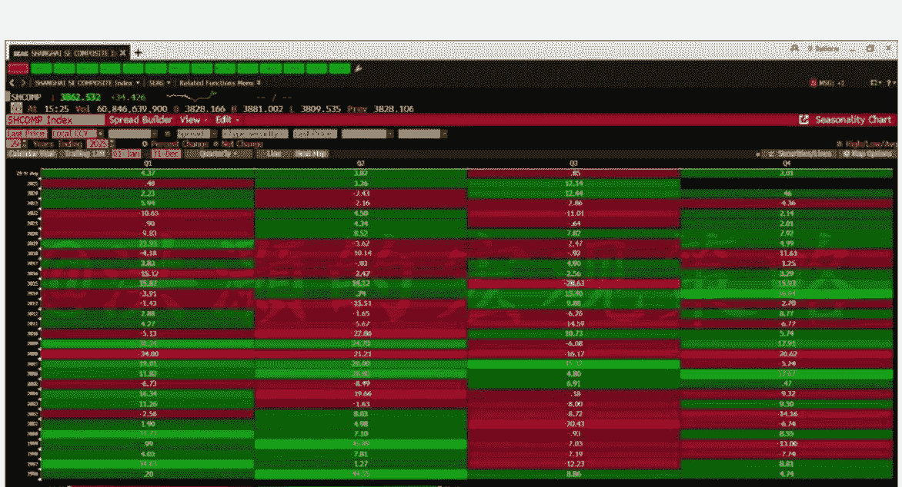
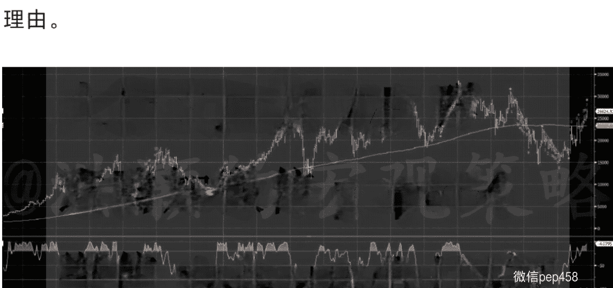

# 洪灏的宏观策略

# 洪灏：持币，还是持股过节

09-29 16:42

那不是一个问题。

黄金周长假已近在眉睫，不少读者纷纷就此问题而垂询。这不仅是因为去年国庆期间市场行情之迅出人意料，更因为时前后我们对市场大势走向的预判，至今仍令人记忆犹新、回味不绝。

在今天的专属读者报告中，我们剖析了八月工业利润的激对市场未来走势的预示，并对下一阶段工作的重心开展望。我们认为，消费很可能成为下一轮发力的重点所在。当下，一系列利好消费的政策已逐步铺开，诸如生育补贴计划与义务教育免费等举措。今晨《经济日报》金观平署名社论《像抓生产一样抓消费》，其观点与我们今早的研判不谋而合。

若能实现消费结构的变化，使经济脱离对产能投资的过度依赖，新经济结构的韧性和抗风险能力必将水涨船高。当然，此乃远景。眼下更多读者关心的，仍持币还是持仓过节这个恰在眉睫的抉择。

以下内容V+会员可见

加微信top28688，进资料分享群

我们以上证指数问世以来的全部数据为经纬，将分析结论条分层析如下：

- 一、纵观三十五年股市的历史，上证后收益率中位数终极坐标收益区间。同时，后市胜率均超过五成，大多时候优于增长长期平均52.6%的胜率基准。这种市场特征很可能是从季节性特征或与市场规律暗合——每年季度与去年往往是众所知的“春季行情”，其回报率与胜率较二三季度更胜一筹（图一所示，Q1和Q4绿色明显红色）。需要强调的是：我们应该慎用季节性因素作为预测市场走势的唯一依据。

- 二、在明确的上升趋势中，后市持续回撤的概率更是季节性。随着持仓时间推移，上证胜率与收益率皆逐级上升。这说明即便后市持仓发现浮优，在趋势向上的市场里，时间将成为投资者拨云见日的良友（图所示，以红年份所示的熊市后亏损频繁，而非末红年份的牛市里的亏损则寥寥无几）。

换言，在升势未尽的行情中，任何过早离场都可视为失之交臂。当市场进入加速阶段，离场意味着将来将不得不以更高代价重建，此即为所谓“卖飞”。这种市场曾以买化解解买，恰如下格局（图二）。在此情况下，择时无异于火中取栗。下跌当视为为达低布局的机会，而上涨则应作为坚定持有的理由。

- 三、2008年全球量化宽松转型央行货币政策模式的转折点。若以此为分水岭，可见2008年前国庆节后表现虽可，胜率大约四成；而2008年后，国庆节后上涨的胜率却大幅提升，跃升至七成以上（图三显示2008年后，最右列红字出现频率锐减）。2008年后的这段新时期，因货币政策模式的延续性与历史的临近，更具参考价值。

加微信top28688，进资料分享群

- 四、2008年以来，唯2023年国庆后所有持有收益率全军没。这因该年正值疫情后市场正常化：当时恒指三月内飙涨50%，恒指更是翻倍，其后余下的时光都在消化这番惊人涨幅。

总而言之：在趋势明显的升市中，询问持持币还是持股过节实属多此一举。此类市场常以超买化解超买，择时犹如镜花水月，易错失良机。2008年以后，上证后胜率约达七成，且随着持有期延长，收益率与胜率均能更上一层楼。

洪灝

2025.09.29

加微信top28688，资料分享群

# 知识星球TOP 资源分享群

添加微信；n免费入群

微信:top28688

| 序号 | 公号/星球/社群 | 原价 | 领域 |
|---|---|---|---|
| 1 | 生财有木 | 2765/年 | 同业，搞钱 |
| 2 | 众宗吃瓜群 | 365/年 | 时政，历史 |
| 3 | 记忆Legacy/剪树西风 | 365/年 | 成长， |
| 4 | 欧洲金轨 | 328/年 | 时政，历史 |
| 5 | 卢克文青云会 | 699/年 | 时政，社会 |
| 6 | 体制内主任 | 599/年 | 体制；职场 |
| 7 | 局外人的视界 | 669/年 | 金融，时政 |
| 8 | 泽沛异迁 | 4166/年 | 财富，成长 |
| 9 | 守夜人总司令 | 599/年 | 时政，经济 |
| 10 | 江宁知府 | 365/年 | 时政，国际 |
| 11 | 政堂/顾子明 | 568/年 | 时政，经济 |
| 12 | 唐书院 | 1399/年 | 金融，财富 |
| 13 | 大树乡谈 | 199/年 | 时政，成长 |
| 14 | 水库联大 | 10000/年 | 房产，经济 |
| 15 | 洪灏宏观策略 | 4376/年 | 经济，搞钱 |
| 16 | 金通鉴/北海南山 | 4576/年 | 股票，行研 |
| 17 | 猫哥的世界 | 299/年 | 时政，社会 |
| 18 | 飞浅龙 | 3600/年 | 股市，经济 |
| 19 | 米来联债见闻 | 599/年 | 经济，金融 |
| 20 | 茶茶财经圈 | 330/年 | 房产，股票 |
| 21 | 赢在八小时之外 | 365/年 | 成长，职场 |

......
更多资源，不再列举

- 书籍、报告、课程等各类高价值资源

- 免费群每日分享免费资源

- VIP群 每日分享所有资源（日均20+），75/年 赠送付费资源合集，市场价数万
