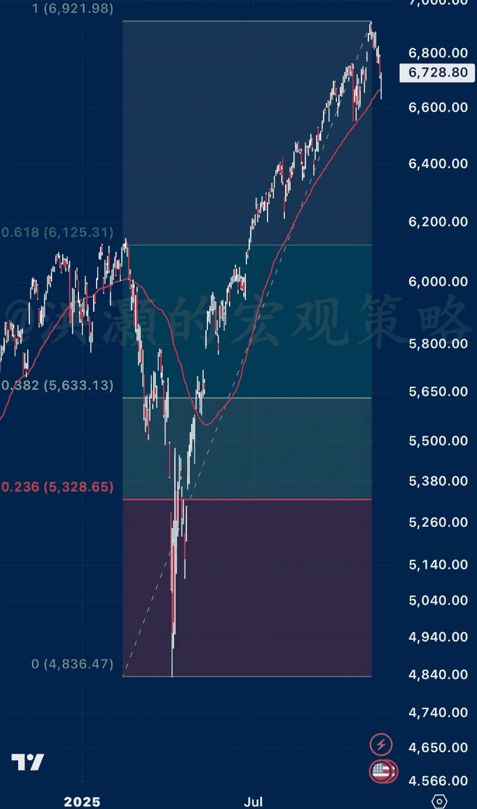

> “

【与瑞士宝盛的中国市场月度对话】最近，一系列重要会议释放的政策信号，与市场预期基本相符。
从长期来看，中国对内需发展和科技创新的聚焦，叠加为期一年的中美贸易“停战”等安排，为投资者带来了哪些关键启示？展望2026年港股、A股市场的前景，这些因素又能助力牛市的持续？
同时，近期中美股市及黄金价格出现回落，美元则有所走强，短期走势看似与原有趋势背离。这一轮调整背后的驱动因素是什么？在当前环境下，投资者又应如何科学布局长远配置？

所有链接均在外网。

来源：
作者：洪灏
摘录：洪灏的宏观策略

> 昨夜，标普成功测试50天线。

作者：洪灏
摘录：洪灏的宏观策略

# S&P 500 Index

USD
5
7,000.00
1 (6,921.98)
6,800.00
6,728.80
6,600.00
6,400.00
0.618 (6,125.31)
6,200.00
6,000.00
5,800.00
0.382 (5,633.13)
5,650.00
5,500.00
5,380.00
0.236 (5,328.65)
5,260.00
5,140.00
5,040.00
4,940.00
0 (4,836.47)
4,840.00
4,740.00
4,650.00
4,566.00
2025
Jul

周五，参议院共和党人拒绝了民主党人提出的即将到期的医疗保健补贴延长一年以重启政府运行的提议。这是民主党从原来的永久性医疗补贴所作出的让步，但共和党称这样想谈判“门都都没有”。
美国政府继续历史上最长的停摆，导致航班大面积取消，食品援助延迟发放。但至少民主党似乎希望打破僵局，标普收回重心，成功测试50天线。调查显示，美国消费者信心历史最低。

作者：洪灏
摘录：洪灏的宏观策略

英文：
中文：
苹果播客：Apple 播客（CN） - 网页播放器
Spotify: https://open.spotify.com/episode/1MVon11ON5BYwwxrR...

作者：洪灏
摘录：洪灏的宏观策略

# 知识星球TOP

添加微信；
免费入群
微信:top28688

| 序号 | 公号/星球/社群 | 原价 | 领域 |
| --- | --- | --- | --- |
| 1 | 生财有木 | 2765/年 | 同业，搞钱 |
| 2 | 众宗众吃瓜群 | 365/年 | 时政，历史 |
| 3 | 记忆巷/毅树西风 | 365/年 | 成长，财富 |
| 4 | 欧洲金轨 | 328/年 | 时政，历史 |
| 5 | 卢克青云会 | 699/年 | 时政，社会 |
| 6 | 体制内主任 | 599/年 | 体制，职场 |
| 7 | 局外人的视界 | 669/年 | 金融，时政 |
| 8 | 溯泽异迁 | 4166/年 | 财富，成长 |
| 9 | 守夜人司令 | 599/年 | 时政，经济 |
| 10 | 江宁知府 | 365/年 | 时政，国际 |
| 11 | 政堂/顾子明 | 568/年 | 时政，经济 |
| 12 | 唐书院 | 1399/年 | 金融，财富 |
| 13 | 大树乡谈 | 199/年 | 时政，成长 |
| 14 | 水库欧 | 10000元 | 房产，经济 |
| 15 | 洪灏宏观策略 | 4376/年 | 经济，搞钱 |
| 16 | 金企通鉴/北海南山 | 4576/年 | 股票，行情 |
| 17 | 猫哥的世界 | 299/年 | 时政，社会 |
| 18 | 飞龙沃 | 3600/年 | 股市，经济 |
| 19 | 米联诸见闻 | 599/年 | 经济，金融 |
| 20 | 茶茶财经圈 | 330/年 | 房产，股票 |
| 21 | 赢在八小时之外 | 365/年 | 成长，职场 |

...... 更多资源，不再列举
+   - 免费群 每日分享数字资源
- VIP群 每日分享所有资源（日均20+），75/年
赠送付费资源合集，市场价数万元
