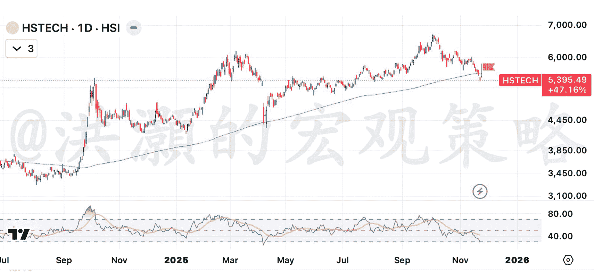

> 昨晚是标普历史上第4次开盘上涨超过1.5%，然后收盘下跌超过1.5%。

2008年10月7日
2008年10月9日
2025年4月8日
2025年11月20日

加微信进资料群

前后相差17年。我在我们的北京和深圳年度展望会上讨论过这个周期和它的意义。明天，上海的年度展望会会议。

作者：洪灏
摘录：洪灏的宏观策略

加微信top28688，进资料分享群

> 经历了今天的暴跌之后，恒科技术上非常难看 ………

作者：洪灏
摘录：洪灏的宏观策略

# HSTECH · 1D · HSI

HSTECH 5,395.49 +47.16%

> “没有想到，连英伟达也救不了市场。美国经济数据没有发表，美联储蒙眼开飞机。市场低估了美国政府关门对于流动性的冲击。

作者：洪灏
摘录：洪灏的宏观策略

加微信top28688，进资料分享群

# 知识星球TOP资源分享群

添加微信；免费入群
微信:top28688

| 序号 | 公号/星球/社群 | 原价 | 领域 |
| :--- | :--- | :--- | :--- |
| 1 | 生财有木 | 2765/年 | 同业, 钱谈 |
| 2 | 怂宗怂吃瓜群 | 365/年 | 时政, 历史 |
| 3 | 记忆Legacy/碧树西风 | 365/年 | 成长, 钱 |
| 4 | 欧洲金轨 | 328/年 | 时政, 历史 |
| 5 | 卢克文青云会 | 699/年 | 时政, 社会 |
| 6 | 体制内主任 | 599/年 | 体制; 职场 |
| 7 | 局外人的视角 | 669/年 | 金融, 时政 |
| 8 | 溯泽异贷 | 4166/年 | 财富, 成长 |
| 9 | 宁夜人总司令 | 599/年 | 时政, 经济 |
| 10 | 江宁知府 | 365/篇 | 时政, 国际 |
| 11 | 政堂/顾子明 | 568/年 | 时政, 经济 |
| 12 | 唐书院 | 1399/年 | 金融, 财富 |
| 13 | 大树乡谈 | 199/年 | 时政, 成长 |
| 14 | 水库欧大 | 10000/元 | 房产, 经济 |
| 15 | 洪灏宏观策略 | 4376/年 | 经济, 钱谈 |
| 16 | 金通鉴/北海南山 | 4576/年 | 股票, 行研 |
| 17 | 猫哥的世界 | 299/年 | 时政, 社会 |
| 18 | 飞浪龙 | 3600/年 | 股市, 经济 |
| 19 | 米联储见闻 | 599/年 | 经济, 金融 |
| 20 | 茶茶财经圈 | 330/年 | 房产, 股票 |
| 21 | 赢在八小时之外 | 365/年 | 成长, 职场 |

...... 更多资源，不再列举
+ 图书、报告、课程等各类高价值资源

- ★ 免费群 每日分享数字资源
★ VIP群 每日享所有资源（日均20+），75/年
赠送付费资源集合，市场价数万元
