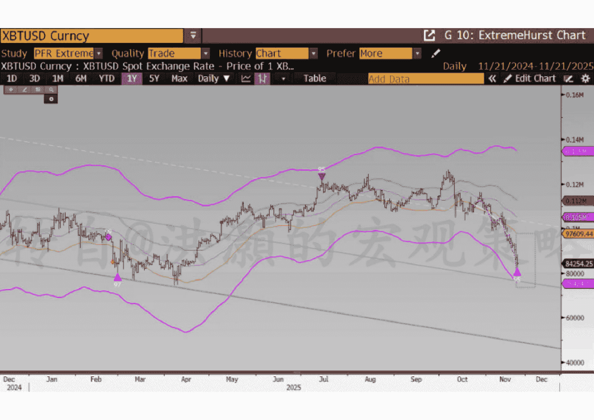
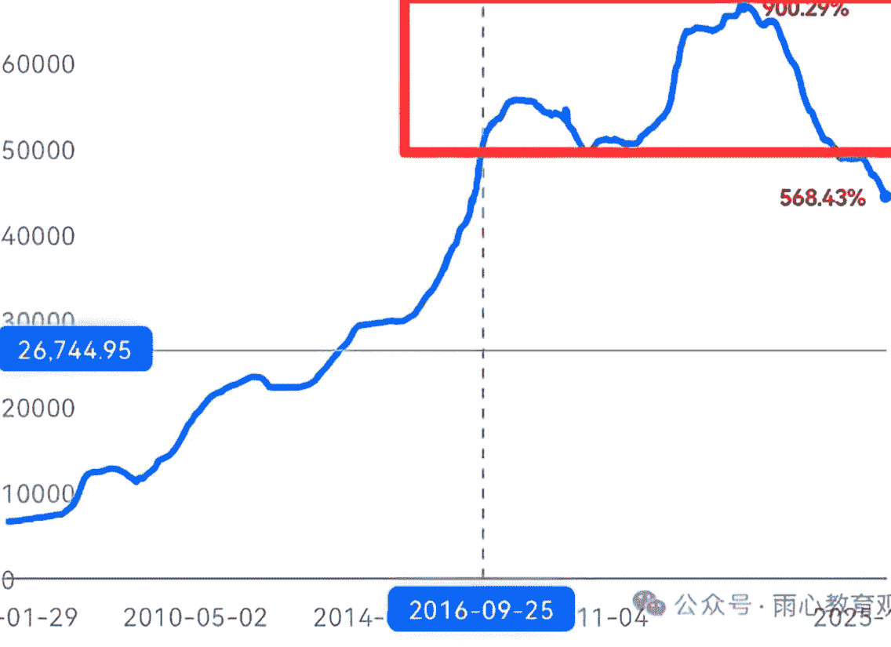

> 比特币在这个位置应该开始技术反弹。

作者：洪灏
摘录：洪灏的宏观策略

# 上海房价走势图

作者：洪灏
摘录：洪灏的宏观策略

# 上海冰山成交指数 2025.10.19

49857 排名 9 成交量 -- 议价率 9.2%
+2568 4.9% 年同比 44% 量比 -- 换手率 16%
总涨幅 650% 反弹 0% 冰山分 --

周报 月报 1年 3年 6年 全部

均线

## 知识星球TOP

添加微信 资源分享群 免费入群

微信:top28688

| 序号 | 公号/星球/社群 | 原价 | 领域 |
| --- | --- | --- | --- |
| 1 | 生财有木 | 2765/年 | 副业、搞钱 |
| 2 | 怂宗吃瓜群 | 365/年 | 时政、历史 |
| 3 | 记忆巷/碧树西风 | 365/年 | 成长、励 |
| 4 | 欧洲金轨 | 328/年 | 时政、历史 |
| 5 | 卢克文青云会 | 699/年 | 时政、社会 |
| 6 | 体制内主任 | 599/年 | 体制、职场 |
| 7 | 局外人的视界 | 669/年 | 金融、时政 |
| 8 | 潇迸译谈 | 4166/年 | 财富、成长 |
| 9 | 守夜人总司令 | 599/年 | 时政、经济 |
| 10 | 江宁知府 | 365/万 | 时政、国际 |
| 11 | 政堂/顾子明 | 568/年 | 时政、经济 |
| 12 | 唐书院 | 1399/年 | 金融、财富 |
| 13 | 大树义谈 | 199/年 | 时政、成长 |
| 14 | 水库联大 | 10000/年 | 房产、经济 |
| 15 | 洪澜的宏观策略 | 4376/年 | 经济、搞钱 |
| 16 | 金政通鉴/北海南山 | 4576/年 | 股票、行研 |
| 17 | 猫哥的世界 | 299/年 | 时政、社会 |
| 18 | 飞浅王 | 3600/年 | 股市、经济 |
| 19 | 来联储见闻 | 599/年 | 经济、金融 |
| 20 | 盏茶学院 | 330/年 | 房产、股票 |
| 21 | 赢在八小时之外 | 365/年 | 成长、职场 |

...... 更多资源，不再列举

+图书、报告、课程等各类高价值资源

★ 免费群 每日分享所有资源（日均20+），75/年

★ VIP群 每日分享所有资源（日均20+），赠送付费资源合集，市场价万元
