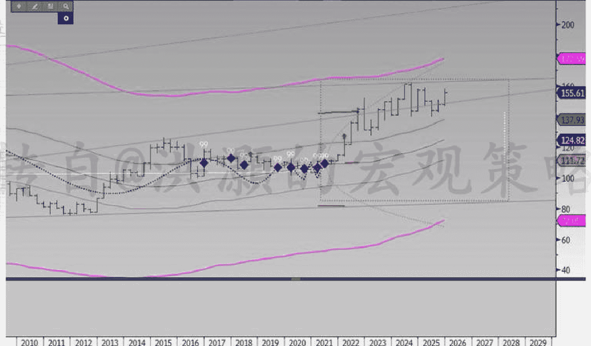
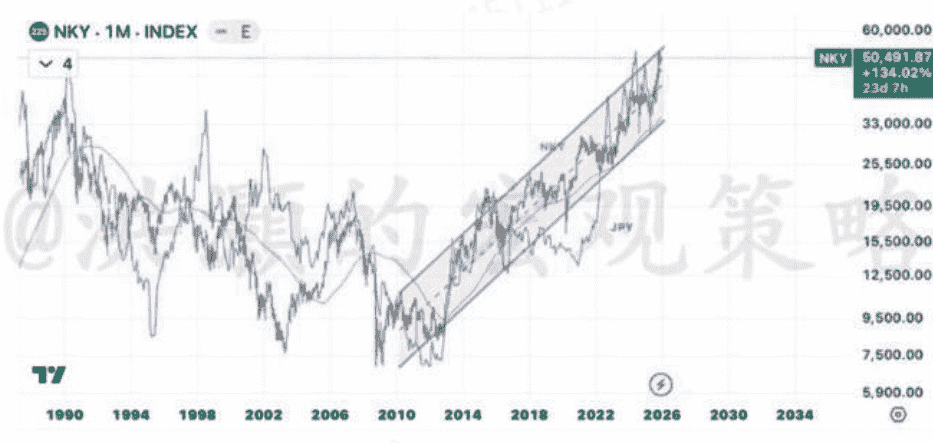
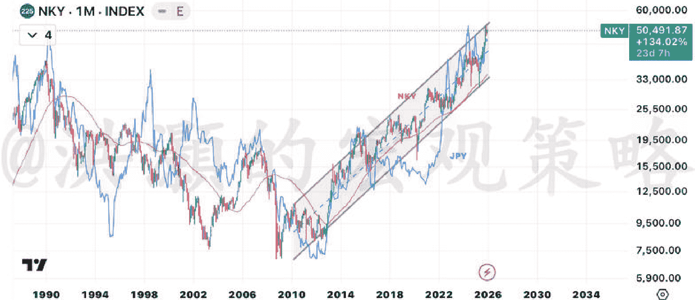

# 洪灏的宏观策略

洪灏 宇宙
2025/12/07 12:23

日元的贬值趋势（粉红色趋势上沿）具体成因在前面两个问答中已详细讨论。

| USDJPY Currency | Study PFA Extreme Maximum | History Chart | Prefer More |
|---|---|---|---|
| USD/JPY JPY Currency: USD.JPY Spot Exchange Rate Pri... | Quarterly | 12/30/2025-12/2/2025 | |
| ID 10 30 1N 6M YTD 5Y Max Quarterly | Edit Chart | | |

洪灏 宇宙
2025/12/07 12:15

Ben 提问：洪帅，得益于您对后市场的判断，以及“不要看他的票赚多了”要看他有没有重仓，我在这波波动中及时买到重仓，后续在回调时不断加仓。
目前已经买了心里仓位。谢谢您的提问！

# USDJPY Currency

Study PFR Extreme Quality Maximum History Chart Prefer More
Quarterly 12/30/2005-12/2/2025
Add Data Edit Chart
nG 10: Extreme Hurst Chart

USDJPY Currency : USDJPY Spot Exchange Rate - Pri...

+ 1D 3D 1M 6M YTD 1Y 5Y Max Quarterly

日元 vs 日经。具体成因在两个问答中已详细讨论。

日元 vs 十年美债收益率。具体成因两个问答中已详细讨论。

> 今天更新结束。下午出席财经中国年会。

作者：洪灏
摘录：洪灏的宏观策略

# 知识星球TOP资源群

入群畅看全网付费资源

分享资源目录（部分）

| 序号 | 公众号/星球/V会员 | 原价 | 领域 |
|---|---|---|---|
| 1 | 生财有术 | 2765/年 | 副业·搞钱·电商·自媒体 |
| 2 | 欧洲金驼 | 328/年 | |
| 3 | 悠悠(体中中) | 365/年 | |
| 4 | 政堂/狮子明彰享 | 568/年 | |
| 5 | 卢克青云会 | 699/年 | |
| 6 | 江子知府 | 365/篇 | 时政·经济·国际·历史 |
| 7 | 米联储见闻 | 599/年 | |
| 8 | A视野 | 26/篇 | |
| 9 | 猫哥的世界 | 299/年 | |
| 10 | 宁夜人总司令 | 599/年 | |
| 11 | 付鹏 | 1888/年 | |
| 12 | 洪澜的宏观策略 | 899/年 | |
| 13 | 金融通鉴/北海南山 | 4576/年 | |
| 14 | 丁长灵星球 | 1599/年 | 股市·财富·地产·趋势 |
| 15 | 鉴茶财经院 | 330/年 | |
| 16 | 雪雪花老老头 | 66/篇 | |
| 17 | 飞龙沫 | 3600/年 | |
| 18 | 安民分析 | 28/篇 | |
| 19 | 水库欧大 | 6980/年 | |
| 20 | 智谷趋势 | 498/年 | |
| 21 | 记忆承载/智树西风 | 365/年 | 社会·职场·成长·认知 |
| 22 | U君/赢在八小时之外 | 365/年 | |
| 23 | 贰掌柜(学习笔记) | 99/年 | |
| 24 | 体制内主任 | 599/年 | |
| 25 | 局外人的视野 | 669/年 | |
| 26 | 潇沫异谈 | 4166/年 | |
| 27 | 大树闲谈 | 199/年 | |
| 28 | 图书·报告等资源 | | |
| 29 | 影视·软件等资源 | | |

**VIP群:** 特惠88/年+每日分享所有资源+入群资料** (原价数万元)

**免费群:** 可免费进群+每日享小部分资源
