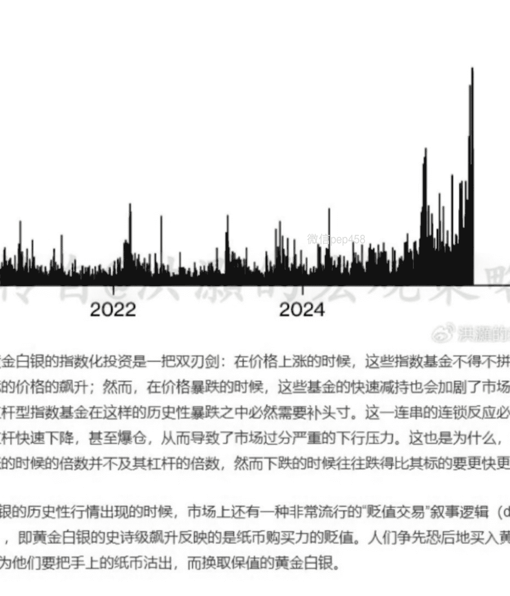
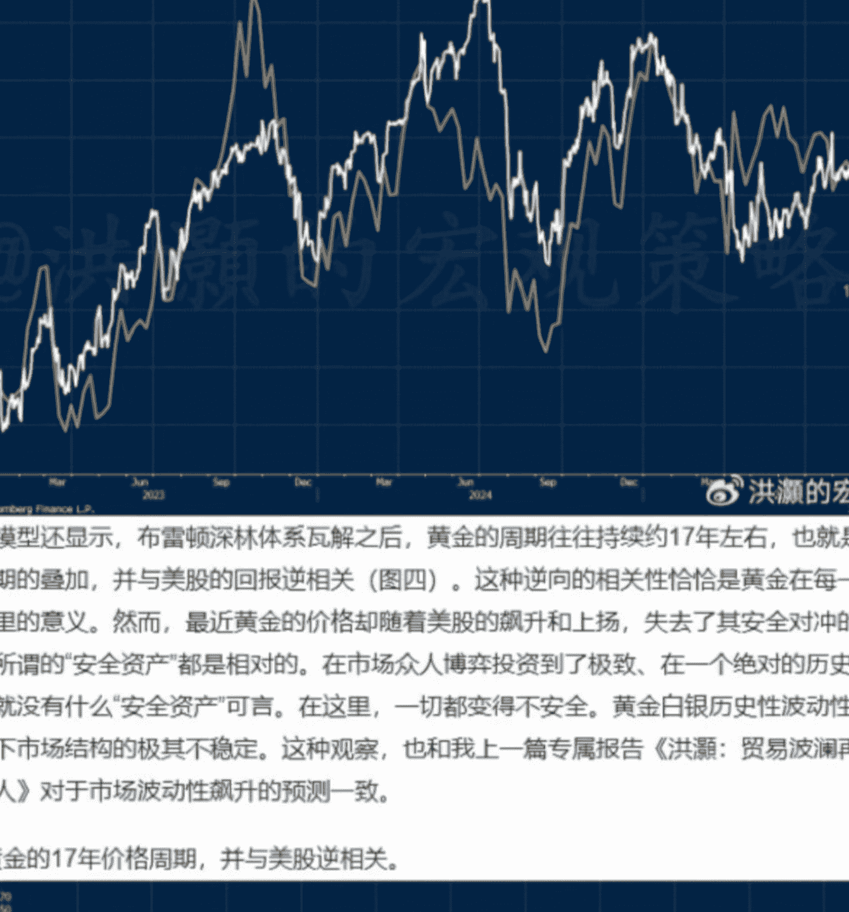
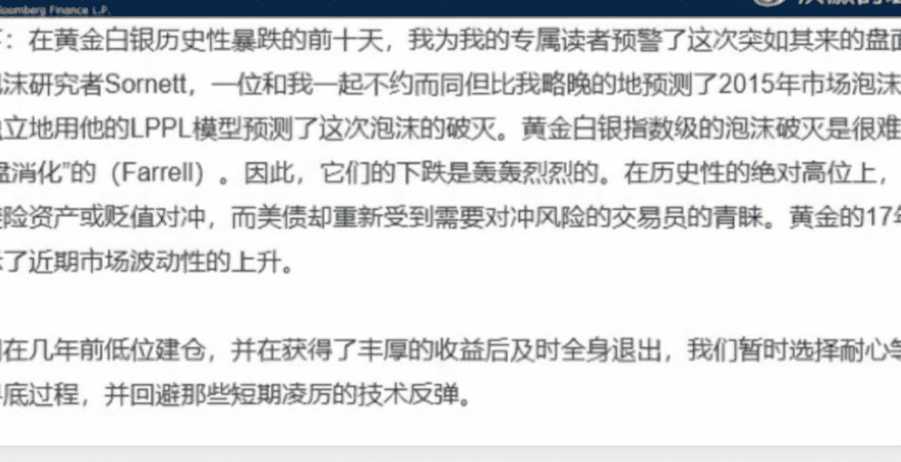

# 源于金价泡沫崩溃的解构

## 金2008年危机

> “Prudence usually can thank you for there, but you do not get correct by saying”
— Bob Frankel

然而，认为金价是泡沫的人，显然是太乐观了。

事实证明了，金价并不是泡沫，相反，金价正在开始泡沫。在2008年，金价从年初的700美元左右飙升到年底的1000美元以上，对于金价而言，金价已经暴涨了近50%。

从金价的走势来看，金价在2008年11月10日跌破1000美元关口，在11月11日，金价又回升并站上了1000美元关口。在随后的一天（短暂反弹），金价再次与1000美元关口发生了激烈交战。

但是，认为金价是泡沫的人们显然太悲观了。在2008年，金价从年初的1000美元左右跌到了年底的700美元左右，对于金价而言，金价已经暴跌了近30%。

从1971年起，黄金的价值开始历史性的反转。这几十年来，黄金已经作为一种资产得到了重新关注。对于投资者而言，黄金仍然是避险资产。

然而，在2008年金融危机爆发时，黄金并没有像人们预期的那样暴跌，相反，黄金在金融危机期间反而开始暴涨。

这在历史上是第一次。在过去，每当股市发生危机时，投资者往往会抛售黄金来换取现金，但这一次的情况是前无未例的。

在金价泡沫的讨论中，黄金的避险属性这对于投资者来说是一个至关重要的属性。

然而，当泡沫真的发生时，黄金的避险属性似乎失效了。在2008年9月，当雷曼兄弟宣布破产时，金价也开始下跌了。

但是，在2008年11月之后，金价又开始回升了。这说明，黄金的避险属性并没有失效，相反，这反而预示着金价泡沫的到来。

然而，认为金价是泡沫的人们显然太悲观了。在2009年，金价从年初的1000美元左右跌到了年底的800美元左右。

但是，在2010年，金价又开始暴涨了。这种情况在历史上是前无未例的。

在2010年9月15日，由于美联储宣布了量化宽松，金价再次突破了1500美元关口，并在几天后又创了新的高点。

在2011年，金价再次突破了1900美元关口。

然而，认为金价是泡沫的人们显然太悲观了。在2012年，金价从年初的1900美元左右跌到了年底的1600美元左右。

在2013年，金价又开始暴涨了。

在2013年4月，金价再次突破了1600美元关口。

图1：金价走势图

## Option Volume on Gold ETF Hits Record

Volatility and trading volumes also hit record

然而，金价的泡沫只是一个开始。这个泡沫显示了市场的不持续性。从泡沫的角度来看，在泡沫期间，黄金的特殊表现显示了市场的疯狂。

然而，黄金ETF的期权交易创了历史新高，这说明了市场对黄金的未来预期非常激烈。同时，黄金的波动率也达到了新高。

# 知识星球TOP
汇聚全网高价值资源
打造TOP级分享社群

- 付费文章
- 付费社群
- 时政&国际
- 副业&搞钱
- 财经&市场
- 行业报告

时政·历史·职场·体制·自媒体
学习·军事·软件·影音·社会学

公众号:知识星球TOP  微信:top28688  微信:top28388

添加微信 免费进群
