# DeepSeek: 从入门到精通

清华大学新闻与传播学院
新媒体研究中心
元宇宙文化实验室

@新媒沈阳 团队：余梦琉博士后


## 扫码加入 知识星球TOP免费资源群

公众号:知识星球TOP

免费

- 每日免费获取高价值资源
- 可提供各类资源搜索服务


价值

微信信号:jntsg8

| 热门付费文章 | 各行各业报告 |
| 精选图书资源 | 副业赚钱方法 |
| 职场实用资源 | AI政经自媒体 |


及时

微信信号:jntsg2


专注

分享资料仅供个人学习，请及时删除，切勿商用传播

- Deepseek是什么？
- Deepseek能够做什么？
- 如何使用Deepseek?

## DeepSeek是什么？

- DeepSeek是一家专注通用人工智能（AGI）的中国科技公司，主攻大模型研发。
- DeepSeek-R1是其开源的推理模型，擅长处理复杂且免费商用。

### 性能对标 OpenAI-o1 正版

DeepSeek-R1在训练阶段对大规模模型使用了强化学习技术，在仅有少量标注数据的情况下，极大提升了模型推理能力。在数学、代码、自然语言推理等任务上，性能比 OpenAI o1 正版。

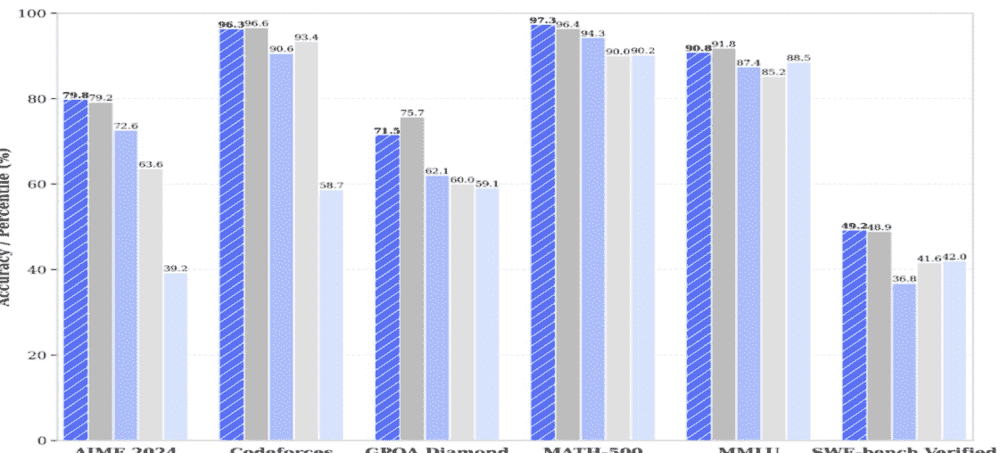

AI / 国产 / 免费 / 开源 / 强大

## Deepseek可以做什么？

直接面向用户或者支持开发者，提供智能对话、文本生成、语义理解、计算推理、代码生成补全等应用场景，支持联网搜索与深度思考模式，同时支持扫描读取各类文件和图片中的文字内容。

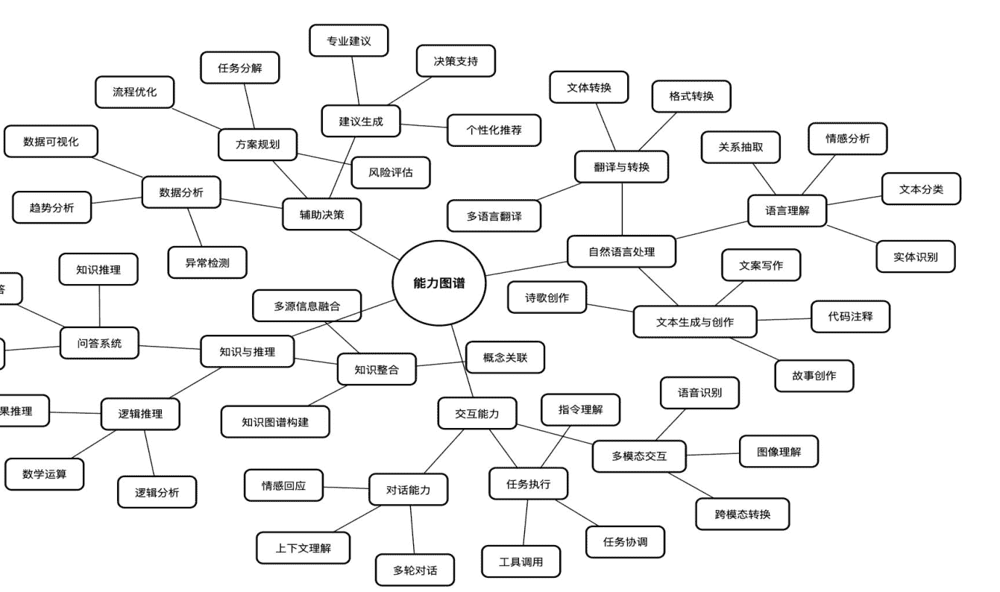

### 文本生成

### 文本创作
- 文章/故事/诗写作
- 营销文案、广告语生成
- 社交媒体内容（如推文、帖子）
- 剧本或对话设计

###01 摘要与改写
- 长文本摘要（论文、报告）
- 文本简化（降低复杂度）
- 多语言翻译与本地化

###02 结构化生成
- 表格、列表生成（如日程安排、菜谱）
- 代码注释、文档撰写

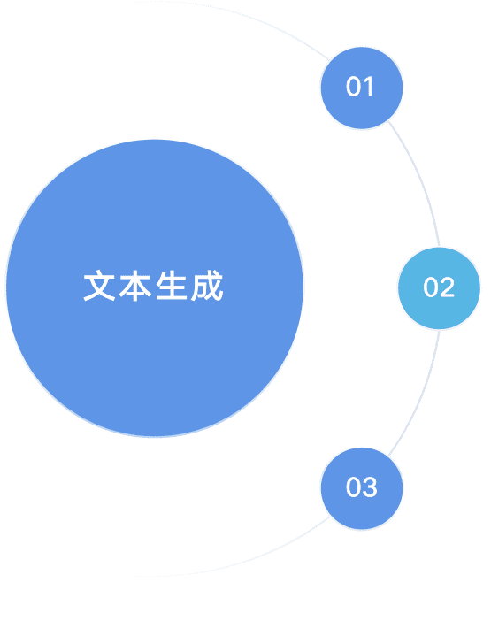

文本生成

### 自然语言理解与分析

- 语义分析
- 情感分析（评论、反馈）
- 意图识别（客服对话、用户查询）
- 实体提取（人名、地点、事件）

- 知识推理
- 知识推理
- 逻辑问题解答（数学、常识推理）
- 因果分析（事件关联性）

### 文本分类

- 文本分类
- 主题标签生成（如新闻分类）
- 垃圾内容检测


### 编程与代码相关


### 代码生成
- 根据需求生成代码片段（Python、JavaScript）
- 自动补全与注释生成

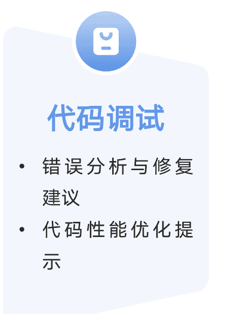

### 代码调试
- 错误分析与修复建议
- 代码性能优化提示


### 技术文档处理
- API文档生成
- 代码库解释与示例生成

### 常规绘图

### SVG矢量图
### Mermaid图表
### React图表

- 基础图形
- 图标
- 简单插图
- 流程图
- 组织架构图

- 流程图
- 时序图
- 类图
- 状态图
- 实体关系图
- 思维导图

- 折线图
- 柱状图
- 饼图
- 散点图
- 雷达图
- 组合图

### 如何使用 DeepSeek?

https://chat.deepseek.com


我是 DeepSeek，很高兴见到你！我可以陪你写代码、文档、写作各种内容。由于技术原因，知识截止日期是2024年7月，任何问题我会尽力为您提供准确的答案。

### 如何从入门到精通？

### 推理模型
推理模型是指在语言模型的基础上，通过强化学习等技术增强其推理能力。它们通常具备额外的思考能力，在逻辑推理和问题解决方面表现突出。
- 例如：DeepSeek-R1, OpenAI o1

### 非推理模型
非推理模型侧重于语言生成、上下文理解。此类模型通过大量数据训练，掌握语言规律并生成合适的内容，但缺乏深度推理能力。
- 例如：GPT-3, BERT, Google

| 维度 | 推理模型 | 通用模型 |
| :--- | :--- | :--- |
| 优势领域 | 数学推导、逻辑分析、代码生成、复杂问答 | 语言生成、创意写作、开放对话 |
| 劣势领域 | 发散性任务（如创作） | 需要严格逻辑的任务（数学证明） |
| 性能本质 | 逻辑高密度任务 | 任务性任务 |
| 判断 | 全面更强 | 灵活，但依赖提示补偿 |

## 提示语策略差异

### 1 推理模型
- 提示语更简洁，只需明确目标和需求（因其内化推理逻辑）。
- 无需逐步指导，模型自动生成结构化推理过程。

### 2 通用模型
- 需显式引导推理步骤（通过CoT提示），否则可能跳过逻辑。
- 依赖提示语补足短板（要求思考、提供示例）。

## 关键原则

### 模型选择
- 优先根据任务类型而非模型热选择（如数学任务选推理，创意任务选通用）。

### 提示词设计
- 推理模型：简洁指令，聚焦目标，信任其内化能力。“要什么直接说”。
- 通用模型：结构化、补偿性引导。“缺什么补什么”。

### 避免误区
- 不要对推理模型使用“启发式”提示（如角色扮演），可能干扰其逻辑主线。
- 不要对通用模型“过度信任”（直接询问复杂推理问题，需分步验证结果）。

## 从“下达指令”到“表达需求”

| 策略类型 | 定义与目标 | 适用场景 | 示例（推理模型适用） | 优势与风险 |
| :--- | :--- | :--- | :--- | :--- |
| 指令驱动 | 直接给背景步骤或格式要求 | 简单任务、快速执行 | 用Python编写排序函数，输出包含注释。 | 结果精准高效，限制模型优化空间 |
| 需求导向 | 描述问题背景与目标，由模型规划解决路径 | 复杂问题、需自主推理 | 我需要优化用户登录流程，分析当前瓶颈并提出3种方案。 | 激发模型深层推理，需清晰定义边界 |
| 混合模式 | 结合需求描述与约束条件 | 平衡活性与可控 | 设计一个杭州三日计划，要求包含西湖和灵隐，预算控制在200元以内。 | 兼顾目标与细节，避免过度约束 |
| 启动式提问 | 通过提问引导模型思考（如“为什么”、“如何”） | 探索性问题、需模型解释逻辑 | 为什么选择梯度下降法解决此优化问题？请对比其他算法。 | 触发模型解释能力，可能偏离核心目标 |

## 任务需求与提示语策略

| 任务类型 | 适用模型 | 提示语侧重点 | 示例 (有效提示) | 需避免的提示策略 |
| :--- | :--- | :--- | :--- | :--- |
| 数学证明 | 推理模型 | 直接提问，无需分步引导 | 证明勾股定理 | 额外拆解（如“先画图，再列公式”） |
| | 通用模型 | 显式要求步骤，提供示例 | 证明勾股定理 | 直接提问（易跳过步骤） |
| 创意写作 | 推理模型 | 鼓励发散，设定角色/风格 | 以XX风格写一个故事 | 限制逻辑 |
| | 通用模型 | 明确目标，避免过度发挥 | 写一个不超过200字的小说 | 开放式指令 |
| 代码生成 | 推理模型 | 简单需求，信任逻辑 | 用Python实现排序 | 分步指导 |
| | 通用模型 | 明确输入、输出格式 | 解释原理，再写出代码 | 模糊需求 |
| 多轮对话 | 通用模型 | 自然交互，无需额外指令 | 你认为怎么样？ | 强制逻辑链 |
| | 推理模型 | 明确约束，避免发散 | 从三个维度分析 | 情感化 |
| 逻辑分析 | 推理模型 | 直接抛出复杂问题 | 你认为哪种对？ | 总结 |
| | 通用模型 | 逐步追问 | 解释两种差异 | 结论 |

## 如何向AI表达需求

| 需求类型 | 特点 | 需求表达公式 | 推理模型适配 | 通用模型适配 |
| :--- | :--- | :--- | :--- | :--- |
| 1. 决策需求 | 权衡选项、评估 | 目标 + 选项 + 标准 | 直接建议 | 归纳 |
| 2. 分析需求 | 深度理解、发现模式 | 问题 + 信息 + 方法 | 触发因果 | 逻辑导 |
| 3. 创造性需求 | 生成新内容 | 主题 + 风格 + 约束 | 逻辑框架 | 依赖引导 |
| 4. 验证需求 | 检查自洽性、可靠性 | 结论/方案 + 验证方法 | 逻辑分类 | 总结 |
| 5. 执行需求 | 完成具体操作 | 任务 + 步骤 + 输出格式 | 自主优化 | 严格执行 |

## 提示示例

### 决策需求
- 现有方案：初期投入高，长期成本低
- 第三方合作：按需付费，灵活性高
- 计算ROI并对比选择最优

### 分析需求
- 分析三年新能源销售数据：增长趋势与政策关联
- 预测市场占比：使用模型并解释依据
- 设计一款智能家居产品：解决老人安全问题、结合传感器网络预警、提供三种技术路线

### 验证性需求
- “以下是结论：神经网络A优于传统方法B” 。 验证：实验数据是否支持该结论、检查对照组是否存在偏差、重新计算p值判断显著性

### 执行需求
- 将以下C语言转换为Python，要求：保持时间复杂度不变、使用numpy向量化操作、输出带测试用例的完整代码。

 还要不要学提示语？

提示语 (Prompt) 是用户输入给AI系统的指令或信息，用于引导AI生成特定的输出或执行特定的任务。简单来说，提示语就是我们与AI“对话”时语言，它可以是一个简单的问题，一段详细的指令，也可以是一个复杂的任务描述。提示语的基本结构包括指令、上下文和期望

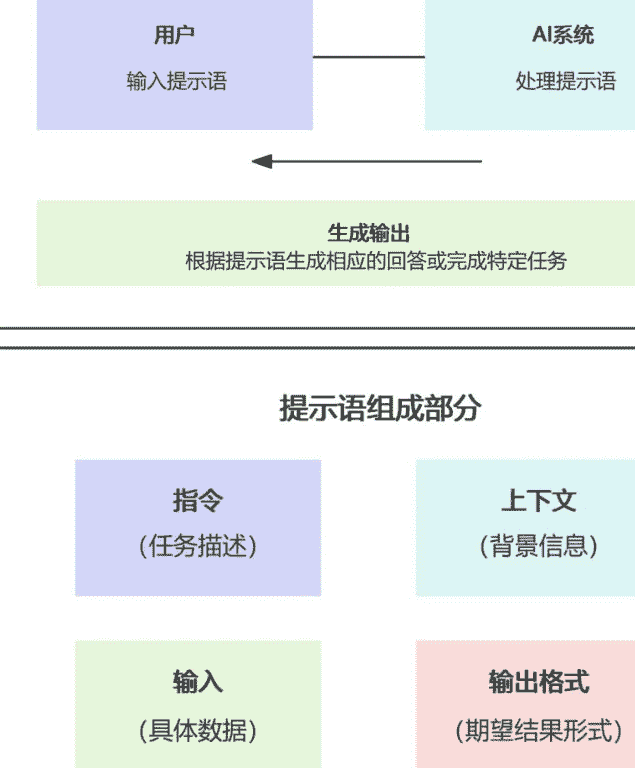

## 提示语类型

### 提示语的本质

1-1-1 提示语的本质特征

| 特征 | 描述 | 示例 |
| :--- | :--- | :--- |
| 沟通桥梁 | 连接人类意图和AI理解 | 将以下内容翻译为法语：Hello, world |
| 上下文提供 | 为AI提供必要的背景信息 | 假设你是一位19世纪的历史学家，评论矿的崛起 |
| 任务定义器 | 明确指定AI需要完成的任务 | 为一篇关于气候变化的文章写引言，长度200字 |
| 输出塑造器 | 影响AI输出的形式和内容 | 用简单的语言解释量子学，假设你在教一个10岁的孩子 |
| AI能力引导 | 引导AI使用特定的能力或技能 | 使用你的创意写作能力，创建一个关于旅行的短篇故事 |

### 提示语的类型

- 1. 指令型提示语：直接告诉AI需要执行的任务。
2. 问答型提示语：向AI提出问题，期望得到相应的答案。
3. 角色扮演型提示语：要求AI扮演特定角色，模拟特定场景。
4. 创意型提示语：引导AI进行创意写作或内容生成。
5. 分析型提示语：要求AI对给定信息进行分析和推理。
6. 多模态提示语：结合文本、图像等多种形式的输入。

# 掌握提示语设计：AIGC时代的必备技能

## 提示语设计的核心技能体系

表1-3-2 提示语设计进阶技能子项

| 核心技能 | 子项 |
| :--- | :--- |
| 问题重构能力 | 将复杂、模糊的人类需求转化为结构化的AI任务 |
| 引导能力 | 显式引导推理步骤（CoT提示），否则可能跳过逻辑 |
| 补足能力 | 依赖提示语补足短板（要求思考、提供示例） |
| 策略差异 | 将模型分为两类：“概率预测（快速反应）”模型和“链式推理（慢思考）”模型。前者适合快速反馈，处理即时任务；后者通过推理解决复杂问题。了解它们的差异有助于根据需求选择模型，实现最佳效果。 |


## 提示语的DNA: 解构强大提示语的基本元素

### 提示语的基本元素分类

提示语的基本元素可以根据其功能和作用分为三个大类：信息类元素、结构类元素和控制类元素：

信息类元素决定了AI在生成过程中需要处理的具体内容，包括主题、背景、数据等，为AI提供了必要的知识和上下文。

### 提示语基本元素分类体系

结构类元素用于定义生成内容的组织形式和呈现方式，决定了AI输出的结构、格式和风格。

| 信息类元素 | 结构类元素 | 控制类元素 |
| --- | --- | --- |
| 主题元素 | 格式元素 | 任务控制元素 |
| 背景元素 | 结构元素 | 质量控制元素 |
| 数据元素 | 格式元素 | 约束条件元素 |
| 知识元素 | 长度元素 | 迭代指令元素 |
| 参考元素 | 可视化元素 | 输出验证元素 |

控制类元素用于管理和引导AI的生成过程，确保输出符合预期并能够进行必要的调整，是实现高级提示语工程的重要工具。

## 提示语的DNA: 解构强大提示语的基本元素

### 提示语元素组合矩阵 2-1-1 提示语元素组合矩阵

| 目标 | 主要元素组合 | 次要元素组合 | 组合效果 |
| :--- | :--- | :--- | :--- |
| 提高输出准确性 | 主题元素 + 数据元素 + 质量控制元素 | 知识元素 + 验证元素 | 确保AI基于准确的主题和数据生成内容，并通过严格的质量控制和验证确保高标准 |
| 增强创造思维 | 主题元素 + 背景元素 + 约束条件元素 | 参考元素 + 代替指令元素 | 通过提供丰富的背景信息和适度的约束，激发AI的创造思维，同时通过多次迭代促进创新 |
| 优化任务执行效率 | 任务指令元素 + 结构元素 + 格式元素 | 长度元素 + 格式元素 | 通过清晰的指令和定义的结构提高执行效率，同时输出符合特定的格式 |
| 提升输出一致性 | 风格元素 + 知识元素 + 约束元素 | 格式元素 + 质量控制元素 | 通过统一的风格和专业领域确保输出的一致性，同时使用约束条件和质量控制标准 |
| 增强交互体验 | 代替指令元素 + 输出验证元素 + 质量控制元素 | 任务指令元素 + 背景元素 | 建立动态的交互，允许AI进行自我调和，同时根据任务和背景灵活调整 |

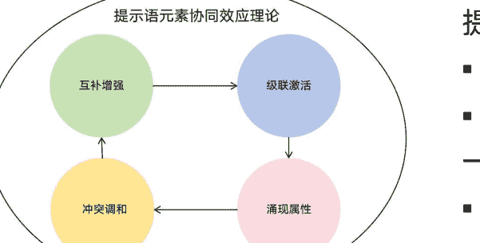

> 提示语元素协同效应理论的核心要点：
- **互补增强**：某些元素组合可以互相互补，产生 1+1>2 的效果。
- **级联激活**：一个元素的激活可能引发一系列相关元素的连锁反应，形成一个自我强化的正反馈循环。
- **冲突和调和**：看似相似的元素组合可能产生意想不到的积极效果。
- **涌现属性**：某些元素组合可能产生单个元素所不具备的新特性。

## 教教AI的秘籍：让你的提示语效果倍增的关键策略

策略一：精准定义任务，减少模糊性

策略二：妥当分解复杂任务，降低AI认知负荷

策略三：引入引导性问题，提升生成内容的深度

策略四：控制提示语长度，确保生成的准确性

策略五：灵活运用开放式提示与封闭式提示

如何实现精准定义：明确的核心问题、具体化的生成指令、去除多余信息

分解任务的技巧：分段生成、逐层深入、设置逻辑结构

引导性问题的设计要点：设置多个层次的问题、促AI对比或论证、引导思维的多样性

控制提示语长度的技巧：避免复套复杂的指令、保持简洁性、使用分步提示

开放式提示：提出开放性问题，允许AI根据多个角度进行生成
封闭式提示：提出具体问题或设定明确限制，要求AI给出精准回答

## 常见陷阱与应对：新手必知的提示语设计误区

### 缺乏迭代陷阱：期待一次性完美结果

+ 陷阱症状：
- 重复复杂的初始提示语
- 对初次输出结果不满意就放弃
- 缺乏对AI输出的分析和反馈

+ 应对策略：
- 采用增量方法：从基础提示语开始，逐步添加细节和要求。
- 主动寻求反馈：要求AI对其输出进行自我评估，并提供改进建议。
- 准备多轮对话：设计一系列后续问题，用于澄清和改进初始输出。

### 过度指令和模糊陷阱：当细节淹没重点或意图不明确

+ 陷阱症状：
- 提示语异常冗长或过于简短
- AI输出与期望严重不符
- 频繁需要澄清或重新解释需求

+ 应对策略：
- 平衡细节度：提供足够的上下文，但避免过多限制。
- 明确关键词：突出最重要的2-3个要求。
- 使用结构化格式：采用清晰的结构来组织需求。
- 提供示例：如果可能，给出期望输出的简短示例。

## 常见陷阱与应对：新手必知的提示语设计误区

### 假设偏差陷阱：当AI告诉你你想听的

### 幻觉生成陷阱：当AI自信地胡言八道

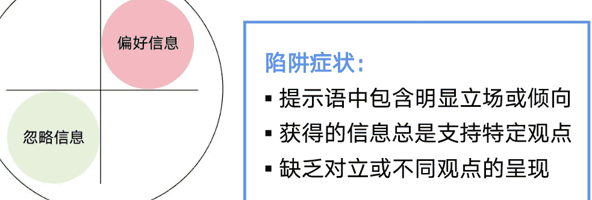

+ 陷阱症状：
- 提示语中包含明显立场或倾向
- 获得的信息总是支持特定观点
- 缺乏对立或不同观点的呈现

+ 陷阱症状：
- AI提供的包含具体数据或事实无法验证
- 输出中包含看似专业实际上上不存在的术语或概念
- 对未来或不确定事件做出过于具体的预测

+ 应对策略：
- 自我审视：在设计提示语时，反思自己可能存在的偏差。
- 使用中立语言：避免在提示语中包含偏或预设立场。
- 要求多角度分析：明确要求AI提供不同的观点或论据。
- 批判性思考：对AI的输出保持警惕，交叉验证重要信息。

+ 应对策略：
- 明确不确定性：鼓励AI在不确定时明确说明。
- 事实核查提示：要求AI区分已知事实和推测。
- 多源验证：要求AI从多个角度或来源验证信息。
- 要求引用：明确要求AI提供信息来源，便于验证。

## 常见陷阱与应对：新手必知的提示语设计误区

### 忽视伦理边界陷阱：低估AI的伦理限制

| AI伦理考虑点 | 陷阱症状 | 提示语设计清单 |
| --- | --- | --- |
| 隐私保护 | 要求AI生成争议、不道德或非法内容 | 目标明确性 |
| 公平性和非歧视 | 对AI拒绝或警告感到惑 | 信息充足性 |
| 透明度和可解释性 | 尝试绕过AI的安全机制 | 结构合理性 |
| 社会影响 | 忽视AI输出带来的伦理影响 | 语言中立性 |
| 安全和滥用防范 | | 伦理合规性 |
| | | 验证性 |
| | | 输出格式 |
| | | 难度适中 |
| | | 多样性考虑 |

+ 应对策略：
- 合法合规：确保你的请求符合法律和道德标准。
- 伦理指南：在提示语中明确包含伦理和指导。
- 影响评估：要求AI评估其建议或输出的潜在影响。

## 常见陷阱与应对：新手必知的提示语设计误区

### 挖掘反向思维：从相反角度切入

+ 创新策略：
- 设定逆向任务：引导AI从相反的角度处理，提供不同于传统的内容。
- 挑战思维：打破常规，促使生成具有挑战性的内容。

### 灵活运用任务：给AI发挥的空间

+ 创新策略：
- 设定基本框架，留出探索余地：生成内容。
- 多维度任务：引导AI从多个角度看待，激发对其生成的多样化思考。

## AI缺陷：概率幻觉

> AI幻觉 (AI Hallucinations) 是指人工智能模型在生成文本或回答时，尽管表面上呈现出逻辑和语法正确的形式，但其输出可能包含完全虚构、不准确或与事实符的信息。


AI幻觉的产生原因通常由于模型在缺乏相关信息的情况下，通过概率性生成内容，而非基于真实的知识库或逻辑推理，使得输出难以可信，且可能误导用户。AI幻觉这一关键缺陷，潜在局限包括解释性、计算成本、数据偏见、实时更新、数据安全、个人隐私、恶意输出等。

## AI幻觉：五类七特

### 01 “五类”

| 幻觉类型 | 数据可用性 | 理解能力 | 语境精度 | 外部信息整合 | 逻辑推理 | 典型错误 |
| --- | --- | --- | --- | --- | --- | --- |
| 数据误用 | 有数据 | 低 | 高 | 中 | 回答部分符或细节 |
| 语境误 | 有数据 | 高 | 低 | 高 | 中 | 对意图理解，回答偏离主题 |
| 信息缺失 | 无数据 | 中 | 高 | 低 | 中 | 未能正确获取外部信息 |
| 推理错误 | 部分数据 | 高 | 高 | 中 | 低 | 逻辑推理中存在漏洞 |
| 无中生 | 无数据 | 低 | 中 | 低 | 完全虚构的信息 |

### 02 “七特”

## AIGC评测：两个国家级项目+一套自动化评测系统

两个国家级项目：
* **2023国家自然科学基金青年项目“面向人工智能生成内容的风险识别与治理策略”**
* **2023国家资助博士后人员“AIGC意识形态评估”**


| 大型多学科自动化评测平台 | | | |
|---|---|---|---|
| 差异报告-8 | [查看] | 差异报告-10 | [查看] | 差异报告-7 | [查看] |
| 差异报告-9 | [查看] | 差异报告-6 | [查看] | 差异报告-5 | [查看] |
| 差异报告-4 | [查看] | 差异报告-3 | [查看] | 差异报告-2 | [查看] |
| 差异报告 | [查看] | 差异报告-1 | [查看] | 详细报告 [查看] |

共计26个细分指标

## 创新的火花：如何设计独特匠心的提示语？

### 抽象—具体循环：在不同抽象层次间切换矛盾思维法：利用对立促进创新

抽象化问题 -> 具化反馈 -> 迭代优化

引入对立概念，提出冲突性任务要求

### 运用类比与隐喻：增强创意表达

融合批判性思维与创新推理

使用类比说明复杂概念

- 质疑既有框架
- 创新推理
- 多方论证与批判结合
- 增强生成内容的全面性

### 隐喻增强语言的表达层次

### 涌现思维模型：利用集体智慧的提示语设计

- 分解与重组：将复杂问题拆分为简单组件，再将其交互

选择具备启发性的类比

### 反向设计思维：从生成结果倒推提示语

从预期结果开始 -> 倒推提示语结构 -> 灵活调整提示语细节

- 交互规则设定：在提示语中定义组件互动规则。
- 整体行为为观察：设计机制来观察和解释从交互中涌的整体行为。

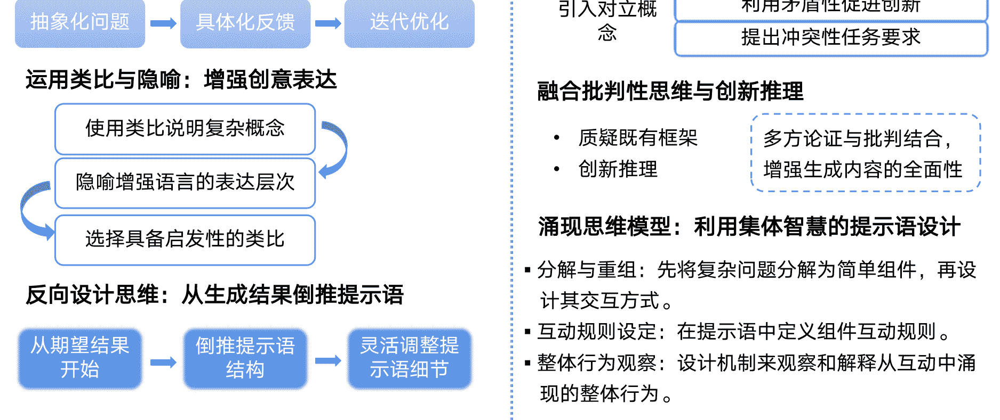


# 任务分解的提示语链设计步骤

任务分解的概念来源于问题解决理论和系统工程。将任务分解应用于提示语设计，实际上是在模拟人类处理复杂问题的方式。这种方法主要基于分而治之原则、层级结构理论以及认知负荷理论作为其理论基础。

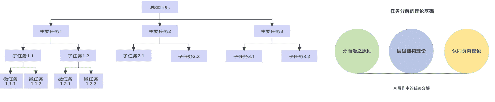

设计基于任务分解的提示语链涉及以下步骤：

| 明确总体目标 | 识别主要任务 | 细化子任务 | 定义微任务 | 设计对应提示语 | 建立任务间联系 | 加入反馈调整机制 |
| :--- | :--- | :--- | :--- | :--- | :--- | :--- |

# SPECTRA任务分解模型

为了更有效地进行任务分解，可以采用SPECTRA模型（Systematic Partitioning for Enhanced Cognitive Task Resolution in AI）：

## 基于SPECTRA模型的提示链设计

- Segmentation（分割）：将大任务分解为独立的相关的部分
- Prioritization（优先）：确定子任务的重要性和执行顺序
- Elaboration（细化）：深入探索每个子任务的细节
- Connection（连接）：建立子任务之间的逻辑关联
- Temporal Arrangement（时序安排）：考虑子任务的时间维度
- Resource Allocation（资源分配）：为每个子任务分配适当的注意力资源
- Adaptation（适配）：根据AI反馈调整任务结构

1. 分割提示：“将[总任务描述]分解为3—5个主要组成部分，确保每个部分都是相对独立与整体目标相关的。”
2. 优先提示：“对上述任务进行执行优先级排序，考虑它们对目标的重要性和逻辑顺序。”
3. 细化提示：“选择优先级最高的子任务，将其进一步细化为2—3个具体的行为。”
4. 连接提示：“分析各个子任务的关系，确定它们如何相互影响，以及如何共同推进整体任务的实现。”
5. 时序提示：“为每个子任务制定一个简单的时间表，考虑它们的依赖关系和完成所需的时间。”
6. 资源分配提示：“评估每个子任务的复杂度，分配1—10的注意力分值，指导在执行过程中分配资源。”
7. 适配提示：“在执行子任务后，评估其产出量和对目标的贡献，必要时调整后续任务的优先级或内容。”

# 思维拓展的认知理论基础

思维拓展的提示链设计建立在创造性认知理论的基础上。根据Geneplore模型（Generate-Explore Model），创造性思维包括两个主要阶段：

生成阶段（Generate）和探索阶段（Explore），可将这一理论应用到AI内容生成的过程中，设计相应的提示语策略。


## 发散思维的提示链设计
基于“IDEA”框架

- Imagine (想象):鼓励超越常规的思考
- Diverge (发散):探索多个可能性
- Expand (扩展):深化和拓展初始想法
- Alternate (替代):寻找替代方案

## 实战技巧：操作方法

1. 使用“假设情境”提示激发想象力
2. 应用“多角度”提示探索不同视角
3. 使用“深化”提示拓展初始想法
4. 设计“反转”提示寻找替代方案

## 思维拓展的提示语链设计

## 聚合思维的提示语链设计
基于“FOCUS”框架

## 跨界思维的提示语链设计
基于“BRIDGE”框架

- Filter（筛选）：评估和选择最佳想法
- Optimize（优化）：改进选定的想法
- Combine（组合）：整合多个想法
- Unify（统一）：创建一致的叙述或解决方案
- Synthesize（综合）：形成最终结论

- Blend（混合）：融合不同领域的概念
- Reframe（重构）：用新视角看待问题
- Interconnect（互联）：建立领域间的联系
- Decontextualize（去情境化）：将概念从原始环境中抽离
- Generalize（泛化）：寻找普遍原则
- Extrapolate（推演）：将原理应用到新领域

## 实战技巧：操作方法

| 1 | 使用“评估矩阵”提示进行系统性筛选 |
| 2 | 应用“优化循环”提示改进想法 |
| 3 | 设计“创意直觉”提示融合不同概念 |
| 4 | 使用“叙事架构”提示建立统一 |
| 5 | 应用“综合提炼”提示形成最终结论 |

## 实战技巧：操作方法

| 1 | 使用“随机输入”提示引入领域元素 |
| 2 | 应用“类比映射”提示建立领域联系 |
| 3 | 设计“抽象化”提示提取核心原理 |
| 4 | 使用“跨域应用”提示探索新的场景 |

# 融合：整合知识与创意的提示语策略

### 三链融合模型

- 逻辑链 (Logic Chain):确保推理的严密性
- 知识链 (Knowledge Chain):激活相关领域知识
- 创意链 (Creativity Chain):促进创新思维和独特见解

- 平衡评估：实时评估三链的贡献度，确保均衡
- 适应性切换：根据任务需求和当前输出，动态切换
- 交叉强化：利用一个链来弥补另一个链的弱点
- 整合检查：定期评估输出的逻辑性、知识深度和创新性

| 逻辑链优化策略 | 知识链优化策略 | 创意链优化策略 |
| :--- | :--- | :--- |
| 应用逻辑原理 | 构建层次知识图 | 应用创造性思维 |
| 构建论证结构 | 实施知识检索与集成 | 实施概念重组 |
| 使用逻辑关系 | 进行跨域知识映射 | 进行情境转换与类比 |

# 复杂任务提示链设计实战

需要考虑的因素：任务目标、目标受众、文章类型、字数要求、特殊要求成果展示与改进建议

## 整体提示链设计框架

通过四个关键步骤：分析（Analysis）、构思（Ideation）、发展（Development）和评估（Assessment），为提示链的设计提供系统化的指导。

| 分析 | 构思 |
| :--- | :--- |
| 在分析阶段，首先明确任务目标和关键问题 | 在构思阶段重构创新思维、探索多种解决方案 |
| 发展 | 评估 |
| 在发展阶段，逐步生成具体的内容 | 最后的评估确保内容符合预期并持续改进 |

- 内容全面性
- 逻辑深度
- 实践指导
- 结构清晰度
- 语言表达
- 跨学科整合
- 未来展望

## 执行技巧与注意事项

递进式深化 -> 动态调整 -> 定期回顾 -> 交互改进 -> 平衡控制

# 语用意图分析（PIA）：解码内容生成的目的

PIA的理论基础：PIA建立在语用学和语言行为的基础上，通过分析任务的语用意图，为AI设定明确的任务目标并提出了以下分类：

### 应用示例

假设需要写一篇关于“气候变化”的文章，目的是“增强公众意识并促行动”:

| 语用意图 | 强度 (1-10) | 描述说明 |
| :--- | :--- | :--- |
| 陈述型 (Assertive) | 8 | 提供关于气候变化的事和数据 |
| 指令型 (Directive) | 7 | 鼓励读者采取行动 |
| 表达型 (Expressive) | 6 | 传达对气候变化的关键 |
| 承诺型 (Commissive) | 3 | 提出行为建议 |
| 宣告型 (Declarative) | 1 | 不适用于此文章 |

### PIA实施步骤：

1. 识别主要语用意图：确定任务的重心
2. 分析次要语用意图：识别可能的辅助目的

> 任务目标：创作一篇关于气候变化的文章，旨在增强公众意识：
> (1) 陈述型（强度8）：提供可靠的气候数据和科学发现。
> (2) 指令型（强度7）：鼓励读者采取积极的环保行动。
> (3) 表达型（强度6）：传达对气候变化威胁的紧迫感。
> 确保文章：
> 包含自权威来源的最新气候数据
> 解释气候变化的原因和影响
> 提供至少5个读者可以立即采取的行动建议
> 引入语言引发读者的责任感。

3. 评估语用意图的强度：量化每种意图的强度
4. 构建语用意图矩阵：创建语用意图及其程度的矩阵

## 主题聚焦机制（TFM）：锁定核心内容

TFM的理论基础：
TFM借鉴了认知语言学中的“原型理论”和“框架语义学”，开发以下技巧：

### 应用示例

| 1. 主题原型 | |
| :--- | :--- |
| 关键特征：全球变暖、极端天气、海平面上升、生态系统演化 | |
| 代表性例子：北极冰川融化、热带雨林减少、珊瑚白化 | |
| 主题原型构建 | 确定主题的核心特征与典型性子 |

| 2. 语义框架 | |
| :--- | :--- |
| 语义框架设置 | 创建与主题相关的概念网络 |

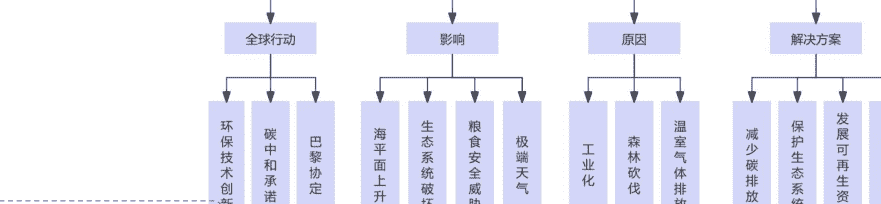

TFM实施步骤：

1. 定义主题原型：列出主题的关键特征和代表例子
2. 构建语义框架：创建与主题相关的概念
3. 设置重点梯度：按重要性排序相关概念
4. 构建主题引导：设计特定的关键词来保持聚焦

- 重要关键词：气候变化、全球变暖、碳排放、可持续发展
- 预期影响：气候变化的证据

## 细节增强策略（DES）：深化内容

DES的理论基础：
DES整合了认知叙事和信息处理理论，开发以下策略：

| 多模态描述 | 微观—宏观连接 | 对比强化 | 时空 |
| :--- | :--- | :--- | :--- |
| 数据可视化 | | | |
| 概念 | 案例 | | |

DES实施步骤：

1. 识别关键概念：确定需要详细的核心
2. 设计细节矩阵：为每个概念创建多维度的细节
3. 构建微观-宏观桥接：设计连接具体事例
4. 创建感官描述：为抽象概念设计具体的感官描述
5. 制定策略：规划将数据转化为生动的叙述或形式

- 内容全面性
- 逻辑深度
- 创新性
- 实践指导
- 跨学科整合
- 未来展望

为了使生成的气候变化文章更加深度和细节，可以利用DES（Detailed Explanation Strategy）构建一个细节矩阵。

## 跨域映射机制（CMM）：激发创新思维

CMM的理论基础：
CMM借用了认知语言学中的概念隐喻理论和认知科学的类比推演：

| 结构映射 | 属性转移 | 关系对应 | 抽象模式 |
| :--- | :--- | :--- | :--- |

CMM实施步骤：

1. 源域选择：根据任务需求找到合适的类比
2. 射点识别：确定源域和目标域关键对应点
3. 类比语义：创造性地将源域概念应用于目标域
4. 类比细化：调整和优化类比，确保其恰性和新颖

### 应用示例

任务：创建一个跨领域探讨网络安全的文章，运用人体系统作为核心类比。

(1) 以相同语言的方式介绍免疫系统和网络安全系统的相似性，为后续设定调。
(2) 层次类比：
a. 将防火墙和访问控制形成皮肤和黏，解释它们作为第一道防线。
b. 接入检测系统如何类白细胞在网络中“巡逻”，辨别和应对敌人。
c. 解释签名式病毒类似于体抗，能够识别已知威胁。
d. 比较免疫隔离和隔离过程与免疫爆发的相似性，都是为了防止“感染”扩散。
e. 讨论威胁数据库类似于免疫记忆，使系统能够灵活应对重复出现的。
(3) 深入启发启示：
a. 分析免疫系统的连续性如何启发开发网络安全的设计。
b. 探讨免疫系统的分层防御策略如何应用于网络安全的纵深防御机制。
c. 讨论过度反应（如过敏）可能对应的网络安全问题（误报或过度限制）。
(4) 创新思路：
a. 提出“数字泡沫”概念，讨论如何模拟攻击来增强系统抵抗力。
b. 讨论“网络生态”概念，类比人体卫生如何预防疾病。
c. 探索“数字共生”概念，类比人体内的淋巴结，讨论如何利用良性AI增强网络安全。
(5) 挑战与展望：
a. 分析此类类比的局限性，指出免疫系统和网络安全系统的关键差异。
b. 展望未来：讨论如何引入生物其他特性来增强网络安全。

注意：在使用类比时，保持科学严谨性，避免过度复杂的技术概念。尊重原文的生动，寻求有实质的技术深度。

## 概念嫁接策略 (CGS): 创造性融合

CGS的理论基础：

CGS借鉴了认知科学中的概念整合理论，概念嫁接策略的基本构成如下：

| 输入空间定义 | 明确融合的两个或多个概念领域 |
| :--- | :--- |
| 通用空间识别 | 找出输入空间之间的共同特征 |
| 选择性投射 | 从输入空间选择相关元素进行融合 |

### 应用示例

任务：尝试将“社交媒体”和“传统图书馆”这两个概念进行嫁接，设计一个全新的平台。

(1) 输入概念：
* 社交媒体：即时性、互动性、个性化、病毒传播
* 传统图书馆：储备、系统性、学习
(2) 共同特征：
* 信息存储和检索
(3) 融合点：
* 实时互动、 知识深度
* 个性化路径

CGS实施步骤：

1. 选择输入概念：确定要融合的核心
2. 分析特征：列出每个输入概念的关键特征和属性
3. 寻找共同点：识别概念之间的共享特征
4. 创造概念融合：设计创新性连接
5. 建模建议：创建引导AI进行概念嫁接

## 知识转移 (KTT): 跨域应用

KTT的理论基础：

KTT基于认知科学的迁移学习和组织学习理论，提出了以下关键步骤：

| 源域识别 | 知识重构 |
| :--- | :--- |
| 知识抽象 | 应用验证 |
| 目标映射 | |

### 应用示例

假设想要改善在线教育平台的参与度，可以尝试从游戏领域迁移：

(1) 问题定义：提高在线教育平台的参与度
(2) 源域：游戏化机制、玩家心理学、设计、反馈系统
(3) 知识提取：
* 进度系统、社交互动、个性化挑战、即时反馈
(4) 相似性分析：
* 游戏场景 <->课程单元
* 技能提升 <->学习社区

KTT实施步骤：

1. 定义问题：明确目标域需要解决的问题
2. 寻找源域：搜索可能包含相关知识或方法的领域
3. 知识提取：从源域提取关键的技能或方法
4. 相似性分析：分析源域和目标域之间的结构相似性
5. 迁移策略设计：制定从源域到目标域的迁移策略
6. 构建迁移提示：创建引导AI进行知识转移

## 随机组合机制（RCM）：打破常规思维

RCM的理论基础：

RCM建立在创造性思维中的“强制联系”和“创意综合”理论基础上，将这些理论应用到AI内容生成领域，提出了以下步骤：

| 元素库构建 | 创建包含多样化元素的知识库 | 强制联系 | 将随机选择的元素强制性地联系起来 |
| :--- | :--- | :--- | :--- |
| 随机抽取 | 从元素库中随机选择元素 | 创意整合 | 基于随机组合生成新的概念 |

RCM实施步骤：

1. 定义创意领域：明确需要创新的具体领域或问题
2. 构建多元元素库：收集与创意领域相关和不相关的多元化元素
3. 设计随机抽取机制：创建一个可以随机选择元素的系统
4. 制定组合规则：设定如何将随机元素组合在一起的规则
5. 生成组合提示：创建引导AI进行随机组合

假设为一家咖啡连锁店设计一个创新的营销活动，可以使用RCM激发创意。
元素库构建：

* 创意相关：豆种、烘焙、萃取、风味
* 文化艺术：音乐、绘画、舞蹈、文学
* 科技：AR、VR、AI、物联网
* 环保：可持续、回收、碳中和、生物屏障
* 社交：社交互动、直播、社区、互动

## 极端假设策略 (EHS): 突破思维边界

EHS的理论基础：

EHS借用了“逆向思维”和“假设性思考”的概念，开发了以下策略：

| 常规假设识别 | 明确当前领域的常规假设 | 后果探索 | 深入探讨极端假设带来的影响和机会 |
| :--- | :--- | :--- | :--- |
| 极端反转 | 将常规假设推向极端或完全反转 | 创新洞察提取 | 从极端从中提取可能的创新点 |

EHS实施步骤：

1. 识别常规假设：列出在特定领域被广泛接受的假设
2. 生成极端假设：将这些假设推向极端或完全反覆
3. 构建极端场景：详细描述如果极端假设真的变成怎样
4. 探索影响：分析极端假设对各个相关方面的潜在影响
5. 提取创新点：从极端场景中提出的可能的创新机会
6. 构建极端假设提示：创建引导AI进行极端假设的提示

任务：以“未来教育”为主题，运用极端假设策略来激发创新思维。
常规假设：

+ (1) 学校是学习的主要场所
(2) 教师是知识的主要传播者
(3) 学习需要长时间的努力
(4) 考试是评价学习结果的主要方式


## 多重束约策略 (MCS): 激发创造性问题解决

## MCS的理论基础：

MCS基于创造性问题解决理论和设计思维中的有限性思维概念，提出了以下关键步骤：

| 约束条件设定 | 制定多个具有挑战性的限制条件 | 创造性妥协探索 | 寻找满足所有约束的创新解决方案 |
| :--- | :--- | :--- | :--- |
| 约束间矛盾分析 | 识别约束之间的潜在冲突 | 约束突破思考 | 探索创造性地绕过或重新定义约束 |

## MCS实施步骤：

| 应用示例 |
| :--- |
| 1. 问题定义：明确需要解决的核心问题 | 2. 约束条件列举：设置多个具有挑战性的限制条件 | 3. 约束影响分析：评估每个约束对问题解决的影响 | 4. 创新方案构思：在多重约束下寻找创新解决方案 | 5. 约束重构：必要时重定义或调整约束条件 |

- **任务**：用多重约束来设计一款创新的智能家居产品。
(1) 核心问题：设计一款多功能智能家居设备
(2) 约束条件：
- 产品体积不能超过一个标准脸盒
- 必须同时满足5个不同的家居需求
- 产品售价不超过1000美元
- 使用100%可回收材料制造
- 适用于从儿童到老人的所有年龄段

## 语体模拟（RSM）：精准捕获语言特征

## RSM的理论基础：

RSM建立在语言学中的语域理论和语体分析的基础上，关键步骤如下：

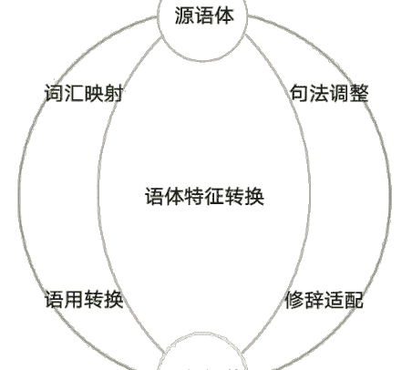

| 语体特征识别 | 语体要素提取 |
| :--- | :--- |
| 语境因素考虑 | 语体规则构建 |

### RSM实施步骤：

1. 确定目标语体：明确需要模拟的具体语体风格
2. 收集语料样本：搜集目标语体的典型文本样本
3. 分析语体特征：从词汇、语法、修辞等多个维度分析语体特征
4. 提取关键元素：识别和提取构成语体的独特语体元素
5. 构建语体指南：创建详细的语体使用指南
6. 生成模拟提示语：创建引导AI模拟特定语体的提示语

### 应用示例

假设需要AI生成一模拟莎士比亚风格的短文，可以使用RSM来指导AI更准确地捕获莎士比亚风格的语言特征。
莎士比亚风格特征分析：

- 词汇：使用英语词汇，创造性的复合词
- 语法：倒装句。不规则的相反
- 修辞：大量的比喻、隐喻和关联
- 韵律：多用抑格五音步
- 主题：常涉及情感、权力、背叛等永恒主题

## 情感融入策略 (EIS): 增强文本感染力

## EIS的理论基础：

EIS基于情感语言学和心理语言学的研究成果，开发了以下策略：

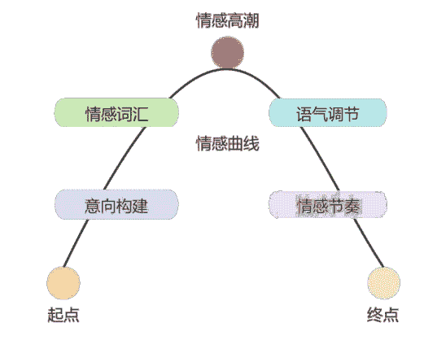

### EIS实施步骤：

1. 确定目标情感：明确文本要传达的主要情感基调
2. 创建情感词库：收集与目标情感相关的词汇和短语
3. 设计情感曲线：规划文本中情感强度的变化趋势
4. 选择情感触点：在文中插入情感元素的关键位置
5. 构建情感场景：创造能引发情感共鸣的具体场景或细节
6. 生成情感融入提示：创建引导AI注入情感元素的提示词

### 应用示例

假设需要AI生成一段关于“离别”主题的短文，可以使用EIS来指导AI更好地融入情感元素。
情感分析：
- 主要情感：悲伤、不舍
- 次要情感：希望、感谢

## 修辞技巧应用 (RTA): 提升语言表现力

## RTA的理论基础：

RTA基于修辞学和文学的理论，将这些理论应用到AI内容生成过程中，提出了以下关键步骤：

| 修辞技巧识别 | 修辞整合 |
| :--- | :--- |
| 语言适配 | 效果评估 |

### 应用示例

假设需要AI生成一段描述城市夜景的落子，可以使用RTA来指导AI更好地运用修辞技巧。

- **修辞技巧选择**：
- 主要技巧：比喻、拟人、排比
- 辅助技巧：对比、夸张

## 语言风格内化：整合情感修辞技巧

为了让语言模拟、情感融入和修辞技巧有机结合，可以采用以下策略：

## RTA实施步骤：

1. 确定任务目标：明确文本的主要目的
2. 选择核心修辞：选择2—3主要修辞的
3. 设计修辞示例：为选定的修辞手法创建使用范例
4. 安排修辞分布：规划修辞技巧在文本中的分布
5. 创建平衡策略：确保修辞技巧不超过刻意或过度
6. 生成修辞应用提示：创建AI运用修辞技巧的提示语

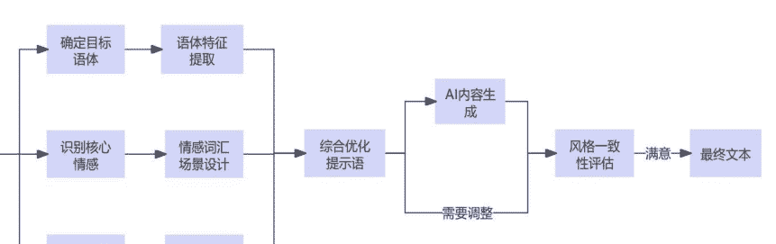

# 元叙提示框架：设计生成自反性文本的高阶提示（一）

元叙提示框架创新技巧，包括嵌入式自反提示、层次叙述提示、时序提示以及读者元叙述。这些方法通过层次叙述结构和交互机制，提升AI生成内容的深度和复杂度。

- 设置特定的词语或自反触发器
- 指导AI在这些点上主叙事，插入对内容生成过程

| 应用示例 |
| :--- |
| (1) 创建一个500字左右的科幻篇，主题是“时间旅行的道德境”。(2) 在每个关键情节后，插入一段提示，解释：a. 为什么你选择这个情节 b. 你考虑过其他主题 c. 这个选择如何推动叙事。(3) 在故事结束后，提供200字左右的整体创作过程，包括：a. 你遇到的主要挑战 b. 你认为成功和改进的部分 c. 如果重新创作，你会做出不同的选择。确保主叙事与元叙述有所区分，突出特性。开始你的创作。 |

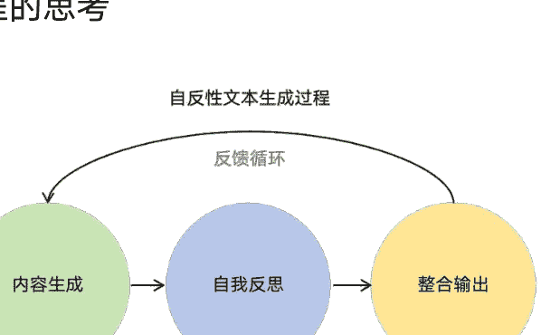

# 元叙提示框架：设计生成文本的高阶提示（二）

递归元叙提示

- 多层次叙事结构，每一层都包含上一层的反思
- 在递归过程中探索创作的本质和限制

角色转换

- 为每个人设定角色和语言风格
- 设计角色之间的互动


### 应用示例

[系统指令]你是一个递归叙事生成器。你的任务是创作三层递归。每一层都包含对上一层的反思和讨论。遵循以下步骤：

(1) 第一层叙事：写一个200字的微小说，主题是“创作的困境”。(2) 第二层叙事：用150字让你第一层叙事的过程，讨论：如何诠释“创作的困境”这个主题、在创作过程中遇到的困难。(3) 第三层叙事：用100字反思第二层叙事的经历，探讨：评价自己创作的挑战、这种递归结构如何影响你对创作本质的理解。(4) 最后，用50字总结递归叙事的意义，思考这种创作方式对创作可能的推动。

### 应用示例

[系统指令]你扮演两个角色：一个是小说家A，另一个评论家B。你们将创作一篇关于“人工智能”的文章。遵循以下规则：

(1) 小说家A：用小说的方式写人工智能的各个方面。每写200字，让评论家B进行讨论。(2) 评论家B：对A写的简短文字进行批评和分析。评论要简洁，不超过50字。(3) 互动规则：A在看完B的评论后，在某种程度上采纳建议，调整写作内容。如果不符合B的预期，可以在后续写作中巧妙回应。(4) 整体结构：文章长度控制在1000字左右。以整体性的反思结果结尾。确保A和B的逻辑清晰，且形成一个连贯的叙事故事。

## 元叙提示框架：设计生成自反性文本的高阶提示（三）

读者互动元叙提示

- 设计需要读者决策的分支点
- 在文中植入对读者选择的反思

应用示例

创建一个交互式元叙短剧，遵循以下结构：

(1) 开场：介绍一个主角面临重大决定需要选择的场景。
(2) 设置两个关键决策点，每个决策点提供两个选项。例如：
- a. 决策点1：[选项1A] 或 [选项1B]
- b. 决策点2：[选项2A] 或 [选项2B]
- c. 决策点3：[选项3A] 或 [选项3B]
(3) 对于每个决策点：
- a. 需要描述每个选项可能导致的结果
- b. 加入读者选择者对可能选择的预测和评论
- c. 无论选择哪选项，都要继续讲述故事
(4) 在叙事过程中，插入对以下内容的反思：
- a. 读者的选择如何重塑故事
- b. 作者、角色和读者之间的关系
- c. 自由意志与预设叙事路径的矛盾
(5) 结尾：
- a. 根据读者的选择呈现一个结局
- b. 提供一个元总结，反思整个互动过程的意义

要求：

- a. 保持每一分的连贯性
- b. 在叙事中融入哲学思考
- c. 字数控制在120字左右

创建一个交互式元叙故事作品，展示所有可能的分支和结局。

## 文案写作的提示语设计

在商业环境中，优质的文案起到了品牌与消费者之间沟通的关键作用。它不仅要准确传达信息，还需要激发情感共鸣，从而有效让目标众作出决策。文案写作中最重要的维度包括：
- 信息传递：清晰、准确
- 情感共鸣：触动、相关
- 行动引导：说服、激励

## 文案写作的三大要素

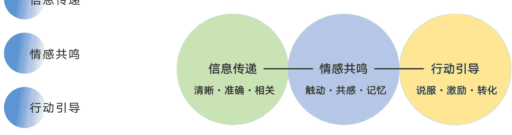

# 信息传递：设计清晰、精准框架

在商业文案写作中，有效的信息传递是基础，信息的核心在于清晰和精准。

## 信息传递特质设计

1. 信息传递顺序
2. 表达清晰
3. 结构严密
4. 受众针对性强
5. 记忆点突出

信息传递指令：在提示中明确指出目标。字数限制：为每个信息点设定。逻辑关系：明确信息点之间的关联。受众描述：包含目标特征特征。核心强化：要求文中重复表达核心信息。

- a. 主要特性1：[特性名] (20字描述)
- b. 主要特性2：[特性名] (20字描述)
- c. 主要特性3：[特性名] (20字描述)
(3) 目标说明（50字以内）：描述用户的特征和需求。
(4) 产品优势（30字以内）：提炼3个最具竞争力的优势。使用对比或选择性语句。

### 应用示例

为[产品名称]创建一个产品文案，目标是实现清晰、精准的信息传递。遵循以下结构和要求：

(1) 核心信息（最高，50字以内）：a. 主要功能 b. 核心价值主张。用一句有力的话，包含关键词1和关键词2。
(2) 功能亮点（次优，50字以内）：a. 主要特性：[特性名] (20字)。使用简洁的句子，避免冗余。每个部分之间使用视觉分割。关键信息添加标记，不超过3个。确保整体读性控制在Flesh-Kincaid水平。生成一个完整文案。

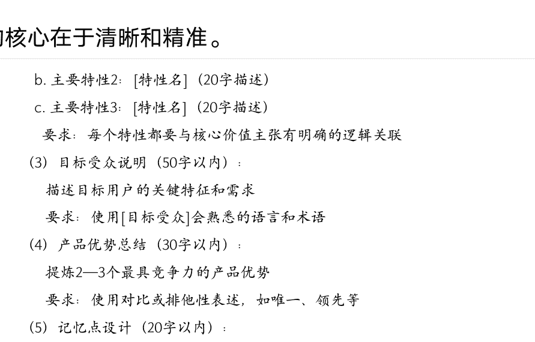

## 情感共鸣：设计触发反应

在商业文案设计中，情感共鸣是影响消费者行为的重要因素，核心在于共情。

| 优秀文案的情感共鸣特质 | 提示设计技巧 |
| :--- | :--- |
| 1. 情感共鸣说明 | 情感关键词：在提示中明确指定情感 |
| 2. 多感官体验 | 感官词汇：使用视觉、听觉、触觉等感官相关的描述 |
| 3. 情感强化 | 场景设定：创建与产品相关的具体描述 |
| 4. 情感层次丰富 | 情感递进：设计从基础到高级的情感递进 |
| 5. 共情叙述 | 叙事结构：要求化的叙事方式来体现品牌价值 |

信息传递指令：在提示中明确指出。字数限制：为每个信息点设定。逻辑关系：明确信息点之间的关联。受众描述：包含目标特征特征。核心强化：要求文中重复表达核心信息。

- 出点：目标在该情境中面临的问题或挑战（30字）
- 由此产生的情感反应（40字）
- 展现如何解决问题并转化情感（80字）：每个部分都有明确的情感词汇，情感要有感染力。
(4) 品牌价值主张（50字以内）：用具有感染力的语言描述核心价值。要求将性价值与情感价值相结合。
(5) 情感高潮（100字以内）：描述产品后的理想状态或震撼的未来。使用比喻或悬念手法，增强文案的感染。
(6) 共情的结果（30字以内）：设计一个能引发读者共鸣的暗示性语言。使用第二人称，增强互动。

### 应用示例

(1) 情感基础设定（20字以内）：明确指出体现的情感核心，用温暖激励消费者。

## 行动引导：设计促进决策和行动

在商业文案写作中，最终目标往往是促众采取行动，行动引导的核心在于说服和激励。

| 优秀文案的行动引导 | 提示设计技巧 |
| :--- | :--- |
| 1. 明确的引导 | 行动明确化：在提示中明确指出众采取的具体行动 |
| 2. 强烈的迫感 | 时间限制设置：要在文案中加入限时优惠或稀缺信息 |
| 3. 低门槛的起始步骤 | 简单行动设计：要求一个简单、具体的步行动 |
| 4. 清晰的收益描述 | 利益强化：明确列出行动后的具体收益 |
| 5. 社会证明的运用 | 案例/数据：要求用户提供真实或数据支持 |

### 应用示例

为[产品/服务名称]创作一个促销文案，目标是有效引导目标受众立即行动。请遵循以下结构：

(1) 引起注意（30字以内）：创建一个引人的标题，包含动词和具体数字，如“立省30%”、“7天优惠”等等。
(2) 行动明确化（20字以内）：明确结束受众采取的行动。使用动词，明确具体元素，如立即订阅、在注册时。
(3) 核心利益点（3点，30字以内）：列举行动后能获得的好处。每个利益点都是具体的、量化的，并与目标的需求直接相关。
(4) 紧迫感（50字以内）：创造一个不行动就会失去的情景。使用限时优惠或供应等，给出具体的截止时间或数量。
(5) 社会证明（2~3条，每25字以内）：提供真实或数据支持，如90%的用户表示效果显著。
(6) 低门槛起始步骤（40字以内）：设计一个简单的步行动。这个步骤通常容易，降低用户的压力。
(7) 行动召唤：创造有力的行动。使用强烈的语言，如立即、现在。
(8) 损失回避（30字以内）：描述不采取可能导致的损失。使用对比手法，找出行动。在文中加入2~3个迫感相关的语言。使用视觉焦点，加粗。确保整体读性。生成一个促销文案。


# 营销策划提示设计

在当代营销环境中，有效营销策划是品牌成功的关键。设计高质量的营销策划，核心在于创新、精准和可行。通过提示确保生成的执行具有实操性。

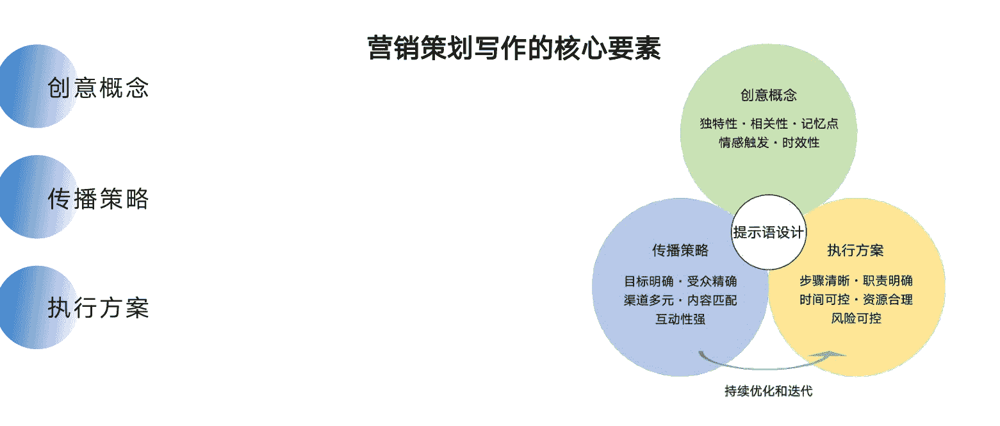

## 创意概念：激发创新思维

理论层面：

独特性 | 相关性 | 记忆点 | 情感触发 | 时效性

方法层面：

1. 跨领域联想
2. 品牌DNA融入
3. 记忆点设计
4. 情感地图构建
5. 趋势融合

### 应用示例

为[品牌名称]设计一个营销概念，用于其[具体产品/服务]的推广。遵循以下要求：

(1) 核心创意：结合[品牌领域]和另一个看似相关的（或不相关的）领域的元素，提出一个独特的创意。
(2) 品牌价值融入：解释该创意与品牌的核心价值1、核心价值2。
(3) 记忆点设计：创造出一个朗朗口的口号或标语，需包含双关或文字游戏。
(4) 情感触发元素：基于[目标画像]的情感需求，设计一个能引起强烈共鸣的创意。
(5) 时效性接钩：将创意与当前热门社会话题或现象联系起来，突出时效性。
(6) 表现形式：提出2—3种可能的表现方式，至少包含一种创新的媒体形式。
(7) 病毒扩散：解释该创意如何具备病毒传播的潜力。额外要求：确保创意在挑战常规的同时不会引起争议或负面解读。考虑创意的可持续性，思考将其发展为一个长期的运营主题。

## 传播策略：设计精确定位

理论层面：设定3个SMART目标，兼顾品牌影响力、参与度和转化率。每个目标都是具体的数字指标和时间框架。

(4) 核心指标：提炼1个信息和3个支持性信息。这些信息与品牌属性一致，并能引起目标众的关注。
(5) 全渠道矩阵：设计一个包含至少7个渠道的传播矩阵，包括社交媒体、线下活动、持续媒体等，每个渠道的具体内容和预期效果。
(6) 内容策略：为3个主要渠道设计差异化的内容，每个渠道包含内容形式、主题方向和元素，解释如何与用户路径的不同阶段匹配。
(7) 创新手法：提出1个常规或非常规的传播方式。这个方法能够提升活动的趣味性与参与度。
(8) KOL合作计划：设计一个层次化的KOL合作策略，包括头部KOL、腰部KOL和微信KOL的不同方式。
(9) 时间线：绘制一个具体的时间表，涵盖预热、活动、持续和维持阶段。标注关键时间节点和对应的传播点。
(10) 评价标准：设定5-7个关键绩效指标（KPI），兼顾量、参与、转化和品牌健康等方面。数据来源和频率。
(11) 风险应对：列出2-3个可能的传播风险，并为每个风险提供相应的应对策略。预算分配。

| 目标明确 | 受众精准 | 内容匹配 | 互动性 |
| :--- | :--- | :--- | :--- |

# 方法论量化指令

1. 目标明确
2. 受众画像详述
3. 全渠道思维引导
4. 形式多样化
5. 互动机制设计

### 应用示例

[为品牌名]的[营销活动名]设计一个全方位的传播策略。策略应能够在复杂的环境中精准触达目标受众，实现品牌目标。请遵循以下要求：

(1) 市场洞察：基于最新的市场数据，总结目标受众的3个核心趋势和2个痛点。
(2) 受众画像：分析2-3个核心目标受众群体，包括人口统计学特征、行为动机、价值观和媒体使用偏好。为每个群体设定一个击中人心的诉求。
(3) 目标诉求：


## 执行方案：设计可操作的行动提示

## 理论层面

4. 执行行动步骤包含：

### 步骤清晰 职责明确 时间可控 资源可用 风险可控

- 将此行程拆分为15—20个行动步骤。每个步骤应：
  - 行动描述
  - 责任人/部门
  - 开始和结束时间
  - 所需资源
  - 完成指标

5. 资源分配规划（1000字）：创建一个资源配置矩阵，横轴为时间，纵轴为资源类型，标注每个阶段的资源需求。

### 方法层面

6. 部门联控（800字）：设计2—3个关键的部门协作流程，如创意审批、内容制作、媒体投放等，使用流程图。

  - 1. 行动步骤分解 4. 资源分配引导
  - 2. 角色配合 5. 风险指标评估

7. 预算明细（1000字）：提供一份详细的预算分解，包括：各环节的具体体现—预留的应急资金以及主要成本控制措施，包括内容质量、用户活跃、技术实现等方面。

  - 3. 时间节点设定

8. 质量控制（900字）：定义3—5个关键的质量控制点和相应的检查标准，包含其发生概率和影响程度，为每个风险点制定特定的预防和补救措施。

### 应用示例

9. 风险沟通（800字）：制定一个与各利益相关者（高管、合作伙伴、媒体）汇报进展的机制，说明沟通渠道、方式和关键信息。

为[品牌名称]的[营销活动名称]设计一个清晰可行的执行方案。该方案能够将理念概念和传播策略转化为具体行动，确保活动的开展和目标达成。请遵循以下：

10. 应急准备（900字）：针对2—3个重大意外（包括重点项目延期、预算变动等情况）制定针对性的应急预案，包括影响范围、响应流程和补救措施。

  - 1. 执行团队（300字）：模拟一个执行方案的核心团队，包括内部人员和外部合作。

11. 执行计划（700字）：设计一个执行后报告、评估和持续改进建议。指明目标的达成情况和重要性。

  - 2. 项目里程程（1200字）：设定5—7个里程碑事件，每个里程碑包含具体目标、完成标准和节点。

创新执行
推荐1—2个项目管理工具或方法，解释它们如何提升执行效率和灵活性。基于以上要求，制定一份全面、清晰且具有操作性的执行方案。方案应包含对核心问题的应对策略、对传播素材的有效支持，以及所有可能的考虑因素。使用甘特图呈现整体时间线。

# 品牌故事的提示语设计

在数字化时代，品牌故事已成为连接企业与消费者的重要纽带。它不仅能传递品牌的核心价值，还能在情感层面与消费者建立联系。本节将探讨如何设计提示语，以引导生成富有感染力的品牌故事。本节将从品牌定位、价值主张和未来三个核心要素出发，通过关键考量、常见陷阱和提示语框架三个维度来详细阐述每个要素的重要性和设计方法。

## 品牌故事的关键元素

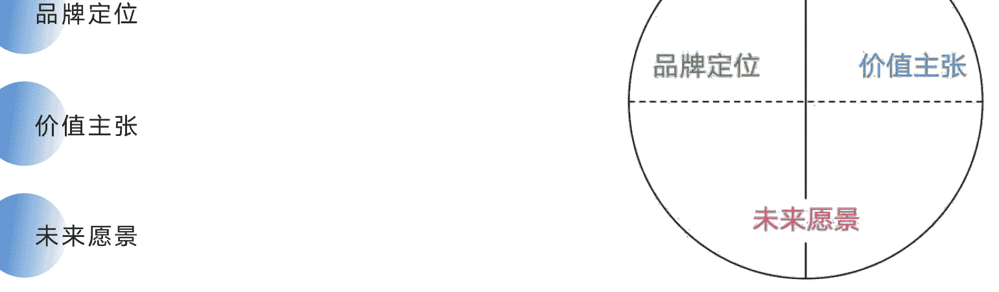

## 品牌定位：在市场中找到独特位置

## 关键考量：

| 目标市场的精准描述 | 竞争对手的分析和差异化策略 |
| 品牌个性和形象的一致性 | 与目标受众的情感连接接点 |

- 每个竞争对手的核心优势
- 品牌相对于每个竞争对手的独特优势
- 市场尚未被满足的需求或机会
- 品牌个性
- 用五个形容词描述品牌定位，并解释每个特质如何体现在品牌体验中。
- 价值主张：
  描述品牌为目标受众提供的核心价值和独特利益。说明这些价值如何解决客户的具体问题或满足其需求。
- 情感连接点：
  描述一个能够与目标受众产生强烈共鸣的品牌元素或故事。解释这个元素如何与受众的需求达成共鸣。
- 定位声明：
  综合以上信息，创作出一个有力的定位声明。这个声明应当清晰传达品牌是什么、为谁、提供什么价值。
- 视觉识别：
  提出2-3个能体现品牌定位的视觉建议（如标识、色彩、图像风格）。

 评价标准：

## 常见误区：

- 1. 定位过于泛泛，缺乏针对性
- 2. 过度模仿竞争对手，失去独特性
- 3. 忽视市场，定位边缘化
- 4. 品牌定位不能匹配，难以兑现承诺

## 应用示例：

为[品牌名]创建一个清晰独特的品牌定位声明，遵循以下指南：
(1) 核心定位：
用一个有力的话描述品牌的核心。确保该定位清晰传达品牌的独特价值和市场地位。
(2) 目标画像：
描述目标受众的细节，包括：
- 人口统计特征（年龄、性别、收入等）
- 心理特征（价值观、生活方式、兴趣爱好）
- 消费行为（购买动机、决策因素）
- 需求
(3) 竞争分析：
列出三个主要对手，并分析：

- 清晰：定位是否容易理解和记忆
- 独特性：是否明显区别于对手
- 相关性：是否与目标受众的需求和渴望相关
- 可信度：是否基于品牌的实际能力和智能
- 持续性：是否具有长期发展潜力

注意事项：
- 避免使用行业术语
- 确保定位简明有力，同时富有洞察力
- 考虑定位的可扩展性，以及未来的品牌发展
根据以上指南，创建一个富有洞察力的品牌定位方案。

# 价值主张：传递独特的品牌价值

## 关键考量：

| 产品/服务的核心优势 | 解决客户痛点的能力 |
|---|---|
| 情感和功能价值的平衡 | 价值主张的可信度和可证性 |

列举品牌产品或服务的3—5核心优势。每个优势都应该与竞争对手有明显的区别，并直接解决客户的痛点。

- (5) 情感价值：
  描述品牌如何在情感层面上与客户建立联系。包括品牌带来的情感体验、生活方式属性或成长等方面。
- (6) 证明机制：
  提供2—3支持价值主张的具体证据或数据。这可以包括客户证言、行业认证。
- (7) 差异化：
  解释品牌的价值主张与竞争对手区分开。强调独特之处。
- (8) 长期价值：
  描述客户使用品牌或服务可能获得的持续利益。
- (9) 视觉化：
  提供一个视觉展示。
- (10) 标识化：
  提供一个视觉元素。有助于增强品牌记忆。

## 常见陷阱：

- 1. 价值主张过于复杂，难以传达
- 2. 忽视情感价值，过度强调功能特性
- 3. 夸大其词，无法承诺
- 4. 与竞争对手过于相似

### 应用示例

为[品牌名]制定一个有力的价值主张，遵循以下指南：
(1) 核心优势：
用一句话描述品牌的核心。该话应当清晰有力，传达独特价值。
(2) 目标客户：
列出3—5个目标客户最关心的需求。详细描述它们的影响。
(3) 问题解决方案：
针对每个痛点，详细说明品牌如何解决问题。创建一个简洁版的价值主张，适用于快速传播。

标准：
- 清晰：价值主张是否易理解
- 相关性：是否直接解决目标客户的需求
- 独特性：是否区别于对手
- 可信度：是否有足够的证据支持
- 情感共鸣：是否在情感层面上与客户产生共鸣
- 执行性：品牌是否能够履行
基于以上指南，创建一个完全的价值主张。

# 未来愿景：描绘长远目标

## 关键考量：

与当前品牌定位的一致性和延续性，对行业和社会的积极影响

## 常见异常：

- 1. 愿景过于抽象，缺乏实际意义
- 2. 忽视社会责任，仅关注商业目标
- 3. 不能激发利益者的共鸣
- 4. 愿景与当前形象差距，缺乏可信度

设定3—5个实现愿景的关键里程程，这些里程程应当是具体的、可量的。
(8)全球愿景：描绘市场中的未来发展。
(9) 技术领先：预测利用新技术来实现愿景，包括创新领域。
(10) 伙伴生态：描绘与其他机构合作共同实现更大的目标。
(11) 励志口号：创造一个激励口号，体现共同奋斗的精神，具有影响力。
(12) 视觉构念：提出一个视觉元素，能够传达核心理念。

## 应用示例：

为[品牌名]创造一个富有影响力的愿景，包含以下元素：
(1) 愿景描述：
用一句话描述未来后的理想状态。富有活力，与核心价值一致。
(2) 行业领先：
描绘如何引领行业或改变格局。包括技术创新、商业模式革新水平。
(3) 社会贡献：
为社会带来积极影响。考虑环境保护、教育等方面的贡献。
(4) 客户价值：
评价标准：
- 一致性：与价值观一致
- 远见：展现了未来
- 可信度：基于优势，具有现实性
- 共鸣：能够激发利益者
遵循以上指南，创造一个具有感染力的未来愿景。

# 年终总结的提示设计

## 业绩回顾

## 成就展示

## 未来规划

业绩回顾部分旨在清晰、全面地展示过去一年的成绩。侧重于以下要点：
- 成果回顾
- 结构清晰
- 具体实例

成就展示部分应突出个人和团队在过去一年的创新、突破及贡献，侧重于：
- 团队贡献
- 创新与突破
- 个人荣誉

未来规划部分是年终总结的重点，设定明确目标和发展方向。遵循以下要求：
- 目标设定
- 行动计划
- 持续性

| 维度 | 提示设计 | 要求 |
| --- | --- | --- |
| 成果概述 | 请总结过去一年的主要工作，重点展示核心业务的推动作用。 | 业绩数据：列出关键业绩指标，如销售额、客户增长率、完成情况等；分析这些结果带来的影响，如市场扩张等。 |
| 数据支撑 | 提供支撑业务的具体数据并通过图表展示成果。 | 数据驱动：尽量使用百分比，如“销售增长了0%”或“客户满意度提升了10%”等数据；明确数据来源和依据，确保真实性。 |
| 项目亮点 | 列出过去一年中完成或参与的多个目标及成就，展现你在项目中的角色和贡献。 | 关键成果：列出项目名称、目标及自己的影响力；描述项目如何推动部门或团队实现，具体的贡献。 |

| 维度 | 提示设计 | 要求 |
| --- | --- | --- |
| 团队贡献 | [描述团队在协作中的表现，如跨部门合作、协调等]；列举团队在实现目标方面的成就，如“年度目标完成到120%”。 | |
| 创新突破 | 创新：列出创新的产品、流程或技术，取得突破性进展；展现其独特性；分析其如何解决了哪些问题或带来了哪些改变。 | |
| 个人荣誉 | 荣誉奖励：列出获得的奖项、称号或荣誉；个人荣誉：通过个人努力推动了业务和团队的进步。 | |

| 维度 | 提示设计 | 要求 |
| --- | --- | --- |
| 目标设定 | 明确具体的工作目标，如“实现XX拓展客户”等目标量化，明确并确保目标达成的可行性。 | 为每个目标量化，如“年度增长30%”或“增加10个客户”。 | |
| 行动计划 | 列出实现目标的步骤，如“提升服务”、“加强互动”等。 | 为目标设定明确的时间和阶段。 |
| 发展方向 | 设定个人的规划；拓展领域或设定未来。 | |

# 玩转公众号：内容的提示策略

## 平台特性与算法

微信公众号具有核心特性：私域流量、深度阅读、规范体系和互动机制。这些特性直接影响提示设计的方向：

- 私域流量
- 深度阅读
- 规范体系
- 互动机制

## 选题规划

高质量的内容通常体现以下特点：层次感、节奏、互动性。基于这些特点，结构设计应遵循：

- (1) 明确结构：在提示词中预设整体框架，确保每个部分的侧重。
- (2) 设置深度：针对不同层次，规定深度要求。
- (3) 预设互动：在提示词中规划互动位置，确保自然引入。
- (4) 控制信息密度：通过提示语调控段落密度，避免疏散或密集。

应用示例：

```
任务目标：生成[具体领域]的选题。
背景信息：
- 粉丝定位：
- 目标读者：
- 读者需求：
要求：
(1) 生成10个选题方向：
- 主题
- 副标题
- 核心观点
- 价值主张
(2) 每个选题包含：
- 主题
- 副标题
- 核心观点
- 价值主张
(3) 考虑时效性与平衡。
输出格式：

| 私域流量 | 深度阅读 |
| --- | --- |
| 精准群体 | 完整阅读 |
| 高频互动 | 深度内容 |
| 运营 | 高质量内容导向 |
| **公众号平台特性** | |
| 规范体系 | 互动机制 |
| 内容审核机制 | 赞赏 |
| 发布流程 | 转化分享 |
```

## 创作引导（一）

微信公众号作为深度阅读，内容创作需要在吸引力、专业性和传播性之间平衡。设计设计应遵循以下原则：

- (1) 明确维度：
  在提示词中指明类型，如解决方案、分析、分享。
- (2) 设定语气：
  根据基调，可以是严谨型、明快型或和型。
- (3) 规定结构：
  包含核心要素，如热点、数据、观点等。
- (4) 吸引力与专业性：
  在提示语中约束。

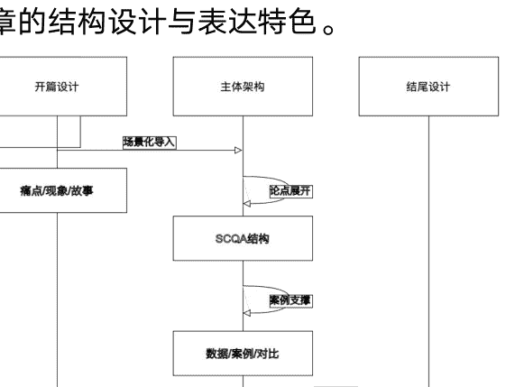

## 创作提示

优质的文章通常具备以下特质：

| 信息密度 | 差异价值 | 时效性 | 平台调性 |
| --- | --- | --- | --- |

### 应用示例

基于以下要素生成文章：
主题：[主题]
核心观点：[观点]
目标读者：[群体]
价值类型：分析型/方法类/经验型
表达基调：专业/温和
差异化要求：
- 竞品分析
- 深度
- 专家引领
生成要求：
- 提供3个方案
- 每一个方案明确亮点

## 创作引导（二）

### 应用示例

高质量的内容结构通常体现以下特点：

- (1) 明确结构：
  在提示词中预设整体框架，确保每个部分的侧重。
- (2) 设置深度：
  针对不同层次，规定深度、案例数量。
- (3) 预设互动：
  在提示词中规划互动位置，确保自然引入。
- (4) 控制信息密度：
  通过提示语调控段落密度，避免疏散或密集。

```
任务描述：创作一篇深度分析文章
主题：【主题名称】
目标：【写作目的】
一、结构化设计：
（1）开头模块：800字以内
（2）引导问题：从[数据/现状/热点]切入
呈现展现：明确主旨与形成结论
核心观点：提出独特视角与解决思路

（二）主体部分：2500字左右
分述展开：3—4个节点
每个节点包含：
* 观点展现：150字左右
* 原理分析：300字左右
* 案例连接：2个典型案例
* 数据支撑：权威来源数据
* 专家意见：引用权威结论

（三）结语部分：700字以内
总结：呼应开头
趋势展望：前瞻性视角
行动建议：3—5点可执行建议

二、互动设计：
（1）开头互动：设置引发思考的问题
（2）主体互动：在章节节点后设置提问
（3）结尾互动：邀请读者分享经验与观点

三、内容风格：
（1）信息密度控制：
以故事为主，引发共鸣
- 主体：以结论为主，配比论述40% + 案例30% + 数据20% + 专家意见 10%
- 结尾：用引言和建议为主，突出核心价值点

（2）段落论述：250—300字
- 案例连接：200—250字
- 数据分析：150—200字
- 过渡连接：100字左右

四、高级拓展：
(1) 逻辑扩展
(2) 观点之间：通过递进/并列/转说明
(3) 逻辑支撑：多维度视角，避免单一类型限制
(4) 深度挖掘

- 表现：展现观点与问题呈现
- 原因分析：内在逻辑与逻辑总结
- 深层：通过调研与整合结论

- 风格把控：
- 语言风格：专业中
- 专业术语：核心概念解读到位
- 表达方式：逻辑清晰
```


# 驾驭微博：短平快传播中的提示语设计

## 平台特性与传播机制

微博平台具有四大核心特征：实时性、社交属性、话题引导和多媒体融合。这些特征直接影响提示语设计的策略方向：

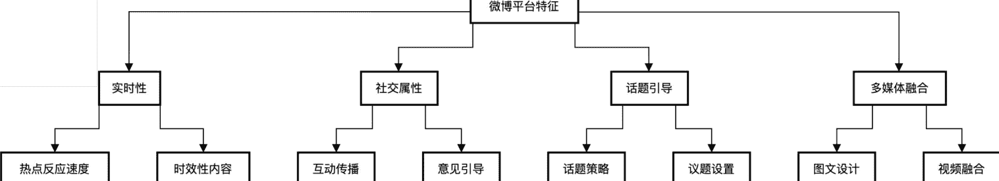

- (1) 实时性要求提示语必须具备快速响应能力，支持热点话题的跟进与创作。
- (2) 社交属性决定了内容需要具备强的互动性和对话感，提示语设计要融入互动机制。
- (3) 话题引导能力使平台成为舆论场，提示语需要掌握议题设置的技巧。
- (4) 多媒体融合特性要求提示语能够调度文字、图片、视频等多种内容形式。

- 微博的内容分发主要依赖于以下路径：
- 粉丝关系链传播
- 热门话题引流
- 兴趣推荐算法
- 转发评论互动

## 内容策略的提示设计（一）

内容策略的提示设计不仅涉及到信息传递的准确性，还要考虑应用平台特性、用户需求差异、内容传播效果、创造力的激发以及生成过程中的灵活性和控制性，具体可行的策略如下：

### 基础框架

### 差异化策略

微博内容创作的关键在于把握“短平快”的平台节奏，同时又要确保内容的价值密度。基于平台特性，提示框架设计需要关注以下维度：

针对不同类型的微博内容，提示设计需要采取差异化策略。这种差异不仅体现在内容形式上，更要在创作思路和传播策略上有所区分：

| 内容类型 | 核心特点 | 关键要素 | 提示设计点 |
| --- | --- | --- | --- |
| 热点追踪型 | 快速响应、观点鲜明 | 热点跟进、独特视角、价值延展 | 抓取热点、突出差异、预设 |
| 原创内容型 | 深度核心、专业价值 | 专业领域、创意策略、方法论 | 框架搭建 |
| 话题引导型 | 议题引导、观点引导 | 话题引导、观点延续、互动 | 议题设计、闭环 |
| 品牌营销型 | 价值传递、转化目标 | 品牌调性、用户痛点、解决 | 价值传递、情感共鸣、行动 |
| 互动娱乐型 | 松感、互动 | 话题主题、互动机制 | 创意设计、传播 |

### 内容策略的提示设计（二）

### 热点聚焦型

- 基于热点事件创作
- 核心业务：
- 陈述：呈现核心事件
- 专业解读：结合视角
- 延伸思考：提供独特观点
- 避开热门话题：差异化处理

### 原创内容型

- 创建主题内容
- 内容结构：
- (1) 核心结论：编写
- (2) 专业解析：理论依据
- 实践案例
- (3) 互动设计：设置引发性
- 传播策略：关联相关话题

### 话题引导型

- 话题引导设计：
- 主题：#话题#
- 引导策略：
- (1) 设置：核心问题
- (2) 互动：投票/回应
- 引导方向
- 情绪基调：保持积极包容性

### 品牌营销型

- 品牌内容创作指南：
- 营销目标：#目标#
- 内容架构：
- (1) 品牌元素植入：占比30%
- 产品/服务亮点
- 品牌价值支撑
- (2) 内容策略：场景化描述

### 互动娱乐型

- 互动娱乐内容设计：
- 形式类型：测试/问答/互动
- 内容架构：
- (1) 引入部分：设置悬念卖点
- 情境描述
- (2) 互动机制：参与方式说明
- 互动激励
- 用户端关联
- 解决方案呈现
- (3) 传播：
- 话题：#话题#
- 互动：投票/问答
- 注意事项：
- 避免直接宣传
- 强化价值
- 保持自然感
- (3) 话题延续：衍生方向
- 二次创作空间
- 调整性：轻松灵活
- 适用性驱动：正向引导

## 话题与标签应用

微博话题是重要的入口，提示语需要规范话题使用策略：

### 话题选择原则

- 与内容高相关性
- 活跃度适中的话题
- 避免过度竞争的热门话题

### 标签使用策略

- 核心话题前置
- 相关话题补充
- 品牌话题植入

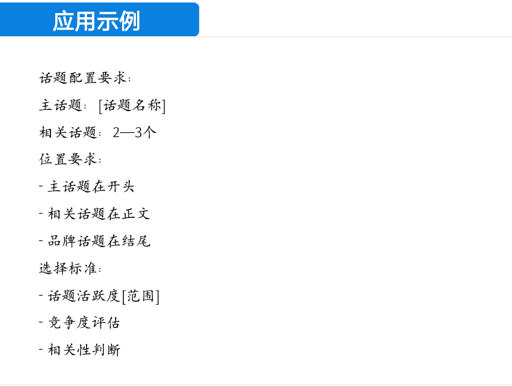

## 传播策略的设计

微博内容的传播效果很大程度上取决于策略，提示语需要涵盖以下维度：

### 热点借力

- 热点筛选：设定热点选择的标准，如热度、受众引起程度等
- 角度创新：找到差异化的切入点，避免同质化
- 时机把握：明确内容发布的最优时间窗口

- 热点借力：内容生成需求：
- 主题背景：[当前热点]
- 热度指标：[热门搜索/话题讨论]
- 目标对象：[用户群体]
- 差异化需求：
- 分析未见角度
- 提出新的切入点
- 设计以引发共鸣
- 传播策略：
- 话题选择
- 关键信息引导互动设计
- 引导策略

### 应用示例

- 发布频率：依据账号定位和粉丝活跃度设定
- 内容分类：不同类型的比例配置
- 互动时间：明确重点互动的阶段

请帮定制微博账号的内容排期规划：
账号信息：
- 定位：[账号定位]
- 目标对象：[受众]
- 当前粉丝量：[数量]
- 内容领域：[领域]
需要考虑的发布时间，包括：
(1) 设定一周的发布时间表，包括：
- 每天的发布时间
- 最佳发布时间
- 不同类型的内容
(2) 设定内容形式，包括：
- 各内容的比例
- 不同形式的发布时间
- 与粉丝互动
请给出详细的排期建议，并说明每个安排的理由。同时，提供热点响应的策略建议。

### 内容设计

- 引起引导：设计能够触发用户达的互动语
- 转化激励：通过设置或福利机制提升转化意愿
- 私信响应：规范化的私信回复

- 为以下内容设计：
- 主题：[主题]
- 内容形式：[图/视频/文字]
- 互动目标：提升转化/话题度
- (1) 引导方案：设定引起关注的问题
- 最佳时机
- 转化策略：让用户跳转
- 互动：确保自然
- 扩展性：考虑互动性。

# 小红书布局

### 平台特性与分发机制

小红书具有三大核心特征：生态、社区氛围和垂直。小红书的内容呈现主要依赖三个层面：推荐流、兴趣标签、搜索发现。其中，推荐流形式要求内容在标题上具备足够的吸引力；搜索则考虑信息的完整性。

### 创作原则

- 1. 注重实用性与分享性
- 2. 情感共鸣与个性化表达
- 3. 视觉与文字的协同
- 4. 视觉导向

## 种草文案

### 信任建设

信任建设的关键在于专业性与真实体验相结合，打造信任框架。

| 维度 | 提示语示例 | 要求 |
| --- | --- | --- |
| 背景 | 请设计一个信任框架 | 产品类型：[具体类别] |
| 身份/专业领域：[具体类别] | 专业背景展示 | 避免套路 |
| 内容构成 | 真实历程分享 | 呈现真实细节，保持客观 |

### 场景化表达

通过具体生活场景描绘，让内容具代入感。场景化不仅仅是讲述过程，而是帮助用户构建真实的场景。

| 维度 | 提示语示例 | 要求 |
| --- | --- | --- |
| 产品/服务 | 帮设计一个场景化的方案 | 产品/服务：[具体内容] |
| 目标场景：[使用场景] | 用户：[画像] |
| 场景设计 | 设计3个具体场景 | 每个场景包含：环境描述、痛点发现、解决方案 |
| 表述要求 | 帮描述每个场景的真实背景和细节 | 细节要真实，问题解决 |

### 风格调性

风格调性的设计影响内容的呈现方式，还决定了目标观众的共鸣。

| 维度 | 提示语示例 | 要求 |
| --- | --- | --- |
| 风格设计 | 请设计[美妆/美食/生活]领域的风格 | 账号定位：
| 人设特征：[描述] | 专业背景：[描述] | 目标调性：[描述] |
| 语言风格要求 | 遵循以下特点：口语化、句式独特、专业术语使用 | 情感基调：（主要情绪色彩、互动气） |
| 个性化元素 | 固定开头、独特方式、签名结尾 | |

## 小红书文案创作示例（一）

### 标题创作

标题创作的提示词应该情绪共鸣、专业性、搜索优化和清晰的价值承诺。

| 维度 | 提示词示例 | 要求 |
| --- | --- | --- |
| 领域/卖点 | 帮我创作一个小红书的标题 | 内容领域：[美妆/家居/旅行] |
| 核心卖点：体验收益/解决问题 | 目标受众：[画像] |
| 标题设计要求 | 提供3—5个标题方案 | 每个标题包含：引人注意的开头、核心关键词、具体的方法、明确的价值主张 |
| 标题特征 | 字数：15-25字；语气：亲和 | 必须包含：[关键词] 避免使用：[禁用词/营销词] |

请分析市场中3个热门标题，并根据其内容语言风格创建一个新的标题。确保新标题在表面上有吸引力。提供一个标题，通过与相同卖点进行对比，表现出差异化和深度，并与市场上的标题相似。亮点风格：[举例]，分析3—5个热门标题，描述其结构和用词。创新创作方法：[在此说明如何创作新内容，如情感、传递、视觉表现等方面的细节，例如通过加入技巧、问答、设定、独特特征或色彩语言创作]

## 文案创作提示语示例（二）

主体内容

这种提示语能够帮助AI生成情感化且富有个性化的内容，让读者感受到作者的真实感，从而增强用户的情感认同。

### 个人化体验分享

生成关于[个人经历]的分享内容，需描述具体的体验过程，决定个人情感变化，使内容更具温度和真实感。这种提示语将引导AI使用温暖的语言和情感化的表达方式，帮助打动读者，引发共鸣。

### 情感共鸣型

生成一个关于[话题]的分享内容，采用温暖的语言，激发读者的情感共鸣。

### 购物推荐与测评

生成一个关于[产品/服务]的测评内容，详细描述产品卖点、优势，使得内容具有实用性，又能引导用户产生决策。

### 互动性强

生成一个关于[话题]的内容，结尾处提问或鼓励读者分享看法，增强互动性。通过加入互动元素，让生成的内容符合特点。

# 抖音短视频创作

### 平台特性分析

抖音具有三大核心特征：
- 1. 高度视觉化吸引力
- 2. 情绪饱满与娱乐性
- 3. 强互动与挑战性
- 4. 剧情与故事性

### 创作原则

| 视觉冲击与情绪 | 引导参与 | 节奏鲜明 |
| --- | --- | --- |
| 吸引性 | 互动性 | 简洁高效 |
| 完整性 | 需求分析 | |

### 提示语设计技巧

- 吸睛开头：在抖音内容中，开头3秒决定了观众的停留意愿。吸睛元素，生成一个强力的开场，在3秒内引起兴趣。
- 情感共鸣型：在文案中融入情绪化表达，生成一个富有情感共鸣的脚本或文案，传达共鸣。
- 节奏紧凑：抖音短视频需要节奏紧凑，开头有冲突，结尾有反转，确保内容连续有深度。
- 互动性强：抖音内容通常在结尾处引导互动，具有号召力，有助于观众互动，增加视频的传播效果。

### 实际操作优化

#### 案例一：故事性脚本创作

对于具有情节性的视频，提示语需要注重故事性和悬念，吸引观众观看完整视频。方向：AI生成的内容具备吸引力和故事性。为[主题]生成一个引人的故事，采用悬念开头，逐步，引导观众遵循情节发展。

#### 案例二：实用技能分享类文案

实用性内容在抖音上非常受欢迎，提示语应确保内容精简、适合教学、清晰明确，方便观众理解和应用。生成一个[实用技能]的简单教程，以清晰步骤和语言描述，让观众快速掌握。

#### 案例三：引发情感共鸣的情感文案

情感化内容在抖音上有强的传播力，提示语应引导AI关注情感的真实性和共鸣。方向：AI生成的内容表达自然，能够引发观众的情感共鸣，提升互动。

#### 案例四：引导互动的结尾语句

生成一个互动引导语句，鼓励观众点赞、评论和分享，增强视频的互动性。

✨ 我的选题

## 提示词工程：精准指引与 效能增益

### 1. 设定明确的目标与上下文

- 说明任务的具体目标（如获取信息、生成文本、分析数据等）
- 提供背景信息，以减少模型的猜测
- 针对不同的场景，给出期望的输出类型（如表格、列表、总结等）

### 2. 激活角色与思维模式

- 设定模型为特定的身份，如技术专家、教师或HR
- 指导模型使用特定的写作风格（如正式、非正式、技术性等）
- 让模型模拟特定的思维模式，如批判性思维、创造性思维

### 3.逐步拆解复杂任务

- 将复杂问题分解为多个独立的步骤
- 在每一步操作结束后，请求模型总结或验证中间结果
- 合并多个子任务的输出，形成完整的解决方案或总结

### 6. 动态反馈与迭代优化

- 在收到回答后，指出模型的误差或不足，并要求修正
- 让模型根据前一轮的输出进行改进


## AI进阶使用

## AI思维

- 构建个人提示词体系
- 设计层级化提示结构
- 创新性组合涵盖不同领域提示词

## 工作流程的创新

- 设计人机协作流程
- 建立反馈优化循环
- 创造领域专属方法

> “提示词是撬动AI的杠杆”
> “好的提示词体系是独特的竞争力”

> “流程决定上限，细节决定效果”
> “创新工作才能带来突破性进展”

## 深度整合的思维

- 跨领域知识整合
- AI与专业知识融合
- 构建创新生态系统

## 个人特色的打造

- 发展个人方法论
- 创造专属工具组合
- 形成难以复制优势

> “整合是创新的源泉”
> “跨界思维才能激发新可能”

> “与众不同才是真正的竞争力”
> “打造个人特色是制胜关键”

从“使用者”到“创新者”的进阶之路

## 人机共生质量影响分析：人vs机器

生成质量的关键

- 输入质量：70% 人的影响
- 基础能力：80% 机器的影响
- 迭代优化：90% 人的影响

- 提示词的准确性和完整性
- 需求描述的清晰度
- AI模型的能力边界
- 训练数据的质量
- 反馈的精准度
- 优化的方向把握

## 人的关键影响路径

## 机器的关键影响路径

1. 提示工程（决定性）
- 清晰的目标定义
- 准确的约束条件
- 结构化的需求描述
2. 质量控制
- 结果评估
- 方向调整
- 标准制定
3. 创意引导
- 创意输入
- 风格定义

1. 基础生成能力
- 模型性能
- 训练质量
- 算法优化
2. 理解准确度
- 语义理解
- 上下文把握
3. 一致性保证
- 输出稳定性
- 质量基线

结论：对生成质量的影响，人的主导作用更大（约65%）。原因：提示工程的质量和迭代优化的精准度是决定最终输出质量的关键。

## AI进阶使用


知识唤醒阶段

知识整合阶段

提示构建阶段

- 让AI列出关键概念清单
- 通过AI提问触发思考
- 用AI拓展思维维度

- AI协助建立知识关联
- 发现知识应用场景
- 形成系统化观点

- 整合关键信息要素
- 构建清晰的结构
- 设定具体的约束

## AI辅助知识生成进化

| 概念图谱构建 | 深度学习式对话 | 知识验证 |
| :--- | :--- | :--- |
| 1. 知识获取增强 | • AI辅助绘制知识地图 | • 主题探讨 | • 概念准确性验证 |
| | 识别知识关联和缺口 | • 多角度理解 | • 理解深度测试 |
| 2. 知识整合升级 | 跨领域关联 | 系统化重构 | 情境化应用 |
| | 建立知识连接 | • 构建知识体系 | • 场景模拟 |
| | 发现创新点 | • 形成框架 | • 实践验证 |
| 3. 知识创新突破 | 观点生成 | 方法创新 | 价值创造 |
| | • 新观点构建 | • 解决方案设计 | • 实践应用 |
| | • 创新性验证 | • 方法论构建 | • 价值验证 |

- **实践路径**
循环提升策略：
1. 每循环设定明确的知识提升目标
2. 通过AI辅助，持续深化理解和应用
3. 定期进行知识整合和创新尝试
4. 建立个人方法论

## 关于“知识唤醒”

1. 什么是知识？
- 已有的认知
- 经验积累
- 潜在的

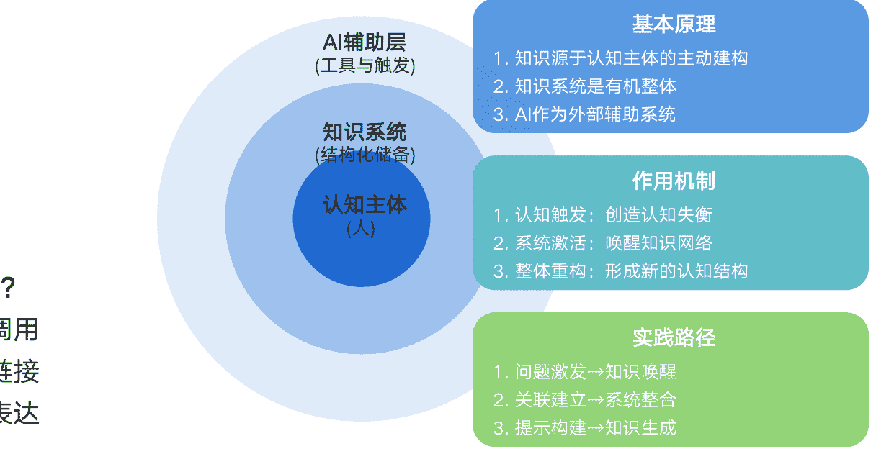

2. 为什么需要唤醒？
- 存在但未调用
- 存在但未显现
- 存在但未激活

3. 核心属性
- 身体性
- 场景性
- 认知性
