# 重磅|任泽平年度演讲: 2025 中国经济十大预测（建议收藏）

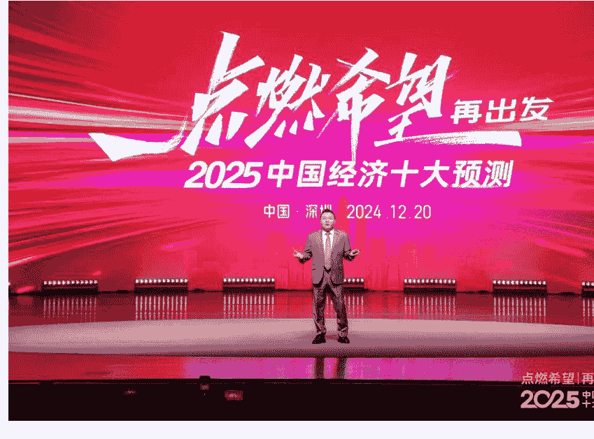

任泽平|任泽平年终秀“点燃希望·再出发——2025 中国经济十大预测”圆满收官。

要点提炼：

2025 中国经济十大预测

## 一、新周期、新时代趋势：强调要顺应新趋势，把握新机遇再出发，长期乐观主义穿越周期，列举如人工智能、新能源等代表的科技革命，以及企业出海、国内刺激经济新变化，指出成功需勤加努力，新机遇亦有其发展阶段，要保持好奇与学习。

## 二、全球经济形势变化：全球开启周期，2025 年特普 2.0 上将带来不确定性，如再通胀、关税战；世界经济增长缓慢，制度经济学占显著重要性，不同的经济增长理论对经济发展重视侧重，而包容性制度对经济繁荣意义重大，以阿根、日本等为例说明制度如何影响经济发展及存在的问题，中国需要制度改革利得释放。

## 三、第四次科技革命进展：热火朝燃，指出新能源、人工智能、低空商业航空、生物制造、可控聚、量子计算七大领域爆发及对应应用场景、形成成果，如低空形成万亿级市场规模、商业航空成本降低等，但也带来就业等问题亟待解决。

## 四、中国经济刺激与发展策略：企业出海有措；拉大规模积极刺激经济，传递多方面积极信号，短期政策、长期技术，长期角度，当前政策发力时机合适且初见成效，后需持续推动，要发展基础设施、新生产力，同时营造良好环境保护营商环境，实现经济触底本土，且中国人在出、市场等等方面具备发展优势。

## 五、企业出海趋势与策略：企业出海是大势所趋；从出口出海可从红海向蓝海，分析了出海的原因国内市场竞争激烈、海外市场空间广阔等，介绍了目的选择及不同区域特点，强调全球化本质是本土化，还列举了名创优优、欧洲、德国、亚洲、瑞士等同类型企业的成功出海案例及经验。

## 六、人工智能发展及影响：迎来大爆炸，介绍其发展历程中关键人物与突破，许多业内专家指出，2025 年将是 AI 超应用元年，涵盖智能体（如智能驾驶、人形机器人等）、专业大模型、AI 消费电子、AI 科研四大类超级应用及表现形式，同时 AI 带来机遇也有安全等方面的重大挑战。

## 七、新能源革命新机遇：变革加速前进，下半场电动化、下半场智能化，包括汽车出海、智能驾驶（介绍了单车智能和车路协同两种技术路径及在车路协同方面的突破和商业落地情况）、固态电池（优势及商业化面临的技术难题）、钛矿等光伏新技术、氢能源发展（储能技术进步、加氢站建设等）等方面的发展与进阶。

## 八、消费领域新趋势：归因以内为主，线下零售向线上、山姆会员店、名创优品品质和服务赢得人气；兴趣消费回归年轻人，带动品牌营销销售，社区成为重要营销场景；文化消费、国潮出海具有潜力，如李子柒、《黑神话》等案例体现其影响力，此外“健康+体验”成为食品等领域消费新趋势。

## 九、房地产市场新趋势：迈向后期时代，出现开发时代落幕、都市圈群人口聚集、市场化、改善型需求主导、政策宽松、土地财政转型六大趋势，中国有条件实现房地产软着，未来需要通过新模式实现供需平衡和健康发展。

## 十、人口相关经济趋势与挑战：应对老龄化少子化，一方面老龄化催生银发经济，涉及农食住房养老等多个领域，同时涉及相关长寿科技企业案例；另一方面少子化问题严重，中国生育率全球倒数，原因是生育养育成本高，呼吁减成本政策，且要高度重视儿童早期发展及相关制度改革、公共服务均衡。

> 以下为任泽平博士在12月20日点望希望终奖的演讲精华整理：

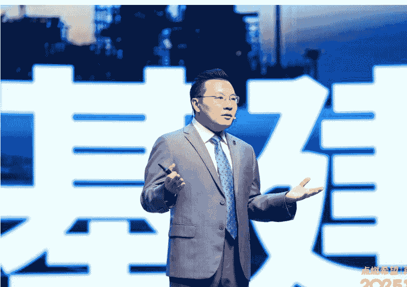

尊敬的各位来宾，女士们，先生们，大家好！我是任泽平！

今天，演讲的主题是：点燃希望、再出发——2025 中国经济十大预测。为什么再出发？因为时代变了，我们需要看到变化，顺势而为，重新出发。今天的演讲，我调研了百家企业，看了几十本书，希望大家看清时代的趋势，把握未来的。在这里我要感谢深圳集团对本次活动的大力支持！2024 年将过去，展望2025，未来有哪些新趋势？发生什么大事？诞生哪些机遇？让我们一起点燃希望，勇敢出发！

## 第一大预测

这是一个新周期、新时代，顺应趋势，把握机遇，勇敢出发。一切皆有利于，这两年我做了很多宏观实战，给大家写三句 slogan：

- 第一句：长期主义，坚持正确的，最终就会开花。
- 第二句：悲观正确，乐观，世界将属于长期主义者。
- 第三句：团队比平台重要，沿途比远方重要。

大家经常说，唯有乐观主义才能超越周期，在这里我要把这句话改成：“唯有长期主义才能超越周期”，只要长期主义精神，更有意义。为什么要乐观？因为开心就是生命的意义，虽然过程重要，但是结果不好毫无意义。所以今天的演讲达到两个目的：是一些干货，能帮大家解决现实问题；二是给大家打气，让我们振奋进入新年！

## 第二大预测

这个时代不仅是变化，堪称巨变。百年未有之变，旧秩序开始瓦解，全球化、民粹、地缘冲突、国际秩序调整等现象涌现。新秩序正在重建，站在新周期的起点上，全球经济低谷转向创新、商业模式和产业变革。以人工智能和新能源为代表的第四次科技革命如火朝荼，引发全球拉大规模刺激经济序幕，新质生产力被寄予厚望。准备这次演讲演讲，我跟几十位企业家进行了交流，现在企业家的基本像是三点：

- 一是面对外部形势认识已经比较清醒，比如前几年还有人幻想贸易摩擦能够很快结束，经济还能高速增长，房价还有大涨，这些企业家都清醒了。
- 二是大部分企业家并没有躺，大家还在努力奋斗，积极地折腾。
- 三是面对新常态，大家都在求新求变。比如寻找市场，出海；寻找赛道，新能源、低空经济、银发经济；寻找工具，大家都在关注人工智能。这是很大的变化，大家对旧时代不再留恋，开始开启新时代的大门，寻找新趋势。

百年未有之局，也是百年未有之机。马斯克、张一鸣、雷军、王传福等新一代领军企业家，顺势而为抓住了机遇。赢在大势才能赢在未来。在这个巨变的时代，比勤更重要的是顺势而为。为什么？打个比方，大家都是在跑步的，你在正确的方向上跑步，就像在高铁上跑步一样，自带300公里时速。300公里时速是什么？就是时代给你的机会。当我们看看华为转型崛起的时候，明显感受到时代变迁对亿万人命运的改变。这些改变对个体是个偶然，对群体是必然。变才是最大的不变。

今年3月，小米SU7发布，雷军发布会卖出近10万辆，震动圈，成为现象事件，引发各大车企人才纷纷投身新媒体。如果你以为这是什么创业励文，就错错了，事实上，雷军是典型的大器晚成，甚至在互联网浪潮中起了个大早、赶了个大聚。

雷军1992年大学毕业就加入了金山软件，结果面对“前有微软，后有蓝渣”的困难，面对习惯了免费软件的市场，金山软件一生都存在极其困难。为什么？因为错错了路。直到2007年金山上市，雷军才是给一起奋斗的兄弟们换了一代，这16年的代价是什么？错过了整个PC互联网时代。同时的创业者是腾讯的马化腾、阿里巴巴的马云，这些企业发展十倍于金山。

多年前接受采访回望金山的奋斗，雷军说：我很努力，和我一样的人打了多年江山，我不肯定输，我是非常努力。但是如果努力没有结果，意义就是顺势而为。格言：“站在风口上，猪都能飞起来”。后来2010年，雷军创立小米，选择了智能手机领域，用互联网思维快速迭代，圈了无数米粉”。2024年，雷军又用互联网思维造车，用互联网思维营销，越了湖，抓住了互联网流量和红利。

现在的雷军，成就金山时代不可持续。以前我们强调长期主义，确实很重要，但是我们需要重新定义成功。所有的机会都经历四个阶段：

- 看见
- 看不起
- 看懂
- 来不及

我们要始终保持对新事物的好奇，对未来不断学习。所以在这个岁末，我邀请大家拿出时间，一起仰望星空，思考更长远。

2024年陈东升出版了一本新书，题目很直接，《战略决定一切》。在这本书中提到，“聚焦就是最大的效率，所有领域都要遵循战略，所有资源都要从战略。做正确的决定，时间就是。”

陈东升先是创立了泰康，后来又进行了天才的创新设计，买泰康保险可以入住泰之家，打通保险、养老和大健康产业，抓住了中国经济新机，连续七年领身世界500强。

直播电商是大势所在。2022年6月，我和惠敏老师又一次连直播，当时我们俩都挺的。我是呼吁教育被全网误解，老师遇到很多行业，未来可能很多人，很多行业被AI代替，被用AI的人取代。我们要了解AI，拥抱AI。

新能源是大势趋势。2024年，马斯克凭借4000亿美元身家登顶全球首富，主要是因为特斯拉暴涨。马斯克不仅创立了特斯拉——新能源汽车引领者，还创立了SpaceX——全球商业航空引领者，甚至创立了OpenAI——全球人工智能引领者，现实版的钢铁人。中国会诞生马斯克这样的企业家？为什么要给企业家提供土壤？我后面会在制度经济的部分讲解。

## 2025 中国经济十大预测

出海是大势趋势。如果你觉得国内14亿的市场太卷了，没关系，让我们放眼82亿人的市场，那里有5-10亿级空间。这几年涌出了“出海四小龙”，速卖（AliExpress）、SHEIN、TikTok Shop和Temu这四大跨境电商平台。“出海四小龙”依托独特的商业模式创新，近几年迅速崛起。凭借小单快反、柔性供应链、强大的设计能力，2014年创立至今，短时间内估值近千亿美元。TikTok凭借性的舞蹈、音乐和娱乐，已连接全球16亿月活，成为内容电商的头部。

银发经济是大势趋势。陈东是从国务院发展研究中心下的官员，92派的代表，他有句名言：“要站到万里高空上看这个世界，处于百年的时空观察这个世界，才能看得更早、更远。”不要用战术上的勤奋，来掩盖策略上的懒惰。

人工智能是大势趋势。英伟达的市值3.5万亿美元，什么概念？相当于24万亿人民币，超过苹果和微软，成为全球第一。大家知道同期股市的总市值是多少？80万亿左右，一家英伟达占比30%。多年前就开始了AI研发，建立深度学习实验室，所以在2019年推出了第一代文心模型，今天文心一言拥有国内最大规模，近个月全用百度智能云。AI在互联网上改写任何行业。

第一大关键词，全球迎来新一轮降息周期。9月19日，美联储宣布降息50个基点，这是美联储自2020年以来首次降息，正式开启了新一轮降息周期。不像美国，下半年以来，加拿大、英国、欧区等经济体相继宣布降息。中国也于9月宣布降息，甚至在12月把货币政策调整为宽松。美联储降息周期对我们有什么影响？美联储降息，中美利差收窄，缓解了人民币汇率和资本流动的压力，打开了国内货币政策的宽松空间。

达尔文在《进化论》中说：“能够活下来的不是最大的，也不是最聪明的，而是最适应环境的。”有一句话：你对事情的理解就是你的竞争力，你对认知越深刻，你就越竞争力。

2025 中国经济十大预测，你无法获得认知以外的成功。点燃希望再出发。2024年将过去，展望2025，未来有哪些新趋势？发生什么大事？诞生哪些机遇？全球开启降息周期，特朗普2.0，将会对我们产生什么影响？中国拉开了大规模刺激经济的序幕，全力经营，重启全球，明年经济复苏吗？股市会牛市吗？房地产止跌回升？以人工智能和新能源为代表的第四次科技革命如火朝荼，新质生产力成为重器，我们如何乘上时代的快车？智能驾驶、低空经济、亚洲航空、生物制造等新经济不断普及，我们如何抓住未来的机遇？中国企业出海元年，竞争在哪里？航到全球的机会是什么？

新的一年，新的时代，新的周期，让我们刷新认知，刷新自己，点燃希望，鼓气勇气，重新出发，向着梦想奔跑，向着希望奔跑！不要为了明天而焦虑，让我们为了今天而奋斗！

全球开启降息周期，特朗普2.0搅动全球，世界经济增长分化，制度经济为各国发展带来希望。过去的一年，世界变幻乱常，俄乌冲突、中东大战，脱钩不断，逆全球化趋势演剧烈。如果要用四个关键词形容2025的世界经济，我是认为是：息周期、特朗普2.0、增长分化、第四次科技革命。

5、对华增加关税，我国出口面临压力，这需要国内加大度的扩大内需。出海和跨境电商是统关税的重要手段。

6、进一步脱锚链，国产替代和新生产力将得到更大政策支持。

7、再通胀黄金，但俄乌战争可能缓解，黄金的避险价值削弱。

8、利好行业。新政对科技行业放松管制，人工智能、商业航空、脑机接口等将带来更大的支持。

9、利好加密货币。特朗普和马斯克都是加密货币的支持者。

外部越紧张，内部越要活跃。面对外部压力，中国的应对就是做好自己的事情，打铁还要打造自身，以更大决心和更大力度推动改革开放，全力拼经济，保障降准，减轻税费，支持民营经济。

大国宏观政策以我为主，为国内经济和服务就业，只要股市繁荣，房地产止跌回稳，经济复苏，经济改善，民众收入增长，企业积极投资，一片欢欣景象，全球资金源将不断流入中国，支持中国经济发展。假以时日，果见分明。

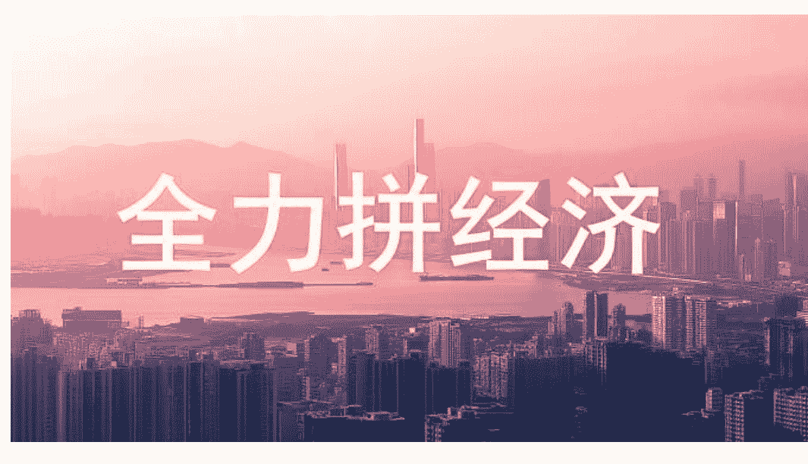

加微信jntsg2，免费进资料分享群

### 第三大关键题：世界经济增长动力。

**2024 年 10 月**，诺贝尔委员会决定将今年的诺贝尔经济学奖颁给三位经济学家：麻省理工学院的阿西·莫格鲁（Daron Acemoglu）、约翰翰逊（Simon Johnson）和芝加哥大学的罗宾逊（James Robinson）。他们三人的主要贡献是：研究制度是如何形成的以及制度如何影响经济发展。

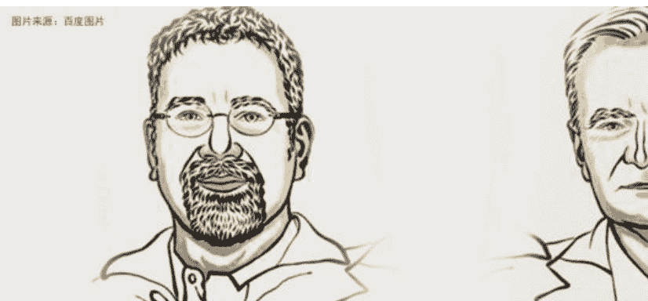

阿西·莫格鲁 DARON ACEMOGLU
麻省理工学院(MIT) 经济学教授
约翰翰逊 SIMON JOHNSON
麻省理工学院(MIT) 经济学教授

诺贝尔委员会的颁奖说：“国家与国家之间巨大的收入差距是我们这个时代最大的挑战之一，这些获奖者证明了社会制度对于实现这一目标的重要性。”

世界经济增长分到什么程度？全球富裕的前 20%国家比贫穷后 20%的国家富裕约 30 倍。

为什么贫穷的国家长期贫穷，为什么富裕的国家长期富裕？制度经济学给出了答案：不是因为地理因素，也不是因为人为因素，主要是因为制度因素，包容性制度决定经济增长，掠夺性制度导致贫穷国家。

经济学思想关于经济增长理论的发展，分为五个阶段：

### 马尔萨斯增长模型

### 索洛增长模型

### 刘易斯增长模型

- 人口和资源匮乏
- 资本、劳动
- 剩余劳动力从低效率部门转移到高效部门

马尔萨斯增长模型。由英国经济学家托马·罗伯特·马尔萨斯提出，他认为人口按几何级增长，而生活资源只能按算术级增长，从而导致饥荒、战争和疾病的周期性复发。马尔萨斯人口论没有看到技术进步和制度变革带来的经济增长前景。

索洛增长模型。由经济学家罗伯·萨洛提出，又称外生经济增长模型，强调劳动力、资本等要素对经济增长的贡献。

刘易斯增长模型。由1979年贝尔经济学奖获得威廉·阿比·刘易斯提出，也称“两个部门模型”，强调劳动力的转移对经济增长的贡献，发展中国家的经济由低效率的传统部门和高效的现代部门组成，当剩余劳动力从传统部门向现代部门转移时，直到刘易斯拐出现，即传统部门的剩余劳动力被完全吸收，此时经济增长缓慢。

内生增长模型。由20世纪90年代的一批经济学家提出，包括罗默的增长模型、卡拉斯模型、巴罗模型，强调技术进步、人力资本、引进外资等对经济的增长。

加微信jntg2，免费资料分享

制度经济学增长模型。更强调制度重要性，包容制度是经济增长的源头，国家成功的基石，主要特征是保护产权、公正司法、契精神、法治精神、市场机制。

随着经济增长理论的发展，越来越接近真相。经济学是一门伟大的学科，因她试图拯救世界。这是诺贝尔经济学奖第八次颁给了制度经济学领域，之前包括大卫·罗斯、科斯、诺斯等人。

## 2025 中国经济十大预测

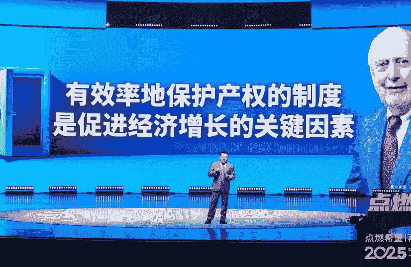

1993 年，美国经济学家诺斯（Douglass North）获得了诺贝尔经济学奖。他的主要贡献之一，就是通过研究荷兰和英国在 16-18 世纪的兴起，发现了一个重要的结论：有效地保护产权的制度是促进经济增长的关键因素。

基于制度经济学，在这里我提出制度长期形势的分析框架；经济长期看制度、中期看技术、短期看政策。制度大于技术，国家发展需要技术创新，技术创新需要制度的土壤，企业也需要制度的土壤。我将用这个分析框架在后面分析未来经济形势。

微信jnts2，免费进资料分享群

用经济学可以解释过去40年的经济腾飞，开放是中国最大的制度红利。市场经济和法治精神是增长的源泉，也是我们这个时代最大的财富。文明需要不断启蒙，这是诺贝尔经济学带给我们的最重要的启示，也是我们这一代的使命。用经济学可以解释世界增长差异，为什么有的国家拥有丰富的自然资源、充沛的劳动力，却没有增长落入低收入陷阱和中收入陷阱，比如拉美、中东、非洲很多地区。用经济学还可以解释一个很有有趣的现象：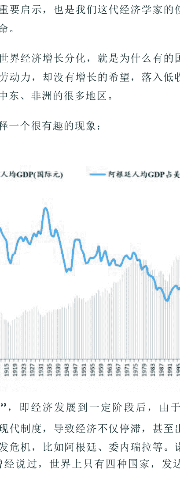 部分国家的“阶级陷阱”，即经济发展到一定阶段后，由于没有建立国际化、市场化、法治化的现代制度，导致经济不仅停滞，甚至出现严重倒退，社会动荡爆发危机，比如阿根廷、委内瑞拉等。诺贝尔经济学获得者西蒙·库兹曾说过，世界上只有发达国家、中国和阿根廷（此处原文可能有误，曾富的国家）。

20 世纪，阿根廷是世界上最富的国家之一。1880-1950 年，阿根廷的 GDP 均增长速度 7%，成为世界上最富的国家。由于自然资源丰富，被称为“世界粮仓”。但是今天，它已经成为中收入陷阱的典型，从高收入国家落入中收入国家。20 世纪以来，阿根廷的主权债务违约发生多次。2024 年阿根廷统计局数据显示，该贫困率已激增至 59%，创下历史记录。阿根廷落入陷阱，完全符合经济学理论，就是没有建立一套国际化、市场化的现代制度，反而恰相反。

- 1、违法国际化，选择封闭，拒绝外资、拒绝还债、制造高额关税。虽然转移了矛盾，但是导致资本外流。
- 2、违法法治化，民主主义。以多数人的名义损害少数人的财产，通过行政手段实行再分配，政客以此获得底层选票。先做大饼，结果没有做蛋糕，陷入贫困。
- 3、违法市场化，实施大量管制措施，损害了外资和民营资本，损害了经济的活力和效率。
- 4、违法经济规律，发货币。为了赢得选举，竞选者向百姓开空，大幅提高工资、医疗、住房等，结果发货币，导致严重的通货膨胀。

所以经济增长的源泉是制度，而不是印钱。这不是拉丁国家的通病，如果印钱能消除贫困，那么……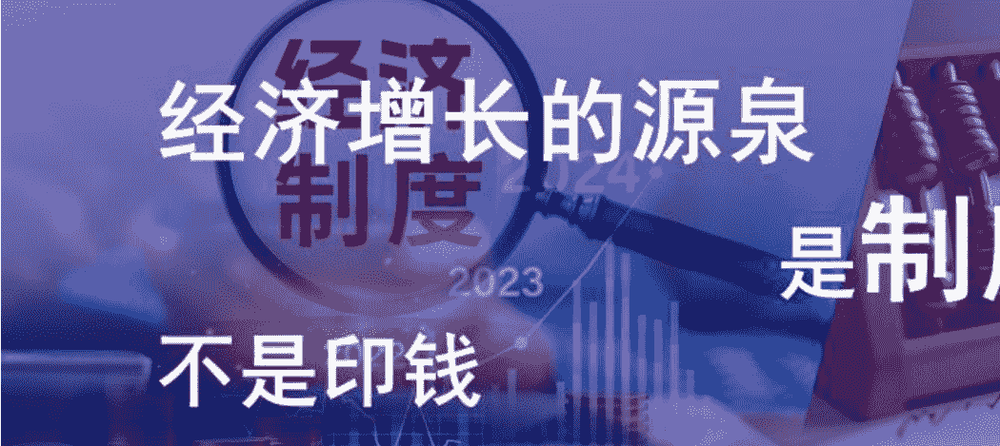 管制过多、缺乏产权保护、逆全球化、民粹主义、高福利，基本上是国际化、法治化、市场化的现代制度没有建立起来。

日本是另一个“陷阱”案例。二战后高速追赶，日本成为世界第二大经济体，跻身OECD国家头部，汽车、家电、电子等出口强，国民信心爆发，“日本第一”成为一时的口号。但是，随着90 年代股市破裂，经济长期增长，物价通缩，人口老龄化，社会活力下降，企业规模外迁，国内产业空心，陷入失去的“三十年”。

### 辜朝明

### “资产负债表衰退”理论

最近这些年国内讨论比较多，最著名的是辜朝明的“资产负债表衰退”理论。

“资产负债表衰退”理论认为，企业在资产价格泡沫扩张或经济繁荣时机会购买更多资产，当资产价格泡沫破裂以后，负债端增长资产端却严重缩水，企业不得不继续偿还负债，生产经营目标从“利润最大化”转为“负债最小化”，从而导致整个社会陷入需求不足和经济衰退的恶性循环。

怎么办？辜朝明认为，有效的办法是政府通过扩张性的财政政策来扩大总需求，推动经济复苏和企业居民资产债表的修复。但是遗憾的是，日本过去三十年，在财政刺激下不仅力度不够，而且经常陷入滞后，错失良机。很多经济学家把日本失去三十年的主要归结为宏观政策失效，日本已经建立了国际化、法治化、市场化的经济制度，其实日本的老龄化少子化、劳动力市场僵化、终身制、年功序列制、中小企业活力不足、社会阶层固化等都是重要的结构性原因。

对于中国而言，制度改革还未完成，城市化、户籍制度改革、所有制改革等还需要推进，市场化和法治还需要完善，中国还有大量的改革红利有待释放，因此当下中国需要经济刺激+制度改革共同推进，中国经济增长的潜力巨大。

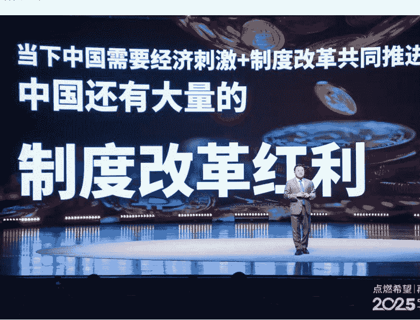

如果这些制度改革红利释放，中国至少可以实现10年以上的中等收入阶段，跨越中等收入阶段。这是制度经济学给我们的启发。

第四大关键词，第四次科技革命。

## 第三大预测

第四次科技革命如火，人工智能、商业航天、低空经济、生物制造出现重大突破。市值17 万亿美元，在全球市场中占比18%。这表明创新达到了前所未有的水平。华尔街和硅谷相互成就，资本市场为创新提供了不断的弹药。人类迎来新一轮科技革命，这是继蒸汽革命、电力革命、计算机及信息革命之后，第四次科技革命正在如火。我认为第四次科技革命有七大领域：新能源、人工智能、商业航天、低空经济、生物制造、可控核聚变、量子计算。这是新趋势，也是机遇。

大家想象过这些画面：以后在高层打开窗户就能快速出行，自动驾驶飞机。这些都是应用，原来在科幻电影里的画面正在现实。未来有望构建全新的交通体系，现在的公路、地铁、高空飞行器执行许多任务。

生物制造可以解决传统物质生产的痛点，以后物质生产方式将更加清洁、高效、再生。以往要获得某种物质，要通过化学制造，环境污染大。商业航天正在快速起跑，未来是星辰大海。

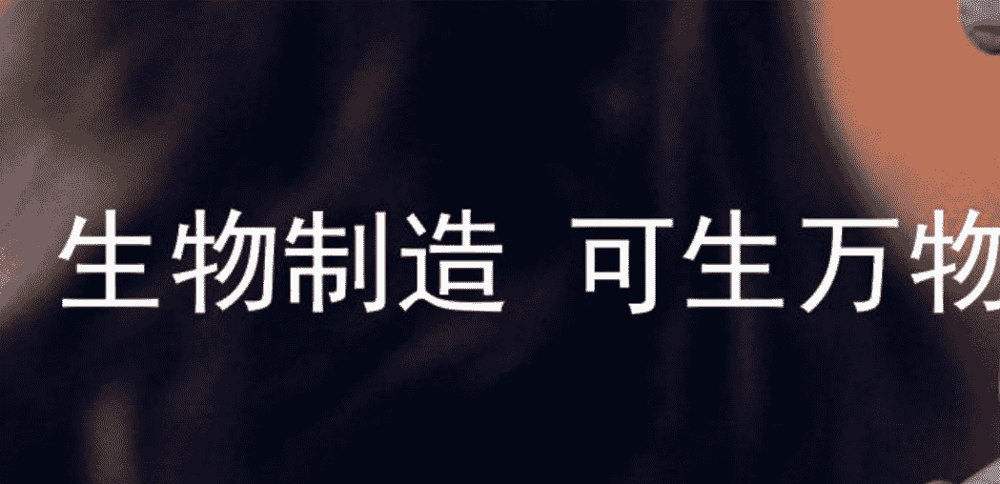

### 人造太阳——可控核聚变 终极能源？

人类未来有没有终极能源解决方案？有一种方案，“人造太阳”——可控核聚变。大家对风能、太阳能这些能源熟悉，其实核聚变也是新能源。核聚变，是指氢的两种同位素，氘和氚，结合形成氦，在这个核聚变过程中释放出巨大能量。

什么是可控核聚变？就是要实现可控的、能够持续进行的核聚变反应，从而实现安全、持续、平稳的能量输出。如果地球上实现可控核聚变，就如同掌握了“人造太阳”。核聚变的优势非常明显：能量大、元素多、清洁、相对安全。能量巨大，核聚变比核裂强4倍，几克瓦就能提供一个人所需要的能量。元素丰富，每升海水就有0.03克，通过核聚变产生相当于300升汽油燃烧的能量。清洁，不产生温室气体。安全，核聚变与过去电站的核裂原理不同，失控风险、放射性离子问题。

科学界有一种看法，可控核聚变可能是人类的终极能源，一旦突破，人类将不再存在能源困扰。从2021 年开始，可控核聚变有了重大突破。马斯克成立了SpaceX作为工程企业，以极低成本和高效率著称，研发经费只有NASA的/10，速度却是对方的两倍。

生物制造可以解决传统物质生产的痛点，以后物质生产方式将更加清洁、高效、再生。以往要获得某种物质，要通过化学制造，工厂、反应、高温、高压，环境污染大，动植物天然提取量有限，且破坏生态平衡。生物制造可以解决上述痛点。简单来说，就是用生物机能进行加工与合成。举个例子，人工合成淀粉。科研人员采用生物制造技术，将二氧化碳固定，人工淀粉的速率是自然速率的8.5倍。如果能把粮食生产从土地转移到工厂，就能单纯解决吃饭的不确定性，保障粮食安全。生物制造可能会改变未来的农业模式。生物制造可生万物。预测，未来全球60%的物质生产可通过生物制造方式实现，在能源、化工、农业、医药、材料等领域大有为。颠覆传统的物质生产方式！

前面，我们基于经济学，提出经济形势的分析框架：经济长期制度、中期技术、短期政策。我们下面用这个框架分析 2025 年中国经济。

传递八矩阵信号：一是加大推出政策；二是加大财政政策周期调节调整；三是促进房地产止跌回稳；四是努力提振资本市场；五是推出生育配套政策、完善养老体系；六是帮助困难企业通过关关；八是兜民生、就业优先。

近期我国在新建、新生产力领域取得长足发展，在控方面积极有效，为高质量发展打下坚实基础。但是，在短期经济运行、股市、房产、就业、居民收入、民间投资、地方财政等等方面面临到的不少挑战。

随着市场情绪恶化，我们启动降息周期，为财政政策的调整提供了有利条件，当前正是对大规模经济刺激计划、增强信心的关键窗口。

9 月以来，我国推出了一系列提振经济的增量政策：降息降准、降低房贷利率、创新工具支持房市场、降低首付、放松市场限制、10 万亿规模、收购商品库、注银行、增加民生支出等。10 月以来，我们看到制造业 PMI 新订单指数、商品销售等出现回升，说明 9 月以来的刺激政策初见效。

**2025 年**我们将面临世界经济放缓、地缘动荡、断链风险、加关税等新挑战，我们还需要政策持续发力，提振经济信心。要出手，要手重，信心黄金重要。客观上是微观上是多少家庭的悲欢离合。

最近不少投资者和企业家反馈他们的担忧：这次刺激政策能否持续？经济能否重启？站在历史的十字路口，相信我们一定能够做出正确的选择。

**未来保护经营经济**，堪比万亿产制，今年的诺贝尔经济学奖授予经济学奖表明，市场和法治化的制度是经济增长的动力，这也是当前经济发展的中长期看。科技是第一生产力，当前全球第四次科技革命如火如荼，带来新机遇，开启新周期。

什么是拉动经济的好办法？就是“新基建”，通过财政货币政策扩张支持新基建，短期有利于稳增长、稳就业，长期有利于打造中国经济的新技术、新引擎。

什么是“新基建”？说过过去 20 年公路、铁路、桥梁等“老”基建支撑了中国经济快速增长，成为世界工厂，那么未来 20 年支撑中国经济创新发展一是基建。

新基建包括新型能源体系、新能源汽车、充电桩、新信息技术、芯片半导体、数字经济、人工智能、生物制造、商业航天等。新基建正面临挑战，不是简单的走老路，而是面向未来，抓住第四次科技革命的重大机遇，进行技术升级和产业升级。

中国在全球号称“基建狂魔”，这是我国的制度优势。基础设施具有很强的外部性、外溢，以及对其他产业的重要支撑作用。

经济长期看制度。长期的经济增长，制度更重要。国家的发展离开创新，而制度离开不开自由包容的土壤，只有具有制度土壤才能生长出技术创新和企业家精神。

### 包容性制度是经济增长的源泉国家成功的基石

什么是好的制度？现代经济学认为，包容性制度是经济增长的源泉，国家成功的基石，主要特征是保护产权、公正司法、契约精神、法治精神、市场机制。这不仅可以解释世界经济的分化，也可以解释改革开放四十多年中国为何如此成功。未来我们需要为企业营造良好的营商环境。

民营经济是市场的活力的源泉，贡献了“56789”，即民营经济贡献了中国经济 50%以上的税收、60%以上的 GDP、70%的技术创新成果、80%以上的城镇就业、90%以上的企业数量。保护民营经济，相当于十万亿刺激。

10 月 10 日，司法部、国家发展委员会颁布《民营经济促进法（草案征求意见稿）》，有利于改善营商环境，帮助企业渡过困难。民营经济有活力、有信心、有投资，则中国经济就能复苏，就业、财政、创新等就能随之改善，股市繁荣、房地产止跌回升就能实现。

越是在经济困难时期，越要休养，减轻减轻负担。税不是查出来的，更不是罚出来的，是发展出来的，只要全力经营经济，经济繁荣，自然就有了。

### 2025 年经济形势：六大判别

对于 2025 年经济形势，我有六大判别：

- 一是全球开启降息周期，打开国内货币政策宽松的空间；
- 二是特朗普 2.0 带来再通胀和关税上升风险，我们需要提前做好准备，铁得自身硬；
- 三是国内拉开大规模经济刺激计划的序幕，力度空前；
- 四是一系列提振民营信心的举措，营商环境改善；
- 五是这一轮经济刺激计划不是重走老路，而是大力发展新能源、人工智能、芯片半导体、商业制造、生物制造、数字经济等代表的新基建、新质生产力；
- 六是市场政策不断放松，一线核心城市有望回稳，二三四线城市将继续增长。

## 2025 中国经济十大预测

认为，只要推动一轮市场化、法治化引导的改革开放，未来最好的机会就在中国。中国拥有14 亿最大的市场，城镇化率还有 60% 以上的空间，人均 GDP 有增长潜力，人口红利向人才红利转变。人是经济活力的基础。今年，在全球范围内，中国排名领先的城市中，深圳为什么对人才有这么吸引力？离不开中国持续发展的环境。

我想以深圳为例，在 AI、科技为主的时代，勤奋的人没有停下脚步。在国际会上展示了多项创新成果。同时，紧抓新媒体风口与头部机构创作多个“爆款”作品，让更多的人来到深圳，在深圳安居乐业。通过科技创新的工具、务实的办法，把深圳建设为最具竞争力的人。放眼全球，这是一片奋斗的热土。只要把发展放在首位，宏观政策加大，微观政策加大，提振民营信心，中国经济前景光明！

## 第五个预测：出口出海，从红海到蓝海，全球化本质上本土化

为什么要出海？因为出口出海是大势所趋。过去 40 年，中国快速成长为“世界工厂”，出口贸易份额占全球从 0.7% 提升至 2023 年的14.2%，连续 7 年保持贸易大国地位，中国制造业产值占全球 1/3。而且出口产品不断升级，从“老三样”（服装、家具、家电）向“新三样”（电动车、储能、光伏）升级，现在中国已经成为全球第一出口大国。

同时，有些海外区域出现了反弹，因为中国制造业太强大，产品便宜廉，当地的产业和就业就会受到冲击，多的海外地区希望中国企业能够当地带动就业，帮助当地发展，而不只是当作销售市场。而且这些年贸易保护主义盛行，各国意识到供应链安全的重要性，开始出台各种措施鼓励产业回流。

### 这将带来什么影响？反弹+高墙

此时，美国搞起了脱钩断链、小院高墙、友岸外包，试图推动“中国+1”，也就是在中国以外建立新的制造中心，减少对中国制造业的依赖。站在在国内看，这些年国内越越卷，价格此起彼伏。如果你觉得国内 14 亿人的市场太卷了，没关系，让我们放眼全球 82 亿的大市场，那里有 5-10 倍广阔空间。很多行业在国内是红海，出海就变成蓝海。

更何况，前面已经海尔、海信、理想、美的、名创优、雪蜜冰城、抖音、SHEIN、TikTok 这些成功的企业鼓励着我们，当年美国、德国、日本、韩国企业的全球化之路启着我们。全球更大的市场在招召着我们。

从生产组织能力、品牌能力、技术实力，中国企业具备了出海条件。现在中国企业已经不是低端的代表，而是高技术、高品质和高质量的代表。

面对这些新趋势和外部环境，最好的办法是出海，出口到出海，从红海到蓝海。天时地利人和具备，踏上征程走向世界。出口就是把海外当目标，把产品和服务推向海外；而出海，则要把供应链、物流、销售重建。某种程度上说是这一代企业的使命。

### 亚洲东南亚是最主要地

| 北美 | 欧洲 | 东南亚 |
| :--- | :--- | :--- |
| GDP | 26% | 17.0% | 4.2% |
| 份额 | 0.41% | 3.09% | 0.49% |
| 份额 | 4.29% | 3.38% | 6.45% |
| | 2% | 1.50% | 4.60% | 18.23% | 8.30% |
| 劳动力 | 6.3% | 1.30% | 0.23% | 0.06% | 0.34% | 2.17% |

出海之地，亚洲东南亚是最主要地之一，这里有 6.8 亿人的广阔市场，有年轻的劳动力，有丰富的矿资源，是中国的近邻，对华比较友好。中国人均 GDP 1.2 万美元，东南亚大部分国家均 GDP 4000 美元，相当于中国的 90 年代~2000 年初，生机勃勃，前景无限。

欧洲国家适合建立研发中心和跨境电商中心。研发中心可以学习先进的技术，跨境电商中心可以学习开发技巧。欧美市场是全球主要的消费市场和创新新领域，中国 GDP 占份额的 26%，有 3.35 亿人口。

共建“一带一路”国家与中国非常友好，在基础设施建设、投资经营、资源能源等方面有广阔的合作空间。中东地区适合合伙、风电企业出海，那里有丰富的电力资源。中东有石油资源，也是风能的重要资源来源，友好。拉美非常有丰富的铁矿石、锂、农产品等资源，有充沛的劳动力，非常适合中国制造业、农业和能源企业出海。

随着全球产业迁移，未来全球制造业不再一国家独大，也没有谁能替代中国，未来将形成“中国+N”的格局：中国+越南、墨西哥、印度、印尼、土耳其、匈牙利等。

出海？全球化本质上本土化。出海不是出口，也不是差，关键是落地。本土化就是全球化，顺应当地习惯，带动当地就业，融入当地法律法规，与当地政府和合作伙伴建立良好的关系。过去，中国制造走向全球，但在零售领域，山姆、Costco 等海外零售出海案例少。

## 2025 中国经济十大预测

很多企业问，这些行业有没有机会？传统行业或年轻企业获得出海的门票呢？很长一段时间大家都认为是红海竞争，低价竞争，那么这样的行业有没有机会？只要有用户需求的地方，就有机会。

今年参加了一场聚会，氛围很大。很多企业在全球范围内已经超过 7000 家店。欧定找到了高弹衬衫这个品类赛道。我今天穿的正好就是欧定衬衫，弹性非常好，怎么动都不紧绷，衣领穿久了也不塌。而且之所以看起来非常合身，是因为他们应用了 AI 在线定制。欧定立仅短短，不仅在中国高端衬衫网络销量领先，并且已经成功出海，畅销全球 56 个国家，成为全球 30 万高端男士的首选。

欧定高弹衬衫
- 高弹不皱棉面料
- 黑科技免熨面料
- 机动力学科技领型
- AI 在线专属定制
- 1V1 专属服务
- 弹性哲学

这形成了一套经验和方法论。比如最优出海选择、全球组织构建海外产品组合……现在很多企业正在向欧定学习，要有胆量、有勇气走出去。

| 免费 | 每日获取高价值资源 | 可提供各类资源 |
| :--- | :--- | :--- |
| 价值 | 热门文章 | 各行业报告 |
| 及时 | 精选图书资源 | 副业赚钱方法 |
| 注意 | 职场实用资源 | AI 经自媒体 |

中国企业的出海，要通过技术、品牌的持续投入，成为一个真正赢得全球口碑的世界的一流企业。

成功出海的案例有很多，比如凭借“你爱我，我爱你”，“蜜雪冰城”火遍全球的蜜雪冰城，在范围内开了三四万家，成为全球前五连锁餐饮店，主打性价比奶茶和供应链。

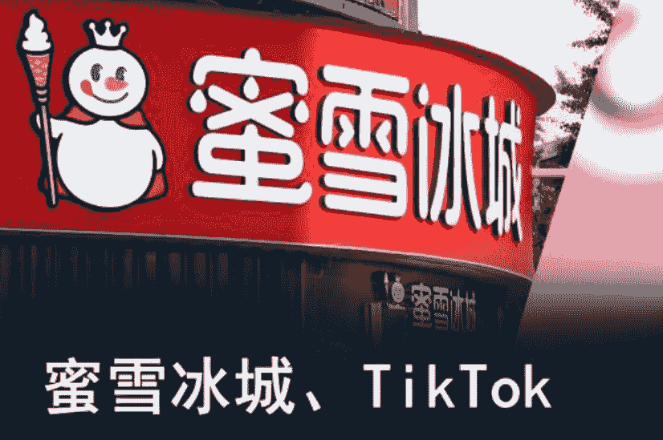

再比如，TikTok作为字节跳动下的海外短视频社交平台，凭借个性化的推荐算法，成功的营销运营、火爆的网红直播带，火遍全球。至2024年8月，TikTok全球月用户数达16亿，美国活跃用户数达1.7亿，成功跻身社交媒体平台的前五。全球人口超过20%都在使用TikTok。

从出口到出海，从红海向蓝海，中国企业的大航海时代正在到来！

加微信jntsg2，免费资料分享群

## 第六大预测

人工智能迎来世纪大爆炸，图像识别、人形机器人、AI 助手、消费电子、AI 科研超级应用呼之欲出

诸位，AI 正在改变人类历史进程。一些企业正在引领新趋势，英伟达市值突破 3 万亿美元，最新的芯片一发布就被抢空。OpenAI 发布了 ChatGPT，直接颠覆搜索引擎行业。特斯拉推出没有方向盘的汽车，国内文心一言、抖音豆包火遍全国。

谁会成为下一个英伟达？如何抓住 AI 浪潮中的新机遇？让我们先从深度学习讲起

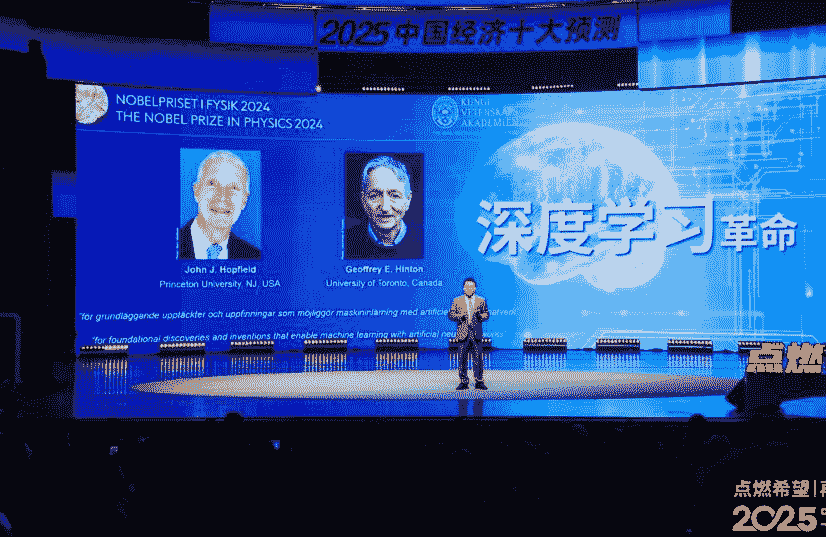

大家知道今年的诺贝尔物理学奖颁给了什么领域吗？对于人工智能，两位获奖者，左边的是约翰·霍普·菲尔德，物理学家，1982 年发明了霍普·菲尔德神经网络，让机器拥有了记忆能力。

微信jnts2免费进资料分享群

右边是杰斐·辛顿，传奇的计算机科学家，在先者的成果上发展了深度学习，坚持研究神经网络线性长达50 年，用图形处理 GPU 加速了 AI 的到来。这两位科学家为人工智能做出了杰出的贡献。

## 第六大预测 人工智能迎来世纪大爆炸

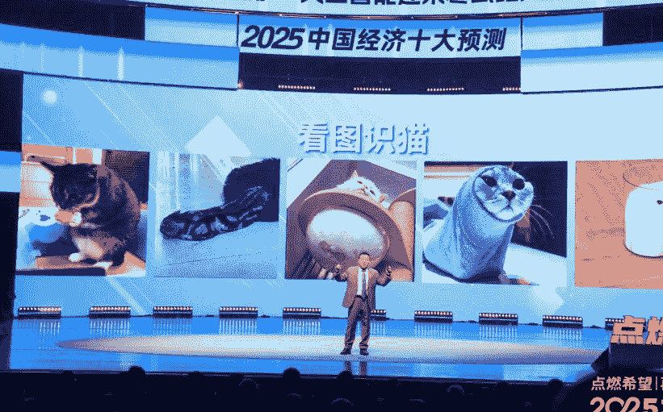

我们先来做个著名的小游戏，“看图识猫”，诺奖主就是通过这个游戏，突破了 AI 发展 30 年的瓶颈。在这五图中，一共有五只猫。我相信，在座的各位 100% 都能拿对这个。这五只都是猫，有像老虎的猫、也有准萨的猫，还有流体猫。

各位在今天之前，有见过几只猫的照片吗？没有。那为什么大家能正确识别别的其他的猫，大脑帮助我们归纳了猫的特征。学习特征，就是人类学习的来源，人工智能也可以如此，本质就是特征和学习。

12 年前，谷歌参加一场找猫的比赛，也是计算机视觉的比赛；将世界上万包含有猫的视频作为学习样本，交给机器去观察学习的特征。世界上最早的 AI 之一——“谷歌”，使用了 16000 块 CPU，准确率有 74%。而，当年的冠军仅用了 4 块英伟达的 GPU，就达到了 84%的准确率。

加微信jntsg2，免费获取资料

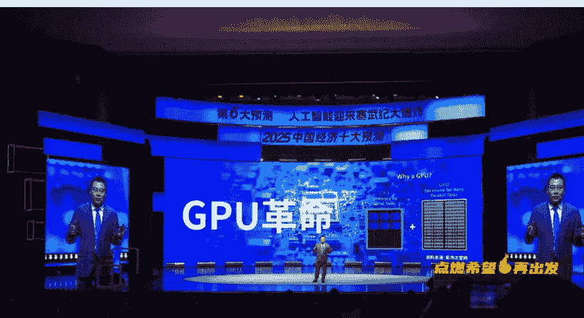

是的，当年的冠军团队就是辛顿团队，今年获得了诺贝尔物理学奖，对 AI 领域做出了突破性的贡献。辛顿最早意识到 GPU 在 AI 学习领域的潜力，并且进行了探索。

今天英伟达成为全球市值最大的公司，但 12 年前，英伟达芯片在科技大厂的眼里只是玩具，辛顿带领两个学生，用了四块 GPU，实现了更高效、更准确、成本更低的 AI 训练，改变了学术界和产业界。

### 为什么 GPU 比 CPU 快？CPU 是通用的，能够串联执行各种任务。GPU 的通用性不如 CPU，但是强项在于并行计算。一块 GPU 就比 1 位小学生快，GPU 好得多

AI 训练就像刚才刚识别万张图片，1 个数字学生的速度肯定不如上万个小学生，数字学虽然难以解决复杂的问题，在大规模简单任务上不如上万个学生同时进行。从那时起，AI 意识到了 GPU 作为算力工具，可以突破深度学习的瓶颈，全球科技大厂就开始了抢人才、抢团队、抢芯片。

加微信jntsg2免费进资料分享群

## 第六大预测 人工智能迎来世纪大爆发
2025中国经济十大预测

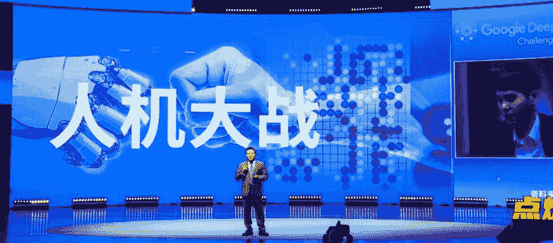

### 人机大战

快速发展的十年里，AI 先在电子游戏、棋类运动上击败人类。2016年，阿尔法狗击败人类围棋冠军，震惊全球。DeepMind团队采用深度学习，在 GPU 算力支持下，仅用了两年。短短几年内，AI的学习的速度乎想象。

2025 年是 AI 超级应用元年。把 AI 超级应用分为四类：

### 第一类超级应用是智能体

智能体可以像人类一样，拥有一个物理躯体，能感知、能互动，完成特定任务。以往的机器人有什么不同？现在看到的智能驾驶，很大程度上是在人形领域。

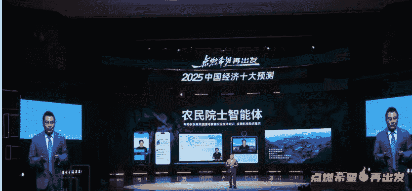包括：
- 智能驾驶：比如特斯拉最新的 RoboCab 已经进化到了不用方向盘。
- 人形机器人：比如工业机器人、扫地机器人、装货机器人，它们功能强大，可以在各种特定领域学习各种技能。
- 智能博士：由百度和字节共同打造的首个‘智能博士’，基于文心大模型，以对话的方式与用户问答。家长可以随时提问各种问题，未来智能体将重新定义知识分享和个人影响。

微信jntsg2免费进资料

### 第二类 AI 应用应该是专业模型

专业模型将超强能力带给各行业。大家还记得年初春节的 Sora 模型吗？Sora 就是视频领域的专业模型，每个人都能通过 AI 制作动画和建模。未来电影和广告的制作成本将会大幅减少，甚至将一部大片。这样的变革也在重塑行业。

加微信jntsg2免费进资料群

### 第三类超级应用是 AI 消费电子

用 AI 构建虚拟世界与现实桥梁。比如苹果的 Vision Pro、Meta 的智能眼镜，还有 AI PC、手机，让全球消费电子焕新，未来还将孕育更多流畅产品与体验。

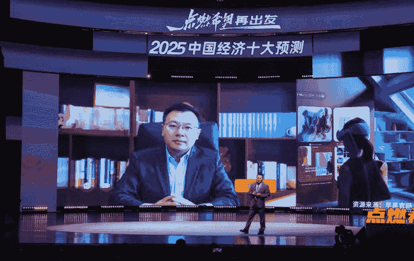

定制的智能体，不仅有外形，还训练了知识库，能实时回答各种问题，还能理解对话的情绪。

### 第四类超级应用是 AI 科研

帮助人类突破科研的边界，推动社会的进步。是中国医药大国，创新药和世界是有差距，主要是因为创新药研发失败率高，一般要花费 10 亿元，周期 10 年，成功率仅 10%。现在有研究证实，如果用 AI 发现、筛选化合物可以大幅提高成功率，并且缩短研发周期 40% 到 60%。

微信jntsg2免费进资料

像老年顽症、冻症这些困扰人类几个世纪的疑难症，以后都可能靠 AI 来解决。有人说，再过十年，人类的寿命在科技助力下将大大延长，活到 120 岁都不再梦想。

AI 超级应用爆发还有一个前提，就是消除大模型的幻觉。百度今年发布了一项新的图片生成技术——iRAG，用检索增强的方法，消除图片的“机器味”，提高生的准确性和实用性。有了准确性，AI 的应用空间才能打开。

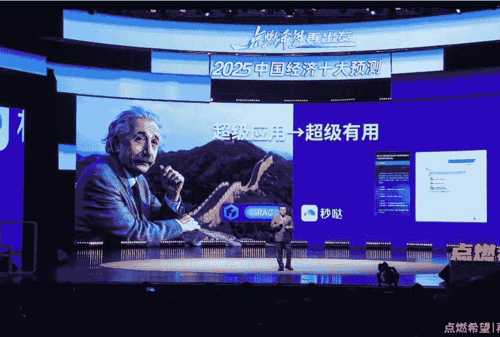

AI 时代，不仅要有超级应用，更要打造数百万的“超级有用”，形成巨大的 AI 应用生态，让每个普通人都能参与到 AI 浪潮中。比如，百度今年发布了一款无代码工具“秒砖”，不用写一行代码，就能开发应用，大幅降低了 AI 的开发门槛。

前段时间，DeepMind 的联合创始人哈萨斯·苏莱曼出版了《潮汐将至》，我读后深受触发。未来人工智能将带来深刻变革，比如智能驾驶、药物研发、智能机器人、智能助手、智能搜索，人类生产的所有领域都被人工智能改变。

加微信jntsg2免费资料分享群

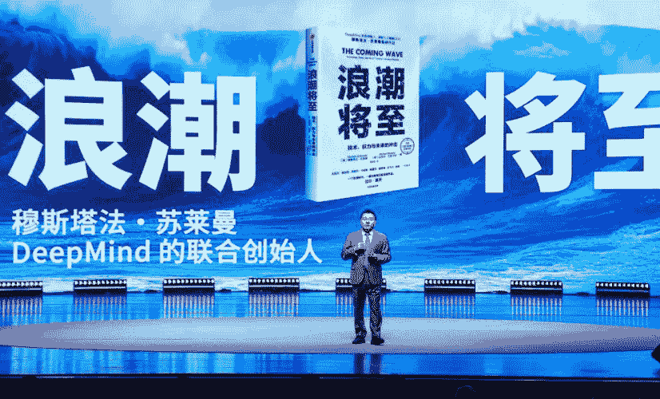

但是，也带来智能病毒研发、智能网络攻击、智能武器化、大规模失业等一系列重大挑战。

未来会从人工智能进化到通用人工智能，超级智能出现吗？随着人工智能世纪大爆发，人类如何在技术浪潮中生存下来？穆斯塔·苏莱曼认为，这波技术浪潮有 4 个特征：

1. **非对称性**：技术的高度非对称性，使得量相当、规模相当的势力暴露出难以想象的弱点。比如配备了廉价无人机的可以对抗几百美元的无人机，这种战争形态完全被改变。

微信jntsg2免费资料群

2. **演化性**：技术以人的速度迭代，未来可能通过人工智能研发一种快速进化的病毒，导致全球流行。

3. **通用性**：它们能够服务于许多领域。人工智能能够、开发清洁能源、优化交通、诊断医院等等。

4. **自主性**：技术越来越呈现出一定程度的自主性。高阶智能驾驶展现了自主性，其中著名的阿尔法狗展现了自主性，这种自主性会带来很多惊喜且难以预料的结果。这种交互使得技术潜能巨大，但也可能威胁到全球秩序。很难保证你看到的是真，哪些是假的。虚假视频和图片在网上流传，就有可能干扰选举。本来就“造谣一张”，再加上人工智能造谣，以后世界很难。

微信intsg2免费进阶资料

### 20 年，从科幻到现实

发展 AI 浪潮将至，安全第一。大家还记得年初发布的标题吗？叫“We Robot”，20 年从科幻到现实。20 年前有一部经典科幻片《I Robot》，讲的是机器人产生自我意识，对抗人类，最后与人类和平的故事。

AI 浪潮什么是决胜因素？算法、算力、数据，还是科学家和企业家精神？回到今年记得诺贝尔奖，辛顿选择的 AI 路线“深度学习”，由于当时算力不够、数据规模太小，AI 界的权威是深度学习反对者。辛顿坐了 30 多年，在 2012 年选择 GPU 证明深度学习价值，那时他已经 65 岁了，没有人知道这条道路能否成功。同样是全球的新王英伟达，在业界普遍对深度学习的时候，黄仁勋 ALL IN GPU，战胜 GPU 时代的霸主，重塑英伟达，把一家公司带到全球市值第一，成为新的王者。GPU 点燃了人工智能的火。《迈未来的之路》描述了黄仁勋的创业精神：以光速迭代，扁平化组织，坦诚沟通，聚焦 GPU，抓住人工智能机遇，第一性原则，以及喊出了“更强！我更快！你们无法打败我！”敢于面对不确定性，对信念坚定不移，这种科学家和企业家精神推动了进步。

微信jntsg2免费资料群

## 第七大预测

新能源革命加速前进，汽车出海、智能驾驶、固态电池、储能、氢能配新机遇。风电、光伏、氢能等，中国有望在第三次能源革命中弯道超车。今年我国新能源汽车销量节，7 月，新能源月渗透率超过 50%，首次超过燃油车。截至 11 月，新能源汽车销量首次突破 1000 万辆，预计全年有望超过 1300 万辆，同比增长 30%以上。

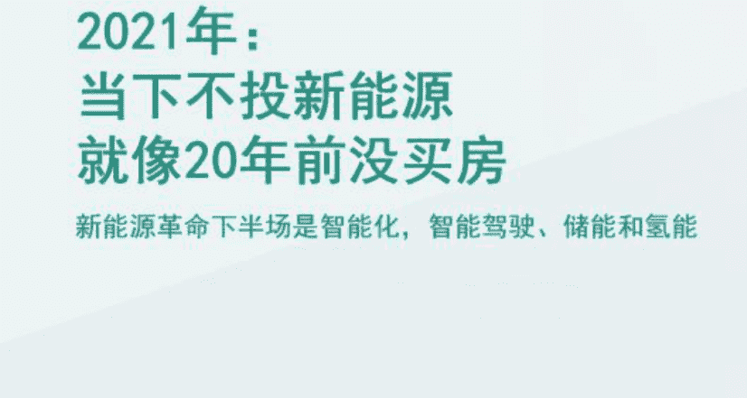

我在 2019 年认为新能源是基础的关键之一。2021 年提出“不下新能源，就像 20 年前没买房”。新能源革命上半场是电动，汽车和锂电，下半场是智能化，智能驾驶、储能和氢能。

未来新能源的第一大变化是汽车出海。新能源汽车为中国企业提供了换道的绝佳机会。2023 年中国汽车出口 491 万辆，新能源出口 120 万辆，超越日本，首次登顶全球第一。2024 年中国汽车出口预计同比增长 30%，蝉联世界第一。

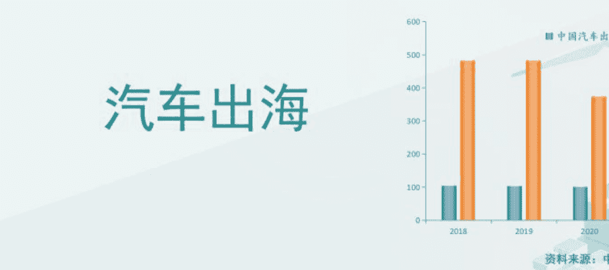

中国汽车企业刚开始全球化，全球化之路值得我们学习。2023 年财报，丰田销量 944 万辆，净利润超过 300 亿美元，是全球第一。反观中国汽车，销量 491 万辆，利润接近亏损。新能源出口 120 万辆，超越日本，首次登顶全球第一。

微信jntsg2免费进资料群

当前新能源汽车面临的形势，欧美渗透率是 17%，东南亚是 10%，这些地区的自动化空间巨大。未来 10 年，中国汽车登陆全球，为电气化做出贡献。

微信jntsg2免费进资料

新能源的第二次变化是智能驾驶。我们想一下，某一天当你开车，发现没有方向盘，一切控制交给智能驾驶。以往的智能驾驶有什么不同？现在看到的智能驾驶，很大程度上是在人形领域。比如特斯拉最新的 RoboCab 已经进化到了不用方向盘。

智能驾驶的核心在于车辆自身的传感器和道路基础设施和云端数据处理。智能驾驶有两种路径，一种是单车智能，第二种是路云协同。路云一体化强化了车辆感知和数据处理能力，实现更好的效率和安全性。这些技术越来越呈现出一定程度的自主性。高阶智能驾驶展现了自主性，其中著名的阿尔法狗展现了自主性，这种自主性会带来很多惊喜且难以预料的结果。这种交互使得技术潜能巨大，但也可能威胁到全球秩序。未来的智能驾驶。

新能源第三大突破是固态电池。

### 固态电池——能源革命 能量密度高、更安全

固态电池是能源革命的奇迹。去掉了电解液，固态电池更轻，可用于飞行汽车、低空经济，未来还能用在智能穿戴设备中，有了更多的空间。固态电池有三大优点：
- 能量密度更高：固态电解质适配更多的正极材料，理论上固态电池能量密度可以是磷酸锂的 5 倍以上。
- 更安全：由于用的固态电解质本身不是易燃物。
- 寿命更长：固态电池可以循环万次，至少三十年。而当前磷酸锂电池循环约 3000 次，固态电池是它的三倍。

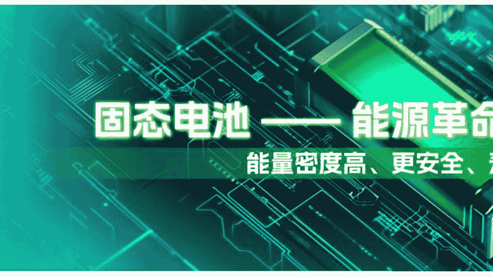

### 固态电池技术难题

业界正为努力攻克这个固固界面问题。未来随着界面问题的解决，固态电池大规模应用将带来能量密度更高、续航里程更长、安全性更可靠的新电池技术。

新能源第四次大变化是钙钛矿光电伏技术突破。现在，钙钛矿正处于从 0 到 1 的突破时刻，未来将会打破现有光电转换效率上限。今年，钙钛矿太阳能电池取得重大突破。例如，南京大学公布的全钛矿叠层光伏电池，转化效率达到 28.2%，刷新世界纪录。钙钛矿电池作为第三代新型薄膜电池的代表，正在快速实现产业化，国内已有近十家企业宣布钙钛矿电池投资计划。

### 钙钛矿等风电光伏新技术突破

风电正走向大瓦、深远海时代。我国自主研制的风机叶片长度已达到 143 米，是全球下线的直径最大的风电叶片。我国深远海风资源可开发是近海的 3 到 4 倍，未来深远海、漂浮风电都是蓝海市场。

微信jntsg2免费分享群

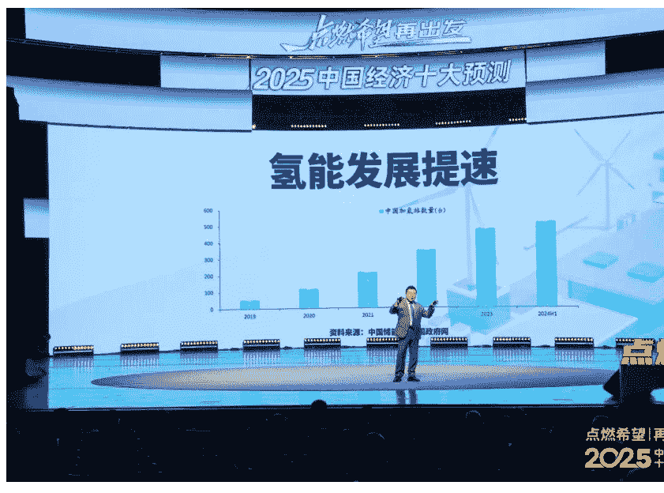

石化启动了国内首条“西氢东输”管道项目，上半年输氢管道长达 2058 公里。同时，固态、深冷高、有机液体等储运方式也在探索中。中国加氢站建设迅猛，截至今年 6 月，已建成 507 座，同比增长超 60%，加氢站数量居世界首位。

朋友们！每一次技术的飞跃，都是创造性的破坏，告别旧世界，迎接新世界。让我们迎接一个更加绿色的新能源时代！

## 八大预测

### 回归人为，线下消费重拾人间烟火，兴趣消费打造年轻人，文化消费、潮起出海风头强势

当我们在线下消费正处于没落的时候，今年胖东来、山姆会员店、名创优品却引起火的一场邂逅。河南的胖东来，只有 13 家店，但盈利能力十分强劲，身为“中国超级天花板”。山姆会员店，在中国共有 50 家门店，年费会员却超过 500 万。

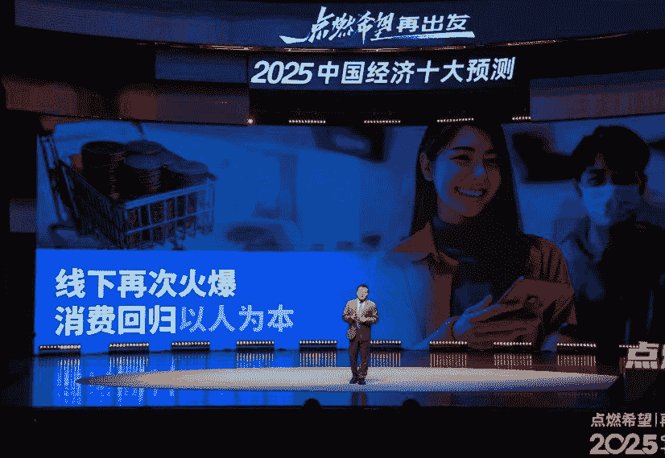

为什么线下消费重焕赢得火爆人气？因为这些企业正在让消费回归本质——一以品质为本、人为本。

守住品质，人气自然回归。比如，胖东来在牛肉店里放一张“丁伦解牛肉”图，细致到告诉顾客每个部位该怎么做好吃。会准备宠物寄存专区、母婴室、直饮水、免费充电，连购物车都掉了七种，不适合人群。会把水果标上含糖量、产地、一切为用户着考虑。细节功夫做到家里，把消费者体验拉满，线下消费就有了线上无法替代的温暖，人间烟火。

对于来说，“我们不是把商品销售给顾客，而是把幸福传递给顾客”。优秀的企业赚取利润，伟大的企业赢得人心。

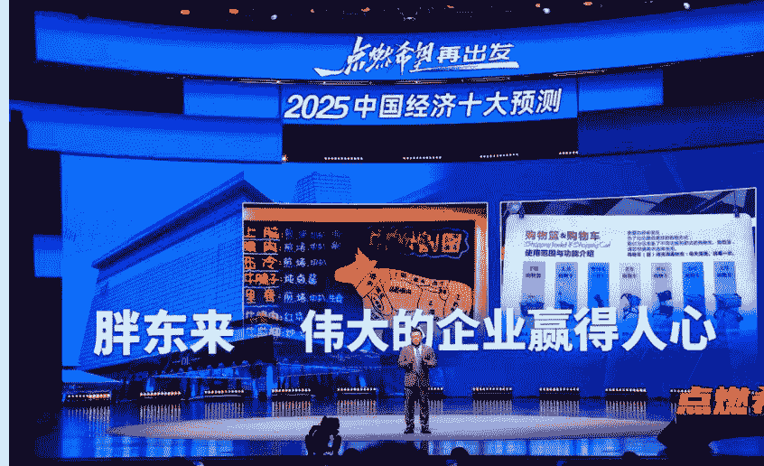

再如此山姆超市，这家从美国飘洋过海的会员超市，在中国做得非常成功。为什么？

山姆超市高度重视选品，连续做了更多健康、高品质的好产品，今年打造了许多大爆款，比如瑞士奶酪、青汁、烤肉等，自选品销售额占比达到 40%。山姆的选品能力很强，选品策略是从过去货架“多而全”的模式向“少而精”的模式转换。

过去超市陈列的冗余单品太多，消费者来购面对面“信息爆炸”，消费体验差。山姆改变了这一模式，同一个品类只选择 1-3 个最优品牌和产品，用大数据和复购率来说，SKU 数量仅 4000 多个，相比于传统卖场 2 万多个 SKU 数量显著减少，极大提升了客户体验。山姆用会员制+优选品+包装策略，赢得了信任。

前段时间，名创优品的库登春天和胖东来有一个交流，他们达成一个共识：打造品牌零售，聚焦好产品、好环境、好服务。

### 点燃希望再出版
2025 中国经济十大预测
卷卷绘未来

## 国富
卷品质 卷创新 不卷价格

### 总经理希望
点燃希望|再出发
2025 中国经济领先
卷卷绘未来

什么是品质零售？回归零售本质，回归消费者，品质、卷创新，不卷价格。在当下，打造品质零售，放弃低价血拼，反内卷，我认为是一个很好的行动，我们需要建立健康的商业文明。名创优品和胖东来的勇敢创新，改变了中国消费格局。

消费者需要好的产品，好的产品创造合理的利润，这样企业才能良好发展。质优价平，企业受益，社会受益。有人把名创优品的成功归于运营，但我看到的是：如果我们没有勇气，巨大的尝试就没有成果。正是这种精神，火炬，推动了时代的潮流。

为什么“兴趣消费”如此火？年轻人这一一代演唱、Citywalk、露营等灵魂自由、个性鲜明，愿意为“Pay for passion”买单。

### 在哪里，消费就会哪里

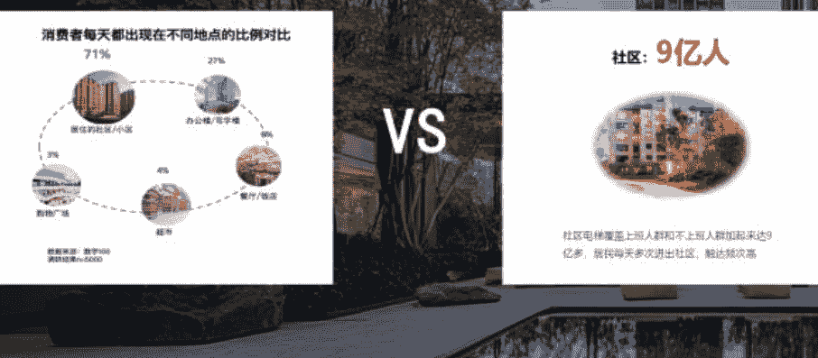

消费重回人为本，带动营销方式的变革。过去，电视作为客厅的中心，一度是最重要的媒介，但今天，人们的生活从客厅走向更广泛的社区。中国 66% 的人口生活在城市，社区电梯成为了全新的主流。社区广告不再是简单投放，而是精准触达，拉近品牌与用户之间的距离，消费的机会就在身边，是每一位企业家值得深耕。

### 小红书：勾画人间烟火

我去了小红书，这个平台为什么独特？因为小红书上 90% 的曝光是 UGC 内容，也就是真实用户生产的内容。小红书更像是一场中心化的分享和互助，抚人心。很多年轻人都会把小红书做一个搜索平台，只要用心，品牌一样焕发活力。户外运动，探路者专注于户外装，从攀岩到露营，今年实现逆势增长，连续 16 年为南极考察团队提供装备。

### 探路者焕发活力勇攀高峰

买什么不如买健康，“健康+体验”引领消费新趋势。在食品领域尤为明显，大家还是卷食材、卷原料。既然健康，又要体验，成为抓住消费者的关键。这两年来我一直是北纬 47° 玉米的长期用户，他们的鲜食玉米是非转，主打低 GI、低脂轻卡，开袋好吃方便，很符合消费者心理。北纬 47° 在“健康+体验”的赛道上不断积累，最近推出了一款非常棒的饮料，47° 植物醇乳，每瓶含 0 糖，早餐来一瓶，养肠胃。

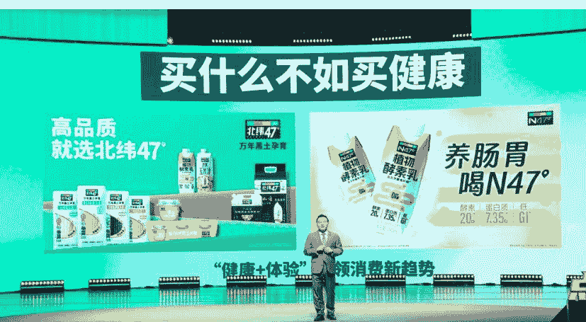

文化消费可以跨越国界，本土就是世界。李柒被称为“全球华人第一网红”，阔别四年全年火爆，创下“最多订阅量的海外中文频道”吉尼斯世界纪录。东方美食、田园牧歌、非遗文化在海外大受欢迎，印证了“国风出海”的超强想象力。今年 3A 游戏《黑神悟空》，把西游记的故事用高质量游戏走向全球。

## 2025 中国经济十大预测

善品堂的创始人何德益跟我交流后说，企业家对国学理论如何在中国企业中实践有很大需求。举其例子，明心学大家都知道，格物、知行合一、致良知。对于企业家而言，在经营企业、履行社会责任等方面都会遇到各种问题。东方国学智慧不仅可以助力企业解决现实问题，更在修、齐、治家的基础上，让企业家具有更高的抱负和远见。

何总还聊到国学复兴，这几年《道德经》《王阳明》《曾国藩》《了凡四训》《孙子兵法》《黄帝内经》这些国学经典非常受欢迎。当时的品堂在北京东三有一个 4000 类经典，从国学图书规划出版延伸到国学教育培训、国学活动、国学消费衍生品，善品堂把国学做到世俗，接地气，让国学从书里走到生活、生态和生命。只要做到这一点，品质为本，线下消费、兴趣消费、品牌、流量都有机会。

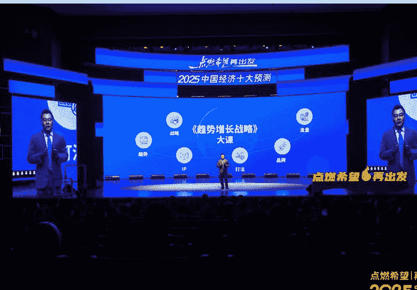

## 第九预测

迈向后房地产时代，促进市场止跌回升，分化是未来主要趋势。当前观点认为，中国可能会重演日本“失去三十年”。我们现在面临老龄化、少子化、人口摩擦。从城镇化来看，日本在 1990 年代城镇化率超过 77%，已经结束，没有空间。而中国 2023 年城镇化率 66.2%，还有十几个百分点的空间。过去十年，房地产带来了高房价、高债务等问题。最近四年，在政策调控下，房地产经历了剧烈调整，幅度之大、持续时间长。2024 年 9 月，国家首次提出“促进市场止跌回稳”，预示着房地产政策拐点出现，随后二线城市放宽限购、降低首付、降低利率、降低交易环节费，二线楼市回暖。

未来，作为中国经济第一支柱，房地产则是重心。十年前提出，“房地产长期看人口、中期看土地、短期看金融”。让我们展望房地产的六大趋势。

### 第一大趋势：房地产开发时代落幕，步入后房地产时代。“房地产长期看人口”，人口在 2013 年达到顶峰，主力购房的人口周期拐点已经出现。1978-2023 年，中国住房套数从 31 亿套增加至 37 亿套，户从 8 亿增至 10  亿，中国住房供应从短缺向总体平衡。需求峰值已过，高增长时代落幕。2023 年我国城镇化率 66.2%，未来城市化还有空间，但速度会放缓。这些标志着中国房地产市场正告别高增长阶段，步入后房地产时代。

### 第二大趋势：都市圈和城市群体到来，东北、西北以及低能级城市将面临人口持续流出。根据国际经验，在城市化过程中，人口明显向都市圈和城市群聚集。以美国为例，人口从铁锈地带向三大沿岸转移。日本的情况类似，特别是在 1973 年以后，人口从东京、大阪、名古屋的“三极”向东京的“一极”集聚。中国的都市圈城市群时代，近年来人口向东部沿海地区聚集，东北和西部地区人口流失。未来有 80% 的新增人口分布在都市圈，人口集聚的趋势将重塑中国经济地理的新格局。

### 第三大趋势：分化是未来房地产市场最大的特征。未来二线城市随着人口流入还有较大的购房需求。但是，东北、西北及非都市圈城市群的级城市，住房供给相对过剩，且随着人口外运，未来剩余程度将进一步加深。在城市内部，房地产也将进一步分化，未来好城市、好地段、好社区的好房子才是核心资产，硬通货。

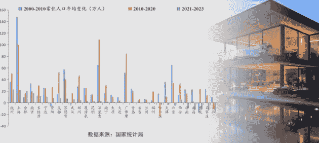

### 第四趋势：改善型需求取代刚需市场，从卖方市场转向买方市场，品质房成为核心竞争力。我们测算，2024-2030 年，刚需需求占 29%，更新需求占 30%，改善型需求占 41%，改善型需求上升。

### 第五大趋势：放松限购、限贷、限价等限制措施是大势。后房地产时代，供需关系发生重大变化，重点将从防守转向释放需求，促进市场止跌回升。

### 第六趋势：土地财政转向税收财政和股权转型是必之路。过去十年，在房地产快速增长时期，土地财政对于补充财力、完善基础设施发挥了积极作用。2023 年土地使用权租赁收入 5.8 万亿，比 2021 年峰值下滑 31%。目前部分地方政府展现出超前，努力摆脱对房地产的依赖，打造具有地方特色的产业集群。例如，安徽合肥是有名的投资城；江苏常州大力推进“新源都”建设。后房地产时代，行业发展模式从“高负债、高杠杆、高周转”转向“高质量、高级”、抓住转型型需求、养老地产的新契机。穿越周期，剩余者为王。

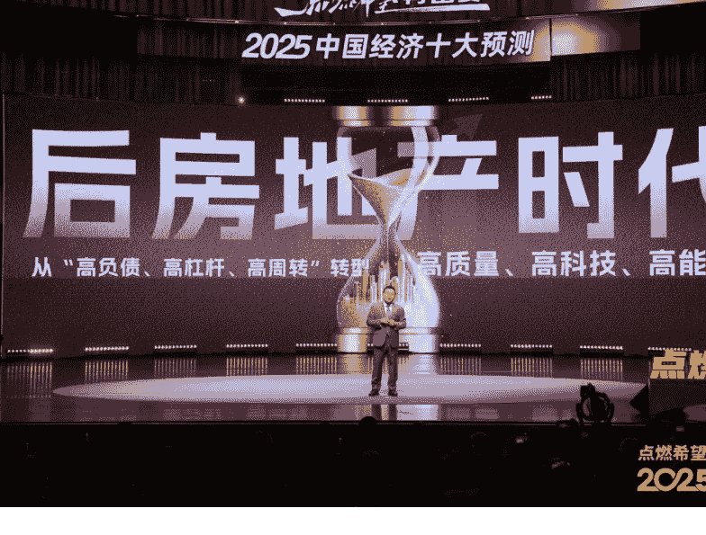

## 第十大预测

应对老龄化少子化，抓住银发经济机遇，提振生育率，重视儿童早期发展。中国人口的主要趋势是：老龄化、少子化、不婚化，与之对应的是银发经济、提振生育率、单身经济。我们来看老龄化。中国的婴儿潮是 1962-1976 年，这一批婴儿潮人口正在步入老龄化，中国老龄化规模、速度快。2023 年 65 岁以上人口占比为 15.4%，根据预测，2060 年占比将达到 35%。

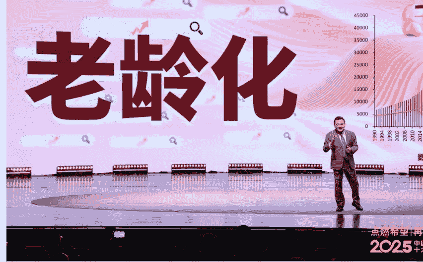

你印象中的老人可能都是勤俭节约一辈子，舍不得花钱。这可能是很大的误解。中国 40 后、50 后是强起来的一代，60 后、70 后是富起来的一代，80 后、90 后是强起来的一代。60 后、70 后受益于改革开放，财富有所积累，普遍受过教育，自我意识觉醒。他们会使用智能手机，网上支付，自己挑选酒店，懂得享受生活。随着大健康产业的发展，长寿时代来临，他们可能会健康工作到 70 岁，也可能会洒酒周游世界，充满活力，你也可以叫他们“银发青年”。

## 你想活出怎样的人生

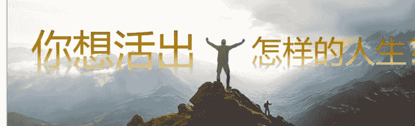

对于来说，“我们不是把商品销售给顾客，而是把幸福传递给顾客”。优秀的企业赚取利润，伟大的企业赢得人心。

6)“金”、养老金融。老年人投资谨慎，保险产品更受青睐。希望未来，“老有所养、老有所医、老有所为、老有所学、老有所教、老有所乐”。

### 少子化

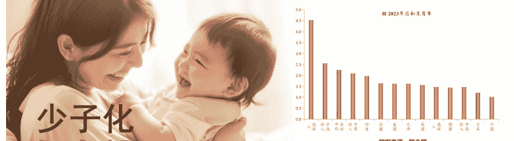

我们再次来看少子化。2022年我国总和生育率跌破1.1，2023年为1.5左右。

中国生育率在全球主要国家中倒数第二，且比欧美发达国家低50%以上。我们来看其他国家的生育率，2023年法国1.7、美国1.6、巴西1.6、英国1.6、德国1.4、日本1.2、韩国0.7，中国只有1.6左右。

为什么中国生育率倒数第二？我和梁建、黄文政、亚亚福、吕俊几位老师发起了育人口，致力于独立的人口研究和建议。2024年育人口报告发布《中国生育成本报告》，根据测算，全家庭0-17岁孩子的养成成本平均为53.8万。

我们将养成本进行国际比较：把一个孩子抚养到满18岁的成本相对于人均GDP的倍数，澳大利亚是2.1倍，法国是2.2倍，瑞典是2.9倍，德国是3.6倍，美国是4.1倍，日本是4.3倍，中国是6.3倍，几乎全球最高。

### 生育成本对比

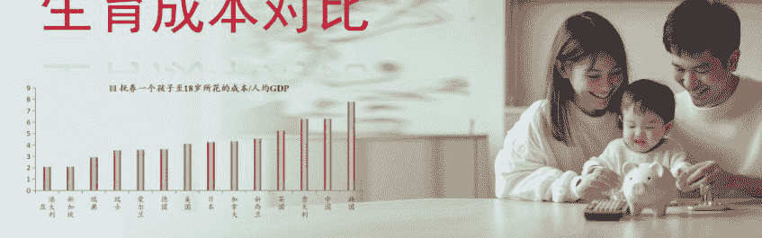

加微信jntsg2，免费资料分享群

生育养育孩子，除了要付直接的财务成本以外，还需要花费大量的时间和机会成本。时间成本包括产假、看护孩子和接送孩子、辅导孩子作业、增加的时间成本。机会成本包括生育养育会影响女性的收入报酬、职业晋升、父母双方的娱乐。

由于生育成本高、女性难以兼顾家庭和工作，中国人的平均生育意愿（理想子女）是世界上最低的。生育养育成本过高是影响年龄女性生育意愿最重要的因素。

许多发达国家的政府已经给予GDP的1%-3%来提供资金补贴、税收优惠等生育福利，补贴力度大的国家，生育率也更高。根据OECD数据，北欧国家福利支出占GDP2%以上，普遍高于南欧及东亚国家，生育率也相对较高。

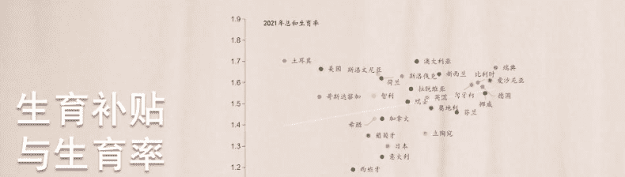

面对少子化，全国范围内需要减轻年龄女性生育成本的政策，包括现金和税收补贴、购房补贴、增托补贴、提供女性平等的育假、保障女性的就业权利、允许辅助生育技术、高考和学术改革等。

在这里，中国留守儿童问题值得特别关注。大家知道，儿童是未来的、民族的希望。留守儿童的发展对我们都很重要。

我国，有近4成儿童与父母双方共同居住，“原生家庭”支持弱化、社会关注支持不足，农村留守儿童更容易出现心理健康问题。2020年，63.6%的儿童与父母一方一起居住，19.6%的儿童与父母一方一起居住，16.8%的儿童不与父母一起居住，合计36.4%的儿童不能与父母双方共同居住，其中超过8成是人口流动的影响。中国不仅面临老龄化少子化，而且面临留守儿童问题。联合国儿童基金会数据显示，中国有至少3000万的17岁以下儿童面临情绪或行为上的问题。

微信jntsg2，免费资料分享

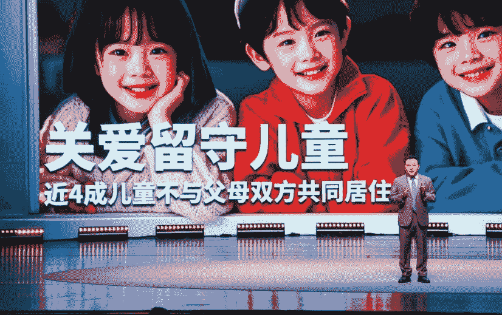

所以，未来不仅需要提高生育水平，还需要重视儿童尤其是留守儿童的早期发展，推动户籍制度改革和公共服务均等化。

如果通过这次年度调研，能够让社会各界重视中国的人口问题。重视低养育成本的重要性，关爱留守儿童，推动社会进步，那么这次年度演讲也会特别有意义！为不能发声的人发声，让这个世界更温暖！

加微信jntsg2，免费进资料分享群

女士们，先生们！今天我们一起展望了 2025年的

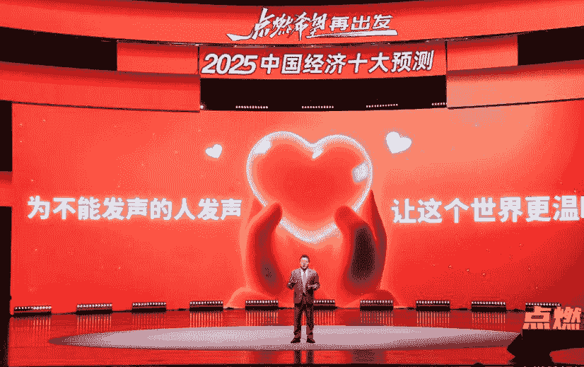

中国经济。我希望今天的演讲，对于你看清时代的趋势、把握未来的机遇有所帮助。当你有私下的悲观观点不同时，我是一个乐观主义者。朋友们，我相信，悲观毫无意义，当你凝视深渊的时候，深渊也在凝视你。不要因为时代变得混乱了，就把自己也变得愚味了。多向内求，少向外。

> 真正幸福的人生是你即使看清了生活的真相，依然选择乐观前行。

真正悲剧的人生，是你即使看清了生活的真相，依然选择放弃前行。
时代有时向左，有时向右，但最终向向前。

最后，让我们一起一下 2025 中国经济的十大预测：

第一大预测：这是一个新周期、新时代，顺应趋势，把握机遇，勇敢再次出发，一切发生都有利于我们。

微信jntsg2，免费进资料分享群

第二次预测：全球增长周期，明斯 2.0 推动全球，世界经济增长缓慢，地缘政治为各国发展带来挑战。

第三次预测：科技如火如荼，人工智能、新能源、商业航天、低空、生物制造实现重大突破。

第四次预测：中国大陆规模刺激经济的序幕，提振信心，全力经营经济，大发展新基建、新生产力。

第五次预测：企业从出口到全球，从红海到蓝海，全球化本质是本土化，跨界，走向世界。

第六次预测：人工智能迎来大爆炸，图像识别、人形机器人、AI消费、AI量级超级应用之出现。

第七次预测：新能源革命加速前进，汽车市场、智能驾驶、固态电池、储能、氢能释放机遇。

第八次预测：零售回归以人为本，线下零售重拾烟火气，兴趣消费打动年轻人，文化消费、消费出海风头正劲。

第九次预测：转向房地产时代，促进市场跃迁，调整和分化是未来主要趋势，人口向城市圈聚集。

第十次预测：应对老龄化冲击，抓住转型经济机遇，提振生育率，重视儿童早期发展。

女士们，先生们！我们今天的演讲就要结束了。我们经历过无数次的战争、危机、混乱和萧条，在人类社会的暗处时刻，总有人会站起来建立愿景，经营希望，点燃未来，激发活力。那些未能击你的，都将使你更大。

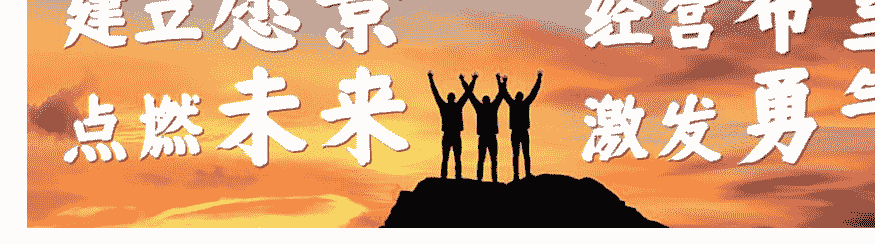

加微信jntsg2，免费资料分享

是的，过去这些年，我们非常不容易。但是，无论遇到多大的困难，一定要勇敢向前，不要让一时的迷茫遮盖你心中的梦想。唯有长期主义才能穿越周期。

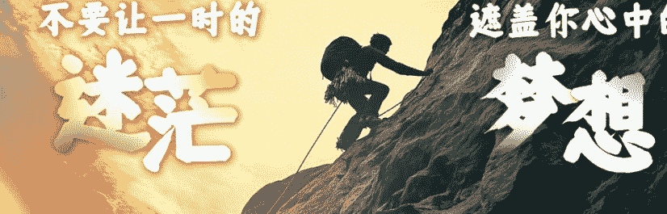

你每天的努力，都会将你走更远。展望未来，我们深信正心正念，坚持长期的事，就会开花结果。悲观者正确，乐观者前行，世界终属于长期主义！

加微信jnts2，免费进资料群

### 世界终将属于乐观者

朋友们！新的一年到来，新周期，新时代，新趋势，新机遇！在这个关键时刻，让我们一起点燃希望，照亮未来！让我们一起为自己加油，为梦想而战！

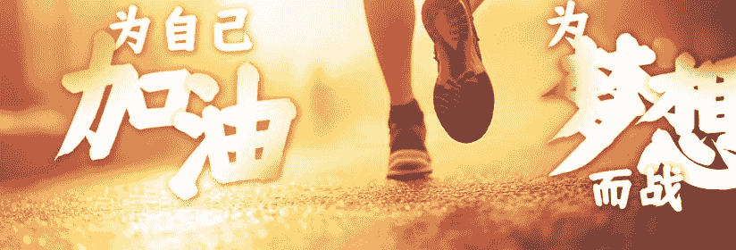

2025年，祝福我们每个人！

# 扫描加入 知识星球 免费资源群

| 免费 | ✔ 每日获取高价值资源   ✔ 提供各类优质资源搜索服务 |
| 价值 | ◆热门付费文章 ◆行业业务报告 |
| 及时 | ◆精选图书资源 ◆副业赚钱方法 |
| 专注 | ◆职场实用资源 ◆AI政经自媒体 |

公众号：知识星球

微信号：jntsg8

微信号：jntsg2

分享资料仅供个人学习，请及时删除，严禁商用传播
